# Polyglot Codebase Knowledge Graph

> Generated offline by **readmenator**. 43 files, 1985 symbols, 611 imports. Supports C, C++, Python, Go, Rust, JS/TS, Java, C#, Shell, PHP, Dart, GDScript, Nim, ASM, Ruby, Swift, Kotlin, Scala, Lua, Elixir.
> No LLMs. No tokens. Pure static analysis. See more [here](https://github.com/grisuno/ReadMenator)

**Start here:** Statistics Dashboard for scope, God Nodes for blast radius, Architecture Reference for per-file API. Agents: prefer `readmenator-agent/INDEX.md` + `SYMBOLS.md`.

**Wiki:** prefer `readmenator-wiki/index.md` for progressive disclosure: one synthesis page per community, `connections.json` with EXTRACTED vs INFERRED confidence, `queries.md` log, `REPORT.md` audit.

**Confidence:** EXTRACTED = parsed from source, INFERRED = heuristic bridge, AMBIGUOUS = reported, never hidden. See `readmenator-wiki/REPORT.md`.

**Total Files Parsed:** 43 | **Total Symbols Extracted:** 1985 | **Total Imports:** 611
 | **Resolved Imports:** 110

<!-- ranking_model: v1.0 | weights: {ppr:0.45,auth:0.2,test:0.15,doc:0.1,fresh:0.1} | alpha:0.85 | commit:587dd9b | date:2026-07-18 -->


## Table of Contents

1. [Statistics Dashboard](#statistics-dashboard)
2. [Architectural Layers](#architectural-layers)
3. [Architecture Overview](#architecture-overview)
4. [Execution Flows](#execution-flows)
5. [Ranked Context](#ranked-context)
6. [God Nodes](#god-nodes)
7. [Community Analysis](#community-analysis)
8. [Surprising Connections](#surprising-connections)
9. [Suggested Questions](#suggested-questions)
10. [Force-Graph Explorer](#force-graph-explorer)
11. [Corpus Analytics](#corpus-analytics)
12. [Taint Propagation Map](#taint-propagation-map)
13. [Hotspot Analysis](#hotspot-analysis)
14. [Change Impact Analysis](#change-impact-analysis)
15. [Suggested Linting Rules](#suggested-linting-rules)
16. [Concept Graph](#concept-graph)
17. [Orphans](#orphans)
18. [Query Recipes](#query-recipes)
19. [Structural Knowledge Map](#structural-knowledge-map)
20. [UML Class Diagram](#uml-class-diagram)
21. [Code Property Graph](#code-property-graph)
22. [Architecture Reference](#architecture-reference)
    - [PY (42 files)](#py-42-files)
    - [SH (1 files)](#sh-1-files)

---

## Statistics Dashboard

| Metric | Value |
|--------|-------|
| Total Files | 43 |
| Total Symbols | 1985 |
| Total Imports | 611 |
| Call Edges | 12978 |
| Inheritance Edges | 97 |
| Languages | 2 |
| Avg Symbols/File | 46.2 |
| Avg Imports/File | 14.2 |
| Resolved Imports | 110 |

### Top Files by Import Count (Fan-Out)

| File | Imports | Symbols | Language |
|------|---------|---------|----------|
| `qc_dashboard.py` | 38 | 88 | py |
| `quantum_framework_menu.py` | 25 | 78 | py |
| `quantum_dash.py` | 24 | 71 | py |
| `quantum_lab.py` | 23 | 64 | py |
| `quantum_visualizer.py` | 23 | 54 | py |
| `test_qc_integration.py` | 23 | 87 | py |
| `entangled_hydrogen.py` | 22 | 43 | py |
| `quantum_framework_molecular_v2.py` | 22 | 63 | py |
| `molecular_sim.py` | 20 | 35 | py |
| `relativistic_hydrogen.py` | 20 | 58 | py |

---

## Architectural Layers

Auto-detected from path patterns, naming conventions, and imported frameworks.

| Layer | Files |
|-------|-------|
| utility | 38 |
| testing | 3 |
| presentation | 2 |

### utility

- `advanced_experiments.py` (py, 56 symbols)
- `app.py` (py, 21 symbols)
- `demo_molecular_vqe.py` (py, 10 symbols)
- `entangled_hydrogen.py` (py, 43 symbols)
- `higgs_four_lepton_analysis.py` (py, 44 symbols)
- `higgs_quantum_analysis.py` (py, 44 symbols)
- `__init__.py` (py, 0 symbols)
- `app.py` (py, 20 symbols)
- `backend.py` (py, 35 symbols)
- `glkit.py` (py, 30 symbols)
- `hud.py` (py, 19 symbols)
- `matter.py` (py, 19 symbols)
- `physics.py` (py, 34 symbols)
- `postfx.py` (py, 11 symbols)
- `scenes.py` (py, 73 symbols)
- *... and 23 more*

### presentation

- `quantum_3dview.py` (py, 27 symbols)
- `quantum_dash.py` (py, 71 symbols)

### testing

- `test_immersive.py` (py, 22 symbols)
- `test_qc_integration.py` (py, 87 symbols)
- `test_quantum_framework.py` (py, 49 symbols)

---

## Architecture Overview

6 components stacked in 3 dependency tiers (weighted Eades-Lin-Smyth ordering: arrows point from dependent to dependency, top to bottom). Labels are import counts, thick arrows the top quartile; 1 transitively implied edges are omitted. Dashed red arrows are upward dependencies: the smallest set of imports that closes every cycle and breaks the layering. Cyan components hold entry points. Interactive version: `readmenator-apidocs/index.html#/flows`.

Upward dependencies to fix first: `root: quantum_simulator` -> `root: quantum_framework_core` (2 imports)

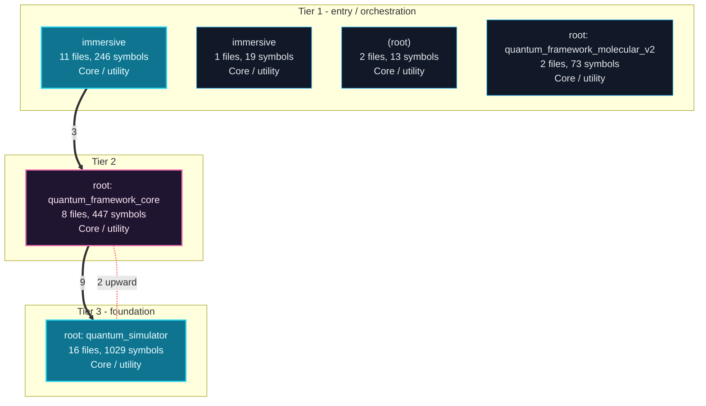

---

## Execution Flows

Entry points are scored from `__main__` guards, `main` functions, entry-style names and files, and call-graph sources. Each flow walks resolved calls in call-site order (depth <= 4, <= 40 steps); numbers give the call order, dashed arrows revisit an already expanded callee, red arrows are recursion. Interactive version with zoom and per-node docs: `readmenator-apidocs/index.html#/flows`.

### `app.main`

`immersive/app.py:382`, score 13: entry-style name `main`; defined in entry file `app.py`; called from the `__main__` guard; called from the `__main__` guard.

Call tree:

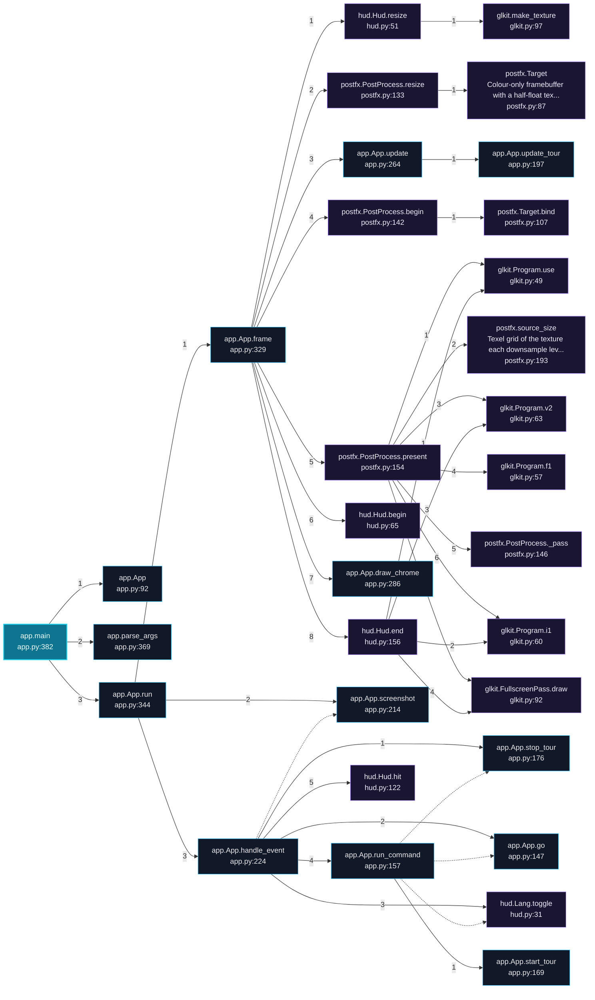

Cross-file sequence:

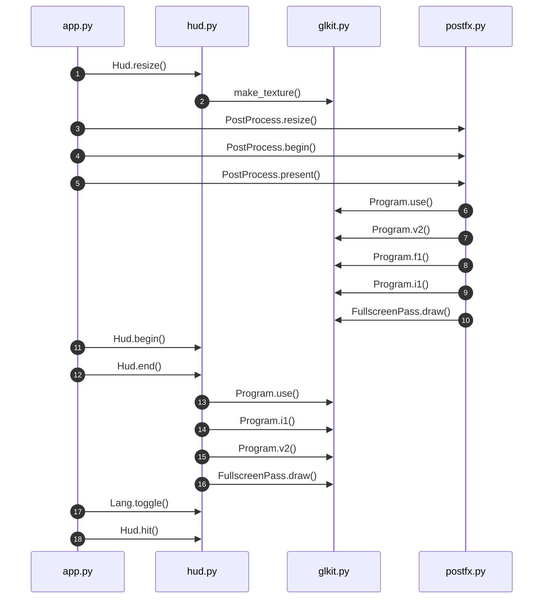

### `advanced_experiments (__main__)`

`advanced_experiments.py:1337`, score 8: `if __name__ == "__main__"` guard.

Call tree:

```mermaid
flowchart LR
    classDef default fill:#111827,stroke:#38bdf8,color:#e5e7eb;
    classDef entry fill:#0e7490,stroke:#22d3ee,color:#ecfeff,stroke-width:2px;
    n_advanced_experiments_py___main_["advanced_experiments (__main__)<br/>advanced_experiments.py"]:::entry
    n_advanced_experiments_py___make_logger["advanced_experiments._make_logger<br/>advanced_experiments.py:121"]:::default
    n_advanced_experiments_py__main["advanced_experiments.main<br/>Main entry point.<br/>advanced_experiments.py:1304"]:::default
    n_advanced_experiments_py__AdvancedExperimentRunner["advanced_experiments.AdvancedExperimentRunner<br/>Runs all three advanced experiments.<br/>advanced_experiments.py:1223"]:::default
    n_advanced_experiments_py__run_grover["advanced_experiments.AdvancedExperimentRunner.run_grover<br/>Run Grover's algorithm experiment.<br/>advanced_experiments.py:1235"]:::default
    n_advanced_experiments_py__GroverConfig["advanced_experiments.GroverConfig<br/>Configuration for Grover's algorithm experime...<br/>advanced_experiments.py:141"]:::default
    n_advanced_experiments_py__GroverSearch["advanced_experiments.GroverSearch<br/>Complete Grover's algorithm implementation us...<br/>advanced_experiments.py:240"]:::default
    n_advanced_experiments_py__run["advanced_experiments.GroverSearch.run<br/>Run Grover's search algorithm.<br/>advanced_experiments.py:300"]:::default
    n_advanced_experiments_py___calculate_entropy["advanced_experiments.GroverSearch._calculate_entropy<br/>Calculate Shannon entropy from probability di...<br/>advanced_experiments.py:266"]:::default
    n_advanced_experiments_py__apply["advanced_experiments.GroverOracle.apply<br/>Apply oracle: flip phase of marked state.<br/>advanced_experiments.py:176"]:::default
    n_advanced_experiments_py__apply_206["advanced_experiments.GroverDiffusionOperator.apply<br/>Apply diffusion operator using Hadamard + Ora...<br/>advanced_experiments.py:206"]:::default
    n_advanced_experiments_py__run_qed["advanced_experiments.AdvancedExperimentRunner.run_qed<br/>Run QED effects experiment.<br/>advanced_experiments.py:1252"]:::default
    n_advanced_experiments_py__QEDConfig["advanced_experiments.QEDConfig<br/>Configuration for QED effects calculations.<br/>advanced_experiments.py:404"]:::default
    n_advanced_experiments_py__QEDEffectsExperiment["advanced_experiments.QEDEffectsExperiment<br/>Complete QED effects experiment combining Lam...<br/>advanced_experiments.py:722"]:::default
    n_advanced_experiments_py__run_full_analysis["advanced_experiments.QEDEffectsExperiment.run_full_analysis<br/>Run complete QED analysis.<br/>advanced_experiments.py:736"]:::default
    n_advanced_experiments_py__compare_2s_2p["advanced_experiments.LambShiftCalculator.compare_2s_2p<br/>Compare Lamb shift for 2s_{1/2} and 2p_{1/2}...<br/>advanced_experiments.py:558"]:::default
    n_advanced_experiments_py__full_report["advanced_experiments.AnomalousMagneticMoment.full_report<br/>Generate a full report on g-2 calculations.<br/>advanced_experiments.py:686"]:::default
    n_advanced_experiments_py___calculate_energy_levels["advanced_experiments.QEDEffectsExperiment._calculate_ener...<br/>Calculate hydrogen energy levels including QE...<br/>advanced_experiments.py:761"]:::default
    n_advanced_experiments_py__run_polyatomic["advanced_experiments.AdvancedExperimentRunner.run_polyatomic<br/>Run polyatomic molecule experiment.<br/>advanced_experiments.py:1266"]:::default
    n_advanced_experiments_py__PolyatomicExperiment["advanced_experiments.PolyatomicExperiment<br/>Complete polyatomic molecule experiment.<br/>advanced_experiments.py:1105"]:::default
    n_advanced_experiments_py__run_analysis["advanced_experiments.PolyatomicExperiment.run_analysis<br/>Run complete analysis for a molecule.<br/>advanced_experiments.py:1123"]:::default
    n_advanced_experiments_py__run_pyscf["advanced_experiments.PolyatomicVQE.run_pyscf<br/>Run PySCF calculation for the molecule.<br/>advanced_experiments.py:999"]:::default
    n_advanced_experiments_py__run_all_1278["advanced_experiments.AdvancedExperimentRunner.run_all<br/>Run all experiments.<br/>advanced_experiments.py:1278"]:::default
    n_advanced_experiments_py___main_ -->|"1"| n_advanced_experiments_py___make_logger
    n_advanced_experiments_py___main_ -->|"2"| n_advanced_experiments_py__main
    n_advanced_experiments_py__main -->|"1"| n_advanced_experiments_py__AdvancedExperimentRunner
    n_advanced_experiments_py__main -->|"2"| n_advanced_experiments_py__run_grover
    n_advanced_experiments_py__run_grover -->|"1"| n_advanced_experiments_py__GroverConfig
    n_advanced_experiments_py__run_grover -->|"2"| n_advanced_experiments_py__GroverSearch
    n_advanced_experiments_py__run_grover -->|"3"| n_advanced_experiments_py__run
    n_advanced_experiments_py__run -->|"1"| n_advanced_experiments_py___calculate_entropy
    n_advanced_experiments_py__run -->|"2"| n_advanced_experiments_py__apply
    n_advanced_experiments_py__run -->|"3"| n_advanced_experiments_py__apply_206
    n_advanced_experiments_py__main -->|"3"| n_advanced_experiments_py__run_qed
    n_advanced_experiments_py__run_qed -->|"1"| n_advanced_experiments_py__QEDConfig
    n_advanced_experiments_py__run_qed -->|"2"| n_advanced_experiments_py__QEDEffectsExperiment
    n_advanced_experiments_py__run_qed -->|"3"| n_advanced_experiments_py__run_full_analysis
    n_advanced_experiments_py__run_full_analysis -->|"1"| n_advanced_experiments_py__compare_2s_2p
    n_advanced_experiments_py__run_full_analysis -->|"2"| n_advanced_experiments_py__full_report
    n_advanced_experiments_py__run_full_analysis -->|"3"| n_advanced_experiments_py___calculate_energy_levels
    n_advanced_experiments_py__main -->|"4"| n_advanced_experiments_py__run_polyatomic
    n_advanced_experiments_py__run_polyatomic -->|"1"| n_advanced_experiments_py__PolyatomicExperiment
    n_advanced_experiments_py__run_polyatomic -->|"2"| n_advanced_experiments_py__run_analysis
    n_advanced_experiments_py__run_analysis -->|"1"| n_advanced_experiments_py__run_pyscf
    n_advanced_experiments_py__main -->|"5"| n_advanced_experiments_py__run_all_1278
    n_advanced_experiments_py__run_all_1278 -.-> n_advanced_experiments_py__run_grover
    n_advanced_experiments_py__run_all_1278 -.-> n_advanced_experiments_py__run_qed
    n_advanced_experiments_py__run_all_1278 -.-> n_advanced_experiments_py__run_polyatomic
```

### `app (__main__)`

`app.py:406`, score 8: `if __name__ == "__main__"` guard.

Call tree:

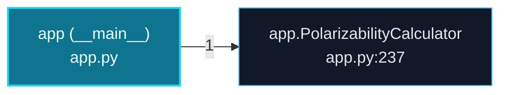

---

## Ranked Context

Files ranked by composite score for the current query context. The ranking combines Personalized PageRank (query relevance), global authority, test coverage, documentation coverage, and code freshness. Model: v1.0.

| Rank | File | Composite | PPR | Authority | Test | Doc |
|------|------|-----------|-----|-----------|------|-----|
| 1 | `quantum_framework_physics.py` | 0.1645 | 0.1751 | 0.1751 | 0.00 | 0.51 |
| 2 | `quantum_computer.py` | 0.1342 | 0.1276 | 0.1276 | 0.00 | 0.51 |
| 3 | `quantum_framework_main.py` | 0.1218 | 0.0115 | 0.0115 | 0.00 | 1.14 |
| 4 | `demo_molecular_vqe.py` | 0.1175 | 0.0115 | 0.0115 | 0.00 | 1.10 |
| 5 | `test_quantum_framework.py` | 0.1095 | 0.0115 | 0.0115 | 0.00 | 1.02 |
| 6 | `qc_immersive.py` | 0.1075 | 0.0115 | 0.0115 | 0.00 | 1.00 |
| 7 | `quantum_framework_menu.py` | 0.1045 | 0.0148 | 0.0148 | 0.00 | 0.95 |
| 8 | `quantum_framework_core.py` | 0.1031 | 0.0498 | 0.0498 | 0.00 | 0.71 |
| 9 | `quantum_framework_molecular_v2.py` | 0.0980 | 0.0213 | 0.0213 | 0.00 | 0.84 |
| 10 | `advanced_experiments.py` | 0.0932 | 0.0170 | 0.0170 | 0.00 | 0.82 |

---

## God Nodes

Most architecturally central files ranked by combined import/export degree and symbol richness.

| File | Score | Connections | PageRank |
|------|-------|-------------|----------|
| `quantum_computer.py` | 42.3 | | 0.1276 |
| `quantum_framework_core.py` | 33.7 | | 0.0498 |
| `qc_dashboard.py` | 24.8 | | 0.0000 |
| `quantum_framework_menu.py` | 23.8 | | 0.0148 |
| `quantum_simulator.py` | 22.0 | | 0.0000 |
| `backend.py` | 21.5 | | 0.0000 |
| `app.py` | 18.0 | | 0.0000 |
| `molecular_sim.py` | 17.5 | | 0.0000 |
| `scenes.py` | 17.3 | | 0.0000 |
| `advanced_experiments.py` | 15.6 | | 0.0170 |

---

## Community Analysis

Files grouped by import-based community detection. Cohesion measures how tightly connected each community is internally.

### root: quantum_simulator (Cohesion: 0.74)

**16 files** in this community:

- `advanced_experiments.py` (py, 56 symbols)
- `app.py` (py, 21 symbols)
- `entangled_hydrogen.py` (py, 43 symbols)
- `higgs_four_lepton_analysis.py` (py, 44 symbols)
- `higgs_quantum_analysis.py` (py, 44 symbols)
- `molecular_sim.py` (py, 35 symbols)
- `polarizability_v3.py` (py, 21 symbols)
- `quantum_3dview.py` (py, 27 symbols)
- `quantum_computer.py` (py, 123 symbols)
- `quantum_dash.py` (py, 71 symbols)
- `quantum_framework_menu.py` (py, 78 symbols)
- `quantum_framework_physics.py` (py, 79 symbols)
- `quantum_simulator.py` (py, 180 symbols)
- `quantum_visualizer.py` (py, 54 symbols)
- `relativistic_hydrogen.py` (py, 58 symbols)
- `topological_hilbert_compression2.py` (py, 95 symbols)

### immersive (Cohesion: 0.81)

**12 files** in this community:

- `__init__.py` (py, 0 symbols)
- `app.py` (py, 20 symbols)
- `backend.py` (py, 35 symbols)
- `glkit.py` (py, 30 symbols)
- `hud.py` (py, 19 symbols)
- `physics.py` (py, 34 symbols)
- `postfx.py` (py, 11 symbols)
- `scenes.py` (py, 73 symbols)
- `shaders.py` (py, 2 symbols)
- `spin.py` (py, 22 symbols)
- `qc_immersive.py` (py, 0 symbols)
- `test_immersive.py` (py, 22 symbols)

### root: quantum_framework_core (Cohesion: 0.54)

**10 files** in this community:

- `orbital_visualizer2.py` (py, 17 symbols)
- `qc_dashboard.py` (py, 88 symbols)
- `qc_integration.py` (py, 61 symbols)
- `quantum_framework_core.py` (py, 157 symbols)
- `quantum_framework_main.py` (py, 7 symbols)
- `quantum_framework_molecular.py` (py, 33 symbols)
- `quantum_framework_visualization.py` (py, 20 symbols)
- `quantum_lab.py` (py, 64 symbols)
- `test_qc_integration.py` (py, 87 symbols)
- `test_quantum_framework.py` (py, 49 symbols)

### root: quantum_framework_molecular_v2 (Cohesion: 1.00)

**2 files** in this community:

- `demo_molecular_vqe.py` (py, 10 symbols)
- `quantum_framework_molecular_v2.py` (py, 63 symbols)

---

## Surprising Connections

Files in different communities connected through 3+ indirect hops.

- `__init__.py` <-> `orbital_visualizer2.py` (5 hops, across 3 communities)
- `__init__.py` <-> `quantum_framework_visualization.py` (5 hops, across 3 communities)
- `__init__.py` <-> `quantum_simulator.py` (5 hops, across 2 communities)
- `glkit.py` <-> `orbital_visualizer2.py` (5 hops, across 3 communities)
- `glkit.py` <-> `quantum_framework_visualization.py` (5 hops, across 3 communities)

---

## Suggested Questions

Auto-generated exploration prompts based on graph structure:

- What does quantum_computer.py depend on, and what depends on it? (15 connections)
- What does quantum_framework_core.py depend on, and what depends on it? (9 connections)
- What does qc_dashboard.py depend on, and what depends on it? (8 connections)
- How are the 16 files in 'root: quantum_simulator' related to each other?
- Why are __init__.py and orbital_visualizer2.py connected through 5 hops across 3 communities?

---

## Force-Graph Explorer

Heterogeneous explorer payload (files, communities, layers, externals) rendered with force-graph physics, stable family colors, log2 node sizing, and convex-hull community overlays. Open `readmenator-maps/graph-force.html` (linked from the maps gallery) or run `explorer`.

- Nodes: 125 (community: 4, external: 75, file: 43, layer: 3)
- Edges: 694

---

## Corpus Analytics

Attribution funnel and distributions for the explorer dashboard.

- Files: 43 | With symbols: 40 | Attributed: 40 | God nodes: 10 | Symbols: 1985

- Layer `utility`: 38 files
- Layer `testing`: 3 files
- Layer `presentation`: 2 files

- Language `py`: 42 files
- Language `sh`: 1 files

---

## Taint Propagation Map

Taint analysis traces how dangerous imports propagate through the codebase via transitive dependencies. Source files import dangerous modules directly; sink files receive the danger indirectly.

**Taint Sources:** 3 | **Taint Sinks:** 5 | **Propagation Paths:** 7

- `higgs_four_lepton_analysis.py` imports `urllib.request` (0 hop to `higgs_four_lepton_analysis.py`) [medium]
  Path: higgs_four_lepton_analysis.py
- `higgs_four_lepton_analysis.py` imports `urllib.request` (1 hop to `quantum_computer.py`) [medium]
  Path: higgs_four_lepton_analysis.py -> quantum_computer.py
- `higgs_four_lepton_analysis.py` imports `urllib.request` (2 hops to `quantum_framework_physics.py`) [medium]
  Path: higgs_four_lepton_analysis.py -> quantum_computer.py -> quantum_framework_physics.py
- `higgs_quantum_analysis.py` imports `urllib.request` (0 hop to `higgs_quantum_analysis.py`) [medium]
  Path: higgs_quantum_analysis.py
- `higgs_quantum_analysis.py` imports `urllib.request` (1 hop to `quantum_computer.py`) [medium]
  Path: higgs_quantum_analysis.py -> quantum_computer.py
- `higgs_quantum_analysis.py` imports `urllib.request` (2 hops to `quantum_framework_physics.py`) [medium]
  Path: higgs_quantum_analysis.py -> quantum_computer.py -> quantum_framework_physics.py
- `qc_launcher.py` imports `subprocess` (0 hop to `qc_launcher.py`) [high]
  Path: qc_launcher.py

---

## Hotspot Analysis

Files ranked by combined complexity (symbol count) and centrality (connection count). High-scoring files are architecturally critical and may need refactoring attention.

| File | Complexity | Centrality | Combined | Symbols | Connections |
|------|-----------|------------|----------|---------|-------------|
| `quantum_framework_physics.py` | 0.439 | 0.182 | 0.285 | 79 | 12 |
| `quantum_computer.py` | 0.683 | 0.515 | 0.582 | 123 | 34 |
| `quantum_framework_main.py` | 0.039 | 0.197 | 0.134 | 7 | 13 |
| `demo_molecular_vqe.py` | 0.056 | 0.167 | 0.122 | 10 | 11 |
| `test_quantum_framework.py` | 0.272 | 0.197 | 0.227 | 49 | 13 |
| `qc_immersive.py` | 0.000 | 0.045 | 0.027 | 0 | 3 |
| `quantum_framework_menu.py` | 0.433 | 0.500 | 0.473 | 78 | 33 |
| `quantum_framework_core.py` | 0.872 | 0.470 | 0.631 | 157 | 31 |
| `quantum_framework_molecular_v2.py` | 0.350 | 0.364 | 0.358 | 63 | 24 |
| `advanced_experiments.py` | 0.311 | 0.364 | 0.343 | 56 | 24 |
| `qc_dashboard.py` | 0.489 | 1.000 | 0.796 | 88 | 66 |
| `test_qc_integration.py` | 0.483 | 0.621 | 0.566 | 87 | 41 |
| `quantum_simulator.py` | 1.000 | 0.273 | 0.564 | 180 | 18 |
| `quantum_dash.py` | 0.394 | 0.424 | 0.412 | 71 | 28 |
| `topological_hilbert_compression2.py` | 0.528 | 0.303 | 0.393 | 95 | 20 |

---

## Concept Graph

Semantic second-brain layer: nouns are concept nodes, verbs are edges. Each noun maps atomically to a file set (EXTRACTED); each verb aggregates structural imports, calls, and inherits into consumes, invokes, extends, depends_on, or bridges (INFERRED).

**50 concepts, 100 relations.**

| Concept | Files | Mentions |
|---------|-------|----------|
| `quantum` | 28 | 233 |
| `run` | 26 | 128 |
| `state` | 23 | 235 |
| `config` | 22 | 63 |
| `energy` | 19 | 76 |
| `all` | 18 | 66 |
| `single` | 18 | 42 |
| `author` | 18 | 18 |
| `gris` | 18 | 18 |
| `iscomeback` | 18 | 18 |
| `backend` | 17 | 97 |
| `entropy` | 17 | 58 |
| `molecular` | 17 | 52 |
| `create` | 17 | 49 |
| `make` | 17 | 18 |
| `agpl` | 17 | 17 |
| `license` | 17 | 17 |
| `dirac` | 16 | 101 |
| `hamiltonian` | 16 | 68 |
| `states` | 16 | 43 |
| `uses` | 16 | 36 |
| `orbital` | 15 | 75 |
| `compute` | 15 | 69 |
| `framework` | 15 | 65 |
| `build` | 15 | 52 |
| `full` | 15 | 39 |
| `immersive` | 15 | 21 |
| `logger` | 15 | 20 |
| `apply` | 14 | 130 |
| `gate` | 14 | 124 |

### Verb Edges

| Source | Verb | Target | Strength | Evidence |
|--------|------|--------|----------|----------|
| `run` | `depends_on` | `quantum` | 1.00 | 10 |
| `state` | `depends_on` | `quantum` | 0.92 | 10 |
| `quantum` | `depends_on` | `hamiltonian` | 0.88 | 10 |
| `run` | `depends_on` | `hamiltonian` | 0.88 | 10 |
| `quantum` | `depends_on` | `run` | 0.86 | 10 |
| `quantum` | `depends_on` | `logger` | 0.84 | 10 |
| `run` | `depends_on` | `state` | 0.84 | 10 |
| `config` | `depends_on` | `quantum` | 0.82 | 10 |
| `quantum` | `depends_on` | `make` | 0.82 | 10 |
| `quantum` | `depends_on` | `state` | 0.82 | 10 |
| `state` | `depends_on` | `hamiltonian` | 0.82 | 10 |
| `quantum` | `depends_on` | `build` | 0.80 | 10 |
| `quantum` | `depends_on` | `config` | 0.80 | 10 |
| `quantum` | `depends_on` | `create` | 0.80 | 10 |
| `run` | `depends_on` | `logger` | 0.80 | 10 |
| `run` | `depends_on` | `make` | 0.80 | 10 |
| `entropy` | `depends_on` | `quantum` | 0.78 | 10 |
| `quantum` | `depends_on` | `author` | 0.78 | 10 |
| `quantum` | `depends_on` | `gris` | 0.78 | 10 |
| `quantum` | `depends_on` | `iscomeback` | 0.78 | 10 |
| `run` | `depends_on` | `build` | 0.78 | 10 |
| `run` | `depends_on` | `psi` | 0.78 | 10 |
| `state` | `depends_on` | `logger` | 0.78 | 10 |
| `state` | `depends_on` | `make` | 0.78 | 10 |
| `state` | `depends_on` | `run` | 0.78 | 10 |
| `all` | `depends_on` | `quantum` | 0.76 | 10 |
| `quantum` | `depends_on` | `apply` | 0.76 | 10 |
| `quantum` | `depends_on` | `compute` | 0.76 | 10 |
| `run` | `depends_on` | `apply` | 0.76 | 10 |
| `run` | `depends_on` | `backend` | 0.76 | 10 |

### Dialectic Prompts

- Thesis: `agpl` centralizes 17 files; Antithesis: `all` pulls 18 files with 12 shared (Jaccard 0.52); Synthesis: should they merge, split by layer, or keep `bridges` explicit?
- Thesis: `agpl` centralizes 17 files; Antithesis: `amplitude` pulls 13 files with 8 shared (Jaccard 0.36); Synthesis: should they merge, split by layer, or keep `bridges` explicit?
- Thesis: `agpl` centralizes 17 files; Antithesis: `apply` pulls 14 files with 8 shared (Jaccard 0.35); Synthesis: should they merge, split by layer, or keep `bridges` explicit?
- Thesis: `agpl` centralizes 17 files; Antithesis: `author` pulls 18 files with 17 shared (Jaccard 0.94); Synthesis: should they merge, split by layer, or keep `bridges` explicit?
- Thesis: `agpl` centralizes 17 files; Antithesis: `backend` pulls 17 files with 9 shared (Jaccard 0.36); Synthesis: should they merge, split by layer, or keep `bridges` explicit?
- Thesis: `agpl` centralizes 17 files; Antithesis: `bell` pulls 13 files with 9 shared (Jaccard 0.43); Synthesis: should they merge, split by layer, or keep `bridges` explicit?
- Thesis: `agpl` centralizes 17 files; Antithesis: `build` pulls 15 files with 8 shared (Jaccard 0.33); Synthesis: should they merge, split by layer, or keep `bridges` explicit?
- Thesis: `agpl` centralizes 17 files; Antithesis: `circuit` pulls 14 files with 8 shared (Jaccard 0.35); Synthesis: should they merge, split by layer, or keep `bridges` explicit?
- Thesis: `agpl` centralizes 17 files; Antithesis: `compute` pulls 15 files with 11 shared (Jaccard 0.52); Synthesis: should they merge, split by layer, or keep `bridges` explicit?
- Thesis: `agpl` centralizes 17 files; Antithesis: `computer` pulls 14 files with 11 shared (Jaccard 0.55); Synthesis: should they merge, split by layer, or keep `bridges` explicit?

---

## Change Impact Analysis

Files sorted by how many other files would be affected if they changed. High-impact files should be changed with caution.

| File | Direct Dependents | Transitive Dependents | Total Impact |
|------|------------------|----------------------|--------------|
| `quantum_framework_physics.py` | 3 | 24 | 27 |
| `quantum_computer.py` | 14 | 8 | 22 |
| `quantum_framework_core.py` | 8 | 5 | 13 |
| `molecular_sim.py` | 6 | 5 | 11 |
| `quantum_framework_molecular.py` | 3 | 6 | 9 |
| `relativistic_hydrogen.py` | 3 | 6 | 9 |
| `physics.py` | 5 | 3 | 8 |
| `quantum_lab.py` | 2 | 5 | 7 |
| `quantum_simulator.py` | 1 | 6 | 7 |
| `advanced_experiments.py` | 1 | 5 | 6 |
| `glkit.py` | 4 | 2 | 6 |
| `backend.py` | 4 | 1 | 5 |
| `shaders.py` | 2 | 3 | 5 |
| `quantum_visualizer.py` | 2 | 3 | 5 |
| `hud.py` | 2 | 2 | 4 |

---

## Suggested Linting Rules

Automatically suggested linting and security rules based on patterns detected in the codebase. These can be exported as Semgrep rules using the `--export-rules` flag.

| Rule ID | Severity | Description | Language | Matches |
|---------|----------|-------------|----------|---------|
| `RM002` | warning | Bare except clause catches all exceptions including SystemExit | python | 4 |
| `RM001` | info | Large number of functions in py: 1650 total | py | 1650 |
| `RM003` | info | Print statement found (consider logging instead) | python | 1004 |

---

## Orphans

Files with no documentation or low connectivity. These are candidates for documentation investment or cleanup.

- `__init__.py` (0 symbols, no doc)
- `install.sh` (0 symbols, no doc)

---

## Query Recipes

Example queries you can run against this knowledge base using the ranking engine:

```
# Find files most relevant to a concept
readmenator query "Where is the import resolver implemented?"

# Rank files by relevance to a topic
readmenator query "How does documentation generation work?"

# Explain why a file ranks highly
readmenator query "explain readmenator/_documentation.py"

# Trace dependency paths with ranked context
readmenator query "path from CLI to exporter"
```

The ranking model uses the following signals:

- **Personalized PageRank** (45% weight): query-specific relevance via seed propagation
- **Global Authority** (20% weight): structural importance via standard PageRank
- **Test Coverage** (15% weight): fraction of symbols referenced in test files
- **Doc Coverage** (10% weight): presence of docstrings and file-level docs
- **Freshness** (10% weight): recent modification activity

Results include score decomposition and justification paths for each ranked item.

---

## Structural Knowledge Map

> **Note:** The visual graph below has been intelligently pruned to the top 300 most relevant nodes to prevent rendering crashes. Full details of all files are documented in the Architecture Reference.

```mermaid
graph LR
    classDef mod fill:#1e1e1e,stroke:#ff6666,stroke-width:2px,color:#fff;
    classDef cls fill:#2d2d2d,stroke:#4ec9b0,stroke-width:2px,color:#fff;
    classDef fn fill:#333,stroke:#dcdcaa,stroke-width:1px,color:#dcdcaa;
    classDef ext fill:#111,stroke:#666,stroke-dasharray:5 5,color:#aaa;
    subgraph community_2 ["root: quantum_framework_core"]
    qc_dashboard_py["qc_dashboard.py (py)"]
    class qc_dashboard_py mod;
    qc_dashboard_py_DashboardConfig["DashboardConfig"]
    class qc_dashboard_py_DashboardConfig cls;
    qc_dashboard_py --> qc_dashboard_py_DashboardConfig
    qc_dashboard_py_GateItem["GateItem"]
    class qc_dashboard_py_GateItem cls;
    qc_dashboard_py --> qc_dashboard_py_GateItem
    qc_dashboard_py_SnapshotData["SnapshotData"]
    class qc_dashboard_py_SnapshotData cls;
    qc_dashboard_py --> qc_dashboard_py_SnapshotData
    qc_dashboard_py_H2VQESolver["H2VQESolver"]
    class qc_dashboard_py_H2VQESolver cls;
    qc_dashboard_py --> qc_dashboard_py_H2VQESolver
    qc_dashboard_py_VisualisationEngine["VisualisationEngine"]
    class qc_dashboard_py_VisualisationEngine cls;
    qc_dashboard_py --> qc_dashboard_py_VisualisationEngine
    test_qc_integration_py["test_qc_integration.py (py)"]
    class test_qc_integration_py mod;
    end
    subgraph community_0 ["root: quantum_simulator"]
    quantum_framework_menu_py["quantum_framework_menu.py (py)"]
    class quantum_framework_menu_py mod;
    quantum_dash_py["quantum_dash.py (py)"]
    class quantum_dash_py mod;
    quantum_visualizer_py["quantum_visualizer.py (py)"]
    class quantum_visualizer_py mod;
    entangled_hydrogen_py["entangled_hydrogen.py (py)"]
    class entangled_hydrogen_py mod;
    quantum_lab_py["quantum_lab.py (py)"]
    class quantum_lab_py mod;
    end
    subgraph community_1 ["immersive"]
    immersive_app_py["app.py (py)"]
    class immersive_app_py mod;
    advanced_experiments_py["advanced_experiments.py (py)"]
    class advanced_experiments_py mod;
    molecular_sim_py["molecular_sim.py (py)"]
    class molecular_sim_py mod;
    end
    subgraph community_3 ["root: quantum_framework_molecular_v2"]
    quantum_framework_molecular_v2_py["quantum_framework_molecular_v2.py (py)"]
    class quantum_framework_molecular_v2_py mod;
    topological_hilbert_compression2_py["topological_hilbert_compression2.py (py)"]
    class topological_hilbert_compression2_py mod;
    relativistic_hydrogen_py["relativistic_hydrogen.py (py)"]
    class relativistic_hydrogen_py mod;
    immersive_backend_py["backend.py (py)"]
    class immersive_backend_py mod;
    higgs_four_lepton_analysis_py["higgs_four_lepton_analysis.py (py)"]
    class higgs_four_lepton_analysis_py mod;
    higgs_quantum_analysis_py["higgs_quantum_analysis.py (py)"]
    class higgs_quantum_analysis_py mod;
    qc_integration_py["qc_integration.py (py)"]
    class qc_integration_py mod;
    quantum_3dview_py["quantum_3dview.py (py)"]
    class quantum_3dview_py mod;
    test_immersive_py["test_immersive.py (py)"]
    class test_immersive_py mod;
    quantum_simulator_py["quantum_simulator.py (py)"]
    class quantum_simulator_py mod;
    quantum_framework_core_py["quantum_framework_core.py (py)"]
    class quantum_framework_core_py mod;
    immersive_scenes_py["scenes.py (py)"]
    class immersive_scenes_py mod;
    app_py["app.py (py)"]
    class app_py mod;
    polarizability_v3_py["polarizability_v3.py (py)"]
    class polarizability_v3_py mod;
    quantum_framework_molecular_py["quantum_framework_molecular.py (py)"]
    class quantum_framework_molecular_py mod;
    immersive_spin_py["spin.py (py)"]
    class immersive_spin_py mod;
    quantum_framework_visualization_py["quantum_framework_visualization.py (py)"]
    class quantum_framework_visualization_py mod;
    quantum_computer_py["quantum_computer.py (py)"]
    class quantum_computer_py mod;
    test_quantum_framework_py["test_quantum_framework.py (py)"]
    class test_quantum_framework_py mod;
    quantum_framework_main_py["quantum_framework_main.py (py)"]
    class quantum_framework_main_py mod;
    orbital_visualizer2_py["orbital_visualizer2.py (py)"]
    class orbital_visualizer2_py mod;
    qc_launcher_py["qc_launcher.py (py)"]
    class qc_launcher_py mod;
    demo_molecular_vqe_py["demo_molecular_vqe.py (py)"]
    class demo_molecular_vqe_py mod;
    immersive_hud_py["hud.py (py)"]
    class immersive_hud_py mod;
    quantum_framework_physics_py["quantum_framework_physics.py (py)"]
    class quantum_framework_physics_py mod;
    immersive_matter_py["matter.py (py)"]
    class immersive_matter_py mod;
    immersive_physics_py["physics.py (py)"]
    class immersive_physics_py mod;
    immersive_postfx_py["postfx.py (py)"]
    class immersive_postfx_py mod;
    immersive_glkit_py["glkit.py (py)"]
    class immersive_glkit_py mod;
    immersive_shaders_py["shaders.py (py)"]
    class immersive_shaders_py mod;
    qc_immersive_py["qc_immersive.py (py)"]
    class qc_immersive_py mod;
    immersive___init___py["__init__.py (py)"]
    class immersive___init___py mod;
    install_sh["install.sh (sh)"]
    class install_sh mod;
    end
    qc_dashboard_py ~~~ quantum_framework_visualization_py
    test_qc_integration_py ~~~ test_quantum_framework_py
    quantum_lab_py ~~~ quantum_framework_main_py
    qc_integration_py ~~~ orbital_visualizer2_py
    quantum_framework_menu_py ~~~ topological_hilbert_compression2_py
    quantum_dash_py ~~~ relativistic_hydrogen_py
    quantum_visualizer_py ~~~ higgs_four_lepton_analysis_py
    entangled_hydrogen_py ~~~ higgs_quantum_analysis_py
    advanced_experiments_py ~~~ quantum_3dview_py
    molecular_sim_py ~~~ quantum_simulator_py
    topological_hilbert_compression2_py ~~~ app_py
    relativistic_hydrogen_py ~~~ polarizability_v3_py
    higgs_four_lepton_analysis_py ~~~ quantum_computer_py
    higgs_quantum_analysis_py ~~~ quantum_framework_physics_py
    immersive_app_py ~~~ immersive_physics_py
    immersive_backend_py ~~~ immersive_postfx_py
    test_immersive_py ~~~ immersive_glkit_py
    immersive_scenes_py ~~~ immersive_shaders_py
    immersive_spin_py ~~~ qc_immersive_py
    immersive_hud_py ~~~ immersive___init___py
    advanced_experiments_py -- resolved_imports --> quantum_computer_py
    advanced_experiments_py -- resolved_imports --> quantum_simulator_py
    advanced_experiments_py -- resolved_imports --> relativistic_hydrogen_py
    advanced_experiments_py -- resolved_imports --> molecular_sim_py
    app_py -- resolved_imports --> quantum_computer_py
    app_py -- resolved_imports --> molecular_sim_py
    demo_molecular_vqe_py -- resolved_imports --> quantum_framework_molecular_v2_py
    demo_molecular_vqe_py -- resolved_imports --> quantum_framework_molecular_v2_py
    entangled_hydrogen_py -- resolved_imports --> quantum_computer_py
    entangled_hydrogen_py -- resolved_imports --> quantum_computer_py
    entangled_hydrogen_py -- resolved_imports --> molecular_sim_py
    entangled_hydrogen_py -- resolved_imports --> relativistic_hydrogen_py
    higgs_four_lepton_analysis_py -- resolved_imports --> quantum_computer_py
    higgs_quantum_analysis_py -- resolved_imports --> quantum_computer_py
    immersive_app_py -- resolved_imports --> immersive_backend_py
    immersive_app_py -- resolved_imports --> immersive_glkit_py
    immersive_app_py -- resolved_imports --> immersive_postfx_py
    immersive_app_py -- resolved_imports --> immersive_hud_py
    immersive_app_py -- resolved_imports --> immersive_scenes_py
    immersive_app_py -- resolved_imports --> immersive_shaders_py
    immersive_backend_py -- resolved_imports --> immersive_physics_py
    immersive_backend_py -- resolved_imports --> quantum_lab_py
    immersive_backend_py -- resolved_imports --> quantum_framework_core_py
    immersive_backend_py -- resolved_imports --> quantum_framework_molecular_py
    immersive_backend_py -- resolved_imports --> quantum_computer_py
    immersive_hud_py -- resolved_imports --> immersive_glkit_py
    immersive_hud_py -- resolved_imports --> immersive_shaders_py
    immersive_postfx_py -- resolved_imports --> immersive_glkit_py
    immersive_scenes_py -- resolved_imports --> immersive_backend_py
    immersive_scenes_py -- resolved_imports --> immersive_glkit_py
    immersive_scenes_py -- resolved_imports --> immersive_hud_py
    immersive_scenes_py -- resolved_imports --> immersive_physics_py
    immersive_shaders_py -- resolved_imports --> immersive_physics_py
    immersive_spin_py -- resolved_imports --> immersive_backend_py
    immersive_spin_py -- resolved_imports --> immersive_physics_py
    immersive_spin_py -- resolved_imports --> relativistic_hydrogen_py
    molecular_sim_py -- resolved_imports --> quantum_computer_py
    molecular_sim_py -- resolved_imports --> quantum_computer_py
    molecular_sim_py -- resolved_imports --> quantum_computer_py
    polarizability_v3_py -- resolved_imports --> quantum_computer_py
    polarizability_v3_py -- resolved_imports --> molecular_sim_py
    qc_dashboard_py -- resolved_imports --> quantum_framework_core_py
    qc_dashboard_py -- resolved_imports --> quantum_computer_py
    qc_dashboard_py -- resolved_imports --> quantum_framework_core_py
    qc_dashboard_py -- resolved_imports --> quantum_framework_core_py
    qc_dashboard_py -- resolved_imports --> quantum_computer_py
    qc_dashboard_py -- resolved_imports --> orbital_visualizer2_py
    qc_dashboard_py -- resolved_imports --> quantum_framework_visualization_py
    qc_dashboard_py -- resolved_imports --> quantum_dash_py
    qc_dashboard_py -- resolved_imports --> quantum_3dview_py
    qc_dashboard_py -- resolved_imports --> qc_integration_py
    qc_dashboard_py -- resolved_imports --> quantum_computer_py
    qc_dashboard_py -- resolved_imports --> qc_integration_py
    qc_dashboard_py -- resolved_imports --> qc_integration_py
    qc_immersive_py -- resolved_imports --> immersive_app_py
    qc_integration_py -- resolved_imports --> quantum_framework_core_py
    qc_integration_py -- resolved_imports --> quantum_framework_core_py
    qc_integration_py -- resolved_imports --> quantum_computer_py
    qc_integration_py -- resolved_imports --> quantum_computer_py
    quantum_3dview_py -- resolved_imports --> quantum_computer_py
    quantum_3dview_py -- resolved_imports --> quantum_visualizer_py
    quantum_computer_py -- resolved_imports --> quantum_framework_physics_py
    quantum_dash_py -- resolved_imports --> quantum_computer_py
    quantum_dash_py -- resolved_imports --> molecular_sim_py
    quantum_framework_core_py -- resolved_imports --> quantum_framework_physics_py
    quantum_framework_main_py -- resolved_imports --> quantum_framework_core_py
    quantum_framework_main_py -- resolved_imports --> quantum_framework_menu_py
    quantum_framework_main_py -- resolved_imports --> quantum_lab_py
    quantum_framework_menu_py -- resolved_imports --> quantum_framework_core_py
    quantum_framework_menu_py -- resolved_imports --> quantum_framework_molecular_py
    quantum_framework_menu_py -- resolved_imports --> higgs_four_lepton_analysis_py
    quantum_framework_menu_py -- resolved_imports --> quantum_dash_py
    quantum_framework_menu_py -- resolved_imports --> quantum_3dview_py
    quantum_framework_menu_py -- resolved_imports --> quantum_visualizer_py
    quantum_framework_menu_py -- resolved_imports --> app_py
    quantum_lab_py -- resolved_imports --> quantum_framework_core_py
    quantum_lab_py -- resolved_imports --> quantum_framework_molecular_py
    quantum_simulator_py -- resolved_imports --> quantum_framework_physics_py
    quantum_visualizer_py -- resolved_imports --> quantum_computer_py
    quantum_visualizer_py -- resolved_imports --> molecular_sim_py
    quantum_visualizer_py -- resolved_imports --> advanced_experiments_py
    test_immersive_py -- resolved_imports --> immersive_physics_py
    test_immersive_py -- resolved_imports --> immersive___init___py
    test_immersive_py -- resolved_imports --> immersive___init___py
    test_immersive_py -- resolved_imports --> immersive___init___py
    test_immersive_py -- resolved_imports --> immersive_backend_py
    test_immersive_py -- resolved_imports --> immersive_app_py
    test_qc_integration_py -- resolved_imports --> qc_integration_py
    test_qc_integration_py -- resolved_imports --> qc_dashboard_py
    test_qc_integration_py -- resolved_imports --> qc_dashboard_py
    test_qc_integration_py -- resolved_imports --> qc_dashboard_py
    test_qc_integration_py -- resolved_imports --> qc_dashboard_py
    test_qc_integration_py -- resolved_imports --> qc_dashboard_py
    test_qc_integration_py -- resolved_imports --> qc_dashboard_py
    test_qc_integration_py -- resolved_imports --> qc_dashboard_py
    test_qc_integration_py -- resolved_imports --> qc_dashboard_py
    test_qc_integration_py -- resolved_imports --> qc_dashboard_py
    test_qc_integration_py -- resolved_imports --> qc_dashboard_py
    test_qc_integration_py -- resolved_imports --> qc_dashboard_py
    test_qc_integration_py -- resolved_imports --> qc_dashboard_py
    ext___future__["__future__"]
    class ext___future__ ext;
    advanced_experiments_py -.->|imports| ext___future__
    ext_logging["logging"]
    class ext_logging ext;
    advanced_experiments_py -.->|imports| ext_logging
    ext_math["math"]
    class ext_math ext;
    advanced_experiments_py -.->|imports| ext_math
    ext_os["os"]
    class ext_os ext;
    advanced_experiments_py -.->|imports| ext_os
    ext_sys["sys"]
    class ext_sys ext;
    advanced_experiments_py -.->|imports| ext_sys
    ext_warnings["warnings"]
    class ext_warnings ext;
    advanced_experiments_py -.->|imports| ext_warnings
    ext_dataclasses["dataclasses"]
    class ext_dataclasses ext;
    advanced_experiments_py -.->|imports| ext_dataclasses
    ext_typing["typing"]
    class ext_typing ext;
    advanced_experiments_py -.->|imports| ext_typing
    ext_abc["abc"]
    class ext_abc ext;
    advanced_experiments_py -.->|imports| ext_abc
    ext_numpy["numpy"]
    class ext_numpy ext;
    advanced_experiments_py -.->|imports| ext_numpy
    ext_torch["torch"]
    class ext_torch ext;
    advanced_experiments_py -.->|imports| ext_torch
    ext_torch_nn["torch.nn"]
    class ext_torch_nn ext;
    advanced_experiments_py -.->|imports| ext_torch_nn
    ext_torch_nn_functional["torch.nn.functional"]
    class ext_torch_nn_functional ext;
    advanced_experiments_py -.->|imports| ext_torch_nn_functional
    ext_quantum_computer["quantum_computer"]
    class ext_quantum_computer ext;
    advanced_experiments_py -.->|imports| ext_quantum_computer
    ext_quantum_simulator["quantum_simulator"]
    class ext_quantum_simulator ext;
    advanced_experiments_py -.->|imports| ext_quantum_simulator
    ext_relativistic_hydrogen["relativistic_hydrogen"]
    class ext_relativistic_hydrogen ext;
    advanced_experiments_py -.->|imports| ext_relativistic_hydrogen
    ext_molecular_sim["molecular_sim"]
    class ext_molecular_sim ext;
    advanced_experiments_py -.->|imports| ext_molecular_sim
    ext_argparse["argparse"]
    class ext_argparse ext;
    advanced_experiments_py -.->|imports| ext_argparse
    ext_pyscf["pyscf"]
    class ext_pyscf ext;
    advanced_experiments_py -.->|imports| ext_pyscf
    app_py -.->|imports| ext___future__
    app_py -.->|imports| ext_warnings
    app_py -.->|imports| ext_math
    app_py -.->|imports| ext_numpy
    app_py -.->|imports| ext_sys
    app_py -.->|imports| ext_dataclasses
    app_py -.->|imports| ext_typing
    app_py -.->|imports| ext_torch
    app_py -.->|imports| ext_quantum_computer
    app_py -.->|imports| ext_molecular_sim
    app_py -.->|imports| ext_pyscf
    ext_openfermion_transforms["openfermion.transforms"]
    class ext_openfermion_transforms ext;
    app_py -.->|imports| ext_openfermion_transforms
    ext_openfermion_ops["openfermion.ops"]
    class ext_openfermion_ops ext;
    app_py -.->|imports| ext_openfermion_ops
    ext_scipy_optimize["scipy.optimize"]
    class ext_scipy_optimize ext;
    app_py -.->|imports| ext_scipy_optimize
    demo_molecular_vqe_py -.->|imports| ext_logging
    demo_molecular_vqe_py -.->|imports| ext_sys
    ext_time["time"]
    class ext_time ext;
    demo_molecular_vqe_py -.->|imports| ext_time
    demo_molecular_vqe_py -.->|imports| ext_typing
    ext_quantum_framework_molecular_v2["quantum_framework_molecular_v2"]
    class ext_quantum_framework_molecular_v2 ext;
    demo_molecular_vqe_py -.->|imports| ext_quantum_framework_molecular_v2
    demo_molecular_vqe_py -.->|imports| ext_quantum_framework_molecular_v2
    demo_molecular_vqe_py -.->|imports| ext_numpy
    demo_molecular_vqe_py -.->|imports| ext_os
```

---

## UML Class Diagram

Auto-generated Mermaid class diagrams from parsed class-level symbols, split into groups of at most 6 classes so each diagram stays readable. Per-module class diagrams with exact members live in `readmenator-apidocs/modules/`.

#### `advanced_experiments.py`

```mermaid
classDiagram
  direction LR
  class advanced_experiments_py_GroverConfig {
    <<class>>
    +_make_logger(name, level)
    +main()
    +__init__(self, n_qubits, marked_state)
    +_validate(self)
    +apply(self, state, backend)
    +__init__(self, n_qubits)
    +apply(self, state, backend)
    +__init__(self, config)
    +_calculate_entropy(self, probs)
    +_init_quantum_computer(self)
  }
  class advanced_experiments_py_GroverOracle {
    <<class>>
    +_make_logger(name, level)
    +main()
    +__init__(self, n_qubits, marked_state)
    +_validate(self)
    +apply(self, state, backend)
    +__init__(self, n_qubits)
    +apply(self, state, backend)
    +__init__(self, config)
    +_calculate_entropy(self, probs)
    +_init_quantum_computer(self)
  }
  class advanced_experiments_py_GroverDiffusionOperator {
    <<class>>
    +_make_logger(name, level)
    +main()
    +__init__(self, n_qubits, marked_state)
    +_validate(self)
    +apply(self, state, backend)
    +__init__(self, n_qubits)
    +apply(self, state, backend)
    +__init__(self, config)
    +_calculate_entropy(self, probs)
    +_init_quantum_computer(self)
  }
  class advanced_experiments_py_GroverSearch {
    <<class>>
    +_make_logger(name, level)
    +main()
    +__init__(self, n_qubits, marked_state)
    +_validate(self)
    +apply(self, state, backend)
    +__init__(self, n_qubits)
    +apply(self, state, backend)
    +__init__(self, config)
    +_calculate_entropy(self, probs)
    +_init_quantum_computer(self)
  }
  class advanced_experiments_py_QEDConfig {
    <<class>>
    +_make_logger(name, level)
    +main()
    +__init__(self, n_qubits, marked_state)
    +_validate(self)
    +apply(self, state, backend)
    +__init__(self, n_qubits)
    +apply(self, state, backend)
    +__init__(self, config)
    +_calculate_entropy(self, probs)
    +_init_quantum_computer(self)
  }
  class advanced_experiments_py_LambShiftCalculator {
    <<class>>
    +_make_logger(name, level)
    +main()
    +__init__(self, n_qubits, marked_state)
    +_validate(self)
    +apply(self, state, backend)
    +__init__(self, n_qubits)
    +apply(self, state, backend)
    +__init__(self, config)
    +_calculate_entropy(self, probs)
    +_init_quantum_computer(self)
  }
  class advanced_experiments_py_AnomalousMagneticMoment {
    <<class>>
    +_make_logger(name, level)
    +main()
    +__init__(self, n_qubits, marked_state)
    +_validate(self)
    +apply(self, state, backend)
    +__init__(self, n_qubits)
    +apply(self, state, backend)
    +__init__(self, config)
    +_calculate_entropy(self, probs)
    +_init_quantum_computer(self)
  }
  class advanced_experiments_py_QEDEffectsExperiment {
    <<class>>
    +_make_logger(name, level)
    +main()
    +__init__(self, n_qubits, marked_state)
    +_validate(self)
    +apply(self, state, backend)
    +__init__(self, n_qubits)
    +apply(self, state, backend)
    +__init__(self, config)
    +_calculate_entropy(self, probs)
    +_init_quantum_computer(self)
  }
  class advanced_experiments_py_PolyatomicMoleculeData {
    <<class>>
    +_make_logger(name, level)
    +main()
    +__init__(self, n_qubits, marked_state)
    +_validate(self)
    +apply(self, state, backend)
    +__init__(self, n_qubits)
    +apply(self, state, backend)
    +__init__(self, config)
    +_calculate_entropy(self, probs)
    +_init_quantum_computer(self)
  }
  class advanced_experiments_py_MoleculeBuilder {
    <<class>>
    +_make_logger(name, level)
    +main()
    +__init__(self, n_qubits, marked_state)
    +_validate(self)
    +apply(self, state, backend)
    +__init__(self, n_qubits)
    +apply(self, state, backend)
    +__init__(self, config)
    +_calculate_entropy(self, probs)
    +_init_quantum_computer(self)
  }
  class advanced_experiments_py_PolyatomicVQE {
    <<class>>
    +_make_logger(name, level)
    +main()
    +__init__(self, n_qubits, marked_state)
    +_validate(self)
    +apply(self, state, backend)
    +__init__(self, n_qubits)
    +apply(self, state, backend)
    +__init__(self, config)
    +_calculate_entropy(self, probs)
    +_init_quantum_computer(self)
  }
  class advanced_experiments_py_PolyatomicExperiment {
    <<class>>
    +_make_logger(name, level)
    +main()
    +__init__(self, n_qubits, marked_state)
    +_validate(self)
    +apply(self, state, backend)
    +__init__(self, n_qubits)
    +apply(self, state, backend)
    +__init__(self, config)
    +_calculate_entropy(self, probs)
    +_init_quantum_computer(self)
  }
  class advanced_experiments_py_AdvancedExperimentRunner {
    <<class>>
    +_make_logger(name, level)
    +main()
    +__init__(self, n_qubits, marked_state)
    +_validate(self)
    +apply(self, state, backend)
    +__init__(self, n_qubits)
    +apply(self, state, backend)
    +__init__(self, config)
    +_calculate_entropy(self, probs)
    +_init_quantum_computer(self)
  }
```

#### `app.py`

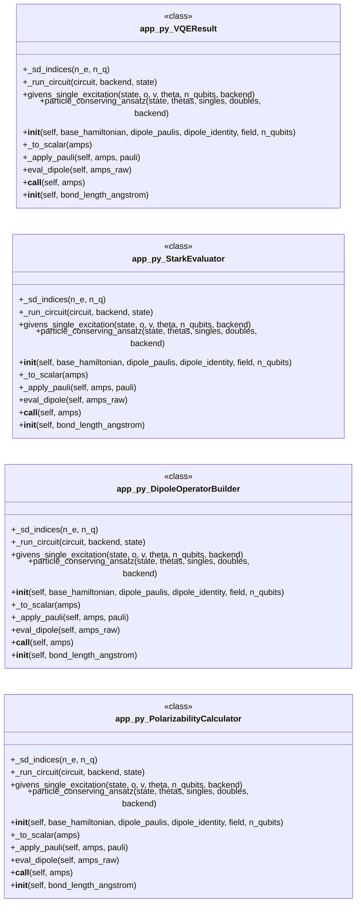

#### `entangled_hydrogen.py`

```mermaid
classDiagram
  direction LR
  class entangled_hydrogen_py_EntangledHydrogenConfig {
    <<class>>
    +_make_logger(name)
    +main()
    +name(self)
    +prepare(self, n_qubits)
    +get_theoretical_entropy(self)
    +name(self)
    +prepare(self, qc, backend)
    +get_theoretical_entropy(self)
    +__init__(self, n_qubits)
    +name(self)
  }
  class entangled_hydrogen_py_IEntangledState {
    <<class>>
    +_make_logger(name)
    +main()
    +name(self)
    +prepare(self, n_qubits)
    +get_theoretical_entropy(self)
    +name(self)
    +prepare(self, qc, backend)
    +get_theoretical_entropy(self)
    +__init__(self, n_qubits)
    +name(self)
  }
  class entangled_hydrogen_py_BellState {
    <<class>>
    +_make_logger(name)
    +main()
    +name(self)
    +prepare(self, n_qubits)
    +get_theoretical_entropy(self)
    +name(self)
    +prepare(self, qc, backend)
    +get_theoretical_entropy(self)
    +__init__(self, n_qubits)
    +name(self)
  }
  class entangled_hydrogen_py_GHZState {
    <<class>>
    +_make_logger(name)
    +main()
    +name(self)
    +prepare(self, n_qubits)
    +get_theoretical_entropy(self)
    +name(self)
    +prepare(self, qc, backend)
    +get_theoretical_entropy(self)
    +__init__(self, n_qubits)
    +name(self)
  }
  class entangled_hydrogen_py_WState {
    <<class>>
    +_make_logger(name)
    +main()
    +name(self)
    +prepare(self, n_qubits)
    +get_theoretical_entropy(self)
    +name(self)
    +prepare(self, qc, backend)
    +get_theoretical_entropy(self)
    +__init__(self, n_qubits)
    +name(self)
  }
  class entangled_hydrogen_py_WavefunctionCalculator {
    <<class>>
    +_make_logger(name)
    +main()
    +name(self)
    +prepare(self, n_qubits)
    +get_theoretical_entropy(self)
    +name(self)
    +prepare(self, qc, backend)
    +get_theoretical_entropy(self)
    +__init__(self, n_qubits)
    +name(self)
  }
  class entangled_hydrogen_py_EntangledHydrogenSampler {
    <<class>>
    +_make_logger(name)
    +main()
    +name(self)
    +prepare(self, n_qubits)
    +get_theoretical_entropy(self)
    +name(self)
    +prepare(self, qc, backend)
    +get_theoretical_entropy(self)
    +__init__(self, n_qubits)
    +name(self)
  }
  class entangled_hydrogen_py_EntangledHydrogenVisualizer {
    <<class>>
    +_make_logger(name)
    +main()
    +name(self)
    +prepare(self, n_qubits)
    +get_theoretical_entropy(self)
    +name(self)
    +prepare(self, qc, backend)
    +get_theoretical_entropy(self)
    +__init__(self, n_qubits)
    +name(self)
  }
  class entangled_hydrogen_py_EntangledHydrogenExperiment {
    <<class>>
    +_make_logger(name)
    +main()
    +name(self)
    +prepare(self, n_qubits)
    +get_theoretical_entropy(self)
    +name(self)
    +prepare(self, qc, backend)
    +get_theoretical_entropy(self)
    +__init__(self, n_qubits)
    +name(self)
  }
```

#### `higgs_four_lepton_analysis.py`

```mermaid
classDiagram
  direction LR
  class higgs_four_lepton_analysis_py_LeptonType {
    <<class>>
    +_make_logger(name)
    +main()
    +__post_init__(self)
    +from_energy_momentum(cls, E, px, py, pz)
    +__add__(self, other)
    +pt(self)
    +eta(self)
    +phi(self)
    +energy(self)
    +mass(self)
  }
  class higgs_four_lepton_analysis_py_EventType {
    <<class>>
    +_make_logger(name)
    +main()
    +__post_init__(self)
    +from_energy_momentum(cls, E, px, py, pz)
    +__add__(self, other)
    +pt(self)
    +eta(self)
    +phi(self)
    +energy(self)
    +mass(self)
  }
  class higgs_four_lepton_analysis_py_Config {
    <<class>>
    +_make_logger(name)
    +main()
    +__post_init__(self)
    +from_energy_momentum(cls, E, px, py, pz)
    +__add__(self, other)
    +pt(self)
    +eta(self)
    +phi(self)
    +energy(self)
    +mass(self)
  }
  class higgs_four_lepton_analysis_py_FourMomentum {
    <<class>>
    +_make_logger(name)
    +main()
    +__post_init__(self)
    +from_energy_momentum(cls, E, px, py, pz)
    +__add__(self, other)
    +pt(self)
    +eta(self)
    +phi(self)
    +energy(self)
    +mass(self)
  }
  class higgs_four_lepton_analysis_py_Lepton {
    <<class>>
    +_make_logger(name)
    +main()
    +__post_init__(self)
    +from_energy_momentum(cls, E, px, py, pz)
    +__add__(self, other)
    +pt(self)
    +eta(self)
    +phi(self)
    +energy(self)
    +mass(self)
  }
  class higgs_four_lepton_analysis_py_Event {
    <<class>>
    +_make_logger(name)
    +main()
    +__post_init__(self)
    +from_energy_momentum(cls, E, px, py, pz)
    +__add__(self, other)
    +pt(self)
    +eta(self)
    +phi(self)
    +energy(self)
    +mass(self)
  }
  class higgs_four_lepton_analysis_py_QuantumSpinorProcessor {
    <<class>>
    +_make_logger(name)
    +main()
    +__post_init__(self)
    +from_energy_momentum(cls, E, px, py, pz)
    +__add__(self, other)
    +pt(self)
    +eta(self)
    +phi(self)
    +energy(self)
    +mass(self)
  }
  class higgs_four_lepton_analysis_py_EventParser {
    <<class>>
    +_make_logger(name)
    +main()
    +__post_init__(self)
    +from_energy_momentum(cls, E, px, py, pz)
    +__add__(self, other)
    +pt(self)
    +eta(self)
    +phi(self)
    +energy(self)
    +mass(self)
  }
  class higgs_four_lepton_analysis_py_Visualizer {
    <<class>>
    +_make_logger(name)
    +main()
    +__post_init__(self)
    +from_energy_momentum(cls, E, px, py, pz)
    +__add__(self, other)
    +pt(self)
    +eta(self)
    +phi(self)
    +energy(self)
    +mass(self)
  }
  class higgs_four_lepton_analysis_py_HiggsQuantumAnalysis {
    <<class>>
    +_make_logger(name)
    +main()
    +__post_init__(self)
    +from_energy_momentum(cls, E, px, py, pz)
    +__add__(self, other)
    +pt(self)
    +eta(self)
    +phi(self)
    +energy(self)
    +mass(self)
  }
```

#### `higgs_quantum_analysis.py`

```mermaid
classDiagram
  direction LR
  class higgs_quantum_analysis_py_LeptonType {
    <<class>>
    +_make_logger(name)
    +main()
    +__post_init__(self)
    +from_energy_momentum(cls, E, px, py, pz)
    +__add__(self, other)
    +pt(self)
    +eta(self)
    +phi(self)
    +energy(self)
    +mass(self)
  }
  class higgs_quantum_analysis_py_EventType {
    <<class>>
    +_make_logger(name)
    +main()
    +__post_init__(self)
    +from_energy_momentum(cls, E, px, py, pz)
    +__add__(self, other)
    +pt(self)
    +eta(self)
    +phi(self)
    +energy(self)
    +mass(self)
  }
  class higgs_quantum_analysis_py_Config {
    <<class>>
    +_make_logger(name)
    +main()
    +__post_init__(self)
    +from_energy_momentum(cls, E, px, py, pz)
    +__add__(self, other)
    +pt(self)
    +eta(self)
    +phi(self)
    +energy(self)
    +mass(self)
  }
  class higgs_quantum_analysis_py_FourMomentum {
    <<class>>
    +_make_logger(name)
    +main()
    +__post_init__(self)
    +from_energy_momentum(cls, E, px, py, pz)
    +__add__(self, other)
    +pt(self)
    +eta(self)
    +phi(self)
    +energy(self)
    +mass(self)
  }
  class higgs_quantum_analysis_py_Lepton {
    <<class>>
    +_make_logger(name)
    +main()
    +__post_init__(self)
    +from_energy_momentum(cls, E, px, py, pz)
    +__add__(self, other)
    +pt(self)
    +eta(self)
    +phi(self)
    +energy(self)
    +mass(self)
  }
  class higgs_quantum_analysis_py_Event {
    <<class>>
    +_make_logger(name)
    +main()
    +__post_init__(self)
    +from_energy_momentum(cls, E, px, py, pz)
    +__add__(self, other)
    +pt(self)
    +eta(self)
    +phi(self)
    +energy(self)
    +mass(self)
  }
  class higgs_quantum_analysis_py_QuantumSpinorProcessor {
    <<class>>
    +_make_logger(name)
    +main()
    +__post_init__(self)
    +from_energy_momentum(cls, E, px, py, pz)
    +__add__(self, other)
    +pt(self)
    +eta(self)
    +phi(self)
    +energy(self)
    +mass(self)
  }
  class higgs_quantum_analysis_py_EventParser {
    <<class>>
    +_make_logger(name)
    +main()
    +__post_init__(self)
    +from_energy_momentum(cls, E, px, py, pz)
    +__add__(self, other)
    +pt(self)
    +eta(self)
    +phi(self)
    +energy(self)
    +mass(self)
  }
  class higgs_quantum_analysis_py_Visualizer {
    <<class>>
    +_make_logger(name)
    +main()
    +__post_init__(self)
    +from_energy_momentum(cls, E, px, py, pz)
    +__add__(self, other)
    +pt(self)
    +eta(self)
    +phi(self)
    +energy(self)
    +mass(self)
  }
  class higgs_quantum_analysis_py_HiggsQuantumAnalysis {
    <<class>>
    +_make_logger(name)
    +main()
    +__post_init__(self)
    +from_energy_momentum(cls, E, px, py, pz)
    +__add__(self, other)
    +pt(self)
    +eta(self)
    +phi(self)
    +energy(self)
    +mass(self)
  }
```

#### `immersive/app.py`, `immersive/backend.py`

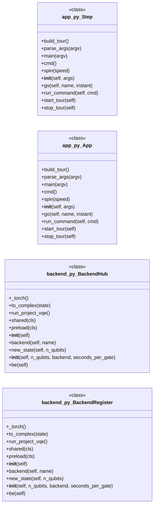

---

## Code Property Graph

Machine-readable Code Property Graph (CPG) in JSON-LD format. This block allows AI agents to parse the full structural graph without additional file reads. Compatible with GraphRAG pipelines.

```json
{"@context": "https://schema.org", "analysis": {"communities": [{"cohesion": 0.744, "id": 0, "label": "root: quantum_simulator", "size": 16}, {"cohesion": 0.815, "id": 1, "label": "immersive", "size": 12}, {"cohesion": 0.542, "id": 2, "label": "root: quantum_framework_core", "size": 10}, {"cohesion": 1.0, "id": 3, "label": "root: quantum_framework_molecular_v2", "size": 2}], "god_nodes": [{"node_id": "quantum_computer.py", "score": 42.3}, {"node_id": "quantum_framework_core.py", "score": 33.7}, {"node_id": "qc_dashboard.py", "score": 24.8}, {"node_id": "quantum_framework_menu.py", "score": 23.8}, {"node_id": "quantum_simulator.py", "score": 22.0}, {"node_id": "immersive/backend.py", "score": 21.5}, {"node_id": "immersive/app.py", "score": 18.0}, {"node_id": "molecular_sim.py", "score": 17.5}, {"node_id": "immersive/scenes.py", "score": 17.3}, {"node_id": "advanced_experiments.py", "score": 15.6}], "surprising_connections": [{"hops": 5, "source": "immersive/__init__.py", "target": "orbital_visualizer2.py"}, {"hops": 5, "source": "immersive/__init__.py", "target": "quantum_framework_visualization.py"}, {"hops": 5, "source": "immersive/__init__.py", "target": "quantum_simulator.py"}, {"hops": 5, "source": "immersive/glkit.py", "target": "orbital_visualizer2.py"}, {"hops": 5, "source": "immersive/glkit.py", "target": "quantum_framework_visualization.py"}]}, "edges": [{"confidence": "EXTRACTED", "relation": "imports", "source": "advanced_experiments.py", "target": "__future__"}, {"confidence": "EXTRACTED", "relation": "imports", "source": "advanced_experiments.py", "target": "logging"}, {"confidence": "EXTRACTED", "relation": "imports", "source": "advanced_experiments.py", "target": "math"}, {"confidence": "EXTRACTED", "relation": "imports", "source": "advanced_experiments.py", "target": "os"}, {"confidence": "EXTRACTED", "relation": "imports", "source": "advanced_experiments.py", "target": "sys"}, {"confidence": "EXTRACTED", "relation": "imports", "source": "advanced_experiments.py", "target": "warnings"}, {"confidence": "EXTRACTED", "relation": "imports", "source": "advanced_experiments.py", "target": "dataclasses"}, {"confidence": "EXTRACTED", "relation": "imports", "source": "advanced_experiments.py", "target": "typing"}, {"confidence": "EXTRACTED", "relation": "imports", "source": "advanced_experiments.py", "target": "abc"}, {"confidence": "EXTRACTED", "relation": "imports", "source": "advanced_experiments.py", "target": "numpy"}, {"confidence": "EXTRACTED", "relation": "imports", "source": "advanced_experiments.py", "target": "torch"}, {"confidence": "EXTRACTED", "relation": "imports", "source": "advanced_experiments.py", "target": "torch.nn"}, {"confidence": "EXTRACTED", "relation": "imports", "source": "advanced_experiments.py", "target": "torch.nn.functional"}, {"confidence": "EXTRACTED", "relation": "imports", "source": "advanced_experiments.py", "target": "quantum_computer"}, {"confidence": "EXTRACTED", "relation": "imports", "source": "advanced_experiments.py", "target": "quantum_simulator"}, {"confidence": "EXTRACTED", "relation": "imports", "source": "advanced_experiments.py", "target": "relativistic_hydrogen"}, {"confidence": "EXTRACTED", "relation": "imports", "source": "advanced_experiments.py", "target": "molecular_sim"}, {"confidence": "EXTRACTED", "relation": "imports", "source": "advanced_experiments.py", "target": "argparse"}, {"confidence": "EXTRACTED", "relation": "imports", "source": "advanced_experiments.py", "target": "pyscf"}, {"confidence": "EXTRACTED", "relation": "imports", "source": "app.py", "target": "__future__"}, {"confidence": "EXTRACTED", "relation": "imports", "source": "app.py", "target": "warnings"}, {"confidence": "EXTRACTED", "relation": "imports", "source": "app.py", "target": "math"}, {"confidence": "EXTRACTED", "relation": "imports", "source": "app.py", "target": "numpy"}, {"confidence": "EXTRACTED", "relation": "imports", "source": "app.py", "target": "sys"}, {"confidence": "EXTRACTED", "relation": "imports", "source": "app.py", "target": "dataclasses"}, {"confidence": "EXTRACTED", "relation": "imports", "source": "app.py", "target": "typing"}, {"confidence": "EXTRACTED", "relation": "imports", "source": "app.py", "target": "torch"}, {"confidence": "EXTRACTED", "relation": "imports", "source": "app.py", "target": "quantum_computer"}, {"confidence": "EXTRACTED", "relation": "imports", "source": "app.py", "target": "molecular_sim"}, {"confidence": "EXTRACTED", "relation": "imports", "source": "app.py", "target": "pyscf"}, {"confidence": "EXTRACTED", "relation": "imports", "source": "app.py", "target": "openfermion.transforms"}, {"confidence": "EXTRACTED", "relation": "imports", "source": "app.py", "target": "openfermion.ops"}, {"confidence": "EXTRACTED", "relation": "imports", "source": "app.py", "target": "scipy.optimize"}, {"confidence": "EXTRACTED", "relation": "imports", "source": "demo_molecular_vqe.py", "target": "logging"}, {"confidence": "EXTRACTED", "relation": "imports", "source": "demo_molecular_vqe.py", "target": "sys"}, {"confidence": "EXTRACTED", "relation": "imports", "source": "demo_molecular_vqe.py", "target": "time"}, {"confidence": "EXTRACTED", "relation": "imports", "source": "demo_molecular_vqe.py", "target": "typing"}, {"confidence": "EXTRACTED", "relation": "imports", "source": "demo_molecular_vqe.py", "target": "quantum_framework_molecular_v2"}, {"confidence": "EXTRACTED", "relation": "imports", "source": "demo_molecular_vqe.py", "target": "quantum_framework_molecular_v2"}, {"confidence": "EXTRACTED", "relation": "imports", "source": "demo_molecular_vqe.py", "target": "numpy"}, {"confidence": "EXTRACTED", "relation": "imports", "source": "demo_molecular_vqe.py", "target": "os"}, {"confidence": "EXTRACTED", "relation": "imports", "source": "demo_molecular_vqe.py", "target": "traceback"}, {"confidence": "EXTRACTED", "relation": "imports", "source": "entangled_hydrogen.py", "target": "__future__"}, {"confidence": "EXTRACTED", "relation": "imports", "source": "entangled_hydrogen.py", "target": "logging"}, {"confidence": "EXTRACTED", "relation": "imports", "source": "entangled_hydrogen.py", "target": "math"}, {"confidence": "EXTRACTED", "relation": "imports", "source": "entangled_hydrogen.py", "target": "os"}, {"confidence": "EXTRACTED", "relation": "imports", "source": "entangled_hydrogen.py", "target": "sys"}, {"confidence": "EXTRACTED", "relation": "imports", "source": "entangled_hydrogen.py", "target": "warnings"}, {"confidence": "EXTRACTED", "relation": "imports", "source": "entangled_hydrogen.py", "target": "abc"}, {"confidence": "EXTRACTED", "relation": "imports", "source": "entangled_hydrogen.py", "target": "dataclasses"}, {"confidence": "EXTRACTED", "relation": "imports", "source": "entangled_hydrogen.py", "target": "typing"}, {"confidence": "EXTRACTED", "relation": "imports", "source": "entangled_hydrogen.py", "target": "numpy"}, {"confidence": "EXTRACTED", "relation": "imports", "source": "entangled_hydrogen.py", "target": "torch"}, {"confidence": "EXTRACTED", "relation": "imports", "source": "entangled_hydrogen.py", "target": "torch.nn"}, {"confidence": "EXTRACTED", "relation": "imports", "source": "entangled_hydrogen.py", "target": "torch.nn.functional"}, {"confidence": "EXTRACTED", "relation": "imports", "source": "entangled_hydrogen.py", "target": "scipy.special"}, {"confidence": "EXTRACTED", "relation": "imports", "source": "entangled_hydrogen.py", "target": "matplotlib.pyplot"}, {"confidence": "EXTRACTED", "relation": "imports", "source": "entangled_hydrogen.py", "target": "matplotlib"}, {"confidence": "EXTRACTED", "relation": "imports", "source": "entangled_hydrogen.py", "target": "matplotlib.colors"}, {"confidence": "EXTRACTED", "relation": "imports", "source": "entangled_hydrogen.py", "target": "argparse"}, {"confidence": "EXTRACTED", "relation": "imports", "source": "entangled_hydrogen.py", "target": "quantum_computer"}, {"confidence": "EXTRACTED", "relation": "imports", "source": "entangled_hydrogen.py", "target": "quantum_computer"}, {"confidence": "EXTRACTED", "relation": "imports", "source": "entangled_hydrogen.py", "target": "molecular_sim"}, {"confidence": "EXTRACTED", "relation": "imports", "source": "entangled_hydrogen.py", "target": "relativistic_hydrogen"}, {"confidence": "EXTRACTED", "relation": "imports", "source": "higgs_four_lepton_analysis.py", "target": "__future__"}, {"confidence": "EXTRACTED", "relation": "imports", "source": "higgs_four_lepton_analysis.py", "target": "csv"}, {"confidence": "EXTRACTED", "relation": "imports", "source": "higgs_four_lepton_analysis.py", "target": "logging"}, {"confidence": "EXTRACTED", "relation": "imports", "source": "higgs_four_lepton_analysis.py", "target": "math"}, {"confidence": "EXTRACTED", "relation": "imports", "source": "higgs_four_lepton_analysis.py", "target": "os"}, {"confidence": "EXTRACTED", "relation": "imports", "source": "higgs_four_lepton_analysis.py", "target": "sys"}, {"confidence": "EXTRACTED", "relation": "imports", "source": "higgs_four_lepton_analysis.py", "target": "urllib.request"}, {"confidence": "EXTRACTED", "relation": "imports", "source": "higgs_four_lepton_analysis.py", "target": "urllib.error"}, {"confidence": "EXTRACTED", "relation": "imports", "source": "higgs_four_lepton_analysis.py", "target": "dataclasses"}, {"confidence": "EXTRACTED", "relation": "imports", "source": "higgs_four_lepton_analysis.py", "target": "enum"}, {"confidence": "EXTRACTED", "relation": "imports", "source": "higgs_four_lepton_analysis.py", "target": "pathlib"}, {"confidence": "EXTRACTED", "relation": "imports", "source": "higgs_four_lepton_analysis.py", "target": "typing"}, {"confidence": "EXTRACTED", "relation": "imports", "source": "higgs_four_lepton_analysis.py", "target": "numpy"}, {"confidence": "EXTRACTED", "relation": "imports", "source": "higgs_four_lepton_analysis.py", "target": "quantum_computer"}, {"confidence": "EXTRACTED", "relation": "imports", "source": "higgs_four_lepton_analysis.py", "target": "torch"}, {"confidence": "EXTRACTED", "relation": "imports", "source": "higgs_four_lepton_analysis.py", "target": "torch.nn.functional"}, {"confidence": "EXTRACTED", "relation": "imports", "source": "higgs_four_lepton_analysis.py", "target": "plotly.graph_objects"}, {"confidence": "EXTRACTED", "relation": "imports", "source": "higgs_four_lepton_analysis.py", "target": "plotly.subplots"}, {"confidence": "EXTRACTED", "relation": "imports", "source": "higgs_quantum_analysis.py", "target": "__future__"}, {"confidence": "EXTRACTED", "relation": "imports", "source": "higgs_quantum_analysis.py", "target": "csv"}, {"confidence": "EXTRACTED", "relation": "imports", "source": "higgs_quantum_analysis.py", "target": "logging"}, {"confidence": "EXTRACTED", "relation": "imports", "source": "higgs_quantum_analysis.py", "target": "math"}, {"confidence": "EXTRACTED", "relation": "imports", "source": "higgs_quantum_analysis.py", "target": "os"}, {"confidence": "EXTRACTED", "relation": "imports", "source": "higgs_quantum_analysis.py", "target": "sys"}, {"confidence": "EXTRACTED", "relation": "imports", "source": "higgs_quantum_analysis.py", "target": "urllib.request"}, {"confidence": "EXTRACTED", "relation": "imports", "source": "higgs_quantum_analysis.py", "target": "urllib.error"}, {"confidence": "EXTRACTED", "relation": "imports", "source": "higgs_quantum_analysis.py", "target": "dataclasses"}, {"confidence": "EXTRACTED", "relation": "imports", "source": "higgs_quantum_analysis.py", "target": "enum"}, {"confidence": "EXTRACTED", "relation": "imports", "source": "higgs_quantum_analysis.py", "target": "pathlib"}, {"confidence": "EXTRACTED", "relation": "imports", "source": "higgs_quantum_analysis.py", "target": "typing"}, {"confidence": "EXTRACTED", "relation": "imports", "source": "higgs_quantum_analysis.py", "target": "numpy"}, {"confidence": "EXTRACTED", "relation": "imports", "source": "higgs_quantum_analysis.py", "target": "quantum_computer"}, {"confidence": "EXTRACTED", "relation": "imports", "source": "higgs_quantum_analysis.py", "target": "torch"}, {"confidence": "EXTRACTED", "relation": "imports", "source": "higgs_quantum_analysis.py", "target": "torch.nn.functional"}, {"confidence": "EXTRACTED", "relation": "imports", "source": "higgs_quantum_analysis.py", "target": "plotly.graph_objects"}, {"confidence": "EXTRACTED", "relation": "imports", "source": "higgs_quantum_analysis.py", "target": "plotly.subplots"}, {"confidence": "EXTRACTED", "relation": "imports", "source": "immersive/app.py", "target": "__future__"}, {"confidence": "EXTRACTED", "relation": "imports", "source": "immersive/app.py", "target": "argparse"}, {"confidence": "EXTRACTED", "relation": "imports", "source": "immersive/app.py", "target": "math"}, {"confidence": "EXTRACTED", "relation": "imports", "source": "immersive/app.py", "target": "os"}, {"confidence": "EXTRACTED", "relation": "imports", "source": "immersive/app.py", "target": "sys"}, {"confidence": "EXTRACTED", "relation": "imports", "source": "immersive/app.py", "target": "time"}, {"confidence": "EXTRACTED", "relation": "imports", "source": "immersive/app.py", "target": "dataclasses"}, {"confidence": "EXTRACTED", "relation": "imports", "source": "immersive/app.py", "target": "typing"}, {"confidence": "EXTRACTED", "relation": "imports", "source": "immersive/app.py", "target": "numpy"}, {"confidence": "EXTRACTED", "relation": "imports", "source": "immersive/app.py", "target": "pygame"}, {"confidence": "EXTRACTED", "relation": "imports", "source": "immersive/app.py", "target": "OpenGL"}, {"confidence": "EXTRACTED", "relation": "imports", "source": "immersive/app.py", "target": "backend"}, {"confidence": "EXTRACTED", "relation": "imports", "source": "immersive/app.py", "target": "glkit"}, {"confidence": "EXTRACTED", "relation": "imports", "source": "immersive/app.py", "target": "postfx"}, {"confidence": "EXTRACTED", "relation": "imports", "source": "immersive/app.py", "target": "hud"}, {"confidence": "EXTRACTED", "relation": "imports", "source": "immersive/app.py", "target": "scenes"}, {"confidence": "EXTRACTED", "relation": "imports", "source": "immersive/app.py", "target": "shaders"}, {"confidence": "EXTRACTED", "relation": "imports", "source": "immersive/app.py", "target": "threading"}, {"confidence": "EXTRACTED", "relation": "imports", "source": "immersive/backend.py", "target": "__future__"}, {"confidence": "EXTRACTED", "relation": "imports", "source": "immersive/backend.py", "target": "logging"}, {"confidence": "EXTRACTED", "relation": "imports", "source": "immersive/backend.py", "target": "math"}, {"confidence": "EXTRACTED", "relation": "imports", "source": "immersive/backend.py", "target": "sys"}, {"confidence": "EXTRACTED", "relation": "imports", "source": "immersive/backend.py", "target": "threading"}, {"confidence": "EXTRACTED", "relation": "imports", "source": "immersive/backend.py", "target": "pathlib"}, {"confidence": "EXTRACTED", "relation": "imports", "source": "immersive/backend.py", "target": "typing"}, {"confidence": "EXTRACTED", "relation": "imports", "source": "immersive/backend.py", "target": "numpy"}, {"confidence": "EXTRACTED", "relation": "imports", "source": "immersive/backend.py", "target": "physics"}, {"confidence": "EXTRACTED", "relation": "imports", "source": "immersive/backend.py", "target": "torch"}, {"confidence": "EXTRACTED", "relation": "imports", "source": "immersive/backend.py", "target": "unittest"}, {"confidence": "EXTRACTED", "relation": "imports", "source": "immersive/backend.py", "target": "quantum_lab"}, {"confidence": "EXTRACTED", "relation": "imports", "source": "immersive/backend.py", "target": "quantum_framework_core"}, {"confidence": "EXTRACTED", "relation": "imports", "source": "immersive/backend.py", "target": "quantum_framework_molecular"}, {"confidence": "EXTRACTED", "relation": "imports", "source": "immersive/backend.py", "target": "quantum_computer"}, {"confidence": "EXTRACTED", "relation": "imports", "source": "immersive/glkit.py", "target": "__future__"}, {"confidence": "EXTRACTED", "relation": "imports", "source": "immersive/glkit.py", "target": "math"}, {"confidence": "EXTRACTED", "relation": "imports", "source": "immersive/glkit.py", "target": "typing"}, {"confidence": "EXTRACTED", "relation": "imports", "source": "immersive/glkit.py", "target": "numpy"}, {"confidence": "EXTRACTED", "relation": "imports", "source": "immersive/glkit.py", "target": "OpenGL"}, {"confidence": "EXTRACTED", "relation": "imports", "source": "immersive/hud.py", "target": "__future__"}, {"confidence": "EXTRACTED", "relation": "imports", "source": "immersive/hud.py", "target": "colorsys"}, {"confidence": "EXTRACTED", "relation": "imports", "source": "immersive/hud.py", "target": "typing"}, {"confidence": "EXTRACTED", "relation": "imports", "source": "immersive/hud.py", "target": "numpy"}, {"confidence": "EXTRACTED", "relation": "imports", "source": "immersive/hud.py", "target": "pygame"}, {"confidence": "EXTRACTED", "relation": "imports", "source": "immersive/hud.py", "target": "OpenGL"}, {"confidence": "EXTRACTED", "relation": "imports", "source": "immersive/hud.py", "target": "glkit"}, {"confidence": "EXTRACTED", "relation": "imports", "source": "immersive/hud.py", "target": "shaders"}, {"confidence": "EXTRACTED", "relation": "imports", "source": "immersive/matter.py", "target": "__future__"}, {"confidence": "EXTRACTED", "relation": "imports", "source": "immersive/matter.py", "target": "math"}, {"confidence": "EXTRACTED", "relation": "imports", "source": "immersive/matter.py", "target": "threading"}, {"confidence": "EXTRACTED", "relation": "imports", "source": "immersive/matter.py", "target": "dataclasses"}, {"confidence": "EXTRACTED", "relation": "imports", "source": "immersive/matter.py", "target": "typing"}, {"confidence": "EXTRACTED", "relation": "imports", "source": "immersive/matter.py", "target": "numpy"}, {"confidence": "EXTRACTED", "relation": "imports", "source": "immersive/matter.py", "target": "pyscf"}, {"confidence": "EXTRACTED", "relation": "imports", "source": "immersive/matter.py", "target": "pyscf.dft"}, {"confidence": "EXTRACTED", "relation": "imports", "source": "immersive/matter.py", "target": "pyscf"}, {"confidence": "EXTRACTED", "relation": "imports", "source": "immersive/physics.py", "target": "__future__"}, {"confidence": "EXTRACTED", "relation": "imports", "source": "immersive/physics.py", "target": "math"}, {"confidence": "EXTRACTED", "relation": "imports", "source": "immersive/physics.py", "target": "dataclasses"}, {"confidence": "EXTRACTED", "relation": "imports", "source": "immersive/physics.py", "target": "typing"}, {"confidence": "EXTRACTED", "relation": "imports", "source": "immersive/physics.py", "target": "numpy"}, {"confidence": "EXTRACTED", "relation": "imports", "source": "immersive/physics.py", "target": "scipy.special"}, {"confidence": "EXTRACTED", "relation": "imports", "source": "immersive/postfx.py", "target": "__future__"}, {"confidence": "EXTRACTED", "relation": "imports", "source": "immersive/postfx.py", "target": "typing"}, {"confidence": "EXTRACTED", "relation": "imports", "source": "immersive/postfx.py", "target": "numpy"}, {"confidence": "EXTRACTED", "relation": "imports", "source": "immersive/postfx.py", "target": "OpenGL"}, {"confidence": "EXTRACTED", "relation": "imports", "source": "immersive/postfx.py", "target": "glkit"}, {"confidence": "EXTRACTED", "relation": "imports", "source": "immersive/scenes.py", "target": "__future__"}, {"confidence": "EXTRACTED", "relation": "imports", "source": "immersive/scenes.py", "target": "math"}, {"confidence": "EXTRACTED", "relation": "imports", "source": "immersive/scenes.py", "target": "os"}, {"confidence": "EXTRACTED", "relation": "imports", "source": "immersive/scenes.py", "target": "collections"}, {"confidence": "EXTRACTED", "relation": "imports", "source": "immersive/scenes.py", "target": "typing"}, {"confidence": "EXTRACTED", "relation": "imports", "source": "immersive/scenes.py", "target": "numpy"}, {"confidence": "EXTRACTED", "relation": "imports", "source": "immersive/scenes.py", "target": "pygame"}, {"confidence": "EXTRACTED", "relation": "imports", "source": "immersive/scenes.py", "target": "OpenGL"}, {"confidence": "EXTRACTED", "relation": "imports", "source": "immersive/scenes.py", "target": "backend"}, {"confidence": "EXTRACTED", "relation": "imports", "source": "immersive/scenes.py", "target": "glkit"}, {"confidence": "EXTRACTED", "relation": "imports", "source": "immersive/scenes.py", "target": "hud"}, {"confidence": "EXTRACTED", "relation": "imports", "source": "immersive/scenes.py", "target": "physics"}, {"confidence": "EXTRACTED", "relation": "imports", "source": "immersive/shaders.py", "target": "__future__"}, {"confidence": "EXTRACTED", "relation": "imports", "source": "immersive/shaders.py", "target": "physics"}, {"confidence": "EXTRACTED", "relation": "imports", "source": "immersive/spin.py", "target": "__future__"}, {"confidence": "EXTRACTED", "relation": "imports", "source": "immersive/spin.py", "target": "math"}, {"confidence": "EXTRACTED", "relation": "imports", "source": "immersive/spin.py", "target": "sys"}, {"confidence": "EXTRACTED", "relation": "imports", "source": "immersive/spin.py", "target": "dataclasses"}, {"confidence": "EXTRACTED", "relation": "imports", "source": "immersive/spin.py", "target": "typing"}, {"confidence": "EXTRACTED", "relation": "imports", "source": "immersive/spin.py", "target": "numpy"}, {"confidence": "EXTRACTED", "relation": "imports", "source": "immersive/spin.py", "target": "scipy.special"}, {"confidence": "EXTRACTED", "relation": "imports", "source": "immersive/spin.py", "target": "backend"}, {"confidence": "EXTRACTED", "relation": "imports", "source": "immersive/spin.py", "target": "physics"}, {"confidence": "EXTRACTED", "relation": "imports", "source": "immersive/spin.py", "target": "scipy.special"}, {"confidence": "EXTRACTED", "relation": "imports", "source": "immersive/spin.py", "target": "logging"}, {"confidence": "EXTRACTED", "relation": "imports", "source": "immersive/spin.py", "target": "relativistic_hydrogen"}, {"confidence": "EXTRACTED", "relation": "imports", "source": "molecular_sim.py", "target": "__future__"}, {"confidence": "EXTRACTED", "relation": "imports", "source": "molecular_sim.py", "target": "logging"}, {"confidence": "EXTRACTED", "relation": "imports", "source": "molecular_sim.py", "target": "math"}, {"confidence": "EXTRACTED", "relation": "imports", "source": "molecular_sim.py", "target": "os"}, {"confidence": "EXTRACTED", "relation": "imports", "source": "molecular_sim.py", "target": "sys"}, {"confidence": "EXTRACTED", "relation": "imports", "source": "molecular_sim.py", "target": "dataclasses"}, {"confidence": "EXTRACTED", "relation": "imports", "source": "molecular_sim.py", "target": "typing"}, {"confidence": "EXTRACTED", "relation": "imports", "source": "molecular_sim.py", "target": "numpy"}, {"confidence": "EXTRACTED", "relation": "imports", "source": "molecular_sim.py", "target": "torch"}, {"confidence": "EXTRACTED", "relation": "imports", "source": "molecular_sim.py", "target": "quantum_computer"}, {"confidence": "EXTRACTED", "relation": "imports", "source": "molecular_sim.py", "target": "argparse"}, {"confidence": "EXTRACTED", "relation": "imports", "source": "molecular_sim.py", "target": "quantum_computer"}, {"confidence": "EXTRACTED", "relation": "imports", "source": "molecular_sim.py", "target": "pyscf"}, {"confidence": "EXTRACTED", "relation": "imports", "source": "molecular_sim.py", "target": "openfermion"}, {"confidence": "EXTRACTED", "relation": "imports", "source": "molecular_sim.py", "target": "openfermion.transforms"}, {"confidence": "EXTRACTED", "relation": "imports", "source": "molecular_sim.py", "target": "openfermion.linalg"}, {"confidence": "EXTRACTED", "relation": "imports", "source": "molecular_sim.py", "target": "openfermionpyscf"}, {"confidence": "EXTRACTED", "relation": "imports", "source": "molecular_sim.py", "target": "openfermion"}, {"confidence": "EXTRACTED", "relation": "imports", "source": "molecular_sim.py", "target": "quantum_computer"}, {"confidence": "EXTRACTED", "relation": "imports", "source": "molecular_sim.py", "target": "scipy.optimize"}, {"confidence": "EXTRACTED", "relation": "imports", "source": "orbital_visualizer2.py", "target": "numpy"}, {"confidence": "EXTRACTED", "relation": "imports", "source": "orbital_visualizer2.py", "target": "scipy.special"}, {"confidence": "EXTRACTED", "relation": "imports", "source": "orbital_visualizer2.py", "target": "matplotlib.pyplot"}, {"confidence": "EXTRACTED", "relation": "imports", "source": "orbital_visualizer2.py", "target": "matplotlib"}, {"confidence": "EXTRACTED", "relation": "imports", "source": "orbital_visualizer2.py", "target": "torch"}, {"confidence": "EXTRACTED", "relation": "imports", "source": "orbital_visualizer2.py", "target": "os"}, {"confidence": "EXTRACTED", "relation": "imports", "source": "orbital_visualizer2.py", "target": "sys"}, {"confidence": "EXTRACTED", "relation": "imports", "source": "orbital_visualizer2.py", "target": "warnings"}, {"confidence": "EXTRACTED", "relation": "imports", "source": "orbital_visualizer2.py", "target": "typing"}, {"confidence": "EXTRACTED", "relation": "imports", "source": "orbital_visualizer2.py", "target": "schrodinger_crystal_fixed2"}, {"confidence": "EXTRACTED", "relation": "imports", "source": "orbital_visualizer2.py", "target": "plotly.graph_objects"}, {"confidence": "EXTRACTED", "relation": "imports", "source": "orbital_visualizer2.py", "target": "traceback"}, {"confidence": "EXTRACTED", "relation": "imports", "source": "polarizability_v3.py", "target": "__future__"}, {"confidence": "EXTRACTED", "relation": "imports", "source": "polarizability_v3.py", "target": "warnings"}, {"confidence": "EXTRACTED", "relation": "imports", "source": "polarizability_v3.py", "target": "math"}, {"confidence": "EXTRACTED", "relation": "imports", "source": "polarizability_v3.py", "target": "numpy"}, {"confidence": "EXTRACTED", "relation": "imports", "source": "polarizability_v3.py", "target": "sys"}, {"confidence": "EXTRACTED", "relation": "imports", "source": "polarizability_v3.py", "target": "dataclasses"}, {"confidence": "EXTRACTED", "relation": "imports", "source": "polarizability_v3.py", "target": "typing"}, {"confidence": "EXTRACTED", "relation": "imports", "source": "polarizability_v3.py", "target": "torch"}, {"confidence": "EXTRACTED", "relation": "imports", "source": "polarizability_v3.py", "target": "quantum_computer"}, {"confidence": "EXTRACTED", "relation": "imports", "source": "polarizability_v3.py", "target": "molecular_sim"}, {"confidence": "EXTRACTED", "relation": "imports", "source": "polarizability_v3.py", "target": "pyscf"}, {"confidence": "EXTRACTED", "relation": "imports", "source": "polarizability_v3.py", "target": "openfermion.transforms"}, {"confidence": "EXTRACTED", "relation": "imports", "source": "polarizability_v3.py", "target": "openfermion.ops"}, {"confidence": "EXTRACTED", "relation": "imports", "source": "polarizability_v3.py", "target": "scipy.optimize"}, {"confidence": "EXTRACTED", "relation": "imports", "source": "qc_dashboard.py", "target": "__future__"}, {"confidence": "EXTRACTED", "relation": "imports", "source": "qc_dashboard.py", "target": "io"}, {"confidence": "EXTRACTED", "relation": "imports", "source": "qc_dashboard.py", "target": "logging"}, {"confidence": "EXTRACTED", "relation": "imports", "source": "qc_dashboard.py", "target": "math"}, {"confidence": "EXTRACTED", "relation": "imports", "source": "qc_dashboard.py", "target": "os"}, {"confidence": "EXTRACTED", "relation": "imports", "source": "qc_dashboard.py", "target": "sys"}, {"confidence": "EXTRACTED", "relation": "imports", "source": "qc_dashboard.py", "target": "tempfile"}, {"confidence": "EXTRACTED", "relation": "imports", "source": "qc_dashboard.py", "target": "dataclasses"}, {"confidence": "EXTRACTED", "relation": "imports", "source": "qc_dashboard.py", "target": "pathlib"}, {"confidence": "EXTRACTED", "relation": "imports", "source": "qc_dashboard.py", "target": "typing"}, {"confidence": "EXTRACTED", "relation": "imports", "source": "qc_dashboard.py", "target": "numpy"}, {"confidence": "EXTRACTED", "relation": "imports", "source": "qc_dashboard.py", "target": "matplotlib"}, {"confidence": "EXTRACTED", "relation": "imports", "source": "qc_dashboard.py", "target": "matplotlib.pyplot"}, {"confidence": "EXTRACTED", "relation": "imports", "source": "qc_dashboard.py", "target": "matplotlib.patches"}, {"confidence": "EXTRACTED", "relation": "imports", "source": "qc_dashboard.py", "target": "quantum_framework_core"}, {"confidence": "EXTRACTED", "relation": "imports", "source": "qc_dashboard.py", "target": "quantum_computer"}, {"confidence": "EXTRACTED", "relation": "imports", "source": "qc_dashboard.py", "target": "tempfile"}, {"confidence": "EXTRACTED", "relation": "imports", "source": "qc_dashboard.py", "target": "tempfile"}, {"confidence": "EXTRACTED", "relation": "imports", "source": "qc_dashboard.py", "target": "tempfile"}, {"confidence": "EXTRACTED", "relation": "imports", "source": "qc_dashboard.py", "target": "streamlit"}, {"confidence": "EXTRACTED", "relation": "imports", "source": "qc_dashboard.py", "target": "matplotlib"}, {"confidence": "EXTRACTED", "relation": "imports", "source": "qc_dashboard.py", "target": "matplotlib.pyplot"}, {"confidence": "EXTRACTED", "relation": "imports", "source": "qc_dashboard.py", "target": "mpl_toolkits.mplot3d"}, {"confidence": "EXTRACTED", "relation": "imports", "source": "qc_dashboard.py", "target": "quantum_framework_core"}, {"confidence": "EXTRACTED", "relation": "imports", "source": "qc_dashboard.py", "target": "quantum_framework_core"}, {"confidence": "EXTRACTED", "relation": "imports", "source": "qc_dashboard.py", "target": "quantum_computer"}, {"confidence": "EXTRACTED", "relation": "imports", "source": "qc_dashboard.py", "target": "plotly.graph_objects"}, {"confidence": "EXTRACTED", "relation": "imports", "source": "qc_dashboard.py", "target": "plotly.subplots"}, {"confidence": "EXTRACTED", "relation": "imports", "source": "qc_dashboard.py", "target": "orbital_visualizer2"}, {"confidence": "EXTRACTED", "relation": "imports", "source": "qc_dashboard.py", "target": "numpy"}, {"confidence": "EXTRACTED", "relation": "imports", "source": "qc_dashboard.py", "target": "quantum_framework_visualization"}, {"confidence": "EXTRACTED", "relation": "imports", "source": "qc_dashboard.py", "target": "quantum_dash"}, {"confidence": "EXTRACTED", "relation": "imports", "source": "qc_dashboard.py", "target": "quantum_3dview"}, {"confidence": "EXTRACTED", "relation": "imports", "source": "qc_dashboard.py", "target": "streamlit"}, {"confidence": "EXTRACTED", "relation": "imports", "source": "qc_dashboard.py", "target": "qc_integration"}, {"confidence": "EXTRACTED", "relation": "imports", "source": "qc_dashboard.py", "target": "quantum_computer"}, {"confidence": "EXTRACTED", "relation": "imports", "source": "qc_dashboard.py", "target": "qc_integration"}, {"confidence": "EXTRACTED", "relation": "imports", "source": "qc_dashboard.py", "target": "qc_integration"}, {"confidence": "EXTRACTED", "relation": "imports", "source": "qc_immersive.py", "target": "warnings"}, {"confidence": "EXTRACTED", "relation": "imports", "source": "qc_immersive.py", "target": "immersive.app"}, {"confidence": "EXTRACTED", "relation": "imports", "source": "qc_integration.py", "target": "__future__"}, {"confidence": "EXTRACTED", "relation": "imports", "source": "qc_integration.py", "target": "logging"}, {"confidence": "EXTRACTED", "relation": "imports", "source": "qc_integration.py", "target": "math"}, {"confidence": "EXTRACTED", "relation": "imports", "source": "qc_integration.py", "target": "re"}, {"confidence": "EXTRACTED", "relation": "imports", "source": "qc_integration.py", "target": "abc"}, {"confidence": "EXTRACTED", "relation": "imports", "source": "qc_integration.py", "target": "dataclasses"}, {"confidence": "EXTRACTED", "relation": "imports", "source": "qc_integration.py", "target": "typing"}, {"confidence": "EXTRACTED", "relation": "imports", "source": "qc_integration.py", "target": "argparse"}, {"confidence": "EXTRACTED", "relation": "imports", "source": "qc_integration.py", "target": "quantum_framework_core"}, {"confidence": "EXTRACTED", "relation": "imports", "source": "qc_integration.py", "target": "quantum_framework_core"}, {"confidence": "EXTRACTED", "relation": "imports", "source": "qc_integration.py", "target": "quantum_computer"}, {"confidence": "EXTRACTED", "relation": "imports", "source": "qc_integration.py", "target": "quantum_computer"}, {"confidence": "EXTRACTED", "relation": "imports", "source": "qc_integration.py", "target": "qiskit"}, {"confidence": "EXTRACTED", "relation": "imports", "source": "qc_integration.py", "target": "pennylane"}, {"confidence": "EXTRACTED", "relation": "imports", "source": "qc_launcher.py", "target": "__future__"}, {"confidence": "EXTRACTED", "relation": "imports", "source": "qc_launcher.py", "target": "subprocess"}, {"confidence": "EXTRACTED", "relation": "imports", "source": "qc_launcher.py", "target": "sys"}, {"confidence": "EXTRACTED", "relation": "imports", "source": "qc_launcher.py", "target": "dataclasses"}, {"confidence": "EXTRACTED", "relation": "imports", "source": "qc_launcher.py", "target": "pathlib"}, {"confidence": "EXTRACTED", "relation": "imports", "source": "qc_launcher.py", "target": "typing"}, {"confidence": "EXTRACTED", "relation": "imports", "source": "qc_launcher.py", "target": "textual.app"}, {"confidence": "EXTRACTED", "relation": "imports", "source": "qc_launcher.py", "target": "textual.binding"}, {"confidence": "EXTRACTED", "relation": "imports", "source": "qc_launcher.py", "target": "textual.containers"}, {"confidence": "EXTRACTED", "relation": "imports", "source": "qc_launcher.py", "target": "textual.widgets"}, {"confidence": "EXTRACTED", "relation": "imports", "source": "qc_launcher.py", "target": "textual.widgets.option_list"}, {"confidence": "EXTRACTED", "relation": "imports", "source": "quantum_3dview.py", "target": "numpy"}, {"confidence": "EXTRACTED", "relation": "imports", "source": "quantum_3dview.py", "target": "torch"}, {"confidence": "EXTRACTED", "relation": "imports", "source": "quantum_3dview.py", "target": "plotly.graph_objects"}, {"confidence": "EXTRACTED", "relation": "imports", "source": "quantum_3dview.py", "target": "plotly.subplots"}, {"confidence": "EXTRACTED", "relation": "imports", "source": "quantum_3dview.py", "target": "plotly.express"}, {"confidence": "EXTRACTED", "relation": "imports", "source": "quantum_3dview.py", "target": "dataclasses"}, {"confidence": "EXTRACTED", "relation": "imports", "source": "quantum_3dview.py", "target": "typing"}, {"confidence": "EXTRACTED", "relation": "imports", "source": "quantum_3dview.py", "target": "enum"}, {"confidence": "EXTRACTED", "relation": "imports", "source": "quantum_3dview.py", "target": "colorsys"}, {"confidence": "EXTRACTED", "relation": "imports", "source": "quantum_3dview.py", "target": "json"}, {"confidence": "EXTRACTED", "relation": "imports", "source": "quantum_3dview.py", "target": "pathlib"}, {"confidence": "EXTRACTED", "relation": "imports", "source": "quantum_3dview.py", "target": "warnings"}, {"confidence": "EXTRACTED", "relation": "imports", "source": "quantum_3dview.py", "target": "quantum_computer"}, {"confidence": "EXTRACTED", "relation": "imports", "source": "quantum_3dview.py", "target": "quantum_visualizer"}, {"confidence": "EXTRACTED", "relation": "imports", "source": "quantum_3dview.py", "target": "IPython.display"}, {"confidence": "EXTRACTED", "relation": "imports", "source": "quantum_3dview.py", "target": "scipy.io"}, {"confidence": "EXTRACTED", "relation": "imports", "source": "quantum_computer.py", "target": "__future__"}, {"confidence": "EXTRACTED", "relation": "imports", "source": "quantum_computer.py", "target": "logging"}, {"confidence": "EXTRACTED", "relation": "imports", "source": "quantum_computer.py", "target": "math"}, {"confidence": "EXTRACTED", "relation": "imports", "source": "quantum_computer.py", "target": "os"}, {"confidence": "EXTRACTED", "relation": "imports", "source": "quantum_computer.py", "target": "warnings"}, {"confidence": "EXTRACTED", "relation": "imports", "source": "quantum_computer.py", "target": "abc"}, {"confidence": "EXTRACTED", "relation": "imports", "source": "quantum_computer.py", "target": "dataclasses"}, {"confidence": "EXTRACTED", "relation": "imports", "source": "quantum_computer.py", "target": "typing"}, {"confidence": "EXTRACTED", "relation": "imports", "source": "quantum_computer.py", "target": "numpy"}, {"confidence": "EXTRACTED", "relation": "imports", "source": "quantum_computer.py", "target": "torch"}, {"confidence": "EXTRACTED", "relation": "imports", "source": "quantum_computer.py", "target": "quantum_framework_physics"}, {"confidence": "EXTRACTED", "relation": "imports", "source": "quantum_computer.py", "target": "argparse"}, {"confidence": "EXTRACTED", "relation": "imports", "source": "quantum_dash.py", "target": "__future__"}, {"confidence": "EXTRACTED", "relation": "imports", "source": "quantum_dash.py", "target": "logging"}, {"confidence": "EXTRACTED", "relation": "imports", "source": "quantum_dash.py", "target": "math"}, {"confidence": "EXTRACTED", "relation": "imports", "source": "quantum_dash.py", "target": "os"}, {"confidence": "EXTRACTED", "relation": "imports", "source": "quantum_dash.py", "target": "sys"}, {"confidence": "EXTRACTED", "relation": "imports", "source": "quantum_dash.py", "target": "warnings"}, {"confidence": "EXTRACTED", "relation": "imports", "source": "quantum_dash.py", "target": "abc"}, {"confidence": "EXTRACTED", "relation": "imports", "source": "quantum_dash.py", "target": "dataclasses"}, {"confidence": "EXTRACTED", "relation": "imports", "source": "quantum_dash.py", "target": "enum"}, {"confidence": "EXTRACTED", "relation": "imports", "source": "quantum_dash.py", "target": "pathlib"}, {"confidence": "EXTRACTED", "relation": "imports", "source": "quantum_dash.py", "target": "typing"}, {"confidence": "EXTRACTED", "relation": "imports", "source": "quantum_dash.py", "target": "numpy"}, {"confidence": "EXTRACTED", "relation": "imports", "source": "quantum_dash.py", "target": "torch"}, {"confidence": "EXTRACTED", "relation": "imports", "source": "quantum_dash.py", "target": "plotly.graph_objects"}, {"confidence": "EXTRACTED", "relation": "imports", "source": "quantum_dash.py", "target": "plotly.subplots"}, {"confidence": "EXTRACTED", "relation": "imports", "source": "quantum_dash.py", "target": "plotly.express"}, {"confidence": "EXTRACTED", "relation": "imports", "source": "quantum_dash.py", "target": "matplotlib"}, {"confidence": "EXTRACTED", "relation": "imports", "source": "quantum_dash.py", "target": "matplotlib.pyplot"}, {"confidence": "EXTRACTED", "relation": "imports", "source": "quantum_dash.py", "target": "matplotlib.patches"}, {"confidence": "EXTRACTED", "relation": "imports", "source": "quantum_dash.py", "target": "mpl_toolkits.mplot3d"}, {"confidence": "EXTRACTED", "relation": "imports", "source": "quantum_dash.py", "target": "mpl_toolkits.mplot3d"}, {"confidence": "EXTRACTED", "relation": "imports", "source": "quantum_dash.py", "target": "argparse"}, {"confidence": "EXTRACTED", "relation": "imports", "source": "quantum_dash.py", "target": "quantum_computer"}, {"confidence": "EXTRACTED", "relation": "imports", "source": "quantum_dash.py", "target": "molecular_sim"}, {"confidence": "EXTRACTED", "relation": "imports", "source": "quantum_framework_core.py", "target": "__future__"}, {"confidence": "EXTRACTED", "relation": "imports", "source": "quantum_framework_core.py", "target": "logging"}, {"confidence": "EXTRACTED", "relation": "imports", "source": "quantum_framework_core.py", "target": "math"}, {"confidence": "EXTRACTED", "relation": "imports", "source": "quantum_framework_core.py", "target": "os"}, {"confidence": "EXTRACTED", "relation": "imports", "source": "quantum_framework_core.py", "target": "warnings"}, {"confidence": "EXTRACTED", "relation": "imports", "source": "quantum_framework_core.py", "target": "abc"}, {"confidence": "EXTRACTED", "relation": "imports", "source": "quantum_framework_core.py", "target": "dataclasses"}, {"confidence": "EXTRACTED", "relation": "imports", "source": "quantum_framework_core.py", "target": "enum"}, {"confidence": "EXTRACTED", "relation": "imports", "source": "quantum_framework_core.py", "target": "typing"}, {"confidence": "EXTRACTED", "relation": "imports", "source": "quantum_framework_core.py", "target": "numpy"}, {"confidence": "EXTRACTED", "relation": "imports", "source": "quantum_framework_core.py", "target": "torch"}, {"confidence": "EXTRACTED", "relation": "imports", "source": "quantum_framework_core.py", "target": "quantum_framework_physics"}, {"confidence": "EXTRACTED", "relation": "imports", "source": "quantum_framework_core.py", "target": "tomllib"}, {"confidence": "EXTRACTED", "relation": "imports", "source": "quantum_framework_core.py", "target": "time"}, {"confidence": "EXTRACTED", "relation": "imports", "source": "quantum_framework_core.py", "target": "argparse"}, {"confidence": "EXTRACTED", "relation": "imports", "source": "quantum_framework_core.py", "target": "tomli"}, {"confidence": "EXTRACTED", "relation": "imports", "source": "quantum_framework_main.py", "target": "__future__"}, {"confidence": "EXTRACTED", "relation": "imports", "source": "quantum_framework_main.py", "target": "argparse"}, {"confidence": "EXTRACTED", "relation": "imports", "source": "quantum_framework_main.py", "target": "logging"}, {"confidence": "EXTRACTED", "relation": "imports", "source": "quantum_framework_main.py", "target": "os"}, {"confidence": "EXTRACTED", "relation": "imports", "source": "quantum_framework_main.py", "target": "sys"}, {"confidence": "EXTRACTED", "relation": "imports", "source": "quantum_framework_main.py", "target": "typing"}, {"confidence": "EXTRACTED", "relation": "imports", "source": "quantum_framework_main.py", "target": "torch"}, {"confidence": "EXTRACTED", "relation": "imports", "source": "quantum_framework_main.py", "target": "quantum_framework_core"}, {"confidence": "EXTRACTED", "relation": "imports", "source": "quantum_framework_main.py", "target": "quantum_framework_menu"}, {"confidence": "EXTRACTED", "relation": "imports", "source": "quantum_framework_main.py", "target": "quantum_lab"}, {"confidence": "EXTRACTED", "relation": "imports", "source": "quantum_framework_menu.py", "target": "__future__"}, {"confidence": "EXTRACTED", "relation": "imports", "source": "quantum_framework_menu.py", "target": "logging"}, {"confidence": "EXTRACTED", "relation": "imports", "source": "quantum_framework_menu.py", "target": "math"}, {"confidence": "EXTRACTED", "relation": "imports", "source": "quantum_framework_menu.py", "target": "os"}, {"confidence": "EXTRACTED", "relation": "imports", "source": "quantum_framework_menu.py", "target": "sys"}, {"confidence": "EXTRACTED", "relation": "imports", "source": "quantum_framework_menu.py", "target": "time"}, {"confidence": "EXTRACTED", "relation": "imports", "source": "quantum_framework_menu.py", "target": "dataclasses"}, {"confidence": "EXTRACTED", "relation": "imports", "source": "quantum_framework_menu.py", "target": "typing"}, {"confidence": "EXTRACTED", "relation": "imports", "source": "quantum_framework_menu.py", "target": "numpy"}, {"confidence": "EXTRACTED", "relation": "imports", "source": "quantum_framework_menu.py", "target": "torch"}, {"confidence": "EXTRACTED", "relation": "imports", "source": "quantum_framework_menu.py", "target": "quantum_framework_core"}, {"confidence": "EXTRACTED", "relation": "imports", "source": "quantum_framework_menu.py", "target": "quantum_framework_molecular"}, {"confidence": "EXTRACTED", "relation": "imports", "source": "quantum_framework_menu.py", "target": "scipy.special"}, {"confidence": "EXTRACTED", "relation": "imports", "source": "quantum_framework_menu.py", "target": "matplotlib.pyplot"}, {"confidence": "EXTRACTED", "relation": "imports", "source": "quantum_framework_menu.py", "target": "scipy.special"}, {"confidence": "EXTRACTED", "relation": "imports", "source": "quantum_framework_menu.py", "target": "scipy.special"}, {"confidence": "EXTRACTED", "relation": "imports", "source": "quantum_framework_menu.py", "target": "scipy.special"}, {"confidence": "EXTRACTED", "relation": "imports", "source": "quantum_framework_menu.py", "target": "scipy.special"}, {"confidence": "EXTRACTED", "relation": "imports", "source": "quantum_framework_menu.py", "target": "higgs_four_lepton_analysis"}, {"confidence": "EXTRACTED", "relation": "imports", "source": "quantum_framework_menu.py", "target": "quantum_dash"}, {"confidence": "EXTRACTED", "relation": "imports", "source": "quantum_framework_menu.py", "target": "quantum_3dview"}, {"confidence": "EXTRACTED", "relation": "imports", "source": "quantum_framework_menu.py", "target": "json"}, {"confidence": "EXTRACTED", "relation": "imports", "source": "quantum_framework_menu.py", "target": "quantum_visualizer"}, {"confidence": "EXTRACTED", "relation": "imports", "source": "quantum_framework_menu.py", "target": "app"}, {"confidence": "EXTRACTED", "relation": "imports", "source": "quantum_framework_menu.py", "target": "traceback"}, {"confidence": "EXTRACTED", "relation": "imports", "source": "quantum_framework_molecular.py", "target": "__future__"}, {"confidence": "EXTRACTED", "relation": "imports", "source": "quantum_framework_molecular.py", "target": "logging"}, {"confidence": "EXTRACTED", "relation": "imports", "source": "quantum_framework_molecular.py", "target": "math"}, {"confidence": "EXTRACTED", "relation": "imports", "source": "quantum_framework_molecular.py", "target": "os"}, {"confidence": "EXTRACTED", "relation": "imports", "source": "quantum_framework_molecular.py", "target": "warnings"}, {"confidence": "EXTRACTED", "relation": "imports", "source": "quantum_framework_molecular.py", "target": "dataclasses"}, {"confidence": "EXTRACTED", "relation": "imports", "source": "quantum_framework_molecular.py", "target": "typing"}, {"confidence": "EXTRACTED", "relation": "imports", "source": "quantum_framework_molecular.py", "target": "numpy"}, {"confidence": "EXTRACTED", "relation": "imports", "source": "quantum_framework_molecular.py", "target": "torch"}, {"confidence": "EXTRACTED", "relation": "imports", "source": "quantum_framework_molecular.py", "target": "pyscf"}, {"confidence": "EXTRACTED", "relation": "imports", "source": "quantum_framework_molecular.py", "target": "openfermion"}, {"confidence": "EXTRACTED", "relation": "imports", "source": "quantum_framework_molecular.py", "target": "openfermion.transforms"}, {"confidence": "EXTRACTED", "relation": "imports", "source": "quantum_framework_molecular.py", "target": "openfermion.ops"}, {"confidence": "EXTRACTED", "relation": "imports", "source": "quantum_framework_molecular.py", "target": "openfermionpyscf"}, {"confidence": "EXTRACTED", "relation": "imports", "source": "quantum_framework_molecular.py", "target": "scipy.optimize"}, {"confidence": "EXTRACTED", "relation": "imports", "source": "quantum_framework_molecular_v2.py", "target": "__future__"}, {"confidence": "EXTRACTED", "relation": "imports", "source": "quantum_framework_molecular_v2.py", "target": "logging"}, {"confidence": "EXTRACTED", "relation": "imports", "source": "quantum_framework_molecular_v2.py", "target": "math"}, {"confidence": "EXTRACTED", "relation": "imports", "source": "quantum_framework_molecular_v2.py", "target": "os"}, {"confidence": "EXTRACTED", "relation": "imports", "source": "quantum_framework_molecular_v2.py", "target": "warnings"}, {"confidence": "EXTRACTED", "relation": "imports", "source": "quantum_framework_molecular_v2.py", "target": "dataclasses"}, {"confidence": "EXTRACTED", "relation": "imports", "source": "quantum_framework_molecular_v2.py", "target": "typing"}, {"confidence": "EXTRACTED", "relation": "imports", "source": "quantum_framework_molecular_v2.py", "target": "numpy"}, {"confidence": "EXTRACTED", "relation": "imports", "source": "quantum_framework_molecular_v2.py", "target": "torch"}, {"confidence": "EXTRACTED", "relation": "imports", "source": "quantum_framework_molecular_v2.py", "target": "pyscf"}, {"confidence": "EXTRACTED", "relation": "imports", "source": "quantum_framework_molecular_v2.py", "target": "openfermion"}, {"confidence": "EXTRACTED", "relation": "imports", "source": "quantum_framework_molecular_v2.py", "target": "openfermion.transforms"}, {"confidence": "EXTRACTED", "relation": "imports", "source": "quantum_framework_molecular_v2.py", "target": "openfermion.ops"}, {"confidence": "EXTRACTED", "relation": "imports", "source": "quantum_framework_molecular_v2.py", "target": "openfermion.linalg"}, {"confidence": "EXTRACTED", "relation": "imports", "source": "quantum_framework_molecular_v2.py", "target": "openfermionpyscf"}, {"confidence": "EXTRACTED", "relation": "imports", "source": "quantum_framework_molecular_v2.py", "target": "scipy.optimize"}, {"confidence": "EXTRACTED", "relation": "imports", "source": "quantum_framework_molecular_v2.py", "target": "tomllib"}, {"confidence": "EXTRACTED", "relation": "imports", "source": "quantum_framework_molecular_v2.py", "target": "argparse"}, {"confidence": "EXTRACTED", "relation": "imports", "source": "quantum_framework_molecular_v2.py", "target": "tomli"}, {"confidence": "EXTRACTED", "relation": "imports", "source": "quantum_framework_molecular_v2.py", "target": "math"}, {"confidence": "EXTRACTED", "relation": "imports", "source": "quantum_framework_molecular_v2.py", "target": "itertools"}, {"confidence": "EXTRACTED", "relation": "imports", "source": "quantum_framework_molecular_v2.py", "target": "time"}, {"confidence": "EXTRACTED", "relation": "imports", "source": "quantum_framework_physics.py", "target": "__future__"}, {"confidence": "EXTRACTED", "relation": "imports", "source": "quantum_framework_physics.py", "target": "logging"}, {"confidence": "EXTRACTED", "relation": "imports", "source": "quantum_framework_physics.py", "target": "math"}, {"confidence": "EXTRACTED", "relation": "imports", "source": "quantum_framework_physics.py", "target": "os"}, {"confidence": "EXTRACTED", "relation": "imports", "source": "quantum_framework_physics.py", "target": "typing"}, {"confidence": "EXTRACTED", "relation": "imports", "source": "quantum_framework_physics.py", "target": "numpy"}, {"confidence": "EXTRACTED", "relation": "imports", "source": "quantum_framework_physics.py", "target": "torch"}, {"confidence": "EXTRACTED", "relation": "imports", "source": "quantum_framework_physics.py", "target": "torch.nn"}, {"confidence": "EXTRACTED", "relation": "imports", "source": "quantum_framework_physics.py", "target": "torch.nn.functional"}, {"confidence": "EXTRACTED", "relation": "imports", "source": "quantum_framework_visualization.py", "target": "__future__"}, {"confidence": "EXTRACTED", "relation": "imports", "source": "quantum_framework_visualization.py", "target": "logging"}, {"confidence": "EXTRACTED", "relation": "imports", "source": "quantum_framework_visualization.py", "target": "math"}, {"confidence": "EXTRACTED", "relation": "imports", "source": "quantum_framework_visualization.py", "target": "os"}, {"confidence": "EXTRACTED", "relation": "imports", "source": "quantum_framework_visualization.py", "target": "warnings"}, {"confidence": "EXTRACTED", "relation": "imports", "source": "quantum_framework_visualization.py", "target": "dataclasses"}, {"confidence": "EXTRACTED", "relation": "imports", "source": "quantum_framework_visualization.py", "target": "typing"}, {"confidence": "EXTRACTED", "relation": "imports", "source": "quantum_framework_visualization.py", "target": "numpy"}, {"confidence": "EXTRACTED", "relation": "imports", "source": "quantum_framework_visualization.py", "target": "torch"}, {"confidence": "EXTRACTED", "relation": "imports", "source": "quantum_framework_visualization.py", "target": "scipy.special"}, {"confidence": "EXTRACTED", "relation": "imports", "source": "quantum_framework_visualization.py", "target": "matplotlib.pyplot"}, {"confidence": "EXTRACTED", "relation": "imports", "source": "quantum_framework_visualization.py", "target": "matplotlib"}, {"confidence": "EXTRACTED", "relation": "imports", "source": "quantum_framework_visualization.py", "target": "matplotlib.colors"}, {"confidence": "EXTRACTED", "relation": "imports", "source": "quantum_framework_visualization.py", "target": "plotly.graph_objects"}, {"confidence": "EXTRACTED", "relation": "imports", "source": "quantum_lab.py", "target": "__future__"}, {"confidence": "EXTRACTED", "relation": "imports", "source": "quantum_lab.py", "target": "argparse"}, {"confidence": "EXTRACTED", "relation": "imports", "source": "quantum_lab.py", "target": "math"}, {"confidence": "EXTRACTED", "relation": "imports", "source": "quantum_lab.py", "target": "os"}, {"confidence": "EXTRACTED", "relation": "imports", "source": "quantum_lab.py", "target": "sys"}, {"confidence": "EXTRACTED", "relation": "imports", "source": "quantum_lab.py", "target": "time"}, {"confidence": "EXTRACTED", "relation": "imports", "source": "quantum_lab.py", "target": "dataclasses"}, {"confidence": "EXTRACTED", "relation": "imports", "source": "quantum_lab.py", "target": "typing"}, {"confidence": "EXTRACTED", "relation": "imports", "source": "quantum_lab.py", "target": "numpy"}, {"confidence": "EXTRACTED", "relation": "imports", "source": "quantum_lab.py", "target": "quantum_framework_core"}, {"confidence": "EXTRACTED", "relation": "imports", "source": "quantum_lab.py", "target": "torch"}, {"confidence": "EXTRACTED", "relation": "imports", "source": "quantum_lab.py", "target": "rich.console"}, {"confidence": "EXTRACTED", "relation": "imports", "source": "quantum_lab.py", "target": "rich.panel"}, {"confidence": "EXTRACTED", "relation": "imports", "source": "quantum_lab.py", "target": "rich.table"}, {"confidence": "EXTRACTED", "relation": "imports", "source": "quantum_lab.py", "target": "rich.text"}, {"confidence": "EXTRACTED", "relation": "imports", "source": "quantum_lab.py", "target": "rich.rule"}, {"confidence": "EXTRACTED", "relation": "imports", "source": "quantum_lab.py", "target": "rich.prompt"}, {"confidence": "EXTRACTED", "relation": "imports", "source": "quantum_lab.py", "target": "rich.align"}, {"confidence": "EXTRACTED", "relation": "imports", "source": "quantum_lab.py", "target": "rich.columns"}, {"confidence": "EXTRACTED", "relation": "imports", "source": "quantum_lab.py", "target": "rich.live"}, {"confidence": "EXTRACTED", "relation": "imports", "source": "quantum_lab.py", "target": "scipy.special"}, {"confidence": "EXTRACTED", "relation": "imports", "source": "quantum_lab.py", "target": "math"}, {"confidence": "EXTRACTED", "relation": "imports", "source": "quantum_lab.py", "target": "quantum_framework_molecular"}, {"confidence": "EXTRACTED", "relation": "imports", "source": "quantum_simulator.py", "target": "__future__"}, {"confidence": "EXTRACTED", "relation": "imports", "source": "quantum_simulator.py", "target": "logging"}, {"confidence": "EXTRACTED", "relation": "imports", "source": "quantum_simulator.py", "target": "math"}, {"confidence": "EXTRACTED", "relation": "imports", "source": "quantum_simulator.py", "target": "os"}, {"confidence": "EXTRACTED", "relation": "imports", "source": "quantum_simulator.py", "target": "warnings"}, {"confidence": "EXTRACTED", "relation": "imports", "source": "quantum_simulator.py", "target": "abc"}, {"confidence": "EXTRACTED", "relation": "imports", "source": "quantum_simulator.py", "target": "dataclasses"}, {"confidence": "EXTRACTED", "relation": "imports", "source": "quantum_simulator.py", "target": "enum"}, {"confidence": "EXTRACTED", "relation": "imports", "source": "quantum_simulator.py", "target": "typing"}, {"confidence": "EXTRACTED", "relation": "imports", "source": "quantum_simulator.py", "target": "numpy"}, {"confidence": "EXTRACTED", "relation": "imports", "source": "quantum_simulator.py", "target": "torch"}, {"confidence": "EXTRACTED", "relation": "imports", "source": "quantum_simulator.py", "target": "quantum_framework_physics"}, {"confidence": "EXTRACTED", "relation": "imports", "source": "quantum_simulator.py", "target": "tomllib"}, {"confidence": "EXTRACTED", "relation": "imports", "source": "quantum_simulator.py", "target": "scipy.special"}, {"confidence": "EXTRACTED", "relation": "imports", "source": "quantum_simulator.py", "target": "matplotlib.pyplot"}, {"confidence": "EXTRACTED", "relation": "imports", "source": "quantum_simulator.py", "target": "tomli"}, {"confidence": "EXTRACTED", "relation": "imports", "source": "quantum_visualizer.py", "target": "__future__"}, {"confidence": "EXTRACTED", "relation": "imports", "source": "quantum_visualizer.py", "target": "logging"}, {"confidence": "EXTRACTED", "relation": "imports", "source": "quantum_visualizer.py", "target": "math"}, {"confidence": "EXTRACTED", "relation": "imports", "source": "quantum_visualizer.py", "target": "os"}, {"confidence": "EXTRACTED", "relation": "imports", "source": "quantum_visualizer.py", "target": "sys"}, {"confidence": "EXTRACTED", "relation": "imports", "source": "quantum_visualizer.py", "target": "warnings"}, {"confidence": "EXTRACTED", "relation": "imports", "source": "quantum_visualizer.py", "target": "abc"}, {"confidence": "EXTRACTED", "relation": "imports", "source": "quantum_visualizer.py", "target": "dataclasses"}, {"confidence": "EXTRACTED", "relation": "imports", "source": "quantum_visualizer.py", "target": "typing"}, {"confidence": "EXTRACTED", "relation": "imports", "source": "quantum_visualizer.py", "target": "numpy"}, {"confidence": "EXTRACTED", "relation": "imports", "source": "quantum_visualizer.py", "target": "torch"}, {"confidence": "EXTRACTED", "relation": "imports", "source": "quantum_visualizer.py", "target": "quantum_computer"}, {"confidence": "EXTRACTED", "relation": "imports", "source": "quantum_visualizer.py", "target": "molecular_sim"}, {"confidence": "EXTRACTED", "relation": "imports", "source": "quantum_visualizer.py", "target": "advanced_experiments"}, {"confidence": "EXTRACTED", "relation": "imports", "source": "quantum_visualizer.py", "target": "argparse"}, {"confidence": "EXTRACTED", "relation": "imports", "source": "quantum_visualizer.py", "target": "matplotlib.pyplot"}, {"confidence": "EXTRACTED", "relation": "imports", "source": "quantum_visualizer.py", "target": "matplotlib.pyplot"}, {"confidence": "EXTRACTED", "relation": "imports", "source": "quantum_visualizer.py", "target": "matplotlib.patches"}, {"confidence": "EXTRACTED", "relation": "imports", "source": "quantum_visualizer.py", "target": "matplotlib.pyplot"}, {"confidence": "EXTRACTED", "relation": "imports", "source": "quantum_visualizer.py", "target": "mpl_toolkits.mplot3d"}, {"confidence": "EXTRACTED", "relation": "imports", "source": "quantum_visualizer.py", "target": "matplotlib.pyplot"}, {"confidence": "EXTRACTED", "relation": "imports", "source": "quantum_visualizer.py", "target": "mpl_toolkits.mplot3d"}, {"confidence": "EXTRACTED", "relation": "imports", "source": "quantum_visualizer.py", "target": "matplotlib.pyplot"}, {"confidence": "EXTRACTED", "relation": "imports", "source": "relativistic_hydrogen.py", "target": "numpy"}, {"confidence": "EXTRACTED", "relation": "imports", "source": "relativistic_hydrogen.py", "target": "scipy.special"}, {"confidence": "EXTRACTED", "relation": "imports", "source": "relativistic_hydrogen.py", "target": "scipy"}, {"confidence": "EXTRACTED", "relation": "imports", "source": "relativistic_hydrogen.py", "target": "matplotlib.pyplot"}, {"confidence": "EXTRACTED", "relation": "imports", "source": "relativistic_hydrogen.py", "target": "matplotlib"}, {"confidence": "EXTRACTED", "relation": "imports", "source": "relativistic_hydrogen.py", "target": "matplotlib.colors"}, {"confidence": "EXTRACTED", "relation": "imports", "source": "relativistic_hydrogen.py", "target": "torch"}, {"confidence": "EXTRACTED", "relation": "imports", "source": "relativistic_hydrogen.py", "target": "torch.nn"}, {"confidence": "EXTRACTED", "relation": "imports", "source": "relativistic_hydrogen.py", "target": "torch.nn.functional"}, {"confidence": "EXTRACTED", "relation": "imports", "source": "relativistic_hydrogen.py", "target": "os"}, {"confidence": "EXTRACTED", "relation": "imports", "source": "relativistic_hydrogen.py", "target": "sys"}, {"confidence": "EXTRACTED", "relation": "imports", "source": "relativistic_hydrogen.py", "target": "warnings"}, {"confidence": "EXTRACTED", "relation": "imports", "source": "relativistic_hydrogen.py", "target": "json"}, {"confidence": "EXTRACTED", "relation": "imports", "source": "relativistic_hydrogen.py", "target": "typing"}, {"confidence": "EXTRACTED", "relation": "imports", "source": "relativistic_hydrogen.py", "target": "dataclasses"}, {"confidence": "EXTRACTED", "relation": "imports", "source": "relativistic_hydrogen.py", "target": "abc"}, {"confidence": "EXTRACTED", "relation": "imports", "source": "relativistic_hydrogen.py", "target": "logging"}, {"confidence": "EXTRACTED", "relation": "imports", "source": "relativistic_hydrogen.py", "target": "math"}, {"confidence": "EXTRACTED", "relation": "imports", "source": "relativistic_hydrogen.py", "target": "glob"}, {"confidence": "EXTRACTED", "relation": "imports", "source": "relativistic_hydrogen.py", "target": "traceback"}, {"confidence": "EXTRACTED", "relation": "imports", "source": "test_immersive.py", "target": "math"}, {"confidence": "EXTRACTED", "relation": "imports", "source": "test_immersive.py", "target": "os"}, {"confidence": "EXTRACTED", "relation": "imports", "source": "test_immersive.py", "target": "numpy"}, {"confidence": "EXTRACTED", "relation": "imports", "source": "test_immersive.py", "target": "pytest"}, {"confidence": "EXTRACTED", "relation": "imports", "source": "test_immersive.py", "target": "scipy.special"}, {"confidence": "EXTRACTED", "relation": "imports", "source": "test_immersive.py", "target": "immersive.physics"}, {"confidence": "EXTRACTED", "relation": "imports", "source": "test_immersive.py", "target": "immersive"}, {"confidence": "EXTRACTED", "relation": "imports", "source": "test_immersive.py", "target": "immersive"}, {"confidence": "EXTRACTED", "relation": "imports", "source": "test_immersive.py", "target": "immersive"}, {"confidence": "EXTRACTED", "relation": "imports", "source": "test_immersive.py", "target": "immersive.backend"}, {"confidence": "EXTRACTED", "relation": "imports", "source": "test_immersive.py", "target": "immersive.app"}, {"confidence": "EXTRACTED", "relation": "imports", "source": "test_immersive.py", "target": "pygame"}, {"confidence": "EXTRACTED", "relation": "imports", "source": "test_qc_integration.py", "target": "__future__"}, {"confidence": "EXTRACTED", "relation": "imports", "source": "test_qc_integration.py", "target": "math"}, {"confidence": "EXTRACTED", "relation": "imports", "source": "test_qc_integration.py", "target": "typing"}, {"confidence": "EXTRACTED", "relation": "imports", "source": "test_qc_integration.py", "target": "pytest"}, {"confidence": "EXTRACTED", "relation": "imports", "source": "test_qc_integration.py", "target": "numpy"}, {"confidence": "EXTRACTED", "relation": "imports", "source": "test_qc_integration.py", "target": "qc_integration"}, {"confidence": "EXTRACTED", "relation": "imports", "source": "test_qc_integration.py", "target": "qc_dashboard"}, {"confidence": "EXTRACTED", "relation": "imports", "source": "test_qc_integration.py", "target": "qc_dashboard"}, {"confidence": "EXTRACTED", "relation": "imports", "source": "test_qc_integration.py", "target": "qc_dashboard"}, {"confidence": "EXTRACTED", "relation": "imports", "source": "test_qc_integration.py", "target": "qc_dashboard"}, {"confidence": "EXTRACTED", "relation": "imports", "source": "test_qc_integration.py", "target": "qc_dashboard"}, {"confidence": "EXTRACTED", "relation": "imports", "source": "test_qc_integration.py", "target": "qc_dashboard"}, {"confidence": "EXTRACTED", "relation": "imports", "source": "test_qc_integration.py", "target": "qc_dashboard"}, {"confidence": "EXTRACTED", "relation": "imports", "source": "test_qc_integration.py", "target": "qc_dashboard"}, {"confidence": "EXTRACTED", "relation": "imports", "source": "test_qc_integration.py", "target": "qc_dashboard"}, {"confidence": "EXTRACTED", "relation": "imports", "source": "test_qc_integration.py", "target": "qc_dashboard"}, {"confidence": "EXTRACTED", "relation": "imports", "source": "test_qc_integration.py", "target": "qc_dashboard"}, {"confidence": "EXTRACTED", "relation": "imports", "source": "test_qc_integration.py", "target": "qc_dashboard"}, {"confidence": "EXTRACTED", "relation": "imports", "source": "test_qc_integration.py", "target": "qc_dashboard"}, {"confidence": "EXTRACTED", "relation": "imports", "source": "test_qc_integration.py", "target": "qc_dashboard"}, {"confidence": "EXTRACTED", "relation": "imports", "source": "test_qc_integration.py", "target": "qc_dashboard"}, {"confidence": "EXTRACTED", "relation": "imports", "source": "test_qc_integration.py", "target": "quantum_framework_core"}, {"confidence": "EXTRACTED", "relation": "imports", "source": "test_qc_integration.py", "target": "quantum_framework_core"}, {"confidence": "EXTRACTED", "relation": "imports", "source": "test_quantum_framework.py", "target": "math"}, {"confidence": "EXTRACTED", "relation": "imports", "source": "test_quantum_framework.py", "target": "sys"}, {"confidence": "EXTRACTED", "relation": "imports", "source": "test_quantum_framework.py", "target": "os"}, {"confidence": "EXTRACTED", "relation": "imports", "source": "test_quantum_framework.py", "target": "typing"}, {"confidence": "EXTRACTED", "relation": "imports", "source": "test_quantum_framework.py", "target": "pytest"}, {"confidence": "EXTRACTED", "relation": "imports", "source": "test_quantum_framework.py", "target": "numpy"}, {"confidence": "EXTRACTED", "relation": "imports", "source": "test_quantum_framework.py", "target": "torch"}, {"confidence": "EXTRACTED", "relation": "imports", "source": "test_quantum_framework.py", "target": "quantum_framework_core"}, {"confidence": "EXTRACTED", "relation": "imports", "source": "test_quantum_framework.py", "target": "quantum_framework_core"}, {"confidence": "EXTRACTED", "relation": "imports", "source": "test_quantum_framework.py", "target": "quantum_framework_core"}, {"confidence": "EXTRACTED", "relation": "imports", "source": "topological_hilbert_compression2.py", "target": "__future__"}, {"confidence": "EXTRACTED", "relation": "imports", "source": "topological_hilbert_compression2.py", "target": "logging"}, {"confidence": "EXTRACTED", "relation": "imports", "source": "topological_hilbert_compression2.py", "target": "math"}, {"confidence": "EXTRACTED", "relation": "imports", "source": "topological_hilbert_compression2.py", "target": "os"}, {"confidence": "EXTRACTED", "relation": "imports", "source": "topological_hilbert_compression2.py", "target": "sys"}, {"confidence": "EXTRACTED", "relation": "imports", "source": "topological_hilbert_compression2.py", "target": "warnings"}, {"confidence": "EXTRACTED", "relation": "imports", "source": "topological_hilbert_compression2.py", "target": "abc"}, {"confidence": "EXTRACTED", "relation": "imports", "source": "topological_hilbert_compression2.py", "target": "dataclasses"}, {"confidence": "EXTRACTED", "relation": "imports", "source": "topological_hilbert_compression2.py", "target": "enum"}, {"confidence": "EXTRACTED", "relation": "imports", "source": "topological_hilbert_compression2.py", "target": "typing"}, {"confidence": "EXTRACTED", "relation": "imports", "source": "topological_hilbert_compression2.py", "target": "numpy"}, {"confidence": "EXTRACTED", "relation": "imports", "source": "topological_hilbert_compression2.py", "target": "torch"}, {"confidence": "EXTRACTED", "relation": "imports", "source": "topological_hilbert_compression2.py", "target": "torch.nn"}, {"confidence": "EXTRACTED", "relation": "imports", "source": "topological_hilbert_compression2.py", "target": "torch.nn.functional"}, {"confidence": "EXTRACTED", "relation": "imports", "source": "topological_hilbert_compression2.py", "target": "argparse"}, {"confidence": "EXTRACTED", "relation": "imports", "source": "topological_hilbert_compression2.py", "target": "quantum_computer"}, {"confidence": "EXTRACTED", "relation": "imports", "source": "topological_hilbert_compression2.py", "target": "time"}, {"confidence": "EXTRACTED", "relation": "imports", "source": "topological_hilbert_compression2.py", "target": "quantum_computer"}, {"confidence": "EXTRACTED", "relation": "resolved_imports", "source": "advanced_experiments.py", "target": "quantum_computer.py"}, {"confidence": "EXTRACTED", "relation": "resolved_imports", "source": "advanced_experiments.py", "target": "quantum_simulator.py"}, {"confidence": "EXTRACTED", "relation": "resolved_imports", "source": "advanced_experiments.py", "target": "relativistic_hydrogen.py"}, {"confidence": "EXTRACTED", "relation": "resolved_imports", "source": "advanced_experiments.py", "target": "molecular_sim.py"}, {"confidence": "EXTRACTED", "relation": "resolved_imports", "source": "app.py", "target": "quantum_computer.py"}, {"confidence": "EXTRACTED", "relation": "resolved_imports", "source": "app.py", "target": "molecular_sim.py"}, {"confidence": "EXTRACTED", "relation": "resolved_imports", "source": "demo_molecular_vqe.py", "target": "quantum_framework_molecular_v2.py"}, {"confidence": "EXTRACTED", "relation": "resolved_imports", "source": "demo_molecular_vqe.py", "target": "quantum_framework_molecular_v2.py"}, {"confidence": "EXTRACTED", "relation": "resolved_imports", "source": "entangled_hydrogen.py", "target": "quantum_computer.py"}, {"confidence": "EXTRACTED", "relation": "resolved_imports", "source": "entangled_hydrogen.py", "target": "quantum_computer.py"}, {"confidence": "EXTRACTED", "relation": "resolved_imports", "source": "entangled_hydrogen.py", "target": "molecular_sim.py"}, {"confidence": "EXTRACTED", "relation": "resolved_imports", "source": "entangled_hydrogen.py", "target": "relativistic_hydrogen.py"}, {"confidence": "EXTRACTED", "relation": "resolved_imports", "source": "higgs_four_lepton_analysis.py", "target": "quantum_computer.py"}, {"confidence": "EXTRACTED", "relation": "resolved_imports", "source": "higgs_quantum_analysis.py", "target": "quantum_computer.py"}, {"confidence": "EXTRACTED", "relation": "resolved_imports", "source": "immersive/app.py", "target": "immersive/backend.py"}, {"confidence": "EXTRACTED", "relation": "resolved_imports", "source": "immersive/app.py", "target": "immersive/glkit.py"}, {"confidence": "EXTRACTED", "relation": "resolved_imports", "source": "immersive/app.py", "target": "immersive/postfx.py"}, {"confidence": "EXTRACTED", "relation": "resolved_imports", "source": "immersive/app.py", "target": "immersive/hud.py"}, {"confidence": "EXTRACTED", "relation": "resolved_imports", "source": "immersive/app.py", "target": "immersive/scenes.py"}, {"confidence": "EXTRACTED", "relation": "resolved_imports", "source": "immersive/app.py", "target": "immersive/shaders.py"}, {"confidence": "EXTRACTED", "relation": "resolved_imports", "source": "immersive/backend.py", "target": "immersive/physics.py"}, {"confidence": "EXTRACTED", "relation": "resolved_imports", "source": "immersive/backend.py", "target": "quantum_lab.py"}, {"confidence": "EXTRACTED", "relation": "resolved_imports", "source": "immersive/backend.py", "target": "quantum_framework_core.py"}, {"confidence": "EXTRACTED", "relation": "resolved_imports", "source": "immersive/backend.py", "target": "quantum_framework_molecular.py"}, {"confidence": "EXTRACTED", "relation": "resolved_imports", "source": "immersive/backend.py", "target": "quantum_computer.py"}, {"confidence": "EXTRACTED", "relation": "resolved_imports", "source": "immersive/hud.py", "target": "immersive/glkit.py"}, {"confidence": "EXTRACTED", "relation": "resolved_imports", "source": "immersive/hud.py", "target": "immersive/shaders.py"}, {"confidence": "EXTRACTED", "relation": "resolved_imports", "source": "immersive/postfx.py", "target": "immersive/glkit.py"}, {"confidence": "EXTRACTED", "relation": "resolved_imports", "source": "immersive/scenes.py", "target": "immersive/backend.py"}, {"confidence": "EXTRACTED", "relation": "resolved_imports", "source": "immersive/scenes.py", "target": "immersive/glkit.py"}, {"confidence": "EXTRACTED", "relation": "resolved_imports", "source": "immersive/scenes.py", "target": "immersive/hud.py"}, {"confidence": "EXTRACTED", "relation": "resolved_imports", "source": "immersive/scenes.py", "target": "immersive/physics.py"}, {"confidence": "EXTRACTED", "relation": "resolved_imports", "source": "immersive/shaders.py", "target": "immersive/physics.py"}, {"confidence": "EXTRACTED", "relation": "resolved_imports", "source": "immersive/spin.py", "target": "immersive/backend.py"}, {"confidence": "EXTRACTED", "relation": "resolved_imports", "source": "immersive/spin.py", "target": "immersive/physics.py"}, {"confidence": "EXTRACTED", "relation": "resolved_imports", "source": "immersive/spin.py", "target": "relativistic_hydrogen.py"}, {"confidence": "EXTRACTED", "relation": "resolved_imports", "source": "molecular_sim.py", "target": "quantum_computer.py"}, {"confidence": "EXTRACTED", "relation": "resolved_imports", "source": "molecular_sim.py", "target": "quantum_computer.py"}, {"confidence": "EXTRACTED", "relation": "resolved_imports", "source": "molecular_sim.py", "target": "quantum_computer.py"}, {"confidence": "EXTRACTED", "relation": "resolved_imports", "source": "polarizability_v3.py", "target": "quantum_computer.py"}, {"confidence": "EXTRACTED", "relation": "resolved_imports", "source": "polarizability_v3.py", "target": "molecular_sim.py"}, {"confidence": "EXTRACTED", "relation": "resolved_imports", "source": "qc_dashboard.py", "target": "quantum_framework_core.py"}, {"confidence": "EXTRACTED", "relation": "resolved_imports", "source": "qc_dashboard.py", "target": "quantum_computer.py"}, {"confidence": "EXTRACTED", "relation": "resolved_imports", "source": "qc_dashboard.py", "target": "quantum_framework_core.py"}, {"confidence": "EXTRACTED", "relation": "resolved_imports", "source": "qc_dashboard.py", "target": "quantum_framework_core.py"}, {"confidence": "EXTRACTED", "relation": "resolved_imports", "source": "qc_dashboard.py", "target": "quantum_computer.py"}, {"confidence": "EXTRACTED", "relation": "resolved_imports", "source": "qc_dashboard.py", "target": "orbital_visualizer2.py"}, {"confidence": "EXTRACTED", "relation": "resolved_imports", "source": "qc_dashboard.py", "target": "quantum_framework_visualization.py"}, {"confidence": "EXTRACTED", "relation": "resolved_imports", "source": "qc_dashboard.py", "target": "quantum_dash.py"}, {"confidence": "EXTRACTED", "relation": "resolved_imports", "source": "qc_dashboard.py", "target": "quantum_3dview.py"}, {"confidence": "EXTRACTED", "relation": "resolved_imports", "source": "qc_dashboard.py", "target": "qc_integration.py"}, {"confidence": "EXTRACTED", "relation": "resolved_imports", "source": "qc_dashboard.py", "target": "quantum_computer.py"}, {"confidence": "EXTRACTED", "relation": "resolved_imports", "source": "qc_dashboard.py", "target": "qc_integration.py"}, {"confidence": "EXTRACTED", "relation": "resolved_imports", "source": "qc_dashboard.py", "target": "qc_integration.py"}, {"confidence": "EXTRACTED", "relation": "resolved_imports", "source": "qc_immersive.py", "target": "immersive/app.py"}, {"confidence": "EXTRACTED", "relation": "resolved_imports", "source": "qc_integration.py", "target": "quantum_framework_core.py"}, {"confidence": "EXTRACTED", "relation": "resolved_imports", "source": "qc_integration.py", "target": "quantum_framework_core.py"}, {"confidence": "EXTRACTED", "relation": "resolved_imports", "source": "qc_integration.py", "target": "quantum_computer.py"}, {"confidence": "EXTRACTED", "relation": "resolved_imports", "source": "qc_integration.py", "target": "quantum_computer.py"}, {"confidence": "EXTRACTED", "relation": "resolved_imports", "source": "quantum_3dview.py", "target": "quantum_computer.py"}, {"confidence": "EXTRACTED", "relation": "resolved_imports", "source": "quantum_3dview.py", "target": "quantum_visualizer.py"}, {"confidence": "EXTRACTED", "relation": "resolved_imports", "source": "quantum_computer.py", "target": "quantum_framework_physics.py"}, {"confidence": "EXTRACTED", "relation": "resolved_imports", "source": "quantum_dash.py", "target": "quantum_computer.py"}, {"confidence": "EXTRACTED", "relation": "resolved_imports", "source": "quantum_dash.py", "target": "molecular_sim.py"}, {"confidence": "EXTRACTED", "relation": "resolved_imports", "source": "quantum_framework_core.py", "target": "quantum_framework_physics.py"}, {"confidence": "EXTRACTED", "relation": "resolved_imports", "source": "quantum_framework_main.py", "target": "quantum_framework_core.py"}, {"confidence": "EXTRACTED", "relation": "resolved_imports", "source": "quantum_framework_main.py", "target": "quantum_framework_menu.py"}, {"confidence": "EXTRACTED", "relation": "resolved_imports", "source": "quantum_framework_main.py", "target": "quantum_lab.py"}, {"confidence": "EXTRACTED", "relation": "resolved_imports", "source": "quantum_framework_menu.py", "target": "quantum_framework_core.py"}, {"confidence": "EXTRACTED", "relation": "resolved_imports", "source": "quantum_framework_menu.py", "target": "quantum_framework_molecular.py"}, {"confidence": "EXTRACTED", "relation": "resolved_imports", "source": "quantum_framework_menu.py", "target": "higgs_four_lepton_analysis.py"}, {"confidence": "EXTRACTED", "relation": "resolved_imports", "source": "quantum_framework_menu.py", "target": "quantum_dash.py"}, {"confidence": "EXTRACTED", "relation": "resolved_imports", "source": "quantum_framework_menu.py", "target": "quantum_3dview.py"}, {"confidence": "EXTRACTED", "relation": "resolved_imports", "source": "quantum_framework_menu.py", "target": "quantum_visualizer.py"}, {"confidence": "EXTRACTED", "relation": "resolved_imports", "source": "quantum_framework_menu.py", "target": "app.py"}, {"confidence": "EXTRACTED", "relation": "resolved_imports", "source": "quantum_lab.py", "target": "quantum_framework_core.py"}, {"confidence": "EXTRACTED", "relation": "resolved_imports", "source": "quantum_lab.py", "target": "quantum_framework_molecular.py"}, {"confidence": "EXTRACTED", "relation": "resolved_imports", "source": "quantum_simulator.py", "target": "quantum_framework_physics.py"}, {"confidence": "EXTRACTED", "relation": "resolved_imports", "source": "quantum_visualizer.py", "target": "quantum_computer.py"}, {"confidence": "EXTRACTED", "relation": "resolved_imports", "source": "quantum_visualizer.py", "target": "molecular_sim.py"}, {"confidence": "EXTRACTED", "relation": "resolved_imports", "source": "quantum_visualizer.py", "target": "advanced_experiments.py"}, {"confidence": "EXTRACTED", "relation": "resolved_imports", "source": "test_immersive.py", "target": "immersive/physics.py"}, {"confidence": "EXTRACTED", "relation": "resolved_imports", "source": "test_immersive.py", "target": "immersive/__init__.py"}, {"confidence": "EXTRACTED", "relation": "resolved_imports", "source": "test_immersive.py", "target": "immersive/__init__.py"}, {"confidence": "EXTRACTED", "relation": "resolved_imports", "source": "test_immersive.py", "target": "immersive/__init__.py"}, {"confidence": "EXTRACTED", "relation": "resolved_imports", "source": "test_immersive.py", "target": "immersive/backend.py"}, {"confidence": "EXTRACTED", "relation": "resolved_imports", "source": "test_immersive.py", "target": "immersive/app.py"}, {"confidence": "EXTRACTED", "relation": "resolved_imports", "source": "test_qc_integration.py", "target": "qc_integration.py"}, {"confidence": "EXTRACTED", "relation": "resolved_imports", "source": "test_qc_integration.py", "target": "qc_dashboard.py"}, {"confidence": "EXTRACTED", "relation": "resolved_imports", "source": "test_qc_integration.py", "target": "qc_dashboard.py"}, {"confidence": "EXTRACTED", "relation": "resolved_imports", "source": "test_qc_integration.py", "target": "qc_dashboard.py"}, {"confidence": "EXTRACTED", "relation": "resolved_imports", "source": "test_qc_integration.py", "target": "qc_dashboard.py"}, {"confidence": "EXTRACTED", "relation": "resolved_imports", "source": "test_qc_integration.py", "target": "qc_dashboard.py"}, {"confidence": "EXTRACTED", "relation": "resolved_imports", "source": "test_qc_integration.py", "target": "qc_dashboard.py"}, {"confidence": "EXTRACTED", "relation": "resolved_imports", "source": "test_qc_integration.py", "target": "qc_dashboard.py"}, {"confidence": "EXTRACTED", "relation": "resolved_imports", "source": "test_qc_integration.py", "target": "qc_dashboard.py"}, {"confidence": "EXTRACTED", "relation": "resolved_imports", "source": "test_qc_integration.py", "target": "qc_dashboard.py"}, {"confidence": "EXTRACTED", "relation": "resolved_imports", "source": "test_qc_integration.py", "target": "qc_dashboard.py"}, {"confidence": "EXTRACTED", "relation": "resolved_imports", "source": "test_qc_integration.py", "target": "qc_dashboard.py"}, {"confidence": "EXTRACTED", "relation": "resolved_imports", "source": "test_qc_integration.py", "target": "qc_dashboard.py"}, {"confidence": "EXTRACTED", "relation": "resolved_imports", "source": "test_qc_integration.py", "target": "qc_dashboard.py"}, {"confidence": "EXTRACTED", "relation": "resolved_imports", "source": "test_qc_integration.py", "target": "qc_dashboard.py"}, {"confidence": "EXTRACTED", "relation": "resolved_imports", "source": "test_qc_integration.py", "target": "qc_dashboard.py"}, {"confidence": "EXTRACTED", "relation": "resolved_imports", "source": "test_qc_integration.py", "target": "quantum_framework_core.py"}, {"confidence": "EXTRACTED", "relation": "resolved_imports", "source": "test_qc_integration.py", "target": "quantum_framework_core.py"}, {"confidence": "EXTRACTED", "relation": "resolved_imports", "source": "test_quantum_framework.py", "target": "quantum_framework_core.py"}, {"confidence": "EXTRACTED", "relation": "resolved_imports", "source": "test_quantum_framework.py", "target": "quantum_framework_core.py"}, {"confidence": "EXTRACTED", "relation": "resolved_imports", "source": "test_quantum_framework.py", "target": "quantum_framework_core.py"}, {"confidence": "EXTRACTED", "relation": "resolved_imports", "source": "topological_hilbert_compression2.py", "target": "quantum_computer.py"}, {"confidence": "EXTRACTED", "relation": "resolved_imports", "source": "topological_hilbert_compression2.py", "target": "quantum_computer.py"}], "generator": "readmenator", "metadata": {"edge_count": 13796, "file_count": 43, "language_count": 2, "symbol_count": 1985}, "nodes": [{"doc": "Advanced Quantum Experiments - Extension Pack ============================================== Extends the existing quantum simulator with:  1. GROVER'S ALGORITHM - Quantum search using quantum_computer.py 2. QED EFFECTS - Lamb shift, anomalous magnetic moment using relativistic_hydrogen.py 3. POLYATOMIC MOLECULES - H2O, NH3 using molecular_sim.py infrastructure  All built on top of existing PyTorch infrastructure.  Author: Gris Iscomeback License: AGPL v3", "id": "advanced_experiments.py", "kind": "module", "label": "advanced_experiments.py", "language": "py", "sha256": "f8f088255f76c2cd", "symbol_count": 56, "symbols": [{"kind": "function", "line": 121, "name": "_make_logger", "signature": "def _make_logger(name, level)"}, {"doc": "Configuration for Grover's algorithm experiments.", "kind": "class", "line": 141, "name": "GroverConfig", "signature": "class GroverConfig"}, {"doc": "Oracle for Grover's algorithm.\nMarks the target state by applying a phase flip.\n\nUses the existing MCZGate from quantum_computer.py for multi-controlled Z.", "kind": "class", "line": 159, "name": "GroverOracle", "signature": "class GroverOracle"}, {"doc": "Diffusion operator (Grover diffusion / inversion about mean).\n\nD = 2|s><s| - I where |s> = H^⊗n |0>\n\nImplemented using the existing gate infrastructure.", "kind": "class", "line": 194, "name": "GroverDiffusionOperator", "signature": "class GroverDiffusionOperator"}, {"doc": "Complete Grover's algorithm implementation using existing quantum_computer.py infrastructure.", "kind": "class", "line": 240, "name": "GroverSearch", "signature": "class GroverSearch"}, {"doc": "Configuration for QED effects calculations.", "kind": "class", "line": 404, "name": "QEDConfig", "signature": "class QEDConfig"}, {"doc": "Calculates the Lamb shift using Bethe's formula and more accurate methods.\n\nThe Lamb shift is the small difference between 2s_{1/2} and 2p_{1/2} energy levels\ndue to QED effects (vacuum fluctuations and self-energy).\n\nUses the existing Dirac infrastructure from relativistic_hydrogen.py", "kind": "class", "line": 430, "name": "LambShiftCalculator", "signature": "class LambShiftCalculator"}, {"doc": "Calculates the electron's anomalous magnetic moment (g-2).\n\nThe electron g-factor is slightly different from 2 due to QED effects:\ng = 2(1 + a_e) where a_e = α/(2π) + higher-order terms\n\nUses the existing Dirac infrastructure for baseline calculations.", "kind": "class", "line": 595, "name": "AnomalousMagneticMoment", "signature": "class AnomalousMagneticMoment"}, {"doc": "Complete QED effects experiment combining Lamb shift and g-2.\nUses existing relativistic_hydrogen.py infrastructure.", "kind": "class", "line": 722, "name": "QEDEffectsExperiment", "signature": "class QEDEffectsExperiment"}, {"doc": "Data for polyatomic molecules.", "kind": "class", "line": 831, "name": "PolyatomicMoleculeData", "signature": "class PolyatomicMoleculeData"}, {"doc": "Build molecule data for VQE calculations.\nUses existing molecular_sim.py infrastructure.", "kind": "class", "line": 849, "name": "MoleculeBuilder", "signature": "class MoleculeBuilder"}, {"doc": "VQE solver for polyatomic molecules.\nUses existing molecular_sim.py infrastructure.", "kind": "class", "line": 970, "name": "PolyatomicVQE", "signature": "class PolyatomicVQE"}, {"doc": "Complete polyatomic molecule experiment.", "kind": "class", "line": 1105, "name": "PolyatomicExperiment", "signature": "class PolyatomicExperiment"}, {"doc": "Runs all three advanced experiments.", "kind": "class", "line": 1223, "name": "AdvancedExperimentRunner", "signature": "class AdvancedExperimentRunner"}, {"doc": "Main entry point.", "kind": "function", "line": 1304, "name": "main", "signature": "def main()"}, {"kind": "method", "line": 167, "name": "__init__", "signature": "def __init__(self, n_qubits, marked_state)"}, {"kind": "method", "line": 172, "name": "_validate", "signature": "def _validate(self)"}, {"doc": "Apply oracle: flip phase of marked state.\n|x> -> (-1)^{f(x)} |x> where f(x)=1 only for marked state.\n\nUses amplitude-level phase manipulation for exact implementation.", "kind": "method", "line": 176, "name": "apply", "signature": "def apply(self, state, backend)"}, {"kind": "method", "line": 203, "name": "__init__", "signature": "def __init__(self, n_qubits)"}, {"doc": "Apply diffusion operator using Hadamard + Oracle on |0> + Hadamard.\n\nD = H^⊗n (2|0><0| - I) H^⊗n", "kind": "method", "line": 206, "name": "apply", "signature": "def apply(self, state, backend)"}, {"kind": "method", "line": 245, "name": "__init__", "signature": "def __init__(self, config)"}, {"doc": "Calculate Shannon entropy from probability distribution.\nH = -sum(p * log2(p))", "kind": "method", "line": 266, "name": "_calculate_entropy", "signature": "def _calculate_entropy(self, probs)"}, {"doc": "Initialize quantum computer using existing quantum_computer.py infrastructure.", "kind": "method", "line": 278, "name": "_init_quantum_computer", "signature": "def _init_quantum_computer(self)"}, {"doc": "Run Grover's search algorithm.\n\nReturns:\n    Dictionary with results including success probability and evolution history.", "kind": "method", "line": 300, "name": "run", "signature": "def run(self)"}, {"kind": "method", "line": 440, "name": "__init__", "signature": "def __init__(self, config)"}, {"doc": "Bethe's non-relativistic formula for Lamb shift.\n\nΔE_Lamb = (8α^3 / 3πn^3) * |ψ_n(0)|^2 * ln(E_avg / E_n)\n\nFor s-states: |ψ_n(0)|^2 = Z^3 / (π n^3 a0^3)\n\nArgs:\n    n: Principal quantum number\n    l: Angular momentum quantum number\n    Z: Nuclear charge (default 1 for hydrogen)\n\nReturns:\n    Lamb shift in atomic units", "kind": "method", "line": 462, "name": "bethe_formula", "signature": "def bethe_formula(self, n, l, Z)"}, {"doc": "Approximate Lamb shift for l > 0.\nMuch smaller than for s-states.", "kind": "method", "line": 505, "name": "_higher_l_shift", "signature": "def _higher_l_shift(self, n, l, Z)"}, {"doc": "Calculate full Lamb shift including radiative corrections.\n\nΔE = ΔE_SE + ΔE_Uehling + ΔE_rel\n\nWhere:\n- ΔE_SE: Self-energy (main contribution)\n- ΔE_Uehling: Vacuum polarization (Uehling potential)\n- ΔE_rel: Relativistic corrections", "kind": "method", "line": 518, "name": "full_lamb_shift", "signature": "def full_lamb_shift(self, n, l, j, Z)"}, {"doc": "Compare Lamb shift for 2s_{1/2} and 2p_{1/2} states.\n\nThis is the classic Lamb shift measurement: the 2s_{1/2} - 2p_{1/2} splitting.\nExperimentally: ~1057.8 MHz", "kind": "method", "line": 558, "name": "compare_2s_2p", "signature": "def compare_2s_2p(self, Z)"}, {"kind": "method", "line": 605, "name": "__init__", "signature": "def __init__(self, config)"}, {"doc": "Schwinger's first-order result: a_e = α/(2π)\n\nThis is the leading QED correction.", "kind": "method", "line": 611, "name": "schwinger_term", "signature": "def schwinger_term(self)"}, {"doc": "Second-order correction: (α/π)^2 * C_2\nC_2 ≈ 0.328478965...", "kind": "method", "line": 619, "name": "second_order", "signature": "def second_order(self)"}, {"doc": "Third-order correction: (α/π)^3 * C_3\nC_3 ≈ 1.181241456...", "kind": "method", "line": 627, "name": "third_order", "signature": "def third_order(self)"}, {"doc": "Fourth-order correction: (α/π)^4 * C_4\nC_4 ≈ -1.9144(35)", "kind": "method", "line": 635, "name": "fourth_order", "signature": "def fourth_order(self)"}, {"doc": "Fifth-order correction: (α/π)^5 * C_5\nC_5 ≈ 7.7(1.1)", "kind": "method", "line": 643, "name": "fifth_order", "signature": "def fifth_order(self)"}, {"doc": "Calculate anomalous magnetic moment to specified order.\n\nArgs:\n    order: Maximum order to include (1-5)\n\nReturns:\n    Dictionary with contributions at each order", "kind": "method", "line": 651, "name": "calculate_a_e", "signature": "def calculate_a_e(self, order)"}, {"doc": "Generate a full report on g-2 calculations.", "kind": "method", "line": 686, "name": "full_report", "signature": "def full_report(self)"}, {"kind": "method", "line": 728, "name": "__init__", "signature": "def __init__(self, config)"}, {"doc": "Run complete QED analysis.", "kind": "method", "line": 736, "name": "run_full_analysis", "signature": "def run_full_analysis(self)"}, {"doc": "Calculate hydrogen energy levels including QED corrections.", "kind": "method", "line": 761, "name": "_calculate_energy_levels", "signature": "def _calculate_energy_levels(self)"}, {"doc": "Calculate Dirac energy level.\nUses existing relativistic_hydrogen.py if available.", "kind": "method", "line": 805, "name": "_dirac_energy", "signature": "def _dirac_energy(self, n, kappa)"}, {"doc": "Build water molecule geometry.\n\nH2O geometry:\n    H1 at (0, 0, 0)\n    O  at (r_OH, 0, 0)\n    H2 at (r_OH + r_OH*cos(θ), r_OH*sin(θ), 0)", "kind": "method", "line": 866, "name": "h2o", "signature": "def h2o(bond_length, angle_deg)"}, {"doc": "Build ammonia molecule geometry.\n\nNH3 has trigonal pyramidal geometry.", "kind": "method", "line": 898, "name": "nh3", "signature": "def nh3(bond_length, angle_deg)"}, {"doc": "Build methane molecule geometry.\n\nCH4 has tetrahedral geometry.", "kind": "method", "line": 933, "name": "ch4", "signature": "def ch4(bond_length)"}, {"kind": "method", "line": 976, "name": "__init__", "signature": "def __init__(self, config)"}, {"doc": "Run PySCF calculation for the molecule.", "kind": "method", "line": 999, "name": "run_pyscf", "signature": "def run_pyscf(self, molecule)"}, {"doc": "Return hardcoded reference values for common molecules.", "kind": "method", "line": 1066, "name": "_hardcoded_values", "signature": "def _hardcoded_values(self, molecule)"}, {"kind": "method", "line": 1110, "name": "__init__", "signature": "def __init__(self, config)"}, {"doc": "Run complete analysis for a molecule.", "kind": "method", "line": 1123, "name": "run_analysis", "signature": "def run_analysis(self, molecule_name)"}, {"doc": "Run analysis for all molecules.", "kind": "method", "line": 1164, "name": "run_all", "signature": "def run_all(self)"}, {"doc": "Scan potential energy surface by varying bond length.", "kind": "method", "line": 1175, "name": "scan_bond_length", "signature": "def scan_bond_length(self, molecule_name, r_min, r_max, n_points)"}, {"kind": "method", "line": 1228, "name": "__init__", "signature": "def __init__(self)"}, {"doc": "Run Grover's algorithm experiment.", "kind": "method", "line": 1235, "name": "run_grover", "signature": "def run_grover(self, n_qubits, marked_state)"}, {"doc": "Run QED effects experiment.", "kind": "method", "line": 1252, "name": "run_qed", "signature": "def run_qed(self)"}, {"doc": "Run polyatomic molecule experiment.", "kind": "method", "line": 1266, "name": "run_polyatomic", "signature": "def run_polyatomic(self, molecule)"}, {"doc": "Run all experiments.", "kind": "method", "line": 1278, "name": "run_all", "signature": "def run_all(self)"}]}, {"doc": "app.py — Corrected with proper particle-conserving ansatz =======================================================================  Root cause identified: The uccsd() function in molecular_sim.py implements singles excitations incorrectly. For excitation (o→v), it does: CNOT ladder → RY(v) → CNOT ladder inverse This ADDS an electron at v without REMOVING from o, producing |1110⟩ instead of |0110⟩. The states reachable by uccsd never include |0110⟩ or |1001⟩, which are exactly the states the dipole operator connects to |1100⟩ (HF). Hence <μ>=0 always, giving α=0.", "id": "app.py", "kind": "module", "label": "app.py", "language": "py", "sha256": "1c70e027c05c8ed4", "symbol_count": 21, "symbols": [{"kind": "class", "line": 39, "name": "VQEResult", "signature": "class VQEResult"}, {"kind": "function", "line": 46, "name": "_sd_indices", "signature": "def _sd_indices(n_e, n_q)"}, {"kind": "function", "line": 55, "name": "_run_circuit", "signature": "def _run_circuit(circuit, backend, state)"}, {"doc": "Apply a particle-conserving single excitation rotation between \nqubits o (occupied) and v (virtual).\n\nRotates in the {|1_o 0_v⟩, |0_o 1_v⟩} subspace:\n    |1_o 0_v⟩ → cos(θ)|1_o 0_v⟩ + sin(θ)|0_o 1_v⟩\n    |0_o 1_v⟩ → -sin(θ)|1_o 0_v⟩ + cos(θ)|0_o 1_v⟩\n\nFor adjacent qubits: CNOT(v,o) → RY(v, 2θ) → CNOT(v,o)\nFor non-adjacent: SWAP chain to make adjacent, apply, SWAP back.", "kind": "function", "line": 61, "name": "givens_single_excitation", "signature": "def givens_single_excitation(state, o, v, theta, n_qubits, backend)"}, {"doc": "Particle-conserving UCCSD-like ansatz:\n- Singles: Givens rotations (correct particle conservation)\n- Doubles: reuse uccsd's double excitation (works correctly)", "kind": "function", "line": 109, "name": "particle_conserving_ansatz", "signature": "def particle_conserving_ansatz(state, thetas, singles, doubles, backend)"}, {"kind": "class", "line": 151, "name": "StarkEvaluator", "signature": "class StarkEvaluator"}, {"kind": "class", "line": 203, "name": "DipoleOperatorBuilder", "signature": "class DipoleOperatorBuilder"}, {"kind": "class", "line": 237, "name": "PolarizabilityCalculator", "signature": "class PolarizabilityCalculator"}, {"kind": "method", "line": 152, "name": "__init__", "signature": "def __init__(self, base_hamiltonian, dipole_paulis, dipole_identity, field, n_qubits)"}, {"kind": "method", "line": 161, "name": "_to_scalar", "signature": "def _to_scalar(amps)"}, {"kind": "method", "line": 165, "name": "_apply_pauli", "signature": "def _apply_pauli(self, amps, pauli)"}, {"kind": "method", "line": 184, "name": "eval_dipole", "signature": "def eval_dipole(self, amps_raw)"}, {"kind": "method", "line": 197, "name": "__call__", "signature": "def __call__(self, amps)"}, {"kind": "method", "line": 204, "name": "__init__", "signature": "def __init__(self, bond_length_angstrom)"}, {"kind": "method", "line": 238, "name": "__init__", "signature": "def __init__(self)"}, {"kind": "method", "line": 258, "name": "_evaluator", "signature": "def _evaluator(self, field)"}, {"kind": "method", "line": 262, "name": "_get_state", "signature": "def _get_state(self, theta)"}, {"kind": "method", "line": 267, "name": "_diagnose", "signature": "def _diagnose(self, field, theta, label)"}, {"kind": "method", "line": 277, "name": "_optimize", "signature": "def _optimize(self, field, theta_init, n_restarts)"}, {"kind": "method", "line": 303, "name": "run", "signature": "def run(self)"}, {"kind": "function", "line": 290, "name": "cost", "signature": "def cost(th)"}]}, {"doc": "Quantum Framework Demo - Production Version =========================================== Demonstrates all improvements and features of the refactored molecular module.  Improvements implemented: 1. OpenFermion for all Hamiltonians (NO hardcoded values) 2. Precision mode flag (direct vs MPS) 3. Smart initialization with MP2 + parameter scan 4. Cached Pauli operations (x10-100 speedup) 5. Particle-conserving subspace 6. TOML configuration", "id": "demo_molecular_vqe.py", "kind": "module", "label": "demo_molecular_vqe.py", "language": "py", "sha256": "69ba8d81cf9306c2", "symbol_count": 10, "symbols": [{"doc": "Print formatted header.", "kind": "function", "line": 47, "name": "print_header", "signature": "def print_header(title)"}, {"doc": "Check and report available dependencies.", "kind": "function", "line": 54, "name": "check_dependencies", "signature": "def check_dependencies()"}, {"doc": "Demo: H2 with direct statevector (precision mode).", "kind": "function", "line": 78, "name": "demo_h2_direct", "signature": "def demo_h2_direct()"}, {"doc": "Demo: H2 with precision_mode=False (NOTE: solver is statevector; see module docs).", "kind": "function", "line": 104, "name": "demo_h2_mps", "signature": "def demo_h2_mps()"}, {"doc": "Demo: Compare direct vs MPS.", "kind": "function", "line": 132, "name": "demo_comparison", "signature": "def demo_comparison()"}, {"doc": "Demo: OpenFermion molecule builder.", "kind": "function", "line": 168, "name": "demo_molecule_builder", "signature": "def demo_molecule_builder()"}, {"doc": "Demo: Smart parameter initialization.", "kind": "function", "line": 198, "name": "demo_smart_initialization", "signature": "def demo_smart_initialization()"}, {"doc": "Demo: Cached Pauli operations.", "kind": "function", "line": 232, "name": "demo_cached_operations", "signature": "def demo_cached_operations()"}, {"doc": "Demo: Configuration from TOML.", "kind": "function", "line": 278, "name": "demo_config_from_toml", "signature": "def demo_config_from_toml()"}, {"doc": "Run all demos.", "kind": "function", "line": 303, "name": "main", "signature": "def main()"}]}, {"doc": "Entangled Hydrogen Visualization System ======================================== Demonstrates entangled hydrogen states using the trained quantum computer and molecular simulation backends.  This script IMPORTS and USES the existing modules: - quantum_computer.py for quantum state preparation and evolution - molecular_sim.py for molecular energy evaluation - relativistic_hydrogen.py for Dirac relativistic calculations - orbital_visualizer2.py for orbital visualization components  Author: Gris Iscomeback License: AGPL v3", "id": "entangled_hydrogen.py", "kind": "module", "label": "entangled_hydrogen.py", "language": "py", "sha256": "10cfbb6db0f98e4e", "symbol_count": 43, "symbols": [{"doc": "Create a module-level logger with consistent formatter.", "kind": "function", "line": 44, "name": "_make_logger", "signature": "def _make_logger(name)"}, {"doc": "Configuration for entangled hydrogen visualization system.\n\nAll parameters are parametric and configurable from this class.", "kind": "class", "line": 61, "name": "EntangledHydrogenConfig", "signature": "class EntangledHydrogenConfig"}, {"doc": "Abstract interface for entangled quantum states.", "kind": "class", "line": 114, "name": "IEntangledState", "signature": "class IEntangledState(ABC)"}, {"doc": "Bell state: |Phi+> = (|00> + |11>) / sqrt(2).", "kind": "class", "line": 131, "name": "BellState", "signature": "class BellState(IEntangledState)"}, {"doc": "GHZ state: (|00...0> + |11...1>) / sqrt(2).", "kind": "class", "line": 145, "name": "GHZState", "signature": "class GHZState(IEntangledState)"}, {"doc": "W state: (|001> + |010> + |100>) / sqrt(3).", "kind": "class", "line": 162, "name": "WState", "signature": "class WState(IEntangledState)"}, {"doc": "Calculates hydrogen atom wavefunctions for entangled state visualization.\nUses the same implementation as orbital_visualizer2.py.", "kind": "class", "line": 194, "name": "WavefunctionCalculator", "signature": "class WavefunctionCalculator"}, {"doc": "Monte Carlo sampler for entangled hydrogen states.\nSamples from the joint probability distribution of entangled orbitals.", "kind": "class", "line": 253, "name": "EntangledHydrogenSampler", "signature": "class EntangledHydrogenSampler"}, {"doc": "Visualizer for entangled hydrogen states.\nCreates high-resolution visualizations similar to orbital_visualizer2.py.", "kind": "class", "line": 408, "name": "EntangledHydrogenVisualizer", "signature": "class EntangledHydrogenVisualizer"}, {"doc": "Main experiment class for entangled hydrogen visualization.\n\nUses the existing quantum_computer.py, molecular_sim.py, and\nvisualization components from orbital_visualizer2.py and relativistic_hydrogen.py.", "kind": "class", "line": 569, "name": "EntangledHydrogenExperiment", "signature": "class EntangledHydrogenExperiment"}, {"doc": "Main entry point for entangled hydrogen visualization.", "kind": "function", "line": 893, "name": "main", "signature": "def main()"}, {"doc": "Return the name of the entangled state.", "kind": "method", "line": 119, "name": "name", "signature": "def name(self)"}, {"doc": "Prepare the entangled state on n qubits.", "kind": "method", "line": 123, "name": "prepare", "signature": "def prepare(self, n_qubits)"}, {"doc": "Return the theoretical Shannon entropy in bits.", "kind": "method", "line": 127, "name": "get_theoretical_entropy", "signature": "def get_theoretical_entropy(self)"}, {"kind": "method", "line": 135, "name": "name", "signature": "def name(self)"}, {"kind": "method", "line": 138, "name": "prepare", "signature": "def prepare(self, qc, backend)"}, {"kind": "method", "line": 141, "name": "get_theoretical_entropy", "signature": "def get_theoretical_entropy(self)"}, {"kind": "method", "line": 148, "name": "__init__", "signature": "def __init__(self, n_qubits)"}, {"kind": "method", "line": 152, "name": "name", "signature": "def name(self)"}, {"kind": "method", "line": 155, "name": "prepare", "signature": "def prepare(self, qc, backend)"}, {"kind": "method", "line": 158, "name": "get_theoretical_entropy", "signature": "def get_theoretical_entropy(self)"}, {"kind": "method", "line": 165, "name": "__init__", "signature": "def __init__(self, n_qubits)"}, {"kind": "method", "line": 169, "name": "name", "signature": "def name(self)"}, {"kind": "method", "line": 172, "name": "prepare", "signature": "def prepare(self, qc, backend, factory)"}, {"kind": "method", "line": 190, "name": "get_theoretical_entropy", "signature": "def get_theoretical_entropy(self)"}, {"kind": "method", "line": 200, "name": "__init__", "signature": "def __init__(self, config)"}, {"doc": "Calculate non-relativistic radial wavefunction R_nl(r).", "kind": "method", "line": 204, "name": "radial_wavefunction", "signature": "def radial_wavefunction(n, l, r)"}, {"doc": "Calculate real spherical harmonics Y_lm(theta, phi).", "kind": "method", "line": 215, "name": "spherical_harmonic_real", "signature": "def spherical_harmonic_real(l, m, theta, phi)"}, {"doc": "Calculate wavefunction on 2D grid for quantum computer processing.", "kind": "method", "line": 225, "name": "psi_on_grid", "signature": "def psi_on_grid(self, n, l, m)"}, {"doc": "Calculate full 3D wavefunction psi_nlm(r, theta, phi).", "kind": "method", "line": 245, "name": "psi_3d", "signature": "def psi_3d(self, n, l, m, r, theta, phi)"}, {"kind": "method", "line": 259, "name": "__init__", "signature": "def __init__(self, config, wavefunction_calc)"}, {"doc": "Find maximum probability for rejection sampling.", "kind": "method", "line": 263, "name": "find_max_probability", "signature": "def find_max_probability(self, n, l, m)"}, {"doc": "Sample points from a single hydrogen orbital using Monte Carlo.", "kind": "method", "line": 295, "name": "sample_orbital", "signature": "def sample_orbital(self, n, l, m, num_samples)"}, {"doc": "Sample from entangled hydrogen state.\n\nCreates a superposition of two orbitals with entanglement_weight:\n|psi> = sqrt(1-w) * |n1,l1,m1> + sqrt(w) * |n2,l2,m2>\n\nFor true entanglement visualization, we create a joint state:\n|Psi> = (|n1,l1,m1>|n2,l2,m2> + |n2,l2,m2>|n1,l1,m1>) / sqrt(2)", "kind": "method", "line": 362, "name": "sample_entangled_state", "signature": "def sample_entangled_state(self, n1, l1, m1, n2, l2, m2, num_samples, entanglement_weight)"}, {"kind": "method", "line": 414, "name": "__init__", "signature": "def __init__(self, config)"}, {"doc": "Create visualization of entangled hydrogen state.", "kind": "method", "line": 417, "name": "visualize", "signature": "def visualize(self, data, quantum_result, save_path)"}, {"kind": "method", "line": 577, "name": "__init__", "signature": "def __init__(self, config)"}, {"doc": "Initialize the quantum computer using the existing quantum_computer.py module.", "kind": "method", "line": 591, "name": "_initialize_quantum_computer", "signature": "def _initialize_quantum_computer(self)"}, {"doc": "Run Bell state entangled hydrogen visualization.\n\nCreates a Bell state and correlates it with hydrogen orbitals.", "kind": "method", "line": 630, "name": "run_bell_entangled_hydrogen", "signature": "def run_bell_entangled_hydrogen(self, n1, l1, m1, n2, l2, m2, backend, num_samples, suffix)"}, {"doc": "Run GHZ state entangled hydrogen visualization.\n\nCreates a GHZ state with n qubits and correlates with n orbitals.", "kind": "method", "line": 672, "name": "run_ghz_entangled_hydrogen", "signature": "def run_ghz_entangled_hydrogen(self, orbitals, backend, num_samples)"}, {"doc": "Run entangled hydrogen with molecular energy evaluation using molecular_sim.py.", "kind": "method", "line": 745, "name": "run_entangled_h_with_molecular_energy", "signature": "def run_entangled_h_with_molecular_energy(self, n1, l1, m1, n2, l2, m2, backend, num_samples)"}, {"doc": "Run entangled hydrogen with relativistic Dirac calculations.\nUses components from relativistic_hydrogen.py.", "kind": "method", "line": 794, "name": "run_relativistic_entangled_hydrogen", "signature": "def run_relativistic_entangled_hydrogen(self, n1, l1, m1, n2, l2, m2, backend, num_samples)"}, {"doc": "Run all available entangled hydrogen demonstrations.", "kind": "method", "line": 852, "name": "run_all_demonstrations", "signature": "def run_all_demonstrations(self, num_samples)"}]}, {"doc": "Higgs to Four Lepton Analysis - Quantum Backend Integration =================================================================  This script ACTUALLY uses the user's quantum computing backends: - HamiltonianBackend: Spectral neural network for Hamiltonian operations - SchrodingerBackend: Wave function evolution network - DiracBackend: Relativistic spinor network with gamma matrices  No fake implementations. No placeholders. Uses the neural networks.  Author: Gris Iscomeback License: AGPL v3", "id": "higgs_four_lepton_analysis.py", "kind": "module", "label": "higgs_four_lepton_analysis.py", "language": "py", "sha256": "154ce0eaf7245a60", "symbol_count": 44, "symbols": [{"kind": "function", "line": 57, "name": "_make_logger", "signature": "def _make_logger(name)"}, {"kind": "class", "line": 72, "name": "LeptonType", "signature": "class LeptonType(Enum)"}, {"kind": "class", "line": 78, "name": "EventType", "signature": "class EventType(Enum)"}, {"kind": "class", "line": 86, "name": "Config", "signature": "class Config"}, {"kind": "class", "line": 125, "name": "FourMomentum", "signature": "class FourMomentum"}, {"kind": "class", "line": 164, "name": "Lepton", "signature": "class Lepton"}, {"kind": "class", "line": 183, "name": "Event", "signature": "class Event"}, {"doc": "Uses the ACTUAL DiracBackend from quantum_computer.py for spinor calculations.\n\nThis is NOT a fake implementation - it uses the neural network\nspectral layers trained (or randomly initialized) for Dirac spinor evolution.", "kind": "class", "line": 205, "name": "QuantumSpinorProcessor", "signature": "class QuantumSpinorProcessor"}, {"doc": "Parse CMS CSV files with actual column names.", "kind": "class", "line": 377, "name": "EventParser", "signature": "class EventParser"}, {"doc": "3D visualization using Plotly with quantum-processed trajectories.", "kind": "class", "line": 436, "name": "Visualizer", "signature": "class Visualizer"}, {"doc": "Main analysis class using quantum backends from quantum_computer.py", "kind": "class", "line": 612, "name": "HiggsQuantumAnalysis", "signature": "class HiggsQuantumAnalysis"}, {"kind": "function", "line": 747, "name": "main", "signature": "def main()"}, {"kind": "method", "line": 136, "name": "__post_init__", "signature": "def __post_init__(self)"}, {"kind": "method", "line": 151, "name": "from_energy_momentum", "signature": "def from_energy_momentum(cls, E, px, py, pz)"}, {"kind": "method", "line": 154, "name": "__add__", "signature": "def __add__(self, other)"}, {"kind": "method", "line": 171, "name": "pt", "signature": "def pt(self)"}, {"kind": "method", "line": 173, "name": "eta", "signature": "def eta(self)"}, {"kind": "method", "line": 175, "name": "phi", "signature": "def phi(self)"}, {"kind": "method", "line": 177, "name": "energy", "signature": "def energy(self)"}, {"kind": "method", "line": 179, "name": "mass", "signature": "def mass(self)"}, {"kind": "method", "line": 193, "name": "__post_init__", "signature": "def __post_init__(self)"}, {"kind": "method", "line": 200, "name": "check_higgs", "signature": "def check_higgs(self, cfg)"}, {"kind": "method", "line": 213, "name": "__init__", "signature": "def __init__(self, config)"}, {"doc": "Precompute k-space grids for Dirac equation.", "kind": "method", "line": 247, "name": "_precompute_momentum_grids", "signature": "def _precompute_momentum_grids(self)"}, {"doc": "Convert particle momentum to a 2-channel spatial wavefunction (2, G, G)\nsuitable for processing by the DiracBackend.\n\nThe wavefunction encodes the momentum as a plane wave with the correct\nrelativistic dispersion relation.", "kind": "method", "line": 255, "name": "momentum_to_spinor_wavefunction", "signature": "def momentum_to_spinor_wavefunction(self, px, py, pz, energy, mass, charge)"}, {"doc": "Evolve a wavefunction using the DiracBackend neural network.\n\nThis applies the actual spectral layers from the trained (or random)\nDirac network.", "kind": "method", "line": 296, "name": "evolve_with_dirac_backend", "signature": "def evolve_with_dirac_backend(self, psi, steps)"}, {"doc": "Evolve using the SchrodingerBackend neural network.", "kind": "method", "line": 308, "name": "evolve_with_schrodinger_backend", "signature": "def evolve_with_schrodinger_backend(self, psi, steps)"}, {"doc": "Evolve using the HamiltonianBackend neural network.", "kind": "method", "line": 315, "name": "evolve_with_hamiltonian_backend", "signature": "def evolve_with_hamiltonian_backend(self, psi, steps)"}, {"doc": "Compute the Dirac current using the actual neural network backends.\n\nReturns (jx, jy, jz, info_dict) where info contains quantum observables.", "kind": "method", "line": 322, "name": "compute_dirac_current", "signature": "def compute_dirac_current(self, px, py, pz, energy, mass, charge)"}, {"doc": "Compute complex amplitude from wavefunction for helicity analysis.", "kind": "method", "line": 370, "name": "compute_spinor_amplitude", "signature": "def compute_spinor_amplitude(self, psi)"}, {"kind": "method", "line": 380, "name": "__init__", "signature": "def __init__(self, config)"}, {"kind": "method", "line": 383, "name": "parse_file", "signature": "def parse_file(self, filepath, event_type)"}, {"kind": "method", "line": 396, "name": "_parse_row", "signature": "def _parse_row(self, row, event_type)"}, {"kind": "method", "line": 439, "name": "__init__", "signature": "def __init__(self, config, quantum_processor)"}, {"doc": "Compute helical trajectory using actual DiracBackend evolution.", "kind": "method", "line": 443, "name": "compute_quantum_helix", "signature": "def compute_quantum_helix(self, px, py, pz, charge, mass, energy)"}, {"kind": "method", "line": 474, "name": "create_visualization", "signature": "def create_visualization(self, events, output_path)"}, {"kind": "method", "line": 566, "name": "_create_detector", "signature": "def _create_detector(self)"}, {"kind": "method", "line": 581, "name": "_create_explosion", "signature": "def _create_explosion(self, vx, vy, vz, energy)"}, {"kind": "method", "line": 617, "name": "__init__", "signature": "def __init__(self, config)"}, {"kind": "method", "line": 630, "name": "fetch_data", "signature": "def fetch_data(self)"}, {"kind": "method", "line": 645, "name": "load_events", "signature": "def load_events(self)"}, {"doc": "Run analysis using actual quantum backends.", "kind": "method", "line": 672, "name": "analyze_with_quantum_backends", "signature": "def analyze_with_quantum_backends(self)"}, {"kind": "method", "line": 728, "name": "generate_visualization", "signature": "def generate_visualization(self)"}, {"kind": "method", "line": 734, "name": "run", "signature": "def run(self)"}]}, {"doc": "Higgs to Four Lepton Analysis - Quantum Backend Integration =================================================================  This script ACTUALLY uses the user's quantum computing backends: - HamiltonianBackend: Spectral neural network for Hamiltonian operations - SchrodingerBackend: Wave function evolution network - DiracBackend: Relativistic spinor network with gamma matrices  No fake implementations. No placeholders. Uses the neural networks.  Author: Gris Iscomeback License: AGPL v3", "id": "higgs_quantum_analysis.py", "kind": "module", "label": "higgs_quantum_analysis.py", "language": "py", "sha256": "394bf90e34a9aa07", "symbol_count": 44, "symbols": [{"kind": "function", "line": 57, "name": "_make_logger", "signature": "def _make_logger(name)"}, {"kind": "class", "line": 72, "name": "LeptonType", "signature": "class LeptonType(Enum)"}, {"kind": "class", "line": 78, "name": "EventType", "signature": "class EventType(Enum)"}, {"kind": "class", "line": 86, "name": "Config", "signature": "class Config"}, {"kind": "class", "line": 125, "name": "FourMomentum", "signature": "class FourMomentum"}, {"kind": "class", "line": 164, "name": "Lepton", "signature": "class Lepton"}, {"kind": "class", "line": 183, "name": "Event", "signature": "class Event"}, {"doc": "Uses the ACTUAL DiracBackend from quantum_computer.py for spinor calculations.\n\nThis is NOT a fake implementation - it uses the neural network\nspectral layers trained (or randomly initialized) for Dirac spinor evolution.", "kind": "class", "line": 205, "name": "QuantumSpinorProcessor", "signature": "class QuantumSpinorProcessor"}, {"doc": "Parse CMS CSV files with actual column names.", "kind": "class", "line": 377, "name": "EventParser", "signature": "class EventParser"}, {"doc": "3D visualization using Plotly with quantum-processed trajectories.", "kind": "class", "line": 436, "name": "Visualizer", "signature": "class Visualizer"}, {"doc": "Main analysis class using quantum backends from quantum_computer.py", "kind": "class", "line": 612, "name": "HiggsQuantumAnalysis", "signature": "class HiggsQuantumAnalysis"}, {"kind": "function", "line": 747, "name": "main", "signature": "def main()"}, {"kind": "method", "line": 136, "name": "__post_init__", "signature": "def __post_init__(self)"}, {"kind": "method", "line": 151, "name": "from_energy_momentum", "signature": "def from_energy_momentum(cls, E, px, py, pz)"}, {"kind": "method", "line": 154, "name": "__add__", "signature": "def __add__(self, other)"}, {"kind": "method", "line": 171, "name": "pt", "signature": "def pt(self)"}, {"kind": "method", "line": 173, "name": "eta", "signature": "def eta(self)"}, {"kind": "method", "line": 175, "name": "phi", "signature": "def phi(self)"}, {"kind": "method", "line": 177, "name": "energy", "signature": "def energy(self)"}, {"kind": "method", "line": 179, "name": "mass", "signature": "def mass(self)"}, {"kind": "method", "line": 193, "name": "__post_init__", "signature": "def __post_init__(self)"}, {"kind": "method", "line": 200, "name": "check_higgs", "signature": "def check_higgs(self, cfg)"}, {"kind": "method", "line": 213, "name": "__init__", "signature": "def __init__(self, config)"}, {"doc": "Precompute k-space grids for Dirac equation.", "kind": "method", "line": 247, "name": "_precompute_momentum_grids", "signature": "def _precompute_momentum_grids(self)"}, {"doc": "Convert particle momentum to a 2-channel spatial wavefunction (2, G, G)\nsuitable for processing by the DiracBackend.\n\nThe wavefunction encodes the momentum as a plane wave with the correct\nrelativistic dispersion relation.", "kind": "method", "line": 255, "name": "momentum_to_spinor_wavefunction", "signature": "def momentum_to_spinor_wavefunction(self, px, py, pz, energy, mass, charge)"}, {"doc": "Evolve a wavefunction using the DiracBackend neural network.\n\nThis applies the actual spectral layers from the trained (or random)\nDirac network.", "kind": "method", "line": 296, "name": "evolve_with_dirac_backend", "signature": "def evolve_with_dirac_backend(self, psi, steps)"}, {"doc": "Evolve using the SchrodingerBackend neural network.", "kind": "method", "line": 308, "name": "evolve_with_schrodinger_backend", "signature": "def evolve_with_schrodinger_backend(self, psi, steps)"}, {"doc": "Evolve using the HamiltonianBackend neural network.", "kind": "method", "line": 315, "name": "evolve_with_hamiltonian_backend", "signature": "def evolve_with_hamiltonian_backend(self, psi, steps)"}, {"doc": "Compute the Dirac current using the actual neural network backends.\n\nReturns (jx, jy, jz, info_dict) where info contains quantum observables.", "kind": "method", "line": 322, "name": "compute_dirac_current", "signature": "def compute_dirac_current(self, px, py, pz, energy, mass, charge)"}, {"doc": "Compute complex amplitude from wavefunction for helicity analysis.", "kind": "method", "line": 370, "name": "compute_spinor_amplitude", "signature": "def compute_spinor_amplitude(self, psi)"}, {"kind": "method", "line": 380, "name": "__init__", "signature": "def __init__(self, config)"}, {"kind": "method", "line": 383, "name": "parse_file", "signature": "def parse_file(self, filepath, event_type)"}, {"kind": "method", "line": 396, "name": "_parse_row", "signature": "def _parse_row(self, row, event_type)"}, {"kind": "method", "line": 439, "name": "__init__", "signature": "def __init__(self, config, quantum_processor)"}, {"doc": "Compute helical trajectory using actual DiracBackend evolution.", "kind": "method", "line": 443, "name": "compute_quantum_helix", "signature": "def compute_quantum_helix(self, px, py, pz, charge, mass, energy)"}, {"kind": "method", "line": 474, "name": "create_visualization", "signature": "def create_visualization(self, events, output_path)"}, {"kind": "method", "line": 566, "name": "_create_detector", "signature": "def _create_detector(self)"}, {"kind": "method", "line": 581, "name": "_create_explosion", "signature": "def _create_explosion(self, vx, vy, vz, energy)"}, {"kind": "method", "line": 617, "name": "__init__", "signature": "def __init__(self, config)"}, {"kind": "method", "line": 630, "name": "fetch_data", "signature": "def fetch_data(self)"}, {"kind": "method", "line": 645, "name": "load_events", "signature": "def load_events(self)"}, {"doc": "Run analysis using actual quantum backends.", "kind": "method", "line": 672, "name": "analyze_with_quantum_backends", "signature": "def analyze_with_quantum_backends(self)"}, {"kind": "method", "line": 728, "name": "generate_visualization", "signature": "def generate_visualization(self)"}, {"kind": "method", "line": 734, "name": "run", "signature": "def run(self)"}]}, {"id": "immersive/__init__.py", "kind": "module", "label": "__init__.py", "language": "py", "sha256": "7576c2c249a018af", "symbol_count": 0, "symbols": []}, {"doc": "Immersive viewer entry: window, event loop, cinematic tour director.", "id": "immersive/app.py", "kind": "module", "label": "app.py", "language": "py", "sha256": "2e28c2326025d416", "symbol_count": 20, "symbols": [{"kind": "class", "line": 64, "name": "Step", "signature": "class Step"}, {"kind": "function", "line": 71, "name": "build_tour", "signature": "def build_tour()"}, {"kind": "class", "line": 92, "name": "App", "signature": "class App"}, {"kind": "function", "line": 369, "name": "parse_args", "signature": "def parse_args(argv)"}, {"kind": "function", "line": 382, "name": "main", "signature": "def main(argv)"}, {"kind": "function", "line": 72, "name": "cmd", "signature": "def cmd()"}, {"kind": "function", "line": 75, "name": "spin", "signature": "def spin(speed)"}, {"kind": "method", "line": 93, "name": "__init__", "signature": "def __init__(self, args)"}, {"kind": "method", "line": 147, "name": "go", "signature": "def go(self, name, instant)"}, {"kind": "method", "line": 157, "name": "run_command", "signature": "def run_command(self, cmd)"}, {"kind": "method", "line": 169, "name": "start_tour", "signature": "def start_tour(self)"}, {"kind": "method", "line": 176, "name": "stop_tour", "signature": "def stop_tour(self)"}, {"kind": "method", "line": 182, "name": "advance_tour", "signature": "def advance_tour(self)"}, {"kind": "method", "line": 197, "name": "update_tour", "signature": "def update_tour(self, dt)"}, {"kind": "method", "line": 214, "name": "screenshot", "signature": "def screenshot(self, path)"}, {"kind": "method", "line": 224, "name": "handle_event", "signature": "def handle_event(self, ev)"}, {"kind": "method", "line": 264, "name": "update", "signature": "def update(self, dt)"}, {"kind": "method", "line": 286, "name": "draw_chrome", "signature": "def draw_chrome(self)"}, {"kind": "method", "line": 329, "name": "frame", "signature": "def frame(self, dt)"}, {"kind": "method", "line": 344, "name": "run", "signature": "def run(self)"}]}, {"doc": "Bridge between the viewer and the project's own simulator (quantum_computer.QuantumComputer).  Every state shown in the qubit scenes lives in a JointHilbertState (2^n amplitude fields on a GxG grid). Gates are animated as partial unitaries applied to that tensor and committed with the project's gate registry, so the picture is always a view of the project's computation. An independent ideal register runs in lockstep to expose any deviation between the two.", "id": "immersive/backend.py", "kind": "module", "label": "backend.py", "language": "py", "sha256": "edf7283fd88e0c99", "symbol_count": 35, "symbols": [{"doc": "Loads the project's QuantumComputer once and exposes its physics backends.", "kind": "class", "line": 31, "name": "BackendHub", "signature": "class BackendHub"}, {"kind": "function", "line": 74, "name": "_torch", "signature": "def _torch()"}, {"kind": "function", "line": 80, "name": "to_complex", "signature": "def to_complex(state)"}, {"doc": "Animated n-qubit register whose state is a JointHilbertState from the project's simulator.", "kind": "class", "line": 85, "name": "BackendRegister", "signature": "class BackendRegister"}, {"doc": "Run the project's own live H2 VQE (MPSQuantumComputer + Jordan-Wigner Hamiltonian, 2-qubit STO-3G model).", "kind": "function", "line": 265, "name": "run_project_vqe", "signature": "def run_project_vqe()"}, {"kind": "method", "line": 39, "name": "shared", "signature": "def shared(cls)"}, {"kind": "method", "line": 46, "name": "preload", "signature": "def preload(cls)"}, {"kind": "method", "line": 49, "name": "__init__", "signature": "def __init__(self)"}, {"kind": "method", "line": 67, "name": "backend", "signature": "def backend(self, name)"}, {"kind": "method", "line": 70, "name": "new_state", "signature": "def new_state(self, n_qubits)"}, {"kind": "method", "line": 88, "name": "__init__", "signature": "def __init__(self, n_qubits, backend, seconds_per_gate)"}, {"kind": "method", "line": 107, "name": "be", "signature": "def be(self)"}, {"kind": "method", "line": 110, "name": "cycle_backend", "signature": "def cycle_backend(self)"}, {"kind": "method", "line": 115, "name": "reset", "signature": "def reset(self)"}, {"kind": "method", "line": 124, "name": "prepare", "signature": "def prepare(self, kind)"}, {"kind": "method", "line": 134, "name": "single", "signature": "def single(self, name, qubit)"}, {"kind": "method", "line": 137, "name": "cnot", "signature": "def cnot(self, control, target)"}, {"kind": "method", "line": 140, "name": "queue", "signature": "def queue(self, spec)"}, {"kind": "method", "line": 148, "name": "busy", "signature": "def busy(self)"}, {"kind": "method", "line": 152, "name": "progress", "signature": "def progress(self)"}, {"kind": "method", "line": 156, "name": "active_name", "signature": "def active_name(self)"}, {"kind": "method", "line": 161, "name": "_commit", "signature": "def _commit(self, state, spec)"}, {"kind": "method", "line": 167, "name": "_partial", "signature": "def _partial(self, state, spec, s)"}, {"kind": "method", "line": 177, "name": "update", "signature": "def update(self, dt)"}, {"doc": "Advance every spatial amplitude field with the selected physics backend (EvolveGate).", "kind": "method", "line": 197, "name": "evolve", "signature": "def evolve(self, steps, dt)"}, {"kind": "method", "line": 209, "name": "reduced_density", "signature": "def reduced_density(self, qubit)"}, {"kind": "method", "line": 216, "name": "bloch", "signature": "def bloch(self, qubit)"}, {"kind": "method", "line": 220, "name": "backend_bloch", "signature": "def backend_bloch(self, qubit)"}, {"kind": "method", "line": 223, "name": "entropy", "signature": "def entropy(self, qubit)"}, {"kind": "method", "line": 227, "name": "probabilities", "signature": "def probabilities(self)"}, {"kind": "method", "line": 231, "name": "psi", "signature": "def psi(self)"}, {"doc": "Complex amplitude fields, shape (2^n, G, G).", "kind": "method", "line": 235, "name": "fields", "signature": "def fields(self)"}, {"doc": "Largest gap between the project's Bloch vectors and the ideal-unitary reference.", "kind": "method", "line": 239, "name": "deviation", "signature": "def deviation(self)"}, {"kind": "method", "line": 243, "name": "measure", "signature": "def measure(self, shots, rng)"}, {"kind": "method", "line": 251, "name": "describe", "signature": "def describe(self)"}]}, {"doc": "Thin OpenGL helpers: program compilation, uniforms, fullscreen pass, orbit camera.", "id": "immersive/glkit.py", "kind": "module", "label": "glkit.py", "language": "py", "sha256": "99347ed3d79856be", "symbol_count": 30, "symbols": [{"kind": "function", "line": 21, "name": "_compile", "signature": "def _compile(kind, source, label)"}, {"doc": "Linked shader program with cached uniform locations and typed setters.", "kind": "class", "line": 32, "name": "Program", "signature": "class Program"}, {"doc": "Empty VAO + one oversized triangle; every effect is a fragment shader.", "kind": "class", "line": 86, "name": "FullscreenPass", "signature": "class FullscreenPass"}, {"kind": "function", "line": 97, "name": "make_texture", "signature": "def make_texture(width, height, internal, fmt, dtype, data, linear)"}, {"kind": "function", "line": 110, "name": "upload_radial", "signature": "def upload_radial(tex, table)"}, {"doc": "Upload a (x, y, z) float volume as a linear R32F 3D texture (texture axes s,t,r = x,y,z).", "kind": "function", "line": 117, "name": "upload_volume", "signature": "def upload_volume(tex, volume)"}, {"kind": "function", "line": 130, "name": "_normalize", "signature": "def _normalize(v)"}, {"doc": "Z-up orbit camera with inertia, eased zoom and idle auto-rotation.", "kind": "class", "line": 135, "name": "OrbitCamera", "signature": "class OrbitCamera"}, {"kind": "method", "line": 35, "name": "__init__", "signature": "def __init__(self, fragment_source, label, vertex_source)"}, {"kind": "method", "line": 49, "name": "use", "signature": "def use(self)"}, {"kind": "method", "line": 52, "name": "loc", "signature": "def loc(self, name)"}, {"kind": "method", "line": 57, "name": "f1", "signature": "def f1(self, name, v)"}, {"kind": "method", "line": 60, "name": "i1", "signature": "def i1(self, name, v)"}, {"kind": "method", "line": 63, "name": "v2", "signature": "def v2(self, name, v)"}, {"kind": "method", "line": 66, "name": "v3", "signature": "def v3(self, name, v)"}, {"kind": "method", "line": 69, "name": "v2a", "signature": "def v2a(self, name, arr)"}, {"kind": "method", "line": 73, "name": "v3a", "signature": "def v3a(self, name, arr)"}, {"kind": "method", "line": 77, "name": "v4ia", "signature": "def v4ia(self, name, arr)"}, {"kind": "method", "line": 81, "name": "v3ia", "signature": "def v3ia(self, name, arr)"}, {"kind": "method", "line": 89, "name": "__init__", "signature": "def __init__(self)"}, {"kind": "method", "line": 92, "name": "draw", "signature": "def draw(self)"}, {"kind": "method", "line": 138, "name": "__init__", "signature": "def __init__(self, dist, yaw, pitch)"}, {"kind": "method", "line": 151, "name": "drag", "signature": "def drag(self, dx, dy, dt)"}, {"kind": "method", "line": 158, "name": "zoom", "signature": "def zoom(self, steps)"}, {"kind": "method", "line": 162, "name": "fly_to", "signature": "def fly_to(self, dist)"}, {"kind": "method", "line": 165, "name": "update", "signature": "def update(self, dt)"}, {"kind": "method", "line": 175, "name": "eye", "signature": "def eye(self)"}, {"kind": "method", "line": 179, "name": "basis", "signature": "def basis(self)"}, {"kind": "method", "line": 185, "name": "set_uniforms", "signature": "def set_uniforms(self, prog, width, height)"}, {"doc": "Return (x, y, in_front) in pixel coordinates (origin top-left).", "kind": "method", "line": 194, "name": "project", "signature": "def project(self, world, width, height)"}]}, {"doc": "2D heads-up display drawn with pygame into an RGBA surface and composited over the GL scene.", "id": "immersive/hud.py", "kind": "module", "label": "hud.py", "language": "py", "sha256": "596d883f23f3cecf", "symbol_count": 19, "symbols": [{"doc": "Tiny bilingual string table. Keys missing in a language fall back to English.", "kind": "class", "line": 24, "name": "Lang", "signature": "class Lang"}, {"kind": "class", "line": 40, "name": "Hud", "signature": "class Hud"}, {"kind": "method", "line": 27, "name": "__init__", "signature": "def __init__(self, table, code)"}, {"kind": "method", "line": 31, "name": "toggle", "signature": "def toggle(self)"}, {"kind": "method", "line": 34, "name": "__call__", "signature": "def __call__(self, key)"}, {"kind": "method", "line": 41, "name": "__init__", "signature": "def __init__(self, width, height)"}, {"kind": "method", "line": 51, "name": "resize", "signature": "def resize(self, width, height)"}, {"kind": "method", "line": 57, "name": "font", "signature": "def font(self, size, bold)"}, {"kind": "method", "line": 65, "name": "begin", "signature": "def begin(self)"}, {"kind": "method", "line": 69, "name": "s", "signature": "def s(self, v)"}, {"kind": "method", "line": 72, "name": "text", "signature": "def text(self, msg, x, y, size, color, bold, anchor, alpha, shadow)"}, {"kind": "method", "line": 99, "name": "panel", "signature": "def panel(self, rect, radius)"}, {"kind": "method", "line": 105, "name": "bar", "signature": "def bar(self, rect, frac, color, back)"}, {"kind": "method", "line": 113, "name": "button", "signature": "def button(self, rect, label, action, hot)"}, {"kind": "method", "line": 122, "name": "hit", "signature": "def hit(self, pos)"}, {"kind": "method", "line": 128, "name": "heatmap", "signature": "def heatmap(self, values, rect, peak)"}, {"kind": "method", "line": 138, "name": "hue_color", "signature": "def hue_color(self, phase)"}, {"kind": "method", "line": 142, "name": "wrap", "signature": "def wrap(self, msg, width_px, size, bold)"}, {"kind": "method", "line": 156, "name": "end", "signature": "def end(self, fade)"}]}, {"doc": "Ab-initio fields for atoms and molecules (PySCF) sampled on a cubic grid for GPU volume rendering.", "id": "immersive/matter.py", "kind": "module", "label": "matter.py", "language": "py", "sha256": "b3710c6b7d346527", "symbol_count": 19, "symbols": [{"kind": "class", "line": 30, "name": "System", "signature": "class System"}, {"kind": "function", "line": 39, "name": "_mol", "signature": "def _mol(key, title, atoms, spin, en, es)"}, {"kind": "class", "line": 77, "name": "OrbitalInfo", "signature": "class OrbitalInfo"}, {"kind": "class", "line": 85, "name": "Solved", "signature": "class Solved"}, {"kind": "function", "line": 102, "name": "pyscf_available", "signature": "def pyscf_available()"}, {"kind": "function", "line": 110, "name": "solve", "signature": "def solve(system)"}, {"kind": "function", "line": 139, "name": "_ao_values", "signature": "def _ao_values(solved, n)"}, {"doc": "Evaluate sum_ab ao_a ao_b D_ab (density-like) chunk-wise; `quadratic` returns the AO-basis matrix.", "kind": "function", "line": 149, "name": "_evaluate", "signature": "def _evaluate(solved, quadratic)"}, {"doc": "Signed amplitude a(r) with density a^2: sqrt(rho), signed sqrt(spin density), or an orbital.", "kind": "function", "line": 160, "name": "field_amplitude", "signature": "def field_amplitude(solved, kind)"}, {"doc": "1 / (99.7th percentile of a^2 inside the bounding sphere).", "kind": "function", "line": 192, "name": "exposure", "signature": "def exposure(amp, half)"}, {"kind": "function", "line": 201, "name": "bonds", "signature": "def bonds(symbols, coords)"}, {"doc": "Runs PySCF off the render thread and caches finished systems.", "kind": "class", "line": 211, "name": "AsyncSolver", "signature": "class AsyncSolver"}, {"kind": "method", "line": 214, "name": "__init__", "signature": "def __init__(self)"}, {"kind": "method", "line": 220, "name": "request", "signature": "def request(self, system)"}, {"doc": "Solve `system` and sample the given fields in one background job.", "kind": "method", "line": 236, "name": "prefetch", "signature": "def prefetch(self, system, kinds)"}, {"kind": "method", "line": 261, "name": "request_field", "signature": "def request_field(self, system, kind)"}, {"kind": "function", "line": 224, "name": "work", "signature": "def work()"}, {"kind": "function", "line": 242, "name": "work", "signature": "def work()"}, {"kind": "function", "line": 269, "name": "work", "signature": "def work()"}]}, {"doc": "Physics kernels for the immersive viewer: hydrogenic tables, angular constants, qubit registers.", "id": "immersive/physics.py", "kind": "module", "label": "physics.py", "language": "py", "sha256": "867f1e067ac1ccd8", "symbol_count": 34, "symbols": [{"doc": "Return (cos(theta), sin(theta) e^{i phi}) used by the polynomial table.", "kind": "function", "line": 32, "name": "unit_vector_poly_args", "signature": "def unit_vector_poly_args(theta, phi)"}, {"doc": "Derive normalisation constants of Y_l^m (m >= 0) against scipy so the GLSL table cannot drift.", "kind": "function", "line": 37, "name": "angular_constants", "signature": "def angular_constants()"}, {"doc": "Evaluate Y_l^m through the same polynomial table the shader uses (for cross-checking).", "kind": "function", "line": 48, "name": "ylm_from_table", "signature": "def ylm_from_table(l, m, theta, phi, consts)"}, {"kind": "function", "line": 59, "name": "radial_norm", "signature": "def radial_norm(n, l)"}, {"doc": "Hydrogenic R_nl(r) in Bohr radii.", "kind": "function", "line": 63, "name": "radial_function", "signature": "def radial_function(n, l, r)"}, {"kind": "function", "line": 69, "name": "radial_table", "signature": "def radial_table(qn, rmax, samples)"}, {"doc": "Bounding-sphere radius (Bohr) that contains the visible cloud of shell n.", "kind": "function", "line": 75, "name": "view_radius", "signature": "def view_radius(n_max)"}, {"kind": "function", "line": 80, "name": "energy_ev", "signature": "def energy_ev(n)"}, {"kind": "function", "line": 84, "name": "orbital_label", "signature": "def orbital_label(n, l, m)"}, {"kind": "function", "line": 88, "name": "psi_samples", "signature": "def psi_samples(qn, coefs, r, theta, phi)"}, {"doc": "Exposure reference: a high percentile of |psi|^2 over the visible ball and a sweep of relative phases.\n\nA plain maximum is dominated by the nuclear cusp of s states and would leave extended lobes invisible.", "kind": "function", "line": 95, "name": "density_peak", "signature": "def density_peak(qn, coefs, rmax, phases, percentile)"}, {"doc": "Overlap integral of two 1s functions separated by `bond` Bohr.", "kind": "function", "line": 115, "name": "overlap_1s", "signature": "def overlap_1s(bond)"}, {"kind": "class", "line": 121, "name": "OrbitalPreset", "signature": "class OrbitalPreset"}, {"kind": "function", "line": 130, "name": "_combo", "signature": "def _combo(n, l, m, sign_a, sign_b, phase)"}, {"doc": "A unitary exp(-i s H) with H Hermitian, so it can be animated for s in [0, 1].", "kind": "class", "line": 154, "name": "Gate", "signature": "class Gate"}, {"doc": "Small state-vector simulator with animated gate application and reduced Bloch vectors.", "kind": "class", "line": 187, "name": "QubitRegister", "signature": "class QubitRegister"}, {"kind": "method", "line": 157, "name": "__init__", "signature": "def __init__(self, name, hamiltonian, qubits)"}, {"kind": "method", "line": 163, "name": "unitary", "signature": "def unitary(self, s)"}, {"kind": "method", "line": 190, "name": "__init__", "signature": "def __init__(self, n_qubits, seconds_per_gate)"}, {"kind": "method", "line": 201, "name": "reset", "signature": "def reset(self)"}, {"kind": "method", "line": 208, "name": "set_state", "signature": "def set_state(self, vec)"}, {"kind": "method", "line": 213, "name": "embed", "signature": "def embed(self, op, qubit)"}, {"kind": "method", "line": 221, "name": "single", "signature": "def single(self, name, qubit)"}, {"kind": "method", "line": 226, "name": "cnot", "signature": "def cnot(self, control, target)"}, {"kind": "method", "line": 231, "name": "queue", "signature": "def queue(self, gate)"}, {"kind": "method", "line": 235, "name": "busy", "signature": "def busy(self)"}, {"kind": "method", "line": 239, "name": "progress", "signature": "def progress(self)"}, {"kind": "method", "line": 243, "name": "active_name", "signature": "def active_name(self)"}, {"kind": "method", "line": 246, "name": "update", "signature": "def update(self, dt)"}, {"kind": "method", "line": 262, "name": "probabilities", "signature": "def probabilities(self)"}, {"kind": "method", "line": 265, "name": "reduced_density", "signature": "def reduced_density(self, qubit)"}, {"kind": "method", "line": 270, "name": "bloch", "signature": "def bloch(self, qubit)"}, {"kind": "method", "line": 274, "name": "entropy", "signature": "def entropy(self, qubit)"}, {"kind": "method", "line": 278, "name": "measure", "signature": "def measure(self, shots, rng)"}]}, {"doc": "HDR post-processing: multi-level bloom, filmic tone mapping, grading, lens fringe, vignette and grain.", "id": "immersive/postfx.py", "kind": "module", "label": "postfx.py", "language": "py", "sha256": "438d97475d9adea0", "symbol_count": 11, "symbols": [{"doc": "Colour-only framebuffer with a half-float texture.", "kind": "class", "line": 87, "name": "Target", "signature": "class Target"}, {"kind": "class", "line": 116, "name": "PostProcess", "signature": "class PostProcess"}, {"doc": "Texel grid of the texture each downsample level reads from.", "kind": "function", "line": 193, "name": "source_size", "signature": "def source_size(post, index)"}, {"kind": "method", "line": 90, "name": "__init__", "signature": "def __init__(self, width, height)"}, {"kind": "method", "line": 107, "name": "bind", "signature": "def bind(self)"}, {"kind": "method", "line": 111, "name": "destroy", "signature": "def destroy(self)"}, {"kind": "method", "line": 119, "name": "__init__", "signature": "def __init__(self, width, height)"}, {"kind": "method", "line": 133, "name": "resize", "signature": "def resize(self, width, height)"}, {"kind": "method", "line": 142, "name": "begin", "signature": "def begin(self)"}, {"kind": "method", "line": 146, "name": "_pass", "signature": "def _pass(self, program, target, source)"}, {"kind": "method", "line": 154, "name": "present", "signature": "def present(self, time, width, height)"}]}, {"doc": "Interactive scenes: hydrogen orbital clouds, H2 molecular orbitals, Bloch sphere, entanglement.", "id": "immersive/scenes.py", "kind": "module", "label": "scenes.py", "language": "py", "sha256": "2c281660674fc52b", "symbol_count": 73, "symbols": [{"kind": "class", "line": 134, "name": "Scene", "signature": "class Scene"}, {"doc": "Shared raymarching state for atom and molecule scenes: slicing, colour, density.", "kind": "class", "line": 175, "name": "VolumeScene", "signature": "class VolumeScene(Scene)"}, {"kind": "class", "line": 282, "name": "AtomScene", "signature": "class AtomScene(VolumeScene)"}, {"doc": "Pauli-spinor hydrogen states: spin direction as colour and arrows, driven by the project's Dirac energies.", "kind": "class", "line": 450, "name": "SpinScene", "signature": "class SpinScene(VolumeScene)"}, {"doc": "Atoms and molecules from PySCF (UHF/RHF, 6-31G) rendered from a 3D texture of the electron density.", "kind": "class", "line": 609, "name": "MatterScene", "signature": "class MatterScene(VolumeScene)"}, {"kind": "function", "line": 856, "name": "fmt_c", "signature": "def fmt_c(z)"}, {"kind": "function", "line": 860, "name": "backend_command", "signature": "def backend_command(reg, cmd)"}, {"doc": "Show which engine produced the picture, plus the backend's spatial wavefunction fields.", "kind": "function", "line": 867, "name": "draw_backend_panel", "signature": "def draw_backend_panel(hud, tr, reg, x, y)"}, {"kind": "class", "line": 903, "name": "BlochScene", "signature": "class BlochScene(Scene)"}, {"kind": "class", "line": 1037, "name": "EntangleScene", "signature": "class EntangleScene(Scene)"}, {"kind": "method", "line": 139, "name": "__init__", "signature": "def __init__(self, app)"}, {"kind": "method", "line": 144, "name": "enter", "signature": "def enter(self)"}, {"kind": "method", "line": 147, "name": "loading", "signature": "def loading(self)"}, {"kind": "method", "line": 150, "name": "update", "signature": "def update(self, dt)"}, {"kind": "method", "line": 153, "name": "render", "signature": "def render(self)"}, {"kind": "method", "line": 156, "name": "draw_hud", "signature": "def draw_hud(self, hud, tr)"}, {"kind": "method", "line": 159, "name": "command", "signature": "def command(self, cmd)"}, {"kind": "method", "line": 162, "name": "on_key", "signature": "def on_key(self, ev)"}, {"kind": "method", "line": 169, "name": "panel_rect", "signature": "def panel_rect(self, hud, x, y, w, h)"}, {"kind": "method", "line": 178, "name": "__init__", "signature": "def __init__(self, app)"}, {"kind": "method", "line": 201, "name": "cloud_radius", "signature": "def cloud_radius(self)"}, {"kind": "method", "line": 204, "name": "cut_normal", "signature": "def cut_normal(self)"}, {"kind": "method", "line": 213, "name": "command", "signature": "def command(self, cmd)"}, {"kind": "method", "line": 236, "name": "update", "signature": "def update(self, dt)"}, {"kind": "method", "line": 243, "name": "set_volume_uniforms", "signature": "def set_volume_uniforms(self)"}, {"kind": "method", "line": 263, "name": "phase_legend", "signature": "def phase_legend(self, hud, tr, x, y)"}, {"kind": "method", "line": 273, "name": "cut_hud", "signature": "def cut_hud(self, hud, tr, x, y)"}, {"kind": "method", "line": 287, "name": "__init__", "signature": "def __init__(self, app)"}, {"kind": "method", "line": 304, "name": "enter", "signature": "def enter(self)"}, {"kind": "method", "line": 307, "name": "load_preset", "signature": "def load_preset(self, preset)"}, {"kind": "method", "line": 314, "name": "set_states", "signature": "def set_states(self, states, label)"}, {"kind": "method", "line": 328, "name": "command", "signature": "def command(self, cmd)"}, {"kind": "method", "line": 350, "name": "coefficients", "signature": "def coefficients(self)"}, {"kind": "method", "line": 364, "name": "update", "signature": "def update(self, dt)"}, {"kind": "method", "line": 368, "name": "render", "signature": "def render(self)"}, {"kind": "method", "line": 379, "name": "draw_hud", "signature": "def draw_hud(self, hud, tr)"}, {"kind": "method", "line": 416, "name": "draw_energy_panel", "signature": "def draw_energy_panel(self, hud, tr, top)"}, {"kind": "method", "line": 458, "name": "__init__", "signature": "def __init__(self, app)"}, {"kind": "method", "line": 476, "name": "enter", "signature": "def enter(self)"}, {"kind": "method", "line": 479, "name": "load", "signature": "def load(self, preset)"}, {"kind": "method", "line": 486, "name": "refresh", "signature": "def refresh(self)"}, {"kind": "method", "line": 495, "name": "command", "signature": "def command(self, cmd)"}, {"kind": "method", "line": 508, "name": "coefficients", "signature": "def coefficients(self)"}, {"kind": "method", "line": 511, "name": "update", "signature": "def update(self, dt)"}, {"kind": "method", "line": 519, "name": "render", "signature": "def render(self)"}, {"kind": "method", "line": 549, "name": "draw_hud", "signature": "def draw_hud(self, hud, tr)"}, {"kind": "method", "line": 597, "name": "spin_inset", "signature": "def spin_inset(self, hud, cx, cy, radius, sigma)"}, {"kind": "method", "line": 618, "name": "__init__", "signature": "def __init__(self, app)"}, {"kind": "method", "line": 639, "name": "enter", "signature": "def enter(self)"}, {"kind": "method", "line": 643, "name": "warm_up", "signature": "def warm_up(self, keys)"}, {"kind": "method", "line": 651, "name": "system", "signature": "def system(self)"}, {"kind": "method", "line": 654, "name": "loading", "signature": "def loading(self)"}, {"kind": "method", "line": 658, "name": "command", "signature": "def command(self, cmd)"}, {"kind": "method", "line": 688, "name": "wanted_kind", "signature": "def wanted_kind(self)"}, {"kind": "method", "line": 699, "name": "update", "signature": "def update(self, dt)"}, {"kind": "method", "line": 719, "name": "apply", "signature": "def apply(self, solved, kind, token)"}, {"kind": "method", "line": 744, "name": "render", "signature": "def render(self)"}, {"kind": "method", "line": 769, "name": "draw_hud", "signature": "def draw_hud(self, hud, tr)"}, {"kind": "method", "line": 831, "name": "draw_vqe", "signature": "def draw_vqe(self, hud, tr)"}, {"kind": "method", "line": 910, "name": "__init__", "signature": "def __init__(self, app)"}, {"kind": "method", "line": 926, "name": "enter", "signature": "def enter(self)"}, {"kind": "method", "line": 930, "name": "command", "signature": "def command(self, cmd)"}, {"kind": "method", "line": 945, "name": "update", "signature": "def update(self, dt)"}, {"kind": "method", "line": 959, "name": "render", "signature": "def render(self)"}, {"kind": "method", "line": 981, "name": "sphere_labels", "signature": "def sphere_labels(self, hud, centre, tag)"}, {"kind": "method", "line": 989, "name": "draw_hud", "signature": "def draw_hud(self, hud, tr)"}, {"kind": "method", "line": 1046, "name": "__init__", "signature": "def __init__(self, app)"}, {"kind": "method", "line": 1062, "name": "centres", "signature": "def centres(self)"}, {"kind": "method", "line": 1065, "name": "enter", "signature": "def enter(self)"}, {"kind": "method", "line": 1069, "name": "command", "signature": "def command(self, cmd)"}, {"kind": "method", "line": 1099, "name": "update", "signature": "def update(self, dt)"}, {"kind": "method", "line": 1122, "name": "render", "signature": "def render(self)"}, {"kind": "method", "line": 1147, "name": "draw_hud", "signature": "def draw_hud(self, hud, tr)"}]}, {"doc": "GLSL sources. The orbital shader evaluates hydrogenic wavefunctions per pixel on the GPU.", "id": "immersive/shaders.py", "kind": "module", "label": "shaders.py", "language": "py", "sha256": "150fa865f5ad6541", "symbol_count": 2, "symbols": [{"kind": "function", "line": 578, "name": "orbital_fragment", "signature": "def orbital_fragment()"}, {"kind": "function", "line": 585, "name": "bloch_fragment", "signature": "def bloch_fragment()"}]}, {"doc": "Pauli-spinor hydrogen states |n l j m_j>: exact angular coupling, fine structure from the project's Dirac backend.", "id": "immersive/spin.py", "kind": "module", "label": "spin.py", "language": "py", "sha256": "01a50040df7887e1", "symbol_count": 22, "symbols": [{"doc": "Coefficients (c_up, c_down) of |l, s=1/2; j=l+sign/2, m_j> on (Y_l^{mj-1/2} up, Y_l^{mj+1/2} down).", "kind": "function", "line": 24, "name": "clebsch", "signature": "def clebsch(l, mj2, sign)"}, {"kind": "function", "line": 33, "name": "lande_g", "signature": "def lande_g(l, sign)"}, {"kind": "class", "line": 42, "name": "SpinorComponent", "signature": "class SpinorComponent"}, {"doc": "Fine-structure energies from relativistic_hydrogen.DiracHydrogenAtom (shimmed for SciPy >= 1.15).", "kind": "class", "line": 66, "name": "DiracBackendLink", "signature": "class DiracBackendLink"}, {"kind": "class", "line": 99, "name": "SpinPreset", "signature": "class SpinPreset"}, {"kind": "function", "line": 110, "name": "_c", "signature": "def _c(n, l, sign, mj2, coef)"}, {"kind": "function", "line": 141, "name": "component_energy", "signature": "def component_energy(comp, link, field_tesla)"}, {"doc": "Atomic-time units advanced per screen second, chosen so the dominant beat lasts `beat_seconds` on screen.", "kind": "function", "line": 146, "name": "time_scale", "signature": "def time_scale(components, link, field_tesla, beat_seconds)"}, {"kind": "function", "line": 155, "name": "real_time_label", "signature": "def real_time_label(au_per_screen_second)"}, {"kind": "function", "line": 163, "name": "evolved_coefficients", "signature": "def evolved_coefficients(components, energies, t_au)"}, {"doc": "Two-component spinor (up, down) at cartesian `points` (N, 3).", "kind": "function", "line": 168, "name": "spinor_field", "signature": "def spinor_field(components, coefs, points)"}, {"kind": "class", "line": 188, "name": "SpinMeasurement", "signature": "class SpinMeasurement"}, {"kind": "function", "line": 196, "name": "measure", "signature": "def measure(components, coefs, reach, arrows)"}, {"doc": "1 / percentile of the spinor density over the visible ball, over several beat phases.", "kind": "function", "line": 216, "name": "exposure", "signature": "def exposure(components, energies, rmax, percentile)"}, {"kind": "function", "line": 238, "name": "shared_link", "signature": "def shared_link()"}, {"kind": "method", "line": 50, "name": "j", "signature": "def j(self)"}, {"kind": "method", "line": 54, "name": "kappa", "signature": "def kappa(self)"}, {"kind": "method", "line": 58, "name": "label", "signature": "def label(self)"}, {"kind": "method", "line": 62, "name": "valid", "signature": "def valid(self)"}, {"kind": "method", "line": 69, "name": "__init__", "signature": "def __init__(self)"}, {"kind": "method", "line": 89, "name": "ok", "signature": "def ok(self)"}, {"kind": "method", "line": 92, "name": "energy", "signature": "def energy(self, comp)"}]}, {"id": "install.sh", "kind": "module", "label": "install.sh", "language": "sh", "sha256": "c907d80fd6734993", "symbol_count": 0, "symbols": []}, {"doc": "molecular_simulator.py - VERSIÓN CON OPENFERMION CORREGIDO", "id": "molecular_sim.py", "kind": "module", "label": "molecular_sim.py", "language": "py", "sha256": "f36aa2c80b29e55a", "symbol_count": 35, "symbols": [{"kind": "function", "line": 18, "name": "_make_logger", "signature": "def _make_logger(name)"}, {"kind": "class", "line": 35, "name": "MoleculeData", "signature": "class MoleculeData"}, {"doc": "H2 con datos PySCF.", "kind": "function", "line": 41, "name": "_h2_sto3g_pyscf", "signature": "def _h2_sto3g_pyscf()"}, {"doc": "H2 con datos hardcodeados (STO-3G @ 0.735 A).", "kind": "function", "line": 75, "name": "_h2_sto3g_hardcoded", "signature": "def _h2_sto3g_hardcoded()"}, {"doc": "Lazy molecule registry: builds molecule data (which runs a PySCF\ncalculation) on FIRST ACCESS instead of at import time.  Importing\nthis module is now cheap and side-effect free.", "kind": "class", "line": 136, "name": "_LazyMoleculeRegistry", "signature": "class _LazyMoleculeRegistry(dict)"}, {"doc": "Construye Hamiltoniano JW usando OpenFermion correctamente.\nUsa MolecularData de OpenFermion para asegurar consistencia.", "kind": "function", "line": 176, "name": "build_jw_hamiltonian_of", "signature": "def build_jw_hamiltonian_of(mol)"}, {"doc": "Construye los términos del Hamiltoniano molecular en codificación JW a\npartir de integrales ab initio h_core / eri (notación de químicos),\nSIN necesidad de OpenFermion.\n\nH = e_nuc + Σ_PQ sp h_core[P,Q] a†_{P,sp} a_{Q,sp}\n          + (1/2) Σ_PQRS,sp,sq (PQ|RS) a†_{P,sp} a†_{R,sq} a_{S,sq} a_{Q,sp}\n\nLas integrales espaciales (PQ|RS) llevan un δ(sp_p, sp_r)δ(sp_q, sp_s)\nimplícito en la integración de espín, así que (p,q) comparten espín\n``sp`` y (r,s) comparten ``sq``.  El factor (1/2) compensa la\nsimetría de intercambio (PQ|RS) = (RS|PQ) para no doble-contar.\n\nCada término se devuelve como (coeficiente, create, annihilate) donde\nlas listas se aplican en orden (el primer elemento actúa primero),\nlistos para ``_jw_excitation_map``.", "kind": "function", "line": 252, "name": "_integral_jw_terms", "signature": "def _integral_jw_terms(mol)"}, {"doc": "Evaluador exacto de energía en codificación JW.\n\nUsa OpenFermion cuando está disponible; si no, construye el\nHamiltoniano desde las integrales h_core/eri de la molécula\n(ab initio, mismas matemáticas).  Solo lanza RuntimeError si no hay\nninguna fuente de Hamiltoniano.", "kind": "class", "line": 305, "name": "ExactJWEnergy", "signature": "class ExactJWEnergy"}, {"doc": "Backend neuronal con calibración.", "kind": "class", "line": 429, "name": "SurrogateEnergy", "signature": "class SurrogateEnergy"}, {"kind": "function", "line": 468, "name": "prepare_hf", "signature": "def prepare_hf(mol, factory, backend)"}, {"kind": "function", "line": 476, "name": "_sd_indices", "signature": "def _sd_indices(n_e, n_q)"}, {"doc": "Acción de un operador de excitación fermiónica sobre el estado base |k>\nen codificación Jordan-Wigner.  Devuelve (k', sign) o None si no aplica.\n\nCada (anti)operador a_j aporta el signo de paridad JW\n(-1)^{suma de ocupaciones de qubits l < j} sobre el vector de bits\nactual.  Ver quantum_framework_molecular.UCCSDAnsatz._jw_excitation.", "kind": "function", "line": 485, "name": "_jw_excitation_map", "signature": "def _jw_excitation_map(n_qubits, k, create, annihilate)"}, {"doc": "Aplica exp(theta * (T - T†)) como rotación de Givens con signo JW\ndirectamente sobre las amplitudes del estado conjunto (exacto, unitario,\nconserva norma y número de partículas).", "kind": "function", "line": 515, "name": "_jw_givens_evolve", "signature": "def _jw_givens_evolve(state, create, annihilate, theta)"}, {"doc": "UCCSD ansatz (fermiónico, con signos Jordan-Wigner exactos).\n\n- Singles y doubles se aplican como rotaciones de Givens con el signo\n  de paridad JW sobre las amplitudes del estado conjunto: exactas,\n  unitarias, conservan número de partículas.\n- Reemplaza la implementación anterior: las singles usaban escaleras\n  CNOT+Ry que no conservan número de partículas y las doubles\n  ignoraban los índices de la excitación (pivote dinámico por argmax).\n- theta=0 para cualquier parámetro → identidad exacta.\n- ``backend`` y ``runner`` se conservan por compatibilidad de firma;\n  la rotación directa sobre amplitudes no los necesita.", "kind": "function", "line": 539, "name": "uccsd", "signature": "def uccsd(state, thetas, singles, doubles, backend, runner)"}, {"kind": "class", "line": 573, "name": "VQEResult", "signature": "class VQEResult"}, {"kind": "class", "line": 592, "name": "VQESolver", "signature": "class VQESolver"}, {"kind": "method", "line": 143, "name": "__init__", "signature": "def __init__(self, builders)"}, {"kind": "method", "line": 149, "name": "_resolve", "signature": "def _resolve(self, name)"}, {"kind": "method", "line": 159, "name": "__getitem__", "signature": "def __getitem__(self, name)"}, {"kind": "method", "line": 162, "name": "get", "signature": "def get(self, name, default)"}, {"kind": "method", "line": 315, "name": "__init__", "signature": "def __init__(self, mol, n_qubits)"}, {"doc": "(dim,2,G,G) → (dim,2)  ó  (dim,2) → (dim,2).\nIntegra la función de onda espacial sobre la grilla manteniendo\nla estructura re/im que necesita el evaluador JW.", "kind": "method", "line": 339, "name": "_to_scalar", "signature": "def _to_scalar(amps)"}, {"kind": "method", "line": 349, "name": "_verify_hf", "signature": "def _verify_hf(self)"}, {"kind": "method", "line": 359, "name": "_apply", "signature": "def _apply(self, amps, pauli)"}, {"doc": "Evaluate <psi|H|psi> applying the JW excitation terms directly.", "kind": "method", "line": 379, "name": "_evaluate_integrals", "signature": "def _evaluate_integrals(self, amps)"}, {"kind": "method", "line": 405, "name": "_evaluate", "signature": "def _evaluate(self, amps)"}, {"kind": "method", "line": 421, "name": "__call__", "signature": "def __call__(self, amps)"}, {"kind": "method", "line": 432, "name": "__init__", "signature": "def __init__(self, mol, n_qubits, exact_eval, backend)"}, {"kind": "method", "line": 441, "name": "calibrate", "signature": "def calibrate(self, hf_amps)"}, {"kind": "method", "line": 454, "name": "cost_with_barrier", "signature": "def cost_with_barrier(self, amps)"}, {"kind": "method", "line": 579, "name": "__repr__", "signature": "def __repr__(self)"}, {"kind": "method", "line": 593, "name": "__init__", "signature": "def __init__(self, qc, config)"}, {"kind": "method", "line": 597, "name": "_run", "signature": "def _run(self, circ, be, state)"}, {"kind": "method", "line": 605, "name": "run", "signature": "def run(self, mol, backend, max_iter, tol)"}, {"kind": "function", "line": 653, "name": "cost", "signature": "def cost(thetas)"}]}, {"doc": "Hydrogen Orbital Visualizer ============================ HIGH RESOLUTION visualization with Hamiltonian NN. FIXED: Large image size, proper point sizes, high quality output.", "id": "orbital_visualizer2.py", "kind": "module", "label": "orbital_visualizer2.py", "language": "py", "sha256": "c95e8d1767fb7005", "symbol_count": 17, "symbols": [{"kind": "class", "line": 44, "name": "Config", "signature": "class Config"}, {"doc": "Calculates hydrogen atom wavefunctions.", "kind": "class", "line": 83, "name": "WavefunctionCalculator", "signature": "class WavefunctionCalculator"}, {"doc": "Uses YOUR TRAINED MODEL for calculations.", "kind": "class", "line": 126, "name": "HamiltonianNNProcessor", "signature": "class HamiltonianNNProcessor"}, {"doc": "Monte Carlo sampling for orbital visualization.", "kind": "class", "line": 160, "name": "MonteCarloSampler", "signature": "class MonteCarloSampler"}, {"doc": "HIGH RESOLUTION visualization - NOT 16x16!", "kind": "class", "line": 265, "name": "OrbitalVisualizer", "signature": "class OrbitalVisualizer"}, {"kind": "function", "line": 433, "name": "main", "signature": "def main()"}, {"kind": "method", "line": 87, "name": "radial_wavefunction", "signature": "def radial_wavefunction(n, l, r)"}, {"kind": "method", "line": 97, "name": "spherical_harmonic_real", "signature": "def spherical_harmonic_real(l, m, theta, phi)"}, {"kind": "method", "line": 107, "name": "psi_on_grid", "signature": "def psi_on_grid(n, l, m, grid_size)"}, {"kind": "method", "line": 129, "name": "__init__", "signature": "def __init__(self, engine)"}, {"kind": "method", "line": 133, "name": "is_model_loaded", "signature": "def is_model_loaded(self)"}, {"kind": "method", "line": 136, "name": "compute_expected_energy", "signature": "def compute_expected_energy(self, n, l, m)"}, {"kind": "method", "line": 163, "name": "__init__", "signature": "def __init__(self, hamiltonian_processor)"}, {"kind": "method", "line": 166, "name": "find_max_probability", "signature": "def find_max_probability(self, n, l, m)"}, {"kind": "method", "line": 195, "name": "sample", "signature": "def sample(self, n, l, m, num_samples)"}, {"kind": "method", "line": 268, "name": "visualize", "signature": "def visualize(self, data, save_path, hamiltonian_processor)"}, {"kind": "method", "line": 396, "name": "_plotly", "signature": "def _plotly(self, X, Y, Z, prob_norm, phases, n, l, m)"}]}, {"doc": "polarizability_v3.py — Corrected with proper particle-conserving ansatz =======================================================================  Root cause identified: The uccsd() function in molecular_sim.py implements singles excitations incorrectly. For excitation (o→v), it does: CNOT ladder → RY(v) → CNOT ladder inverse This ADDS an electron at v without REMOVING from o, producing |1110⟩ instead of |0110⟩. The states reachable by uccsd never include |0110⟩ or |1001⟩, which are exactly the states the dipole operator connects to |1100⟩ (HF). Hence <μ>=0 always, giving α=0.  Fix: Implement proper Givens-rotation-based singles that conserve particle number. For adjacent qubits, Givens(o,v,θ) is: CNOT(v,o) → RY(v, 2θ) → CNOT(v,o) This rotates in the {|10⟩, |01⟩} subspace: |1_o 0_v⟩ → cos(θ)|1_o 0_v⟩ + sin(θ)|0_o 1_v⟩  For non-adjacent qubits, we SWAP to make them adjacent, apply Givens, then SWAP back. This preserves all quantum numbers.  We keep the doubles excitation from uccsd since it works correctly (verified: it produces |1100⟩↔|0011⟩ rotation properly).", "id": "polarizability_v3.py", "kind": "module", "label": "polarizability_v3.py", "language": "py", "sha256": "a20f6a34c1f0fa21", "symbol_count": 21, "symbols": [{"kind": "class", "line": 51, "name": "VQEResult", "signature": "class VQEResult"}, {"kind": "function", "line": 58, "name": "_sd_indices", "signature": "def _sd_indices(n_e, n_q)"}, {"kind": "function", "line": 67, "name": "_run_circuit", "signature": "def _run_circuit(circuit, backend, state)"}, {"doc": "Apply a particle-conserving single excitation rotation between \nqubits o (occupied) and v (virtual).\n\nRotates in the {|1_o 0_v⟩, |0_o 1_v⟩} subspace:\n    |1_o 0_v⟩ → cos(θ)|1_o 0_v⟩ + sin(θ)|0_o 1_v⟩\n    |0_o 1_v⟩ → -sin(θ)|1_o 0_v⟩ + cos(θ)|0_o 1_v⟩\n\nFor adjacent qubits: CNOT(v,o) → RY(v, 2θ) → CNOT(v,o)\nFor non-adjacent: SWAP chain to make adjacent, apply, SWAP back.", "kind": "function", "line": 73, "name": "givens_single_excitation", "signature": "def givens_single_excitation(state, o, v, theta, n_qubits, backend)"}, {"doc": "Particle-conserving UCCSD-like ansatz:\n- Singles: Givens rotations (correct particle conservation)\n- Doubles: reuse uccsd's double excitation (works correctly)", "kind": "function", "line": 121, "name": "particle_conserving_ansatz", "signature": "def particle_conserving_ansatz(state, thetas, singles, doubles, backend)"}, {"kind": "class", "line": 163, "name": "StarkEvaluator", "signature": "class StarkEvaluator"}, {"kind": "class", "line": 215, "name": "DipoleOperatorBuilder", "signature": "class DipoleOperatorBuilder"}, {"kind": "class", "line": 249, "name": "PolarizabilityCalculator", "signature": "class PolarizabilityCalculator"}, {"kind": "method", "line": 164, "name": "__init__", "signature": "def __init__(self, base_hamiltonian, dipole_paulis, dipole_identity, field, n_qubits)"}, {"kind": "method", "line": 173, "name": "_to_scalar", "signature": "def _to_scalar(amps)"}, {"kind": "method", "line": 177, "name": "_apply_pauli", "signature": "def _apply_pauli(self, amps, pauli)"}, {"kind": "method", "line": 196, "name": "eval_dipole", "signature": "def eval_dipole(self, amps_raw)"}, {"kind": "method", "line": 209, "name": "__call__", "signature": "def __call__(self, amps)"}, {"kind": "method", "line": 216, "name": "__init__", "signature": "def __init__(self, bond_length_angstrom)"}, {"kind": "method", "line": 250, "name": "__init__", "signature": "def __init__(self)"}, {"kind": "method", "line": 270, "name": "_evaluator", "signature": "def _evaluator(self, field)"}, {"kind": "method", "line": 274, "name": "_get_state", "signature": "def _get_state(self, theta)"}, {"kind": "method", "line": 279, "name": "_diagnose", "signature": "def _diagnose(self, field, theta, label)"}, {"kind": "method", "line": 289, "name": "_optimize", "signature": "def _optimize(self, field, theta_init, n_restarts)"}, {"kind": "method", "line": 315, "name": "run", "signature": "def run(self)"}, {"kind": "function", "line": 302, "name": "cost", "signature": "def cost(th)"}]}, {"doc": "QC Dashboard - Streamlit web application for real-time quantum playground.  Provides an interactive web-based quantum circuit builder with: - Interactive circuit construction via gate buttons - Real-time state visualisation (probability bars, Bloch spheres, phase space) - OpenQASM code editor with live preview and export/import - Entropy evolution tracking + entanglement analysis (cut-position sweep, scaling) - Molecular H2 VQE simulation (energy convergence, landscape, orbital visualisation) - 3D visualisation via Plotly (Bloch spheres, probability bars, state vector) - Backend comparison (MPS, statevector)  Architecture ------------ DashboardConfig         -- centralised configuration (no magic numbers) VisualisationEngine     -- renders matplotlib figures from snapshots SimulatorBackend        -- thin wrapper around MPS / statevector / synthetic H2VQESolver             -- self-contained H2 VQE (numpy only, no PySCF) DashboardApp            -- top-level Streamlit application orchestrator  Usage ----- streamlit run qc_dashboard.py  Or programmatically: from qc_dashboard import DashboardApp, DashboardConfig app = DashboardApp(DashboardConfig()) app.run()", "id": "qc_dashboard.py", "kind": "module", "label": "qc_dashboard.py", "language": "py", "sha256": "38c768bafd8bc7e7", "symbol_count": 88, "symbols": [{"doc": "Centralised configuration for the dashboard.", "kind": "class", "line": 55, "name": "DashboardConfig", "signature": "class DashboardConfig"}, {"doc": "A gate placed in the circuit builder.", "kind": "class", "line": 120, "name": "GateItem", "signature": "class GateItem"}, {"doc": "Quantum state snapshot for visualisation.", "kind": "class", "line": 130, "name": "SnapshotData", "signature": "class SnapshotData"}, {"doc": "Self-contained H2 VQE solver using the hardcoded STO-3G Hamiltonian.\n\nThe Hamiltonian in the Jordan-Wigner 2-qubit active space:\n    H = E_nuc + hZZ * Z0Z1 + hXX * X0X1 + hYY * Y0Y1\n\nReference energies:\n    E_HF = -1.11675928 Ha,  E_FCI = -1.13728383 Ha,  E_nuc = 0.71996899 Ha\n\nUsage\n-----\n    solver = H2VQESolver()\n    result = solver.run_vqe()\n    print(result[\"energy\"])  # converged VQE energy\n\n    landscape = solver.energy_landscape()\n    print(landscape[\"bond_lengths\"], landscape[\"energies\"])", "kind": "class", "line": 147, "name": "H2VQESolver", "signature": "class H2VQESolver"}, {"doc": "Renders figures from quantum state snapshots using matplotlib.", "kind": "class", "line": 340, "name": "VisualisationEngine", "signature": "class VisualisationEngine"}, {"doc": "Thin wrapper around the QC framework simulator for dashboard use.", "kind": "class", "line": 725, "name": "SimulatorBackend", "signature": "class SimulatorBackend"}, {"doc": "Optional Plotly-based 3D visualisations.", "kind": "class", "line": 979, "name": "Plotly3DEngine", "signature": "class Plotly3DEngine"}, {"doc": "Run a function that creates a matplotlib figure and capture it as PNG bytes.", "kind": "function", "line": 1133, "name": "_capture_mpl_fig", "signature": "def _capture_mpl_fig(func)"}, {"doc": "Wrapper around the repo's real orbital_visualizer2.py scripts.", "kind": "class", "line": 1151, "name": "RealOrbitalEngine", "signature": "class RealOrbitalEngine"}, {"doc": "Wrapper around the repo's real quantum_dash.py and quantum_3dview.py.", "kind": "class", "line": 1269, "name": "BrutalVizEngine", "signature": "class BrutalVizEngine"}, {"doc": "Compare circuit execution across all available backends.", "kind": "class", "line": 1344, "name": "BackendComparator", "signature": "class BackendComparator"}, {"doc": "Streamlit-based interactive quantum playground.", "kind": "class", "line": 1371, "name": "DashboardApp", "signature": "class DashboardApp"}, {"doc": "Launch the Streamlit dashboard.", "kind": "function", "line": 1994, "name": "main", "signature": "def main()"}, {"kind": "method", "line": 166, "name": "__init__", "signature": "def __init__(self, config)"}, {"kind": "method", "line": 173, "name": "_pauli_operators", "signature": "def _pauli_operators(n_qubits, qubit, op)"}, {"kind": "method", "line": 189, "name": "_pauli_string_matrix", "signature": "def _pauli_string_matrix(paulis, n_qubits)"}, {"doc": "Build H2 Hamiltonian matrix for given bond length (Angstrom).\n\nThe coefficients scale with bond length to reproduce the Morse-like well.", "kind": "method", "line": 206, "name": "_build_hamiltonian", "signature": "def _build_hamiltonian(self, bond_length)"}, {"doc": "UCC-like ansatz for H2: |psi(theta)> = cos(theta)*|10> + sin(theta)*|01>.", "kind": "method", "line": 229, "name": "_ansatz_state", "signature": "def _ansatz_state(theta)"}, {"kind": "method", "line": 241, "name": "_energy", "signature": "def _energy(self, theta, h_matrix, e_nuc)"}, {"kind": "method", "line": 248, "name": "run_vqe", "signature": "def run_vqe(self, bond_length, max_iter)"}, {"doc": "Sweep bond length and return VQE energy curve.", "kind": "method", "line": 293, "name": "energy_landscape", "signature": "def energy_landscape(self)"}, {"doc": "Compute hydrogen 1s orbital wavefunction along the internuclear axis.", "kind": "method", "line": 318, "name": "orbital_wavefunction", "signature": "def orbital_wavefunction(bond_length, grid_points)"}, {"kind": "method", "line": 343, "name": "__init__", "signature": "def __init__(self, config)"}, {"kind": "method", "line": 349, "name": "_init_plotting", "signature": "def _init_plotting(self)"}, {"kind": "method", "line": 362, "name": "available", "signature": "def available(self)"}, {"kind": "method", "line": 365, "name": "render_full_dashboard", "signature": "def render_full_dashboard(self, snapshots, current)"}, {"kind": "method", "line": 403, "name": "render_entropy_chart", "signature": "def render_entropy_chart(self, snapshots)"}, {"doc": "Entropy vs cut position for the latest snapshot.", "kind": "method", "line": 429, "name": "render_entanglement_profile", "signature": "def render_entanglement_profile(self, snapshots)"}, {"kind": "method", "line": 474, "name": "render_vqe_convergence", "signature": "def render_vqe_convergence(self, convergence, e_hf, e_fci)"}, {"kind": "method", "line": 501, "name": "render_energy_landscape", "signature": "def render_energy_landscape(self, bond_lengths, vqe_energies, hf_energies, fci_energies)"}, {"kind": "method", "line": 533, "name": "render_orbital_plot", "signature": "def render_orbital_plot(self, orbital_data)"}, {"kind": "method", "line": 562, "name": "render_entropy_scaling", "signature": "def render_entropy_scaling(self, data)"}, {"kind": "method", "line": 589, "name": "_render_probabilities", "signature": "def _render_probabilities(self, snap, ax)"}, {"kind": "method", "line": 606, "name": "_render_bloch_sphere", "signature": "def _render_bloch_sphere(self, snap, ax)"}, {"kind": "method", "line": 635, "name": "_render_phase_space", "signature": "def _render_phase_space(self, snap, ax)"}, {"kind": "method", "line": 670, "name": "render_orbital_2d_projections", "signature": "def render_orbital_2d_projections(self, data)"}, {"kind": "method", "line": 715, "name": "_hex_to_rgb", "signature": "def _hex_to_rgb(h)"}, {"kind": "method", "line": 728, "name": "__init__", "signature": "def __init__(self, config)"}, {"kind": "method", "line": 737, "name": "_init_framework", "signature": "def _init_framework(self)"}, {"kind": "method", "line": 760, "name": "_get_mps_gate_registry", "signature": "def _get_mps_gate_registry()"}, {"kind": "method", "line": 768, "name": "_get_sv_gate_registry", "signature": "def _get_sv_gate_registry()"}, {"kind": "method", "line": 775, "name": "execute_circuit", "signature": "def execute_circuit(self, gates, n_qubits)"}, {"kind": "method", "line": 788, "name": "_mps_execute", "signature": "def _mps_execute(self, gates, n_qubits)"}, {"kind": "method", "line": 839, "name": "_sv_execute", "signature": "def _sv_execute(self, gates, n_qubits)"}, {"kind": "method", "line": 886, "name": "_snapshot_from_mps", "signature": "def _snapshot_from_mps(self, state, step, gate_name)"}, {"kind": "method", "line": 898, "name": "_snapshot_from_sv", "signature": "def _snapshot_from_sv(self, state, step, gate_name)"}, {"kind": "method", "line": 917, "name": "_compute_bloch_mps", "signature": "def _compute_bloch_mps(state, n_qubits)"}, {"kind": "method", "line": 933, "name": "_synthetic_execute", "signature": "def _synthetic_execute(self, gates, n_qubits)"}, {"kind": "method", "line": 982, "name": "__init__", "signature": "def __init__(self, config)"}, {"kind": "method", "line": 988, "name": "_init_plotly", "signature": "def _init_plotly(self)"}, {"kind": "method", "line": 998, "name": "available", "signature": "def available(self)"}, {"kind": "method", "line": 1001, "name": "render_bloch_3d", "signature": "def render_bloch_3d(self, bloch_vectors)"}, {"kind": "method", "line": 1049, "name": "render_probability_3d", "signature": "def render_probability_3d(self, probabilities, n_qubits)"}, {"doc": "3D scatter plot: X=real, Y=imaginary, Z=probability.", "kind": "method", "line": 1080, "name": "render_state_3d", "signature": "def render_state_3d(self, probabilities, phases)"}, {"kind": "method", "line": 1154, "name": "__init__", "signature": "def __init__(self)"}, {"kind": "method", "line": 1163, "name": "_init_real", "signature": "def _init_real(self)"}, {"kind": "method", "line": 1210, "name": "available", "signature": "def available(self)"}, {"kind": "method", "line": 1214, "name": "entangled_available", "signature": "def entangled_available(self)"}, {"kind": "method", "line": 1217, "name": "sample", "signature": "def sample(self, n, l, m, num_samples)"}, {"kind": "method", "line": 1222, "name": "render_to_bytes", "signature": "def render_to_bytes(self, data)"}, {"kind": "method", "line": 1240, "name": "sample_entangled", "signature": "def sample_entangled(self, n1, l1, m1, n2, l2, m2, num_samples)"}, {"kind": "method", "line": 1250, "name": "render_entangled_to_bytes", "signature": "def render_entangled_to_bytes(self, data)"}, {"kind": "method", "line": 1272, "name": "__init__", "signature": "def __init__(self)"}, {"kind": "method", "line": 1279, "name": "_init_real", "signature": "def _init_real(self)"}, {"kind": "method", "line": 1297, "name": "dash_available", "signature": "def dash_available(self)"}, {"kind": "method", "line": 1301, "name": "hologram_available", "signature": "def hologram_available(self)"}, {"kind": "method", "line": 1304, "name": "run_brutal_viz", "signature": "def run_brutal_viz(self, circuit_name)"}, {"kind": "method", "line": 1327, "name": "render_hologram", "signature": "def render_hologram(self, snapshots, backend_comp)"}, {"kind": "method", "line": 1347, "name": "__init__", "signature": "def __init__(self, config)"}, {"kind": "method", "line": 1351, "name": "run_comparison", "signature": "def run_comparison(self, gates, n_qubits)"}, {"kind": "method", "line": 1374, "name": "__init__", "signature": "def __init__(self, config)"}, {"kind": "method", "line": 1384, "name": "run", "signature": "def run(self)"}, {"kind": "method", "line": 1399, "name": "_ensure_streamlit", "signature": "def _ensure_streamlit()"}, {"kind": "method", "line": 1408, "name": "_init_session", "signature": "def _init_session(st)"}, {"kind": "method", "line": 1432, "name": "_render_ui", "signature": "def _render_ui(self, st)"}, {"kind": "method", "line": 1447, "name": "_render_sidebar_controls", "signature": "def _render_sidebar_controls(self, st)"}, {"kind": "method", "line": 1535, "name": "_render_main_panel", "signature": "def _render_main_panel(self, st)"}, {"kind": "method", "line": 1563, "name": "_render_playground_tab", "signature": "def _render_playground_tab(self, st)"}, {"kind": "method", "line": 1606, "name": "_render_qasm_tab", "signature": "def _render_qasm_tab(self, st)"}, {"kind": "method", "line": 1669, "name": "_render_entropy_tab", "signature": "def _render_entropy_tab(self, st)"}, {"kind": "method", "line": 1688, "name": "_render_entanglement_tab", "signature": "def _render_entanglement_tab(self, st)"}, {"kind": "method", "line": 1732, "name": "_render_molecule_tab", "signature": "def _render_molecule_tab(self, st)"}, {"kind": "method", "line": 1803, "name": "_render_3d_tab", "signature": "def _render_3d_tab(self, st)"}, {"kind": "method", "line": 1855, "name": "_render_orbital_tab", "signature": "def _render_orbital_tab(self, st)"}, {"kind": "method", "line": 1958, "name": "_auto_run", "signature": "def _auto_run(self, st)"}, {"kind": "method", "line": 1969, "name": "_build_qasm_from_gates", "signature": "def _build_qasm_from_gates(self, gates)"}, {"kind": "class", "line": 1176, "name": "_FakeConfig", "signature": "class _FakeConfig"}, {"kind": "function", "line": 1936, "name": "_parse_orb", "signature": "def _parse_orb(k)"}]}, {"doc": "Q2C immersive viewer: GPU volumetric orbitals, H2 bonds, Bloch sphere and entanglement.", "id": "qc_immersive.py", "kind": "module", "label": "qc_immersive.py", "language": "py", "sha256": "937a0d34fdb50749", "symbol_count": 0, "symbols": []}, {"doc": "QC Integration Bridge - OpenQASM, Qiskit, and PennyLane interoperability layer.  Provides bidirectional conversion between the QC quantum circuit representation and standard quantum computing formats: - OpenQASM 2.0 (export/import) - Qiskit QuantumCircuit (export/import when qiskit is installed) - PennyLane QNode / tape (export/import when pennylane is installed)  Architecture ------------ IntegrationConfig    -- centralised configuration (no hardcoded values) IQCAdapter          -- abstract interface for each target format OpenQasmAdapter     -- OpenQASM 2.0 string <-> internal circuit QiskitAdapter       -- Qiskit QuantumCircuit <-> internal circuit PennyLaneAdapter    -- PennyLane operations <-> internal circuit IntegrationBridge   -- facade that delegates to the correct adapter  Usage ----- from qc_integration import IntegrationBridge, IntegrationConfig  config = IntegrationConfig() bridge = IntegrationBridge(config)  # Export to OpenQASM qasm_str = bridge.export_qasm(circuit)  # Import from OpenQASM", "id": "qc_integration.py", "kind": "module", "label": "qc_integration.py", "language": "py", "sha256": "781cc53b2af59b76", "symbol_count": 61, "symbols": [{"doc": "Centralised configuration for the integration bridge.\n\nAll tunable parameters live here -- no hardcoded values in logic.", "kind": "class", "line": 77, "name": "IntegrationConfig", "signature": "class IntegrationConfig"}, {"doc": "A single quantum gate instruction.", "kind": "class", "line": 130, "name": "GateInstruction", "signature": "class GateInstruction"}, {"doc": "Intermediate representation of a quantum circuit.\n\nThis is the lingua franca between the QC framework and external formats.", "kind": "class", "line": 146, "name": "CircuitIR", "signature": "class CircuitIR"}, {"doc": "Interface for a format-specific adapter (Interface Segregation).", "kind": "class", "line": 181, "name": "IQCAdapter", "signature": "class IQCAdapter(ABC)"}, {"doc": "Adapter for OpenQASM 2.0 format.", "kind": "class", "line": 226, "name": "OpenQasmAdapter", "signature": "class OpenQasmAdapter(IQCAdapter)"}, {"doc": "Adapter for Qiskit QuantumCircuit format.", "kind": "class", "line": 358, "name": "QiskitAdapter", "signature": "class QiskitAdapter(IQCAdapter)"}, {"doc": "Adapter for PennyLane format.", "kind": "class", "line": 455, "name": "PennyLaneAdapter", "signature": "class PennyLaneAdapter(IQCAdapter)"}, {"doc": "Converts between CircuitIR and the actual QC framework circuit types.\n\nSupports both:\n  - quantum_framework_core.MPSQuantumComputer / QuantumCircuit (MPS)\n  - quantum_computer.QuantumComputer / QuantumCircuit (statevector)", "kind": "class", "line": 557, "name": "FrameworkAdapter", "signature": "class FrameworkAdapter"}, {"doc": "Build CircuitIR instances for common quantum algorithms.", "kind": "class", "line": 659, "name": "StandardCircuitFactory", "signature": "class StandardCircuitFactory"}, {"doc": "Facade that exposes all format conversions through a single API.\n\nUsage\n-----\n    bridge = IntegrationBridge()\n    cir = StandardCircuitFactory.bell_state()\n\n    # OpenQASM\n    qasm_str = bridge.export_qasm(cir)\n    assert isinstance(qasm_str, str)\n\n    cir_restored = bridge.import_qasm(qasm_str)\n    assert cir_restored.n_qubits == cir.n_qubits\n\n    # Qiskit (if installed)\n    if bridge._qiskit_available:\n        qc_qiskit = bridge.to_qiskit(cir)\n        cir_back = bridge.from_qiskit(qc_qiskit)\n\n    # PennyLane (if installed)\n    if bridge._pennylane_available:\n        qnode = bridge.to_pennylane(cir)\n        result = qnode()", "kind": "class", "line": 727, "name": "IntegrationBridge", "signature": "class IntegrationBridge"}, {"doc": "Command-line interface for the integration bridge.", "kind": "function", "line": 851, "name": "main", "signature": "def main()"}, {"kind": "method", "line": 115, "name": "__post_init__", "signature": "def __post_init__(self)"}, {"kind": "method", "line": 137, "name": "__post_init__", "signature": "def __post_init__(self)"}, {"kind": "method", "line": 141, "name": "num_qubits", "signature": "def num_qubits(self)"}, {"kind": "method", "line": 156, "name": "append", "signature": "def append(self, gate)"}, {"kind": "method", "line": 164, "name": "__len__", "signature": "def __len__(self)"}, {"kind": "method", "line": 167, "name": "__repr__", "signature": "def __repr__(self)"}, {"doc": "Export a CircuitIR to the target format.", "kind": "method", "line": 185, "name": "export", "signature": "def export(self, circuit)"}, {"doc": "Import from the target format into a CircuitIR.", "kind": "method", "line": 189, "name": "import_", "signature": "def import_(self, data)"}, {"kind": "method", "line": 238, "name": "__init__", "signature": "def __init__(self, config)"}, {"kind": "method", "line": 243, "name": "export", "signature": "def export(self, circuit)"}, {"doc": "Parse an OpenQASM 2.0 string into a CircuitIR.", "kind": "method", "line": 277, "name": "import_", "signature": "def import_(self, data)"}, {"kind": "method", "line": 339, "name": "_param_names_for_gate", "signature": "def _param_names_for_gate(name)"}, {"kind": "method", "line": 361, "name": "__init__", "signature": "def __init__(self, config)"}, {"kind": "method", "line": 364, "name": "export", "signature": "def export(self, circuit)"}, {"kind": "method", "line": 379, "name": "import_", "signature": "def import_(self, data)"}, {"kind": "method", "line": 403, "name": "_ensure_qiskit", "signature": "def _ensure_qiskit()"}, {"kind": "method", "line": 414, "name": "_build_qiskit_method_map", "signature": "def _build_qiskit_method_map(qc)"}, {"kind": "method", "line": 433, "name": "_build_reverse_gate_map", "signature": "def _build_reverse_gate_map()"}, {"kind": "method", "line": 458, "name": "__init__", "signature": "def __init__(self, config)"}, {"kind": "method", "line": 461, "name": "export", "signature": "def export(self, circuit)"}, {"kind": "method", "line": 483, "name": "import_", "signature": "def import_(self, data)"}, {"kind": "method", "line": 506, "name": "_ensure_pennylane", "signature": "def _ensure_pennylane()"}, {"kind": "method", "line": 517, "name": "_build_gate_ops", "signature": "def _build_gate_ops(pl)"}, {"kind": "method", "line": 535, "name": "_build_reverse_ops", "signature": "def _build_reverse_ops(pl)"}, {"kind": "method", "line": 565, "name": "__init__", "signature": "def __init__(self, config)"}, {"doc": "Extract a CircuitIR from a framework circuit object.", "kind": "method", "line": 568, "name": "to_circuit_ir", "signature": "def to_circuit_ir(self, circuit, framework_type)"}, {"doc": "Build a framework circuit object from a CircuitIR.", "kind": "method", "line": 584, "name": "from_circuit_ir", "signature": "def from_circuit_ir(self, cir, framework_type)"}, {"kind": "method", "line": 598, "name": "_detect_framework", "signature": "def _detect_framework(circuit)"}, {"kind": "method", "line": 607, "name": "_from_mps_circuit", "signature": "def _from_mps_circuit(circuit)"}, {"kind": "method", "line": 623, "name": "_to_mps_circuit", "signature": "def _to_mps_circuit(cir)"}, {"kind": "method", "line": 631, "name": "_from_sv_circuit", "signature": "def _from_sv_circuit(circuit)"}, {"kind": "method", "line": 647, "name": "_to_sv_circuit", "signature": "def _to_sv_circuit(cir)"}, {"kind": "method", "line": 663, "name": "bell_state", "signature": "def bell_state()"}, {"kind": "method", "line": 670, "name": "ghz_state", "signature": "def ghz_state(n_qubits)"}, {"kind": "method", "line": 678, "name": "qft", "signature": "def qft(n_qubits)"}, {"kind": "method", "line": 693, "name": "w_state", "signature": "def w_state(n_qubits)"}, {"kind": "method", "line": 701, "name": "grover", "signature": "def grover(n_qubits, marked, iterations)"}, {"kind": "method", "line": 753, "name": "__init__", "signature": "def __init__(self, config)"}, {"kind": "method", "line": 763, "name": "_init_optional_adapters", "signature": "def _init_optional_adapters(self)"}, {"kind": "method", "line": 780, "name": "export_qasm", "signature": "def export_qasm(self, circuit)"}, {"kind": "method", "line": 783, "name": "import_qasm", "signature": "def import_qasm(self, qasm_str)"}, {"kind": "method", "line": 788, "name": "to_qiskit", "signature": "def to_qiskit(self, circuit)"}, {"kind": "method", "line": 793, "name": "from_qiskit", "signature": "def from_qiskit(self, qiskit_circuit)"}, {"kind": "method", "line": 800, "name": "to_pennylane", "signature": "def to_pennylane(self, circuit)"}, {"kind": "method", "line": 805, "name": "from_pennylane", "signature": "def from_pennylane(self, pennylane_data)"}, {"kind": "method", "line": 812, "name": "to_circuit_ir", "signature": "def to_circuit_ir(self, circuit, framework_type)"}, {"kind": "method", "line": 819, "name": "from_circuit_ir", "signature": "def from_circuit_ir(self, cir, framework_type)"}, {"kind": "method", "line": 828, "name": "export_qasm_from_framework", "signature": "def export_qasm_from_framework(self, circuit, framework_type)"}, {"kind": "method", "line": 837, "name": "import_qasm_to_framework", "signature": "def import_qasm_to_framework(self, qasm_str, framework_type)"}, {"kind": "function", "line": 467, "name": "circuit_fn", "signature": "def circuit_fn()"}]}, {"doc": "Q2C launcher: a Textual front door to the immersive GPU viewer and the rich Quantum Lab.", "id": "qc_launcher.py", "kind": "module", "label": "qc_launcher.py", "language": "py", "sha256": "8b8830fd6063a941", "symbol_count": 13, "symbols": [{"kind": "class", "line": 38, "name": "Experience", "signature": "class Experience"}, {"kind": "class", "line": 87, "name": "Launcher", "signature": "class Launcher(App)"}, {"kind": "method", "line": 105, "name": "__init__", "signature": "def __init__(self)"}, {"kind": "method", "line": 111, "name": "t", "signature": "def t(self, key)"}, {"kind": "method", "line": 114, "name": "compose", "signature": "def compose(self)"}, {"kind": "method", "line": 128, "name": "_options", "signature": "def _options(self)"}, {"kind": "method", "line": 131, "name": "on_mount", "signature": "def on_mount(self)"}, {"kind": "method", "line": 136, "name": "refresh_detail", "signature": "def refresh_detail(self)"}, {"kind": "method", "line": 143, "name": "on_option_list_option_highlighted", "signature": "def on_option_list_option_highlighted(self, event)"}, {"kind": "method", "line": 147, "name": "on_option_list_option_selected", "signature": "def on_option_list_option_selected(self, event)"}, {"kind": "method", "line": 151, "name": "action_toggle_lang", "signature": "def action_toggle_lang(self)"}, {"kind": "method", "line": 159, "name": "build_command", "signature": "def build_command(self, exp)"}, {"kind": "method", "line": 167, "name": "action_launch", "signature": "def action_launch(self)"}]}, {"doc": "quantum_brutalist.py - Ultra-High Fidelity Quantum Visualization ================================================================ Real-time holographic quantum state visualization with particle effects, neural network topology mapping, and immersive 3D interaction.  Author: Gris Iscomeback", "id": "quantum_3dview.py", "kind": "module", "label": "quantum_3dview.py", "language": "py", "sha256": "d61dc9c92ac9295f", "symbol_count": 27, "symbols": [{"kind": "class", "line": 32, "name": "BrutalTheme", "signature": "class BrutalTheme(Enum)"}, {"kind": "class", "line": 39, "name": "BrutalConfig", "signature": "class BrutalConfig"}, {"doc": "Visualizador holográfico 3D de estados cuánticos", "kind": "class", "line": 84, "name": "QuantumHologram", "signature": "class QuantumHologram"}, {"doc": "Visualiza la topología interna de las redes neuronales cuánticas", "kind": "class", "line": 403, "name": "QuantumNeuralTopology", "signature": "class QuantumNeuralTopology"}, {"doc": "Convierte estados cuánticos en audio para percepción alternativa", "kind": "class", "line": 500, "name": "QuantumSonification", "signature": "class QuantumSonification"}, {"doc": "Dashboard interactivo completo con todas las visualizaciones brutales", "kind": "class", "line": 560, "name": "BrutalDashboard", "signature": "class BrutalDashboard"}, {"doc": "Demostración de visualización brutal", "kind": "function", "line": 614, "name": "demo_brutal", "signature": "def demo_brutal()"}, {"doc": "Crea datos sintéticos para demostración", "kind": "function", "line": 653, "name": "create_synthetic_snapshots", "signature": "def create_synthetic_snapshots()"}, {"kind": "method", "line": 52, "name": "colors", "signature": "def colors(self)"}, {"kind": "method", "line": 87, "name": "__init__", "signature": "def __init__(self, config)"}, {"doc": "Crea visualización holográfica de amplitudes en 3D con efecto de partículas", "kind": "method", "line": 92, "name": "create_amplitude_hologram", "signature": "def create_amplitude_hologram(self, snapshots, backend_comparison)"}, {"doc": "Añade campo de amplitudes 3D con efecto de partículas flotantes", "kind": "method", "line": 148, "name": "_add_holographic_field", "signature": "def _add_holographic_field(self, fig, snapshots, row, col)"}, {"doc": "Añade trazas de entropía con efecto de cola luminosa", "kind": "method", "line": 245, "name": "_add_entropy_trails", "signature": "def _add_entropy_trails(self, fig, snapshots, row, col)"}, {"doc": "Esfera de Bloch con efectos de holograma y partículas orbitales", "kind": "method", "line": 292, "name": "_add_bloch_sphere_holographic", "signature": "def _add_bloch_sphere_holographic(self, fig, snapshot, backend_name, row, col)"}, {"doc": "Interpola entre dos colores hex", "kind": "method", "line": 389, "name": "_interpolate_color", "signature": "def _interpolate_color(self, color1, color2, factor)"}, {"kind": "method", "line": 406, "name": "__init__", "signature": "def __init__(self, model)"}, {"doc": "Crea mapa 3D de la arquitectura neuronal con activaciones en tiempo real", "kind": "method", "line": 410, "name": "create_topology_map", "signature": "def create_topology_map(self)"}, {"doc": "Extrae información de capas del modelo PyTorch", "kind": "method", "line": 477, "name": "_extract_layers", "signature": "def _extract_layers(self, model)"}, {"doc": "Genera topología representativa de backend cuántico", "kind": "method", "line": 490, "name": "_generate_quantum_topology", "signature": "def _generate_quantum_topology(self)"}, {"kind": "method", "line": 503, "name": "__init__", "signature": "def __init__(self, sample_rate)"}, {"doc": "Convierte un estado cuántico en onda de audio\n- Amplitudes controlan volumen\n- Fases controlan paneo estéreo\n- Probabilidades controlan frecuencia", "kind": "method", "line": 506, "name": "state_to_audio", "signature": "def state_to_audio(self, snapshot, duration)"}, {"doc": "Genera envolvente ADSR proporcional a la intensidad del estado", "kind": "method", "line": 538, "name": "_adsr_envelope", "signature": "def _adsr_envelope(self, length, intensity)"}, {"kind": "method", "line": 563, "name": "__init__", "signature": "def __init__(self, config)"}, {"doc": "Genera reporte completo con múltiples visualizaciones", "kind": "method", "line": 570, "name": "generate_full_report", "signature": "def generate_full_report(self, snapshots, backend_comparison)"}, {"doc": "Guarda audio como WAV", "kind": "method", "line": 605, "name": "_save_audio", "signature": "def _save_audio(self, audio, path)"}, {"kind": "function", "line": 391, "name": "hex_to_rgb", "signature": "def hex_to_rgb(hex_color)"}, {"kind": "function", "line": 395, "name": "rgb_to_hex", "signature": "def rgb_to_hex(rgb)"}]}, {"doc": "quantum_computer.py  Author: Gris Iscomeback License: AGPL v3  Collapse-Free Quantum Computer Simulator on Classical Hardware.  The state of n qubits lives in the JOINT Hilbert space C^(2^n). The state vector has 2^n complex amplitudes: one per computational basis state. This is the only representation that correctly supports entanglement.  Each amplitude alpha_k (k in {0,...,2^n - 1}) is encoded as a 2D spatial wavefunction on a (G, G) grid, using the neural physics backends as the time-evolution engine. The joint state tensor has shape:  amplitudes: (2^n, 2, G, G) dim 0 : computational basis index  (2^n states) dim 1 : real / imaginary channel   (2 channels) dim 2 : spatial x                  (G points) dim 3 : spatial y                  (G points)  Single-qubit gates act via einsum on the qubit index within dim 0. Two-qubit gates (CNOT, CZ, SWAP) permute and mix amplitude pairs in dim 0. Measurement reads Born probabilities from norm-squared without collapsing.  Architecture (SOLID): - IQuantumGate         : gate abstraction (Interface Segregation) - IPhysicsBackend      : physics engine abstraction (Dependency Inversion)", "id": "quantum_computer.py", "kind": "module", "label": "quantum_computer.py", "language": "py", "sha256": "31aefc7689a6e307", "symbol_count": 123, "symbols": [{"doc": "Create a module-level logger with a consistent formatter.", "kind": "function", "line": 71, "name": "_make_logger", "signature": "def _make_logger(name)"}, {"doc": "Global configuration for the quantum computer simulator.\n\ngrid_size, hidden_dim, expansion_dim, num_spectral_layers must match\nthe values used when training the checkpoint files.", "kind": "class", "line": 87, "name": "SimulatorConfig", "signature": "class SimulatorConfig"}, {"doc": "Joint quantum state of n qubits in the full 2^n dimensional Hilbert space.\n\nThe state is stored as a tensor of shape (2^n, 2, G, G):\n    - dim 0: computational basis index k in {0, ..., 2^n - 1}\n             bit j of k is the state of qubit j (MSB = qubit 0)\n    - dim 1: channel 0 = real part, channel 1 = imaginary part\n    - dim 2: spatial x (G grid points)\n    - dim 3: spatial y (G grid points)\n\nEach amplitude alpha_k is a spatial wavefunction. The overall quantum\namplitude for basis state |k> is the complex field alpha_k(x,y).\nThe Born probability of measuring |k> is:\n\n    P(k) = integral |alpha_k(x,y)|^2 dx dy\n         = sum_{x,y} (alpha_k_real^2 + alpha_k_imag^2)\n\nnormalized so that sum_k P(k) = 1.\n\nThis representation correctly supports:\n    - Superposition: multiple k indices have non-zero amplitude\n    - Entanglement: amplitudes do not factorize across qubits\n    - Coherent multi-qubit gates: exact permutation and mixing of amplitudes", "kind": "class", "line": 119, "name": "JointHilbertState", "signature": "class JointHilbertState"}, {"doc": "Spatial potentials for eigenstate initialization.", "kind": "class", "line": 230, "name": "PotentialGenerator", "signature": "class PotentialGenerator"}, {"doc": "Solve the 1D marginal Hamiltonian and return the n-th eigenstate\nas a normalized 2-channel (2, G, G) real tensor.\n\nUses a caller-provided torch.Generator for the random phase so the\nglobal RNG state is never touched (reproducibility).", "kind": "function", "line": 280, "name": "_solve_eigenstate", "signature": "def _solve_eigenstate(config, potential, n, generator)"}, {"doc": "Build the (2, G, G) spatial wavefunction for amplitude at basis index basis_idx.\n\nEach computational basis state gets its own spatial eigenstate profile.\nThe excitation level is proportional to the popcount of the basis index.", "kind": "function", "line": 309, "name": "_build_basis_amplitude", "signature": "def _build_basis_amplitude(config, basis_idx, generator)"}, {"doc": "Builds JointHilbertState tensors for common initial conditions.", "kind": "class", "line": 326, "name": "JointStateFactory", "signature": "class JointStateFactory"}, {"doc": "Apply a 2x2 unitary u to qubit j in the joint Hilbert space.\n\nFor each pair of basis states (k0, k1) that differ only in bit j:\n    alpha_{k0}' = u[0,0]*alpha_{k0} + u[0,1]*alpha_{k1}\n    alpha_{k1}' = u[1,0]*alpha_{k0} + u[1,1]*alpha_{k1}\n\nComplex scalar * (2,G,G) amplitude:\n    (a+ib)(psi_r + i*psi_i) = (a*psi_r - b*psi_i) + i*(a*psi_i + b*psi_r)\n\nThis is exact, preserves unitarity, and correctly creates superpositions.", "kind": "function", "line": 361, "name": "_single_qubit_unitary", "signature": "def _single_qubit_unitary(state, qubit, u, backend)"}, {"doc": "Apply a 4x4 unitary in the {|00>,|01>,|10>,|11>} subspace of (ctrl, tgt).\n\nFor each group of 4 basis states sharing all bits except ctrl and tgt,\napply the 4x4 unitary to the amplitude quadruplet.\n\nOrdering within the 4x4 block: |00>=0, |01>=1, |10>=2, |11>=3\n(first bit = ctrl, second bit = tgt).\n\nThis correctly implements CNOT, CZ, SWAP and any 2-qubit gate.", "kind": "function", "line": 411, "name": "_two_qubit_unitary", "signature": "def _two_qubit_unitary(state, ctrl, tgt, u4)"}, {"doc": "Abstract quantum gate operating on the joint Hilbert space.", "kind": "class", "line": 466, "name": "IQuantumGate", "signature": "class IQuantumGate(ABC)"}, {"doc": "H = [[1,1],[1,-1]] / sqrt(2).", "kind": "class", "line": 485, "name": "HadamardGate", "signature": "class HadamardGate(IQuantumGate)"}, {"doc": "X = [[0,1],[1,0]].", "kind": "class", "line": 500, "name": "PauliXGate", "signature": "class PauliXGate(IQuantumGate)"}, {"doc": "Y = [[0,-i],[i,0]].", "kind": "class", "line": 514, "name": "PauliYGate", "signature": "class PauliYGate(IQuantumGate)"}, {"doc": "Z = [[1,0],[0,-1]].", "kind": "class", "line": 528, "name": "PauliZGate", "signature": "class PauliZGate(IQuantumGate)"}, {"doc": "S = [[1,0],[0,i]].", "kind": "class", "line": 542, "name": "SGate", "signature": "class SGate(IQuantumGate)"}, {"doc": "T = [[1,0],[0,e^{i*pi/4}]].", "kind": "class", "line": 556, "name": "TGate", "signature": "class TGate(IQuantumGate)"}, {"doc": "Rx(theta) = exp(-i*theta/2 * X).", "kind": "class", "line": 571, "name": "RxGate", "signature": "class RxGate(IQuantumGate)"}, {"doc": "Ry(theta) = exp(-i*theta/2 * Y).", "kind": "class", "line": 587, "name": "RyGate", "signature": "class RyGate(IQuantumGate)"}, {"doc": "Rz(theta) = exp(-i*theta/2 * Z).", "kind": "class", "line": 603, "name": "RzGate", "signature": "class RzGate(IQuantumGate)"}, {"doc": "CNOT: |ctrl tgt> -> |ctrl, ctrl XOR tgt>.\n\n4x4 matrix (|00>,|01>,|10>,|11>):\n    |00>->|00>, |01>->|01>, |10>->|11>, |11>->|10>", "kind": "class", "line": 620, "name": "CNOTGate", "signature": "class CNOTGate(IQuantumGate)"}, {"doc": "CZ: applies phase -1 to |11>.\n\n4x4 matrix: diag(1, 1, 1, -1).", "kind": "class", "line": 644, "name": "CZGate", "signature": "class CZGate(IQuantumGate)"}, {"doc": "SWAP: exchanges two qubits.\n\n4x4 matrix: |01>->|10>, |10>->|01>, others unchanged.", "kind": "class", "line": 667, "name": "SWAPGate", "signature": "class SWAPGate(IQuantumGate)"}, {"doc": "Toffoli (CCX): flips target iff both controls are |1>.\n\nExact amplitude permutation in the 8-element 3-qubit subspace.", "kind": "class", "line": 690, "name": "ToffoliGate", "signature": "class ToffoliGate(IQuantumGate)"}, {"doc": "Multi-Controlled Z gate: applies phase -1 to the single basis state\nwhere ALL qubits in targets are |1>.\n\nThis is the exact oracle primitive needed by Grover's algorithm.\nFor n target qubits it marks the state |11...1> with a global phase of -1\nand leaves all other basis states unchanged.\n\nImplementation: iterate over all basis states k; if every bit\ncorresponding to a qubit in targets is set to 1, negate that amplitude\n(multiply real and imaginary parts by -1).\n\ntargets: list of qubit indices that must all be |1> for the phase flip.", "kind": "class", "line": 719, "name": "MCZGate", "signature": "class MCZGate(IQuantumGate)"}, {"doc": "Free Hamiltonian evolution applied to every amplitude in the joint state.\n\nUses the active physics backend.  The evolution preserves each\namplitude's norm (unitary dynamics keeps ||U psi|| = ||psi||), so the\nBorn weights of a superposition are conserved -- previously each\namplitude was renormalized to 1, which silently flattened any\nnon-uniform superposition into a uniform one.\n\nNote: in the joint Hilbert space representation every computational\nbasis amplitude is a full spatial wavefunction, so the evolution is\ninherently global; ``targets`` is accepted for API compatibility.\n``dt`` defaults to the backend configuration value.\n\nparams: {\"dt\": float, \"steps\": int}", "kind": "class", "line": 751, "name": "EvolveGate", "signature": "class EvolveGate(IQuantumGate)"}, {"doc": "Register a custom gate without modifying existing code (Open/Closed Principle).", "kind": "function", "line": 811, "name": "register_gate", "signature": "def register_gate(name, gate)"}, {"doc": "Single gate instruction.", "kind": "class", "line": 818, "name": "CircuitInstruction", "signature": "class CircuitInstruction"}, {"doc": "Ordered sequence of quantum gate instructions.\n\nPure data structure: stores instructions, does not execute them.", "kind": "class", "line": 825, "name": "QuantumCircuit", "signature": "class QuantumCircuit"}, {"doc": "Non-destructive Born-rule measurement of the full register.\n\nContains the complete probability distribution over all 2^n basis states,\nper-qubit marginals, and Bloch vectors. The state is never modified.", "kind": "class", "line": 911, "name": "MeasurementResult", "signature": "class MeasurementResult"}, {"doc": "Collapse-free quantum computer simulator with joint Hilbert space.\n\nThe n-qubit state is stored as a (2^n, 2, G, G) tensor. All gates\noperate via exact unitary transformations on amplitude pairs. Measurement\nis non-destructive Born-rule readout — the state is never collapsed.\n\nBackends:\n    \"hamiltonian\" : Hamiltonian NN spectral operator\n    \"schrodinger\" : Schrodinger evolution network\n    \"dirac\"       : Dirac relativistic spinor network\n\nUsage:\n    config = SimulatorConfig(\n        hamiltonian_checkpoint=\"weights/latest.pth\",\n        schrodinger_checkpoint=\"weights/schrodinger_crystal_final.pth\",\n        dirac_checkpoint=\"weights/dirac_phase5_latest.pth\",\n    )\n    qc = QuantumComputer(config)\n    circuit = QuantumCircuit(2)\n    circuit.h(0).cnot(0, 1)\n    result = qc.run(circuit, backend=\"schrodinger\")\n    print(result)\n    # Most probable: |00> P=0.5  or  |11> P=0.5\n    # Shannon entropy: 1.0000 bits  <- true entanglement", "kind": "class", "line": 965, "name": "QuantumComputer", "signature": "class QuantumComputer"}, {"doc": "Print PASS/FAIL for a single assertion. Returns True if passed.", "kind": "function", "line": 1237, "name": "_check", "signature": "def _check(label, condition)"}, {"doc": "Property-based test suite for quantum phase coherence and unitarity.\n\nEach test has a known exact analytic answer derived from the unitary\nalgebra. Tests are designed to be sensitive to phase errors — circuits\nwhere wrong relative phases produce DIFFERENT probabilities, not just\ndifferent phases that cancel out at measurement.\n\nReturns the number of failed tests.", "kind": "function", "line": 1245, "name": "run_phase_tests", "signature": "def run_phase_tests(config)"}, {"doc": "Run demo suite validating entanglement on all backends.", "kind": "function", "line": 1474, "name": "_demo", "signature": "def _demo(config)"}, {"kind": "method", "line": 145, "name": "__init__", "signature": "def __init__(self, amplitudes, n_qubits)"}, {"doc": "In-place normalization: sum_k P(k) = 1.", "kind": "method", "line": 157, "name": "normalize_", "signature": "def normalize_(self)"}, {"doc": "Return (2^n,) tensor of Born probabilities P(k) for each basis state.", "kind": "method", "line": 163, "name": "probabilities", "signature": "def probabilities(self)"}, {"doc": "Marginal Born probability P(qubit_j = |1>).\n\nSums P(k) over all basis states k where bit j == 1.\nBit ordering: qubit 0 is the MSB of k.", "kind": "method", "line": 168, "name": "marginal_probability_one", "signature": "def marginal_probability_one(self, qubit)"}, {"doc": "Return the index k with the highest probability.", "kind": "method", "line": 183, "name": "most_probable_basis_state", "signature": "def most_probable_basis_state(self)"}, {"doc": "Compute the reduced Bloch vector for qubit j by partial trace.\n\nrho_j[0,0] = P(qubit=0), rho_j[1,1] = P(qubit=1)\nrho_j[0,1] = sum_{pairs} alpha_{k0}^* alpha_{k1} (off-diagonal coherence)\nbx = 2 Re(rho_j[0,1]), by = -2 Im(rho_j[0,1]), bz = P(0) - P(1)", "kind": "method", "line": 187, "name": "bloch_vector", "signature": "def bloch_vector(self, qubit)"}, {"doc": "Return a deep copy.", "kind": "method", "line": 225, "name": "clone", "signature": "def clone(self)"}, {"kind": "method", "line": 233, "name": "__init__", "signature": "def __init__(self, config)"}, {"kind": "method", "line": 237, "name": "_grid", "signature": "def _grid(self)"}, {"doc": "V = k/2 * r^2.", "kind": "method", "line": 242, "name": "harmonic", "signature": "def harmonic(self)"}, {"doc": "Double-well along x.", "kind": "method", "line": 250, "name": "double_well", "signature": "def double_well(self)"}, {"doc": "Coulomb-like V ~ -1/r.", "kind": "method", "line": 257, "name": "coulomb", "signature": "def coulomb(self)"}, {"doc": "Periodic cosine lattice.", "kind": "method", "line": 264, "name": "periodic_lattice", "signature": "def periodic_lattice(self)"}, {"doc": "Dirichlet-weighted mixture of all four potentials.", "kind": "method", "line": 269, "name": "mixed", "signature": "def mixed(self, seed)"}, {"kind": "method", "line": 329, "name": "__init__", "signature": "def __init__(self, config)"}, {"kind": "method", "line": 334, "name": "_empty", "signature": "def _empty(self, n_qubits)"}, {"doc": "Initialize register in |00...0>.", "kind": "method", "line": 338, "name": "all_zeros", "signature": "def all_zeros(self, n_qubits)"}, {"doc": "Initialize register in computational basis state |k>.", "kind": "method", "line": 346, "name": "basis_state", "signature": "def basis_state(self, n_qubits, k)"}, {"doc": "Initialize in the basis state given by binary string.", "kind": "method", "line": 356, "name": "from_bitstring", "signature": "def from_bitstring(self, bitstring)"}, {"doc": "Gate identifier.", "kind": "method", "line": 471, "name": "name", "signature": "def name(self)"}, {"doc": "Apply gate to joint state, return new joint state.", "kind": "method", "line": 475, "name": "apply", "signature": "def apply(self, state, backend, targets, params)"}, {"kind": "method", "line": 489, "name": "name", "signature": "def name(self)"}, {"kind": "method", "line": 492, "name": "apply", "signature": "def apply(self, state, backend, targets, params)"}, {"kind": "method", "line": 504, "name": "name", "signature": "def name(self)"}, {"kind": "method", "line": 507, "name": "apply", "signature": "def apply(self, state, backend, targets, params)"}, {"kind": "method", "line": 518, "name": "name", "signature": "def name(self)"}, {"kind": "method", "line": 521, "name": "apply", "signature": "def apply(self, state, backend, targets, params)"}, {"kind": "method", "line": 532, "name": "name", "signature": "def name(self)"}, {"kind": "method", "line": 535, "name": "apply", "signature": "def apply(self, state, backend, targets, params)"}, {"kind": "method", "line": 546, "name": "name", "signature": "def name(self)"}, {"kind": "method", "line": 549, "name": "apply", "signature": "def apply(self, state, backend, targets, params)"}, {"kind": "method", "line": 560, "name": "name", "signature": "def name(self)"}, {"kind": "method", "line": 563, "name": "apply", "signature": "def apply(self, state, backend, targets, params)"}, {"kind": "method", "line": 575, "name": "name", "signature": "def name(self)"}, {"kind": "method", "line": 578, "name": "apply", "signature": "def apply(self, state, backend, targets, params)"}, {"kind": "method", "line": 591, "name": "name", "signature": "def name(self)"}, {"kind": "method", "line": 594, "name": "apply", "signature": "def apply(self, state, backend, targets, params)"}, {"kind": "method", "line": 607, "name": "name", "signature": "def name(self)"}, {"kind": "method", "line": 610, "name": "apply", "signature": "def apply(self, state, backend, targets, params)"}, {"kind": "method", "line": 629, "name": "name", "signature": "def name(self)"}, {"kind": "method", "line": 632, "name": "apply", "signature": "def apply(self, state, backend, targets, params)"}, {"kind": "method", "line": 652, "name": "name", "signature": "def name(self)"}, {"kind": "method", "line": 655, "name": "apply", "signature": "def apply(self, state, backend, targets, params)"}, {"kind": "method", "line": 675, "name": "name", "signature": "def name(self)"}, {"kind": "method", "line": 678, "name": "apply", "signature": "def apply(self, state, backend, targets, params)"}, {"kind": "method", "line": 698, "name": "name", "signature": "def name(self)"}, {"kind": "method", "line": 701, "name": "apply", "signature": "def apply(self, state, backend, targets, params)"}, {"kind": "method", "line": 736, "name": "name", "signature": "def name(self)"}, {"kind": "method", "line": 739, "name": "apply", "signature": "def apply(self, state, backend, targets, params)"}, {"kind": "method", "line": 770, "name": "name", "signature": "def name(self)"}, {"kind": "method", "line": 773, "name": "apply", "signature": "def apply(self, state, backend, targets, params)"}, {"kind": "method", "line": 832, "name": "__init__", "signature": "def __init__(self, n_qubits)"}, {"kind": "method", "line": 838, "name": "h", "signature": "def h(self, q)"}, {"kind": "method", "line": 841, "name": "x", "signature": "def x(self, q)"}, {"kind": "method", "line": 844, "name": "y", "signature": "def y(self, q)"}, {"kind": "method", "line": 847, "name": "z", "signature": "def z(self, q)"}, {"kind": "method", "line": 850, "name": "s", "signature": "def s(self, q)"}, {"kind": "method", "line": 853, "name": "t", "signature": "def t(self, q)"}, {"kind": "method", "line": 856, "name": "rx", "signature": "def rx(self, q, theta)"}, {"kind": "method", "line": 859, "name": "ry", "signature": "def ry(self, q, theta)"}, {"kind": "method", "line": 862, "name": "rz", "signature": "def rz(self, q, theta)"}, {"kind": "method", "line": 865, "name": "cnot", "signature": "def cnot(self, ctrl, tgt)"}, {"kind": "method", "line": 868, "name": "cx", "signature": "def cx(self, ctrl, tgt)"}, {"kind": "method", "line": 871, "name": "cz", "signature": "def cz(self, ctrl, tgt)"}, {"kind": "method", "line": 874, "name": "swap", "signature": "def swap(self, a, b)"}, {"kind": "method", "line": 877, "name": "toffoli", "signature": "def toffoli(self, c0, c1, tgt)"}, {"kind": "method", "line": 880, "name": "ccx", "signature": "def ccx(self, c0, c1, tgt)"}, {"kind": "method", "line": 883, "name": "evolve", "signature": "def evolve(self, qubits, dt, steps)"}, {"kind": "method", "line": 886, "name": "barrier", "signature": "def barrier(self)"}, {"kind": "method", "line": 889, "name": "_append", "signature": "def _append(self, gate_name, targets, params)"}, {"kind": "method", "line": 897, "name": "depth", "signature": "def depth(self)"}, {"kind": "method", "line": 900, "name": "__len__", "signature": "def __len__(self)"}, {"kind": "method", "line": 903, "name": "__repr__", "signature": "def __repr__(self)"}, {"doc": "Alias: marginal P(|1>) per qubit index.", "kind": "method", "line": 925, "name": "probabilities", "signature": "def probabilities(self)"}, {"doc": "Return the bitstring with the highest probability.", "kind": "method", "line": 929, "name": "most_probable_bitstring", "signature": "def most_probable_bitstring(self)"}, {"doc": "<Z>_j = P(0) - P(1) in [-1, +1].", "kind": "method", "line": 933, "name": "expectation_z", "signature": "def expectation_z(self, qubit)"}, {"doc": "Shannon entropy of the full probability distribution in bits.", "kind": "method", "line": 937, "name": "entropy", "signature": "def entropy(self)"}, {"kind": "method", "line": 945, "name": "__repr__", "signature": "def __repr__(self)"}, {"kind": "method", "line": 993, "name": "__init__", "signature": "def __init__(self, config)"}, {"kind": "method", "line": 1007, "name": "_select_backend", "signature": "def _select_backend(self, name)"}, {"kind": "method", "line": 1012, "name": "_state_to_result", "signature": "def _state_to_result(self, state)"}, {"doc": "Execute a quantum circuit on the joint Hilbert space.\n\nArgs:\n    circuit:        The QuantumCircuit to execute.\n    backend:        Physics backend name.\n    initial_states: Optional {qubit_idx: \"0\" or \"1\"}.\n\nReturns:\n    Non-destructive MeasurementResult with full distribution.", "kind": "method", "line": 1020, "name": "run", "signature": "def run(self, circuit, backend, initial_states)"}, {"doc": "Execute circuit with non-destructive probability snapshots.\n\nThe state is never collapsed between snapshots.", "kind": "method", "line": 1052, "name": "run_with_state_snapshots", "signature": "def run_with_state_snapshots(self, circuit, backend, snapshot_after)"}, {"doc": "|Phi+> = (|00> + |11>) / sqrt(2).\n\nExpected: P(|00>)=0.5, P(|11>)=0.5, entropy=1 bit.", "kind": "method", "line": 1081, "name": "bell_state", "signature": "def bell_state(self, backend)"}, {"doc": "(|00...0> + |11...1>) / sqrt(2).\n\nExpected: P(|00...0>)=P(|11...1>)=0.5, all others 0.", "kind": "method", "line": 1091, "name": "ghz_state", "signature": "def ghz_state(self, n_qubits, backend)"}, {"doc": "QFT on |00...0>. Standard H + controlled-Rz decomposition.", "kind": "method", "line": 1103, "name": "quantum_fourier_transform", "signature": "def quantum_fourier_transform(self, n_qubits, backend)"}, {"doc": "Grover's search algorithm with correct phase oracle and diffusion operator.\n\nThe optimal number of iterations is floor(pi/4 * sqrt(2^n)) which gives\nthe highest probability of measuring the target state.\n\nOracle construction for target |t_0 t_1 ... t_{n-1}>:\n    1. Apply X to every qubit i where t_i == '0'.\n       This maps the target bitstring to |11...1>.\n    2. Apply MCZ on all n qubits.\n       MCZ flips the phase of |11...1> -> exactly the target state\n       (after the X conjugation) gets phase -1.\n    3. Undo the X gates from step 1.\n\nDiffusion operator (inversion about the mean):\n    H^n  X^n  MCZ  X^n  H^n\n\nBoth steps use MCZGate which applies phase -1 to the unique basis state\nwhere all specified qubits are |1>. This is exact for any n.\n\nArgs:\n    n_qubits:        Number of qubits.\n    target_bitstring: Binary string of length n_qubits.\n    backend:         Physics backend name.\n    n_iterations:    Number of Grover iterations. Defaults to\n                     max(1, round(pi/4 * sqrt(2^n_qubits))).\n\nReturns:\n    MeasurementResult. The target bitstring should have the highest\n    probability after the optimal number of iterations.", "kind": "method", "line": 1113, "name": "grover_oracle_search", "signature": "def grover_oracle_search(self, n_qubits, target_bitstring, backend, n_iterations)"}, {"doc": "Hardware-efficient ansatz: Ry layers + CNOT chain. len(thetas)=n_qubits*n_layers.", "kind": "method", "line": 1191, "name": "variational_ansatz", "signature": "def variational_ansatz(self, n_qubits, n_layers, thetas, backend)"}, {"doc": "3-qubit teleportation protocol.\n\nq0 prepared in Ry(pi/3). q2 should match q0's state after corrections.", "kind": "method", "line": 1204, "name": "teleportation", "signature": "def teleportation(self, backend)"}, {"doc": "Deutsch-Jozsa: constant -> all inputs |0>, balanced -> at least one |1>.", "kind": "method", "line": 1217, "name": "deutsch_jozsa", "signature": "def deutsch_jozsa(self, n_input_qubits, is_constant, backend)"}]}, {"doc": "quantum_brutalist_viz.py - Production Quantum State Visualizer ============================================================== High-fidelity 3D holographic visualization of quantum states using trained neural network backends (Hamiltonian, Schrodinger, Dirac).  Author: Gris Iscomeback License: AGPL v3", "id": "quantum_dash.py", "kind": "module", "label": "quantum_dash.py", "language": "py", "sha256": "25280c73669455fe", "symbol_count": 71, "symbols": [{"kind": "function", "line": 91, "name": "_make_logger", "signature": "def _make_logger(name)"}, {"kind": "class", "line": 106, "name": "ColorScheme", "signature": "class ColorScheme(Enum)"}, {"kind": "class", "line": 115, "name": "BrutalistConfig", "signature": "class BrutalistConfig"}, {"kind": "class", "line": 239, "name": "QuantumSnapshot", "signature": "class QuantumSnapshot"}, {"kind": "class", "line": 255, "name": "BackendComparison", "signature": "class BackendComparison"}, {"kind": "class", "line": 268, "name": "VisualizationOutput", "signature": "class VisualizationOutput"}, {"kind": "class", "line": 275, "name": "IVisualComponent", "signature": "class IVisualComponent(ABC)"}, {"kind": "class", "line": 281, "name": "ProbabilityVisualizer", "signature": "class ProbabilityVisualizer(IVisualComponent)"}, {"kind": "class", "line": 340, "name": "BlochSphereVisualizer", "signature": "class BlochSphereVisualizer(IVisualComponent)"}, {"kind": "class", "line": 447, "name": "PhaseSpaceVisualizer", "signature": "class PhaseSpaceVisualizer(IVisualComponent)"}, {"kind": "class", "line": 509, "name": "EntropyVisualizer", "signature": "class EntropyVisualizer(IVisualComponent)"}, {"kind": "class", "line": 583, "name": "BackendComparisonVisualizer", "signature": "class BackendComparisonVisualizer(IVisualComponent)"}, {"kind": "class", "line": 633, "name": "FidelityVisualizer", "signature": "class FidelityVisualizer(IVisualComponent)"}, {"kind": "class", "line": 674, "name": "QuantumStateAnalyzer", "signature": "class QuantumStateAnalyzer"}, {"kind": "class", "line": 754, "name": "StandardCircuits", "signature": "class StandardCircuits"}, {"kind": "class", "line": 806, "name": "CircuitExecutor", "signature": "class CircuitExecutor"}, {"kind": "class", "line": 873, "name": "FigureBuilder", "signature": "class FigureBuilder"}, {"kind": "class", "line": 958, "name": "QuantumVisualizer", "signature": "class QuantumVisualizer"}, {"kind": "function", "line": 1199, "name": "main", "signature": "def main()"}, {"kind": "method", "line": 168, "name": "colors", "signature": "def colors(self)"}, {"kind": "method", "line": 234, "name": "plotly_template", "signature": "def plotly_template(self)"}, {"kind": "method", "line": 277, "name": "render", "signature": "def render(self, data, axes, config)"}, {"kind": "method", "line": 282, "name": "render", "signature": "def render(self, snapshot, axes, config)"}, {"kind": "method", "line": 318, "name": "_render_empty", "signature": "def _render_empty(self, axes, config)"}, {"kind": "method", "line": 326, "name": "_generate_colors", "signature": "def _generate_colors(self, probs, config)"}, {"kind": "method", "line": 341, "name": "render", "signature": "def render(self, snapshot, axes, config)"}, {"kind": "method", "line": 375, "name": "_render_empty_sphere", "signature": "def _render_empty_sphere(self, axes, config)"}, {"kind": "method", "line": 381, "name": "_draw_sphere_wireframe", "signature": "def _draw_sphere_wireframe(self, axes, config)"}, {"kind": "method", "line": 402, "name": "_draw_axes", "signature": "def _draw_axes(self, axes, config)"}, {"kind": "method", "line": 417, "name": "_draw_bloch_vector", "signature": "def _draw_bloch_vector(self, axes, bx, by, bz, color, qubit_idx, config)"}, {"kind": "method", "line": 431, "name": "_draw_uncertainty_ring", "signature": "def _draw_uncertainty_ring(self, axes, bx, by, bz, color, config)"}, {"kind": "method", "line": 448, "name": "render", "signature": "def render(self, snapshot, axes, config)"}, {"kind": "method", "line": 495, "name": "_render_empty", "signature": "def _render_empty(self, axes, config)"}, {"kind": "method", "line": 510, "name": "render", "signature": "def render(self, snapshots, axes, config)"}, {"kind": "method", "line": 556, "name": "_render_empty", "signature": "def _render_empty(self, axes, config)"}, {"kind": "method", "line": 564, "name": "_interpolate_colors", "signature": "def _interpolate_colors(self, color1, color2, n)"}, {"kind": "method", "line": 578, "name": "_hex_to_rgb", "signature": "def _hex_to_rgb(self, hex_color)"}, {"kind": "method", "line": 584, "name": "render", "signature": "def render(self, comparisons, axes, config)"}, {"kind": "method", "line": 624, "name": "_render_empty", "signature": "def _render_empty(self, axes, config)"}, {"kind": "method", "line": 634, "name": "render", "signature": "def render(self, comparisons, axes, config)"}, {"kind": "method", "line": 665, "name": "_render_empty", "signature": "def _render_empty(self, axes, config)"}, {"kind": "method", "line": 675, "name": "__init__", "signature": "def __init__(self, config)"}, {"kind": "method", "line": 678, "name": "compute_probabilities", "signature": "def compute_probabilities(self, state)"}, {"kind": "method", "line": 684, "name": "compute_phases", "signature": "def compute_phases(self, state)"}, {"kind": "method", "line": 696, "name": "compute_entropy", "signature": "def compute_entropy(self, probs)"}, {"kind": "method", "line": 704, "name": "compute_bloch_vectors", "signature": "def compute_bloch_vectors(self, state)"}, {"kind": "method", "line": 713, "name": "create_snapshot", "signature": "def create_snapshot(self, state, step, gate_name, backend_name)"}, {"kind": "method", "line": 756, "name": "bell_state", "signature": "def bell_state()"}, {"kind": "method", "line": 760, "name": "ghz_state", "signature": "def ghz_state(n_qubits)"}, {"kind": "method", "line": 767, "name": "qft", "signature": "def qft(n_qubits)"}, {"kind": "method", "line": 782, "name": "grover_oracle", "signature": "def grover_oracle(n_qubits, marked)"}, {"kind": "method", "line": 794, "name": "grover_diffusion", "signature": "def grover_diffusion(n_qubits)"}, {"kind": "method", "line": 807, "name": "__init__", "signature": "def __init__(self, qc, config)"}, {"kind": "method", "line": 812, "name": "execute_sequence", "signature": "def execute_sequence(self, gates, n_qubits, backend_name)"}, {"kind": "method", "line": 835, "name": "compare_backends", "signature": "def compare_backends(self, gates, n_qubits)"}, {"kind": "method", "line": 874, "name": "__init__", "signature": "def __init__(self, config)"}, {"kind": "method", "line": 883, "name": "build_full_figure", "signature": "def build_full_figure(self, snapshots, comparisons)"}, {"kind": "method", "line": 923, "name": "build_summary_figure", "signature": "def build_summary_figure(self, snapshots, comparisons)"}, {"kind": "method", "line": 959, "name": "__init__", "signature": "def __init__(self, config)"}, {"kind": "method", "line": 966, "name": "_initialize", "signature": "def _initialize(self)"}, {"kind": "method", "line": 976, "name": "_init_quantum_computer", "signature": "def _init_quantum_computer(self)"}, {"kind": "method", "line": 1010, "name": "visualize_bell_state", "signature": "def visualize_bell_state(self)"}, {"kind": "method", "line": 1016, "name": "visualize_ghz_state", "signature": "def visualize_ghz_state(self, n_qubits)"}, {"kind": "method", "line": 1022, "name": "visualize_qft", "signature": "def visualize_qft(self, n_qubits)"}, {"kind": "method", "line": 1028, "name": "visualize_grover", "signature": "def visualize_grover(self, n_qubits, marked_state)"}, {"kind": "method", "line": 1043, "name": "_execute_and_visualize", "signature": "def _execute_and_visualize(self, gates, n_qubits, name)"}, {"kind": "method", "line": 1086, "name": "_create_synthetic_snapshots", "signature": "def _create_synthetic_snapshots(self, n_qubits, gates)"}, {"kind": "method", "line": 1129, "name": "_create_synthetic_comparisons", "signature": "def _create_synthetic_comparisons(self, n_qubits, gates)"}, {"kind": "method", "line": 1153, "name": "_save_data", "signature": "def _save_data(self, path, snapshots, comparisons)"}, {"kind": "method", "line": 1174, "name": "run_all", "signature": "def run_all(self)"}, {"kind": "method", "line": 1189, "name": "_print_summary", "signature": "def _print_summary(self, results)"}]}, {"doc": "Quantum Framework Core Module ============================= Unified core module for quantum simulation using MPS-based Hilbert space representation. Achieves sub-exponential memory scaling O(n * chi^2) instead of O(2^n) for full statevector representation.  This module consolidates: - Configuration loading from TOML - MPS (Matrix Product State) tensor network representation - Physics backends (Hamiltonian, Schrodinger, Dirac) - Quantum gate registry with MPS-compatible operations - Quantum circuit builder and executor  Author: Gris Iscomeback License: AGPL v3", "id": "quantum_framework_core.py", "kind": "module", "label": "quantum_framework_core.py", "language": "py", "sha256": "6bc0a8e49f553ce5", "symbol_count": 157, "symbols": [{"doc": "Create a configured logger instance.", "kind": "function", "line": 59, "name": "_make_logger", "signature": "def _make_logger(name, level)"}, {"doc": "Phase classification for Hilbert space compression.", "kind": "class", "line": 75, "name": "HilbertPhase", "signature": "class HilbertPhase(Enum)"}, {"doc": "Unified configuration for the quantum simulation framework.\nLoads from TOML file with fallback to sensible defaults.", "kind": "class", "line": 85, "name": "FrameworkConfig", "signature": "class FrameworkConfig"}, {"doc": "Atomic data structure.", "kind": "class", "line": 233, "name": "AtomData", "signature": "class AtomData"}, {"doc": "Molecular data structure.", "kind": "class", "line": 245, "name": "MoleculeData", "signature": "class MoleculeData"}, {"doc": "Atomic orbital data structure.", "kind": "class", "line": 265, "name": "OrbitalData", "signature": "class OrbitalData"}, {"doc": "Configuration loader that parses TOML files and provides\naccess to atoms, molecules, and orbitals data.", "kind": "class", "line": 274, "name": "ConfigLoader", "signature": "class ConfigLoader"}, {"doc": "Abstract interface for tensor network quantum states.", "kind": "class", "line": 450, "name": "ITensorNetwork", "signature": "class ITensorNetwork(ABC)"}, {"doc": "Matrix Product State core tensor A^{[k]}_{i_k} with bond indices.\n\nShape: (chi_left, d, chi_right) where d=2 for qubits.\nMemory per core: O(chi^2 * d) = O(chi^2)", "kind": "class", "line": 495, "name": "MPSCore", "signature": "class MPSCore"}, {"doc": "Matrix Product State representation of n-qubit quantum state.\n\n|psi> = sum_{i_1...i_n} A^{[1]}_{i_1} A^{[2]}_{i_2} ... A^{[n]}_{i_n} |i_1...i_n>\n\nMemory: O(n * chi^2 * d) vs O(d^n) for full statevector.\n\nExample scaling:\n    n=30, chi=16: ~30KB vs 8GB for statevector\n    n=33, chi=16: ~33KB vs 64GB for statevector", "kind": "class", "line": 577, "name": "MPSState", "signature": "class MPSState(ITensorNetwork)"}, {"doc": "Vacuum Core architecture for topological protection.\n\nProjects irrelevant Hilbert subspace to zero, achieving\nhigh sparsity (target 99.99%) while preserving quantum information.", "kind": "class", "line": 995, "name": "VacuumCore", "signature": "class VacuumCore"}, {"doc": "Provides topological protection for quantum states.\n\nMonitors:\n    - Winding numbers\n    - Berry phases\n    - Edge state preservation", "kind": "class", "line": 1067, "name": "TopologicalProtector", "signature": "class TopologicalProtector"}, {"doc": "Abstract interface for quantum gates.", "kind": "class", "line": 1119, "name": "IQuantumGate", "signature": "class IQuantumGate(ABC)"}, {"doc": "Hadamard gate: H = [[1,1],[1,-1]] / sqrt(2).", "kind": "class", "line": 1139, "name": "HadamardGate", "signature": "class HadamardGate(IQuantumGate)"}, {"doc": "Pauli-X gate: X = [[0,1],[1,0]].", "kind": "class", "line": 1154, "name": "PauliXGate", "signature": "class PauliXGate(IQuantumGate)"}, {"doc": "Pauli-Y gate: Y = [[0,-i],[i,0]].", "kind": "class", "line": 1168, "name": "PauliYGate", "signature": "class PauliYGate(IQuantumGate)"}, {"doc": "Pauli-Z gate: Z = [[1,0],[0,-1]].", "kind": "class", "line": 1182, "name": "PauliZGate", "signature": "class PauliZGate(IQuantumGate)"}, {"doc": "S gate: S = [[1,0],[0,i]].", "kind": "class", "line": 1196, "name": "SGate", "signature": "class SGate(IQuantumGate)"}, {"doc": "T gate: T = [[1,0],[0,e^{i*pi/4}]].", "kind": "class", "line": 1210, "name": "TGate", "signature": "class TGate(IQuantumGate)"}, {"doc": "Rotation-X gate: Rx(theta) = exp(-i*theta/2 * X).", "kind": "class", "line": 1225, "name": "RxGate", "signature": "class RxGate(IQuantumGate)"}, {"doc": "Rotation-Y gate: Ry(theta) = exp(-i*theta/2 * Y).", "kind": "class", "line": 1241, "name": "RyGate", "signature": "class RyGate(IQuantumGate)"}, {"doc": "Rotation-Z gate: Rz(theta) = exp(-i*theta/2 * Z).", "kind": "class", "line": 1257, "name": "RzGate", "signature": "class RzGate(IQuantumGate)"}, {"doc": "Controlled-Rz gate: applies Rz to target if control is |1>.", "kind": "class", "line": 1274, "name": "CRzGate", "signature": "class CRzGate(IQuantumGate)"}, {"doc": "CNOT gate: flips target if control is |1>.", "kind": "class", "line": 1299, "name": "CNOTGate", "signature": "class CNOTGate(IQuantumGate)"}, {"doc": "Controlled-Z gate: applies phase -1 to |11>.", "kind": "class", "line": 1319, "name": "CZGate", "signature": "class CZGate(IQuantumGate)"}, {"doc": "SWAP gate: exchanges two qubits.", "kind": "class", "line": 1339, "name": "SWAPGate", "signature": "class SWAPGate(IQuantumGate)"}, {"doc": "Single instruction in a quantum circuit.", "kind": "class", "line": 1377, "name": "CircuitInstruction", "signature": "class CircuitInstruction"}, {"doc": "Quantum circuit builder for MPS states.", "kind": "class", "line": 1384, "name": "QuantumCircuit", "signature": "class QuantumCircuit"}, {"doc": "Main quantum computer using MPS representation.\n\nProvides:\n    - State preparation\n    - Circuit execution\n    - Backend selection\n    - Memory-efficient simulation for up to 33+ qubits", "kind": "class", "line": 1459, "name": "MPSQuantumComputer", "signature": "class MPSQuantumComputer"}, {"doc": "Run scaling benchmark to demonstrate MPS memory efficiency.\n\nReturns:\n    Dictionary with qubit counts, memory usage, compression ratios.", "kind": "function", "line": 1691, "name": "run_scaling_benchmark", "signature": "def run_scaling_benchmark(config, max_qubits)"}, {"doc": "Run Grover's search algorithm and return results.\n\nImplements the algorithm at the statevector level for correctness\n(exact oracle via direct phase flip), then reads off probabilities.\n\nArgs:\n    qc: MPSQuantumComputer instance (unused for computation, kept for API compatibility)\n    n_qubits: number of qubits\n    marked_states: list of integers representing marked computational basis states\n\nReturns:\n    dict with keys: probability, marked_states (as bit strings), speedup, iterations", "kind": "function", "line": 1747, "name": "run_grover_search", "signature": "def run_grover_search(qc, n_qubits, marked_states)"}, {"doc": "Initialize random seeds after configuration.", "kind": "method", "line": 153, "name": "__post_init__", "signature": "def __post_init__(self)"}, {"doc": "Load configuration from TOML file.", "kind": "method", "line": 161, "name": "from_toml", "signature": "def from_toml(cls, toml_path)"}, {"kind": "method", "line": 280, "name": "__init__", "signature": "def __init__(self, config_path)"}, {"doc": "Find configuration file in standard locations.", "kind": "method", "line": 289, "name": "_find_config", "signature": "def _find_config(self)"}, {"doc": "Load configuration from TOML file.", "kind": "method", "line": 301, "name": "_load", "signature": "def _load(self)"}, {"doc": "Load default configuration values.", "kind": "method", "line": 315, "name": "_load_defaults", "signature": "def _load_defaults(self)"}, {"doc": "Parse atoms from configuration data.", "kind": "method", "line": 333, "name": "_parse_atoms", "signature": "def _parse_atoms(self)"}, {"doc": "Parse molecules from configuration data.", "kind": "method", "line": 347, "name": "_parse_molecules", "signature": "def _parse_molecules(self)"}, {"doc": "Parse orbitals from configuration data.", "kind": "method", "line": 367, "name": "_parse_orbitals", "signature": "def _parse_orbitals(self)"}, {"doc": "Parse experiments from configuration data.", "kind": "method", "line": 379, "name": "_parse_experiments", "signature": "def _parse_experiments(self)"}, {"doc": "Get atom data by symbol (case-insensitive).", "kind": "method", "line": 390, "name": "get_atom", "signature": "def get_atom(self, symbol)"}, {"doc": "Get molecule data by name (case-insensitive).", "kind": "method", "line": 399, "name": "get_molecule", "signature": "def get_molecule(self, name)"}, {"doc": "Get orbital data by name (case-insensitive).", "kind": "method", "line": 408, "name": "get_orbital", "signature": "def get_orbital(self, name)"}, {"doc": "Get experiment data by name.", "kind": "method", "line": 417, "name": "get_experiment", "signature": "def get_experiment(self, name)"}, {"doc": "Return all atoms.", "kind": "method", "line": 422, "name": "atoms", "signature": "def atoms(self)"}, {"doc": "Return all molecules.", "kind": "method", "line": 427, "name": "molecules", "signature": "def molecules(self)"}, {"doc": "Return all orbitals.", "kind": "method", "line": 432, "name": "orbitals", "signature": "def orbitals(self)"}, {"doc": "Return all experiments.", "kind": "method", "line": 437, "name": "experiments", "signature": "def experiments(self)"}, {"doc": "Get molecules that fit within qubit budget.", "kind": "method", "line": 441, "name": "get_molecules_by_qubits", "signature": "def get_molecules_by_qubits(self, max_qubits)"}, {"doc": "Get atoms that fit within qubit budget.", "kind": "method", "line": 445, "name": "get_atoms_by_qubits", "signature": "def get_atoms_by_qubits(self, max_qubits)"}, {"doc": "Return number of qubits.", "kind": "method", "line": 455, "name": "n_qubits", "signature": "def n_qubits(self)"}, {"doc": "Compute amplitude for a computational basis state.", "kind": "method", "line": 460, "name": "amplitude", "signature": "def amplitude(self, basis_index)"}, {"doc": "Apply single-qubit gate in-place.", "kind": "method", "line": 465, "name": "apply_single_qubit_gate", "signature": "def apply_single_qubit_gate(self, qubit, gate)"}, {"doc": "Apply two-qubit gate in-place.", "kind": "method", "line": 470, "name": "apply_two_qubit_gate", "signature": "def apply_two_qubit_gate(self, qubit_a, qubit_b, gate)"}, {"doc": "Compute state norm.", "kind": "method", "line": 475, "name": "norm", "signature": "def norm(self)"}, {"doc": "Compute measurement probabilities.", "kind": "method", "line": 480, "name": "probabilities", "signature": "def probabilities(self)"}, {"doc": "Compute von Neumann entropy.", "kind": "method", "line": 485, "name": "entropy", "signature": "def entropy(self)"}, {"doc": "Return memory usage in bytes.", "kind": "method", "line": 490, "name": "memory_bytes", "signature": "def memory_bytes(self)"}, {"kind": "method", "line": 503, "name": "__init__", "signature": "def __init__(self, chi_left, chi_right, d, device, dtype)"}, {"doc": "Initialize core tensor for |0> product state (exact).", "kind": "method", "line": 519, "name": "_initialize", "signature": "def _initialize(self)"}, {"doc": "Return the core tensor.", "kind": "method", "line": 532, "name": "tensor", "signature": "def tensor(self)"}, {"doc": "Set the core tensor, preserving complex dtype when needed.", "kind": "method", "line": 539, "name": "tensor", "signature": "def tensor(self, value)"}, {"doc": "Bring core to left-canonical form; return the residual matrix\n``diag(s) @ vh`` that MUST be absorbed into the next core to the\nright (otherwise the represented state changes).", "kind": "method", "line": 548, "name": "left_canonicalize", "signature": "def left_canonicalize(self)"}, {"doc": "Bring core to right-canonical form; return the residual matrix\n``u @ diag(s)`` that MUST be absorbed into the previous core to\nthe left (otherwise the represented state changes).", "kind": "method", "line": 563, "name": "right_canonicalize", "signature": "def right_canonicalize(self)"}, {"kind": "method", "line": 590, "name": "__init__", "signature": "def __init__(self, n_qubits, config)"}, {"doc": "Initialize MPS with product state |00...0>.", "kind": "method", "line": 602, "name": "_initialize", "signature": "def _initialize(self)"}, {"kind": "method", "line": 626, "name": "n_qubits", "signature": "def n_qubits(self)"}, {"doc": "Compute amplitude for computational basis state.", "kind": "method", "line": 629, "name": "amplitude", "signature": "def amplitude(self, basis_index)"}, {"doc": "Apply single-qubit gate in-place.\n\nWorks in complex128 so that gates with imaginary entries (Y, S, T, Rz…)\nare handled correctly.  The core tensor is promoted to complex128 when\nthe result has a non-negligible imaginary component; otherwise it is\nkept as the config dtype (typically float64).", "kind": "method", "line": 650, "name": "apply_single_qubit_gate", "signature": "def apply_single_qubit_gate(self, qubit, gate)"}, {"doc": "Apply two-qubit gate in-place.", "kind": "method", "line": 674, "name": "apply_two_qubit_gate", "signature": "def apply_two_qubit_gate(self, qubit_a, qubit_b, gate)"}, {"doc": "Swap qubit ordering in two-qubit gate.", "kind": "method", "line": 693, "name": "_swap_qubits_in_gate", "signature": "def _swap_qubits_in_gate(self, gate)"}, {"doc": "Apply gate to adjacent qubit pair.", "kind": "method", "line": 703, "name": "_apply_adjacent_gate", "signature": "def _apply_adjacent_gate(self, qubit, gate)"}, {"doc": "Apply gate to non-adjacent qubit pair using SWAP network.", "kind": "method", "line": 787, "name": "_apply_nonadjacent_gate", "signature": "def _apply_nonadjacent_gate(self, qubit_a, qubit_b, gate)"}, {"doc": "Compute the state norm.\n\nBrings the MPS to mixed canonical form (a representation change\nthat preserves the state exactly), then reads the norm of the\northogonality center.  Safe to call: it no longer corrupts the\nstate (regression: the residuals of the SVD sweeps used to be\ndiscarded, scaling amplitudes by O(1) factors).", "kind": "method", "line": 802, "name": "norm", "signature": "def norm(self)"}, {"doc": "Bring MPS to mixed canonical form centered at self._center.", "kind": "method", "line": 818, "name": "_canonicalize", "signature": "def _canonicalize(self)"}, {"doc": "Bring MPS to mixed canonical form with orthogonality center at\n``center``: cores left of the center become left-canonical, cores\nright of the center become right-canonical, and the SVD residuals\nare absorbed into the neighbouring core at every step.  This\npreserves the represented state exactly.", "kind": "method", "line": 822, "name": "_canonicalize_to", "signature": "def _canonicalize_to(self, center)"}, {"doc": "Compute the full measurement probability distribution.\n\nCost is O(2^n): guarded by config.max_probabilities_qubits to\navoid accidental multi-GB allocations / days-long contractions\n(the MPS advantage is storage and gate application, not\nexponential readout).", "kind": "method", "line": 846, "name": "probabilities", "signature": "def probabilities(self)"}, {"doc": "Compute maximum entanglement entropy across all cuts.\n\nFor n=1 qubits, returns Shannon entropy of the probability distribution\n(a single qubit has no entanglement; this convention is kept for\nbackward compatibility with the framework's UI/tests).\nFor n>1, returns the maximum entanglement entropy across all bipartite cuts.", "kind": "method", "line": 876, "name": "entropy", "signature": "def entropy(self)"}, {"doc": "Return memory usage in bytes.", "kind": "method", "line": 905, "name": "memory_bytes", "signature": "def memory_bytes(self)"}, {"doc": "Compute the entanglement entropy at the cut between qubits cut-1\nand cut, from the Schmidt coefficients of the MPS.\n\nBrings the state to mixed canonical form with the orthogonality\ncenter at site ``cut - 1`` and SVDs the center core: its singular\nvalues are exactly the Schmidt coefficients across the cut.  Cost\nis O(n * chi^3) for any n (previously this materialized the full\n2^n statevector for n <= 12 and an exponential-in-cut contraction\nfor n > 12).", "kind": "method", "line": 912, "name": "entanglement_entropy", "signature": "def entanglement_entropy(self, cut)"}, {"doc": "Convert MPS to full statevector (only for small systems).", "kind": "method", "line": 940, "name": "to_statevector", "signature": "def to_statevector(self)"}, {"doc": "Return most probable basis state as bitstring.", "kind": "method", "line": 956, "name": "most_probable_bitstring", "signature": "def most_probable_bitstring(self)"}, {"doc": "Relative weight discarded by the most recent SVD truncation.", "kind": "method", "line": 963, "name": "truncation_error", "signature": "def truncation_error(self)"}, {"doc": "Sum of relative truncation errors over all two-qubit gates applied.", "kind": "method", "line": 968, "name": "cumulative_truncation_error", "signature": "def cumulative_truncation_error(self)"}, {"doc": "Return a deep copy.", "kind": "method", "line": 972, "name": "clone", "signature": "def clone(self)"}, {"kind": "method", "line": 1003, "name": "__init__", "signature": "def __init__(self, n_qubits, config)"}, {"doc": "Initialize vacuum core with ground state.", "kind": "method", "line": 1014, "name": "_initialize", "signature": "def _initialize(self)"}, {"doc": "Compute Berry phases between active states.", "kind": "method", "line": 1020, "name": "_compute_berry_phases", "signature": "def _compute_berry_phases(self)"}, {"doc": "Add a basis state to the active subspace.", "kind": "method", "line": 1027, "name": "add_active_state", "signature": "def add_active_state(self, basis_index, winding_number)"}, {"doc": "Compute winding number for a basis state.", "kind": "method", "line": 1041, "name": "_compute_winding_number", "signature": "def _compute_winding_number(self, basis_index)"}, {"doc": "Check if state is topologically protected.", "kind": "method", "line": 1047, "name": "is_topologically_protected", "signature": "def is_topologically_protected(self, basis_index)"}, {"doc": "Compute vacuum sparsity.", "kind": "method", "line": 1052, "name": "sparsity", "signature": "def sparsity(self)"}, {"doc": "Project state onto active subspace.", "kind": "method", "line": 1058, "name": "project_to_active", "signature": "def project_to_active(self, state)"}, {"kind": "method", "line": 1077, "name": "__init__", "signature": "def __init__(self, config)"}, {"doc": "Compute winding number for a qubit.", "kind": "method", "line": 1082, "name": "compute_winding_number", "signature": "def compute_winding_number(self, state, qubit)"}, {"doc": "Compute Berry phase between two qubits.", "kind": "method", "line": 1094, "name": "compute_berry_phase", "signature": "def compute_berry_phase(self, state, qubit_a, qubit_b)"}, {"doc": "Check if state is topologically protected.", "kind": "method", "line": 1110, "name": "is_protected", "signature": "def is_protected(self, state, vacuum_core)"}, {"doc": "Return gate name.", "kind": "method", "line": 1124, "name": "name", "signature": "def name(self)"}, {"doc": "Apply gate to state and return new state.", "kind": "method", "line": 1129, "name": "apply", "signature": "def apply(self, state, targets, params)"}, {"kind": "method", "line": 1143, "name": "name", "signature": "def name(self)"}, {"kind": "method", "line": 1146, "name": "apply", "signature": "def apply(self, state, targets, params)"}, {"kind": "method", "line": 1158, "name": "name", "signature": "def name(self)"}, {"kind": "method", "line": 1161, "name": "apply", "signature": "def apply(self, state, targets, params)"}, {"kind": "method", "line": 1172, "name": "name", "signature": "def name(self)"}, {"kind": "method", "line": 1175, "name": "apply", "signature": "def apply(self, state, targets, params)"}, {"kind": "method", "line": 1186, "name": "name", "signature": "def name(self)"}, {"kind": "method", "line": 1189, "name": "apply", "signature": "def apply(self, state, targets, params)"}, {"kind": "method", "line": 1200, "name": "name", "signature": "def name(self)"}, {"kind": "method", "line": 1203, "name": "apply", "signature": "def apply(self, state, targets, params)"}, {"kind": "method", "line": 1214, "name": "name", "signature": "def name(self)"}, {"kind": "method", "line": 1217, "name": "apply", "signature": "def apply(self, state, targets, params)"}, {"kind": "method", "line": 1229, "name": "name", "signature": "def name(self)"}, {"kind": "method", "line": 1232, "name": "apply", "signature": "def apply(self, state, targets, params)"}, {"kind": "method", "line": 1245, "name": "name", "signature": "def name(self)"}, {"kind": "method", "line": 1248, "name": "apply", "signature": "def apply(self, state, targets, params)"}, {"kind": "method", "line": 1261, "name": "name", "signature": "def name(self)"}, {"kind": "method", "line": 1264, "name": "apply", "signature": "def apply(self, state, targets, params)"}, {"kind": "method", "line": 1278, "name": "name", "signature": "def name(self)"}, {"kind": "method", "line": 1281, "name": "apply", "signature": "def apply(self, state, targets, params)"}, {"kind": "method", "line": 1303, "name": "name", "signature": "def name(self)"}, {"kind": "method", "line": 1306, "name": "apply", "signature": "def apply(self, state, targets, params)"}, {"kind": "method", "line": 1323, "name": "name", "signature": "def name(self)"}, {"kind": "method", "line": 1326, "name": "apply", "signature": "def apply(self, state, targets, params)"}, {"kind": "method", "line": 1343, "name": "name", "signature": "def name(self)"}, {"kind": "method", "line": 1346, "name": "apply", "signature": "def apply(self, state, targets, params)"}, {"kind": "method", "line": 1387, "name": "__init__", "signature": "def __init__(self, n_qubits)"}, {"doc": "Append an instruction to the circuit.", "kind": "method", "line": 1391, "name": "_append", "signature": "def _append(self, gate_name, targets, params)"}, {"kind": "method", "line": 1402, "name": "h", "signature": "def h(self, qubit)"}, {"kind": "method", "line": 1405, "name": "x", "signature": "def x(self, qubit)"}, {"kind": "method", "line": 1408, "name": "y", "signature": "def y(self, qubit)"}, {"kind": "method", "line": 1411, "name": "z", "signature": "def z(self, qubit)"}, {"kind": "method", "line": 1414, "name": "s", "signature": "def s(self, qubit)"}, {"kind": "method", "line": 1417, "name": "t", "signature": "def t(self, qubit)"}, {"kind": "method", "line": 1420, "name": "rx", "signature": "def rx(self, qubit, theta)"}, {"kind": "method", "line": 1423, "name": "ry", "signature": "def ry(self, qubit, theta)"}, {"kind": "method", "line": 1426, "name": "rz", "signature": "def rz(self, qubit, theta)"}, {"kind": "method", "line": 1429, "name": "crz", "signature": "def crz(self, control, target, theta)"}, {"kind": "method", "line": 1432, "name": "cnot", "signature": "def cnot(self, control, target)"}, {"kind": "method", "line": 1435, "name": "cz", "signature": "def cz(self, control, target)"}, {"kind": "method", "line": 1438, "name": "swap", "signature": "def swap(self, qubit1, qubit2)"}, {"doc": "Return number of instructions.", "kind": "method", "line": 1441, "name": "__len__", "signature": "def __len__(self)"}, {"doc": "True if circuit has instructions.", "kind": "method", "line": 1445, "name": "__bool__", "signature": "def __bool__(self)"}, {"doc": "Execute circuit on state.", "kind": "method", "line": 1449, "name": "run", "signature": "def run(self, state)"}, {"kind": "method", "line": 1470, "name": "__init__", "signature": "def __init__(self, config)"}, {"doc": "Create a new quantum circuit.", "kind": "method", "line": 1486, "name": "create_circuit", "signature": "def create_circuit(self, n_qubits)"}, {"doc": "Create initial state |00...0>.", "kind": "method", "line": 1494, "name": "create_state", "signature": "def create_state(self, n_qubits)"}, {"doc": "Prepare Bell state |Phi+> = (|00> + |11>) / sqrt(2).", "kind": "method", "line": 1508, "name": "bell_state", "signature": "def bell_state(self, n_qubits)"}, {"doc": "Prepare GHZ state (|00...0> + |11...1>) / sqrt(2).", "kind": "method", "line": 1516, "name": "ghz_state", "signature": "def ghz_state(self, n_qubits)"}, {"doc": "Prepare W state: |W_n⟩ = (|100...0⟩ + |010...0⟩ + ... + |000...1⟩) / √n\n\nUses direct statevector-to-MPS conversion via successive SVD.\nThis guarantees exact representation (up to numerical precision).\n\nThe W state has a unique entanglement structure:\n- The entanglement entropy for a cut separating k qubits from (n-k) is:\n  S(k) = H({k/n, (n-k)/n}) where H is the binary entropy function\n- Maximum entropy is 1 bit when n is even and k = n/2\n- For W₃: S_max ≈ 0.9183 bits (H({1/3, 2/3}))\n- This is DIFFERENT from GHZ which has entropy = 1 bit for any cut\n\nReturns:\n    MPSState: The W state in MPS representation", "kind": "method", "line": 1525, "name": "w_state", "signature": "def w_state(self, n_qubits)"}, {"doc": "Build W state using direct statevector-to-MPS conversion via successive SVD.\n\nThis guarantees exact representation (up to numerical precision).", "kind": "method", "line": 1548, "name": "_build_w_state_direct", "signature": "def _build_w_state_direct(self, n_qubits, max_bond)"}, {"doc": "Execute circuit on state.", "kind": "method", "line": 1628, "name": "run_circuit", "signature": "def run_circuit(self, circuit, initial_state)"}, {"doc": "Get physics backend by name.", "kind": "method", "line": 1638, "name": "get_backend", "signature": "def get_backend(self, name)"}, {"doc": "Compute memory usage for a state.", "kind": "method", "line": 1642, "name": "memory_usage", "signature": "def memory_usage(self, state)"}, {"doc": "Compute compression ratio vs a full statevector of the same qubit\ncount (2^n complex128 amplitudes = 2^n * 16 bytes).", "kind": "method", "line": 1655, "name": "compression_ratio", "signature": "def compression_ratio(self, state)"}, {"doc": "Detect Hilbert space phase from state properties.", "kind": "method", "line": 1665, "name": "detect_phase", "signature": "def detect_phase(self, state)"}, {"doc": "Compute average bond dimension across MPS cores.", "kind": "method", "line": 1683, "name": "_compute_average_bond_dimension", "signature": "def _compute_average_bond_dimension(self, state)"}]}, {"doc": "Quantum Simulation Framework - Main Entry Point ================================================ Main entry point for the quantum simulation framework with command-line interface and interactive menu support.  Usage: python quantum_framework_main.py [OPTIONS]  Options: --config PATH       Path to TOML configuration file --learn             Launch the educational Quantum Lab TUI (EN/ES) --interactive       Launch interactive menu mode --all               Run ALL experiments automatically (for debugging) --experiment NAME   Run specific experiment by name --benchmark         Run scaling benchmark --max-qubits N      Maximum qubits for benchmark --molecule NAME     Specify molecule for experiments --orbital NAME      Specify orbital for visualization --qubits N          Number of qubits for experiments --output DIR        Output directory --verbose           Enable verbose logging --help              Show help message  Author: Gris Iscomeback License: AGPL v3", "id": "quantum_framework_main.py", "kind": "module", "label": "quantum_framework_main.py", "language": "py", "sha256": "4b5fbbbac4dc043d", "symbol_count": 7, "symbols": [{"doc": "Configure logging level based on verbosity.", "kind": "function", "line": 52, "name": "setup_logging", "signature": "def setup_logging(verbose)"}, {"doc": "Run scaling benchmark.", "kind": "function", "line": 61, "name": "run_benchmark", "signature": "def run_benchmark(args, config)"}, {"doc": "Run a specific experiment by name.", "kind": "function", "line": 101, "name": "run_experiment", "signature": "def run_experiment(args, config, config_loader)"}, {"doc": "Run molecular simulation.", "kind": "function", "line": 173, "name": "run_molecular_simulation", "signature": "def run_molecular_simulation(args, config, config_loader)"}, {"doc": "Run orbital visualization.", "kind": "function", "line": 210, "name": "run_orbital_visualization", "signature": "def run_orbital_visualization(args, config, config_loader)"}, {"doc": "Print framework information.", "kind": "function", "line": 242, "name": "print_info", "signature": "def print_info(config, config_loader)"}, {"doc": "Main entry point.", "kind": "function", "line": 292, "name": "main", "signature": "def main()"}]}, {"doc": "Quantum Framework Interactive Menu System ========================================= Interactive menu system for accessing all framework capabilities including quantum circuits, molecular simulations, orbital visualization, and advanced physics experiments.  Author: Gris Iscomeback License: AGPL v3", "id": "quantum_framework_menu.py", "kind": "module", "label": "quantum_framework_menu.py", "language": "py", "sha256": "e458e5dbbfa3f98a", "symbol_count": 78, "symbols": [{"doc": "Interactive menu system for the quantum simulation framework.\n\nProvides structured access to all framework capabilities through\na hierarchical menu system with real-time feedback.", "kind": "class", "line": 64, "name": "MenuSystem", "signature": "class MenuSystem"}, {"doc": "Run the interactive menu system.", "kind": "function", "line": 2357, "name": "run_interactive_menu", "signature": "def run_interactive_menu(config, config_loader)"}, {"doc": "Run ALL experiments automatically for debugging.\nThis function executes all available experiments without user interaction.\nUses CORRECT physics formulas verified against experimental data.", "kind": "function", "line": 2363, "name": "run_all_experiments", "signature": "def run_all_experiments(config, config_loader)"}, {"kind": "method", "line": 72, "name": "__init__", "signature": "def __init__(self, config, config_loader)"}, {"doc": "Clear the terminal screen.", "kind": "method", "line": 79, "name": "clear_screen", "signature": "def clear_screen(self)"}, {"doc": "Print formatted header.", "kind": "method", "line": 83, "name": "print_header", "signature": "def print_header(self, title)"}, {"doc": "Print formatted menu with options.", "kind": "method", "line": 90, "name": "print_menu", "signature": "def print_menu(self, title, options)"}, {"doc": "Get user input with history tracking.", "kind": "method", "line": 97, "name": "get_input", "signature": "def get_input(self, prompt)"}, {"doc": "Wait for user to press Enter.", "kind": "method", "line": 106, "name": "pause", "signature": "def pause(self, message)"}, {"doc": "Run the main menu loop.", "kind": "method", "line": 113, "name": "run", "signature": "def run(self)"}, {"doc": "Display main menu.", "kind": "method", "line": 118, "name": "_show_main_menu", "signature": "def _show_main_menu(self)"}, {"doc": "Display quantum circuits menu.", "kind": "method", "line": 163, "name": "_show_circuit_menu", "signature": "def _show_circuit_menu(self)"}, {"doc": "Create and run a custom circuit.", "kind": "method", "line": 197, "name": "_custom_circuit", "signature": "def _custom_circuit(self)"}, {"doc": "Demonstrate Bell state preparation.", "kind": "method", "line": 279, "name": "_bell_state_demo", "signature": "def _bell_state_demo(self)"}, {"doc": "Demonstrate GHZ state preparation.", "kind": "method", "line": 299, "name": "_ghz_state_demo", "signature": "def _ghz_state_demo(self)"}, {"doc": "Demonstrate W state preparation.", "kind": "method", "line": 328, "name": "_w_state_demo", "signature": "def _w_state_demo(self)"}, {"doc": "Demonstrate single qubit gates.", "kind": "method", "line": 356, "name": "_single_qubit_gates_demo", "signature": "def _single_qubit_gates_demo(self)"}, {"doc": "Demonstrate two qubit gates.", "kind": "method", "line": 397, "name": "_two_qubit_gates_demo", "signature": "def _two_qubit_gates_demo(self)"}, {"doc": "Display entanglement experiments menu.", "kind": "method", "line": 431, "name": "_show_entanglement_menu", "signature": "def _show_entanglement_menu(self)"}, {"doc": "Measure entropy of Bell states.", "kind": "method", "line": 459, "name": "_bell_entropy_experiment", "signature": "def _bell_entropy_experiment(self)"}, {"doc": "Study GHZ entanglement scaling with qubit count.", "kind": "method", "line": 472, "name": "_ghz_scaling_experiment", "signature": "def _ghz_scaling_experiment(self)"}, {"doc": "Measure entanglement entropy at different cuts.", "kind": "method", "line": 497, "name": "_entropy_by_cut_experiment", "signature": "def _entropy_by_cut_experiment(self)"}, {"doc": "Generate entropy heatmap for different states.", "kind": "method", "line": 522, "name": "_entropy_heatmap_experiment", "signature": "def _entropy_heatmap_experiment(self)"}, {"doc": "Display molecular simulations menu.", "kind": "method", "line": 583, "name": "_show_molecular_menu", "signature": "def _show_molecular_menu(self)"}, {"doc": "List all available molecules.", "kind": "method", "line": 617, "name": "_list_molecules", "signature": "def _list_molecules(self)"}, {"doc": "Show detailed molecule information.", "kind": "method", "line": 636, "name": "_molecule_info", "signature": "def _molecule_info(self)"}, {"doc": "Run VQE for molecular ground state.", "kind": "method", "line": 667, "name": "_vqe_ground_state", "signature": "def _vqe_ground_state(self)"}, {"doc": "Plot molecular energy landscape.", "kind": "method", "line": 751, "name": "_energy_landscape", "signature": "def _energy_landscape(self)"}, {"doc": "Simulate bond dissociation curve.", "kind": "method", "line": 808, "name": "_bond_dissociation", "signature": "def _bond_dissociation(self)"}, {"doc": "Display orbital visualization menu.", "kind": "method", "line": 868, "name": "_show_orbital_menu", "signature": "def _show_orbital_menu(self)"}, {"doc": "List all available orbitals.", "kind": "method", "line": 899, "name": "_list_orbitals", "signature": "def _list_orbitals(self)"}, {"doc": "Visualize a single orbital.", "kind": "method", "line": 915, "name": "_visualize_orbital", "signature": "def _visualize_orbital(self)"}, {"doc": "Generate orbital visualization plot.", "kind": "method", "line": 947, "name": "_generate_orbital_plot", "signature": "def _generate_orbital_plot(self, orb, num_samples)"}, {"doc": "Compare multiple orbitals.", "kind": "method", "line": 1064, "name": "_compare_orbitals", "signature": "def _compare_orbitals(self)"}, {"doc": "Plot radial wavefunction.", "kind": "method", "line": 1146, "name": "_radial_wavefunction", "signature": "def _radial_wavefunction(self)"}, {"doc": "Plot angular wavefunction.", "kind": "method", "line": 1202, "name": "_angular_wavefunction", "signature": "def _angular_wavefunction(self)"}, {"doc": "Display relativistic physics menu.", "kind": "method", "line": 1264, "name": "_show_relativistic_menu", "signature": "def _show_relativistic_menu(self)"}, {"doc": "Calculate Dirac energy levels.", "kind": "method", "line": 1292, "name": "_dirac_energy_levels", "signature": "def _dirac_energy_levels(self)"}, {"doc": "Calculate Dirac energy level.", "kind": "method", "line": 1321, "name": "_dirac_energy", "signature": "def _dirac_energy(self, n, kappa, alpha, c)"}, {"doc": "Calculate fine structure corrections.", "kind": "method", "line": 1329, "name": "_fine_structure", "signature": "def _fine_structure(self)"}, {"doc": "Simulate Zitterbewegung.", "kind": "method", "line": 1347, "name": "_zitterbewegung", "signature": "def _zitterbewegung(self)"}, {"doc": "Calculate spin-orbit coupling.", "kind": "method", "line": 1363, "name": "_spin_orbit", "signature": "def _spin_orbit(self)"}, {"doc": "Display QED effects menu.", "kind": "method", "line": 1378, "name": "_show_qed_menu", "signature": "def _show_qed_menu(self)"}, {"doc": "Calculate Lamb shift.", "kind": "method", "line": 1406, "name": "_lamb_shift", "signature": "def _lamb_shift(self)"}, {"doc": "Calculate anomalous magnetic moment.", "kind": "method", "line": 1426, "name": "_anomalous_moment", "signature": "def _anomalous_moment(self)"}, {"doc": "Calculate vacuum polarization effects.", "kind": "method", "line": 1453, "name": "_vacuum_polarization", "signature": "def _vacuum_polarization(self)"}, {"doc": "Show full QED corrections.", "kind": "method", "line": 1468, "name": "_full_qed", "signature": "def _full_qed(self)"}, {"doc": "Display quantum algorithms menu.", "kind": "method", "line": 1482, "name": "_show_algorithms_menu", "signature": "def _show_algorithms_menu(self)"}, {"doc": "Demonstrate Grover's search algorithm.", "kind": "method", "line": 1510, "name": "_grover_search", "signature": "def _grover_search(self)"}, {"doc": "Apply one Grover iteration: oracle then diffusion.", "kind": "method", "line": 1558, "name": "_apply_grover_iteration", "signature": "def _apply_grover_iteration(self, state, marked, n_qubits)"}, {"doc": "Demonstrate Quantum Fourier Transform.", "kind": "method", "line": 1607, "name": "_qft_demo", "signature": "def _qft_demo(self)"}, {"doc": "Demonstrate phase estimation.", "kind": "method", "line": 1669, "name": "_phase_estimation", "signature": "def _phase_estimation(self)"}, {"doc": "Demonstrate VQE.", "kind": "method", "line": 1746, "name": "_vqe_demo", "signature": "def _vqe_demo(self)"}, {"doc": "Display benchmarks menu.", "kind": "method", "line": 1816, "name": "_show_benchmark_menu", "signature": "def _show_benchmark_menu(self)"}, {"doc": "Run MPS scaling benchmark.", "kind": "method", "line": 1844, "name": "_mps_scaling_benchmark", "signature": "def _mps_scaling_benchmark(self)"}, {"doc": "Benchmark gate performance.", "kind": "method", "line": 1872, "name": "_gate_performance", "signature": "def _gate_performance(self)"}, {"doc": "Compare memory usage.", "kind": "method", "line": 1907, "name": "_memory_comparison", "signature": "def _memory_comparison(self)"}, {"doc": "Study entanglement scaling.", "kind": "method", "line": 1927, "name": "_entanglement_scaling", "signature": "def _entanglement_scaling(self)"}, {"doc": "Display configuration menu.", "kind": "method", "line": 1953, "name": "_show_config_menu", "signature": "def _show_config_menu(self)"}, {"doc": "View current configuration.", "kind": "method", "line": 1984, "name": "_view_config", "signature": "def _view_config(self)"}, {"doc": "List available atoms.", "kind": "method", "line": 1999, "name": "_list_atoms", "signature": "def _list_atoms(self)"}, {"doc": "List available molecules.", "kind": "method", "line": 2016, "name": "_list_molecules_config", "signature": "def _list_molecules_config(self)"}, {"doc": "List available experiments.", "kind": "method", "line": 2020, "name": "_list_experiments", "signature": "def _list_experiments(self)"}, {"doc": "Show system information.", "kind": "method", "line": 2036, "name": "_system_info", "signature": "def _system_info(self)"}, {"doc": "Display particle physics menu (Higgs analysis).", "kind": "method", "line": 2055, "name": "_show_particle_physics_menu", "signature": "def _show_particle_physics_menu(self)"}, {"doc": "Run the Higgs boson 4-lepton quantum analysis.", "kind": "method", "line": 2077, "name": "_run_higgs_analysis", "signature": "def _run_higgs_analysis(self)"}, {"doc": "Show information about the Higgs analysis.", "kind": "method", "line": 2101, "name": "_higgs_about", "signature": "def _higgs_about(self)"}, {"doc": "Display quantum visualization menu.", "kind": "method", "line": 2129, "name": "_show_visualization_menu", "signature": "def _show_visualization_menu(self)"}, {"doc": "Run brutalist quantum state visualizer.", "kind": "method", "line": 2154, "name": "_run_quantum_dash", "signature": "def _run_quantum_dash(self)"}, {"doc": "Run 3D holographic quantum dashboard.", "kind": "method", "line": 2201, "name": "_run_quantum_3dview", "signature": "def _run_quantum_3dview(self)"}, {"doc": "Run the standard quantum state visualizer.", "kind": "method", "line": 2247, "name": "_run_quantum_visualizer", "signature": "def _run_quantum_visualizer(self)"}, {"doc": "Run H2 polarizability / Stark effect VQE from app.py.", "kind": "method", "line": 2285, "name": "_run_polarizability_vqe", "signature": "def _run_polarizability_vqe(self)"}, {"doc": "Show help information.", "kind": "method", "line": 2316, "name": "_show_help", "signature": "def _show_help(self)"}, {"doc": "Exit the menu system.", "kind": "method", "line": 2350, "name": "_quit", "signature": "def _quit(self)"}, {"kind": "function", "line": 2379, "name": "test_header", "signature": "def test_header(name)"}, {"kind": "function", "line": 951, "name": "radial_wf", "signature": "def radial_wf(n, l, r)"}, {"kind": "function", "line": 959, "name": "spherical_harm_real", "signature": "def spherical_harm_real(l, m, theta, phi)"}, {"kind": "function", "line": 1764, "name": "compute_energy", "signature": "def compute_energy(state, n_qubits)"}]}, {"doc": "Quantum Framework Molecular Module =================================== Molecular simulation with VQE and a fermionic UCCSD ansatz on an exact statevector (2^n amplitudes; the MPS engine is NOT used here -- labels now reflect this honestly).  - UCCSD excitations carry the proper Jordan-Wigner parity signs (they are exact signed Givens rotations, not sign-less orbital rotations). - Analytic parameter-shift gradients (no finite-difference noise). - Ab initio Hamiltonians via PySCF/OpenFermion when available; the offline fallback is a calibrated toy model and is labeled as such.  Author: Gris Iscomeback License: AGPL v3", "id": "quantum_framework_molecular.py", "kind": "module", "label": "quantum_framework_molecular.py", "language": "py", "sha256": "9aa21976eaaf1c0e", "symbol_count": 33, "symbols": [{"kind": "function", "line": 60, "name": "_make_logger", "signature": "def _make_logger(name)"}, {"kind": "class", "line": 74, "name": "MoleculeData", "signature": "class MoleculeData"}, {"doc": "Build molecule data for quantum chemistry calculations.", "kind": "class", "line": 87, "name": "MoleculeBuilder", "signature": "class MoleculeBuilder"}, {"doc": "Exact Jordan-Wigner energy evaluator.\n\nCORRECTED: Uses verified Hamiltonian coefficients from standard references.", "kind": "class", "line": 158, "name": "ExactJWEnergy", "signature": "class ExactJWEnergy"}, {"doc": "Unitary Coupled Cluster Singles and Doubles ansatz.\n\nFor H2 in the 2-qubit active space model:\n- Qubit 0 represents the bonding orbital occupation\n- Qubit 1 represents the anti-bonding orbital occupation\n- HF state: |10> (bonding occupied, anti-bonding empty)\n- The double excitation |10> <-> |01> is mediated by X0X1 + Y0Y1 terms", "kind": "class", "line": 331, "name": "UCCSDAnsatz", "signature": "class UCCSDAnsatz"}, {"kind": "class", "line": 495, "name": "VQEResult", "signature": "class VQEResult"}, {"doc": "Variational Quantum Eigensolver.\n\nCORRECTED: Uses proper UCCSD ansatz and Hamiltonian evaluation.", "kind": "class", "line": 529, "name": "VQESolver", "signature": "class VQESolver"}, {"doc": "Run VQE for H2 molecule - convenience function.", "kind": "function", "line": 674, "name": "run_vqe_h2", "signature": "def run_vqe_h2(max_iter)"}, {"doc": "Build H2 molecule with STO-3G basis.", "kind": "method", "line": 91, "name": "h2_sto3g", "signature": "def h2_sto3g(bond_length)"}, {"doc": "Build H2 using PySCF.", "kind": "method", "line": 98, "name": "_h2_pyscf", "signature": "def _h2_pyscf(bond_length)"}, {"doc": "Build H2 with hardcoded values - CORRECTED for 2-qubit active space.", "kind": "method", "line": 130, "name": "_h2_hardcoded", "signature": "def _h2_hardcoded(bond_length)"}, {"kind": "method", "line": 165, "name": "__init__", "signature": "def __init__(self, mol, n_qubits)"}, {"doc": "Build the molecular Hamiltonian in JW representation.", "kind": "method", "line": 172, "name": "_build_hamiltonian", "signature": "def _build_hamiltonian(self)"}, {"doc": "Build Hamiltonian using OpenFermion - FIXED API.", "kind": "method", "line": 180, "name": "_build_openfermion_hamiltonian", "signature": "def _build_openfermion_hamiltonian(self)"}, {"doc": "Build the fallback H2 Hamiltonian.\n\nWARNING -- this is a CALIBRATED TOY MODEL, not ab initio: its\ncoefficients are derived algebraically from the known reference\nenergies (E_HF = -1.11675928, E_FCI = -1.13728383 Ha), so a VQE\nrun against it reproduces FCI *by construction*.  It is only\nmeant as an offline demo of the optimizer machinery.  Install\nPySCF + OpenFermion (+ openfermionpyscf) for genuine ab initio\nHamiltonians.\n\nH = E_nuc + h3*Z0*Z1 + h4*X0*X1 + h5*Y0*Y1   (2-qubit active space)", "kind": "method", "line": 233, "name": "_build_hardcoded_hamiltonian", "signature": "def _build_hardcoded_hamiltonian(self)"}, {"doc": "Apply Pauli operator to state vector - CORRECTED.", "kind": "method", "line": 273, "name": "_apply_pauli", "signature": "def _apply_pauli(self, state, pauli)"}, {"doc": "Compute ⟨ψ|H|ψ⟩ for the given state.", "kind": "method", "line": 299, "name": "expectation_value", "signature": "def expectation_value(self, state)"}, {"doc": "Evaluate energy from amplitudes (supports both numpy and torch).", "kind": "method", "line": 315, "name": "evaluate", "signature": "def evaluate(self, amps)"}, {"kind": "method", "line": 327, "name": "__call__", "signature": "def __call__(self, amps)"}, {"kind": "method", "line": 342, "name": "__init__", "signature": "def __init__(self, n_qubits, n_electrons)"}, {"doc": "Apply double excitation for 2-qubit H2 model.\n\nThis rotates between |10> and |01>:\n|10> -> cos(theta)*|10> - sin(theta)*|01>\n|01> -> sin(theta)*|10> + cos(theta)*|01>", "kind": "method", "line": 370, "name": "apply_double_excitation_2q", "signature": "def apply_double_excitation_2q(self, state, theta)"}, {"doc": "Apply a fermionic excitation operator to the computational basis\nstate |k> in the Jordan-Wigner encoding and return (k', sign) or\nNone if the excitation does not apply.\n\nOperators act right-to-left: first the annihilations (in the order\nlisted in ``annihilate``), then the creations.  Each (anti)operator\na_j contributes the JW parity sign (-1)^{sum of occupations of\nqubits l < j} computed on the CURRENT bit vector.\n\nThis yields the exact action of a UCC excitation\nT - T^dagger as a signed Givens rotation in the {|k>, |k'>}\nsubspace -- previously the parity signs were missing, so the\n\"UCCSD\" was not the fermionic UCCSD outside the minimal subspace.", "kind": "method", "line": 392, "name": "_jw_excitation", "signature": "def _jw_excitation(self, k, create, annihilate)"}, {"doc": "Apply exp(theta * (T - T^dagger)) as a signed Givens rotation over\nall basis pairs coupled by the excitation T.", "kind": "method", "line": 429, "name": "_apply_signed_rotation", "signature": "def _apply_signed_rotation(self, state, create, annihilate, theta)"}, {"doc": "Apply fermionic single excitation exp(theta * (a^_v a_o - a^_o a_v)).", "kind": "method", "line": 447, "name": "apply_single_excitation", "signature": "def apply_single_excitation(self, state, o, v, theta)"}, {"doc": "Apply fermionic double excitation\nexp(theta * (a^_v1 a^_v2 a_o1 a_o2 - h.c.)).\nConvention: T = a^_v1 a^_v2 a_o1 a_o2 (rightmost acts first).", "kind": "method", "line": 451, "name": "apply_double_excitation", "signature": "def apply_double_excitation(self, state, o1, o2, v1, v2, theta)"}, {"doc": "Apply UCCSD ansatz to state.", "kind": "method", "line": 462, "name": "apply", "signature": "def apply(self, state, thetas)"}, {"kind": "method", "line": 509, "name": "__repr__", "signature": "def __repr__(self)"}, {"kind": "method", "line": 536, "name": "__init__", "signature": "def __init__(self, mol)"}, {"doc": "Prepare Hartree-Fock state.\n\nFor H2 with 2 electrons in 4 spin-orbitals:\n|1100⟩ means electrons in orbitals 0 and 1.", "kind": "method", "line": 547, "name": "prepare_hf_state", "signature": "def prepare_hf_state(self)"}, {"doc": "Run VQE optimization.", "kind": "method", "line": 565, "name": "run", "signature": "def run(self, max_iter, tol)"}, {"kind": "function", "line": 585, "name": "energy", "signature": "def energy(thetas)"}, {"kind": "function", "line": 589, "name": "cost", "signature": "def cost(thetas)"}, {"doc": "Exact analytic gradient via the generalized parameter-shift\nrule.  Each ansatz parameter enters a single Givens rotation\nexp(theta * G) whose Hermitian generator iG has eigenvalues\n{-1, 0, +1}, so E(theta) is a trigonometric polynomial with\nfrequencies {1, 2} and\n\n    dE/dθ = D(π/4) + ((1-√2)/2) · D(π/2),\n    D(φ) = E(θ+φ) − E(θ−φ)\n\n(4 energy evaluations per parameter, machine-precision exact,\nreplacing the previous finite-difference eps=1e-6 gradients).", "kind": "function", "line": 601, "name": "grad", "signature": "def grad(thetas)"}]}, {"doc": "Quantum Framework Molecular Module - Production Version ======================================================== Molecular VQE simulation with OpenFermion integration.  HONEST SCOPE NOTE: the VQE solver runs on an exact statevector (2^n amplitudes).  The ``MPSState`` class below is experimental and is NOT used by the solver (``use_mps`` only gates validation warnings). The UCCSD ansatz carries exact Jordan-Wigner parity signs.  Features: - OpenFermion for all Hamiltonians (NO hardcoded values) - Integration with Schrodinger, Dirac, Hamiltonian backends - Smart initialization with MP2 + parameter scan - Cached Pauli operations for x10-100 speedup - TOML configuration  Author: Gris Iscomeback License: AGPL v3", "id": "quantum_framework_molecular_v2.py", "kind": "module", "label": "quantum_framework_molecular_v2.py", "language": "py", "sha256": "12a0f637fe7d2bf4", "symbol_count": 63, "symbols": [{"kind": "function", "line": 76, "name": "_make_logger", "signature": "def _make_logger(name)"}, {"doc": "Configuration for molecular VQE simulations.", "kind": "class", "line": 96, "name": "MolecularConfig", "signature": "class MolecularConfig"}, {"doc": "Molecular data structure with all necessary information.", "kind": "class", "line": 173, "name": "MoleculeData", "signature": "class MoleculeData"}, {"doc": "Build molecules using OpenFermion + PySCF.\n\nNO hardcoded values - everything comes from quantum chemistry calculations.", "kind": "class", "line": 201, "name": "MoleculeBuilder", "signature": "class MoleculeBuilder"}, {"doc": "Build molecular Hamiltonians using OpenFermion.\n\nNO hardcoded coefficients - everything from first principles.", "kind": "class", "line": 353, "name": "HamiltonianBuilder", "signature": "class HamiltonianBuilder"}, {"doc": "Precomputed Pauli operation for fast application.", "kind": "class", "line": 469, "name": "CachedPauliOperation", "signature": "class CachedPauliOperation"}, {"doc": "Hamiltonian evaluator with cached Pauli operations.\n\nImprovement: x10-100 speedup for repeated evaluations.", "kind": "class", "line": 478, "name": "CachedHamiltonianEvaluator", "signature": "class CachedHamiltonianEvaluator"}, {"doc": "Smart parameter initialization for VQE.\n\nImprovements:\n- MP2 amplitude estimation\n- Systematic parameter scan\n- Parabolic refinement\n- Sensitivity analysis", "kind": "class", "line": 614, "name": "SmartInitializer", "signature": "class SmartInitializer"}, {"doc": "Unitary Coupled Cluster Singles and Doubles ansatz.\n\nFeatures:\n- Particle-conserving excitations\n- Works with both direct and MPS representations\n- Identity check (θ=0 → HF state)", "kind": "class", "line": 747, "name": "UCCSDAnsatz", "signature": "class UCCSDAnsatz"}, {"doc": "Matrix Product State for scalable quantum simulation.\n\nFeatures:\n- Adaptive bond dimension\n- Efficient gate application\n- Entanglement tracking", "kind": "class", "line": 889, "name": "MPSState", "signature": "class MPSState"}, {"doc": "State representation that preserves particle number symmetry.\n\nImprovement: x4 reduction in Hilbert space, better convergence.", "kind": "class", "line": 992, "name": "ParticleConservingState", "signature": "class ParticleConservingState"}, {"doc": "VQE result container.", "kind": "class", "line": 1074, "name": "VQEResult", "signature": "class VQEResult"}, {"doc": "Production VQE solver with all improvements.\n\nFeatures:\n- OpenFermion Hamiltonians (no hardcoded values)\n- Precision mode flag (direct vs MPS)\n- Smart initialization with MP2 + scan\n- Cached Pauli operations\n- Particle conservation option\n- Backend integration", "kind": "class", "line": 1114, "name": "VQESolver", "signature": "class VQESolver"}, {"doc": "Integration with existing backends (Hamiltonian, Schrodinger, Dirac).\n\nUses pre-trained models from QC repository.", "kind": "class", "line": 1304, "name": "BackendIntegrator", "signature": "class BackendIntegrator"}, {"doc": "Convenience function to run VQE.\n\nArgs:\n    molecule: Molecule name (\"H2\", \"H2O\", \"LiH\")\n    precision_mode: Kept for API compatibility. The VQE always runs on\n        an exact statevector; this flag only controls validation warnings.\n    config_path: Path to TOML config file\n    **kwargs: Additional config overrides\n\nReturns:\n    VQEResult", "kind": "function", "line": 1349, "name": "run_vqe", "signature": "def run_vqe(molecule, precision_mode, config_path)"}, {"doc": "Load configuration from TOML file.", "kind": "method", "line": 132, "name": "from_toml", "signature": "def from_toml(cls, toml_path)"}, {"doc": "Build molecule using OpenFermion.\n\nArgs:\n    name: Molecule name (e.g., \"H2\", \"H2O\")\n    geometry: List of (atom_symbol, (x, y, z)) in Angstrom\n    basis: Basis set (e.g., \"sto-3g\", \"6-31g\")\n    charge: Molecular charge\n    multiplicity: Spin multiplicity\n    description: Optional description\n\nReturns:\n    MoleculeData with all properties computed", "kind": "method", "line": 209, "name": "build", "signature": "def build(name, geometry, basis, charge, multiplicity, description)"}, {"doc": "Run PySCF directly if openfermionpyscf not available.", "kind": "method", "line": 290, "name": "_run_pyscf_direct", "signature": "def _run_pyscf_direct(geometry, basis, charge, multiplicity)"}, {"doc": "Build H2 molecule.", "kind": "method", "line": 325, "name": "h2", "signature": "def h2(bond_length, basis)"}, {"doc": "Build H2O molecule.", "kind": "method", "line": 331, "name": "h2o", "signature": "def h2o(bond_length_oh, angle_hoh, basis)"}, {"doc": "Build LiH molecule.", "kind": "method", "line": 343, "name": "lih", "signature": "def lih(bond_length, basis)"}, {"doc": "Build Jordan-Wigner transformed Hamiltonian using OpenFermion.\n\nArgs:\n    mol: MoleculeData with geometry, basis, etc.\n\nReturns:\n    (pauli_terms, nuclear_repulsion)", "kind": "method", "line": 361, "name": "build_jw_hamiltonian", "signature": "def build_jw_hamiltonian(mol)"}, {"doc": "Build full Hamiltonian matrix for small systems.\n\nArgs:\n    mol: MoleculeData\n    n_qubits: Number of qubits\n\nReturns:\n    Hamiltonian matrix (2^n_qubits, 2^n_qubits)", "kind": "method", "line": 418, "name": "build_hamiltonian_matrix", "signature": "def build_hamiltonian_matrix(mol, n_qubits)"}, {"doc": "Build matrix for a Pauli string.", "kind": "method", "line": 442, "name": "_pauli_matrix", "signature": "def _pauli_matrix(pauli_list, n_qubits)"}, {"kind": "method", "line": 485, "name": "__init__", "signature": "def __init__(self, mol, config)"}, {"doc": "Precompute all Pauli operations for fast evaluation.", "kind": "method", "line": 504, "name": "_precompute_operations", "signature": "def _precompute_operations(self)"}, {"doc": "Compute index mapping and phases for a Pauli string.", "kind": "method", "line": 523, "name": "_compute_pauli_mapping", "signature": "def _compute_pauli_mapping(self, pauli_list)"}, {"doc": "Apply cached Pauli operation.", "kind": "method", "line": 562, "name": "apply_pauli_fast", "signature": "def apply_pauli_fast(self, state, op)"}, {"doc": "Compute energy expectation value.", "kind": "method", "line": 569, "name": "expectation_value", "signature": "def expectation_value(self, state)"}, {"doc": "Compute expectation for batch of states.", "kind": "method", "line": 588, "name": "batch_expectation", "signature": "def batch_expectation(self, states)"}, {"kind": "method", "line": 625, "name": "__init__", "signature": "def __init__(self, mol, ansatz, evaluator, config)"}, {"doc": "Estimate doubles amplitude from MP2 theory.\n\nθ_MP2 ≈ t_2^(1) / 2\nwhere t_2^(1) = <ij||ab> / (ε_i + ε_j - ε_a - ε_b)", "kind": "method", "line": 631, "name": "estimate_mp2_amplitude", "signature": "def estimate_mp2_amplitude(self)"}, {"doc": "Systematic scan of parameter space.\n\nReturns:\n    (best_thetas, best_energy)", "kind": "method", "line": 658, "name": "scan_parameter_space", "signature": "def scan_parameter_space(self, hf_state, n_samples, param_range)"}, {"doc": "Refine minimum using parabolic interpolation.", "kind": "method", "line": 713, "name": "_parabolic_refinement", "signature": "def _parabolic_refinement(self, x_vals, y_vals, best_idx, n_params)"}, {"doc": "Complete initialization with all techniques.", "kind": "method", "line": 736, "name": "initialize", "signature": "def initialize(self, hf_state)"}, {"kind": "method", "line": 757, "name": "__init__", "signature": "def __init__(self, n_qubits, n_electrons, config)"}, {"doc": "Generate all single and double excitations.", "kind": "method", "line": 765, "name": "_generate_excitations", "signature": "def _generate_excitations(self)"}, {"doc": "Apply UCCSD ansatz to state.\n\nArgs:\n    state: State vector (2^n_qubits,)\n    thetas: Parameters (n_params,)\n\nReturns:\n    Transformed state vector", "kind": "method", "line": 786, "name": "apply", "signature": "def apply(self, state, thetas)"}, {"doc": "Action of a fermionic excitation on basis state |k> in the\nJordan-Wigner encoding: returns (k', sign) or None.\nEach (anti)operator contributes the JW parity sign\n(-1)^{occupations of qubits l < j} on the current bit vector.", "kind": "method", "line": 818, "name": "_jw_excitation", "signature": "def _jw_excitation(self, k, create, annihilate)"}, {"doc": "Apply exp(theta * (T - T^dagger)) as a JW-signed Givens rotation.", "kind": "method", "line": 846, "name": "_apply_signed_rotation", "signature": "def _apply_signed_rotation(self, state, create, annihilate, theta)"}, {"doc": "Apply fermionic single excitation exp(theta * (a^_a a_i - a^_i a_a)).", "kind": "method", "line": 860, "name": "_apply_single", "signature": "def _apply_single(self, state, i, a, theta)"}, {"doc": "Apply fermionic double excitation\nexp(theta * (a^_a a^_b a_i a_j - h.c.)).\nConvention: T = a^_a a^_b a_i a_j (rightmost acts first).", "kind": "method", "line": 864, "name": "_apply_double", "signature": "def _apply_double(self, state, i, j, a, b, theta)"}, {"doc": "Verify that θ=0 gives HF state.", "kind": "method", "line": 872, "name": "verify_identity", "signature": "def verify_identity(self, hf_state, evaluator, hf_energy)"}, {"kind": "method", "line": 899, "name": "__init__", "signature": "def __init__(self, n_qubits, config)"}, {"doc": "Convert MPS to full statevector.", "kind": "method", "line": 920, "name": "to_statevector", "signature": "def to_statevector(self)"}, {"doc": "Create MPS from statevector.", "kind": "method", "line": 928, "name": "from_statevector", "signature": "def from_statevector(cls, state, n_qubits, config)"}, {"doc": "Compute entanglement entropy at bond.", "kind": "method", "line": 963, "name": "compute_entanglement", "signature": "def compute_entanglement(self, bond_idx)"}, {"kind": "method", "line": 999, "name": "__init__", "signature": "def __init__(self, n_qubits, n_particles)"}, {"doc": "Generate all states with fixed particle number.", "kind": "method", "line": 1010, "name": "_generate_fock_states", "signature": "def _generate_fock_states(self)"}, {"doc": "Create HF state in subspace.", "kind": "method", "line": 1023, "name": "hf_state", "signature": "def hf_state(self)"}, {"doc": "Apply excitation preserving particle number.", "kind": "method", "line": 1037, "name": "apply_excitation", "signature": "def apply_excitation(self, state, occ, vir, theta)"}, {"doc": "Convert subspace state to full statevector.", "kind": "method", "line": 1061, "name": "to_full_statevector", "signature": "def to_full_statevector(self, state)"}, {"kind": "method", "line": 1091, "name": "__repr__", "signature": "def __repr__(self)"}, {"kind": "method", "line": 1127, "name": "__init__", "signature": "def __init__(self, mol, config)"}, {"doc": "Prepare Hartree-Fock state.", "kind": "method", "line": 1155, "name": "prepare_hf_state", "signature": "def prepare_hf_state(self)"}, {"doc": "Evaluate energy.", "kind": "method", "line": 1170, "name": "evaluate", "signature": "def evaluate(self, state)"}, {"doc": "Apply UCCSD ansatz.", "kind": "method", "line": 1177, "name": "apply_ansatz", "signature": "def apply_ansatz(self, state, thetas)"}, {"doc": "Run VQE optimization.", "kind": "method", "line": 1202, "name": "run", "signature": "def run(self)"}, {"kind": "method", "line": 1311, "name": "__init__", "signature": "def __init__(self, config)"}, {"doc": "Load pre-trained backend models.", "kind": "method", "line": 1318, "name": "_load_models", "signature": "def _load_models(self)"}, {"doc": "Get energy estimate from backend model.", "kind": "method", "line": 1335, "name": "get_backend_energy", "signature": "def get_backend_energy(self, state, backend_name)"}, {"kind": "class", "line": 302, "name": "PseudoMolData", "signature": "class PseudoMolData"}, {"kind": "function", "line": 1229, "name": "cost", "signature": "def cost(thetas)"}]}, {"doc": "Quantum Framework Physics Module (canonical) ============================================ Single source of truth for the neural physics stack used across the repo:  - ``SpectralLayer`` / ``HamiltonianBackboneNet`` / ``SchrodingerSpectralNet`` / ``DiracSpectralNet``: FFT-based spectral networks (checkpoint-compatible). - ``GammaMatrices``: Dirac gamma matrices (Dirac and Weyl representations). - ``load_checkpoint``: safe checkpoint loading (shape validation, no silent partial loads, ``weights_only=True`` first with explicit trusted fallback). - ``HamiltonianBackend`` / ``SchrodingerBackend`` / ``DiracBackend``: physics evolution engines.  Key invariants:  * ``evolve_amplitude`` **preserves the input norm** (unitary evolution keeps ``||U psi|| = ||psi||``).  Previously every amplitude was renormalized to 1, which destroyed superposition weights in the joint Hilbert space. * ``dt`` is honoured by every backend (learned propagators use a residual update scaled by ``dt / propagator_dt``). * If a checkpoint is missing or incompatible, the backend falls back to an **exact analytical evolution** and logs a WARNING (never a silent random network).  The analytical Hamiltonian path uses the exact unitary ``exp(-i k^2 dt / 2)`` free-particle propagator in Fourier space.  This module supersedes the duplicated copies that lived in ``quantum_computer.py``, ``quantum_simulator.py`` and ``quantum_framework_core.py``.  Author: Gris Iscomeback License: AGPL v3", "id": "quantum_framework_physics.py", "kind": "module", "label": "quantum_framework_physics.py", "language": "py", "sha256": "3837c19704c3f7f9", "symbol_count": 79, "symbols": [{"doc": "Create a module-level logger with a consistent formatter.", "kind": "function", "line": 46, "name": "_make_logger", "signature": "def _make_logger(name)"}, {"doc": "Spectral convolution in frequency domain.\n\nLearns complex kernels of shape ``(channels, channels, G//2+1, G)`` that\nmodulate the RFFT2 coefficients of the input.\n\nModes:\n    ``channel_mixing=False`` (default, legacy): the kernel is averaged\n    over the output-channel dimension (``.mean(dim=0)``) and the same\n    filter is applied to every channel.  This is the behaviour the\n    pre-trained checkpoints were trained with, so it stays the default\n    for backward compatibility.\n\n    ``channel_mixing=True``: full per-channel-pair complex kernel applied\n    via einsum (true channel mixing, higher expressivity).  Use this for\n    newly trained models; the parameter layout is identical, so old\n    checkpoints still load (they simply behave differently).", "kind": "class", "line": 66, "name": "SpectralLayer", "signature": "class SpectralLayer(Module)"}, {"doc": "Hamiltonian backbone: single-channel field -> H|psi>.", "kind": "class", "line": 133, "name": "HamiltonianBackboneNet", "signature": "class HamiltonianBackboneNet(Module)"}, {"doc": "Schrodinger network: 2-channel [psi_real, psi_imag] -> evolved wavefunction.", "kind": "class", "line": 157, "name": "SchrodingerSpectralNet", "signature": "class SchrodingerSpectralNet(Module)"}, {"doc": "Dirac network: 8-channel spinor [4 components x (real,imag)] -> evolved spinor.", "kind": "class", "line": 184, "name": "DiracSpectralNet", "signature": "class DiracSpectralNet(Module)"}, {"doc": "Dirac gamma matrices in Dirac (standard) or Weyl representation.\n\ngamma^0 = beta, gamma^i = beta * alpha_i.\nStored in complex128: entries are exact (0, ±1, ±i) and the higher\nprecision avoids limiting float64 pipelines.", "kind": "class", "line": 215, "name": "GammaMatrices", "signature": "class GammaMatrices"}, {"doc": "Load ``net`` weights from ``path`` with validation.\n\n- Tries ``weights_only=True`` first (safe); falls back to full pickle only\n  with an explicit security notice (checkpoints in this repo contain\n  numpy scalars saved by the training scripts).\n- Loads with ``strict=True``: silently partial networks are never used.\n- Validates that the spectral kernel shapes match the network grid size,\n  preventing silent bilinear resampling of mismatched checkpoints.\n\nReturns True on success.  On any failure the network is left untouched\nand the caller is expected to fall back to analytical evolution.", "kind": "function", "line": 280, "name": "load_checkpoint", "signature": "def load_checkpoint(net, path, device, name)"}, {"doc": "Uniform read-only view over the two config dataclasses used in the repo\n(``SimulatorConfig`` in quantum_computer.py and ``FrameworkConfig`` in\nquantum_framework_core.py / quantum_simulator.py).", "kind": "class", "line": 351, "name": "_ConfigView", "signature": "class _ConfigView"}, {"doc": "Interface for spatial wavefunction evolution backends.", "kind": "class", "line": 379, "name": "IPhysicsBackend", "signature": "class IPhysicsBackend"}, {"doc": "Hamiltonian physics backend.\n\nWith a valid checkpoint the neural network acts as the Hamiltonian\noperator H (first-order Euler step, norm-preserving — an approximation,\ndocumented as such).  Without a checkpoint, falls back to the exact\nfree-particle Hamiltonian H = -laplacian/2 evolved with the unitary\nspectral propagator exp(-i k^2 dt / 2).", "kind": "class", "line": 391, "name": "HamiltonianBackend", "signature": "class HamiltonianBackend(IPhysicsBackend)"}, {"doc": "Schrodinger physics backend driven by the learned 2-channel propagator.\n\nThe network is treated as a propagator trained for a fixed step\n``propagator_dt``; arbitrary dt values are honoured through a residual\nupdate ``psi + (dt/propagator_dt) * (Net(psi) - psi)`` (identity at\ndt=0).  Without a checkpoint, delegates to the Hamiltonian backend\n(which itself falls back to exact unitary evolution).", "kind": "class", "line": 473, "name": "SchrodingerBackend", "signature": "class SchrodingerBackend(IPhysicsBackend)"}, {"doc": "Dirac relativistic physics backend.\n\nExpands each (2,G,G) amplitude to a 4-component spinor, propagates it\n(learned network with residual dt scaling, or the analytical Dirac\nHamiltonian c*alpha.p + beta*m*c^2), then projects back.  Evolution\npreserves the input norm.", "kind": "class", "line": 518, "name": "DiracBackend", "signature": "class DiracBackend(IPhysicsBackend)"}, {"doc": "Spatial potentials for eigenstate initialization.", "kind": "class", "line": 626, "name": "PotentialGenerator", "signature": "class PotentialGenerator"}, {"doc": "Dirac Hamiltonian operator for relativistic quantum mechanics.\nH_Dirac = c * alpha . p + beta * m * c^2 + V(r)\n\nFIXED: the kinetic term now correctly contracts alpha_{cd} with psi_d\n(previously it always used psi_c, so spinor components never mixed).\nVectorized with einsum instead of per-element .item() loops.", "kind": "class", "line": 676, "name": "DiracHamiltonianOperator", "signature": "class DiracHamiltonianOperator"}, {"doc": "Lamb shift via Bethe's formula (self-energy + Uehling term).", "kind": "class", "line": 762, "name": "LambShiftCalculator", "signature": "class LambShiftCalculator"}, {"doc": "Electron anomalous magnetic moment (g-2)/2 up to 5th order in alpha.", "kind": "class", "line": 802, "name": "AnomalousMagneticMoment", "signature": "class AnomalousMagneticMoment"}, {"doc": "Relativistic hydrogen energy levels from the exact Dirac spectrum.", "kind": "class", "line": 842, "name": "DiracHydrogenAtom", "signature": "class DiracHydrogenAtom"}, {"doc": "Simulates Zitterbewegung (trembling motion) of a relativistic electron:\ninterference between positive and negative energy components.", "kind": "class", "line": 901, "name": "ZitterbewegungSimulator", "signature": "class ZitterbewegungSimulator"}, {"kind": "method", "line": 86, "name": "__init__", "signature": "def __init__(self, channels, grid_size, channel_mixing)"}, {"doc": "Apply spectral convolution via RFFT2.", "kind": "method", "line": 98, "name": "forward", "signature": "def forward(self, x)"}, {"kind": "method", "line": 136, "name": "__init__", "signature": "def __init__(self, grid_size, hidden_dim, num_spectral_layers)"}, {"doc": "Accepts (G,G), (1,G,G), or (B,1,G,G). Returns squeezed output.", "kind": "method", "line": 145, "name": "forward", "signature": "def forward(self, x)"}, {"kind": "method", "line": 160, "name": "__init__", "signature": "def __init__(self, grid_size, hidden_dim, expansion_dim, num_spectral_layers)"}, {"doc": "(2,G,G) or (B,2,G,G) -> same shape.", "kind": "method", "line": 172, "name": "forward", "signature": "def forward(self, x)"}, {"kind": "method", "line": 187, "name": "__init__", "signature": "def __init__(self, grid_size, hidden_dim, expansion_dim, num_spectral_layers)"}, {"doc": "(8,G,G) or (B,8,G,G) -> same shape.", "kind": "method", "line": 199, "name": "forward", "signature": "def forward(self, x)"}, {"kind": "method", "line": 224, "name": "__init__", "signature": "def __init__(self, representation, device)"}, {"kind": "method", "line": 229, "name": "_init_matrices", "signature": "def _init_matrices(self)"}, {"doc": "Move all matrices to device.", "kind": "method", "line": 269, "name": "to", "signature": "def to(self, device)"}, {"kind": "method", "line": 358, "name": "__init__", "signature": "def __init__(self, config)"}, {"doc": "Evolve a single (2, G, G) wavefunction by dt. Preserves input norm.", "kind": "method", "line": 382, "name": "evolve_amplitude", "signature": "def evolve_amplitude(self, amp, dt)"}, {"doc": "Apply global phase e^{i*phi} to a (2, G, G) amplitude.", "kind": "method", "line": 386, "name": "apply_phase", "signature": "def apply_phase(self, amp, phase_angle)"}, {"kind": "method", "line": 402, "name": "__init__", "signature": "def __init__(self, config, checkpoint_attr)"}, {"doc": "Precompute k^2 = kx^2 + ky^2 for the exact kinetic propagator.", "kind": "method", "line": 417, "name": "_precompute_kinetic", "signature": "def _precompute_kinetic(self)"}, {"doc": "Apply H to a real field (H psi for one real channel).", "kind": "method", "line": 425, "name": "_apply_h", "signature": "def _apply_h(self, field)"}, {"kind": "method", "line": 435, "name": "_norm", "signature": "def _norm(self, amp)"}, {"doc": "Evolve by dt preserving the input norm (unitary evolution keeps\n||psi||).  Analytical path uses the exact unitary propagator.", "kind": "method", "line": 438, "name": "evolve_amplitude", "signature": "def evolve_amplitude(self, amp, dt)"}, {"kind": "method", "line": 467, "name": "apply_phase", "signature": "def apply_phase(self, amp, phase_angle)"}, {"kind": "method", "line": 484, "name": "__init__", "signature": "def __init__(self, config, hamiltonian)"}, {"kind": "method", "line": 499, "name": "evolve_amplitude", "signature": "def evolve_amplitude(self, amp, dt)"}, {"kind": "method", "line": 514, "name": "apply_phase", "signature": "def apply_phase(self, amp, phase_angle)"}, {"kind": "method", "line": 528, "name": "__init__", "signature": "def __init__(self, config, hamiltonian)"}, {"kind": "method", "line": 545, "name": "_precompute_dirac", "signature": "def _precompute_dirac(self)"}, {"doc": "Pack 2-channel amplitude into a 4-component spinor (heuristic).", "kind": "method", "line": 553, "name": "_pack", "signature": "def _pack(self, amp)"}, {"doc": "Project 4-component spinor back to a 2-channel amplitude.", "kind": "method", "line": 565, "name": "_unpack", "signature": "def _unpack(self, spinor)"}, {"doc": "Apply analytical Dirac Hamiltonian H = c*alpha.p + beta*m*c^2.", "kind": "method", "line": 570, "name": "_analytical_dirac", "signature": "def _analytical_dirac(self, spinor)"}, {"kind": "method", "line": 586, "name": "evolve_amplitude", "signature": "def evolve_amplitude(self, amp, dt)"}, {"kind": "method", "line": 609, "name": "apply_phase", "signature": "def apply_phase(self, amp, phase_angle)"}, {"doc": "Evolve a full 4-component spinor analytically, preserving its norm.", "kind": "method", "line": 612, "name": "evolve_spinor", "signature": "def evolve_spinor(self, spinor, dt)"}, {"kind": "method", "line": 629, "name": "__init__", "signature": "def __init__(self, grid_size, potential_depth, potential_width)"}, {"kind": "method", "line": 635, "name": "_grid", "signature": "def _grid(self)"}, {"doc": "V = k/2 * r^2.", "kind": "method", "line": 640, "name": "harmonic", "signature": "def harmonic(self)"}, {"doc": "Double-well along x.", "kind": "method", "line": 646, "name": "double_well", "signature": "def double_well(self)"}, {"doc": "Coulomb-like V ~ -1/r.", "kind": "method", "line": 653, "name": "coulomb", "signature": "def coulomb(self)"}, {"doc": "Periodic cosine lattice.", "kind": "method", "line": 660, "name": "periodic_lattice", "signature": "def periodic_lattice(self)"}, {"doc": "Dirichlet-weighted mixture of all four potentials (local RNG).", "kind": "method", "line": 665, "name": "mixed", "signature": "def mixed(self, seed)"}, {"kind": "method", "line": 686, "name": "__init__", "signature": "def __init__(self, grid_size, electron_mass, c_light, device)"}, {"kind": "method", "line": 695, "name": "_precompute_operators", "signature": "def _precompute_operators(self)"}, {"doc": "Apply the Dirac Hamiltonian to a 4-component spinor.\n\nArgs:\n    spinor: shape (4, H, W) or (batch, 4, H, W)\n    potential: optional scalar potential V(r)\n\nReturns:\n    H psi with the same shape as the input.", "kind": "method", "line": 702, "name": "apply_dirac_hamiltonian", "signature": "def apply_dirac_hamiltonian(self, spinor, potential)"}, {"doc": "First-order time evolution psi -> (1 - i H dt) psi, preserving the\ninput norm (first-order unitary approximation).", "kind": "method", "line": 740, "name": "time_evolution", "signature": "def time_evolution(self, spinor, dt, potential, normalization_eps)"}, {"kind": "method", "line": 765, "name": "__init__", "signature": "def __init__(self, alpha_fs, c_light, electron_mass)"}, {"kind": "method", "line": 771, "name": "bethe_formula", "signature": "def bethe_formula(self, n, l, Z)"}, {"kind": "method", "line": 779, "name": "_higher_l_shift", "signature": "def _higher_l_shift(self, n, l, Z)"}, {"kind": "method", "line": 782, "name": "full_lamb_shift", "signature": "def full_lamb_shift(self, n, l, j, Z)"}, {"kind": "method", "line": 805, "name": "__init__", "signature": "def __init__(self, alpha_fs)"}, {"kind": "method", "line": 808, "name": "schwinger_term", "signature": "def schwinger_term(self)"}, {"kind": "method", "line": 811, "name": "second_order", "signature": "def second_order(self)"}, {"kind": "method", "line": 814, "name": "third_order", "signature": "def third_order(self)"}, {"kind": "method", "line": 817, "name": "fourth_order", "signature": "def fourth_order(self)"}, {"kind": "method", "line": 820, "name": "fifth_order", "signature": "def fifth_order(self)"}, {"kind": "method", "line": 823, "name": "calculate_a_e", "signature": "def calculate_a_e(self, order)"}, {"kind": "method", "line": 845, "name": "__init__", "signature": "def __init__(self, c_light, alpha_fs)"}, {"kind": "method", "line": 850, "name": "energy_level_dirac", "signature": "def energy_level_dirac(self, n, kappa)"}, {"kind": "method", "line": 858, "name": "fine_structure_splitting", "signature": "def fine_structure_splitting(self, n, l)"}, {"kind": "method", "line": 873, "name": "energy_spectrum", "signature": "def energy_spectrum(self, n_max)"}, {"kind": "method", "line": 907, "name": "__init__", "signature": "def __init__(self, grid_size, c_light, electron_mass, device)"}, {"kind": "method", "line": 915, "name": "create_gaussian_wave_packet", "signature": "def create_gaussian_wave_packet(self, sigma, momentum)"}, {"kind": "method", "line": 934, "name": "compute_position_expectation", "signature": "def compute_position_expectation(self, spinor)"}, {"kind": "method", "line": 944, "name": "compute_velocity_expectation", "signature": "def compute_velocity_expectation(self, spinor)"}]}, {"doc": "Quantum Framework Visualization Module ======================================== Orbital visualization, Monte Carlo sampling, and entangled state visualization.  Author: Gris Iscomeback License: AGPL v3", "id": "quantum_framework_visualization.py", "kind": "module", "label": "quantum_framework_visualization.py", "language": "py", "sha256": "57b15a048568c119", "symbol_count": 20, "symbols": [{"kind": "function", "line": 46, "name": "_make_logger", "signature": "def _make_logger(name)"}, {"doc": "Calculates hydrogen atom wavefunctions for visualization.\nUses analytical formulas for radial and angular parts.", "kind": "class", "line": 59, "name": "WavefunctionCalculator", "signature": "class WavefunctionCalculator"}, {"doc": "Monte Carlo sampling for orbital visualization.\nUses rejection sampling to generate 3D point clouds.", "kind": "class", "line": 115, "name": "MonteCarloSampler", "signature": "class MonteCarloSampler"}, {"doc": "High-resolution visualization of hydrogen orbitals.\nCreates 2D projections and 3D scatter plots.", "kind": "class", "line": 202, "name": "OrbitalVisualizer", "signature": "class OrbitalVisualizer"}, {"doc": "Monte Carlo sampler for entangled hydrogen states.\nSamples from joint probability distribution of entangled orbitals.", "kind": "class", "line": 290, "name": "EntangledHydrogenSampler", "signature": "class EntangledHydrogenSampler"}, {"doc": "Visualizer for entangled hydrogen states.\nCreates high-resolution visualizations with multiple orbitals.", "kind": "class", "line": 325, "name": "EntangledHydrogenVisualizer", "signature": "class EntangledHydrogenVisualizer"}, {"kind": "method", "line": 65, "name": "__init__", "signature": "def __init__(self, config)"}, {"kind": "method", "line": 69, "name": "radial_wavefunction", "signature": "def radial_wavefunction(n, l, r)"}, {"kind": "method", "line": 81, "name": "spherical_harmonic_real", "signature": "def spherical_harmonic_real(l, m, theta, phi)"}, {"kind": "method", "line": 92, "name": "psi_3d", "signature": "def psi_3d(self, n, l, m, r, theta, phi)"}, {"kind": "method", "line": 97, "name": "psi_on_grid", "signature": "def psi_on_grid(self, n, l, m)"}, {"kind": "method", "line": 121, "name": "__init__", "signature": "def __init__(self, config, wavefunction_calc)"}, {"kind": "method", "line": 125, "name": "find_max_probability", "signature": "def find_max_probability(self, n, l, m)"}, {"kind": "method", "line": 149, "name": "sample", "signature": "def sample(self, n, l, m, num_samples)"}, {"kind": "method", "line": 208, "name": "__init__", "signature": "def __init__(self, config)"}, {"kind": "method", "line": 211, "name": "visualize", "signature": "def visualize(self, data, save_path)"}, {"kind": "method", "line": 296, "name": "__init__", "signature": "def __init__(self, config, wavefunction_calc)"}, {"kind": "method", "line": 301, "name": "sample_entangled_state", "signature": "def sample_entangled_state(self, n1, l1, m1, n2, l2, m2, num_samples, entanglement_weight)"}, {"kind": "method", "line": 331, "name": "__init__", "signature": "def __init__(self, config)"}, {"kind": "method", "line": 334, "name": "visualize", "signature": "def visualize(self, data, quantum_result, save_path)"}]}, {"doc": "Q2C Quantum Lab - Interactive Educational TUI ============================================= A guided, bilingual (English/Spanish) terminal experience for learning quantum computing and quantum chemistry with the Q2C simulator.  It is built on top of the real simulation engine (quantum_framework_core): every probability bar, entropy value and orbital picture you see is computed live, not pre-recorded.  Usage: python quantum_lab.py                # interactive, asks for language python quantum_lab.py --lang es      # start in Spanish python quantum_lab.py --lesson 3     # jump straight into lesson 3  Sections: 1. Lessons     - guided course: qubits, measurement, entanglement, Grover search and quantum chemistry 2. Playground  - build circuits gate by gate, watch the state evolve 3. Chemistry   - molecule cards and an ASCII hydrogen-orbital viewer 4. Glossary    - quick reference of the vocabulary used everywhere  Author: Gris Iscomeback License: AGPL v3", "id": "quantum_lab.py", "kind": "module", "label": "quantum_lab.py", "language": "py", "sha256": "aa8c0b22d473d161", "symbol_count": 64, "symbols": [{"doc": "Build a table of probability bars for a state's distribution.", "kind": "function", "line": 325, "name": "probability_bars", "signature": "def probability_bars(probs, n_qubits, lang, max_rows)"}, {"doc": "Build a table of measurement-count bars.", "kind": "function", "line": 353, "name": "counts_bars", "signature": "def counts_bars(counts, total, lang)"}, {"doc": "Render an ASCII timeline of the circuit, one line per qubit.", "kind": "function", "line": 369, "name": "draw_circuit", "signature": "def draw_circuit(n_qubits, instructions)"}, {"doc": "Parse an angle like '1.57', 'pi', '-pi/2' or '3*pi/4' into radians.", "kind": "function", "line": 394, "name": "parse_angle", "signature": "def parse_angle(token)"}, {"doc": "Draw measurement outcomes from a probability distribution.", "kind": "function", "line": 414, "name": "sample_measurements", "signature": "def sample_measurements(probs, n_qubits, n_samples, rng)"}, {"doc": "Definition of a real hydrogen orbital for the ASCII viewer.", "kind": "class", "line": 431, "name": "OrbitalSpec", "signature": "class OrbitalSpec"}, {"doc": "Hydrogen radial wavefunction R_nl(r) in atomic units.", "kind": "function", "line": 440, "name": "_radial", "signature": "def _radial(n, l, r)"}, {"kind": "function", "line": 452, "name": "_ang_s", "signature": "def _ang_s(x, y, z, r)"}, {"kind": "function", "line": 456, "name": "_ang_pz", "signature": "def _ang_pz(x, y, z, r)"}, {"kind": "function", "line": 460, "name": "_ang_px", "signature": "def _ang_px(x, y, z, r)"}, {"kind": "function", "line": 464, "name": "_ang_dz2", "signature": "def _ang_dz2(x, y, z, r)"}, {"kind": "function", "line": 469, "name": "_ang_dxz", "signature": "def _ang_dxz(x, y, z, r)"}, {"kind": "function", "line": 473, "name": "_ang_dxy", "signature": "def _ang_dxy(x, y, z, r)"}, {"doc": "Render a real scalar field as colored ASCII: brightness = |psi|^2, color = sign.", "kind": "function", "line": 490, "name": "field_to_text", "signature": "def field_to_text(psi)"}, {"doc": "Render |psi|^2 of a hydrogen orbital on a plane slice as colored ASCII.", "kind": "function", "line": 516, "name": "render_orbital", "signature": "def render_orbital(spec, rows, cols)"}, {"doc": "Render the bonding or antibonding LCAO molecular orbital of H2.", "kind": "function", "line": 536, "name": "render_h2_molecular_orbital", "signature": "def render_h2_molecular_orbital(kind, rows, cols)"}, {"doc": "Draw an ASCII plot of E(theta) over one full period with HF and FCI\nreference lines and an optional optimizer marker.", "kind": "function", "line": 556, "name": "landscape_plot", "signature": "def landscape_plot(energies, e_hf, e_fci, marker, rows)"}, {"doc": "Minimal live VQE for H2 in the 2-qubit active space.\n\nThe trial state cos(theta/2)|01> + sin(theta/2)|10> is prepared with a\nreal circuit (Ry, CNOT, X) on the MPS engine, and the energy is read\nfrom the Jordan-Wigner H2 Hamiltonian of quantum_framework_molecular.", "kind": "class", "line": 604, "name": "H2VQEEngine", "signature": "class H2VQEEngine"}, {"kind": "class", "line": 659, "name": "Quiz", "signature": "class Quiz"}, {"kind": "class", "line": 667, "name": "Lesson", "signature": "class Lesson"}, {"doc": "Interactive educational TUI driven by the real Q2C engine.", "kind": "class", "line": 672, "name": "QuantumLab", "signature": "class QuantumLab"}, {"doc": "Entry point used both standalone and from quantum_framework_main.", "kind": "function", "line": 1474, "name": "launch_quantum_lab", "signature": "def launch_quantum_lab(config, loader, lang, lesson)"}, {"kind": "function", "line": 1500, "name": "main", "signature": "def main()"}, {"kind": "function", "line": 567, "name": "row_of", "signature": "def row_of(e)"}, {"kind": "method", "line": 613, "name": "__init__", "signature": "def __init__(self, qc)"}, {"kind": "method", "line": 621, "name": "ansatz_instructions", "signature": "def ansatz_instructions(self, theta)"}, {"kind": "method", "line": 624, "name": "energy", "signature": "def energy(self, theta)"}, {"kind": "method", "line": 633, "name": "correlation_pct", "signature": "def correlation_pct(self, e)"}, {"kind": "method", "line": 636, "name": "landscape", "signature": "def landscape(self, cols)"}, {"doc": "Gradient descent; yields (iteration, theta, energy) live.", "kind": "method", "line": 640, "name": "optimize", "signature": "def optimize(self, theta0, lr, max_iters, tol)"}, {"kind": "method", "line": 675, "name": "__init__", "signature": "def __init__(self, config, loader, lang)"}, {"kind": "method", "line": 683, "name": "t", "signature": "def t(self, key)"}, {"kind": "method", "line": 690, "name": "pause", "signature": "def pause(self)"}, {"kind": "method", "line": 697, "name": "panel", "signature": "def panel(self, body, title, style)"}, {"kind": "method", "line": 701, "name": "show_state", "signature": "def show_state(self, probs, n_qubits, title)"}, {"kind": "method", "line": 707, "name": "run_quiz", "signature": "def run_quiz(self, quiz)"}, {"kind": "method", "line": 728, "name": "lessons", "signature": "def lessons(self)"}, {"kind": "method", "line": 733, "name": "_demo_superposition", "signature": "def _demo_superposition(self)"}, {"kind": "method", "line": 744, "name": "_demo_rotation", "signature": "def _demo_rotation(self)"}, {"kind": "method", "line": 766, "name": "_demo_measurement", "signature": "def _demo_measurement(self)"}, {"kind": "method", "line": 779, "name": "_demo_bell", "signature": "def _demo_bell(self)"}, {"kind": "method", "line": 792, "name": "_demo_ghz_w", "signature": "def _demo_ghz_w(self)"}, {"kind": "method", "line": 799, "name": "_demo_grover", "signature": "def _demo_grover(self)"}, {"kind": "method", "line": 815, "name": "_demo_molecule", "signature": "def _demo_molecule(self)"}, {"kind": "method", "line": 821, "name": "_vqe", "signature": "def _vqe(self)"}, {"kind": "method", "line": 826, "name": "_demo_h2_clouds", "signature": "def _demo_h2_clouds(self)"}, {"kind": "method", "line": 835, "name": "_demo_vqe_ansatz", "signature": "def _demo_vqe_ansatz(self)"}, {"kind": "method", "line": 840, "name": "_demo_vqe_landscape", "signature": "def _demo_vqe_landscape(self)"}, {"kind": "method", "line": 847, "name": "_demo_vqe_live", "signature": "def _demo_vqe_live(self)"}, {"kind": "method", "line": 875, "name": "_lessons_en", "signature": "def _lessons_en(self)"}, {"kind": "method", "line": 1015, "name": "_lessons_es", "signature": "def _lessons_es(self)"}, {"kind": "method", "line": 1159, "name": "run_lesson", "signature": "def run_lesson(self, lesson)"}, {"kind": "method", "line": 1175, "name": "lessons_menu", "signature": "def lessons_menu(self)"}, {"kind": "method", "line": 1198, "name": "_rebuild_state", "signature": "def _rebuild_state(self, n_qubits, instructions)"}, {"kind": "method", "line": 1216, "name": "_playground_dashboard", "signature": "def _playground_dashboard(self, n_qubits, state, instructions)"}, {"kind": "method", "line": 1228, "name": "_show_amplitudes", "signature": "def _show_amplitudes(self, state, n_qubits)"}, {"kind": "method", "line": 1249, "name": "playground", "signature": "def playground(self)"}, {"kind": "method", "line": 1346, "name": "_molecule_card", "signature": "def _molecule_card(self, mol)"}, {"kind": "method", "line": 1365, "name": "molecule_explorer", "signature": "def molecule_explorer(self)"}, {"kind": "method", "line": 1383, "name": "orbital_viewer", "signature": "def orbital_viewer(self)"}, {"kind": "method", "line": 1403, "name": "chemistry_menu", "signature": "def chemistry_menu(self)"}, {"kind": "method", "line": 1422, "name": "glossary", "signature": "def glossary(self)"}, {"kind": "method", "line": 1437, "name": "banner", "signature": "def banner(self)"}, {"kind": "method", "line": 1443, "name": "main_menu", "signature": "def main_menu(self)"}]}, {"doc": "Quantum Simulation Framework - Complete Edition ================================================ Self-contained quantum simulation framework with: - Quantum circuit simulation (Hamiltonian, Schrodinger, Dirac backends) - Atomic orbital visualization with Monte Carlo sampling - Molecular VQE/UCCSD simulation - Relativistic hydrogen with fine structure and Zitterbewegung - Entangled state visualization - Multi-atom orbital support  All configuration via TOML file - no hardcoded values.", "id": "quantum_simulator.py", "kind": "module", "label": "quantum_simulator.py", "language": "py", "sha256": "ee2038e1b56d0bb4", "symbol_count": 180, "symbols": [{"kind": "function", "line": 67, "name": "_make_logger", "signature": "def _make_logger(name, level)"}, {"kind": "class", "line": 81, "name": "FrameworkConfig", "signature": "class FrameworkConfig"}, {"kind": "class", "line": 177, "name": "AtomData", "signature": "class AtomData"}, {"kind": "class", "line": 187, "name": "MoleculeData", "signature": "class MoleculeData"}, {"kind": "class", "line": 205, "name": "OrbitalData", "signature": "class OrbitalData"}, {"kind": "class", "line": 213, "name": "ConfigLoader", "signature": "class ConfigLoader"}, {"kind": "class", "line": 301, "name": "JointHilbertState", "signature": "class JointHilbertState"}, {"kind": "function", "line": 331, "name": "_single_qubit_unitary", "signature": "def _single_qubit_unitary(state, qubit, u, backend)"}, {"kind": "function", "line": 355, "name": "_two_qubit_unitary", "signature": "def _two_qubit_unitary(state, ctrl, tgt, u4)"}, {"kind": "class", "line": 382, "name": "IQuantumGate", "signature": "class IQuantumGate(ABC)"}, {"kind": "class", "line": 393, "name": "HadamardGate", "signature": "class HadamardGate(IQuantumGate)"}, {"kind": "class", "line": 406, "name": "PauliXGate", "signature": "class PauliXGate(IQuantumGate)"}, {"kind": "class", "line": 418, "name": "PauliYGate", "signature": "class PauliYGate(IQuantumGate)"}, {"kind": "class", "line": 430, "name": "PauliZGate", "signature": "class PauliZGate(IQuantumGate)"}, {"kind": "class", "line": 442, "name": "SGate", "signature": "class SGate(IQuantumGate)"}, {"kind": "class", "line": 454, "name": "TGate", "signature": "class TGate(IQuantumGate)"}, {"kind": "class", "line": 467, "name": "RxGate", "signature": "class RxGate(IQuantumGate)"}, {"kind": "class", "line": 481, "name": "RyGate", "signature": "class RyGate(IQuantumGate)"}, {"kind": "class", "line": 495, "name": "RzGate", "signature": "class RzGate(IQuantumGate)"}, {"kind": "class", "line": 510, "name": "CNOTGate", "signature": "class CNOTGate(IQuantumGate)"}, {"kind": "class", "line": 522, "name": "CZGate", "signature": "class CZGate(IQuantumGate)"}, {"kind": "class", "line": 534, "name": "SWAPGate", "signature": "class SWAPGate(IQuantumGate)"}, {"kind": "class", "line": 546, "name": "ToffoliGate", "signature": "class ToffoliGate(IQuantumGate)"}, {"kind": "class", "line": 576, "name": "CircuitInstruction", "signature": "class CircuitInstruction"}, {"kind": "class", "line": 582, "name": "QuantumCircuit", "signature": "class QuantumCircuit"}, {"kind": "class", "line": 638, "name": "QuantumResult", "signature": "class QuantumResult"}, {"kind": "class", "line": 652, "name": "PotentialGenerator", "signature": "class PotentialGenerator"}, {"kind": "function", "line": 693, "name": "_solve_eigenstate", "signature": "def _solve_eigenstate(config, potential, n)"}, {"kind": "function", "line": 709, "name": "_build_basis_amplitude", "signature": "def _build_basis_amplitude(config, basis_idx)"}, {"kind": "class", "line": 716, "name": "JointStateFactory", "signature": "class JointStateFactory"}, {"kind": "class", "line": 743, "name": "QuantumComputer", "signature": "class QuantumComputer"}, {"kind": "class", "line": 787, "name": "WavefunctionCalculator", "signature": "class WavefunctionCalculator"}, {"kind": "class", "line": 824, "name": "MonteCarloSampler", "signature": "class MonteCarloSampler"}, {"kind": "class", "line": 903, "name": "DiracHydrogenAtom", "signature": "class DiracHydrogenAtom"}, {"kind": "class", "line": 944, "name": "ZitterbewegungSimulator", "signature": "class ZitterbewegungSimulator"}, {"kind": "class", "line": 1026, "name": "OrbitalVisualizer", "signature": "class OrbitalVisualizer"}, {"kind": "class", "line": 1087, "name": "EntangledVisualizer", "signature": "class EntangledVisualizer"}, {"kind": "class", "line": 1153, "name": "QuantumSimulationFramework", "signature": "class QuantumSimulationFramework"}, {"kind": "class", "line": 1279, "name": "InteractiveMenu", "signature": "class InteractiveMenu"}, {"kind": "function", "line": 1612, "name": "main", "signature": "def main()"}, {"kind": "method", "line": 125, "name": "from_toml", "signature": "def from_toml(cls, toml_path)"}, {"kind": "method", "line": 214, "name": "__init__", "signature": "def __init__(self, config_path)"}, {"kind": "method", "line": 222, "name": "_find_config", "signature": "def _find_config(self)"}, {"kind": "method", "line": 232, "name": "_load", "signature": "def _load(self)"}, {"kind": "method", "line": 242, "name": "_load_defaults", "signature": "def _load_defaults(self)"}, {"kind": "method", "line": 249, "name": "_parse_atoms", "signature": "def _parse_atoms(self)"}, {"kind": "method", "line": 254, "name": "_parse_molecules", "signature": "def _parse_molecules(self)"}, {"kind": "method", "line": 259, "name": "_parse_orbitals", "signature": "def _parse_orbitals(self)"}, {"kind": "method", "line": 264, "name": "get_atom", "signature": "def get_atom(self, symbol)"}, {"kind": "method", "line": 272, "name": "get_molecule", "signature": "def get_molecule(self, name)"}, {"kind": "method", "line": 280, "name": "get_orbital", "signature": "def get_orbital(self, name)"}, {"kind": "method", "line": 289, "name": "atoms", "signature": "def atoms(self)"}, {"kind": "method", "line": 293, "name": "molecules", "signature": "def molecules(self)"}, {"kind": "method", "line": 297, "name": "orbitals", "signature": "def orbitals(self)"}, {"kind": "method", "line": 302, "name": "__init__", "signature": "def __init__(self, amplitudes, n_qubits)"}, {"kind": "method", "line": 309, "name": "normalize_", "signature": "def normalize_(self)"}, {"kind": "method", "line": 314, "name": "probabilities", "signature": "def probabilities(self)"}, {"kind": "method", "line": 318, "name": "entropy", "signature": "def entropy(self)"}, {"kind": "method", "line": 323, "name": "most_probable_bitstring", "signature": "def most_probable_bitstring(self)"}, {"kind": "method", "line": 327, "name": "clone", "signature": "def clone(self)"}, {"kind": "method", "line": 385, "name": "name", "signature": "def name(self)"}, {"kind": "method", "line": 389, "name": "apply", "signature": "def apply(self, state, backend, targets, params)"}, {"kind": "method", "line": 395, "name": "name", "signature": "def name(self)"}, {"kind": "method", "line": 398, "name": "apply", "signature": "def apply(self, state, backend, targets, params)"}, {"kind": "method", "line": 408, "name": "name", "signature": "def name(self)"}, {"kind": "method", "line": 411, "name": "apply", "signature": "def apply(self, state, backend, targets, params)"}, {"kind": "method", "line": 420, "name": "name", "signature": "def name(self)"}, {"kind": "method", "line": 423, "name": "apply", "signature": "def apply(self, state, backend, targets, params)"}, {"kind": "method", "line": 432, "name": "name", "signature": "def name(self)"}, {"kind": "method", "line": 435, "name": "apply", "signature": "def apply(self, state, backend, targets, params)"}, {"kind": "method", "line": 444, "name": "name", "signature": "def name(self)"}, {"kind": "method", "line": 447, "name": "apply", "signature": "def apply(self, state, backend, targets, params)"}, {"kind": "method", "line": 456, "name": "name", "signature": "def name(self)"}, {"kind": "method", "line": 459, "name": "apply", "signature": "def apply(self, state, backend, targets, params)"}, {"kind": "method", "line": 469, "name": "name", "signature": "def name(self)"}, {"kind": "method", "line": 472, "name": "apply", "signature": "def apply(self, state, backend, targets, params)"}, {"kind": "method", "line": 483, "name": "name", "signature": "def name(self)"}, {"kind": "method", "line": 486, "name": "apply", "signature": "def apply(self, state, backend, targets, params)"}, {"kind": "method", "line": 497, "name": "name", "signature": "def name(self)"}, {"kind": "method", "line": 500, "name": "apply", "signature": "def apply(self, state, backend, targets, params)"}, {"kind": "method", "line": 512, "name": "name", "signature": "def name(self)"}, {"kind": "method", "line": 515, "name": "apply", "signature": "def apply(self, state, backend, targets, params)"}, {"kind": "method", "line": 524, "name": "name", "signature": "def name(self)"}, {"kind": "method", "line": 527, "name": "apply", "signature": "def apply(self, state, backend, targets, params)"}, {"kind": "method", "line": 536, "name": "name", "signature": "def name(self)"}, {"kind": "method", "line": 539, "name": "apply", "signature": "def apply(self, state, backend, targets, params)"}, {"kind": "method", "line": 548, "name": "name", "signature": "def name(self)"}, {"kind": "method", "line": 551, "name": "apply", "signature": "def apply(self, state, backend, targets, params)"}, {"kind": "method", "line": 583, "name": "__init__", "signature": "def __init__(self, n_qubits)"}, {"kind": "method", "line": 587, "name": "_append", "signature": "def _append(self, gate_name, targets, params)"}, {"kind": "method", "line": 590, "name": "h", "signature": "def h(self, qubit)"}, {"kind": "method", "line": 593, "name": "x", "signature": "def x(self, qubit)"}, {"kind": "method", "line": 596, "name": "y", "signature": "def y(self, qubit)"}, {"kind": "method", "line": 599, "name": "z", "signature": "def z(self, qubit)"}, {"kind": "method", "line": 602, "name": "s", "signature": "def s(self, qubit)"}, {"kind": "method", "line": 605, "name": "t", "signature": "def t(self, qubit)"}, {"kind": "method", "line": 608, "name": "rx", "signature": "def rx(self, qubit, theta)"}, {"kind": "method", "line": 611, "name": "ry", "signature": "def ry(self, qubit, theta)"}, {"kind": "method", "line": 614, "name": "rz", "signature": "def rz(self, qubit, theta)"}, {"kind": "method", "line": 617, "name": "cnot", "signature": "def cnot(self, control, target)"}, {"kind": "method", "line": 620, "name": "cz", "signature": "def cz(self, control, target)"}, {"kind": "method", "line": 623, "name": "swap", "signature": "def swap(self, qubit1, qubit2)"}, {"kind": "method", "line": 626, "name": "ccx", "signature": "def ccx(self, ctrl0, ctrl1, target)"}, {"kind": "method", "line": 629, "name": "run", "signature": "def run(self, state, backend)"}, {"kind": "method", "line": 639, "name": "__init__", "signature": "def __init__(self, state)"}, {"kind": "method", "line": 642, "name": "entropy", "signature": "def entropy(self)"}, {"kind": "method", "line": 645, "name": "most_probable_bitstring", "signature": "def most_probable_bitstring(self)"}, {"kind": "method", "line": 648, "name": "probabilities", "signature": "def probabilities(self)"}, {"kind": "method", "line": 653, "name": "__init__", "signature": "def __init__(self, config)"}, {"kind": "method", "line": 657, "name": "_grid", "signature": "def _grid(self)"}, {"kind": "method", "line": 662, "name": "harmonic", "signature": "def harmonic(self)"}, {"kind": "method", "line": 667, "name": "double_well", "signature": "def double_well(self)"}, {"kind": "method", "line": 673, "name": "coulomb", "signature": "def coulomb(self)"}, {"kind": "method", "line": 679, "name": "periodic_lattice", "signature": "def periodic_lattice(self)"}, {"kind": "method", "line": 683, "name": "mixed", "signature": "def mixed(self, seed)"}, {"kind": "method", "line": 717, "name": "__init__", "signature": "def __init__(self, config)"}, {"kind": "method", "line": 720, "name": "_empty", "signature": "def _empty(self, n_qubits)"}, {"kind": "method", "line": 723, "name": "all_zeros", "signature": "def all_zeros(self, n_qubits)"}, {"kind": "method", "line": 730, "name": "basis_state", "signature": "def basis_state(self, n_qubits, k)"}, {"kind": "method", "line": 739, "name": "from_bitstring", "signature": "def from_bitstring(self, bitstring)"}, {"kind": "method", "line": 744, "name": "__init__", "signature": "def __init__(self, config)"}, {"kind": "method", "line": 755, "name": "create_circuit", "signature": "def create_circuit(self, n_qubits)"}, {"kind": "method", "line": 758, "name": "run_circuit", "signature": "def run_circuit(self, circuit, initial_state, backend)"}, {"kind": "method", "line": 765, "name": "bell_state", "signature": "def bell_state(self, backend)"}, {"kind": "method", "line": 771, "name": "ghz_state", "signature": "def ghz_state(self, n_qubits, backend)"}, {"kind": "method", "line": 779, "name": "factory", "signature": "def factory(self)"}, {"kind": "method", "line": 783, "name": "backends", "signature": "def backends(self)"}, {"kind": "method", "line": 788, "name": "__init__", "signature": "def __init__(self, config)"}, {"kind": "method", "line": 792, "name": "radial_wavefunction", "signature": "def radial_wavefunction(n, l, r)"}, {"kind": "method", "line": 804, "name": "spherical_harmonic_real", "signature": "def spherical_harmonic_real(l, m, theta, phi)"}, {"kind": "method", "line": 815, "name": "psi_3d", "signature": "def psi_3d(self, n, l, m, r, theta, phi)"}, {"kind": "method", "line": 820, "name": "energy_analytical", "signature": "def energy_analytical(self, n)"}, {"kind": "method", "line": 825, "name": "__init__", "signature": "def __init__(self, config, wavefunction_calc)"}, {"kind": "method", "line": 829, "name": "find_max_probability", "signature": "def find_max_probability(self, n, l, m)"}, {"kind": "method", "line": 853, "name": "sample_orbital", "signature": "def sample_orbital(self, n, l, m, num_samples, Z)"}, {"kind": "method", "line": 890, "name": "sample_entangled_state", "signature": "def sample_entangled_state(self, n1, l1, m1, n2, l2, m2, num_samples)"}, {"kind": "method", "line": 904, "name": "__init__", "signature": "def __init__(self, config)"}, {"kind": "method", "line": 909, "name": "energy_level_dirac", "signature": "def energy_level_dirac(self, n, kappa, Z)"}, {"kind": "method", "line": 917, "name": "energy_schrodinger", "signature": "def energy_schrodinger(self, n, Z)"}, {"kind": "method", "line": 920, "name": "fine_structure_splitting", "signature": "def fine_structure_splitting(self, n, l, Z)"}, {"kind": "method", "line": 928, "name": "energy_spectrum", "signature": "def energy_spectrum(self, n_max, Z)"}, {"kind": "method", "line": 945, "name": "__init__", "signature": "def __init__(self, config, dirac_backend)"}, {"kind": "method", "line": 950, "name": "create_gaussian_wave_packet", "signature": "def create_gaussian_wave_packet(self, sigma, momentum)"}, {"kind": "method", "line": 968, "name": "compute_position_expectation", "signature": "def compute_position_expectation(self, spinor)"}, {"kind": "method", "line": 979, "name": "compute_velocity_expectation", "signature": "def compute_velocity_expectation(self, spinor)"}, {"kind": "method", "line": 990, "name": "simulate", "signature": "def simulate(self, duration, dt, sigma)"}, {"kind": "method", "line": 1027, "name": "__init__", "signature": "def __init__(self, config)"}, {"kind": "method", "line": 1030, "name": "visualize", "signature": "def visualize(self, data, save_path, title_suffix)"}, {"kind": "method", "line": 1088, "name": "__init__", "signature": "def __init__(self, config)"}, {"kind": "method", "line": 1091, "name": "visualize", "signature": "def visualize(self, data, quantum_result, save_path)"}, {"kind": "method", "line": 1154, "name": "__init__", "signature": "def __init__(self, config_path)"}, {"kind": "method", "line": 1166, "name": "_ensure_output_dir", "signature": "def _ensure_output_dir(self)"}, {"kind": "method", "line": 1169, "name": "list_available_atoms", "signature": "def list_available_atoms(self)"}, {"kind": "method", "line": 1172, "name": "list_available_molecules", "signature": "def list_available_molecules(self)"}, {"kind": "method", "line": 1175, "name": "list_available_orbitals", "signature": "def list_available_orbitals(self)"}, {"kind": "method", "line": 1178, "name": "get_atom", "signature": "def get_atom(self, symbol)"}, {"kind": "method", "line": 1181, "name": "get_molecule", "signature": "def get_molecule(self, name)"}, {"kind": "method", "line": 1184, "name": "get_orbital", "signature": "def get_orbital(self, name)"}, {"kind": "method", "line": 1187, "name": "run_quantum_circuit", "signature": "def run_quantum_circuit(self, circuit, backend)"}, {"kind": "method", "line": 1190, "name": "visualize_orbital", "signature": "def visualize_orbital(self, orbital_name, num_samples, save, Z, title_suffix)"}, {"kind": "method", "line": 1202, "name": "visualize_atom_orbitals", "signature": "def visualize_atom_orbitals(self, atom_symbol, num_samples, save)"}, {"kind": "method", "line": 1226, "name": "visualize_entangled_state", "signature": "def visualize_entangled_state(self, orbital1, orbital2, num_samples, save)"}, {"kind": "method", "line": 1240, "name": "compute_relativistic_energy", "signature": "def compute_relativistic_energy(self, n, l, Z)"}, {"kind": "method", "line": 1243, "name": "compute_energy_spectrum", "signature": "def compute_energy_spectrum(self, n_max, Z)"}, {"kind": "method", "line": 1246, "name": "run_zitterbewegung_simulation", "signature": "def run_zitterbewegung_simulation(self, duration, dt, sigma)"}, {"kind": "method", "line": 1249, "name": "run_all_demonstrations", "signature": "def run_all_demonstrations(self, num_samples)"}, {"kind": "method", "line": 1280, "name": "__init__", "signature": "def __init__(self, framework)"}, {"kind": "method", "line": 1284, "name": "display_header", "signature": "def display_header(self)"}, {"kind": "method", "line": 1292, "name": "display_main_menu", "signature": "def display_main_menu(self)"}, {"kind": "method", "line": 1308, "name": "get_user_choice", "signature": "def get_user_choice(self, prompt)"}, {"kind": "method", "line": 1314, "name": "_display_quantum_result", "signature": "def _display_quantum_result(self, result, n_qubits)"}, {"kind": "method", "line": 1322, "name": "orbital_menu", "signature": "def orbital_menu(self)"}, {"kind": "method", "line": 1346, "name": "atom_orbital_menu", "signature": "def atom_orbital_menu(self)"}, {"kind": "method", "line": 1366, "name": "entangled_menu", "signature": "def entangled_menu(self)"}, {"kind": "method", "line": 1395, "name": "quantum_circuit_menu", "signature": "def quantum_circuit_menu(self)"}, {"kind": "method", "line": 1481, "name": "relativistic_menu", "signature": "def relativistic_menu(self)"}, {"kind": "method", "line": 1521, "name": "zitterbewegung_menu", "signature": "def zitterbewegung_menu(self)"}, {"kind": "method", "line": 1540, "name": "molecular_menu", "signature": "def molecular_menu(self)"}, {"kind": "method", "line": 1564, "name": "atomic_menu", "signature": "def atomic_menu(self)"}, {"kind": "method", "line": 1584, "name": "run", "signature": "def run(self)"}]}, {"doc": "quantum_visualizer.py - Production Quantum State Visualizer ============================================================ Brutal real-time visualization of quantum state evolution using trained neural network backends (Hamiltonian, Schrodinger, Dirac).  Imports and uses existing quantum_computer.py, molecular_sim.py, and advanced_experiments.py infrastructure.  Author: Gris Iscomeback License: AGPL v3", "id": "quantum_visualizer.py", "kind": "module", "label": "quantum_visualizer.py", "language": "py", "sha256": "0a218df2d7b2bde9", "symbol_count": 54, "symbols": [{"kind": "function", "line": 93, "name": "_make_logger", "signature": "def _make_logger(name)"}, {"kind": "class", "line": 109, "name": "VisualizerConfig", "signature": "class VisualizerConfig"}, {"kind": "class", "line": 157, "name": "QuantumStateSnapshot", "signature": "class QuantumStateSnapshot"}, {"kind": "class", "line": 170, "name": "BackendComparisonResult", "signature": "class BackendComparisonResult"}, {"kind": "class", "line": 181, "name": "VisualizationResult", "signature": "class VisualizationResult"}, {"kind": "class", "line": 190, "name": "IVisualizationComponent", "signature": "class IVisualizationComponent(ABC)"}, {"kind": "class", "line": 196, "name": "ProbabilityBarRenderer", "signature": "class ProbabilityBarRenderer(IVisualizationComponent)"}, {"kind": "class", "line": 227, "name": "BlochSphereRenderer", "signature": "class BlochSphereRenderer(IVisualizationComponent)"}, {"kind": "class", "line": 258, "name": "PhasePlotRenderer", "signature": "class PhasePlotRenderer(IVisualizationComponent)"}, {"kind": "class", "line": 291, "name": "EntropyPlotRenderer", "signature": "class EntropyPlotRenderer(IVisualizationComponent)"}, {"kind": "class", "line": 313, "name": "BackendComparisonRenderer", "signature": "class BackendComparisonRenderer(IVisualizationComponent)"}, {"kind": "class", "line": 341, "name": "QuantumStateAnalyzer", "signature": "class QuantumStateAnalyzer"}, {"kind": "class", "line": 397, "name": "CircuitExecutor", "signature": "class CircuitExecutor"}, {"kind": "class", "line": 457, "name": "StandardCircuits", "signature": "class StandardCircuits"}, {"kind": "class", "line": 528, "name": "FigureBuilder", "signature": "class FigureBuilder"}, {"kind": "class", "line": 612, "name": "QuantumVisualizer", "signature": "class QuantumVisualizer"}, {"kind": "function", "line": 856, "name": "main", "signature": "def main()"}, {"kind": "method", "line": 192, "name": "render", "signature": "def render(self, data, axes, config)"}, {"kind": "method", "line": 197, "name": "render", "signature": "def render(self, data, axes, config)"}, {"kind": "method", "line": 218, "name": "_get_colors", "signature": "def _get_colors(self, probs, config)"}, {"kind": "method", "line": 228, "name": "render", "signature": "def render(self, data, axes, config)"}, {"kind": "method", "line": 259, "name": "render", "signature": "def render(self, data, axes, config)"}, {"kind": "method", "line": 292, "name": "render", "signature": "def render(self, snapshots, axes, config)"}, {"kind": "method", "line": 314, "name": "render", "signature": "def render(self, results, axes, config)"}, {"kind": "method", "line": 342, "name": "__init__", "signature": "def __init__(self, config)"}, {"kind": "method", "line": 345, "name": "compute_probabilities", "signature": "def compute_probabilities(self, state)"}, {"kind": "method", "line": 349, "name": "compute_phases", "signature": "def compute_phases(self, state)"}, {"kind": "method", "line": 360, "name": "compute_entropy", "signature": "def compute_entropy(self, probs)"}, {"kind": "method", "line": 367, "name": "compute_bloch_vectors", "signature": "def compute_bloch_vectors(self, state)"}, {"kind": "method", "line": 374, "name": "create_snapshot", "signature": "def create_snapshot(self, state, step, gate_name)"}, {"kind": "method", "line": 398, "name": "__init__", "signature": "def __init__(self, qc, config)"}, {"kind": "method", "line": 403, "name": "execute_sequence", "signature": "def execute_sequence(self, gates, n_qubits, backend_name)"}, {"kind": "method", "line": 423, "name": "compare_backends", "signature": "def compare_backends(self, gates, n_qubits, reference_backend)"}, {"kind": "method", "line": 459, "name": "bell_state", "signature": "def bell_state()"}, {"kind": "method", "line": 466, "name": "ghz_state", "signature": "def ghz_state(n_qubits)"}, {"kind": "method", "line": 473, "name": "qft", "signature": "def qft(n_qubits)"}, {"kind": "method", "line": 488, "name": "grover_oracle", "signature": "def grover_oracle(n_qubits, marked)"}, {"kind": "method", "line": 501, "name": "grover_diffusion", "signature": "def grover_diffusion(n_qubits)"}, {"kind": "method", "line": 514, "name": "custom_sequence", "signature": "def custom_sequence(sequence)"}, {"kind": "method", "line": 529, "name": "__init__", "signature": "def __init__(self, config)"}, {"kind": "method", "line": 537, "name": "build_evolution_figure", "signature": "def build_evolution_figure(self, snapshots, backend_results)"}, {"kind": "method", "line": 563, "name": "build_summary_figure", "signature": "def build_summary_figure(self, snapshots, backend_results)"}, {"kind": "method", "line": 594, "name": "_render_backend_fidelity", "signature": "def _render_backend_fidelity(self, results, axes)"}, {"kind": "method", "line": 613, "name": "__init__", "signature": "def __init__(self, config)"}, {"kind": "method", "line": 620, "name": "_initialize", "signature": "def _initialize(self)"}, {"kind": "method", "line": 629, "name": "_init_quantum_computer", "signature": "def _init_quantum_computer(self)"}, {"kind": "method", "line": 654, "name": "visualize_bell_state", "signature": "def visualize_bell_state(self)"}, {"kind": "method", "line": 683, "name": "visualize_ghz_state", "signature": "def visualize_ghz_state(self, n_qubits)"}, {"kind": "method", "line": 711, "name": "visualize_qft", "signature": "def visualize_qft(self, n_qubits)"}, {"kind": "method", "line": 739, "name": "visualize_grover", "signature": "def visualize_grover(self, n_qubits, marked_state)"}, {"kind": "method", "line": 778, "name": "visualize_custom_circuit", "signature": "def visualize_custom_circuit(self, gates, n_qubits, name)"}, {"kind": "method", "line": 810, "name": "run_all_visualizations", "signature": "def run_all_visualizations(self)"}, {"kind": "method", "line": 825, "name": "_save_figure", "signature": "def _save_figure(self, fig, name)"}, {"kind": "method", "line": 842, "name": "_print_summary", "signature": "def _print_summary(self, results)"}]}, {"doc": "Dirac Relativistic Hydrogen Visualizer ====================================== Validation suite for Dirac equation grokking via Hamiltonian Topological Crystallization. Extends the Schrodinger visualization architecture to handle relativistic quantum mechanics.  Features: - Relativistic Hydrogen Atom energy levels (Fine Structure) - Zitterbewegung (Trembling Motion) reconstruction - Spin-orbit coupling visualization - 4-component spinor evolution", "id": "relativistic_hydrogen.py", "kind": "module", "label": "relativistic_hydrogen.py", "language": "py", "sha256": "311485e6306efc03", "symbol_count": 58, "symbols": [{"kind": "class", "line": 41, "name": "Config", "signature": "class Config"}, {"kind": "class", "line": 95, "name": "LoggerFactory", "signature": "class LoggerFactory"}, {"doc": "Dirac gamma matrices in Dirac (standard) representation.\ngamma^0 = beta, gamma^i = beta * alpha_i", "kind": "class", "line": 113, "name": "GammaMatrices", "signature": "class GammaMatrices"}, {"doc": "Dirac Hamiltonian operator for relativistic quantum mechanics.\nH_Dirac = c * alpha . p + beta * m * c^2 + V(r)\n\nIn atomic units (c = 1/alpha ~ 137):\nH = c * alpha . p + beta * m * c^2 + V", "kind": "class", "line": 199, "name": "DiracHamiltonianOperator", "signature": "class DiracHamiltonianOperator"}, {"kind": "class", "line": 310, "name": "SpectralLayer", "signature": "class SpectralLayer(Module)"}, {"doc": "Neural network for learning Dirac equation dynamics.\nHandles 4-component spinors with real and imaginary parts (8 channels total).", "kind": "class", "line": 351, "name": "DiracSpectralNetwork", "signature": "class DiracSpectralNetwork(Module)"}, {"doc": "Wrapper to load and use the trained Dirac model.", "kind": "class", "line": 393, "name": "DiracModelWrapper", "signature": "class DiracModelWrapper"}, {"doc": "Relativistic hydrogen atom with Dirac equation.\nComputes energy levels including fine structure.", "kind": "class", "line": 516, "name": "DiracHydrogenAtom", "signature": "class DiracHydrogenAtom"}, {"doc": "Simulates the Zitterbewegung (trembling motion) of a relativistic electron.\n\nIn Dirac theory, the position operator has a term oscillating with frequency\n~ 2mc^2/hbar, which is the interference between positive and negative energy states.\n\n<x(t)> = <x(0)> + (p/m) * t + oscillating term\nThe oscillating term has amplitude ~ hbar/(2mc) ~ 10^-12 m", "kind": "class", "line": 640, "name": "ZitterbewegungSimulator", "signature": "class ZitterbewegungSimulator"}, {"doc": "Calculate relativistic hydrogen wavefunctions.", "kind": "class", "line": 833, "name": "DiracWavefunctionCalculator", "signature": "class DiracWavefunctionCalculator"}, {"doc": "Monte Carlo sampling for relativistic orbital visualization.", "kind": "class", "line": 956, "name": "DiracMonteCarloSampler", "signature": "class DiracMonteCarloSampler"}, {"doc": "Visualization suite for Dirac equation results.", "kind": "class", "line": 1075, "name": "DiracVisualizer", "signature": "class DiracVisualizer"}, {"doc": "Complete validation suite for Dirac equation grokking.", "kind": "class", "line": 1370, "name": "DiracValidationSuite", "signature": "class DiracValidationSuite"}, {"kind": "function", "line": 1613, "name": "main", "signature": "def main()"}, {"kind": "method", "line": 97, "name": "create_logger", "signature": "def create_logger(name, level)"}, {"kind": "method", "line": 118, "name": "__init__", "signature": "def __init__(self, device)"}, {"kind": "method", "line": 122, "name": "_init_matrices", "signature": "def _init_matrices(self)"}, {"kind": "method", "line": 207, "name": "__init__", "signature": "def __init__(self, config)"}, {"kind": "method", "line": 215, "name": "_precompute_operators", "signature": "def _precompute_operators(self)"}, {"doc": "Apply Dirac Hamiltonian to 4-component spinor.\n\nArgs:\n    spinor: Shape [4, H, W] or [batch, 4, H, W] - 4-component spinor\n    potential: Optional scalar potential V(r)\n\nReturns:\n    H * psi with same shape as input", "kind": "method", "line": 223, "name": "apply_dirac_hamiltonian", "signature": "def apply_dirac_hamiltonian(self, spinor, potential)"}, {"doc": "Time evolution of Dirac spinor using first-order split-step.\npsi(t+dt) = exp(-i * H * dt) * psi(t) ~ (1 - i*H*dt) * psi", "kind": "method", "line": 282, "name": "time_evolution", "signature": "def time_evolution(self, spinor, dt, potential)"}, {"kind": "method", "line": 311, "name": "__init__", "signature": "def __init__(self, channels, grid_size)"}, {"kind": "method", "line": 322, "name": "forward", "signature": "def forward(self, x)"}, {"kind": "method", "line": 356, "name": "__init__", "signature": "def __init__(self, grid_size, hidden_dim, expansion_dim, num_spectral_layers, spinor_components)"}, {"kind": "method", "line": 379, "name": "forward", "signature": "def forward(self, x)"}, {"kind": "method", "line": 397, "name": "__init__", "signature": "def __init__(self, config)"}, {"kind": "method", "line": 406, "name": "_find_best_checkpoint", "signature": "def _find_best_checkpoint(self)"}, {"kind": "method", "line": 452, "name": "_load_model", "signature": "def _load_model(self)"}, {"doc": "Apply Hamiltonian using analytical operator.\nThe NN model learns spinor evolution, but the Hamiltonian operator\nis applied analytically for physical validation.", "kind": "method", "line": 498, "name": "apply_hamiltonian", "signature": "def apply_hamiltonian(self, spinor, potential)"}, {"doc": "Evolve spinor in time using the analytical Dirac operator.", "kind": "method", "line": 506, "name": "evolve_spinor", "signature": "def evolve_spinor(self, spinor, dt, potential)"}, {"kind": "method", "line": 521, "name": "__init__", "signature": "def __init__(self, config)"}, {"doc": "Exact Dirac energy level for hydrogen-like atom.\n\nE = m*c^2 / sqrt(1 + (alpha*Z)^2 / (n - |kappa| + sqrt(kappa^2 - (alpha*Z)^2))^2)\n\nFor hydrogen (Z=1):\nE = mc^2 * [1 + (alpha^2 / (n - |kappa| + sqrt(kappa^2 - alpha^2)))^2]^(-1/2)\n\nArgs:\n    n: Principal quantum number\n    kappa: Relativistic quantum number (kappa = -(l+1) for j=l+1/2, kappa = l for j=l-1/2)\n\nReturns:\n    Energy in atomic units (relative to m*c^2)", "kind": "method", "line": 526, "name": "energy_level_dirac", "signature": "def energy_level_dirac(self, n, kappa)"}, {"doc": "Calculate fine structure splitting for given n, l.\n\nFine structure includes:\n1. Relativistic correction to kinetic energy\n2. Spin-orbit coupling\n3. Darwin term (for l=0)\n\nReturns energies for j = l+1/2 and j = l-1/2", "kind": "method", "line": 556, "name": "fine_structure_splitting", "signature": "def fine_structure_splitting(self, n, l)"}, {"doc": "Generate relativistic energy spectrum up to n_max.", "kind": "method", "line": 597, "name": "energy_spectrum", "signature": "def energy_spectrum(self, n_max)"}, {"kind": "method", "line": 650, "name": "__init__", "signature": "def __init__(self, config, model_wrapper)"}, {"doc": "Create a Gaussian wave packet for a free particle.\n\nFor Dirac, we need a 4-component spinor that's a superposition\nof positive energy states.", "kind": "method", "line": 657, "name": "create_gaussian_wave_packet", "signature": "def create_gaussian_wave_packet(self, sigma, momentum)"}, {"doc": "Compute expectation value of position operator.\n<x> = <psi| x |psi>", "kind": "method", "line": 702, "name": "compute_position_expectation", "signature": "def compute_position_expectation(self, spinor)"}, {"doc": "Compute expectation value of velocity operator.\nIn Dirac theory, v = c * alpha\n\n<v_x> = c * <psi| alpha_x |psi>", "kind": "method", "line": 724, "name": "compute_velocity_expectation", "signature": "def compute_velocity_expectation(self, spinor)"}, {"doc": "Run Zitterbewegung simulation.\n\nReturns time evolution of position and velocity showing the\noscillatory ZBW term.", "kind": "method", "line": 750, "name": "simulate", "signature": "def simulate(self, duration, dt, sigma)"}, {"kind": "method", "line": 837, "name": "__init__", "signature": "def __init__(self, config)"}, {"doc": "Non-relativistic radial wavefunction for comparison.", "kind": "method", "line": 843, "name": "radial_wavefunction_schrodinger", "signature": "def radial_wavefunction_schrodinger(n, l, r)"}, {"doc": "Relativistic radial wavefunctions for hydrogen.\n\nReturns (f, g) - small and large components.\nFor bound states, the Dirac radial functions are:\nf(r) = sqrt((E+mc^2)/(2E)) * G(r)\ng(r) = sqrt((E-mc^2)/(2E)) * F(r)\n\nSimplified version using Sommerfeld fine-structure formula.", "kind": "method", "line": 853, "name": "radial_wavefunction_dirac", "signature": "def radial_wavefunction_dirac(self, n, kappa, r, Z)"}, {"doc": "Real spherical harmonics.", "kind": "method", "line": 900, "name": "spherical_harmonic_real", "signature": "def spherical_harmonic_real(self, l, m, theta, phi)"}, {"doc": "Spin-angular functions Omega_{kappa,m_j}(theta, phi).\n\nThese couple the orbital and spin degrees of freedom.", "kind": "method", "line": 910, "name": "spin_angular_function", "signature": "def spin_angular_function(self, kappa, m_j, theta, phi)"}, {"kind": "method", "line": 960, "name": "__init__", "signature": "def __init__(self, config, model_wrapper)"}, {"doc": "Sample points from a relativistic hydrogen orbital.", "kind": "method", "line": 966, "name": "sample_orbital", "signature": "def sample_orbital(self, n, l, j, num_samples)"}, {"kind": "method", "line": 1079, "name": "__init__", "signature": "def __init__(self, config)"}, {"doc": "Visualize relativistic orbital.", "kind": "method", "line": 1082, "name": "visualize_orbital", "signature": "def visualize_orbital(self, data, save_path)"}, {"doc": "Visualize relativistic energy spectrum with fine structure.", "kind": "method", "line": 1213, "name": "visualize_energy_spectrum", "signature": "def visualize_energy_spectrum(self, spectrum, save_path)"}, {"doc": "Visualize Zitterbewegung oscillation.", "kind": "method", "line": 1296, "name": "visualize_zitterbewegung", "signature": "def visualize_zitterbewegung(self, zbw_data, save_path)"}, {"kind": "method", "line": 1374, "name": "__init__", "signature": "def __init__(self, config)"}, {"kind": "method", "line": 1398, "name": "print_header", "signature": "def print_header(self)"}, {"doc": "Validate fine structure energy corrections.", "kind": "method", "line": 1419, "name": "validate_fine_structure", "signature": "def validate_fine_structure(self)"}, {"doc": "Validate Zitterbewegung simulation.", "kind": "method", "line": 1477, "name": "validate_zitterbewegung", "signature": "def validate_zitterbewegung(self)"}, {"doc": "Validate complete energy spectrum.", "kind": "method", "line": 1509, "name": "validate_energy_spectrum", "signature": "def validate_energy_spectrum(self)"}, {"doc": "Validate single orbital visualization.", "kind": "method", "line": 1524, "name": "validate_orbital", "signature": "def validate_orbital(self, orbital_name, num_samples)"}, {"doc": "Run complete validation suite.", "kind": "method", "line": 1541, "name": "run_full_validation", "signature": "def run_full_validation(self)"}, {"doc": "Run in interactive mode.", "kind": "method", "line": 1575, "name": "interactive_mode", "signature": "def interactive_mode(self)"}]}, {"doc": "Tests for the immersive viewer: physics kernels, backend bridge, spin, PySCF fields, launcher, GL smoke test.", "id": "test_immersive.py", "kind": "module", "label": "test_immersive.py", "language": "py", "sha256": "90a732a601512566", "symbol_count": 22, "symbols": [{"kind": "function", "line": 17, "name": "test_angular_table_matches_scipy", "signature": "def test_angular_table_matches_scipy(l)"}, {"kind": "function", "line": 26, "name": "test_radial_functions_are_normalised", "signature": "def test_radial_functions_are_normalised(n, l)"}, {"kind": "function", "line": 31, "name": "test_energy_levels", "signature": "def test_energy_levels()"}, {"kind": "function", "line": 36, "name": "test_presets_are_normalised_and_fit_shader", "signature": "def test_presets_are_normalised_and_fit_shader()"}, {"kind": "function", "line": 45, "name": "test_overlap_limits", "signature": "def test_overlap_limits()"}, {"kind": "function", "line": 50, "name": "test_ideal_register_bell_pair", "signature": "def test_ideal_register_bell_pair()"}, {"kind": "function", "line": 64, "name": "backend", "signature": "def backend()"}, {"kind": "function", "line": 71, "name": "run_to_idle", "signature": "def run_to_idle(reg, dt)"}, {"kind": "function", "line": 79, "name": "test_backend_checkpoints_are_loaded", "signature": "def test_backend_checkpoints_are_loaded(backend)"}, {"kind": "function", "line": 84, "name": "test_backend_bell_pair_matches_ideal_unitary", "signature": "def test_backend_bell_pair_matches_ideal_unitary(backend)"}, {"kind": "function", "line": 96, "name": "test_backend_single_gates_match_ideal", "signature": "def test_backend_single_gates_match_ideal(backend, gate)"}, {"kind": "function", "line": 105, "name": "test_project_bloch_vector_uses_standard_y_convention", "signature": "def test_project_bloch_vector_uses_standard_y_convention(backend)"}, {"kind": "function", "line": 112, "name": "test_backend_spatial_evolution_preserves_probabilities", "signature": "def test_backend_spatial_evolution_preserves_probabilities(backend)"}, {"kind": "function", "line": 126, "name": "spin_mod", "signature": "def spin_mod()"}, {"kind": "function", "line": 133, "name": "test_clebsch_coefficients_are_normalised", "signature": "def test_clebsch_coefficients_are_normalised(spin_mod, l, mj2, sign)"}, {"kind": "function", "line": 139, "name": "test_spin_expectation_values", "signature": "def test_spin_expectation_values(spin_mod, key, expected)"}, {"kind": "function", "line": 150, "name": "test_larmor_precession_rotates_spin_about_field", "signature": "def test_larmor_precession_rotates_spin_about_field(spin_mod)"}, {"kind": "function", "line": 164, "name": "test_dirac_backend_gives_literature_fine_structure", "signature": "def test_dirac_backend_gives_literature_fine_structure(spin_mod)"}, {"kind": "function", "line": 176, "name": "test_matter_fields_conserve_electrons_and_spin", "signature": "def test_matter_fields_conserve_electrons_and_spin()"}, {"kind": "function", "line": 193, "name": "test_project_vqe_reaches_fci", "signature": "def test_project_vqe_reaches_fci()"}, {"kind": "function", "line": 201, "name": "test_launcher_lists_every_scene", "signature": "def test_launcher_lists_every_scene()"}, {"kind": "function", "line": 209, "name": "test_gl_scenes_render", "signature": "def test_gl_scenes_render(scene, tmp_path)"}]}, {"doc": "BDD-style integration tests for qc_integration.py and qc_dashboard.py.  Uses pytest with descriptive test names following the pattern: test_<scenario>_<expected_behavior>  Coverage: - qc_integration: IntegrationConfig, GateInstruction, CircuitIR, OpenQasmAdapter, StandardCircuitFactory, IntegrationBridge - qc_dashboard: DashboardConfig, GateItem, VisualisationEngine, SimulatorBackend, DashboardApp  Run: pytest test_qc_integration.py -v pytest test_qc_integration.py -v -k \"qasm or bridge\"", "id": "test_qc_integration.py", "kind": "module", "label": "test_qc_integration.py", "language": "py", "sha256": "4926b9b66934415b", "symbol_count": 87, "symbols": [{"kind": "function", "line": 42, "name": "config", "signature": "def config()"}, {"kind": "function", "line": 47, "name": "bridge", "signature": "def bridge(config)"}, {"kind": "function", "line": 52, "name": "qasm_adapter", "signature": "def qasm_adapter(config)"}, {"kind": "function", "line": 57, "name": "bell_circuit", "signature": "def bell_circuit()"}, {"kind": "function", "line": 62, "name": "ghz_circuit", "signature": "def ghz_circuit()"}, {"doc": "IntegrationConfig: centralised configuration with no hardcoded values.", "kind": "class", "line": 70, "name": "TestIntegrationConfig", "signature": "class TestIntegrationConfig"}, {"doc": "GateInstruction: lightweight quantum gate descriptor.", "kind": "class", "line": 100, "name": "TestGateInstruction", "signature": "class TestGateInstruction"}, {"doc": "CircuitIR: intermediate representation of a quantum circuit.", "kind": "class", "line": 128, "name": "TestCircuitIR", "signature": "class TestCircuitIR"}, {"doc": "OpenQasmAdapter: OpenQASM 2.0 string <-> CircuitIR conversion.", "kind": "class", "line": 165, "name": "TestOpenQasmAdapter", "signature": "class TestOpenQasmAdapter"}, {"doc": "StandardCircuitFactory: builds CircuitIR for common algorithms.", "kind": "class", "line": 260, "name": "TestStandardCircuitFactory", "signature": "class TestStandardCircuitFactory"}, {"doc": "IntegrationBridge: facade for all format conversions.", "kind": "class", "line": 292, "name": "TestIntegrationBridge", "signature": "class TestIntegrationBridge"}, {"doc": "GateItem: circuit builder gate representation.", "kind": "class", "line": 346, "name": "TestGateItem", "signature": "class TestGateItem"}, {"doc": "DashboardConfig: centralised configuration for dashboard.", "kind": "class", "line": 372, "name": "TestDashboardConfig", "signature": "class TestDashboardConfig"}, {"doc": "VisualisationEngine: renders figures from quantum state snapshots.", "kind": "class", "line": 400, "name": "TestVisualisationEngine", "signature": "class TestVisualisationEngine"}, {"doc": "SimulatorBackend: lightweight wrapper around QC framework.", "kind": "class", "line": 441, "name": "TestSimulatorBackend", "signature": "class TestSimulatorBackend"}, {"doc": "SnapshotData: quantum state snapshot for dashboard visualisation.", "kind": "class", "line": 473, "name": "TestSnapshotData", "signature": "class TestSnapshotData"}, {"doc": "Edge cases and error conditions across all modules.", "kind": "class", "line": 517, "name": "TestSadPaths", "signature": "class TestSadPaths"}, {"doc": "End-to-end scenarios combining multiple modules.", "kind": "class", "line": 585, "name": "TestEndToEnd", "signature": "class TestEndToEnd"}, {"kind": "method", "line": 73, "name": "test_default_config_has_supported_gates", "signature": "def test_default_config_has_supported_gates(self, config)"}, {"kind": "method", "line": 79, "name": "test_gate_name_map_is_complete", "signature": "def test_gate_name_map_is_complete(self, config)"}, {"kind": "method", "line": 83, "name": "test_reverse_gate_name_map_is_consistent", "signature": "def test_reverse_gate_name_map_is_consistent(self, config)"}, {"kind": "method", "line": 87, "name": "test_qasm_version_default", "signature": "def test_qasm_version_default(self, config)"}, {"kind": "method", "line": 90, "name": "test_max_qubits_defaults_are_positive", "signature": "def test_max_qubits_defaults_are_positive(self, config)"}, {"kind": "method", "line": 103, "name": "test_create_single_qubit_gate", "signature": "def test_create_single_qubit_gate(self)"}, {"kind": "method", "line": 109, "name": "test_create_two_qubit_gate", "signature": "def test_create_two_qubit_gate(self)"}, {"kind": "method", "line": 114, "name": "test_create_gate_with_params", "signature": "def test_create_gate_with_params(self)"}, {"kind": "method", "line": 118, "name": "test_targets_are_immutable", "signature": "def test_targets_are_immutable(self)"}, {"kind": "method", "line": 131, "name": "test_create_empty_circuit", "signature": "def test_create_empty_circuit(self)"}, {"kind": "method", "line": 136, "name": "test_append_gate", "signature": "def test_append_gate(self)"}, {"kind": "method", "line": 141, "name": "test_append_gate_out_of_range_raises", "signature": "def test_append_gate_out_of_range_raises(self)"}, {"kind": "method", "line": 146, "name": "test_multiple_gates", "signature": "def test_multiple_gates(self)"}, {"kind": "method", "line": 152, "name": "test_repr_includes_qubits_and_gates", "signature": "def test_repr_includes_qubits_and_gates(self)"}, {"kind": "method", "line": 168, "name": "test_export_bell_state_contains_header", "signature": "def test_export_bell_state_contains_header(self, qasm_adapter, bell_circuit)"}, {"kind": "method", "line": 173, "name": "test_export_bell_state_has_qreg_and_creg", "signature": "def test_export_bell_state_has_qreg_and_creg(self, qasm_adapter, bell_circuit)"}, {"kind": "method", "line": 178, "name": "test_export_bell_state_has_gates", "signature": "def test_export_bell_state_has_gates(self, qasm_adapter, bell_circuit)"}, {"kind": "method", "line": 183, "name": "test_export_ghz_state", "signature": "def test_export_ghz_state(self, qasm_adapter, ghz_circuit)"}, {"kind": "method", "line": 189, "name": "test_export_qft_has_swap", "signature": "def test_export_qft_has_swap(self, qasm_adapter, config)"}, {"kind": "method", "line": 194, "name": "test_export_parametric_gate", "signature": "def test_export_parametric_gate(self, qasm_adapter)"}, {"kind": "method", "line": 201, "name": "test_export_exceeds_max_qubits_raises", "signature": "def test_export_exceeds_max_qubits_raises(self, qasm_adapter)"}, {"kind": "method", "line": 206, "name": "test_import_bell_state_roundtrip", "signature": "def test_import_bell_state_roundtrip(self, qasm_adapter, bell_circuit)"}, {"kind": "method", "line": 214, "name": "test_import_ghz_roundtrip", "signature": "def test_import_ghz_roundtrip(self, qasm_adapter, ghz_circuit)"}, {"kind": "method", "line": 220, "name": "test_import_from_standard_qasm_string", "signature": "def test_import_from_standard_qasm_string(self, qasm_adapter)"}, {"kind": "method", "line": 234, "name": "test_import_with_parametric_gates", "signature": "def test_import_with_parametric_gates(self, qasm_adapter)"}, {"kind": "method", "line": 247, "name": "test_import_empty_qasm_returns_zero_qubit_circuit", "signature": "def test_import_empty_qasm_returns_zero_qubit_circuit(self, qasm_adapter)"}, {"kind": "method", "line": 263, "name": "test_bell_state_has_two_gates", "signature": "def test_bell_state_has_two_gates(self)"}, {"kind": "method", "line": 269, "name": "test_bell_state_has_two_qubits", "signature": "def test_bell_state_has_two_qubits(self)"}, {"kind": "method", "line": 273, "name": "test_ghz_state", "signature": "def test_ghz_state(self)"}, {"kind": "method", "line": 278, "name": "test_qft_three_qubits", "signature": "def test_qft_three_qubits(self)"}, {"kind": "method", "line": 283, "name": "test_grover_iterations", "signature": "def test_grover_iterations(self)"}, {"kind": "method", "line": 295, "name": "test_export_qasm_returns_string", "signature": "def test_export_qasm_returns_string(self, bridge, bell_circuit)"}, {"kind": "method", "line": 300, "name": "test_import_qasm_roundtrip", "signature": "def test_import_qasm_roundtrip(self, bridge, bell_circuit)"}, {"kind": "method", "line": 306, "name": "test_full_openqasm_roundtrip_bell", "signature": "def test_full_openqasm_roundtrip_bell(self, bridge)"}, {"kind": "method", "line": 313, "name": "test_full_openqasm_roundtrip_ghz", "signature": "def test_full_openqasm_roundtrip_ghz(self, bridge)"}, {"kind": "method", "line": 320, "name": "test_full_openqasm_roundtrip_qft", "signature": "def test_full_openqasm_roundtrip_qft(self, bridge)"}, {"kind": "method", "line": 327, "name": "test_qiskit_not_available_by_default", "signature": "def test_qiskit_not_available_by_default(self, bridge)"}, {"kind": "method", "line": 332, "name": "test_pennylane_not_available_by_default", "signature": "def test_pennylane_not_available_by_default(self, bridge)"}, {"kind": "method", "line": 337, "name": "test_export_qasm_custom_qreg_name", "signature": "def test_export_qasm_custom_qreg_name(self, bridge, bell_circuit)"}, {"kind": "method", "line": 349, "name": "test_create_single_qubit_gate", "signature": "def test_create_single_qubit_gate(self)"}, {"kind": "method", "line": 357, "name": "test_create_two_qubit_gate", "signature": "def test_create_two_qubit_gate(self)"}, {"kind": "method", "line": 362, "name": "test_create_parametric_gate", "signature": "def test_create_parametric_gate(self)"}, {"kind": "method", "line": 375, "name": "test_default_values", "signature": "def test_default_values(self)"}, {"kind": "method", "line": 382, "name": "test_gate_list_includes_standard_gates", "signature": "def test_gate_list_includes_standard_gates(self)"}, {"kind": "method", "line": 389, "name": "test_qasm_initial_contains_header", "signature": "def test_qasm_initial_contains_header(self)"}, {"kind": "method", "line": 403, "name": "test_engine_available_with_matplotlib", "signature": "def test_engine_available_with_matplotlib(self)"}, {"kind": "method", "line": 415, "name": "test_render_full_dashboard_returns_bytes", "signature": "def test_render_full_dashboard_returns_bytes(self)"}, {"kind": "method", "line": 444, "name": "test_synthetic_execute_returns_snapshots", "signature": "def test_synthetic_execute_returns_snapshots(self)"}, {"kind": "method", "line": 457, "name": "test_empty_circuit_returns_init_snapshot", "signature": "def test_empty_circuit_returns_init_snapshot(self)"}, {"kind": "method", "line": 476, "name": "test_create_snapshot", "signature": "def test_create_snapshot(self)"}, {"kind": "method", "line": 489, "name": "test_entropy_updates", "signature": "def test_entropy_updates(self)"}, {"kind": "method", "line": 500, "name": "test_probabilities_normalized", "signature": "def test_probabilities_normalized(self)"}, {"kind": "method", "line": 520, "name": "test_gate_instruction_empty_targets", "signature": "def test_gate_instruction_empty_targets(self)"}, {"kind": "method", "line": 524, "name": "test_circuit_ir_append_negative_qubit_raises", "signature": "def test_circuit_ir_append_negative_qubit_raises(self)"}, {"kind": "method", "line": 529, "name": "test_openqasm_import_empty_string", "signature": "def test_openqasm_import_empty_string(self, qasm_adapter)"}, {"kind": "method", "line": 534, "name": "test_openqasm_import_garbage_string", "signature": "def test_openqasm_import_garbage_string(self, qasm_adapter)"}, {"kind": "method", "line": 538, "name": "test_openqasm_export_zero_qubit_circuit", "signature": "def test_openqasm_export_zero_qubit_circuit(self, qasm_adapter)"}, {"kind": "method", "line": 543, "name": "test_standard_circuit_factory_qft_one_qubit", "signature": "def test_standard_circuit_factory_qft_one_qubit(self)"}, {"kind": "method", "line": 548, "name": "test_standard_circuit_factory_grover_minimal", "signature": "def test_standard_circuit_factory_grover_minimal(self)"}, {"kind": "method", "line": 552, "name": "test_circuit_ir_repr_no_gates", "signature": "def test_circuit_ir_repr_no_gates(self)"}, {"kind": "method", "line": 557, "name": "test_synthetic_snapshot_probabilities_sum_to_one", "signature": "def test_synthetic_snapshot_probabilities_sum_to_one(self)"}, {"kind": "method", "line": 570, "name": "test_visualisation_engine_handles_no_snapshots", "signature": "def test_visualisation_engine_handles_no_snapshots(self)"}, {"kind": "method", "line": 588, "name": "test_build_export_import_qasm_roundtrip", "signature": "def test_build_export_import_qasm_roundtrip(self, bridge)"}, {"kind": "method", "line": 598, "name": "test_qasm_to_circuitir_to_framework_mps", "signature": "def test_qasm_to_circuitir_to_framework_mps(self, bridge)"}, {"kind": "method", "line": 609, "name": "test_ghz_export_qasm_and_reimport_matches", "signature": "def test_ghz_export_qasm_and_reimport_matches(self, bridge)"}, {"kind": "method", "line": 616, "name": "test_qft_circuit_qasm_roundtrip", "signature": "def test_qft_circuit_qasm_roundtrip(self, bridge)"}, {"kind": "method", "line": 622, "name": "test_export_qasm_with_custom_names", "signature": "def test_export_qasm_with_custom_names(self, bridge)"}, {"kind": "method", "line": 628, "name": "test_import_qasm_preserves_gate_order", "signature": "def test_import_qasm_preserves_gate_order(self, bridge)"}, {"kind": "method", "line": 644, "name": "test_full_pipeline_build_export_import_to_mps", "signature": "def test_full_pipeline_build_export_import_to_mps(self, bridge)"}]}, {"doc": "Quantum Framework Test Suite ============================ Comprehensive pytest tests for the MPS quantum simulation framework.  Run with: pytest test_quantum_framework.py -v pytest test_quantum_framework.py -v -k \"bell\"  # Run only bell state tests pytest test_quantum_framework.py -v --tb=short  # Short traceback  Author: Gris Iscomeback License: AGPL v3", "id": "test_quantum_framework.py", "kind": "module", "label": "test_quantum_framework.py", "language": "py", "sha256": "e8e440d9324c2d14", "symbol_count": 49, "symbols": [{"doc": "Create default framework configuration.", "kind": "function", "line": 43, "name": "config", "signature": "def config()"}, {"doc": "Create quantum computer instance.", "kind": "function", "line": 53, "name": "qc", "signature": "def qc(config)"}, {"doc": "Create precision mode configuration.", "kind": "function", "line": 59, "name": "config_precision", "signature": "def config_precision()"}, {"doc": "Tests for FrameworkConfig.", "kind": "class", "line": 72, "name": "TestFrameworkConfig", "signature": "class TestFrameworkConfig"}, {"doc": "Tests for MPSState.", "kind": "class", "line": 95, "name": "TestMPSState", "signature": "class TestMPSState"}, {"doc": "Tests for Bell state preparation.", "kind": "class", "line": 130, "name": "TestBellState", "signature": "class TestBellState"}, {"doc": "Tests for GHZ state preparation.", "kind": "class", "line": 167, "name": "TestGHZState", "signature": "class TestGHZState"}, {"doc": "Tests for W state preparation.", "kind": "class", "line": 209, "name": "TestWState", "signature": "class TestWState"}, {"doc": "Tests for quantum gates.", "kind": "class", "line": 261, "name": "TestQuantumGates", "signature": "class TestQuantumGates"}, {"doc": "Tests for phase coherence and unitarity.", "kind": "class", "line": 338, "name": "TestPhaseCoherence", "signature": "class TestPhaseCoherence"}, {"doc": "Tests for Grover search algorithm.", "kind": "class", "line": 403, "name": "TestGroverAlgorithm", "signature": "class TestGroverAlgorithm"}, {"doc": "Tests for Quantum Fourier Transform.", "kind": "class", "line": 431, "name": "TestQFT", "signature": "class TestQFT"}, {"doc": "Tests for memory scaling.", "kind": "class", "line": 458, "name": "TestMemoryScaling", "signature": "class TestMemoryScaling"}, {"doc": "Tests for precision mode.", "kind": "class", "line": 501, "name": "TestPrecisionMode", "signature": "class TestPrecisionMode"}, {"doc": "Tests for edge cases.", "kind": "class", "line": 525, "name": "TestEdgeCases", "signature": "class TestEdgeCases"}, {"doc": "Test default configuration values.", "kind": "method", "line": 75, "name": "test_default_config", "signature": "def test_default_config(self)"}, {"doc": "Test custom configuration values.", "kind": "method", "line": 83, "name": "test_custom_config", "signature": "def test_custom_config(self)"}, {"doc": "Test state creation.", "kind": "method", "line": 98, "name": "test_create_state", "signature": "def test_create_state(self, config)"}, {"doc": "Test initial |00...0> state.", "kind": "method", "line": 104, "name": "test_initial_state", "signature": "def test_initial_state(self, qc)"}, {"doc": "Test state cloning.", "kind": "method", "line": 113, "name": "test_clone_state", "signature": "def test_clone_state(self, qc)"}, {"doc": "Test Bell state entropy.", "kind": "method", "line": 133, "name": "test_bell_entropy", "signature": "def test_bell_entropy(self, qc)"}, {"doc": "Test Bell state probabilities.", "kind": "method", "line": 141, "name": "test_bell_probabilities", "signature": "def test_bell_probabilities(self, qc)"}, {"doc": "Test Bell state entanglement.", "kind": "method", "line": 154, "name": "test_bell_entanglement", "signature": "def test_bell_entanglement(self, qc)"}, {"doc": "Test GHZ state entropy.", "kind": "method", "line": 170, "name": "test_ghz_entropy", "signature": "def test_ghz_entropy(self, qc)"}, {"doc": "Test GHZ state probabilities.", "kind": "method", "line": 179, "name": "test_ghz_probabilities", "signature": "def test_ghz_probabilities(self, qc)"}, {"doc": "Test GHZ state memory scaling.", "kind": "method", "line": 192, "name": "test_ghz_scaling", "signature": "def test_ghz_scaling(self, qc)"}, {"doc": "Test W state probabilities.", "kind": "method", "line": 212, "name": "test_w_state_probabilities", "signature": "def test_w_state_probabilities(self, qc)"}, {"doc": "Test W state entropy.", "kind": "method", "line": 227, "name": "test_w_state_entropy", "signature": "def test_w_state_entropy(self, qc)"}, {"doc": "Test that W state has non-zero probabilities for single-excitation states.", "kind": "method", "line": 247, "name": "test_w_state_no_zero_probabilities", "signature": "def test_w_state_no_zero_probabilities(self, qc)"}, {"doc": "Test Hadamard gate.", "kind": "method", "line": 264, "name": "test_hadamard_gate", "signature": "def test_hadamard_gate(self, qc)"}, {"doc": "Test Pauli-X gate.", "kind": "method", "line": 275, "name": "test_pauli_x_gate", "signature": "def test_pauli_x_gate(self, qc)"}, {"doc": "Test Pauli-Z gate on |+> state.", "kind": "method", "line": 285, "name": "test_pauli_z_gate", "signature": "def test_pauli_z_gate(self, qc)"}, {"doc": "Test CNOT gate.", "kind": "method", "line": 297, "name": "test_cnot_gate", "signature": "def test_cnot_gate(self, qc)"}, {"doc": "Test SWAP gate.", "kind": "method", "line": 309, "name": "test_swap_gate", "signature": "def test_swap_gate(self, qc)"}, {"doc": "Test rotation gates.", "kind": "method", "line": 321, "name": "test_rotation_gates", "signature": "def test_rotation_gates(self, qc)"}, {"doc": "Test HZH = X identity.", "kind": "method", "line": 341, "name": "test_hzh_equals_x", "signature": "def test_hzh_equals_x(self, qc)"}, {"doc": "Test XX = I identity.", "kind": "method", "line": 354, "name": "test_xx_equals_identity", "signature": "def test_xx_equals_identity(self, qc)"}, {"doc": "Test CNOT CNOT = I identity.", "kind": "method", "line": 366, "name": "test_cnot_cnot_equals_identity", "signature": "def test_cnot_cnot_equals_identity(self, qc)"}, {"doc": "Test that norm is preserved after gates.", "kind": "method", "line": 381, "name": "test_norm_preservation", "signature": "def test_norm_preservation(self, qc)"}, {"doc": "Test Grover search on 3 qubits.", "kind": "method", "line": 406, "name": "test_grover_3_qubits", "signature": "def test_grover_3_qubits(self, qc)"}, {"doc": "Test Grover speedup.", "kind": "method", "line": 417, "name": "test_grover_speedup", "signature": "def test_grover_speedup(self, qc)"}, {"doc": "Test QFT entropy.", "kind": "method", "line": 434, "name": "test_qft_entropy", "signature": "def test_qft_entropy(self, qc)"}, {"doc": "Test that memory scales sub-exponentially with qubits (MPS property).", "kind": "method", "line": 461, "name": "test_memory_linear_scaling", "signature": "def test_memory_linear_scaling(self)"}, {"doc": "Test MPS compression ratio vs full statevector for large n.", "kind": "method", "line": 478, "name": "test_compression_ratio", "signature": "def test_compression_ratio(self)"}, {"doc": "Test precision mode configuration.", "kind": "method", "line": 504, "name": "test_precision_mode_config", "signature": "def test_precision_mode_config(self)"}, {"doc": "Test Bell state in precision mode.", "kind": "method", "line": 510, "name": "test_precision_mode_bell_state", "signature": "def test_precision_mode_bell_state(self, config_precision)"}, {"doc": "Test single qubit operations.", "kind": "method", "line": 528, "name": "test_single_qubit", "signature": "def test_single_qubit(self, qc)"}, {"doc": "Test with large bond dimension.", "kind": "method", "line": 539, "name": "test_large_bond_dimension", "signature": "def test_large_bond_dimension(self)"}, {"doc": "Test empty circuit.", "kind": "method", "line": 549, "name": "test_empty_circuit", "signature": "def test_empty_circuit(self, qc)"}]}, {"doc": "Topological Hilbert Space Compression ====================================== Implements Matrix Product State (MPS) factorization with vacuum-core architecture for scaling quantum simulations beyond 20 qubits.  Architecture: - MPS/TTN factorization reduces O(2^n) to O(n * chi^2) - Vacuum Core projects irrelevant Hilbert subspace to zero - Hybrid backend routes subcircuits to optimal processors - Topological protection via winding numbers and Berry phases  Author: Gris Iscomeback License: AGPL v3", "id": "topological_hilbert_compression2.py", "kind": "module", "label": "topological_hilbert_compression2.py", "language": "py", "sha256": "5375c5e2c03ed2fd", "symbol_count": 95, "symbols": [{"kind": "class", "line": 47, "name": "HilbertPhase", "signature": "class HilbertPhase(Enum)"}, {"kind": "class", "line": 56, "name": "TopologicalCompressionConfig", "signature": "class TopologicalCompressionConfig"}, {"kind": "class", "line": 85, "name": "ITensorNetwork", "signature": "class ITensorNetwork(ABC)"}, {"doc": "Matrix Product State core tensor A^{[k]}_{i_k} with left and right bond indices.\nShape: (chi_left, d, chi_right) where d=2 for qubits.", "kind": "class", "line": 115, "name": "MPSCore", "signature": "class MPSCore"}, {"doc": "Matrix Product State representation of n-qubit quantum state.\n\n|psi> = sum_{i_1...i_n} A^{[1]}_{i_1} A^{[2]}_{i_2} ... A^{[n]}_{i_n} |i_1...i_n>\n\nMemory: O(n * chi^2 * d) vs O(d^n) for full statevector.\nFor n=30, chi=16: ~30KB vs 8GB for statevector.", "kind": "class", "line": 162, "name": "MPSState", "signature": "class MPSState(ITensorNetwork)"}, {"doc": "Vacuum Core architecture that projects irrelevant Hilbert subspace to zero.\n\nInspired by the HPU-Core achieving 99.996% sparsity:\n- Active core: small subspace carrying quantum information\n- Vacuum: 99%+ of Hilbert space forced to zero by regularization\n- Protection: topological invariants prevent core destruction", "kind": "class", "line": 351, "name": "VacuumCore", "signature": "class VacuumCore"}, {"doc": "Provides topological protection for quantum states via:\n- Winding number monitoring\n- Berry phase calculation\n- Edge state preservation", "kind": "class", "line": 411, "name": "TopologicalProtector", "signature": "class TopologicalProtector"}, {"kind": "class", "line": 452, "name": "HybridBackend", "signature": "class HybridBackend(ABC)"}, {"doc": "Direct tensor backend using JointHilbertState representation.\nLimited to config.max_qubits_direct qubits due to exponential memory.", "kind": "class", "line": 466, "name": "DirectBackend", "signature": "class DirectBackend(HybridBackend)"}, {"doc": "Matrix Product State backend for scalable quantum simulation.\nHandles up to config.max_qubits_mps qubits with sub-exponential memory.", "kind": "class", "line": 515, "name": "MPSBackend", "signature": "class MPSBackend(HybridBackend)"}, {"doc": "Main simulator implementing hybrid architecture for scalable quantum simulation.\n\nArchitecture:\n    - n <= max_qubits_direct: HPU-Core direct tensor (exact wavefunction evolution)\n    - n > max_qubits_direct: MPS with vacuum core compression", "kind": "class", "line": 572, "name": "TopologicalHilbertSimulator", "signature": "class TopologicalHilbertSimulator"}, {"doc": "Validates topological compression on 20-qubit molecular ground state.\n\nTarget: H2O (10 electrons, ~20 qubits)\nMetrics:\n    - Energy error < 1 mHa vs Qiskit VQE\n    - Inference time < 100ms\n    - Memory < 50MB (vs 500MB for direct tensor)", "kind": "class", "line": 723, "name": "Schrodinger20Experiment", "signature": "class Schrodinger20Experiment"}, {"kind": "function", "line": 956, "name": "main", "signature": "def main()"}, {"kind": "method", "line": 80, "name": "__post_init__", "signature": "def __post_init__(self)"}, {"kind": "method", "line": 87, "name": "amplitude", "signature": "def amplitude(self, basis_index)"}, {"kind": "method", "line": 91, "name": "apply_single_qubit_gate", "signature": "def apply_single_qubit_gate(self, qubit, gate)"}, {"kind": "method", "line": 95, "name": "apply_two_qubit_gate", "signature": "def apply_two_qubit_gate(self, qubit_a, qubit_b, gate)"}, {"kind": "method", "line": 99, "name": "norm", "signature": "def norm(self)"}, {"kind": "method", "line": 103, "name": "probabilities", "signature": "def probabilities(self)"}, {"kind": "method", "line": 107, "name": "entropy", "signature": "def entropy(self)"}, {"kind": "method", "line": 111, "name": "memory_bytes", "signature": "def memory_bytes(self)"}, {"kind": "method", "line": 121, "name": "__init__", "signature": "def __init__(self, chi_left, chi_right, d, device, dtype)"}, {"kind": "method", "line": 130, "name": "_initialize", "signature": "def _initialize(self)"}, {"kind": "method", "line": 136, "name": "tensor", "signature": "def tensor(self)"}, {"kind": "method", "line": 142, "name": "tensor", "signature": "def tensor(self, value)"}, {"kind": "method", "line": 147, "name": "left_canonicalize", "signature": "def left_canonicalize(self)"}, {"kind": "method", "line": 154, "name": "right_canonicalize", "signature": "def right_canonicalize(self)"}, {"kind": "method", "line": 172, "name": "__init__", "signature": "def __init__(self, n_qubits, config)"}, {"kind": "method", "line": 181, "name": "_initialize", "signature": "def _initialize(self)"}, {"kind": "method", "line": 195, "name": "_bond_dimension", "signature": "def _bond_dimension(self, site)"}, {"kind": "method", "line": 198, "name": "amplitude", "signature": "def amplitude(self, basis_index)"}, {"kind": "method", "line": 209, "name": "apply_single_qubit_gate", "signature": "def apply_single_qubit_gate(self, qubit, gate)"}, {"kind": "method", "line": 219, "name": "apply_two_qubit_gate", "signature": "def apply_two_qubit_gate(self, qubit_a, qubit_b, gate)"}, {"kind": "method", "line": 236, "name": "_swap_qubits_in_gate", "signature": "def _swap_qubits_in_gate(self, gate)"}, {"kind": "method", "line": 245, "name": "_apply_adjacent_gate", "signature": "def _apply_adjacent_gate(self, qubit, gate)"}, {"kind": "method", "line": 285, "name": "_apply_nonadjacent_gate", "signature": "def _apply_nonadjacent_gate(self, qubit_a, qubit_b, gate)"}, {"kind": "method", "line": 294, "name": "norm", "signature": "def norm(self)"}, {"kind": "method", "line": 301, "name": "_canonicalize", "signature": "def _canonicalize(self)"}, {"kind": "method", "line": 308, "name": "probabilities", "signature": "def probabilities(self)"}, {"kind": "method", "line": 318, "name": "entropy", "signature": "def entropy(self)"}, {"kind": "method", "line": 329, "name": "memory_bytes", "signature": "def memory_bytes(self)"}, {"kind": "method", "line": 335, "name": "entanglement_entropy", "signature": "def entanglement_entropy(self, cut)"}, {"kind": "method", "line": 361, "name": "__init__", "signature": "def __init__(self, n_qubits, config)"}, {"kind": "method", "line": 370, "name": "_initialize", "signature": "def _initialize(self)"}, {"kind": "method", "line": 375, "name": "_compute_berry_phases", "signature": "def _compute_berry_phases(self)"}, {"kind": "method", "line": 381, "name": "add_active_state", "signature": "def add_active_state(self, basis_index, winding_number)"}, {"kind": "method", "line": 389, "name": "_compute_winding_number", "signature": "def _compute_winding_number(self, basis_index)"}, {"kind": "method", "line": 394, "name": "is_topologically_protected", "signature": "def is_topologically_protected(self, basis_index)"}, {"kind": "method", "line": 398, "name": "sparsity", "signature": "def sparsity(self)"}, {"kind": "method", "line": 403, "name": "project_to_active", "signature": "def project_to_active(self, state)"}, {"kind": "method", "line": 419, "name": "__init__", "signature": "def __init__(self, config)"}, {"kind": "method", "line": 424, "name": "compute_winding_number", "signature": "def compute_winding_number(self, state, qubit)"}, {"kind": "method", "line": 433, "name": "compute_berry_phase", "signature": "def compute_berry_phase(self, state, qubit_a, qubit_b)"}, {"kind": "method", "line": 444, "name": "is_protected", "signature": "def is_protected(self, state, vacuum_core)"}, {"kind": "method", "line": 454, "name": "can_handle", "signature": "def can_handle(self, n_qubits)"}, {"kind": "method", "line": 458, "name": "create_state", "signature": "def create_state(self, n_qubits)"}, {"kind": "method", "line": 462, "name": "apply_gate", "signature": "def apply_gate(self, state, gate_name, targets, params)"}, {"kind": "method", "line": 472, "name": "__init__", "signature": "def __init__(self, config)"}, {"kind": "method", "line": 479, "name": "_load_quantum_computer", "signature": "def _load_quantum_computer(self)"}, {"kind": "method", "line": 497, "name": "can_handle", "signature": "def can_handle(self, n_qubits)"}, {"kind": "method", "line": 500, "name": "create_state", "signature": "def create_state(self, n_qubits)"}, {"kind": "method", "line": 507, "name": "apply_gate", "signature": "def apply_gate(self, state, gate_name, targets, params)"}, {"kind": "method", "line": 521, "name": "__init__", "signature": "def __init__(self, config)"}, {"kind": "method", "line": 526, "name": "_initialize_gate_cache", "signature": "def _initialize_gate_cache(self)"}, {"kind": "method", "line": 537, "name": "can_handle", "signature": "def can_handle(self, n_qubits)"}, {"kind": "method", "line": 540, "name": "create_state", "signature": "def create_state(self, n_qubits)"}, {"kind": "method", "line": 543, "name": "apply_gate", "signature": "def apply_gate(self, state, gate_name, targets, params)"}, {"kind": "method", "line": 581, "name": "__init__", "signature": "def __init__(self, config)"}, {"kind": "method", "line": 590, "name": "_select_backend", "signature": "def _select_backend(self, n_qubits, force_mps)"}, {"kind": "method", "line": 602, "name": "create_circuit", "signature": "def create_circuit(self, n_qubits, force_mps)"}, {"kind": "method", "line": 610, "name": "h", "signature": "def h(self, qubit)"}, {"kind": "method", "line": 613, "name": "x", "signature": "def x(self, qubit)"}, {"kind": "method", "line": 616, "name": "y", "signature": "def y(self, qubit)"}, {"kind": "method", "line": 619, "name": "z", "signature": "def z(self, qubit)"}, {"kind": "method", "line": 622, "name": "rx", "signature": "def rx(self, qubit, theta)"}, {"kind": "method", "line": 625, "name": "ry", "signature": "def ry(self, qubit, theta)"}, {"kind": "method", "line": 628, "name": "rz", "signature": "def rz(self, qubit, theta)"}, {"kind": "method", "line": 631, "name": "cnot", "signature": "def cnot(self, control, target)"}, {"kind": "method", "line": 634, "name": "cz", "signature": "def cz(self, control, target)"}, {"kind": "method", "line": 637, "name": "swap", "signature": "def swap(self, qubit_a, qubit_b)"}, {"kind": "method", "line": 640, "name": "run", "signature": "def run(self)"}, {"kind": "method", "line": 650, "name": "probabilities", "signature": "def probabilities(self)"}, {"kind": "method", "line": 655, "name": "entropy", "signature": "def entropy(self)"}, {"kind": "method", "line": 666, "name": "memory_usage", "signature": "def memory_usage(self)"}, {"kind": "method", "line": 682, "name": "compression_ratio", "signature": "def compression_ratio(self)"}, {"kind": "method", "line": 691, "name": "detect_phase", "signature": "def detect_phase(self)"}, {"kind": "method", "line": 714, "name": "_compute_average_bond_dimension", "signature": "def _compute_average_bond_dimension(self)"}, {"kind": "method", "line": 734, "name": "__init__", "signature": "def __init__(self, config)"}, {"kind": "method", "line": 739, "name": "run_bell_state", "signature": "def run_bell_state(self, n_qubits, use_mps)"}, {"kind": "method", "line": 758, "name": "run_ghz_state", "signature": "def run_ghz_state(self, n_qubits, use_mps)"}, {"kind": "method", "line": 777, "name": "run_w_state", "signature": "def run_w_state(self, n_qubits, use_mps)"}, {"doc": "Prepare GHZ state directly without SWAP overhead.\n\nGHZ: |00...0> + |11...1> normalized.\nMPS representation:\n- A^{[0]}_{i_0,α_1}: A[0,0,0]=1/√2, A[0,1,1]=1/√2, shape (1,2,2)\n- A^{[k]}_{α_k,i_k,α_{k+1}}: A[0,0,0]=A[1,1,1]=1, shape (2,2,2)\n- A^{[n-1]}_{α_{n-1},i_{n-1},0}: A[0,0,0]=A[1,1,0]=1, shape (2,2,1)", "kind": "method", "line": 798, "name": "prepare_ghz_state", "signature": "def prepare_ghz_state(self, n_qubits, force_mps)"}, {"kind": "method", "line": 844, "name": "run_scaling_benchmark", "signature": "def run_scaling_benchmark(self, max_qubits, use_mps)"}, {"kind": "method", "line": 897, "name": "run_all", "signature": "def run_all(self)"}, {"kind": "method", "line": 909, "name": "_print_summary", "signature": "def _print_summary(self)"}]}], "type": "CodePropertyGraph", "version": "1.0"}
```

---

## Architecture Reference

### PY (42 files)

#### `advanced_experiments.py`
**Path:** `advanced_experiments.py`
**File Doc:** *Advanced Quantum Experiments - Extension Pack ============================================== Extends the existing quantum simulator with:  1. GROVER'S ALGORITHM - Quantum search using quantum_computer.py 2. QED EFFECTS - Lamb shift, anomalous magnetic moment using relativistic_hydrogen.py 3. POLYATOMIC MOLECULES - H2O, NH3 using molecular_sim.py infrastructure  All built on top of existing PyTorch infrastructure.  Author: Gris Iscomeback License: AGPL v3*

**Classes:**
- `GroverConfig` (line 141) `class GroverConfig` - *Configuration for Grover's algorithm experiments.*
- `GroverOracle` (line 159) `class GroverOracle` - *Oracle for Grover's algorithm.
Marks the target state by applying a phase flip.

Uses the existing MCZGate from quantum_computer.py for multi-controlled Z.*
- `GroverDiffusionOperator` (line 194) `class GroverDiffusionOperator` - *Diffusion operator (Grover diffusion / inversion about mean).

D = 2|s><s| - I where |s> = H^⊗n |0>

Implemented using the existing gate infrastructure.*
- `GroverSearch` (line 240) `class GroverSearch` - *Complete Grover's algorithm implementation using existing quantum_computer.py infrastructure.*
- `QEDConfig` (line 404) `class QEDConfig` - *Configuration for QED effects calculations.*
- `LambShiftCalculator` (line 430) `class LambShiftCalculator` - *Calculates the Lamb shift using Bethe's formula and more accurate methods.

The Lamb shift is the small difference between 2s_{1/2} and 2p_{1/2} energy levels
due to QED effects (vacuum fluctuations and self-energy).

Uses the existing Dirac infrastructure from relativistic_hydrogen.py*
- `AnomalousMagneticMoment` (line 595) `class AnomalousMagneticMoment` - *Calculates the electron's anomalous magnetic moment (g-2).

The electron g-factor is slightly different from 2 due to QED effects:
g = 2(1 + a_e) where a_e = α/(2π) + higher-order terms

Uses the existing Dirac infrastructure for baseline calculations.*
- `QEDEffectsExperiment` (line 722) `class QEDEffectsExperiment` - *Complete QED effects experiment combining Lamb shift and g-2.
Uses existing relativistic_hydrogen.py infrastructure.*
- `PolyatomicMoleculeData` (line 831) `class PolyatomicMoleculeData` - *Data for polyatomic molecules.*
- `MoleculeBuilder` (line 849) `class MoleculeBuilder` - *Build molecule data for VQE calculations.
Uses existing molecular_sim.py infrastructure.*
- `PolyatomicVQE` (line 970) `class PolyatomicVQE` - *VQE solver for polyatomic molecules.
Uses existing molecular_sim.py infrastructure.*
- `PolyatomicExperiment` (line 1105) `class PolyatomicExperiment` - *Complete polyatomic molecule experiment.*
- `AdvancedExperimentRunner` (line 1223) `class AdvancedExperimentRunner` - *Runs all three advanced experiments.*

**Functions:**
- `_make_logger` (line 121) `def _make_logger(name, level)`
- `main` (line 1304) `def main()` - *Main entry point.*

**Methods:**
- `__init__` (line 167) `def __init__(self, n_qubits, marked_state)`
- `_validate` (line 172) `def _validate(self)`
- `apply` (line 176) `def apply(self, state, backend)` - *Apply oracle: flip phase of marked state.
|x> -> (-1)^{f(x)} |x> where f(x)=1 only for marked state.

Uses amplitude-level phase manipulation for exact implementation.*
- `__init__` (line 203) `def __init__(self, n_qubits)`
- `apply` (line 206) `def apply(self, state, backend)` - *Apply diffusion operator using Hadamard + Oracle on |0> + Hadamard.

D = H^⊗n (2|0><0| - I) H^⊗n*
- `__init__` (line 245) `def __init__(self, config)`
- `_calculate_entropy` (line 266) `def _calculate_entropy(self, probs)` - *Calculate Shannon entropy from probability distribution.
H = -sum(p * log2(p))*
- `_init_quantum_computer` (line 278) `def _init_quantum_computer(self)` - *Initialize quantum computer using existing quantum_computer.py infrastructure.*
- `run` (line 300) `def run(self)` - *Run Grover's search algorithm.

Returns:
    Dictionary with results including success probability and evolution history.*
- `__init__` (line 440) `def __init__(self, config)`
- `bethe_formula` (line 462) `def bethe_formula(self, n, l, Z)` - *Bethe's non-relativistic formula for Lamb shift.

ΔE_Lamb = (8α^3 / 3πn^3) * |ψ_n(0)|^2 * ln(E_avg / E_n)

For s-states: |ψ_n(0)|^2 = Z^3 / (π n^3 a0^3)

Args:
    n: Principal quantum number
    l: Angular momentum quantum number
    Z: Nuclear charge (default 1 for hydrogen)

Returns:
    Lamb shift in atomic units*
- `_higher_l_shift` (line 505) `def _higher_l_shift(self, n, l, Z)` - *Approximate Lamb shift for l > 0.
Much smaller than for s-states.*
- `full_lamb_shift` (line 518) `def full_lamb_shift(self, n, l, j, Z)` - *Calculate full Lamb shift including radiative corrections.

ΔE = ΔE_SE + ΔE_Uehling + ΔE_rel

Where:
- ΔE_SE: Self-energy (main contribution)
- ΔE_Uehling: Vacuum polarization (Uehling potential)
- ΔE_rel: Relativistic corrections*
- `compare_2s_2p` (line 558) `def compare_2s_2p(self, Z)` - *Compare Lamb shift for 2s_{1/2} and 2p_{1/2} states.

This is the classic Lamb shift measurement: the 2s_{1/2} - 2p_{1/2} splitting.
Experimentally: ~1057.8 MHz*
- `__init__` (line 605) `def __init__(self, config)`
- `schwinger_term` (line 611) `def schwinger_term(self)` - *Schwinger's first-order result: a_e = α/(2π)

This is the leading QED correction.*
- `second_order` (line 619) `def second_order(self)` - *Second-order correction: (α/π)^2 * C_2
C_2 ≈ 0.328478965...*
- `third_order` (line 627) `def third_order(self)` - *Third-order correction: (α/π)^3 * C_3
C_3 ≈ 1.181241456...*
- `fourth_order` (line 635) `def fourth_order(self)` - *Fourth-order correction: (α/π)^4 * C_4
C_4 ≈ -1.9144(35)*
- `fifth_order` (line 643) `def fifth_order(self)` - *Fifth-order correction: (α/π)^5 * C_5
C_5 ≈ 7.7(1.1)*
- `calculate_a_e` (line 651) `def calculate_a_e(self, order)` - *Calculate anomalous magnetic moment to specified order.

Args:
    order: Maximum order to include (1-5)

Returns:
    Dictionary with contributions at each order*
- `full_report` (line 686) `def full_report(self)` - *Generate a full report on g-2 calculations.*
- `__init__` (line 728) `def __init__(self, config)`
- `run_full_analysis` (line 736) `def run_full_analysis(self)` - *Run complete QED analysis.*
- `_calculate_energy_levels` (line 761) `def _calculate_energy_levels(self)` - *Calculate hydrogen energy levels including QED corrections.*
- `_dirac_energy` (line 805) `def _dirac_energy(self, n, kappa)` - *Calculate Dirac energy level.
Uses existing relativistic_hydrogen.py if available.*
- `h2o` (line 866) `def h2o(bond_length, angle_deg)` - *Build water molecule geometry.

H2O geometry:
    H1 at (0, 0, 0)
    O  at (r_OH, 0, 0)
    H2 at (r_OH + r_OH*cos(θ), r_OH*sin(θ), 0)*
- `nh3` (line 898) `def nh3(bond_length, angle_deg)` - *Build ammonia molecule geometry.

NH3 has trigonal pyramidal geometry.*
- `ch4` (line 933) `def ch4(bond_length)` - *Build methane molecule geometry.

CH4 has tetrahedral geometry.*
- `__init__` (line 976) `def __init__(self, config)`
- `run_pyscf` (line 999) `def run_pyscf(self, molecule)` - *Run PySCF calculation for the molecule.*
- `_hardcoded_values` (line 1066) `def _hardcoded_values(self, molecule)` - *Return hardcoded reference values for common molecules.*
- `__init__` (line 1110) `def __init__(self, config)`
- `run_analysis` (line 1123) `def run_analysis(self, molecule_name)` - *Run complete analysis for a molecule.*
- `run_all` (line 1164) `def run_all(self)` - *Run analysis for all molecules.*
- `scan_bond_length` (line 1175) `def scan_bond_length(self, molecule_name, r_min, r_max, n_points)` - *Scan potential energy surface by varying bond length.*
- `__init__` (line 1228) `def __init__(self)`
- `run_grover` (line 1235) `def run_grover(self, n_qubits, marked_state)` - *Run Grover's algorithm experiment.*
- `run_qed` (line 1252) `def run_qed(self)` - *Run QED effects experiment.*
- `run_polyatomic` (line 1266) `def run_polyatomic(self, molecule)` - *Run polyatomic molecule experiment.*
- `run_all` (line 1278) `def run_all(self)` - *Run all experiments.*

#### `app.py`
**Path:** `app.py`
**File Doc:** *app.py — Corrected with proper particle-conserving ansatz =======================================================================  Root cause identified: The uccsd() function in molecular_sim.py implements singles excitations incorrectly. For excitation (o→v), it does: CNOT ladder → RY(v) → CNOT ladder inverse This ADDS an electron at v without REMOVING from o, producing |1110⟩ instead of |0110⟩. The states reachable by uccsd never include |0110⟩ or |1001⟩, which are exactly the states the dipole operator connects to |1100⟩ (HF). Hence <μ>=0 always, giving α=0.*

**Classes:**
- `VQEResult` (line 39) `class VQEResult`
- `StarkEvaluator` (line 151) `class StarkEvaluator`
- `DipoleOperatorBuilder` (line 203) `class DipoleOperatorBuilder`
- `PolarizabilityCalculator` (line 237) `class PolarizabilityCalculator`

**Functions:**
- `_sd_indices` (line 46) `def _sd_indices(n_e, n_q)`
- `_run_circuit` (line 55) `def _run_circuit(circuit, backend, state)`
- `givens_single_excitation` (line 61) `def givens_single_excitation(state, o, v, theta, n_qubits, backend)` - *Apply a particle-conserving single excitation rotation between 
qubits o (occupied) and v (virtual).

Rotates in the {|1_o 0_v⟩, |0_o 1_v⟩} subspace:
    |1_o 0_v⟩ → cos(θ)|1_o 0_v⟩ + sin(θ)|0_o 1_v⟩
    |0_o 1_v⟩ → -sin(θ)|1_o 0_v⟩ + cos(θ)|0_o 1_v⟩

For adjacent qubits: CNOT(v,o) → RY(v, 2θ) → CNOT(v,o)
For non-adjacent: SWAP chain to make adjacent, apply, SWAP back.*
- `particle_conserving_ansatz` (line 109) `def particle_conserving_ansatz(state, thetas, singles, doubles, backend)` - *Particle-conserving UCCSD-like ansatz:
- Singles: Givens rotations (correct particle conservation)
- Doubles: reuse uccsd's double excitation (works correctly)*
- `cost` (line 290) `def cost(th)`

**Methods:**
- `__init__` (line 152) `def __init__(self, base_hamiltonian, dipole_paulis, dipole_identity, field, n_qubits)`
- `_to_scalar` (line 161) `def _to_scalar(amps)`
- `_apply_pauli` (line 165) `def _apply_pauli(self, amps, pauli)`
- `eval_dipole` (line 184) `def eval_dipole(self, amps_raw)`
- `__call__` (line 197) `def __call__(self, amps)`
- `__init__` (line 204) `def __init__(self, bond_length_angstrom)`
- `__init__` (line 238) `def __init__(self)`
- `_evaluator` (line 258) `def _evaluator(self, field)`
- `_get_state` (line 262) `def _get_state(self, theta)`
- `_diagnose` (line 267) `def _diagnose(self, field, theta, label)`
- `_optimize` (line 277) `def _optimize(self, field, theta_init, n_restarts)`
- `run` (line 303) `def run(self)`

#### `demo_molecular_vqe.py`
**Path:** `demo_molecular_vqe.py`
**File Doc:** *Quantum Framework Demo - Production Version =========================================== Demonstrates all improvements and features of the refactored molecular module.  Improvements implemented: 1. OpenFermion for all Hamiltonians (NO hardcoded values) 2. Precision mode flag (direct vs MPS) 3. Smart initialization with MP2 + parameter scan 4. Cached Pauli operations (x10-100 speedup) 5. Particle-conserving subspace 6. TOML configuration*

**Functions:**
- `print_header` (line 47) `def print_header(title)` - *Print formatted header.*
- `check_dependencies` (line 54) `def check_dependencies()` - *Check and report available dependencies.*
- `demo_h2_direct` (line 78) `def demo_h2_direct()` - *Demo: H2 with direct statevector (precision mode).*
- `demo_h2_mps` (line 104) `def demo_h2_mps()` - *Demo: H2 with precision_mode=False (NOTE: solver is statevector; see module docs).*
- `demo_comparison` (line 132) `def demo_comparison()` - *Demo: Compare direct vs MPS.*
- `demo_molecule_builder` (line 168) `def demo_molecule_builder()` - *Demo: OpenFermion molecule builder.*
- `demo_smart_initialization` (line 198) `def demo_smart_initialization()` - *Demo: Smart parameter initialization.*
- `demo_cached_operations` (line 232) `def demo_cached_operations()` - *Demo: Cached Pauli operations.*
- `demo_config_from_toml` (line 278) `def demo_config_from_toml()` - *Demo: Configuration from TOML.*
- `main` (line 303) `def main()` - *Run all demos.*

#### `entangled_hydrogen.py`
**Path:** `entangled_hydrogen.py`
**File Doc:** *Entangled Hydrogen Visualization System ======================================== Demonstrates entangled hydrogen states using the trained quantum computer and molecular simulation backends.  This script IMPORTS and USES the existing modules: - quantum_computer.py for quantum state preparation and evolution - molecular_sim.py for molecular energy evaluation - relativistic_hydrogen.py for Dirac relativistic calculations - orbital_visualizer2.py for orbital visualization components  Author: Gris Iscomeback License: AGPL v3*

**Classes:**
- `EntangledHydrogenConfig` (line 61) `class EntangledHydrogenConfig` - *Configuration for entangled hydrogen visualization system.

All parameters are parametric and configurable from this class.*
- `IEntangledState` (line 114) `class IEntangledState(ABC)` - *Abstract interface for entangled quantum states.*
- `BellState` (line 131) `class BellState(IEntangledState)` - *Bell state: |Phi+> = (|00> + |11>) / sqrt(2).*
- `GHZState` (line 145) `class GHZState(IEntangledState)` - *GHZ state: (|00...0> + |11...1>) / sqrt(2).*
- `WState` (line 162) `class WState(IEntangledState)` - *W state: (|001> + |010> + |100>) / sqrt(3).*
- `WavefunctionCalculator` (line 194) `class WavefunctionCalculator` - *Calculates hydrogen atom wavefunctions for entangled state visualization.
Uses the same implementation as orbital_visualizer2.py.*
- `EntangledHydrogenSampler` (line 253) `class EntangledHydrogenSampler` - *Monte Carlo sampler for entangled hydrogen states.
Samples from the joint probability distribution of entangled orbitals.*
- `EntangledHydrogenVisualizer` (line 408) `class EntangledHydrogenVisualizer` - *Visualizer for entangled hydrogen states.
Creates high-resolution visualizations similar to orbital_visualizer2.py.*
- `EntangledHydrogenExperiment` (line 569) `class EntangledHydrogenExperiment` - *Main experiment class for entangled hydrogen visualization.

Uses the existing quantum_computer.py, molecular_sim.py, and
visualization components from orbital_visualizer2.py and relativistic_hydrogen.py.*

**Functions:**
- `_make_logger` (line 44) `def _make_logger(name)` - *Create a module-level logger with consistent formatter.*
- `main` (line 893) `def main()` - *Main entry point for entangled hydrogen visualization.*

**Methods:**
- `name` (line 119) `def name(self)` - *Return the name of the entangled state.*
- `prepare` (line 123) `def prepare(self, n_qubits)` - *Prepare the entangled state on n qubits.*
- `get_theoretical_entropy` (line 127) `def get_theoretical_entropy(self)` - *Return the theoretical Shannon entropy in bits.*
- `name` (line 135) `def name(self)`
- `prepare` (line 138) `def prepare(self, qc, backend)`
- `get_theoretical_entropy` (line 141) `def get_theoretical_entropy(self)`
- `__init__` (line 148) `def __init__(self, n_qubits)`
- `name` (line 152) `def name(self)`
- `prepare` (line 155) `def prepare(self, qc, backend)`
- `get_theoretical_entropy` (line 158) `def get_theoretical_entropy(self)`
- `__init__` (line 165) `def __init__(self, n_qubits)`
- `name` (line 169) `def name(self)`
- `prepare` (line 172) `def prepare(self, qc, backend, factory)`
- `get_theoretical_entropy` (line 190) `def get_theoretical_entropy(self)`
- `__init__` (line 200) `def __init__(self, config)`
- `radial_wavefunction` (line 204) `def radial_wavefunction(n, l, r)` - *Calculate non-relativistic radial wavefunction R_nl(r).*
- `spherical_harmonic_real` (line 215) `def spherical_harmonic_real(l, m, theta, phi)` - *Calculate real spherical harmonics Y_lm(theta, phi).*
- `psi_on_grid` (line 225) `def psi_on_grid(self, n, l, m)` - *Calculate wavefunction on 2D grid for quantum computer processing.*
- `psi_3d` (line 245) `def psi_3d(self, n, l, m, r, theta, phi)` - *Calculate full 3D wavefunction psi_nlm(r, theta, phi).*
- `__init__` (line 259) `def __init__(self, config, wavefunction_calc)`
- `find_max_probability` (line 263) `def find_max_probability(self, n, l, m)` - *Find maximum probability for rejection sampling.*
- `sample_orbital` (line 295) `def sample_orbital(self, n, l, m, num_samples)` - *Sample points from a single hydrogen orbital using Monte Carlo.*
- `sample_entangled_state` (line 362) `def sample_entangled_state(self, n1, l1, m1, n2, l2, m2, num_samples, entanglement_weight)` - *Sample from entangled hydrogen state.

Creates a superposition of two orbitals with entanglement_weight:
|psi> = sqrt(1-w) * |n1,l1,m1> + sqrt(w) * |n2,l2,m2>

For true entanglement visualization, we create a joint state:
|Psi> = (|n1,l1,m1>|n2,l2,m2> + |n2,l2,m2>|n1,l1,m1>) / sqrt(2)*
- `__init__` (line 414) `def __init__(self, config)`
- `visualize` (line 417) `def visualize(self, data, quantum_result, save_path)` - *Create visualization of entangled hydrogen state.*
- `__init__` (line 577) `def __init__(self, config)`
- `_initialize_quantum_computer` (line 591) `def _initialize_quantum_computer(self)` - *Initialize the quantum computer using the existing quantum_computer.py module.*
- `run_bell_entangled_hydrogen` (line 630) `def run_bell_entangled_hydrogen(self, n1, l1, m1, n2, l2, m2, backend, num_samples, suffix)` - *Run Bell state entangled hydrogen visualization.

Creates a Bell state and correlates it with hydrogen orbitals.*
- `run_ghz_entangled_hydrogen` (line 672) `def run_ghz_entangled_hydrogen(self, orbitals, backend, num_samples)` - *Run GHZ state entangled hydrogen visualization.

Creates a GHZ state with n qubits and correlates with n orbitals.*
- `run_entangled_h_with_molecular_energy` (line 745) `def run_entangled_h_with_molecular_energy(self, n1, l1, m1, n2, l2, m2, backend, num_samples)` - *Run entangled hydrogen with molecular energy evaluation using molecular_sim.py.*
- `run_relativistic_entangled_hydrogen` (line 794) `def run_relativistic_entangled_hydrogen(self, n1, l1, m1, n2, l2, m2, backend, num_samples)` - *Run entangled hydrogen with relativistic Dirac calculations.
Uses components from relativistic_hydrogen.py.*
- `run_all_demonstrations` (line 852) `def run_all_demonstrations(self, num_samples)` - *Run all available entangled hydrogen demonstrations.*

#### `higgs_four_lepton_analysis.py`
**Path:** `higgs_four_lepton_analysis.py`
**File Doc:** *Higgs to Four Lepton Analysis - Quantum Backend Integration =================================================================  This script ACTUALLY uses the user's quantum computing backends: - HamiltonianBackend: Spectral neural network for Hamiltonian operations - SchrodingerBackend: Wave function evolution network - DiracBackend: Relativistic spinor network with gamma matrices  No fake implementations. No placeholders. Uses the neural networks.  Author: Gris Iscomeback License: AGPL v3*

**Classes:**
- `LeptonType` (line 72) `class LeptonType(Enum)`
- `EventType` (line 78) `class EventType(Enum)`
- `Config` (line 86) `class Config`
- `FourMomentum` (line 125) `class FourMomentum`
- `Lepton` (line 164) `class Lepton`
- `Event` (line 183) `class Event`
- `QuantumSpinorProcessor` (line 205) `class QuantumSpinorProcessor` - *Uses the ACTUAL DiracBackend from quantum_computer.py for spinor calculations.

This is NOT a fake implementation - it uses the neural network
spectral layers trained (or randomly initialized) for Dirac spinor evolution.*
- `EventParser` (line 377) `class EventParser` - *Parse CMS CSV files with actual column names.*
- `Visualizer` (line 436) `class Visualizer` - *3D visualization using Plotly with quantum-processed trajectories.*
- `HiggsQuantumAnalysis` (line 612) `class HiggsQuantumAnalysis` - *Main analysis class using quantum backends from quantum_computer.py*

**Functions:**
- `_make_logger` (line 57) `def _make_logger(name)`
- `main` (line 747) `def main()`

**Methods:**
- `__post_init__` (line 136) `def __post_init__(self)`
- `from_energy_momentum` (line 151) `def from_energy_momentum(cls, E, px, py, pz)`
- `__add__` (line 154) `def __add__(self, other)`
- `pt` (line 171) `def pt(self)`
- `eta` (line 173) `def eta(self)`
- `phi` (line 175) `def phi(self)`
- `energy` (line 177) `def energy(self)`
- `mass` (line 179) `def mass(self)`
- `__post_init__` (line 193) `def __post_init__(self)`
- `check_higgs` (line 200) `def check_higgs(self, cfg)`
- `__init__` (line 213) `def __init__(self, config)`
- `_precompute_momentum_grids` (line 247) `def _precompute_momentum_grids(self)` - *Precompute k-space grids for Dirac equation.*
- `momentum_to_spinor_wavefunction` (line 255) `def momentum_to_spinor_wavefunction(self, px, py, pz, energy, mass, charge)` - *Convert particle momentum to a 2-channel spatial wavefunction (2, G, G)
suitable for processing by the DiracBackend.

The wavefunction encodes the momentum as a plane wave with the correct
relativistic dispersion relation.*
- `evolve_with_dirac_backend` (line 296) `def evolve_with_dirac_backend(self, psi, steps)` - *Evolve a wavefunction using the DiracBackend neural network.

This applies the actual spectral layers from the trained (or random)
Dirac network.*
- `evolve_with_schrodinger_backend` (line 308) `def evolve_with_schrodinger_backend(self, psi, steps)` - *Evolve using the SchrodingerBackend neural network.*
- `evolve_with_hamiltonian_backend` (line 315) `def evolve_with_hamiltonian_backend(self, psi, steps)` - *Evolve using the HamiltonianBackend neural network.*
- `compute_dirac_current` (line 322) `def compute_dirac_current(self, px, py, pz, energy, mass, charge)` - *Compute the Dirac current using the actual neural network backends.

Returns (jx, jy, jz, info_dict) where info contains quantum observables.*
- `compute_spinor_amplitude` (line 370) `def compute_spinor_amplitude(self, psi)` - *Compute complex amplitude from wavefunction for helicity analysis.*
- `__init__` (line 380) `def __init__(self, config)`
- `parse_file` (line 383) `def parse_file(self, filepath, event_type)`
- `_parse_row` (line 396) `def _parse_row(self, row, event_type)`
- `__init__` (line 439) `def __init__(self, config, quantum_processor)`
- `compute_quantum_helix` (line 443) `def compute_quantum_helix(self, px, py, pz, charge, mass, energy)` - *Compute helical trajectory using actual DiracBackend evolution.*
- `create_visualization` (line 474) `def create_visualization(self, events, output_path)`
- `_create_detector` (line 566) `def _create_detector(self)`
- `_create_explosion` (line 581) `def _create_explosion(self, vx, vy, vz, energy)`
- `__init__` (line 617) `def __init__(self, config)`
- `fetch_data` (line 630) `def fetch_data(self)`
- `load_events` (line 645) `def load_events(self)`
- `analyze_with_quantum_backends` (line 672) `def analyze_with_quantum_backends(self)` - *Run analysis using actual quantum backends.*
- `generate_visualization` (line 728) `def generate_visualization(self)`
- `run` (line 734) `def run(self)`

#### `higgs_quantum_analysis.py`
**Path:** `higgs_quantum_analysis.py`
**File Doc:** *Higgs to Four Lepton Analysis - Quantum Backend Integration =================================================================  This script ACTUALLY uses the user's quantum computing backends: - HamiltonianBackend: Spectral neural network for Hamiltonian operations - SchrodingerBackend: Wave function evolution network - DiracBackend: Relativistic spinor network with gamma matrices  No fake implementations. No placeholders. Uses the neural networks.  Author: Gris Iscomeback License: AGPL v3*

**Classes:**
- `LeptonType` (line 72) `class LeptonType(Enum)`
- `EventType` (line 78) `class EventType(Enum)`
- `Config` (line 86) `class Config`
- `FourMomentum` (line 125) `class FourMomentum`
- `Lepton` (line 164) `class Lepton`
- `Event` (line 183) `class Event`
- `QuantumSpinorProcessor` (line 205) `class QuantumSpinorProcessor` - *Uses the ACTUAL DiracBackend from quantum_computer.py for spinor calculations.

This is NOT a fake implementation - it uses the neural network
spectral layers trained (or randomly initialized) for Dirac spinor evolution.*
- `EventParser` (line 377) `class EventParser` - *Parse CMS CSV files with actual column names.*
- `Visualizer` (line 436) `class Visualizer` - *3D visualization using Plotly with quantum-processed trajectories.*
- `HiggsQuantumAnalysis` (line 612) `class HiggsQuantumAnalysis` - *Main analysis class using quantum backends from quantum_computer.py*

**Functions:**
- `_make_logger` (line 57) `def _make_logger(name)`
- `main` (line 747) `def main()`

**Methods:**
- `__post_init__` (line 136) `def __post_init__(self)`
- `from_energy_momentum` (line 151) `def from_energy_momentum(cls, E, px, py, pz)`
- `__add__` (line 154) `def __add__(self, other)`
- `pt` (line 171) `def pt(self)`
- `eta` (line 173) `def eta(self)`
- `phi` (line 175) `def phi(self)`
- `energy` (line 177) `def energy(self)`
- `mass` (line 179) `def mass(self)`
- `__post_init__` (line 193) `def __post_init__(self)`
- `check_higgs` (line 200) `def check_higgs(self, cfg)`
- `__init__` (line 213) `def __init__(self, config)`
- `_precompute_momentum_grids` (line 247) `def _precompute_momentum_grids(self)` - *Precompute k-space grids for Dirac equation.*
- `momentum_to_spinor_wavefunction` (line 255) `def momentum_to_spinor_wavefunction(self, px, py, pz, energy, mass, charge)` - *Convert particle momentum to a 2-channel spatial wavefunction (2, G, G)
suitable for processing by the DiracBackend.

The wavefunction encodes the momentum as a plane wave with the correct
relativistic dispersion relation.*
- `evolve_with_dirac_backend` (line 296) `def evolve_with_dirac_backend(self, psi, steps)` - *Evolve a wavefunction using the DiracBackend neural network.

This applies the actual spectral layers from the trained (or random)
Dirac network.*
- `evolve_with_schrodinger_backend` (line 308) `def evolve_with_schrodinger_backend(self, psi, steps)` - *Evolve using the SchrodingerBackend neural network.*
- `evolve_with_hamiltonian_backend` (line 315) `def evolve_with_hamiltonian_backend(self, psi, steps)` - *Evolve using the HamiltonianBackend neural network.*
- `compute_dirac_current` (line 322) `def compute_dirac_current(self, px, py, pz, energy, mass, charge)` - *Compute the Dirac current using the actual neural network backends.

Returns (jx, jy, jz, info_dict) where info contains quantum observables.*
- `compute_spinor_amplitude` (line 370) `def compute_spinor_amplitude(self, psi)` - *Compute complex amplitude from wavefunction for helicity analysis.*
- `__init__` (line 380) `def __init__(self, config)`
- `parse_file` (line 383) `def parse_file(self, filepath, event_type)`
- `_parse_row` (line 396) `def _parse_row(self, row, event_type)`
- `__init__` (line 439) `def __init__(self, config, quantum_processor)`
- `compute_quantum_helix` (line 443) `def compute_quantum_helix(self, px, py, pz, charge, mass, energy)` - *Compute helical trajectory using actual DiracBackend evolution.*
- `create_visualization` (line 474) `def create_visualization(self, events, output_path)`
- `_create_detector` (line 566) `def _create_detector(self)`
- `_create_explosion` (line 581) `def _create_explosion(self, vx, vy, vz, energy)`
- `__init__` (line 617) `def __init__(self, config)`
- `fetch_data` (line 630) `def fetch_data(self)`
- `load_events` (line 645) `def load_events(self)`
- `analyze_with_quantum_backends` (line 672) `def analyze_with_quantum_backends(self)` - *Run analysis using actual quantum backends.*
- `generate_visualization` (line 728) `def generate_visualization(self)`
- `run` (line 734) `def run(self)`

#### `__init__.py`
**Path:** `immersive/__init__.py`

*No symbols extracted*

#### `app.py`
**Path:** `immersive/app.py`
**File Doc:** *Immersive viewer entry: window, event loop, cinematic tour director.*

**Classes:**
- `Step` (line 64) `class Step`
- `App` (line 92) `class App`

**Functions:**
- `build_tour` (line 71) `def build_tour()`
- `parse_args` (line 369) `def parse_args(argv)`
- `main` (line 382) `def main(argv)`
- `cmd` (line 72) `def cmd()`
- `spin` (line 75) `def spin(speed)`

**Methods:**
- `__init__` (line 93) `def __init__(self, args)`
- `go` (line 147) `def go(self, name, instant)`
- `run_command` (line 157) `def run_command(self, cmd)`
- `start_tour` (line 169) `def start_tour(self)`
- `stop_tour` (line 176) `def stop_tour(self)`
- `advance_tour` (line 182) `def advance_tour(self)`
- `update_tour` (line 197) `def update_tour(self, dt)`
- `screenshot` (line 214) `def screenshot(self, path)`
- `handle_event` (line 224) `def handle_event(self, ev)`
- `update` (line 264) `def update(self, dt)`
- `draw_chrome` (line 286) `def draw_chrome(self)`
- `frame` (line 329) `def frame(self, dt)`
- `run` (line 344) `def run(self)`

#### `backend.py`
**Path:** `immersive/backend.py`
**File Doc:** *Bridge between the viewer and the project's own simulator (quantum_computer.QuantumComputer).  Every state shown in the qubit scenes lives in a JointHilbertState (2^n amplitude fields on a GxG grid). Gates are animated as partial unitaries applied to that tensor and committed with the project's gate registry, so the picture is always a view of the project's computation. An independent ideal register runs in lockstep to expose any deviation between the two.*

**Classes:**
- `BackendHub` (line 31) `class BackendHub` - *Loads the project's QuantumComputer once and exposes its physics backends.*
- `BackendRegister` (line 85) `class BackendRegister` - *Animated n-qubit register whose state is a JointHilbertState from the project's simulator.*

**Functions:**
- `_torch` (line 74) `def _torch()`
- `to_complex` (line 80) `def to_complex(state)`
- `run_project_vqe` (line 265) `def run_project_vqe()` - *Run the project's own live H2 VQE (MPSQuantumComputer + Jordan-Wigner Hamiltonian, 2-qubit STO-3G model).*

**Methods:**
- `shared` (line 39) `def shared(cls)`
- `preload` (line 46) `def preload(cls)`
- `__init__` (line 49) `def __init__(self)`
- `backend` (line 67) `def backend(self, name)`
- `new_state` (line 70) `def new_state(self, n_qubits)`
- `__init__` (line 88) `def __init__(self, n_qubits, backend, seconds_per_gate)`
- `be` (line 107) `def be(self)`
- `cycle_backend` (line 110) `def cycle_backend(self)`
- `reset` (line 115) `def reset(self)`
- `prepare` (line 124) `def prepare(self, kind)`
- `single` (line 134) `def single(self, name, qubit)`
- `cnot` (line 137) `def cnot(self, control, target)`
- `queue` (line 140) `def queue(self, spec)`
- `busy` (line 148) `def busy(self)`
- `progress` (line 152) `def progress(self)`
- `active_name` (line 156) `def active_name(self)`
- `_commit` (line 161) `def _commit(self, state, spec)`
- `_partial` (line 167) `def _partial(self, state, spec, s)`
- `update` (line 177) `def update(self, dt)`
- `evolve` (line 197) `def evolve(self, steps, dt)` - *Advance every spatial amplitude field with the selected physics backend (EvolveGate).*
- `reduced_density` (line 209) `def reduced_density(self, qubit)`
- `bloch` (line 216) `def bloch(self, qubit)`
- `backend_bloch` (line 220) `def backend_bloch(self, qubit)`
- `entropy` (line 223) `def entropy(self, qubit)`
- `probabilities` (line 227) `def probabilities(self)`
- `psi` (line 231) `def psi(self)`
- `fields` (line 235) `def fields(self)` - *Complex amplitude fields, shape (2^n, G, G).*
- `deviation` (line 239) `def deviation(self)` - *Largest gap between the project's Bloch vectors and the ideal-unitary reference.*
- `measure` (line 243) `def measure(self, shots, rng)`
- `describe` (line 251) `def describe(self)`

#### `glkit.py`
**Path:** `immersive/glkit.py`
**File Doc:** *Thin OpenGL helpers: program compilation, uniforms, fullscreen pass, orbit camera.*

**Classes:**
- `Program` (line 32) `class Program` - *Linked shader program with cached uniform locations and typed setters.*
- `FullscreenPass` (line 86) `class FullscreenPass` - *Empty VAO + one oversized triangle; every effect is a fragment shader.*
- `OrbitCamera` (line 135) `class OrbitCamera` - *Z-up orbit camera with inertia, eased zoom and idle auto-rotation.*

**Functions:**
- `_compile` (line 21) `def _compile(kind, source, label)`
- `make_texture` (line 97) `def make_texture(width, height, internal, fmt, dtype, data, linear)`
- `upload_radial` (line 110) `def upload_radial(tex, table)`
- `upload_volume` (line 117) `def upload_volume(tex, volume)` - *Upload a (x, y, z) float volume as a linear R32F 3D texture (texture axes s,t,r = x,y,z).*
- `_normalize` (line 130) `def _normalize(v)`

**Methods:**
- `__init__` (line 35) `def __init__(self, fragment_source, label, vertex_source)`
- `use` (line 49) `def use(self)`
- `loc` (line 52) `def loc(self, name)`
- `f1` (line 57) `def f1(self, name, v)`
- `i1` (line 60) `def i1(self, name, v)`
- `v2` (line 63) `def v2(self, name, v)`
- `v3` (line 66) `def v3(self, name, v)`
- `v2a` (line 69) `def v2a(self, name, arr)`
- `v3a` (line 73) `def v3a(self, name, arr)`
- `v4ia` (line 77) `def v4ia(self, name, arr)`
- `v3ia` (line 81) `def v3ia(self, name, arr)`
- `__init__` (line 89) `def __init__(self)`
- `draw` (line 92) `def draw(self)`
- `__init__` (line 138) `def __init__(self, dist, yaw, pitch)`
- `drag` (line 151) `def drag(self, dx, dy, dt)`
- `zoom` (line 158) `def zoom(self, steps)`
- `fly_to` (line 162) `def fly_to(self, dist)`
- `update` (line 165) `def update(self, dt)`
- `eye` (line 175) `def eye(self)`
- `basis` (line 179) `def basis(self)`
- `set_uniforms` (line 185) `def set_uniforms(self, prog, width, height)`
- `project` (line 194) `def project(self, world, width, height)` - *Return (x, y, in_front) in pixel coordinates (origin top-left).*

#### `hud.py`
**Path:** `immersive/hud.py`
**File Doc:** *2D heads-up display drawn with pygame into an RGBA surface and composited over the GL scene.*

**Classes:**
- `Lang` (line 24) `class Lang` - *Tiny bilingual string table. Keys missing in a language fall back to English.*
- `Hud` (line 40) `class Hud`

**Methods:**
- `__init__` (line 27) `def __init__(self, table, code)`
- `toggle` (line 31) `def toggle(self)`
- `__call__` (line 34) `def __call__(self, key)`
- `__init__` (line 41) `def __init__(self, width, height)`
- `resize` (line 51) `def resize(self, width, height)`
- `font` (line 57) `def font(self, size, bold)`
- `begin` (line 65) `def begin(self)`
- `s` (line 69) `def s(self, v)`
- `text` (line 72) `def text(self, msg, x, y, size, color, bold, anchor, alpha, shadow)`
- `panel` (line 99) `def panel(self, rect, radius)`
- `bar` (line 105) `def bar(self, rect, frac, color, back)`
- `button` (line 113) `def button(self, rect, label, action, hot)`
- `hit` (line 122) `def hit(self, pos)`
- `heatmap` (line 128) `def heatmap(self, values, rect, peak)`
- `hue_color` (line 138) `def hue_color(self, phase)`
- `wrap` (line 142) `def wrap(self, msg, width_px, size, bold)`
- `end` (line 156) `def end(self, fade)`

#### `matter.py`
**Path:** `immersive/matter.py`
**File Doc:** *Ab-initio fields for atoms and molecules (PySCF) sampled on a cubic grid for GPU volume rendering.*

**Classes:**
- `System` (line 30) `class System`
- `OrbitalInfo` (line 77) `class OrbitalInfo`
- `Solved` (line 85) `class Solved`
- `AsyncSolver` (line 211) `class AsyncSolver` - *Runs PySCF off the render thread and caches finished systems.*

**Functions:**
- `_mol` (line 39) `def _mol(key, title, atoms, spin, en, es)`
- `pyscf_available` (line 102) `def pyscf_available()`
- `solve` (line 110) `def solve(system)`
- `_ao_values` (line 139) `def _ao_values(solved, n)`
- `_evaluate` (line 149) `def _evaluate(solved, quadratic)` - *Evaluate sum_ab ao_a ao_b D_ab (density-like) chunk-wise; `quadratic` returns the AO-basis matrix.*
- `field_amplitude` (line 160) `def field_amplitude(solved, kind)` - *Signed amplitude a(r) with density a^2: sqrt(rho), signed sqrt(spin density), or an orbital.*
- `exposure` (line 192) `def exposure(amp, half)` - *1 / (99.7th percentile of a^2 inside the bounding sphere).*
- `bonds` (line 201) `def bonds(symbols, coords)`
- `work` (line 224) `def work()`
- `work` (line 242) `def work()`
- `work` (line 269) `def work()`

**Methods:**
- `__init__` (line 214) `def __init__(self)`
- `request` (line 220) `def request(self, system)`
- `prefetch` (line 236) `def prefetch(self, system, kinds)` - *Solve `system` and sample the given fields in one background job.*
- `request_field` (line 261) `def request_field(self, system, kind)`

#### `physics.py`
**Path:** `immersive/physics.py`
**File Doc:** *Physics kernels for the immersive viewer: hydrogenic tables, angular constants, qubit registers.*

**Classes:**
- `OrbitalPreset` (line 121) `class OrbitalPreset`
- `Gate` (line 154) `class Gate` - *A unitary exp(-i s H) with H Hermitian, so it can be animated for s in [0, 1].*
- `QubitRegister` (line 187) `class QubitRegister` - *Small state-vector simulator with animated gate application and reduced Bloch vectors.*

**Functions:**
- `unit_vector_poly_args` (line 32) `def unit_vector_poly_args(theta, phi)` - *Return (cos(theta), sin(theta) e^{i phi}) used by the polynomial table.*
- `angular_constants` (line 37) `def angular_constants()` - *Derive normalisation constants of Y_l^m (m >= 0) against scipy so the GLSL table cannot drift.*
- `ylm_from_table` (line 48) `def ylm_from_table(l, m, theta, phi, consts)` - *Evaluate Y_l^m through the same polynomial table the shader uses (for cross-checking).*
- `radial_norm` (line 59) `def radial_norm(n, l)`
- `radial_function` (line 63) `def radial_function(n, l, r)` - *Hydrogenic R_nl(r) in Bohr radii.*
- `radial_table` (line 69) `def radial_table(qn, rmax, samples)`
- `view_radius` (line 75) `def view_radius(n_max)` - *Bounding-sphere radius (Bohr) that contains the visible cloud of shell n.*
- `energy_ev` (line 80) `def energy_ev(n)`
- `orbital_label` (line 84) `def orbital_label(n, l, m)`
- `psi_samples` (line 88) `def psi_samples(qn, coefs, r, theta, phi)`
- `density_peak` (line 95) `def density_peak(qn, coefs, rmax, phases, percentile)` - *Exposure reference: a high percentile of |psi|^2 over the visible ball and a sweep of relative phases.

A plain maximum is dominated by the nuclear cusp of s states and would leave extended lobes invisible.*
- `overlap_1s` (line 115) `def overlap_1s(bond)` - *Overlap integral of two 1s functions separated by `bond` Bohr.*
- `_combo` (line 130) `def _combo(n, l, m, sign_a, sign_b, phase)`

**Methods:**
- `__init__` (line 157) `def __init__(self, name, hamiltonian, qubits)`
- `unitary` (line 163) `def unitary(self, s)`
- `__init__` (line 190) `def __init__(self, n_qubits, seconds_per_gate)`
- `reset` (line 201) `def reset(self)`
- `set_state` (line 208) `def set_state(self, vec)`
- `embed` (line 213) `def embed(self, op, qubit)`
- `single` (line 221) `def single(self, name, qubit)`
- `cnot` (line 226) `def cnot(self, control, target)`
- `queue` (line 231) `def queue(self, gate)`
- `busy` (line 235) `def busy(self)`
- `progress` (line 239) `def progress(self)`
- `active_name` (line 243) `def active_name(self)`
- `update` (line 246) `def update(self, dt)`
- `probabilities` (line 262) `def probabilities(self)`
- `reduced_density` (line 265) `def reduced_density(self, qubit)`
- `bloch` (line 270) `def bloch(self, qubit)`
- `entropy` (line 274) `def entropy(self, qubit)`
- `measure` (line 278) `def measure(self, shots, rng)`

#### `postfx.py`
**Path:** `immersive/postfx.py`
**File Doc:** *HDR post-processing: multi-level bloom, filmic tone mapping, grading, lens fringe, vignette and grain.*

**Classes:**
- `Target` (line 87) `class Target` - *Colour-only framebuffer with a half-float texture.*
- `PostProcess` (line 116) `class PostProcess`

**Functions:**
- `source_size` (line 193) `def source_size(post, index)` - *Texel grid of the texture each downsample level reads from.*

**Methods:**
- `__init__` (line 90) `def __init__(self, width, height)`
- `bind` (line 107) `def bind(self)`
- `destroy` (line 111) `def destroy(self)`
- `__init__` (line 119) `def __init__(self, width, height)`
- `resize` (line 133) `def resize(self, width, height)`
- `begin` (line 142) `def begin(self)`
- `_pass` (line 146) `def _pass(self, program, target, source)`
- `present` (line 154) `def present(self, time, width, height)`

#### `scenes.py`
**Path:** `immersive/scenes.py`
**File Doc:** *Interactive scenes: hydrogen orbital clouds, H2 molecular orbitals, Bloch sphere, entanglement.*

**Classes:**
- `Scene` (line 134) `class Scene`
- `VolumeScene` (line 175) `class VolumeScene(Scene)` - *Shared raymarching state for atom and molecule scenes: slicing, colour, density.*
- `AtomScene` (line 282) `class AtomScene(VolumeScene)`
- `SpinScene` (line 450) `class SpinScene(VolumeScene)` - *Pauli-spinor hydrogen states: spin direction as colour and arrows, driven by the project's Dirac energies.*
- `MatterScene` (line 609) `class MatterScene(VolumeScene)` - *Atoms and molecules from PySCF (UHF/RHF, 6-31G) rendered from a 3D texture of the electron density.*
- `BlochScene` (line 903) `class BlochScene(Scene)`
- `EntangleScene` (line 1037) `class EntangleScene(Scene)`

**Functions:**
- `fmt_c` (line 856) `def fmt_c(z)`
- `backend_command` (line 860) `def backend_command(reg, cmd)`
- `draw_backend_panel` (line 867) `def draw_backend_panel(hud, tr, reg, x, y)` - *Show which engine produced the picture, plus the backend's spatial wavefunction fields.*

**Methods:**
- `__init__` (line 139) `def __init__(self, app)`
- `enter` (line 144) `def enter(self)`
- `loading` (line 147) `def loading(self)`
- `update` (line 150) `def update(self, dt)`
- `render` (line 153) `def render(self)`
- `draw_hud` (line 156) `def draw_hud(self, hud, tr)`
- `command` (line 159) `def command(self, cmd)`
- `on_key` (line 162) `def on_key(self, ev)`
- `panel_rect` (line 169) `def panel_rect(self, hud, x, y, w, h)`
- `__init__` (line 178) `def __init__(self, app)`
- `cloud_radius` (line 201) `def cloud_radius(self)`
- `cut_normal` (line 204) `def cut_normal(self)`
- `command` (line 213) `def command(self, cmd)`
- `update` (line 236) `def update(self, dt)`
- `set_volume_uniforms` (line 243) `def set_volume_uniforms(self)`
- `phase_legend` (line 263) `def phase_legend(self, hud, tr, x, y)`
- `cut_hud` (line 273) `def cut_hud(self, hud, tr, x, y)`
- `__init__` (line 287) `def __init__(self, app)`
- `enter` (line 304) `def enter(self)`
- `load_preset` (line 307) `def load_preset(self, preset)`
- `set_states` (line 314) `def set_states(self, states, label)`
- `command` (line 328) `def command(self, cmd)`
- `coefficients` (line 350) `def coefficients(self)`
- `update` (line 364) `def update(self, dt)`
- `render` (line 368) `def render(self)`
- `draw_hud` (line 379) `def draw_hud(self, hud, tr)`
- `draw_energy_panel` (line 416) `def draw_energy_panel(self, hud, tr, top)`
- `__init__` (line 458) `def __init__(self, app)`
- `enter` (line 476) `def enter(self)`
- `load` (line 479) `def load(self, preset)`
- `refresh` (line 486) `def refresh(self)`
- `command` (line 495) `def command(self, cmd)`
- `coefficients` (line 508) `def coefficients(self)`
- `update` (line 511) `def update(self, dt)`
- `render` (line 519) `def render(self)`
- `draw_hud` (line 549) `def draw_hud(self, hud, tr)`
- `spin_inset` (line 597) `def spin_inset(self, hud, cx, cy, radius, sigma)`
- `__init__` (line 618) `def __init__(self, app)`
- `enter` (line 639) `def enter(self)`
- `warm_up` (line 643) `def warm_up(self, keys)`
- `system` (line 651) `def system(self)`
- `loading` (line 654) `def loading(self)`
- `command` (line 658) `def command(self, cmd)`
- `wanted_kind` (line 688) `def wanted_kind(self)`
- `update` (line 699) `def update(self, dt)`
- `apply` (line 719) `def apply(self, solved, kind, token)`
- `render` (line 744) `def render(self)`
- `draw_hud` (line 769) `def draw_hud(self, hud, tr)`
- `draw_vqe` (line 831) `def draw_vqe(self, hud, tr)`
- `__init__` (line 910) `def __init__(self, app)`
- `enter` (line 926) `def enter(self)`
- `command` (line 930) `def command(self, cmd)`
- `update` (line 945) `def update(self, dt)`
- `render` (line 959) `def render(self)`
- `sphere_labels` (line 981) `def sphere_labels(self, hud, centre, tag)`
- `draw_hud` (line 989) `def draw_hud(self, hud, tr)`
- `__init__` (line 1046) `def __init__(self, app)`
- `centres` (line 1062) `def centres(self)`
- `enter` (line 1065) `def enter(self)`
- `command` (line 1069) `def command(self, cmd)`
- `update` (line 1099) `def update(self, dt)`
- `render` (line 1122) `def render(self)`
- `draw_hud` (line 1147) `def draw_hud(self, hud, tr)`

#### `shaders.py`
**Path:** `immersive/shaders.py`
**File Doc:** *GLSL sources. The orbital shader evaluates hydrogenic wavefunctions per pixel on the GPU.*

**Functions:**
- `orbital_fragment` (line 578) `def orbital_fragment()`
- `bloch_fragment` (line 585) `def bloch_fragment()`

#### `spin.py`
**Path:** `immersive/spin.py`
**File Doc:** *Pauli-spinor hydrogen states |n l j m_j>: exact angular coupling, fine structure from the project's Dirac backend.*

**Classes:**
- `SpinorComponent` (line 42) `class SpinorComponent`
- `DiracBackendLink` (line 66) `class DiracBackendLink` - *Fine-structure energies from relativistic_hydrogen.DiracHydrogenAtom (shimmed for SciPy >= 1.15).*
- `SpinPreset` (line 99) `class SpinPreset`
- `SpinMeasurement` (line 188) `class SpinMeasurement`

**Functions:**
- `clebsch` (line 24) `def clebsch(l, mj2, sign)` - *Coefficients (c_up, c_down) of |l, s=1/2; j=l+sign/2, m_j> on (Y_l^{mj-1/2} up, Y_l^{mj+1/2} down).*
- `lande_g` (line 33) `def lande_g(l, sign)`
- `_c` (line 110) `def _c(n, l, sign, mj2, coef)`
- `component_energy` (line 141) `def component_energy(comp, link, field_tesla)`
- `time_scale` (line 146) `def time_scale(components, link, field_tesla, beat_seconds)` - *Atomic-time units advanced per screen second, chosen so the dominant beat lasts `beat_seconds` on screen.*
- `real_time_label` (line 155) `def real_time_label(au_per_screen_second)`
- `evolved_coefficients` (line 163) `def evolved_coefficients(components, energies, t_au)`
- `spinor_field` (line 168) `def spinor_field(components, coefs, points)` - *Two-component spinor (up, down) at cartesian `points` (N, 3).*
- `measure` (line 196) `def measure(components, coefs, reach, arrows)`
- `exposure` (line 216) `def exposure(components, energies, rmax, percentile)` - *1 / percentile of the spinor density over the visible ball, over several beat phases.*
- `shared_link` (line 238) `def shared_link()`

**Methods:**
- `j` (line 50) `def j(self)`
- `kappa` (line 54) `def kappa(self)`
- `label` (line 58) `def label(self)`
- `valid` (line 62) `def valid(self)`
- `__init__` (line 69) `def __init__(self)`
- `ok` (line 89) `def ok(self)`
- `energy` (line 92) `def energy(self, comp)`

#### `molecular_sim.py`
**Path:** `molecular_sim.py`
**File Doc:** *molecular_simulator.py - VERSIÓN CON OPENFERMION CORREGIDO*

**Classes:**
- `MoleculeData` (line 35) `class MoleculeData`
- `_LazyMoleculeRegistry` (line 136) `class _LazyMoleculeRegistry(dict)` - *Lazy molecule registry: builds molecule data (which runs a PySCF
calculation) on FIRST ACCESS instead of at import time.  Importing
this module is now cheap and side-effect free.*
- `ExactJWEnergy` (line 305) `class ExactJWEnergy` - *Evaluador exacto de energía en codificación JW.

Usa OpenFermion cuando está disponible; si no, construye el
Hamiltoniano desde las integrales h_core/eri de la molécula
(ab initio, mismas matemáticas).  Solo lanza RuntimeError si no hay
ninguna fuente de Hamiltoniano.*
- `SurrogateEnergy` (line 429) `class SurrogateEnergy` - *Backend neuronal con calibración.*
- `VQEResult` (line 573) `class VQEResult`
- `VQESolver` (line 592) `class VQESolver`

**Functions:**
- `_make_logger` (line 18) `def _make_logger(name)`
- `_h2_sto3g_pyscf` (line 41) `def _h2_sto3g_pyscf()` - *H2 con datos PySCF.*
- `_h2_sto3g_hardcoded` (line 75) `def _h2_sto3g_hardcoded()` - *H2 con datos hardcodeados (STO-3G @ 0.735 A).*
- `build_jw_hamiltonian_of` (line 176) `def build_jw_hamiltonian_of(mol)` - *Construye Hamiltoniano JW usando OpenFermion correctamente.
Usa MolecularData de OpenFermion para asegurar consistencia.*
- `_integral_jw_terms` (line 252) `def _integral_jw_terms(mol)` - *Construye los términos del Hamiltoniano molecular en codificación JW a
partir de integrales ab initio h_core / eri (notación de químicos),
SIN necesidad de OpenFermion.

H = e_nuc + Σ_PQ sp h_core[P,Q] a†_{P,sp} a_{Q,sp}
          + (1/2) Σ_PQRS,sp,sq (PQ|RS) a†_{P,sp} a†_{R,sq} a_{S,sq} a_{Q,sp}

Las integrales espaciales (PQ|RS) llevan un δ(sp_p, sp_r)δ(sp_q, sp_s)
implícito en la integración de espín, así que (p,q) comparten espín
``sp`` y (r,s) comparten ``sq``.  El factor (1/2) compensa la
simetría de intercambio (PQ|RS) = (RS|PQ) para no doble-contar.

Cada término se devuelve como (coeficiente, create, annihilate) donde
las listas se aplican en orden (el primer elemento actúa primero),
listos para ``_jw_excitation_map``.*
- `prepare_hf` (line 468) `def prepare_hf(mol, factory, backend)`
- `_sd_indices` (line 476) `def _sd_indices(n_e, n_q)`
- `_jw_excitation_map` (line 485) `def _jw_excitation_map(n_qubits, k, create, annihilate)` - *Acción de un operador de excitación fermiónica sobre el estado base |k>
en codificación Jordan-Wigner.  Devuelve (k', sign) o None si no aplica.

Cada (anti)operador a_j aporta el signo de paridad JW
(-1)^{suma de ocupaciones de qubits l < j} sobre el vector de bits
actual.  Ver quantum_framework_molecular.UCCSDAnsatz._jw_excitation.*
- `_jw_givens_evolve` (line 515) `def _jw_givens_evolve(state, create, annihilate, theta)` - *Aplica exp(theta * (T - T†)) como rotación de Givens con signo JW
directamente sobre las amplitudes del estado conjunto (exacto, unitario,
conserva norma y número de partículas).*
- `uccsd` (line 539) `def uccsd(state, thetas, singles, doubles, backend, runner)` - *UCCSD ansatz (fermiónico, con signos Jordan-Wigner exactos).

- Singles y doubles se aplican como rotaciones de Givens con el signo
  de paridad JW sobre las amplitudes del estado conjunto: exactas,
  unitarias, conservan número de partículas.
- Reemplaza la implementación anterior: las singles usaban escaleras
  CNOT+Ry que no conservan número de partículas y las doubles
  ignoraban los índices de la excitación (pivote dinámico por argmax).
- theta=0 para cualquier parámetro → identidad exacta.
- ``backend`` y ``runner`` se conservan por compatibilidad de firma;
  la rotación directa sobre amplitudes no los necesita.*
- `cost` (line 653) `def cost(thetas)`

**Methods:**
- `__init__` (line 143) `def __init__(self, builders)`
- `_resolve` (line 149) `def _resolve(self, name)`
- `__getitem__` (line 159) `def __getitem__(self, name)`
- `get` (line 162) `def get(self, name, default)`
- `__init__` (line 315) `def __init__(self, mol, n_qubits)`
- `_to_scalar` (line 339) `def _to_scalar(amps)` - *(dim,2,G,G) → (dim,2)  ó  (dim,2) → (dim,2).
Integra la función de onda espacial sobre la grilla manteniendo
la estructura re/im que necesita el evaluador JW.*
- `_verify_hf` (line 349) `def _verify_hf(self)`
- `_apply` (line 359) `def _apply(self, amps, pauli)`
- `_evaluate_integrals` (line 379) `def _evaluate_integrals(self, amps)` - *Evaluate <psi|H|psi> applying the JW excitation terms directly.*
- `_evaluate` (line 405) `def _evaluate(self, amps)`
- `__call__` (line 421) `def __call__(self, amps)`
- `__init__` (line 432) `def __init__(self, mol, n_qubits, exact_eval, backend)`
- `calibrate` (line 441) `def calibrate(self, hf_amps)`
- `cost_with_barrier` (line 454) `def cost_with_barrier(self, amps)`
- `__repr__` (line 579) `def __repr__(self)`
- `__init__` (line 593) `def __init__(self, qc, config)`
- `_run` (line 597) `def _run(self, circ, be, state)`
- `run` (line 605) `def run(self, mol, backend, max_iter, tol)`

#### `orbital_visualizer2.py`
**Path:** `orbital_visualizer2.py`
**File Doc:** *Hydrogen Orbital Visualizer ============================ HIGH RESOLUTION visualization with Hamiltonian NN. FIXED: Large image size, proper point sizes, high quality output.*

**Classes:**
- `Config` (line 44) `class Config`
- `WavefunctionCalculator` (line 83) `class WavefunctionCalculator` - *Calculates hydrogen atom wavefunctions.*
- `HamiltonianNNProcessor` (line 126) `class HamiltonianNNProcessor` - *Uses YOUR TRAINED MODEL for calculations.*
- `MonteCarloSampler` (line 160) `class MonteCarloSampler` - *Monte Carlo sampling for orbital visualization.*
- `OrbitalVisualizer` (line 265) `class OrbitalVisualizer` - *HIGH RESOLUTION visualization - NOT 16x16!*

**Functions:**
- `main` (line 433) `def main()`

**Methods:**
- `radial_wavefunction` (line 87) `def radial_wavefunction(n, l, r)`
- `spherical_harmonic_real` (line 97) `def spherical_harmonic_real(l, m, theta, phi)`
- `psi_on_grid` (line 107) `def psi_on_grid(n, l, m, grid_size)`
- `__init__` (line 129) `def __init__(self, engine)`
- `is_model_loaded` (line 133) `def is_model_loaded(self)`
- `compute_expected_energy` (line 136) `def compute_expected_energy(self, n, l, m)`
- `__init__` (line 163) `def __init__(self, hamiltonian_processor)`
- `find_max_probability` (line 166) `def find_max_probability(self, n, l, m)`
- `sample` (line 195) `def sample(self, n, l, m, num_samples)`
- `visualize` (line 268) `def visualize(self, data, save_path, hamiltonian_processor)`
- `_plotly` (line 396) `def _plotly(self, X, Y, Z, prob_norm, phases, n, l, m)`

#### `polarizability_v3.py`
**Path:** `polarizability_v3.py`
**File Doc:** *polarizability_v3.py — Corrected with proper particle-conserving ansatz =======================================================================  Root cause identified: The uccsd() function in molecular_sim.py implements singles excitations incorrectly. For excitation (o→v), it does: CNOT ladder → RY(v) → CNOT ladder inverse This ADDS an electron at v without REMOVING from o, producing |1110⟩ instead of |0110⟩. The states reachable by uccsd never include |0110⟩ or |1001⟩, which are exactly the states the dipole operator connects to |1100⟩ (HF). Hence <μ>=0 always, giving α=0.  Fix: Implement proper Givens-rotation-based singles that conserve particle number. For adjacent qubits, Givens(o,v,θ) is: CNOT(v,o) → RY(v, 2θ) → CNOT(v,o) This rotates in the {|10⟩, |01⟩} subspace: |1_o 0_v⟩ → cos(θ)|1_o 0_v⟩ + sin(θ)|0_o 1_v⟩  For non-adjacent qubits, we SWAP to make them adjacent, apply Givens, then SWAP back. This preserves all quantum numbers.  We keep the doubles excitation from uccsd since it works correctly (verified: it produces |1100⟩↔|0011⟩ rotation properly).*

**Classes:**
- `VQEResult` (line 51) `class VQEResult`
- `StarkEvaluator` (line 163) `class StarkEvaluator`
- `DipoleOperatorBuilder` (line 215) `class DipoleOperatorBuilder`
- `PolarizabilityCalculator` (line 249) `class PolarizabilityCalculator`

**Functions:**
- `_sd_indices` (line 58) `def _sd_indices(n_e, n_q)`
- `_run_circuit` (line 67) `def _run_circuit(circuit, backend, state)`
- `givens_single_excitation` (line 73) `def givens_single_excitation(state, o, v, theta, n_qubits, backend)` - *Apply a particle-conserving single excitation rotation between 
qubits o (occupied) and v (virtual).

Rotates in the {|1_o 0_v⟩, |0_o 1_v⟩} subspace:
    |1_o 0_v⟩ → cos(θ)|1_o 0_v⟩ + sin(θ)|0_o 1_v⟩
    |0_o 1_v⟩ → -sin(θ)|1_o 0_v⟩ + cos(θ)|0_o 1_v⟩

For adjacent qubits: CNOT(v,o) → RY(v, 2θ) → CNOT(v,o)
For non-adjacent: SWAP chain to make adjacent, apply, SWAP back.*
- `particle_conserving_ansatz` (line 121) `def particle_conserving_ansatz(state, thetas, singles, doubles, backend)` - *Particle-conserving UCCSD-like ansatz:
- Singles: Givens rotations (correct particle conservation)
- Doubles: reuse uccsd's double excitation (works correctly)*
- `cost` (line 302) `def cost(th)`

**Methods:**
- `__init__` (line 164) `def __init__(self, base_hamiltonian, dipole_paulis, dipole_identity, field, n_qubits)`
- `_to_scalar` (line 173) `def _to_scalar(amps)`
- `_apply_pauli` (line 177) `def _apply_pauli(self, amps, pauli)`
- `eval_dipole` (line 196) `def eval_dipole(self, amps_raw)`
- `__call__` (line 209) `def __call__(self, amps)`
- `__init__` (line 216) `def __init__(self, bond_length_angstrom)`
- `__init__` (line 250) `def __init__(self)`
- `_evaluator` (line 270) `def _evaluator(self, field)`
- `_get_state` (line 274) `def _get_state(self, theta)`
- `_diagnose` (line 279) `def _diagnose(self, field, theta, label)`
- `_optimize` (line 289) `def _optimize(self, field, theta_init, n_restarts)`
- `run` (line 315) `def run(self)`

#### `qc_dashboard.py`
**Path:** `qc_dashboard.py`
**File Doc:** *QC Dashboard - Streamlit web application for real-time quantum playground.  Provides an interactive web-based quantum circuit builder with: - Interactive circuit construction via gate buttons - Real-time state visualisation (probability bars, Bloch spheres, phase space) - OpenQASM code editor with live preview and export/import - Entropy evolution tracking + entanglement analysis (cut-position sweep, scaling) - Molecular H2 VQE simulation (energy convergence, landscape, orbital visualisation) - 3D visualisation via Plotly (Bloch spheres, probability bars, state vector) - Backend comparison (MPS, statevector)  Architecture ------------ DashboardConfig         -- centralised configuration (no magic numbers) VisualisationEngine     -- renders matplotlib figures from snapshots SimulatorBackend        -- thin wrapper around MPS / statevector / synthetic H2VQESolver             -- self-contained H2 VQE (numpy only, no PySCF) DashboardApp            -- top-level Streamlit application orchestrator  Usage ----- streamlit run qc_dashboard.py  Or programmatically: from qc_dashboard import DashboardApp, DashboardConfig app = DashboardApp(DashboardConfig()) app.run()*

**Classes:**
- `DashboardConfig` (line 55) `class DashboardConfig` - *Centralised configuration for the dashboard.*
- `GateItem` (line 120) `class GateItem` - *A gate placed in the circuit builder.*
- `SnapshotData` (line 130) `class SnapshotData` - *Quantum state snapshot for visualisation.*
- `H2VQESolver` (line 147) `class H2VQESolver` - *Self-contained H2 VQE solver using the hardcoded STO-3G Hamiltonian.

The Hamiltonian in the Jordan-Wigner 2-qubit active space:
    H = E_nuc + hZZ * Z0Z1 + hXX * X0X1 + hYY * Y0Y1

Reference energies:
    E_HF = -1.11675928 Ha,  E_FCI = -1.13728383 Ha,  E_nuc = 0.71996899 Ha

Usage
-----
    solver = H2VQESolver()
    result = solver.run_vqe()
    print(result["energy"])  # converged VQE energy

    landscape = solver.energy_landscape()
    print(landscape["bond_lengths"], landscape["energies"])*
- `VisualisationEngine` (line 340) `class VisualisationEngine` - *Renders figures from quantum state snapshots using matplotlib.*
- `SimulatorBackend` (line 725) `class SimulatorBackend` - *Thin wrapper around the QC framework simulator for dashboard use.*
- `Plotly3DEngine` (line 979) `class Plotly3DEngine` - *Optional Plotly-based 3D visualisations.*
- `RealOrbitalEngine` (line 1151) `class RealOrbitalEngine` - *Wrapper around the repo's real orbital_visualizer2.py scripts.*
- `BrutalVizEngine` (line 1269) `class BrutalVizEngine` - *Wrapper around the repo's real quantum_dash.py and quantum_3dview.py.*
- `BackendComparator` (line 1344) `class BackendComparator` - *Compare circuit execution across all available backends.*
- `DashboardApp` (line 1371) `class DashboardApp` - *Streamlit-based interactive quantum playground.*
- `_FakeConfig` (line 1176) `class _FakeConfig`

**Functions:**
- `_capture_mpl_fig` (line 1133) `def _capture_mpl_fig(func)` - *Run a function that creates a matplotlib figure and capture it as PNG bytes.*
- `main` (line 1994) `def main()` - *Launch the Streamlit dashboard.*
- `_parse_orb` (line 1936) `def _parse_orb(k)`

**Methods:**
- `__init__` (line 166) `def __init__(self, config)`
- `_pauli_operators` (line 173) `def _pauli_operators(n_qubits, qubit, op)`
- `_pauli_string_matrix` (line 189) `def _pauli_string_matrix(paulis, n_qubits)`
- `_build_hamiltonian` (line 206) `def _build_hamiltonian(self, bond_length)` - *Build H2 Hamiltonian matrix for given bond length (Angstrom).

The coefficients scale with bond length to reproduce the Morse-like well.*
- `_ansatz_state` (line 229) `def _ansatz_state(theta)` - *UCC-like ansatz for H2: |psi(theta)> = cos(theta)*|10> + sin(theta)*|01>.*
- `_energy` (line 241) `def _energy(self, theta, h_matrix, e_nuc)`
- `run_vqe` (line 248) `def run_vqe(self, bond_length, max_iter)`
- `energy_landscape` (line 293) `def energy_landscape(self)` - *Sweep bond length and return VQE energy curve.*
- `orbital_wavefunction` (line 318) `def orbital_wavefunction(bond_length, grid_points)` - *Compute hydrogen 1s orbital wavefunction along the internuclear axis.*
- `__init__` (line 343) `def __init__(self, config)`
- `_init_plotting` (line 349) `def _init_plotting(self)`
- `available` (line 362) `def available(self)`
- `render_full_dashboard` (line 365) `def render_full_dashboard(self, snapshots, current)`
- `render_entropy_chart` (line 403) `def render_entropy_chart(self, snapshots)`
- `render_entanglement_profile` (line 429) `def render_entanglement_profile(self, snapshots)` - *Entropy vs cut position for the latest snapshot.*
- `render_vqe_convergence` (line 474) `def render_vqe_convergence(self, convergence, e_hf, e_fci)`
- `render_energy_landscape` (line 501) `def render_energy_landscape(self, bond_lengths, vqe_energies, hf_energies, fci_energies)`
- `render_orbital_plot` (line 533) `def render_orbital_plot(self, orbital_data)`
- `render_entropy_scaling` (line 562) `def render_entropy_scaling(self, data)`
- `_render_probabilities` (line 589) `def _render_probabilities(self, snap, ax)`
- `_render_bloch_sphere` (line 606) `def _render_bloch_sphere(self, snap, ax)`
- `_render_phase_space` (line 635) `def _render_phase_space(self, snap, ax)`
- `render_orbital_2d_projections` (line 670) `def render_orbital_2d_projections(self, data)`
- `_hex_to_rgb` (line 715) `def _hex_to_rgb(h)`
- `__init__` (line 728) `def __init__(self, config)`
- `_init_framework` (line 737) `def _init_framework(self)`
- `_get_mps_gate_registry` (line 760) `def _get_mps_gate_registry()`
- `_get_sv_gate_registry` (line 768) `def _get_sv_gate_registry()`
- `execute_circuit` (line 775) `def execute_circuit(self, gates, n_qubits)`
- `_mps_execute` (line 788) `def _mps_execute(self, gates, n_qubits)`
- `_sv_execute` (line 839) `def _sv_execute(self, gates, n_qubits)`
- `_snapshot_from_mps` (line 886) `def _snapshot_from_mps(self, state, step, gate_name)`
- `_snapshot_from_sv` (line 898) `def _snapshot_from_sv(self, state, step, gate_name)`
- `_compute_bloch_mps` (line 917) `def _compute_bloch_mps(state, n_qubits)`
- `_synthetic_execute` (line 933) `def _synthetic_execute(self, gates, n_qubits)`
- `__init__` (line 982) `def __init__(self, config)`
- `_init_plotly` (line 988) `def _init_plotly(self)`
- `available` (line 998) `def available(self)`
- `render_bloch_3d` (line 1001) `def render_bloch_3d(self, bloch_vectors)`
- `render_probability_3d` (line 1049) `def render_probability_3d(self, probabilities, n_qubits)`
- `render_state_3d` (line 1080) `def render_state_3d(self, probabilities, phases)` - *3D scatter plot: X=real, Y=imaginary, Z=probability.*
- `__init__` (line 1154) `def __init__(self)`
- `_init_real` (line 1163) `def _init_real(self)`
- `available` (line 1210) `def available(self)`
- `entangled_available` (line 1214) `def entangled_available(self)`
- `sample` (line 1217) `def sample(self, n, l, m, num_samples)`
- `render_to_bytes` (line 1222) `def render_to_bytes(self, data)`
- `sample_entangled` (line 1240) `def sample_entangled(self, n1, l1, m1, n2, l2, m2, num_samples)`
- `render_entangled_to_bytes` (line 1250) `def render_entangled_to_bytes(self, data)`
- `__init__` (line 1272) `def __init__(self)`
- `_init_real` (line 1279) `def _init_real(self)`
- `dash_available` (line 1297) `def dash_available(self)`
- `hologram_available` (line 1301) `def hologram_available(self)`
- `run_brutal_viz` (line 1304) `def run_brutal_viz(self, circuit_name)`
- `render_hologram` (line 1327) `def render_hologram(self, snapshots, backend_comp)`
- `__init__` (line 1347) `def __init__(self, config)`
- `run_comparison` (line 1351) `def run_comparison(self, gates, n_qubits)`
- `__init__` (line 1374) `def __init__(self, config)`
- `run` (line 1384) `def run(self)`
- `_ensure_streamlit` (line 1399) `def _ensure_streamlit()`
- `_init_session` (line 1408) `def _init_session(st)`
- `_render_ui` (line 1432) `def _render_ui(self, st)`
- `_render_sidebar_controls` (line 1447) `def _render_sidebar_controls(self, st)`
- `_render_main_panel` (line 1535) `def _render_main_panel(self, st)`
- `_render_playground_tab` (line 1563) `def _render_playground_tab(self, st)`
- `_render_qasm_tab` (line 1606) `def _render_qasm_tab(self, st)`
- `_render_entropy_tab` (line 1669) `def _render_entropy_tab(self, st)`
- `_render_entanglement_tab` (line 1688) `def _render_entanglement_tab(self, st)`
- `_render_molecule_tab` (line 1732) `def _render_molecule_tab(self, st)`
- `_render_3d_tab` (line 1803) `def _render_3d_tab(self, st)`
- `_render_orbital_tab` (line 1855) `def _render_orbital_tab(self, st)`
- `_auto_run` (line 1958) `def _auto_run(self, st)`
- `_build_qasm_from_gates` (line 1969) `def _build_qasm_from_gates(self, gates)`

#### `qc_immersive.py`
**Path:** `qc_immersive.py`
**File Doc:** *Q2C immersive viewer: GPU volumetric orbitals, H2 bonds, Bloch sphere and entanglement.*

*No symbols extracted*

#### `qc_integration.py`
**Path:** `qc_integration.py`
**File Doc:** *QC Integration Bridge - OpenQASM, Qiskit, and PennyLane interoperability layer.  Provides bidirectional conversion between the QC quantum circuit representation and standard quantum computing formats: - OpenQASM 2.0 (export/import) - Qiskit QuantumCircuit (export/import when qiskit is installed) - PennyLane QNode / tape (export/import when pennylane is installed)  Architecture ------------ IntegrationConfig    -- centralised configuration (no hardcoded values) IQCAdapter          -- abstract interface for each target format OpenQasmAdapter     -- OpenQASM 2.0 string <-> internal circuit QiskitAdapter       -- Qiskit QuantumCircuit <-> internal circuit PennyLaneAdapter    -- PennyLane operations <-> internal circuit IntegrationBridge   -- facade that delegates to the correct adapter  Usage ----- from qc_integration import IntegrationBridge, IntegrationConfig  config = IntegrationConfig() bridge = IntegrationBridge(config)  # Export to OpenQASM qasm_str = bridge.export_qasm(circuit)  # Import from OpenQASM*

**Classes:**
- `IntegrationConfig` (line 77) `class IntegrationConfig` - *Centralised configuration for the integration bridge.

All tunable parameters live here -- no hardcoded values in logic.*
- `GateInstruction` (line 130) `class GateInstruction` - *A single quantum gate instruction.*
- `CircuitIR` (line 146) `class CircuitIR` - *Intermediate representation of a quantum circuit.

This is the lingua franca between the QC framework and external formats.*
- `IQCAdapter` (line 181) `class IQCAdapter(ABC)` - *Interface for a format-specific adapter (Interface Segregation).*
- `OpenQasmAdapter` (line 226) `class OpenQasmAdapter(IQCAdapter)` - *Adapter for OpenQASM 2.0 format.*
- `QiskitAdapter` (line 358) `class QiskitAdapter(IQCAdapter)` - *Adapter for Qiskit QuantumCircuit format.*
- `PennyLaneAdapter` (line 455) `class PennyLaneAdapter(IQCAdapter)` - *Adapter for PennyLane format.*
- `FrameworkAdapter` (line 557) `class FrameworkAdapter` - *Converts between CircuitIR and the actual QC framework circuit types.

Supports both:
  - quantum_framework_core.MPSQuantumComputer / QuantumCircuit (MPS)
  - quantum_computer.QuantumComputer / QuantumCircuit (statevector)*
- `StandardCircuitFactory` (line 659) `class StandardCircuitFactory` - *Build CircuitIR instances for common quantum algorithms.*
- `IntegrationBridge` (line 727) `class IntegrationBridge` - *Facade that exposes all format conversions through a single API.

Usage
-----
    bridge = IntegrationBridge()
    cir = StandardCircuitFactory.bell_state()

    # OpenQASM
    qasm_str = bridge.export_qasm(cir)
    assert isinstance(qasm_str, str)

    cir_restored = bridge.import_qasm(qasm_str)
    assert cir_restored.n_qubits == cir.n_qubits

    # Qiskit (if installed)
    if bridge._qiskit_available:
        qc_qiskit = bridge.to_qiskit(cir)
        cir_back = bridge.from_qiskit(qc_qiskit)

    # PennyLane (if installed)
    if bridge._pennylane_available:
        qnode = bridge.to_pennylane(cir)
        result = qnode()*

**Functions:**
- `main` (line 851) `def main()` - *Command-line interface for the integration bridge.*
- `circuit_fn` (line 467) `def circuit_fn()`

**Methods:**
- `__post_init__` (line 115) `def __post_init__(self)`
- `__post_init__` (line 137) `def __post_init__(self)`
- `num_qubits` (line 141) `def num_qubits(self)`
- `append` (line 156) `def append(self, gate)`
- `__len__` (line 164) `def __len__(self)`
- `__repr__` (line 167) `def __repr__(self)`
- `export` (line 185) `def export(self, circuit)` - *Export a CircuitIR to the target format.*
- `import_` (line 189) `def import_(self, data)` - *Import from the target format into a CircuitIR.*
- `__init__` (line 238) `def __init__(self, config)`
- `export` (line 243) `def export(self, circuit)`
- `import_` (line 277) `def import_(self, data)` - *Parse an OpenQASM 2.0 string into a CircuitIR.*
- `_param_names_for_gate` (line 339) `def _param_names_for_gate(name)`
- `__init__` (line 361) `def __init__(self, config)`
- `export` (line 364) `def export(self, circuit)`
- `import_` (line 379) `def import_(self, data)`
- `_ensure_qiskit` (line 403) `def _ensure_qiskit()`
- `_build_qiskit_method_map` (line 414) `def _build_qiskit_method_map(qc)`
- `_build_reverse_gate_map` (line 433) `def _build_reverse_gate_map()`
- `__init__` (line 458) `def __init__(self, config)`
- `export` (line 461) `def export(self, circuit)`
- `import_` (line 483) `def import_(self, data)`
- `_ensure_pennylane` (line 506) `def _ensure_pennylane()`
- `_build_gate_ops` (line 517) `def _build_gate_ops(pl)`
- `_build_reverse_ops` (line 535) `def _build_reverse_ops(pl)`
- `__init__` (line 565) `def __init__(self, config)`
- `to_circuit_ir` (line 568) `def to_circuit_ir(self, circuit, framework_type)` - *Extract a CircuitIR from a framework circuit object.*
- `from_circuit_ir` (line 584) `def from_circuit_ir(self, cir, framework_type)` - *Build a framework circuit object from a CircuitIR.*
- `_detect_framework` (line 598) `def _detect_framework(circuit)`
- `_from_mps_circuit` (line 607) `def _from_mps_circuit(circuit)`
- `_to_mps_circuit` (line 623) `def _to_mps_circuit(cir)`
- `_from_sv_circuit` (line 631) `def _from_sv_circuit(circuit)`
- `_to_sv_circuit` (line 647) `def _to_sv_circuit(cir)`
- `bell_state` (line 663) `def bell_state()`
- `ghz_state` (line 670) `def ghz_state(n_qubits)`
- `qft` (line 678) `def qft(n_qubits)`
- `w_state` (line 693) `def w_state(n_qubits)`
- `grover` (line 701) `def grover(n_qubits, marked, iterations)`
- `__init__` (line 753) `def __init__(self, config)`
- `_init_optional_adapters` (line 763) `def _init_optional_adapters(self)`
- `export_qasm` (line 780) `def export_qasm(self, circuit)`
- `import_qasm` (line 783) `def import_qasm(self, qasm_str)`
- `to_qiskit` (line 788) `def to_qiskit(self, circuit)`
- `from_qiskit` (line 793) `def from_qiskit(self, qiskit_circuit)`
- `to_pennylane` (line 800) `def to_pennylane(self, circuit)`
- `from_pennylane` (line 805) `def from_pennylane(self, pennylane_data)`
- `to_circuit_ir` (line 812) `def to_circuit_ir(self, circuit, framework_type)`
- `from_circuit_ir` (line 819) `def from_circuit_ir(self, cir, framework_type)`
- `export_qasm_from_framework` (line 828) `def export_qasm_from_framework(self, circuit, framework_type)`
- `import_qasm_to_framework` (line 837) `def import_qasm_to_framework(self, qasm_str, framework_type)`

#### `qc_launcher.py`
**Path:** `qc_launcher.py`
**File Doc:** *Q2C launcher: a Textual front door to the immersive GPU viewer and the rich Quantum Lab.*

**Classes:**
- `Experience` (line 38) `class Experience`
- `Launcher` (line 87) `class Launcher(App)`

**Methods:**
- `__init__` (line 105) `def __init__(self)`
- `t` (line 111) `def t(self, key)`
- `compose` (line 114) `def compose(self)`
- `_options` (line 128) `def _options(self)`
- `on_mount` (line 131) `def on_mount(self)`
- `refresh_detail` (line 136) `def refresh_detail(self)`
- `on_option_list_option_highlighted` (line 143) `def on_option_list_option_highlighted(self, event)`
- `on_option_list_option_selected` (line 147) `def on_option_list_option_selected(self, event)`
- `action_toggle_lang` (line 151) `def action_toggle_lang(self)`
- `build_command` (line 159) `def build_command(self, exp)`
- `action_launch` (line 167) `def action_launch(self)`

#### `quantum_3dview.py`
**Path:** `quantum_3dview.py`
**File Doc:** *quantum_brutalist.py - Ultra-High Fidelity Quantum Visualization ================================================================ Real-time holographic quantum state visualization with particle effects, neural network topology mapping, and immersive 3D interaction.  Author: Gris Iscomeback*

**Classes:**
- `BrutalTheme` (line 32) `class BrutalTheme(Enum)`
- `BrutalConfig` (line 39) `class BrutalConfig`
- `QuantumHologram` (line 84) `class QuantumHologram` - *Visualizador holográfico 3D de estados cuánticos*
- `QuantumNeuralTopology` (line 403) `class QuantumNeuralTopology` - *Visualiza la topología interna de las redes neuronales cuánticas*
- `QuantumSonification` (line 500) `class QuantumSonification` - *Convierte estados cuánticos en audio para percepción alternativa*
- `BrutalDashboard` (line 560) `class BrutalDashboard` - *Dashboard interactivo completo con todas las visualizaciones brutales*

**Functions:**
- `demo_brutal` (line 614) `def demo_brutal()` - *Demostración de visualización brutal*
- `create_synthetic_snapshots` (line 653) `def create_synthetic_snapshots()` - *Crea datos sintéticos para demostración*
- `hex_to_rgb` (line 391) `def hex_to_rgb(hex_color)`
- `rgb_to_hex` (line 395) `def rgb_to_hex(rgb)`

**Methods:**
- `colors` (line 52) `def colors(self)`
- `__init__` (line 87) `def __init__(self, config)`
- `create_amplitude_hologram` (line 92) `def create_amplitude_hologram(self, snapshots, backend_comparison)` - *Crea visualización holográfica de amplitudes en 3D con efecto de partículas*
- `_add_holographic_field` (line 148) `def _add_holographic_field(self, fig, snapshots, row, col)` - *Añade campo de amplitudes 3D con efecto de partículas flotantes*
- `_add_entropy_trails` (line 245) `def _add_entropy_trails(self, fig, snapshots, row, col)` - *Añade trazas de entropía con efecto de cola luminosa*
- `_add_bloch_sphere_holographic` (line 292) `def _add_bloch_sphere_holographic(self, fig, snapshot, backend_name, row, col)` - *Esfera de Bloch con efectos de holograma y partículas orbitales*
- `_interpolate_color` (line 389) `def _interpolate_color(self, color1, color2, factor)` - *Interpola entre dos colores hex*
- `__init__` (line 406) `def __init__(self, model)`
- `create_topology_map` (line 410) `def create_topology_map(self)` - *Crea mapa 3D de la arquitectura neuronal con activaciones en tiempo real*
- `_extract_layers` (line 477) `def _extract_layers(self, model)` - *Extrae información de capas del modelo PyTorch*
- `_generate_quantum_topology` (line 490) `def _generate_quantum_topology(self)` - *Genera topología representativa de backend cuántico*
- `__init__` (line 503) `def __init__(self, sample_rate)`
- `state_to_audio` (line 506) `def state_to_audio(self, snapshot, duration)` - *Convierte un estado cuántico en onda de audio
- Amplitudes controlan volumen
- Fases controlan paneo estéreo
- Probabilidades controlan frecuencia*
- `_adsr_envelope` (line 538) `def _adsr_envelope(self, length, intensity)` - *Genera envolvente ADSR proporcional a la intensidad del estado*
- `__init__` (line 563) `def __init__(self, config)`
- `generate_full_report` (line 570) `def generate_full_report(self, snapshots, backend_comparison)` - *Genera reporte completo con múltiples visualizaciones*
- `_save_audio` (line 605) `def _save_audio(self, audio, path)` - *Guarda audio como WAV*

#### `quantum_computer.py`
**Path:** `quantum_computer.py`
**File Doc:** *quantum_computer.py  Author: Gris Iscomeback License: AGPL v3  Collapse-Free Quantum Computer Simulator on Classical Hardware.  The state of n qubits lives in the JOINT Hilbert space C^(2^n). The state vector has 2^n complex amplitudes: one per computational basis state. This is the only representation that correctly supports entanglement.  Each amplitude alpha_k (k in {0,...,2^n - 1}) is encoded as a 2D spatial wavefunction on a (G, G) grid, using the neural physics backends as the time-evolution engine. The joint state tensor has shape:  amplitudes: (2^n, 2, G, G) dim 0 : computational basis index  (2^n states) dim 1 : real / imaginary channel   (2 channels) dim 2 : spatial x                  (G points) dim 3 : spatial y                  (G points)  Single-qubit gates act via einsum on the qubit index within dim 0. Two-qubit gates (CNOT, CZ, SWAP) permute and mix amplitude pairs in dim 0. Measurement reads Born probabilities from norm-squared without collapsing.  Architecture (SOLID): - IQuantumGate         : gate abstraction (Interface Segregation) - IPhysicsBackend      : physics engine abstraction (Dependency Inversion)*

**Classes:**
- `SimulatorConfig` (line 87) `class SimulatorConfig` - *Global configuration for the quantum computer simulator.

grid_size, hidden_dim, expansion_dim, num_spectral_layers must match
the values used when training the checkpoint files.*
- `JointHilbertState` (line 119) `class JointHilbertState` - *Joint quantum state of n qubits in the full 2^n dimensional Hilbert space.

The state is stored as a tensor of shape (2^n, 2, G, G):
    - dim 0: computational basis index k in {0, ..., 2^n - 1}
             bit j of k is the state of qubit j (MSB = qubit 0)
    - dim 1: channel 0 = real part, channel 1 = imaginary part
    - dim 2: spatial x (G grid points)
    - dim 3: spatial y (G grid points)

Each amplitude alpha_k is a spatial wavefunction. The overall quantum
amplitude for basis state |k> is the complex field alpha_k(x,y).
The Born probability of measuring |k> is:

    P(k) = integral |alpha_k(x,y)|^2 dx dy
         = sum_{x,y} (alpha_k_real^2 + alpha_k_imag^2)

normalized so that sum_k P(k) = 1.

This representation correctly supports:
    - Superposition: multiple k indices have non-zero amplitude
    - Entanglement: amplitudes do not factorize across qubits
    - Coherent multi-qubit gates: exact permutation and mixing of amplitudes*
- `PotentialGenerator` (line 230) `class PotentialGenerator` - *Spatial potentials for eigenstate initialization.*
- `JointStateFactory` (line 326) `class JointStateFactory` - *Builds JointHilbertState tensors for common initial conditions.*
- `IQuantumGate` (line 466) `class IQuantumGate(ABC)` - *Abstract quantum gate operating on the joint Hilbert space.*
- `HadamardGate` (line 485) `class HadamardGate(IQuantumGate)` - *H = [[1,1],[1,-1]] / sqrt(2).*
- `PauliXGate` (line 500) `class PauliXGate(IQuantumGate)` - *X = [[0,1],[1,0]].*
- `PauliYGate` (line 514) `class PauliYGate(IQuantumGate)` - *Y = [[0,-i],[i,0]].*
- `PauliZGate` (line 528) `class PauliZGate(IQuantumGate)` - *Z = [[1,0],[0,-1]].*
- `SGate` (line 542) `class SGate(IQuantumGate)` - *S = [[1,0],[0,i]].*
- `TGate` (line 556) `class TGate(IQuantumGate)` - *T = [[1,0],[0,e^{i*pi/4}]].*
- `RxGate` (line 571) `class RxGate(IQuantumGate)` - *Rx(theta) = exp(-i*theta/2 * X).*
- `RyGate` (line 587) `class RyGate(IQuantumGate)` - *Ry(theta) = exp(-i*theta/2 * Y).*
- `RzGate` (line 603) `class RzGate(IQuantumGate)` - *Rz(theta) = exp(-i*theta/2 * Z).*
- `CNOTGate` (line 620) `class CNOTGate(IQuantumGate)` - *CNOT: |ctrl tgt> -> |ctrl, ctrl XOR tgt>.

4x4 matrix (|00>,|01>,|10>,|11>):
    |00>->|00>, |01>->|01>, |10>->|11>, |11>->|10>*
- `CZGate` (line 644) `class CZGate(IQuantumGate)` - *CZ: applies phase -1 to |11>.

4x4 matrix: diag(1, 1, 1, -1).*
- `SWAPGate` (line 667) `class SWAPGate(IQuantumGate)` - *SWAP: exchanges two qubits.

4x4 matrix: |01>->|10>, |10>->|01>, others unchanged.*
- `ToffoliGate` (line 690) `class ToffoliGate(IQuantumGate)` - *Toffoli (CCX): flips target iff both controls are |1>.

Exact amplitude permutation in the 8-element 3-qubit subspace.*
- `MCZGate` (line 719) `class MCZGate(IQuantumGate)` - *Multi-Controlled Z gate: applies phase -1 to the single basis state
where ALL qubits in targets are |1>.

This is the exact oracle primitive needed by Grover's algorithm.
For n target qubits it marks the state |11...1> with a global phase of -1
and leaves all other basis states unchanged.

Implementation: iterate over all basis states k; if every bit
corresponding to a qubit in targets is set to 1, negate that amplitude
(multiply real and imaginary parts by -1).

targets: list of qubit indices that must all be |1> for the phase flip.*
- `EvolveGate` (line 751) `class EvolveGate(IQuantumGate)` - *Free Hamiltonian evolution applied to every amplitude in the joint state.

Uses the active physics backend.  The evolution preserves each
amplitude's norm (unitary dynamics keeps ||U psi|| = ||psi||), so the
Born weights of a superposition are conserved -- previously each
amplitude was renormalized to 1, which silently flattened any
non-uniform superposition into a uniform one.

Note: in the joint Hilbert space representation every computational
basis amplitude is a full spatial wavefunction, so the evolution is
inherently global; ``targets`` is accepted for API compatibility.
``dt`` defaults to the backend configuration value.

params: {"dt": float, "steps": int}*
- `CircuitInstruction` (line 818) `class CircuitInstruction` - *Single gate instruction.*
- `QuantumCircuit` (line 825) `class QuantumCircuit` - *Ordered sequence of quantum gate instructions.

Pure data structure: stores instructions, does not execute them.*
- `MeasurementResult` (line 911) `class MeasurementResult` - *Non-destructive Born-rule measurement of the full register.

Contains the complete probability distribution over all 2^n basis states,
per-qubit marginals, and Bloch vectors. The state is never modified.*
- `QuantumComputer` (line 965) `class QuantumComputer` - *Collapse-free quantum computer simulator with joint Hilbert space.

The n-qubit state is stored as a (2^n, 2, G, G) tensor. All gates
operate via exact unitary transformations on amplitude pairs. Measurement
is non-destructive Born-rule readout — the state is never collapsed.

Backends:
    "hamiltonian" : Hamiltonian NN spectral operator
    "schrodinger" : Schrodinger evolution network
    "dirac"       : Dirac relativistic spinor network

Usage:
    config = SimulatorConfig(
        hamiltonian_checkpoint="weights/latest.pth",
        schrodinger_checkpoint="weights/schrodinger_crystal_final.pth",
        dirac_checkpoint="weights/dirac_phase5_latest.pth",
    )
    qc = QuantumComputer(config)
    circuit = QuantumCircuit(2)
    circuit.h(0).cnot(0, 1)
    result = qc.run(circuit, backend="schrodinger")
    print(result)
    # Most probable: |00> P=0.5  or  |11> P=0.5
    # Shannon entropy: 1.0000 bits  <- true entanglement*

**Functions:**
- `_make_logger` (line 71) `def _make_logger(name)` - *Create a module-level logger with a consistent formatter.*
- `_solve_eigenstate` (line 280) `def _solve_eigenstate(config, potential, n, generator)` - *Solve the 1D marginal Hamiltonian and return the n-th eigenstate
as a normalized 2-channel (2, G, G) real tensor.

Uses a caller-provided torch.Generator for the random phase so the
global RNG state is never touched (reproducibility).*
- `_build_basis_amplitude` (line 309) `def _build_basis_amplitude(config, basis_idx, generator)` - *Build the (2, G, G) spatial wavefunction for amplitude at basis index basis_idx.

Each computational basis state gets its own spatial eigenstate profile.
The excitation level is proportional to the popcount of the basis index.*
- `_single_qubit_unitary` (line 361) `def _single_qubit_unitary(state, qubit, u, backend)` - *Apply a 2x2 unitary u to qubit j in the joint Hilbert space.

For each pair of basis states (k0, k1) that differ only in bit j:
    alpha_{k0}' = u[0,0]*alpha_{k0} + u[0,1]*alpha_{k1}
    alpha_{k1}' = u[1,0]*alpha_{k0} + u[1,1]*alpha_{k1}

Complex scalar * (2,G,G) amplitude:
    (a+ib)(psi_r + i*psi_i) = (a*psi_r - b*psi_i) + i*(a*psi_i + b*psi_r)

This is exact, preserves unitarity, and correctly creates superpositions.*
- `_two_qubit_unitary` (line 411) `def _two_qubit_unitary(state, ctrl, tgt, u4)` - *Apply a 4x4 unitary in the {|00>,|01>,|10>,|11>} subspace of (ctrl, tgt).

For each group of 4 basis states sharing all bits except ctrl and tgt,
apply the 4x4 unitary to the amplitude quadruplet.

Ordering within the 4x4 block: |00>=0, |01>=1, |10>=2, |11>=3
(first bit = ctrl, second bit = tgt).

This correctly implements CNOT, CZ, SWAP and any 2-qubit gate.*
- `register_gate` (line 811) `def register_gate(name, gate)` - *Register a custom gate without modifying existing code (Open/Closed Principle).*
- `_check` (line 1237) `def _check(label, condition)` - *Print PASS/FAIL for a single assertion. Returns True if passed.*
- `run_phase_tests` (line 1245) `def run_phase_tests(config)` - *Property-based test suite for quantum phase coherence and unitarity.

Each test has a known exact analytic answer derived from the unitary
algebra. Tests are designed to be sensitive to phase errors — circuits
where wrong relative phases produce DIFFERENT probabilities, not just
different phases that cancel out at measurement.

Returns the number of failed tests.*
- `_demo` (line 1474) `def _demo(config)` - *Run demo suite validating entanglement on all backends.*

**Methods:**
- `__init__` (line 145) `def __init__(self, amplitudes, n_qubits)`
- `normalize_` (line 157) `def normalize_(self)` - *In-place normalization: sum_k P(k) = 1.*
- `probabilities` (line 163) `def probabilities(self)` - *Return (2^n,) tensor of Born probabilities P(k) for each basis state.*
- `marginal_probability_one` (line 168) `def marginal_probability_one(self, qubit)` - *Marginal Born probability P(qubit_j = |1>).

Sums P(k) over all basis states k where bit j == 1.
Bit ordering: qubit 0 is the MSB of k.*
- `most_probable_basis_state` (line 183) `def most_probable_basis_state(self)` - *Return the index k with the highest probability.*
- `bloch_vector` (line 187) `def bloch_vector(self, qubit)` - *Compute the reduced Bloch vector for qubit j by partial trace.

rho_j[0,0] = P(qubit=0), rho_j[1,1] = P(qubit=1)
rho_j[0,1] = sum_{pairs} alpha_{k0}^* alpha_{k1} (off-diagonal coherence)
bx = 2 Re(rho_j[0,1]), by = -2 Im(rho_j[0,1]), bz = P(0) - P(1)*
- `clone` (line 225) `def clone(self)` - *Return a deep copy.*
- `__init__` (line 233) `def __init__(self, config)`
- `_grid` (line 237) `def _grid(self)`
- `harmonic` (line 242) `def harmonic(self)` - *V = k/2 * r^2.*
- `double_well` (line 250) `def double_well(self)` - *Double-well along x.*
- `coulomb` (line 257) `def coulomb(self)` - *Coulomb-like V ~ -1/r.*
- `periodic_lattice` (line 264) `def periodic_lattice(self)` - *Periodic cosine lattice.*
- `mixed` (line 269) `def mixed(self, seed)` - *Dirichlet-weighted mixture of all four potentials.*
- `__init__` (line 329) `def __init__(self, config)`
- `_empty` (line 334) `def _empty(self, n_qubits)`
- `all_zeros` (line 338) `def all_zeros(self, n_qubits)` - *Initialize register in |00...0>.*
- `basis_state` (line 346) `def basis_state(self, n_qubits, k)` - *Initialize register in computational basis state |k>.*
- `from_bitstring` (line 356) `def from_bitstring(self, bitstring)` - *Initialize in the basis state given by binary string.*
- `name` (line 471) `def name(self)` - *Gate identifier.*
- `apply` (line 475) `def apply(self, state, backend, targets, params)` - *Apply gate to joint state, return new joint state.*
- `name` (line 489) `def name(self)`
- `apply` (line 492) `def apply(self, state, backend, targets, params)`
- `name` (line 504) `def name(self)`
- `apply` (line 507) `def apply(self, state, backend, targets, params)`
- `name` (line 518) `def name(self)`
- `apply` (line 521) `def apply(self, state, backend, targets, params)`
- `name` (line 532) `def name(self)`
- `apply` (line 535) `def apply(self, state, backend, targets, params)`
- `name` (line 546) `def name(self)`
- `apply` (line 549) `def apply(self, state, backend, targets, params)`
- `name` (line 560) `def name(self)`
- `apply` (line 563) `def apply(self, state, backend, targets, params)`
- `name` (line 575) `def name(self)`
- `apply` (line 578) `def apply(self, state, backend, targets, params)`
- `name` (line 591) `def name(self)`
- `apply` (line 594) `def apply(self, state, backend, targets, params)`
- `name` (line 607) `def name(self)`
- `apply` (line 610) `def apply(self, state, backend, targets, params)`
- `name` (line 629) `def name(self)`
- `apply` (line 632) `def apply(self, state, backend, targets, params)`
- `name` (line 652) `def name(self)`
- `apply` (line 655) `def apply(self, state, backend, targets, params)`
- `name` (line 675) `def name(self)`
- `apply` (line 678) `def apply(self, state, backend, targets, params)`
- `name` (line 698) `def name(self)`
- `apply` (line 701) `def apply(self, state, backend, targets, params)`
- `name` (line 736) `def name(self)`
- `apply` (line 739) `def apply(self, state, backend, targets, params)`
- `name` (line 770) `def name(self)`
- `apply` (line 773) `def apply(self, state, backend, targets, params)`
- `__init__` (line 832) `def __init__(self, n_qubits)`
- `h` (line 838) `def h(self, q)`
- `x` (line 841) `def x(self, q)`
- `y` (line 844) `def y(self, q)`
- `z` (line 847) `def z(self, q)`
- `s` (line 850) `def s(self, q)`
- `t` (line 853) `def t(self, q)`
- `rx` (line 856) `def rx(self, q, theta)`
- `ry` (line 859) `def ry(self, q, theta)`
- `rz` (line 862) `def rz(self, q, theta)`
- `cnot` (line 865) `def cnot(self, ctrl, tgt)`
- `cx` (line 868) `def cx(self, ctrl, tgt)`
- `cz` (line 871) `def cz(self, ctrl, tgt)`
- `swap` (line 874) `def swap(self, a, b)`
- `toffoli` (line 877) `def toffoli(self, c0, c1, tgt)`
- `ccx` (line 880) `def ccx(self, c0, c1, tgt)`
- `evolve` (line 883) `def evolve(self, qubits, dt, steps)`
- `barrier` (line 886) `def barrier(self)`
- `_append` (line 889) `def _append(self, gate_name, targets, params)`
- `depth` (line 897) `def depth(self)`
- `__len__` (line 900) `def __len__(self)`
- `__repr__` (line 903) `def __repr__(self)`
- `probabilities` (line 925) `def probabilities(self)` - *Alias: marginal P(|1>) per qubit index.*
- `most_probable_bitstring` (line 929) `def most_probable_bitstring(self)` - *Return the bitstring with the highest probability.*
- `expectation_z` (line 933) `def expectation_z(self, qubit)` - *<Z>_j = P(0) - P(1) in [-1, +1].*
- `entropy` (line 937) `def entropy(self)` - *Shannon entropy of the full probability distribution in bits.*
- `__repr__` (line 945) `def __repr__(self)`
- `__init__` (line 993) `def __init__(self, config)`
- `_select_backend` (line 1007) `def _select_backend(self, name)`
- `_state_to_result` (line 1012) `def _state_to_result(self, state)`
- `run` (line 1020) `def run(self, circuit, backend, initial_states)` - *Execute a quantum circuit on the joint Hilbert space.

Args:
    circuit:        The QuantumCircuit to execute.
    backend:        Physics backend name.
    initial_states: Optional {qubit_idx: "0" or "1"}.

Returns:
    Non-destructive MeasurementResult with full distribution.*
- `run_with_state_snapshots` (line 1052) `def run_with_state_snapshots(self, circuit, backend, snapshot_after)` - *Execute circuit with non-destructive probability snapshots.

The state is never collapsed between snapshots.*
- `bell_state` (line 1081) `def bell_state(self, backend)` - *|Phi+> = (|00> + |11>) / sqrt(2).

Expected: P(|00>)=0.5, P(|11>)=0.5, entropy=1 bit.*
- `ghz_state` (line 1091) `def ghz_state(self, n_qubits, backend)` - *(|00...0> + |11...1>) / sqrt(2).

Expected: P(|00...0>)=P(|11...1>)=0.5, all others 0.*
- `quantum_fourier_transform` (line 1103) `def quantum_fourier_transform(self, n_qubits, backend)` - *QFT on |00...0>. Standard H + controlled-Rz decomposition.*
- `grover_oracle_search` (line 1113) `def grover_oracle_search(self, n_qubits, target_bitstring, backend, n_iterations)` - *Grover's search algorithm with correct phase oracle and diffusion operator.

The optimal number of iterations is floor(pi/4 * sqrt(2^n)) which gives
the highest probability of measuring the target state.

Oracle construction for target |t_0 t_1 ... t_{n-1}>:
    1. Apply X to every qubit i where t_i == '0'.
       This maps the target bitstring to |11...1>.
    2. Apply MCZ on all n qubits.
       MCZ flips the phase of |11...1> -> exactly the target state
       (after the X conjugation) gets phase -1.
    3. Undo the X gates from step 1.

Diffusion operator (inversion about the mean):
    H^n  X^n  MCZ  X^n  H^n

Both steps use MCZGate which applies phase -1 to the unique basis state
where all specified qubits are |1>. This is exact for any n.

Args:
    n_qubits:        Number of qubits.
    target_bitstring: Binary string of length n_qubits.
    backend:         Physics backend name.
    n_iterations:    Number of Grover iterations. Defaults to
                     max(1, round(pi/4 * sqrt(2^n_qubits))).

Returns:
    MeasurementResult. The target bitstring should have the highest
    probability after the optimal number of iterations.*
- `variational_ansatz` (line 1191) `def variational_ansatz(self, n_qubits, n_layers, thetas, backend)` - *Hardware-efficient ansatz: Ry layers + CNOT chain. len(thetas)=n_qubits*n_layers.*
- `teleportation` (line 1204) `def teleportation(self, backend)` - *3-qubit teleportation protocol.

q0 prepared in Ry(pi/3). q2 should match q0's state after corrections.*
- `deutsch_jozsa` (line 1217) `def deutsch_jozsa(self, n_input_qubits, is_constant, backend)` - *Deutsch-Jozsa: constant -> all inputs |0>, balanced -> at least one |1>.*

#### `quantum_dash.py`
**Path:** `quantum_dash.py`
**File Doc:** *quantum_brutalist_viz.py - Production Quantum State Visualizer ============================================================== High-fidelity 3D holographic visualization of quantum states using trained neural network backends (Hamiltonian, Schrodinger, Dirac).  Author: Gris Iscomeback License: AGPL v3*

**Classes:**
- `ColorScheme` (line 106) `class ColorScheme(Enum)`
- `BrutalistConfig` (line 115) `class BrutalistConfig`
- `QuantumSnapshot` (line 239) `class QuantumSnapshot`
- `BackendComparison` (line 255) `class BackendComparison`
- `VisualizationOutput` (line 268) `class VisualizationOutput`
- `IVisualComponent` (line 275) `class IVisualComponent(ABC)`
- `ProbabilityVisualizer` (line 281) `class ProbabilityVisualizer(IVisualComponent)`
- `BlochSphereVisualizer` (line 340) `class BlochSphereVisualizer(IVisualComponent)`
- `PhaseSpaceVisualizer` (line 447) `class PhaseSpaceVisualizer(IVisualComponent)`
- `EntropyVisualizer` (line 509) `class EntropyVisualizer(IVisualComponent)`
- `BackendComparisonVisualizer` (line 583) `class BackendComparisonVisualizer(IVisualComponent)`
- `FidelityVisualizer` (line 633) `class FidelityVisualizer(IVisualComponent)`
- `QuantumStateAnalyzer` (line 674) `class QuantumStateAnalyzer`
- `StandardCircuits` (line 754) `class StandardCircuits`
- `CircuitExecutor` (line 806) `class CircuitExecutor`
- `FigureBuilder` (line 873) `class FigureBuilder`
- `QuantumVisualizer` (line 958) `class QuantumVisualizer`

**Functions:**
- `_make_logger` (line 91) `def _make_logger(name)`
- `main` (line 1199) `def main()`

**Methods:**
- `colors` (line 168) `def colors(self)`
- `plotly_template` (line 234) `def plotly_template(self)`
- `render` (line 277) `def render(self, data, axes, config)`
- `render` (line 282) `def render(self, snapshot, axes, config)`
- `_render_empty` (line 318) `def _render_empty(self, axes, config)`
- `_generate_colors` (line 326) `def _generate_colors(self, probs, config)`
- `render` (line 341) `def render(self, snapshot, axes, config)`
- `_render_empty_sphere` (line 375) `def _render_empty_sphere(self, axes, config)`
- `_draw_sphere_wireframe` (line 381) `def _draw_sphere_wireframe(self, axes, config)`
- `_draw_axes` (line 402) `def _draw_axes(self, axes, config)`
- `_draw_bloch_vector` (line 417) `def _draw_bloch_vector(self, axes, bx, by, bz, color, qubit_idx, config)`
- `_draw_uncertainty_ring` (line 431) `def _draw_uncertainty_ring(self, axes, bx, by, bz, color, config)`
- `render` (line 448) `def render(self, snapshot, axes, config)`
- `_render_empty` (line 495) `def _render_empty(self, axes, config)`
- `render` (line 510) `def render(self, snapshots, axes, config)`
- `_render_empty` (line 556) `def _render_empty(self, axes, config)`
- `_interpolate_colors` (line 564) `def _interpolate_colors(self, color1, color2, n)`
- `_hex_to_rgb` (line 578) `def _hex_to_rgb(self, hex_color)`
- `render` (line 584) `def render(self, comparisons, axes, config)`
- `_render_empty` (line 624) `def _render_empty(self, axes, config)`
- `render` (line 634) `def render(self, comparisons, axes, config)`
- `_render_empty` (line 665) `def _render_empty(self, axes, config)`
- `__init__` (line 675) `def __init__(self, config)`
- `compute_probabilities` (line 678) `def compute_probabilities(self, state)`
- `compute_phases` (line 684) `def compute_phases(self, state)`
- `compute_entropy` (line 696) `def compute_entropy(self, probs)`
- `compute_bloch_vectors` (line 704) `def compute_bloch_vectors(self, state)`
- `create_snapshot` (line 713) `def create_snapshot(self, state, step, gate_name, backend_name)`
- `bell_state` (line 756) `def bell_state()`
- `ghz_state` (line 760) `def ghz_state(n_qubits)`
- `qft` (line 767) `def qft(n_qubits)`
- `grover_oracle` (line 782) `def grover_oracle(n_qubits, marked)`
- `grover_diffusion` (line 794) `def grover_diffusion(n_qubits)`
- `__init__` (line 807) `def __init__(self, qc, config)`
- `execute_sequence` (line 812) `def execute_sequence(self, gates, n_qubits, backend_name)`
- `compare_backends` (line 835) `def compare_backends(self, gates, n_qubits)`
- `__init__` (line 874) `def __init__(self, config)`
- `build_full_figure` (line 883) `def build_full_figure(self, snapshots, comparisons)`
- `build_summary_figure` (line 923) `def build_summary_figure(self, snapshots, comparisons)`
- `__init__` (line 959) `def __init__(self, config)`
- `_initialize` (line 966) `def _initialize(self)`
- `_init_quantum_computer` (line 976) `def _init_quantum_computer(self)`
- `visualize_bell_state` (line 1010) `def visualize_bell_state(self)`
- `visualize_ghz_state` (line 1016) `def visualize_ghz_state(self, n_qubits)`
- `visualize_qft` (line 1022) `def visualize_qft(self, n_qubits)`
- `visualize_grover` (line 1028) `def visualize_grover(self, n_qubits, marked_state)`
- `_execute_and_visualize` (line 1043) `def _execute_and_visualize(self, gates, n_qubits, name)`
- `_create_synthetic_snapshots` (line 1086) `def _create_synthetic_snapshots(self, n_qubits, gates)`
- `_create_synthetic_comparisons` (line 1129) `def _create_synthetic_comparisons(self, n_qubits, gates)`
- `_save_data` (line 1153) `def _save_data(self, path, snapshots, comparisons)`
- `run_all` (line 1174) `def run_all(self)`
- `_print_summary` (line 1189) `def _print_summary(self, results)`

#### `quantum_framework_core.py`
**Path:** `quantum_framework_core.py`
**File Doc:** *Quantum Framework Core Module ============================= Unified core module for quantum simulation using MPS-based Hilbert space representation. Achieves sub-exponential memory scaling O(n * chi^2) instead of O(2^n) for full statevector representation.  This module consolidates: - Configuration loading from TOML - MPS (Matrix Product State) tensor network representation - Physics backends (Hamiltonian, Schrodinger, Dirac) - Quantum gate registry with MPS-compatible operations - Quantum circuit builder and executor  Author: Gris Iscomeback License: AGPL v3*

**Classes:**
- `HilbertPhase` (line 75) `class HilbertPhase(Enum)` - *Phase classification for Hilbert space compression.*
- `FrameworkConfig` (line 85) `class FrameworkConfig` - *Unified configuration for the quantum simulation framework.
Loads from TOML file with fallback to sensible defaults.*
- `AtomData` (line 233) `class AtomData` - *Atomic data structure.*
- `MoleculeData` (line 245) `class MoleculeData` - *Molecular data structure.*
- `OrbitalData` (line 265) `class OrbitalData` - *Atomic orbital data structure.*
- `ConfigLoader` (line 274) `class ConfigLoader` - *Configuration loader that parses TOML files and provides
access to atoms, molecules, and orbitals data.*
- `ITensorNetwork` (line 450) `class ITensorNetwork(ABC)` - *Abstract interface for tensor network quantum states.*
- `MPSCore` (line 495) `class MPSCore` - *Matrix Product State core tensor A^{[k]}_{i_k} with bond indices.

Shape: (chi_left, d, chi_right) where d=2 for qubits.
Memory per core: O(chi^2 * d) = O(chi^2)*
- `MPSState` (line 577) `class MPSState(ITensorNetwork)` - *Matrix Product State representation of n-qubit quantum state.

|psi> = sum_{i_1...i_n} A^{[1]}_{i_1} A^{[2]}_{i_2} ... A^{[n]}_{i_n} |i_1...i_n>

Memory: O(n * chi^2 * d) vs O(d^n) for full statevector.

Example scaling:
    n=30, chi=16: ~30KB vs 8GB for statevector
    n=33, chi=16: ~33KB vs 64GB for statevector*
- `VacuumCore` (line 995) `class VacuumCore` - *Vacuum Core architecture for topological protection.

Projects irrelevant Hilbert subspace to zero, achieving
high sparsity (target 99.99%) while preserving quantum information.*
- `TopologicalProtector` (line 1067) `class TopologicalProtector` - *Provides topological protection for quantum states.

Monitors:
    - Winding numbers
    - Berry phases
    - Edge state preservation*
- `IQuantumGate` (line 1119) `class IQuantumGate(ABC)` - *Abstract interface for quantum gates.*
- `HadamardGate` (line 1139) `class HadamardGate(IQuantumGate)` - *Hadamard gate: H = [[1,1],[1,-1]] / sqrt(2).*
- `PauliXGate` (line 1154) `class PauliXGate(IQuantumGate)` - *Pauli-X gate: X = [[0,1],[1,0]].*
- `PauliYGate` (line 1168) `class PauliYGate(IQuantumGate)` - *Pauli-Y gate: Y = [[0,-i],[i,0]].*
- `PauliZGate` (line 1182) `class PauliZGate(IQuantumGate)` - *Pauli-Z gate: Z = [[1,0],[0,-1]].*
- `SGate` (line 1196) `class SGate(IQuantumGate)` - *S gate: S = [[1,0],[0,i]].*
- `TGate` (line 1210) `class TGate(IQuantumGate)` - *T gate: T = [[1,0],[0,e^{i*pi/4}]].*
- `RxGate` (line 1225) `class RxGate(IQuantumGate)` - *Rotation-X gate: Rx(theta) = exp(-i*theta/2 * X).*
- `RyGate` (line 1241) `class RyGate(IQuantumGate)` - *Rotation-Y gate: Ry(theta) = exp(-i*theta/2 * Y).*
- `RzGate` (line 1257) `class RzGate(IQuantumGate)` - *Rotation-Z gate: Rz(theta) = exp(-i*theta/2 * Z).*
- `CRzGate` (line 1274) `class CRzGate(IQuantumGate)` - *Controlled-Rz gate: applies Rz to target if control is |1>.*
- `CNOTGate` (line 1299) `class CNOTGate(IQuantumGate)` - *CNOT gate: flips target if control is |1>.*
- `CZGate` (line 1319) `class CZGate(IQuantumGate)` - *Controlled-Z gate: applies phase -1 to |11>.*
- `SWAPGate` (line 1339) `class SWAPGate(IQuantumGate)` - *SWAP gate: exchanges two qubits.*
- `CircuitInstruction` (line 1377) `class CircuitInstruction` - *Single instruction in a quantum circuit.*
- `QuantumCircuit` (line 1384) `class QuantumCircuit` - *Quantum circuit builder for MPS states.*
- `MPSQuantumComputer` (line 1459) `class MPSQuantumComputer` - *Main quantum computer using MPS representation.

Provides:
    - State preparation
    - Circuit execution
    - Backend selection
    - Memory-efficient simulation for up to 33+ qubits*

**Functions:**
- `_make_logger` (line 59) `def _make_logger(name, level)` - *Create a configured logger instance.*
- `run_scaling_benchmark` (line 1691) `def run_scaling_benchmark(config, max_qubits)` - *Run scaling benchmark to demonstrate MPS memory efficiency.

Returns:
    Dictionary with qubit counts, memory usage, compression ratios.*
- `run_grover_search` (line 1747) `def run_grover_search(qc, n_qubits, marked_states)` - *Run Grover's search algorithm and return results.

Implements the algorithm at the statevector level for correctness
(exact oracle via direct phase flip), then reads off probabilities.

Args:
    qc: MPSQuantumComputer instance (unused for computation, kept for API compatibility)
    n_qubits: number of qubits
    marked_states: list of integers representing marked computational basis states

Returns:
    dict with keys: probability, marked_states (as bit strings), speedup, iterations*

**Methods:**
- `__post_init__` (line 153) `def __post_init__(self)` - *Initialize random seeds after configuration.*
- `from_toml` (line 161) `def from_toml(cls, toml_path)` - *Load configuration from TOML file.*
- `__init__` (line 280) `def __init__(self, config_path)`
- `_find_config` (line 289) `def _find_config(self)` - *Find configuration file in standard locations.*
- `_load` (line 301) `def _load(self)` - *Load configuration from TOML file.*
- `_load_defaults` (line 315) `def _load_defaults(self)` - *Load default configuration values.*
- `_parse_atoms` (line 333) `def _parse_atoms(self)` - *Parse atoms from configuration data.*
- `_parse_molecules` (line 347) `def _parse_molecules(self)` - *Parse molecules from configuration data.*
- `_parse_orbitals` (line 367) `def _parse_orbitals(self)` - *Parse orbitals from configuration data.*
- `_parse_experiments` (line 379) `def _parse_experiments(self)` - *Parse experiments from configuration data.*
- `get_atom` (line 390) `def get_atom(self, symbol)` - *Get atom data by symbol (case-insensitive).*
- `get_molecule` (line 399) `def get_molecule(self, name)` - *Get molecule data by name (case-insensitive).*
- `get_orbital` (line 408) `def get_orbital(self, name)` - *Get orbital data by name (case-insensitive).*
- `get_experiment` (line 417) `def get_experiment(self, name)` - *Get experiment data by name.*
- `atoms` (line 422) `def atoms(self)` - *Return all atoms.*
- `molecules` (line 427) `def molecules(self)` - *Return all molecules.*
- `orbitals` (line 432) `def orbitals(self)` - *Return all orbitals.*
- `experiments` (line 437) `def experiments(self)` - *Return all experiments.*
- `get_molecules_by_qubits` (line 441) `def get_molecules_by_qubits(self, max_qubits)` - *Get molecules that fit within qubit budget.*
- `get_atoms_by_qubits` (line 445) `def get_atoms_by_qubits(self, max_qubits)` - *Get atoms that fit within qubit budget.*
- `n_qubits` (line 455) `def n_qubits(self)` - *Return number of qubits.*
- `amplitude` (line 460) `def amplitude(self, basis_index)` - *Compute amplitude for a computational basis state.*
- `apply_single_qubit_gate` (line 465) `def apply_single_qubit_gate(self, qubit, gate)` - *Apply single-qubit gate in-place.*
- `apply_two_qubit_gate` (line 470) `def apply_two_qubit_gate(self, qubit_a, qubit_b, gate)` - *Apply two-qubit gate in-place.*
- `norm` (line 475) `def norm(self)` - *Compute state norm.*
- `probabilities` (line 480) `def probabilities(self)` - *Compute measurement probabilities.*
- `entropy` (line 485) `def entropy(self)` - *Compute von Neumann entropy.*
- `memory_bytes` (line 490) `def memory_bytes(self)` - *Return memory usage in bytes.*
- `__init__` (line 503) `def __init__(self, chi_left, chi_right, d, device, dtype)`
- `_initialize` (line 519) `def _initialize(self)` - *Initialize core tensor for |0> product state (exact).*
- `tensor` (line 532) `def tensor(self)` - *Return the core tensor.*
- `tensor` (line 539) `def tensor(self, value)` - *Set the core tensor, preserving complex dtype when needed.*
- `left_canonicalize` (line 548) `def left_canonicalize(self)` - *Bring core to left-canonical form; return the residual matrix
``diag(s) @ vh`` that MUST be absorbed into the next core to the
right (otherwise the represented state changes).*
- `right_canonicalize` (line 563) `def right_canonicalize(self)` - *Bring core to right-canonical form; return the residual matrix
``u @ diag(s)`` that MUST be absorbed into the previous core to
the left (otherwise the represented state changes).*
- `__init__` (line 590) `def __init__(self, n_qubits, config)`
- `_initialize` (line 602) `def _initialize(self)` - *Initialize MPS with product state |00...0>.*
- `n_qubits` (line 626) `def n_qubits(self)`
- `amplitude` (line 629) `def amplitude(self, basis_index)` - *Compute amplitude for computational basis state.*
- `apply_single_qubit_gate` (line 650) `def apply_single_qubit_gate(self, qubit, gate)` - *Apply single-qubit gate in-place.

Works in complex128 so that gates with imaginary entries (Y, S, T, Rz…)
are handled correctly.  The core tensor is promoted to complex128 when
the result has a non-negligible imaginary component; otherwise it is
kept as the config dtype (typically float64).*
- `apply_two_qubit_gate` (line 674) `def apply_two_qubit_gate(self, qubit_a, qubit_b, gate)` - *Apply two-qubit gate in-place.*
- `_swap_qubits_in_gate` (line 693) `def _swap_qubits_in_gate(self, gate)` - *Swap qubit ordering in two-qubit gate.*
- `_apply_adjacent_gate` (line 703) `def _apply_adjacent_gate(self, qubit, gate)` - *Apply gate to adjacent qubit pair.*
- `_apply_nonadjacent_gate` (line 787) `def _apply_nonadjacent_gate(self, qubit_a, qubit_b, gate)` - *Apply gate to non-adjacent qubit pair using SWAP network.*
- `norm` (line 802) `def norm(self)` - *Compute the state norm.

Brings the MPS to mixed canonical form (a representation change
that preserves the state exactly), then reads the norm of the
orthogonality center.  Safe to call: it no longer corrupts the
state (regression: the residuals of the SVD sweeps used to be
discarded, scaling amplitudes by O(1) factors).*
- `_canonicalize` (line 818) `def _canonicalize(self)` - *Bring MPS to mixed canonical form centered at self._center.*
- `_canonicalize_to` (line 822) `def _canonicalize_to(self, center)` - *Bring MPS to mixed canonical form with orthogonality center at
``center``: cores left of the center become left-canonical, cores
right of the center become right-canonical, and the SVD residuals
are absorbed into the neighbouring core at every step.  This
preserves the represented state exactly.*
- `probabilities` (line 846) `def probabilities(self)` - *Compute the full measurement probability distribution.

Cost is O(2^n): guarded by config.max_probabilities_qubits to
avoid accidental multi-GB allocations / days-long contractions
(the MPS advantage is storage and gate application, not
exponential readout).*
- `entropy` (line 876) `def entropy(self)` - *Compute maximum entanglement entropy across all cuts.

For n=1 qubits, returns Shannon entropy of the probability distribution
(a single qubit has no entanglement; this convention is kept for
backward compatibility with the framework's UI/tests).
For n>1, returns the maximum entanglement entropy across all bipartite cuts.*
- `memory_bytes` (line 905) `def memory_bytes(self)` - *Return memory usage in bytes.*
- `entanglement_entropy` (line 912) `def entanglement_entropy(self, cut)` - *Compute the entanglement entropy at the cut between qubits cut-1
and cut, from the Schmidt coefficients of the MPS.

Brings the state to mixed canonical form with the orthogonality
center at site ``cut - 1`` and SVDs the center core: its singular
values are exactly the Schmidt coefficients across the cut.  Cost
is O(n * chi^3) for any n (previously this materialized the full
2^n statevector for n <= 12 and an exponential-in-cut contraction
for n > 12).*
- `to_statevector` (line 940) `def to_statevector(self)` - *Convert MPS to full statevector (only for small systems).*
- `most_probable_bitstring` (line 956) `def most_probable_bitstring(self)` - *Return most probable basis state as bitstring.*
- `truncation_error` (line 963) `def truncation_error(self)` - *Relative weight discarded by the most recent SVD truncation.*
- `cumulative_truncation_error` (line 968) `def cumulative_truncation_error(self)` - *Sum of relative truncation errors over all two-qubit gates applied.*
- `clone` (line 972) `def clone(self)` - *Return a deep copy.*
- `__init__` (line 1003) `def __init__(self, n_qubits, config)`
- `_initialize` (line 1014) `def _initialize(self)` - *Initialize vacuum core with ground state.*
- `_compute_berry_phases` (line 1020) `def _compute_berry_phases(self)` - *Compute Berry phases between active states.*
- `add_active_state` (line 1027) `def add_active_state(self, basis_index, winding_number)` - *Add a basis state to the active subspace.*
- `_compute_winding_number` (line 1041) `def _compute_winding_number(self, basis_index)` - *Compute winding number for a basis state.*
- `is_topologically_protected` (line 1047) `def is_topologically_protected(self, basis_index)` - *Check if state is topologically protected.*
- `sparsity` (line 1052) `def sparsity(self)` - *Compute vacuum sparsity.*
- `project_to_active` (line 1058) `def project_to_active(self, state)` - *Project state onto active subspace.*
- `__init__` (line 1077) `def __init__(self, config)`
- `compute_winding_number` (line 1082) `def compute_winding_number(self, state, qubit)` - *Compute winding number for a qubit.*
- `compute_berry_phase` (line 1094) `def compute_berry_phase(self, state, qubit_a, qubit_b)` - *Compute Berry phase between two qubits.*
- `is_protected` (line 1110) `def is_protected(self, state, vacuum_core)` - *Check if state is topologically protected.*
- `name` (line 1124) `def name(self)` - *Return gate name.*
- `apply` (line 1129) `def apply(self, state, targets, params)` - *Apply gate to state and return new state.*
- `name` (line 1143) `def name(self)`
- `apply` (line 1146) `def apply(self, state, targets, params)`
- `name` (line 1158) `def name(self)`
- `apply` (line 1161) `def apply(self, state, targets, params)`
- `name` (line 1172) `def name(self)`
- `apply` (line 1175) `def apply(self, state, targets, params)`
- `name` (line 1186) `def name(self)`
- `apply` (line 1189) `def apply(self, state, targets, params)`
- `name` (line 1200) `def name(self)`
- `apply` (line 1203) `def apply(self, state, targets, params)`
- `name` (line 1214) `def name(self)`
- `apply` (line 1217) `def apply(self, state, targets, params)`
- `name` (line 1229) `def name(self)`
- `apply` (line 1232) `def apply(self, state, targets, params)`
- `name` (line 1245) `def name(self)`
- `apply` (line 1248) `def apply(self, state, targets, params)`
- `name` (line 1261) `def name(self)`
- `apply` (line 1264) `def apply(self, state, targets, params)`
- `name` (line 1278) `def name(self)`
- `apply` (line 1281) `def apply(self, state, targets, params)`
- `name` (line 1303) `def name(self)`
- `apply` (line 1306) `def apply(self, state, targets, params)`
- `name` (line 1323) `def name(self)`
- `apply` (line 1326) `def apply(self, state, targets, params)`
- `name` (line 1343) `def name(self)`
- `apply` (line 1346) `def apply(self, state, targets, params)`
- `__init__` (line 1387) `def __init__(self, n_qubits)`
- `_append` (line 1391) `def _append(self, gate_name, targets, params)` - *Append an instruction to the circuit.*
- `h` (line 1402) `def h(self, qubit)`
- `x` (line 1405) `def x(self, qubit)`
- `y` (line 1408) `def y(self, qubit)`
- `z` (line 1411) `def z(self, qubit)`
- `s` (line 1414) `def s(self, qubit)`
- `t` (line 1417) `def t(self, qubit)`
- `rx` (line 1420) `def rx(self, qubit, theta)`
- `ry` (line 1423) `def ry(self, qubit, theta)`
- `rz` (line 1426) `def rz(self, qubit, theta)`
- `crz` (line 1429) `def crz(self, control, target, theta)`
- `cnot` (line 1432) `def cnot(self, control, target)`
- `cz` (line 1435) `def cz(self, control, target)`
- `swap` (line 1438) `def swap(self, qubit1, qubit2)`
- `__len__` (line 1441) `def __len__(self)` - *Return number of instructions.*
- `__bool__` (line 1445) `def __bool__(self)` - *True if circuit has instructions.*
- `run` (line 1449) `def run(self, state)` - *Execute circuit on state.*
- `__init__` (line 1470) `def __init__(self, config)`
- `create_circuit` (line 1486) `def create_circuit(self, n_qubits)` - *Create a new quantum circuit.*
- `create_state` (line 1494) `def create_state(self, n_qubits)` - *Create initial state |00...0>.*
- `bell_state` (line 1508) `def bell_state(self, n_qubits)` - *Prepare Bell state |Phi+> = (|00> + |11>) / sqrt(2).*
- `ghz_state` (line 1516) `def ghz_state(self, n_qubits)` - *Prepare GHZ state (|00...0> + |11...1>) / sqrt(2).*
- `w_state` (line 1525) `def w_state(self, n_qubits)` - *Prepare W state: |W_n⟩ = (|100...0⟩ + |010...0⟩ + ... + |000...1⟩) / √n

Uses direct statevector-to-MPS conversion via successive SVD.
This guarantees exact representation (up to numerical precision).

The W state has a unique entanglement structure:
- The entanglement entropy for a cut separating k qubits from (n-k) is:
  S(k) = H({k/n, (n-k)/n}) where H is the binary entropy function
- Maximum entropy is 1 bit when n is even and k = n/2
- For W₃: S_max ≈ 0.9183 bits (H({1/3, 2/3}))
- This is DIFFERENT from GHZ which has entropy = 1 bit for any cut

Returns:
    MPSState: The W state in MPS representation*
- `_build_w_state_direct` (line 1548) `def _build_w_state_direct(self, n_qubits, max_bond)` - *Build W state using direct statevector-to-MPS conversion via successive SVD.

This guarantees exact representation (up to numerical precision).*
- `run_circuit` (line 1628) `def run_circuit(self, circuit, initial_state)` - *Execute circuit on state.*
- `get_backend` (line 1638) `def get_backend(self, name)` - *Get physics backend by name.*
- `memory_usage` (line 1642) `def memory_usage(self, state)` - *Compute memory usage for a state.*
- `compression_ratio` (line 1655) `def compression_ratio(self, state)` - *Compute compression ratio vs a full statevector of the same qubit
count (2^n complex128 amplitudes = 2^n * 16 bytes).*
- `detect_phase` (line 1665) `def detect_phase(self, state)` - *Detect Hilbert space phase from state properties.*
- `_compute_average_bond_dimension` (line 1683) `def _compute_average_bond_dimension(self, state)` - *Compute average bond dimension across MPS cores.*

#### `quantum_framework_main.py`
**Path:** `quantum_framework_main.py`
**File Doc:** *Quantum Simulation Framework - Main Entry Point ================================================ Main entry point for the quantum simulation framework with command-line interface and interactive menu support.  Usage: python quantum_framework_main.py [OPTIONS]  Options: --config PATH       Path to TOML configuration file --learn             Launch the educational Quantum Lab TUI (EN/ES) --interactive       Launch interactive menu mode --all               Run ALL experiments automatically (for debugging) --experiment NAME   Run specific experiment by name --benchmark         Run scaling benchmark --max-qubits N      Maximum qubits for benchmark --molecule NAME     Specify molecule for experiments --orbital NAME      Specify orbital for visualization --qubits N          Number of qubits for experiments --output DIR        Output directory --verbose           Enable verbose logging --help              Show help message  Author: Gris Iscomeback License: AGPL v3*

**Functions:**
- `setup_logging` (line 52) `def setup_logging(verbose)` - *Configure logging level based on verbosity.*
- `run_benchmark` (line 61) `def run_benchmark(args, config)` - *Run scaling benchmark.*
- `run_experiment` (line 101) `def run_experiment(args, config, config_loader)` - *Run a specific experiment by name.*
- `run_molecular_simulation` (line 173) `def run_molecular_simulation(args, config, config_loader)` - *Run molecular simulation.*
- `run_orbital_visualization` (line 210) `def run_orbital_visualization(args, config, config_loader)` - *Run orbital visualization.*
- `print_info` (line 242) `def print_info(config, config_loader)` - *Print framework information.*
- `main` (line 292) `def main()` - *Main entry point.*

#### `quantum_framework_menu.py`
**Path:** `quantum_framework_menu.py`
**File Doc:** *Quantum Framework Interactive Menu System ========================================= Interactive menu system for accessing all framework capabilities including quantum circuits, molecular simulations, orbital visualization, and advanced physics experiments.  Author: Gris Iscomeback License: AGPL v3*

**Classes:**
- `MenuSystem` (line 64) `class MenuSystem` - *Interactive menu system for the quantum simulation framework.

Provides structured access to all framework capabilities through
a hierarchical menu system with real-time feedback.*

**Functions:**
- `run_interactive_menu` (line 2357) `def run_interactive_menu(config, config_loader)` - *Run the interactive menu system.*
- `run_all_experiments` (line 2363) `def run_all_experiments(config, config_loader)` - *Run ALL experiments automatically for debugging.
This function executes all available experiments without user interaction.
Uses CORRECT physics formulas verified against experimental data.*
- `test_header` (line 2379) `def test_header(name)`
- `radial_wf` (line 951) `def radial_wf(n, l, r)`
- `spherical_harm_real` (line 959) `def spherical_harm_real(l, m, theta, phi)`
- `compute_energy` (line 1764) `def compute_energy(state, n_qubits)`

**Methods:**
- `__init__` (line 72) `def __init__(self, config, config_loader)`
- `clear_screen` (line 79) `def clear_screen(self)` - *Clear the terminal screen.*
- `print_header` (line 83) `def print_header(self, title)` - *Print formatted header.*
- `print_menu` (line 90) `def print_menu(self, title, options)` - *Print formatted menu with options.*
- `get_input` (line 97) `def get_input(self, prompt)` - *Get user input with history tracking.*
- `pause` (line 106) `def pause(self, message)` - *Wait for user to press Enter.*
- `run` (line 113) `def run(self)` - *Run the main menu loop.*
- `_show_main_menu` (line 118) `def _show_main_menu(self)` - *Display main menu.*
- `_show_circuit_menu` (line 163) `def _show_circuit_menu(self)` - *Display quantum circuits menu.*
- `_custom_circuit` (line 197) `def _custom_circuit(self)` - *Create and run a custom circuit.*
- `_bell_state_demo` (line 279) `def _bell_state_demo(self)` - *Demonstrate Bell state preparation.*
- `_ghz_state_demo` (line 299) `def _ghz_state_demo(self)` - *Demonstrate GHZ state preparation.*
- `_w_state_demo` (line 328) `def _w_state_demo(self)` - *Demonstrate W state preparation.*
- `_single_qubit_gates_demo` (line 356) `def _single_qubit_gates_demo(self)` - *Demonstrate single qubit gates.*
- `_two_qubit_gates_demo` (line 397) `def _two_qubit_gates_demo(self)` - *Demonstrate two qubit gates.*
- `_show_entanglement_menu` (line 431) `def _show_entanglement_menu(self)` - *Display entanglement experiments menu.*
- `_bell_entropy_experiment` (line 459) `def _bell_entropy_experiment(self)` - *Measure entropy of Bell states.*
- `_ghz_scaling_experiment` (line 472) `def _ghz_scaling_experiment(self)` - *Study GHZ entanglement scaling with qubit count.*
- `_entropy_by_cut_experiment` (line 497) `def _entropy_by_cut_experiment(self)` - *Measure entanglement entropy at different cuts.*
- `_entropy_heatmap_experiment` (line 522) `def _entropy_heatmap_experiment(self)` - *Generate entropy heatmap for different states.*
- `_show_molecular_menu` (line 583) `def _show_molecular_menu(self)` - *Display molecular simulations menu.*
- `_list_molecules` (line 617) `def _list_molecules(self)` - *List all available molecules.*
- `_molecule_info` (line 636) `def _molecule_info(self)` - *Show detailed molecule information.*
- `_vqe_ground_state` (line 667) `def _vqe_ground_state(self)` - *Run VQE for molecular ground state.*
- `_energy_landscape` (line 751) `def _energy_landscape(self)` - *Plot molecular energy landscape.*
- `_bond_dissociation` (line 808) `def _bond_dissociation(self)` - *Simulate bond dissociation curve.*
- `_show_orbital_menu` (line 868) `def _show_orbital_menu(self)` - *Display orbital visualization menu.*
- `_list_orbitals` (line 899) `def _list_orbitals(self)` - *List all available orbitals.*
- `_visualize_orbital` (line 915) `def _visualize_orbital(self)` - *Visualize a single orbital.*
- `_generate_orbital_plot` (line 947) `def _generate_orbital_plot(self, orb, num_samples)` - *Generate orbital visualization plot.*
- `_compare_orbitals` (line 1064) `def _compare_orbitals(self)` - *Compare multiple orbitals.*
- `_radial_wavefunction` (line 1146) `def _radial_wavefunction(self)` - *Plot radial wavefunction.*
- `_angular_wavefunction` (line 1202) `def _angular_wavefunction(self)` - *Plot angular wavefunction.*
- `_show_relativistic_menu` (line 1264) `def _show_relativistic_menu(self)` - *Display relativistic physics menu.*
- `_dirac_energy_levels` (line 1292) `def _dirac_energy_levels(self)` - *Calculate Dirac energy levels.*
- `_dirac_energy` (line 1321) `def _dirac_energy(self, n, kappa, alpha, c)` - *Calculate Dirac energy level.*
- `_fine_structure` (line 1329) `def _fine_structure(self)` - *Calculate fine structure corrections.*
- `_zitterbewegung` (line 1347) `def _zitterbewegung(self)` - *Simulate Zitterbewegung.*
- `_spin_orbit` (line 1363) `def _spin_orbit(self)` - *Calculate spin-orbit coupling.*
- `_show_qed_menu` (line 1378) `def _show_qed_menu(self)` - *Display QED effects menu.*
- `_lamb_shift` (line 1406) `def _lamb_shift(self)` - *Calculate Lamb shift.*
- `_anomalous_moment` (line 1426) `def _anomalous_moment(self)` - *Calculate anomalous magnetic moment.*
- `_vacuum_polarization` (line 1453) `def _vacuum_polarization(self)` - *Calculate vacuum polarization effects.*
- `_full_qed` (line 1468) `def _full_qed(self)` - *Show full QED corrections.*
- `_show_algorithms_menu` (line 1482) `def _show_algorithms_menu(self)` - *Display quantum algorithms menu.*
- `_grover_search` (line 1510) `def _grover_search(self)` - *Demonstrate Grover's search algorithm.*
- `_apply_grover_iteration` (line 1558) `def _apply_grover_iteration(self, state, marked, n_qubits)` - *Apply one Grover iteration: oracle then diffusion.*
- `_qft_demo` (line 1607) `def _qft_demo(self)` - *Demonstrate Quantum Fourier Transform.*
- `_phase_estimation` (line 1669) `def _phase_estimation(self)` - *Demonstrate phase estimation.*
- `_vqe_demo` (line 1746) `def _vqe_demo(self)` - *Demonstrate VQE.*
- `_show_benchmark_menu` (line 1816) `def _show_benchmark_menu(self)` - *Display benchmarks menu.*
- `_mps_scaling_benchmark` (line 1844) `def _mps_scaling_benchmark(self)` - *Run MPS scaling benchmark.*
- `_gate_performance` (line 1872) `def _gate_performance(self)` - *Benchmark gate performance.*
- `_memory_comparison` (line 1907) `def _memory_comparison(self)` - *Compare memory usage.*
- `_entanglement_scaling` (line 1927) `def _entanglement_scaling(self)` - *Study entanglement scaling.*
- `_show_config_menu` (line 1953) `def _show_config_menu(self)` - *Display configuration menu.*
- `_view_config` (line 1984) `def _view_config(self)` - *View current configuration.*
- `_list_atoms` (line 1999) `def _list_atoms(self)` - *List available atoms.*
- `_list_molecules_config` (line 2016) `def _list_molecules_config(self)` - *List available molecules.*
- `_list_experiments` (line 2020) `def _list_experiments(self)` - *List available experiments.*
- `_system_info` (line 2036) `def _system_info(self)` - *Show system information.*
- `_show_particle_physics_menu` (line 2055) `def _show_particle_physics_menu(self)` - *Display particle physics menu (Higgs analysis).*
- `_run_higgs_analysis` (line 2077) `def _run_higgs_analysis(self)` - *Run the Higgs boson 4-lepton quantum analysis.*
- `_higgs_about` (line 2101) `def _higgs_about(self)` - *Show information about the Higgs analysis.*
- `_show_visualization_menu` (line 2129) `def _show_visualization_menu(self)` - *Display quantum visualization menu.*
- `_run_quantum_dash` (line 2154) `def _run_quantum_dash(self)` - *Run brutalist quantum state visualizer.*
- `_run_quantum_3dview` (line 2201) `def _run_quantum_3dview(self)` - *Run 3D holographic quantum dashboard.*
- `_run_quantum_visualizer` (line 2247) `def _run_quantum_visualizer(self)` - *Run the standard quantum state visualizer.*
- `_run_polarizability_vqe` (line 2285) `def _run_polarizability_vqe(self)` - *Run H2 polarizability / Stark effect VQE from app.py.*
- `_show_help` (line 2316) `def _show_help(self)` - *Show help information.*
- `_quit` (line 2350) `def _quit(self)` - *Exit the menu system.*

#### `quantum_framework_molecular.py`
**Path:** `quantum_framework_molecular.py`
**File Doc:** *Quantum Framework Molecular Module =================================== Molecular simulation with VQE and a fermionic UCCSD ansatz on an exact statevector (2^n amplitudes; the MPS engine is NOT used here -- labels now reflect this honestly).  - UCCSD excitations carry the proper Jordan-Wigner parity signs (they are exact signed Givens rotations, not sign-less orbital rotations). - Analytic parameter-shift gradients (no finite-difference noise). - Ab initio Hamiltonians via PySCF/OpenFermion when available; the offline fallback is a calibrated toy model and is labeled as such.  Author: Gris Iscomeback License: AGPL v3*

**Classes:**
- `MoleculeData` (line 74) `class MoleculeData`
- `MoleculeBuilder` (line 87) `class MoleculeBuilder` - *Build molecule data for quantum chemistry calculations.*
- `ExactJWEnergy` (line 158) `class ExactJWEnergy` - *Exact Jordan-Wigner energy evaluator.

CORRECTED: Uses verified Hamiltonian coefficients from standard references.*
- `UCCSDAnsatz` (line 331) `class UCCSDAnsatz` - *Unitary Coupled Cluster Singles and Doubles ansatz.

For H2 in the 2-qubit active space model:
- Qubit 0 represents the bonding orbital occupation
- Qubit 1 represents the anti-bonding orbital occupation
- HF state: |10> (bonding occupied, anti-bonding empty)
- The double excitation |10> <-> |01> is mediated by X0X1 + Y0Y1 terms*
- `VQEResult` (line 495) `class VQEResult`
- `VQESolver` (line 529) `class VQESolver` - *Variational Quantum Eigensolver.

CORRECTED: Uses proper UCCSD ansatz and Hamiltonian evaluation.*

**Functions:**
- `_make_logger` (line 60) `def _make_logger(name)`
- `run_vqe_h2` (line 674) `def run_vqe_h2(max_iter)` - *Run VQE for H2 molecule - convenience function.*
- `energy` (line 585) `def energy(thetas)`
- `cost` (line 589) `def cost(thetas)`
- `grad` (line 601) `def grad(thetas)` - *Exact analytic gradient via the generalized parameter-shift
rule.  Each ansatz parameter enters a single Givens rotation
exp(theta * G) whose Hermitian generator iG has eigenvalues
{-1, 0, +1}, so E(theta) is a trigonometric polynomial with
frequencies {1, 2} and

    dE/dθ = D(π/4) + ((1-√2)/2) · D(π/2),
    D(φ) = E(θ+φ) − E(θ−φ)

(4 energy evaluations per parameter, machine-precision exact,
replacing the previous finite-difference eps=1e-6 gradients).*

**Methods:**
- `h2_sto3g` (line 91) `def h2_sto3g(bond_length)` - *Build H2 molecule with STO-3G basis.*
- `_h2_pyscf` (line 98) `def _h2_pyscf(bond_length)` - *Build H2 using PySCF.*
- `_h2_hardcoded` (line 130) `def _h2_hardcoded(bond_length)` - *Build H2 with hardcoded values - CORRECTED for 2-qubit active space.*
- `__init__` (line 165) `def __init__(self, mol, n_qubits)`
- `_build_hamiltonian` (line 172) `def _build_hamiltonian(self)` - *Build the molecular Hamiltonian in JW representation.*
- `_build_openfermion_hamiltonian` (line 180) `def _build_openfermion_hamiltonian(self)` - *Build Hamiltonian using OpenFermion - FIXED API.*
- `_build_hardcoded_hamiltonian` (line 233) `def _build_hardcoded_hamiltonian(self)` - *Build the fallback H2 Hamiltonian.

WARNING -- this is a CALIBRATED TOY MODEL, not ab initio: its
coefficients are derived algebraically from the known reference
energies (E_HF = -1.11675928, E_FCI = -1.13728383 Ha), so a VQE
run against it reproduces FCI *by construction*.  It is only
meant as an offline demo of the optimizer machinery.  Install
PySCF + OpenFermion (+ openfermionpyscf) for genuine ab initio
Hamiltonians.

H = E_nuc + h3*Z0*Z1 + h4*X0*X1 + h5*Y0*Y1   (2-qubit active space)*
- `_apply_pauli` (line 273) `def _apply_pauli(self, state, pauli)` - *Apply Pauli operator to state vector - CORRECTED.*
- `expectation_value` (line 299) `def expectation_value(self, state)` - *Compute ⟨ψ|H|ψ⟩ for the given state.*
- `evaluate` (line 315) `def evaluate(self, amps)` - *Evaluate energy from amplitudes (supports both numpy and torch).*
- `__call__` (line 327) `def __call__(self, amps)`
- `__init__` (line 342) `def __init__(self, n_qubits, n_electrons)`
- `apply_double_excitation_2q` (line 370) `def apply_double_excitation_2q(self, state, theta)` - *Apply double excitation for 2-qubit H2 model.

This rotates between |10> and |01>:
|10> -> cos(theta)*|10> - sin(theta)*|01>
|01> -> sin(theta)*|10> + cos(theta)*|01>*
- `_jw_excitation` (line 392) `def _jw_excitation(self, k, create, annihilate)` - *Apply a fermionic excitation operator to the computational basis
state |k> in the Jordan-Wigner encoding and return (k', sign) or
None if the excitation does not apply.

Operators act right-to-left: first the annihilations (in the order
listed in ``annihilate``), then the creations.  Each (anti)operator
a_j contributes the JW parity sign (-1)^{sum of occupations of
qubits l < j} computed on the CURRENT bit vector.

This yields the exact action of a UCC excitation
T - T^dagger as a signed Givens rotation in the {|k>, |k'>}
subspace -- previously the parity signs were missing, so the
"UCCSD" was not the fermionic UCCSD outside the minimal subspace.*
- `_apply_signed_rotation` (line 429) `def _apply_signed_rotation(self, state, create, annihilate, theta)` - *Apply exp(theta * (T - T^dagger)) as a signed Givens rotation over
all basis pairs coupled by the excitation T.*
- `apply_single_excitation` (line 447) `def apply_single_excitation(self, state, o, v, theta)` - *Apply fermionic single excitation exp(theta * (a^_v a_o - a^_o a_v)).*
- `apply_double_excitation` (line 451) `def apply_double_excitation(self, state, o1, o2, v1, v2, theta)` - *Apply fermionic double excitation
exp(theta * (a^_v1 a^_v2 a_o1 a_o2 - h.c.)).
Convention: T = a^_v1 a^_v2 a_o1 a_o2 (rightmost acts first).*
- `apply` (line 462) `def apply(self, state, thetas)` - *Apply UCCSD ansatz to state.*
- `__repr__` (line 509) `def __repr__(self)`
- `__init__` (line 536) `def __init__(self, mol)`
- `prepare_hf_state` (line 547) `def prepare_hf_state(self)` - *Prepare Hartree-Fock state.

For H2 with 2 electrons in 4 spin-orbitals:
|1100⟩ means electrons in orbitals 0 and 1.*
- `run` (line 565) `def run(self, max_iter, tol)` - *Run VQE optimization.*

#### `quantum_framework_molecular_v2.py`
**Path:** `quantum_framework_molecular_v2.py`
**File Doc:** *Quantum Framework Molecular Module - Production Version ======================================================== Molecular VQE simulation with OpenFermion integration.  HONEST SCOPE NOTE: the VQE solver runs on an exact statevector (2^n amplitudes).  The ``MPSState`` class below is experimental and is NOT used by the solver (``use_mps`` only gates validation warnings). The UCCSD ansatz carries exact Jordan-Wigner parity signs.  Features: - OpenFermion for all Hamiltonians (NO hardcoded values) - Integration with Schrodinger, Dirac, Hamiltonian backends - Smart initialization with MP2 + parameter scan - Cached Pauli operations for x10-100 speedup - TOML configuration  Author: Gris Iscomeback License: AGPL v3*

**Classes:**
- `MolecularConfig` (line 96) `class MolecularConfig` - *Configuration for molecular VQE simulations.*
- `MoleculeData` (line 173) `class MoleculeData` - *Molecular data structure with all necessary information.*
- `MoleculeBuilder` (line 201) `class MoleculeBuilder` - *Build molecules using OpenFermion + PySCF.

NO hardcoded values - everything comes from quantum chemistry calculations.*
- `HamiltonianBuilder` (line 353) `class HamiltonianBuilder` - *Build molecular Hamiltonians using OpenFermion.

NO hardcoded coefficients - everything from first principles.*
- `CachedPauliOperation` (line 469) `class CachedPauliOperation` - *Precomputed Pauli operation for fast application.*
- `CachedHamiltonianEvaluator` (line 478) `class CachedHamiltonianEvaluator` - *Hamiltonian evaluator with cached Pauli operations.

Improvement: x10-100 speedup for repeated evaluations.*
- `SmartInitializer` (line 614) `class SmartInitializer` - *Smart parameter initialization for VQE.

Improvements:
- MP2 amplitude estimation
- Systematic parameter scan
- Parabolic refinement
- Sensitivity analysis*
- `UCCSDAnsatz` (line 747) `class UCCSDAnsatz` - *Unitary Coupled Cluster Singles and Doubles ansatz.

Features:
- Particle-conserving excitations
- Works with both direct and MPS representations
- Identity check (θ=0 → HF state)*
- `MPSState` (line 889) `class MPSState` - *Matrix Product State for scalable quantum simulation.

Features:
- Adaptive bond dimension
- Efficient gate application
- Entanglement tracking*
- `ParticleConservingState` (line 992) `class ParticleConservingState` - *State representation that preserves particle number symmetry.

Improvement: x4 reduction in Hilbert space, better convergence.*
- `VQEResult` (line 1074) `class VQEResult` - *VQE result container.*
- `VQESolver` (line 1114) `class VQESolver` - *Production VQE solver with all improvements.

Features:
- OpenFermion Hamiltonians (no hardcoded values)
- Precision mode flag (direct vs MPS)
- Smart initialization with MP2 + scan
- Cached Pauli operations
- Particle conservation option
- Backend integration*
- `BackendIntegrator` (line 1304) `class BackendIntegrator` - *Integration with existing backends (Hamiltonian, Schrodinger, Dirac).

Uses pre-trained models from QC repository.*
- `PseudoMolData` (line 302) `class PseudoMolData`

**Functions:**
- `_make_logger` (line 76) `def _make_logger(name)`
- `run_vqe` (line 1349) `def run_vqe(molecule, precision_mode, config_path)` - *Convenience function to run VQE.

Args:
    molecule: Molecule name ("H2", "H2O", "LiH")
    precision_mode: Kept for API compatibility. The VQE always runs on
        an exact statevector; this flag only controls validation warnings.
    config_path: Path to TOML config file
    **kwargs: Additional config overrides

Returns:
    VQEResult*
- `cost` (line 1229) `def cost(thetas)`

**Methods:**
- `from_toml` (line 132) `def from_toml(cls, toml_path)` - *Load configuration from TOML file.*
- `build` (line 209) `def build(name, geometry, basis, charge, multiplicity, description)` - *Build molecule using OpenFermion.

Args:
    name: Molecule name (e.g., "H2", "H2O")
    geometry: List of (atom_symbol, (x, y, z)) in Angstrom
    basis: Basis set (e.g., "sto-3g", "6-31g")
    charge: Molecular charge
    multiplicity: Spin multiplicity
    description: Optional description

Returns:
    MoleculeData with all properties computed*
- `_run_pyscf_direct` (line 290) `def _run_pyscf_direct(geometry, basis, charge, multiplicity)` - *Run PySCF directly if openfermionpyscf not available.*
- `h2` (line 325) `def h2(bond_length, basis)` - *Build H2 molecule.*
- `h2o` (line 331) `def h2o(bond_length_oh, angle_hoh, basis)` - *Build H2O molecule.*
- `lih` (line 343) `def lih(bond_length, basis)` - *Build LiH molecule.*
- `build_jw_hamiltonian` (line 361) `def build_jw_hamiltonian(mol)` - *Build Jordan-Wigner transformed Hamiltonian using OpenFermion.

Args:
    mol: MoleculeData with geometry, basis, etc.

Returns:
    (pauli_terms, nuclear_repulsion)*
- `build_hamiltonian_matrix` (line 418) `def build_hamiltonian_matrix(mol, n_qubits)` - *Build full Hamiltonian matrix for small systems.

Args:
    mol: MoleculeData
    n_qubits: Number of qubits

Returns:
    Hamiltonian matrix (2^n_qubits, 2^n_qubits)*
- `_pauli_matrix` (line 442) `def _pauli_matrix(pauli_list, n_qubits)` - *Build matrix for a Pauli string.*
- `__init__` (line 485) `def __init__(self, mol, config)`
- `_precompute_operations` (line 504) `def _precompute_operations(self)` - *Precompute all Pauli operations for fast evaluation.*
- `_compute_pauli_mapping` (line 523) `def _compute_pauli_mapping(self, pauli_list)` - *Compute index mapping and phases for a Pauli string.*
- `apply_pauli_fast` (line 562) `def apply_pauli_fast(self, state, op)` - *Apply cached Pauli operation.*
- `expectation_value` (line 569) `def expectation_value(self, state)` - *Compute energy expectation value.*
- `batch_expectation` (line 588) `def batch_expectation(self, states)` - *Compute expectation for batch of states.*
- `__init__` (line 625) `def __init__(self, mol, ansatz, evaluator, config)`
- `estimate_mp2_amplitude` (line 631) `def estimate_mp2_amplitude(self)` - *Estimate doubles amplitude from MP2 theory.

θ_MP2 ≈ t_2^(1) / 2
where t_2^(1) = <ij||ab> / (ε_i + ε_j - ε_a - ε_b)*
- `scan_parameter_space` (line 658) `def scan_parameter_space(self, hf_state, n_samples, param_range)` - *Systematic scan of parameter space.

Returns:
    (best_thetas, best_energy)*
- `_parabolic_refinement` (line 713) `def _parabolic_refinement(self, x_vals, y_vals, best_idx, n_params)` - *Refine minimum using parabolic interpolation.*
- `initialize` (line 736) `def initialize(self, hf_state)` - *Complete initialization with all techniques.*
- `__init__` (line 757) `def __init__(self, n_qubits, n_electrons, config)`
- `_generate_excitations` (line 765) `def _generate_excitations(self)` - *Generate all single and double excitations.*
- `apply` (line 786) `def apply(self, state, thetas)` - *Apply UCCSD ansatz to state.

Args:
    state: State vector (2^n_qubits,)
    thetas: Parameters (n_params,)

Returns:
    Transformed state vector*
- `_jw_excitation` (line 818) `def _jw_excitation(self, k, create, annihilate)` - *Action of a fermionic excitation on basis state |k> in the
Jordan-Wigner encoding: returns (k', sign) or None.
Each (anti)operator contributes the JW parity sign
(-1)^{occupations of qubits l < j} on the current bit vector.*
- `_apply_signed_rotation` (line 846) `def _apply_signed_rotation(self, state, create, annihilate, theta)` - *Apply exp(theta * (T - T^dagger)) as a JW-signed Givens rotation.*
- `_apply_single` (line 860) `def _apply_single(self, state, i, a, theta)` - *Apply fermionic single excitation exp(theta * (a^_a a_i - a^_i a_a)).*
- `_apply_double` (line 864) `def _apply_double(self, state, i, j, a, b, theta)` - *Apply fermionic double excitation
exp(theta * (a^_a a^_b a_i a_j - h.c.)).
Convention: T = a^_a a^_b a_i a_j (rightmost acts first).*
- `verify_identity` (line 872) `def verify_identity(self, hf_state, evaluator, hf_energy)` - *Verify that θ=0 gives HF state.*
- `__init__` (line 899) `def __init__(self, n_qubits, config)`
- `to_statevector` (line 920) `def to_statevector(self)` - *Convert MPS to full statevector.*
- `from_statevector` (line 928) `def from_statevector(cls, state, n_qubits, config)` - *Create MPS from statevector.*
- `compute_entanglement` (line 963) `def compute_entanglement(self, bond_idx)` - *Compute entanglement entropy at bond.*
- `__init__` (line 999) `def __init__(self, n_qubits, n_particles)`
- `_generate_fock_states` (line 1010) `def _generate_fock_states(self)` - *Generate all states with fixed particle number.*
- `hf_state` (line 1023) `def hf_state(self)` - *Create HF state in subspace.*
- `apply_excitation` (line 1037) `def apply_excitation(self, state, occ, vir, theta)` - *Apply excitation preserving particle number.*
- `to_full_statevector` (line 1061) `def to_full_statevector(self, state)` - *Convert subspace state to full statevector.*
- `__repr__` (line 1091) `def __repr__(self)`
- `__init__` (line 1127) `def __init__(self, mol, config)`
- `prepare_hf_state` (line 1155) `def prepare_hf_state(self)` - *Prepare Hartree-Fock state.*
- `evaluate` (line 1170) `def evaluate(self, state)` - *Evaluate energy.*
- `apply_ansatz` (line 1177) `def apply_ansatz(self, state, thetas)` - *Apply UCCSD ansatz.*
- `run` (line 1202) `def run(self)` - *Run VQE optimization.*
- `__init__` (line 1311) `def __init__(self, config)`
- `_load_models` (line 1318) `def _load_models(self)` - *Load pre-trained backend models.*
- `get_backend_energy` (line 1335) `def get_backend_energy(self, state, backend_name)` - *Get energy estimate from backend model.*

#### `quantum_framework_physics.py`
**Path:** `quantum_framework_physics.py`
**File Doc:** *Quantum Framework Physics Module (canonical) ============================================ Single source of truth for the neural physics stack used across the repo:  - ``SpectralLayer`` / ``HamiltonianBackboneNet`` / ``SchrodingerSpectralNet`` / ``DiracSpectralNet``: FFT-based spectral networks (checkpoint-compatible). - ``GammaMatrices``: Dirac gamma matrices (Dirac and Weyl representations). - ``load_checkpoint``: safe checkpoint loading (shape validation, no silent partial loads, ``weights_only=True`` first with explicit trusted fallback). - ``HamiltonianBackend`` / ``SchrodingerBackend`` / ``DiracBackend``: physics evolution engines.  Key invariants:  * ``evolve_amplitude`` **preserves the input norm** (unitary evolution keeps ``||U psi|| = ||psi||``).  Previously every amplitude was renormalized to 1, which destroyed superposition weights in the joint Hilbert space. * ``dt`` is honoured by every backend (learned propagators use a residual update scaled by ``dt / propagator_dt``). * If a checkpoint is missing or incompatible, the backend falls back to an **exact analytical evolution** and logs a WARNING (never a silent random network).  The analytical Hamiltonian path uses the exact unitary ``exp(-i k^2 dt / 2)`` free-particle propagator in Fourier space.  This module supersedes the duplicated copies that lived in ``quantum_computer.py``, ``quantum_simulator.py`` and ``quantum_framework_core.py``.  Author: Gris Iscomeback License: AGPL v3*

**Classes:**
- `SpectralLayer` (line 66) `class SpectralLayer(Module)` - *Spectral convolution in frequency domain.

Learns complex kernels of shape ``(channels, channels, G//2+1, G)`` that
modulate the RFFT2 coefficients of the input.

Modes:
    ``channel_mixing=False`` (default, legacy): the kernel is averaged
    over the output-channel dimension (``.mean(dim=0)``) and the same
    filter is applied to every channel.  This is the behaviour the
    pre-trained checkpoints were trained with, so it stays the default
    for backward compatibility.

    ``channel_mixing=True``: full per-channel-pair complex kernel applied
    via einsum (true channel mixing, higher expressivity).  Use this for
    newly trained models; the parameter layout is identical, so old
    checkpoints still load (they simply behave differently).*
- `HamiltonianBackboneNet` (line 133) `class HamiltonianBackboneNet(Module)` - *Hamiltonian backbone: single-channel field -> H|psi>.*
- `SchrodingerSpectralNet` (line 157) `class SchrodingerSpectralNet(Module)` - *Schrodinger network: 2-channel [psi_real, psi_imag] -> evolved wavefunction.*
- `DiracSpectralNet` (line 184) `class DiracSpectralNet(Module)` - *Dirac network: 8-channel spinor [4 components x (real,imag)] -> evolved spinor.*
- `GammaMatrices` (line 215) `class GammaMatrices` - *Dirac gamma matrices in Dirac (standard) or Weyl representation.

gamma^0 = beta, gamma^i = beta * alpha_i.
Stored in complex128: entries are exact (0, ±1, ±i) and the higher
precision avoids limiting float64 pipelines.*
- `_ConfigView` (line 351) `class _ConfigView` - *Uniform read-only view over the two config dataclasses used in the repo
(``SimulatorConfig`` in quantum_computer.py and ``FrameworkConfig`` in
quantum_framework_core.py / quantum_simulator.py).*
- `IPhysicsBackend` (line 379) `class IPhysicsBackend` - *Interface for spatial wavefunction evolution backends.*
- `HamiltonianBackend` (line 391) `class HamiltonianBackend(IPhysicsBackend)` - *Hamiltonian physics backend.

With a valid checkpoint the neural network acts as the Hamiltonian
operator H (first-order Euler step, norm-preserving — an approximation,
documented as such).  Without a checkpoint, falls back to the exact
free-particle Hamiltonian H = -laplacian/2 evolved with the unitary
spectral propagator exp(-i k^2 dt / 2).*
- `SchrodingerBackend` (line 473) `class SchrodingerBackend(IPhysicsBackend)` - *Schrodinger physics backend driven by the learned 2-channel propagator.

The network is treated as a propagator trained for a fixed step
``propagator_dt``; arbitrary dt values are honoured through a residual
update ``psi + (dt/propagator_dt) * (Net(psi) - psi)`` (identity at
dt=0).  Without a checkpoint, delegates to the Hamiltonian backend
(which itself falls back to exact unitary evolution).*
- `DiracBackend` (line 518) `class DiracBackend(IPhysicsBackend)` - *Dirac relativistic physics backend.

Expands each (2,G,G) amplitude to a 4-component spinor, propagates it
(learned network with residual dt scaling, or the analytical Dirac
Hamiltonian c*alpha.p + beta*m*c^2), then projects back.  Evolution
preserves the input norm.*
- `PotentialGenerator` (line 626) `class PotentialGenerator` - *Spatial potentials for eigenstate initialization.*
- `DiracHamiltonianOperator` (line 676) `class DiracHamiltonianOperator` - *Dirac Hamiltonian operator for relativistic quantum mechanics.
H_Dirac = c * alpha . p + beta * m * c^2 + V(r)

FIXED: the kinetic term now correctly contracts alpha_{cd} with psi_d
(previously it always used psi_c, so spinor components never mixed).
Vectorized with einsum instead of per-element .item() loops.*
- `LambShiftCalculator` (line 762) `class LambShiftCalculator` - *Lamb shift via Bethe's formula (self-energy + Uehling term).*
- `AnomalousMagneticMoment` (line 802) `class AnomalousMagneticMoment` - *Electron anomalous magnetic moment (g-2)/2 up to 5th order in alpha.*
- `DiracHydrogenAtom` (line 842) `class DiracHydrogenAtom` - *Relativistic hydrogen energy levels from the exact Dirac spectrum.*
- `ZitterbewegungSimulator` (line 901) `class ZitterbewegungSimulator` - *Simulates Zitterbewegung (trembling motion) of a relativistic electron:
interference between positive and negative energy components.*

**Functions:**
- `_make_logger` (line 46) `def _make_logger(name)` - *Create a module-level logger with a consistent formatter.*
- `load_checkpoint` (line 280) `def load_checkpoint(net, path, device, name)` - *Load ``net`` weights from ``path`` with validation.

- Tries ``weights_only=True`` first (safe); falls back to full pickle only
  with an explicit security notice (checkpoints in this repo contain
  numpy scalars saved by the training scripts).
- Loads with ``strict=True``: silently partial networks are never used.
- Validates that the spectral kernel shapes match the network grid size,
  preventing silent bilinear resampling of mismatched checkpoints.

Returns True on success.  On any failure the network is left untouched
and the caller is expected to fall back to analytical evolution.*

**Methods:**
- `__init__` (line 86) `def __init__(self, channels, grid_size, channel_mixing)`
- `forward` (line 98) `def forward(self, x)` - *Apply spectral convolution via RFFT2.*
- `__init__` (line 136) `def __init__(self, grid_size, hidden_dim, num_spectral_layers)`
- `forward` (line 145) `def forward(self, x)` - *Accepts (G,G), (1,G,G), or (B,1,G,G). Returns squeezed output.*
- `__init__` (line 160) `def __init__(self, grid_size, hidden_dim, expansion_dim, num_spectral_layers)`
- `forward` (line 172) `def forward(self, x)` - *(2,G,G) or (B,2,G,G) -> same shape.*
- `__init__` (line 187) `def __init__(self, grid_size, hidden_dim, expansion_dim, num_spectral_layers)`
- `forward` (line 199) `def forward(self, x)` - *(8,G,G) or (B,8,G,G) -> same shape.*
- `__init__` (line 224) `def __init__(self, representation, device)`
- `_init_matrices` (line 229) `def _init_matrices(self)`
- `to` (line 269) `def to(self, device)` - *Move all matrices to device.*
- `__init__` (line 358) `def __init__(self, config)`
- `evolve_amplitude` (line 382) `def evolve_amplitude(self, amp, dt)` - *Evolve a single (2, G, G) wavefunction by dt. Preserves input norm.*
- `apply_phase` (line 386) `def apply_phase(self, amp, phase_angle)` - *Apply global phase e^{i*phi} to a (2, G, G) amplitude.*
- `__init__` (line 402) `def __init__(self, config, checkpoint_attr)`
- `_precompute_kinetic` (line 417) `def _precompute_kinetic(self)` - *Precompute k^2 = kx^2 + ky^2 for the exact kinetic propagator.*
- `_apply_h` (line 425) `def _apply_h(self, field)` - *Apply H to a real field (H psi for one real channel).*
- `_norm` (line 435) `def _norm(self, amp)`
- `evolve_amplitude` (line 438) `def evolve_amplitude(self, amp, dt)` - *Evolve by dt preserving the input norm (unitary evolution keeps
||psi||).  Analytical path uses the exact unitary propagator.*
- `apply_phase` (line 467) `def apply_phase(self, amp, phase_angle)`
- `__init__` (line 484) `def __init__(self, config, hamiltonian)`
- `evolve_amplitude` (line 499) `def evolve_amplitude(self, amp, dt)`
- `apply_phase` (line 514) `def apply_phase(self, amp, phase_angle)`
- `__init__` (line 528) `def __init__(self, config, hamiltonian)`
- `_precompute_dirac` (line 545) `def _precompute_dirac(self)`
- `_pack` (line 553) `def _pack(self, amp)` - *Pack 2-channel amplitude into a 4-component spinor (heuristic).*
- `_unpack` (line 565) `def _unpack(self, spinor)` - *Project 4-component spinor back to a 2-channel amplitude.*
- `_analytical_dirac` (line 570) `def _analytical_dirac(self, spinor)` - *Apply analytical Dirac Hamiltonian H = c*alpha.p + beta*m*c^2.*
- `evolve_amplitude` (line 586) `def evolve_amplitude(self, amp, dt)`
- `apply_phase` (line 609) `def apply_phase(self, amp, phase_angle)`
- `evolve_spinor` (line 612) `def evolve_spinor(self, spinor, dt)` - *Evolve a full 4-component spinor analytically, preserving its norm.*
- `__init__` (line 629) `def __init__(self, grid_size, potential_depth, potential_width)`
- `_grid` (line 635) `def _grid(self)`
- `harmonic` (line 640) `def harmonic(self)` - *V = k/2 * r^2.*
- `double_well` (line 646) `def double_well(self)` - *Double-well along x.*
- `coulomb` (line 653) `def coulomb(self)` - *Coulomb-like V ~ -1/r.*
- `periodic_lattice` (line 660) `def periodic_lattice(self)` - *Periodic cosine lattice.*
- `mixed` (line 665) `def mixed(self, seed)` - *Dirichlet-weighted mixture of all four potentials (local RNG).*
- `__init__` (line 686) `def __init__(self, grid_size, electron_mass, c_light, device)`
- `_precompute_operators` (line 695) `def _precompute_operators(self)`
- `apply_dirac_hamiltonian` (line 702) `def apply_dirac_hamiltonian(self, spinor, potential)` - *Apply the Dirac Hamiltonian to a 4-component spinor.

Args:
    spinor: shape (4, H, W) or (batch, 4, H, W)
    potential: optional scalar potential V(r)

Returns:
    H psi with the same shape as the input.*
- `time_evolution` (line 740) `def time_evolution(self, spinor, dt, potential, normalization_eps)` - *First-order time evolution psi -> (1 - i H dt) psi, preserving the
input norm (first-order unitary approximation).*
- `__init__` (line 765) `def __init__(self, alpha_fs, c_light, electron_mass)`
- `bethe_formula` (line 771) `def bethe_formula(self, n, l, Z)`
- `_higher_l_shift` (line 779) `def _higher_l_shift(self, n, l, Z)`
- `full_lamb_shift` (line 782) `def full_lamb_shift(self, n, l, j, Z)`
- `__init__` (line 805) `def __init__(self, alpha_fs)`
- `schwinger_term` (line 808) `def schwinger_term(self)`
- `second_order` (line 811) `def second_order(self)`
- `third_order` (line 814) `def third_order(self)`
- `fourth_order` (line 817) `def fourth_order(self)`
- `fifth_order` (line 820) `def fifth_order(self)`
- `calculate_a_e` (line 823) `def calculate_a_e(self, order)`
- `__init__` (line 845) `def __init__(self, c_light, alpha_fs)`
- `energy_level_dirac` (line 850) `def energy_level_dirac(self, n, kappa)`
- `fine_structure_splitting` (line 858) `def fine_structure_splitting(self, n, l)`
- `energy_spectrum` (line 873) `def energy_spectrum(self, n_max)`
- `__init__` (line 907) `def __init__(self, grid_size, c_light, electron_mass, device)`
- `create_gaussian_wave_packet` (line 915) `def create_gaussian_wave_packet(self, sigma, momentum)`
- `compute_position_expectation` (line 934) `def compute_position_expectation(self, spinor)`
- `compute_velocity_expectation` (line 944) `def compute_velocity_expectation(self, spinor)`

#### `quantum_framework_visualization.py`
**Path:** `quantum_framework_visualization.py`
**File Doc:** *Quantum Framework Visualization Module ======================================== Orbital visualization, Monte Carlo sampling, and entangled state visualization.  Author: Gris Iscomeback License: AGPL v3*

**Classes:**
- `WavefunctionCalculator` (line 59) `class WavefunctionCalculator` - *Calculates hydrogen atom wavefunctions for visualization.
Uses analytical formulas for radial and angular parts.*
- `MonteCarloSampler` (line 115) `class MonteCarloSampler` - *Monte Carlo sampling for orbital visualization.
Uses rejection sampling to generate 3D point clouds.*
- `OrbitalVisualizer` (line 202) `class OrbitalVisualizer` - *High-resolution visualization of hydrogen orbitals.
Creates 2D projections and 3D scatter plots.*
- `EntangledHydrogenSampler` (line 290) `class EntangledHydrogenSampler` - *Monte Carlo sampler for entangled hydrogen states.
Samples from joint probability distribution of entangled orbitals.*
- `EntangledHydrogenVisualizer` (line 325) `class EntangledHydrogenVisualizer` - *Visualizer for entangled hydrogen states.
Creates high-resolution visualizations with multiple orbitals.*

**Functions:**
- `_make_logger` (line 46) `def _make_logger(name)`

**Methods:**
- `__init__` (line 65) `def __init__(self, config)`
- `radial_wavefunction` (line 69) `def radial_wavefunction(n, l, r)`
- `spherical_harmonic_real` (line 81) `def spherical_harmonic_real(l, m, theta, phi)`
- `psi_3d` (line 92) `def psi_3d(self, n, l, m, r, theta, phi)`
- `psi_on_grid` (line 97) `def psi_on_grid(self, n, l, m)`
- `__init__` (line 121) `def __init__(self, config, wavefunction_calc)`
- `find_max_probability` (line 125) `def find_max_probability(self, n, l, m)`
- `sample` (line 149) `def sample(self, n, l, m, num_samples)`
- `__init__` (line 208) `def __init__(self, config)`
- `visualize` (line 211) `def visualize(self, data, save_path)`
- `__init__` (line 296) `def __init__(self, config, wavefunction_calc)`
- `sample_entangled_state` (line 301) `def sample_entangled_state(self, n1, l1, m1, n2, l2, m2, num_samples, entanglement_weight)`
- `__init__` (line 331) `def __init__(self, config)`
- `visualize` (line 334) `def visualize(self, data, quantum_result, save_path)`

#### `quantum_lab.py`
**Path:** `quantum_lab.py`
**File Doc:** *Q2C Quantum Lab - Interactive Educational TUI ============================================= A guided, bilingual (English/Spanish) terminal experience for learning quantum computing and quantum chemistry with the Q2C simulator.  It is built on top of the real simulation engine (quantum_framework_core): every probability bar, entropy value and orbital picture you see is computed live, not pre-recorded.  Usage: python quantum_lab.py                # interactive, asks for language python quantum_lab.py --lang es      # start in Spanish python quantum_lab.py --lesson 3     # jump straight into lesson 3  Sections: 1. Lessons     - guided course: qubits, measurement, entanglement, Grover search and quantum chemistry 2. Playground  - build circuits gate by gate, watch the state evolve 3. Chemistry   - molecule cards and an ASCII hydrogen-orbital viewer 4. Glossary    - quick reference of the vocabulary used everywhere  Author: Gris Iscomeback License: AGPL v3*

**Classes:**
- `OrbitalSpec` (line 431) `class OrbitalSpec` - *Definition of a real hydrogen orbital for the ASCII viewer.*
- `H2VQEEngine` (line 604) `class H2VQEEngine` - *Minimal live VQE for H2 in the 2-qubit active space.

The trial state cos(theta/2)|01> + sin(theta/2)|10> is prepared with a
real circuit (Ry, CNOT, X) on the MPS engine, and the energy is read
from the Jordan-Wigner H2 Hamiltonian of quantum_framework_molecular.*
- `Quiz` (line 659) `class Quiz`
- `Lesson` (line 667) `class Lesson`
- `QuantumLab` (line 672) `class QuantumLab` - *Interactive educational TUI driven by the real Q2C engine.*

**Functions:**
- `probability_bars` (line 325) `def probability_bars(probs, n_qubits, lang, max_rows)` - *Build a table of probability bars for a state's distribution.*
- `counts_bars` (line 353) `def counts_bars(counts, total, lang)` - *Build a table of measurement-count bars.*
- `draw_circuit` (line 369) `def draw_circuit(n_qubits, instructions)` - *Render an ASCII timeline of the circuit, one line per qubit.*
- `parse_angle` (line 394) `def parse_angle(token)` - *Parse an angle like '1.57', 'pi', '-pi/2' or '3*pi/4' into radians.*
- `sample_measurements` (line 414) `def sample_measurements(probs, n_qubits, n_samples, rng)` - *Draw measurement outcomes from a probability distribution.*
- `_radial` (line 440) `def _radial(n, l, r)` - *Hydrogen radial wavefunction R_nl(r) in atomic units.*
- `_ang_s` (line 452) `def _ang_s(x, y, z, r)`
- `_ang_pz` (line 456) `def _ang_pz(x, y, z, r)`
- `_ang_px` (line 460) `def _ang_px(x, y, z, r)`
- `_ang_dz2` (line 464) `def _ang_dz2(x, y, z, r)`
- `_ang_dxz` (line 469) `def _ang_dxz(x, y, z, r)`
- `_ang_dxy` (line 473) `def _ang_dxy(x, y, z, r)`
- `field_to_text` (line 490) `def field_to_text(psi)` - *Render a real scalar field as colored ASCII: brightness = |psi|^2, color = sign.*
- `render_orbital` (line 516) `def render_orbital(spec, rows, cols)` - *Render |psi|^2 of a hydrogen orbital on a plane slice as colored ASCII.*
- `render_h2_molecular_orbital` (line 536) `def render_h2_molecular_orbital(kind, rows, cols)` - *Render the bonding or antibonding LCAO molecular orbital of H2.*
- `landscape_plot` (line 556) `def landscape_plot(energies, e_hf, e_fci, marker, rows)` - *Draw an ASCII plot of E(theta) over one full period with HF and FCI
reference lines and an optional optimizer marker.*
- `launch_quantum_lab` (line 1474) `def launch_quantum_lab(config, loader, lang, lesson)` - *Entry point used both standalone and from quantum_framework_main.*
- `main` (line 1500) `def main()`
- `row_of` (line 567) `def row_of(e)`

**Methods:**
- `__init__` (line 613) `def __init__(self, qc)`
- `ansatz_instructions` (line 621) `def ansatz_instructions(self, theta)`
- `energy` (line 624) `def energy(self, theta)`
- `correlation_pct` (line 633) `def correlation_pct(self, e)`
- `landscape` (line 636) `def landscape(self, cols)`
- `optimize` (line 640) `def optimize(self, theta0, lr, max_iters, tol)` - *Gradient descent; yields (iteration, theta, energy) live.*
- `__init__` (line 675) `def __init__(self, config, loader, lang)`
- `t` (line 683) `def t(self, key)`
- `pause` (line 690) `def pause(self)`
- `panel` (line 697) `def panel(self, body, title, style)`
- `show_state` (line 701) `def show_state(self, probs, n_qubits, title)`
- `run_quiz` (line 707) `def run_quiz(self, quiz)`
- `lessons` (line 728) `def lessons(self)`
- `_demo_superposition` (line 733) `def _demo_superposition(self)`
- `_demo_rotation` (line 744) `def _demo_rotation(self)`
- `_demo_measurement` (line 766) `def _demo_measurement(self)`
- `_demo_bell` (line 779) `def _demo_bell(self)`
- `_demo_ghz_w` (line 792) `def _demo_ghz_w(self)`
- `_demo_grover` (line 799) `def _demo_grover(self)`
- `_demo_molecule` (line 815) `def _demo_molecule(self)`
- `_vqe` (line 821) `def _vqe(self)`
- `_demo_h2_clouds` (line 826) `def _demo_h2_clouds(self)`
- `_demo_vqe_ansatz` (line 835) `def _demo_vqe_ansatz(self)`
- `_demo_vqe_landscape` (line 840) `def _demo_vqe_landscape(self)`
- `_demo_vqe_live` (line 847) `def _demo_vqe_live(self)`
- `_lessons_en` (line 875) `def _lessons_en(self)`
- `_lessons_es` (line 1015) `def _lessons_es(self)`
- `run_lesson` (line 1159) `def run_lesson(self, lesson)`
- `lessons_menu` (line 1175) `def lessons_menu(self)`
- `_rebuild_state` (line 1198) `def _rebuild_state(self, n_qubits, instructions)`
- `_playground_dashboard` (line 1216) `def _playground_dashboard(self, n_qubits, state, instructions)`
- `_show_amplitudes` (line 1228) `def _show_amplitudes(self, state, n_qubits)`
- `playground` (line 1249) `def playground(self)`
- `_molecule_card` (line 1346) `def _molecule_card(self, mol)`
- `molecule_explorer` (line 1365) `def molecule_explorer(self)`
- `orbital_viewer` (line 1383) `def orbital_viewer(self)`
- `chemistry_menu` (line 1403) `def chemistry_menu(self)`
- `glossary` (line 1422) `def glossary(self)`
- `banner` (line 1437) `def banner(self)`
- `main_menu` (line 1443) `def main_menu(self)`

#### `quantum_simulator.py`
**Path:** `quantum_simulator.py`
**File Doc:** *Quantum Simulation Framework - Complete Edition ================================================ Self-contained quantum simulation framework with: - Quantum circuit simulation (Hamiltonian, Schrodinger, Dirac backends) - Atomic orbital visualization with Monte Carlo sampling - Molecular VQE/UCCSD simulation - Relativistic hydrogen with fine structure and Zitterbewegung - Entangled state visualization - Multi-atom orbital support  All configuration via TOML file - no hardcoded values.*

**Classes:**
- `FrameworkConfig` (line 81) `class FrameworkConfig`
- `AtomData` (line 177) `class AtomData`
- `MoleculeData` (line 187) `class MoleculeData`
- `OrbitalData` (line 205) `class OrbitalData`
- `ConfigLoader` (line 213) `class ConfigLoader`
- `JointHilbertState` (line 301) `class JointHilbertState`
- `IQuantumGate` (line 382) `class IQuantumGate(ABC)`
- `HadamardGate` (line 393) `class HadamardGate(IQuantumGate)`
- `PauliXGate` (line 406) `class PauliXGate(IQuantumGate)`
- `PauliYGate` (line 418) `class PauliYGate(IQuantumGate)`
- `PauliZGate` (line 430) `class PauliZGate(IQuantumGate)`
- `SGate` (line 442) `class SGate(IQuantumGate)`
- `TGate` (line 454) `class TGate(IQuantumGate)`
- `RxGate` (line 467) `class RxGate(IQuantumGate)`
- `RyGate` (line 481) `class RyGate(IQuantumGate)`
- `RzGate` (line 495) `class RzGate(IQuantumGate)`
- `CNOTGate` (line 510) `class CNOTGate(IQuantumGate)`
- `CZGate` (line 522) `class CZGate(IQuantumGate)`
- `SWAPGate` (line 534) `class SWAPGate(IQuantumGate)`
- `ToffoliGate` (line 546) `class ToffoliGate(IQuantumGate)`
- `CircuitInstruction` (line 576) `class CircuitInstruction`
- `QuantumCircuit` (line 582) `class QuantumCircuit`
- `QuantumResult` (line 638) `class QuantumResult`
- `PotentialGenerator` (line 652) `class PotentialGenerator`
- `JointStateFactory` (line 716) `class JointStateFactory`
- `QuantumComputer` (line 743) `class QuantumComputer`
- `WavefunctionCalculator` (line 787) `class WavefunctionCalculator`
- `MonteCarloSampler` (line 824) `class MonteCarloSampler`
- `DiracHydrogenAtom` (line 903) `class DiracHydrogenAtom`
- `ZitterbewegungSimulator` (line 944) `class ZitterbewegungSimulator`
- `OrbitalVisualizer` (line 1026) `class OrbitalVisualizer`
- `EntangledVisualizer` (line 1087) `class EntangledVisualizer`
- `QuantumSimulationFramework` (line 1153) `class QuantumSimulationFramework`
- `InteractiveMenu` (line 1279) `class InteractiveMenu`

**Functions:**
- `_make_logger` (line 67) `def _make_logger(name, level)`
- `_single_qubit_unitary` (line 331) `def _single_qubit_unitary(state, qubit, u, backend)`
- `_two_qubit_unitary` (line 355) `def _two_qubit_unitary(state, ctrl, tgt, u4)`
- `_solve_eigenstate` (line 693) `def _solve_eigenstate(config, potential, n)`
- `_build_basis_amplitude` (line 709) `def _build_basis_amplitude(config, basis_idx)`
- `main` (line 1612) `def main()`

**Methods:**
- `from_toml` (line 125) `def from_toml(cls, toml_path)`
- `__init__` (line 214) `def __init__(self, config_path)`
- `_find_config` (line 222) `def _find_config(self)`
- `_load` (line 232) `def _load(self)`
- `_load_defaults` (line 242) `def _load_defaults(self)`
- `_parse_atoms` (line 249) `def _parse_atoms(self)`
- `_parse_molecules` (line 254) `def _parse_molecules(self)`
- `_parse_orbitals` (line 259) `def _parse_orbitals(self)`
- `get_atom` (line 264) `def get_atom(self, symbol)`
- `get_molecule` (line 272) `def get_molecule(self, name)`
- `get_orbital` (line 280) `def get_orbital(self, name)`
- `atoms` (line 289) `def atoms(self)`
- `molecules` (line 293) `def molecules(self)`
- `orbitals` (line 297) `def orbitals(self)`
- `__init__` (line 302) `def __init__(self, amplitudes, n_qubits)`
- `normalize_` (line 309) `def normalize_(self)`
- `probabilities` (line 314) `def probabilities(self)`
- `entropy` (line 318) `def entropy(self)`
- `most_probable_bitstring` (line 323) `def most_probable_bitstring(self)`
- `clone` (line 327) `def clone(self)`
- `name` (line 385) `def name(self)`
- `apply` (line 389) `def apply(self, state, backend, targets, params)`
- `name` (line 395) `def name(self)`
- `apply` (line 398) `def apply(self, state, backend, targets, params)`
- `name` (line 408) `def name(self)`
- `apply` (line 411) `def apply(self, state, backend, targets, params)`
- `name` (line 420) `def name(self)`
- `apply` (line 423) `def apply(self, state, backend, targets, params)`
- `name` (line 432) `def name(self)`
- `apply` (line 435) `def apply(self, state, backend, targets, params)`
- `name` (line 444) `def name(self)`
- `apply` (line 447) `def apply(self, state, backend, targets, params)`
- `name` (line 456) `def name(self)`
- `apply` (line 459) `def apply(self, state, backend, targets, params)`
- `name` (line 469) `def name(self)`
- `apply` (line 472) `def apply(self, state, backend, targets, params)`
- `name` (line 483) `def name(self)`
- `apply` (line 486) `def apply(self, state, backend, targets, params)`
- `name` (line 497) `def name(self)`
- `apply` (line 500) `def apply(self, state, backend, targets, params)`
- `name` (line 512) `def name(self)`
- `apply` (line 515) `def apply(self, state, backend, targets, params)`
- `name` (line 524) `def name(self)`
- `apply` (line 527) `def apply(self, state, backend, targets, params)`
- `name` (line 536) `def name(self)`
- `apply` (line 539) `def apply(self, state, backend, targets, params)`
- `name` (line 548) `def name(self)`
- `apply` (line 551) `def apply(self, state, backend, targets, params)`
- `__init__` (line 583) `def __init__(self, n_qubits)`
- `_append` (line 587) `def _append(self, gate_name, targets, params)`
- `h` (line 590) `def h(self, qubit)`
- `x` (line 593) `def x(self, qubit)`
- `y` (line 596) `def y(self, qubit)`
- `z` (line 599) `def z(self, qubit)`
- `s` (line 602) `def s(self, qubit)`
- `t` (line 605) `def t(self, qubit)`
- `rx` (line 608) `def rx(self, qubit, theta)`
- `ry` (line 611) `def ry(self, qubit, theta)`
- `rz` (line 614) `def rz(self, qubit, theta)`
- `cnot` (line 617) `def cnot(self, control, target)`
- `cz` (line 620) `def cz(self, control, target)`
- `swap` (line 623) `def swap(self, qubit1, qubit2)`
- `ccx` (line 626) `def ccx(self, ctrl0, ctrl1, target)`
- `run` (line 629) `def run(self, state, backend)`
- `__init__` (line 639) `def __init__(self, state)`
- `entropy` (line 642) `def entropy(self)`
- `most_probable_bitstring` (line 645) `def most_probable_bitstring(self)`
- `probabilities` (line 648) `def probabilities(self)`
- `__init__` (line 653) `def __init__(self, config)`
- `_grid` (line 657) `def _grid(self)`
- `harmonic` (line 662) `def harmonic(self)`
- `double_well` (line 667) `def double_well(self)`
- `coulomb` (line 673) `def coulomb(self)`
- `periodic_lattice` (line 679) `def periodic_lattice(self)`
- `mixed` (line 683) `def mixed(self, seed)`
- `__init__` (line 717) `def __init__(self, config)`
- `_empty` (line 720) `def _empty(self, n_qubits)`
- `all_zeros` (line 723) `def all_zeros(self, n_qubits)`
- `basis_state` (line 730) `def basis_state(self, n_qubits, k)`
- `from_bitstring` (line 739) `def from_bitstring(self, bitstring)`
- `__init__` (line 744) `def __init__(self, config)`
- `create_circuit` (line 755) `def create_circuit(self, n_qubits)`
- `run_circuit` (line 758) `def run_circuit(self, circuit, initial_state, backend)`
- `bell_state` (line 765) `def bell_state(self, backend)`
- `ghz_state` (line 771) `def ghz_state(self, n_qubits, backend)`
- `factory` (line 779) `def factory(self)`
- `backends` (line 783) `def backends(self)`
- `__init__` (line 788) `def __init__(self, config)`
- `radial_wavefunction` (line 792) `def radial_wavefunction(n, l, r)`
- `spherical_harmonic_real` (line 804) `def spherical_harmonic_real(l, m, theta, phi)`
- `psi_3d` (line 815) `def psi_3d(self, n, l, m, r, theta, phi)`
- `energy_analytical` (line 820) `def energy_analytical(self, n)`
- `__init__` (line 825) `def __init__(self, config, wavefunction_calc)`
- `find_max_probability` (line 829) `def find_max_probability(self, n, l, m)`
- `sample_orbital` (line 853) `def sample_orbital(self, n, l, m, num_samples, Z)`
- `sample_entangled_state` (line 890) `def sample_entangled_state(self, n1, l1, m1, n2, l2, m2, num_samples)`
- `__init__` (line 904) `def __init__(self, config)`
- `energy_level_dirac` (line 909) `def energy_level_dirac(self, n, kappa, Z)`
- `energy_schrodinger` (line 917) `def energy_schrodinger(self, n, Z)`
- `fine_structure_splitting` (line 920) `def fine_structure_splitting(self, n, l, Z)`
- `energy_spectrum` (line 928) `def energy_spectrum(self, n_max, Z)`
- `__init__` (line 945) `def __init__(self, config, dirac_backend)`
- `create_gaussian_wave_packet` (line 950) `def create_gaussian_wave_packet(self, sigma, momentum)`
- `compute_position_expectation` (line 968) `def compute_position_expectation(self, spinor)`
- `compute_velocity_expectation` (line 979) `def compute_velocity_expectation(self, spinor)`
- `simulate` (line 990) `def simulate(self, duration, dt, sigma)`
- `__init__` (line 1027) `def __init__(self, config)`
- `visualize` (line 1030) `def visualize(self, data, save_path, title_suffix)`
- `__init__` (line 1088) `def __init__(self, config)`
- `visualize` (line 1091) `def visualize(self, data, quantum_result, save_path)`
- `__init__` (line 1154) `def __init__(self, config_path)`
- `_ensure_output_dir` (line 1166) `def _ensure_output_dir(self)`
- `list_available_atoms` (line 1169) `def list_available_atoms(self)`
- `list_available_molecules` (line 1172) `def list_available_molecules(self)`
- `list_available_orbitals` (line 1175) `def list_available_orbitals(self)`
- `get_atom` (line 1178) `def get_atom(self, symbol)`
- `get_molecule` (line 1181) `def get_molecule(self, name)`
- `get_orbital` (line 1184) `def get_orbital(self, name)`
- `run_quantum_circuit` (line 1187) `def run_quantum_circuit(self, circuit, backend)`
- `visualize_orbital` (line 1190) `def visualize_orbital(self, orbital_name, num_samples, save, Z, title_suffix)`
- `visualize_atom_orbitals` (line 1202) `def visualize_atom_orbitals(self, atom_symbol, num_samples, save)`
- `visualize_entangled_state` (line 1226) `def visualize_entangled_state(self, orbital1, orbital2, num_samples, save)`
- `compute_relativistic_energy` (line 1240) `def compute_relativistic_energy(self, n, l, Z)`
- `compute_energy_spectrum` (line 1243) `def compute_energy_spectrum(self, n_max, Z)`
- `run_zitterbewegung_simulation` (line 1246) `def run_zitterbewegung_simulation(self, duration, dt, sigma)`
- `run_all_demonstrations` (line 1249) `def run_all_demonstrations(self, num_samples)`
- `__init__` (line 1280) `def __init__(self, framework)`
- `display_header` (line 1284) `def display_header(self)`
- `display_main_menu` (line 1292) `def display_main_menu(self)`
- `get_user_choice` (line 1308) `def get_user_choice(self, prompt)`
- `_display_quantum_result` (line 1314) `def _display_quantum_result(self, result, n_qubits)`
- `orbital_menu` (line 1322) `def orbital_menu(self)`
- `atom_orbital_menu` (line 1346) `def atom_orbital_menu(self)`
- `entangled_menu` (line 1366) `def entangled_menu(self)`
- `quantum_circuit_menu` (line 1395) `def quantum_circuit_menu(self)`
- `relativistic_menu` (line 1481) `def relativistic_menu(self)`
- `zitterbewegung_menu` (line 1521) `def zitterbewegung_menu(self)`
- `molecular_menu` (line 1540) `def molecular_menu(self)`
- `atomic_menu` (line 1564) `def atomic_menu(self)`
- `run` (line 1584) `def run(self)`

#### `quantum_visualizer.py`
**Path:** `quantum_visualizer.py`
**File Doc:** *quantum_visualizer.py - Production Quantum State Visualizer ============================================================ Brutal real-time visualization of quantum state evolution using trained neural network backends (Hamiltonian, Schrodinger, Dirac).  Imports and uses existing quantum_computer.py, molecular_sim.py, and advanced_experiments.py infrastructure.  Author: Gris Iscomeback License: AGPL v3*

**Classes:**
- `VisualizerConfig` (line 109) `class VisualizerConfig`
- `QuantumStateSnapshot` (line 157) `class QuantumStateSnapshot`
- `BackendComparisonResult` (line 170) `class BackendComparisonResult`
- `VisualizationResult` (line 181) `class VisualizationResult`
- `IVisualizationComponent` (line 190) `class IVisualizationComponent(ABC)`
- `ProbabilityBarRenderer` (line 196) `class ProbabilityBarRenderer(IVisualizationComponent)`
- `BlochSphereRenderer` (line 227) `class BlochSphereRenderer(IVisualizationComponent)`
- `PhasePlotRenderer` (line 258) `class PhasePlotRenderer(IVisualizationComponent)`
- `EntropyPlotRenderer` (line 291) `class EntropyPlotRenderer(IVisualizationComponent)`
- `BackendComparisonRenderer` (line 313) `class BackendComparisonRenderer(IVisualizationComponent)`
- `QuantumStateAnalyzer` (line 341) `class QuantumStateAnalyzer`
- `CircuitExecutor` (line 397) `class CircuitExecutor`
- `StandardCircuits` (line 457) `class StandardCircuits`
- `FigureBuilder` (line 528) `class FigureBuilder`
- `QuantumVisualizer` (line 612) `class QuantumVisualizer`

**Functions:**
- `_make_logger` (line 93) `def _make_logger(name)`
- `main` (line 856) `def main()`

**Methods:**
- `render` (line 192) `def render(self, data, axes, config)`
- `render` (line 197) `def render(self, data, axes, config)`
- `_get_colors` (line 218) `def _get_colors(self, probs, config)`
- `render` (line 228) `def render(self, data, axes, config)`
- `render` (line 259) `def render(self, data, axes, config)`
- `render` (line 292) `def render(self, snapshots, axes, config)`
- `render` (line 314) `def render(self, results, axes, config)`
- `__init__` (line 342) `def __init__(self, config)`
- `compute_probabilities` (line 345) `def compute_probabilities(self, state)`
- `compute_phases` (line 349) `def compute_phases(self, state)`
- `compute_entropy` (line 360) `def compute_entropy(self, probs)`
- `compute_bloch_vectors` (line 367) `def compute_bloch_vectors(self, state)`
- `create_snapshot` (line 374) `def create_snapshot(self, state, step, gate_name)`
- `__init__` (line 398) `def __init__(self, qc, config)`
- `execute_sequence` (line 403) `def execute_sequence(self, gates, n_qubits, backend_name)`
- `compare_backends` (line 423) `def compare_backends(self, gates, n_qubits, reference_backend)`
- `bell_state` (line 459) `def bell_state()`
- `ghz_state` (line 466) `def ghz_state(n_qubits)`
- `qft` (line 473) `def qft(n_qubits)`
- `grover_oracle` (line 488) `def grover_oracle(n_qubits, marked)`
- `grover_diffusion` (line 501) `def grover_diffusion(n_qubits)`
- `custom_sequence` (line 514) `def custom_sequence(sequence)`
- `__init__` (line 529) `def __init__(self, config)`
- `build_evolution_figure` (line 537) `def build_evolution_figure(self, snapshots, backend_results)`
- `build_summary_figure` (line 563) `def build_summary_figure(self, snapshots, backend_results)`
- `_render_backend_fidelity` (line 594) `def _render_backend_fidelity(self, results, axes)`
- `__init__` (line 613) `def __init__(self, config)`
- `_initialize` (line 620) `def _initialize(self)`
- `_init_quantum_computer` (line 629) `def _init_quantum_computer(self)`
- `visualize_bell_state` (line 654) `def visualize_bell_state(self)`
- `visualize_ghz_state` (line 683) `def visualize_ghz_state(self, n_qubits)`
- `visualize_qft` (line 711) `def visualize_qft(self, n_qubits)`
- `visualize_grover` (line 739) `def visualize_grover(self, n_qubits, marked_state)`
- `visualize_custom_circuit` (line 778) `def visualize_custom_circuit(self, gates, n_qubits, name)`
- `run_all_visualizations` (line 810) `def run_all_visualizations(self)`
- `_save_figure` (line 825) `def _save_figure(self, fig, name)`
- `_print_summary` (line 842) `def _print_summary(self, results)`

#### `relativistic_hydrogen.py`
**Path:** `relativistic_hydrogen.py`
**File Doc:** *Dirac Relativistic Hydrogen Visualizer ====================================== Validation suite for Dirac equation grokking via Hamiltonian Topological Crystallization. Extends the Schrodinger visualization architecture to handle relativistic quantum mechanics.  Features: - Relativistic Hydrogen Atom energy levels (Fine Structure) - Zitterbewegung (Trembling Motion) reconstruction - Spin-orbit coupling visualization - 4-component spinor evolution*

**Classes:**
- `Config` (line 41) `class Config`
- `LoggerFactory` (line 95) `class LoggerFactory`
- `GammaMatrices` (line 113) `class GammaMatrices` - *Dirac gamma matrices in Dirac (standard) representation.
gamma^0 = beta, gamma^i = beta * alpha_i*
- `DiracHamiltonianOperator` (line 199) `class DiracHamiltonianOperator` - *Dirac Hamiltonian operator for relativistic quantum mechanics.
H_Dirac = c * alpha . p + beta * m * c^2 + V(r)

In atomic units (c = 1/alpha ~ 137):
H = c * alpha . p + beta * m * c^2 + V*
- `SpectralLayer` (line 310) `class SpectralLayer(Module)`
- `DiracSpectralNetwork` (line 351) `class DiracSpectralNetwork(Module)` - *Neural network for learning Dirac equation dynamics.
Handles 4-component spinors with real and imaginary parts (8 channels total).*
- `DiracModelWrapper` (line 393) `class DiracModelWrapper` - *Wrapper to load and use the trained Dirac model.*
- `DiracHydrogenAtom` (line 516) `class DiracHydrogenAtom` - *Relativistic hydrogen atom with Dirac equation.
Computes energy levels including fine structure.*
- `ZitterbewegungSimulator` (line 640) `class ZitterbewegungSimulator` - *Simulates the Zitterbewegung (trembling motion) of a relativistic electron.

In Dirac theory, the position operator has a term oscillating with frequency
~ 2mc^2/hbar, which is the interference between positive and negative energy states.

<x(t)> = <x(0)> + (p/m) * t + oscillating term
The oscillating term has amplitude ~ hbar/(2mc) ~ 10^-12 m*
- `DiracWavefunctionCalculator` (line 833) `class DiracWavefunctionCalculator` - *Calculate relativistic hydrogen wavefunctions.*
- `DiracMonteCarloSampler` (line 956) `class DiracMonteCarloSampler` - *Monte Carlo sampling for relativistic orbital visualization.*
- `DiracVisualizer` (line 1075) `class DiracVisualizer` - *Visualization suite for Dirac equation results.*
- `DiracValidationSuite` (line 1370) `class DiracValidationSuite` - *Complete validation suite for Dirac equation grokking.*

**Functions:**
- `main` (line 1613) `def main()`

**Methods:**
- `create_logger` (line 97) `def create_logger(name, level)`
- `__init__` (line 118) `def __init__(self, device)`
- `_init_matrices` (line 122) `def _init_matrices(self)`
- `__init__` (line 207) `def __init__(self, config)`
- `_precompute_operators` (line 215) `def _precompute_operators(self)`
- `apply_dirac_hamiltonian` (line 223) `def apply_dirac_hamiltonian(self, spinor, potential)` - *Apply Dirac Hamiltonian to 4-component spinor.

Args:
    spinor: Shape [4, H, W] or [batch, 4, H, W] - 4-component spinor
    potential: Optional scalar potential V(r)

Returns:
    H * psi with same shape as input*
- `time_evolution` (line 282) `def time_evolution(self, spinor, dt, potential)` - *Time evolution of Dirac spinor using first-order split-step.
psi(t+dt) = exp(-i * H * dt) * psi(t) ~ (1 - i*H*dt) * psi*
- `__init__` (line 311) `def __init__(self, channels, grid_size)`
- `forward` (line 322) `def forward(self, x)`
- `__init__` (line 356) `def __init__(self, grid_size, hidden_dim, expansion_dim, num_spectral_layers, spinor_components)`
- `forward` (line 379) `def forward(self, x)`
- `__init__` (line 397) `def __init__(self, config)`
- `_find_best_checkpoint` (line 406) `def _find_best_checkpoint(self)`
- `_load_model` (line 452) `def _load_model(self)`
- `apply_hamiltonian` (line 498) `def apply_hamiltonian(self, spinor, potential)` - *Apply Hamiltonian using analytical operator.
The NN model learns spinor evolution, but the Hamiltonian operator
is applied analytically for physical validation.*
- `evolve_spinor` (line 506) `def evolve_spinor(self, spinor, dt, potential)` - *Evolve spinor in time using the analytical Dirac operator.*
- `__init__` (line 521) `def __init__(self, config)`
- `energy_level_dirac` (line 526) `def energy_level_dirac(self, n, kappa)` - *Exact Dirac energy level for hydrogen-like atom.

E = m*c^2 / sqrt(1 + (alpha*Z)^2 / (n - |kappa| + sqrt(kappa^2 - (alpha*Z)^2))^2)

For hydrogen (Z=1):
E = mc^2 * [1 + (alpha^2 / (n - |kappa| + sqrt(kappa^2 - alpha^2)))^2]^(-1/2)

Args:
    n: Principal quantum number
    kappa: Relativistic quantum number (kappa = -(l+1) for j=l+1/2, kappa = l for j=l-1/2)

Returns:
    Energy in atomic units (relative to m*c^2)*
- `fine_structure_splitting` (line 556) `def fine_structure_splitting(self, n, l)` - *Calculate fine structure splitting for given n, l.

Fine structure includes:
1. Relativistic correction to kinetic energy
2. Spin-orbit coupling
3. Darwin term (for l=0)

Returns energies for j = l+1/2 and j = l-1/2*
- `energy_spectrum` (line 597) `def energy_spectrum(self, n_max)` - *Generate relativistic energy spectrum up to n_max.*
- `__init__` (line 650) `def __init__(self, config, model_wrapper)`
- `create_gaussian_wave_packet` (line 657) `def create_gaussian_wave_packet(self, sigma, momentum)` - *Create a Gaussian wave packet for a free particle.

For Dirac, we need a 4-component spinor that's a superposition
of positive energy states.*
- `compute_position_expectation` (line 702) `def compute_position_expectation(self, spinor)` - *Compute expectation value of position operator.
<x> = <psi| x |psi>*
- `compute_velocity_expectation` (line 724) `def compute_velocity_expectation(self, spinor)` - *Compute expectation value of velocity operator.
In Dirac theory, v = c * alpha

<v_x> = c * <psi| alpha_x |psi>*
- `simulate` (line 750) `def simulate(self, duration, dt, sigma)` - *Run Zitterbewegung simulation.

Returns time evolution of position and velocity showing the
oscillatory ZBW term.*
- `__init__` (line 837) `def __init__(self, config)`
- `radial_wavefunction_schrodinger` (line 843) `def radial_wavefunction_schrodinger(n, l, r)` - *Non-relativistic radial wavefunction for comparison.*
- `radial_wavefunction_dirac` (line 853) `def radial_wavefunction_dirac(self, n, kappa, r, Z)` - *Relativistic radial wavefunctions for hydrogen.

Returns (f, g) - small and large components.
For bound states, the Dirac radial functions are:
f(r) = sqrt((E+mc^2)/(2E)) * G(r)
g(r) = sqrt((E-mc^2)/(2E)) * F(r)

Simplified version using Sommerfeld fine-structure formula.*
- `spherical_harmonic_real` (line 900) `def spherical_harmonic_real(self, l, m, theta, phi)` - *Real spherical harmonics.*
- `spin_angular_function` (line 910) `def spin_angular_function(self, kappa, m_j, theta, phi)` - *Spin-angular functions Omega_{kappa,m_j}(theta, phi).

These couple the orbital and spin degrees of freedom.*
- `__init__` (line 960) `def __init__(self, config, model_wrapper)`
- `sample_orbital` (line 966) `def sample_orbital(self, n, l, j, num_samples)` - *Sample points from a relativistic hydrogen orbital.*
- `__init__` (line 1079) `def __init__(self, config)`
- `visualize_orbital` (line 1082) `def visualize_orbital(self, data, save_path)` - *Visualize relativistic orbital.*
- `visualize_energy_spectrum` (line 1213) `def visualize_energy_spectrum(self, spectrum, save_path)` - *Visualize relativistic energy spectrum with fine structure.*
- `visualize_zitterbewegung` (line 1296) `def visualize_zitterbewegung(self, zbw_data, save_path)` - *Visualize Zitterbewegung oscillation.*
- `__init__` (line 1374) `def __init__(self, config)`
- `print_header` (line 1398) `def print_header(self)`
- `validate_fine_structure` (line 1419) `def validate_fine_structure(self)` - *Validate fine structure energy corrections.*
- `validate_zitterbewegung` (line 1477) `def validate_zitterbewegung(self)` - *Validate Zitterbewegung simulation.*
- `validate_energy_spectrum` (line 1509) `def validate_energy_spectrum(self)` - *Validate complete energy spectrum.*
- `validate_orbital` (line 1524) `def validate_orbital(self, orbital_name, num_samples)` - *Validate single orbital visualization.*
- `run_full_validation` (line 1541) `def run_full_validation(self)` - *Run complete validation suite.*
- `interactive_mode` (line 1575) `def interactive_mode(self)` - *Run in interactive mode.*

#### `test_immersive.py`
**Path:** `test_immersive.py`
**File Doc:** *Tests for the immersive viewer: physics kernels, backend bridge, spin, PySCF fields, launcher, GL smoke test.*

**Functions:**
- `test_angular_table_matches_scipy` (line 17) `def test_angular_table_matches_scipy(l)`
- `test_radial_functions_are_normalised` (line 26) `def test_radial_functions_are_normalised(n, l)`
- `test_energy_levels` (line 31) `def test_energy_levels()`
- `test_presets_are_normalised_and_fit_shader` (line 36) `def test_presets_are_normalised_and_fit_shader()`
- `test_overlap_limits` (line 45) `def test_overlap_limits()`
- `test_ideal_register_bell_pair` (line 50) `def test_ideal_register_bell_pair()`
- `backend` (line 64) `def backend()`
- `run_to_idle` (line 71) `def run_to_idle(reg, dt)`
- `test_backend_checkpoints_are_loaded` (line 79) `def test_backend_checkpoints_are_loaded(backend)`
- `test_backend_bell_pair_matches_ideal_unitary` (line 84) `def test_backend_bell_pair_matches_ideal_unitary(backend)`
- `test_backend_single_gates_match_ideal` (line 96) `def test_backend_single_gates_match_ideal(backend, gate)`
- `test_project_bloch_vector_uses_standard_y_convention` (line 105) `def test_project_bloch_vector_uses_standard_y_convention(backend)`
- `test_backend_spatial_evolution_preserves_probabilities` (line 112) `def test_backend_spatial_evolution_preserves_probabilities(backend)`
- `spin_mod` (line 126) `def spin_mod()`
- `test_clebsch_coefficients_are_normalised` (line 133) `def test_clebsch_coefficients_are_normalised(spin_mod, l, mj2, sign)`
- `test_spin_expectation_values` (line 139) `def test_spin_expectation_values(spin_mod, key, expected)`
- `test_larmor_precession_rotates_spin_about_field` (line 150) `def test_larmor_precession_rotates_spin_about_field(spin_mod)`
- `test_dirac_backend_gives_literature_fine_structure` (line 164) `def test_dirac_backend_gives_literature_fine_structure(spin_mod)`
- `test_matter_fields_conserve_electrons_and_spin` (line 176) `def test_matter_fields_conserve_electrons_and_spin()`
- `test_project_vqe_reaches_fci` (line 193) `def test_project_vqe_reaches_fci()`
- `test_launcher_lists_every_scene` (line 201) `def test_launcher_lists_every_scene()`
- `test_gl_scenes_render` (line 209) `def test_gl_scenes_render(scene, tmp_path)`

#### `test_qc_integration.py`
**Path:** `test_qc_integration.py`
**File Doc:** *BDD-style integration tests for qc_integration.py and qc_dashboard.py.  Uses pytest with descriptive test names following the pattern: test_<scenario>_<expected_behavior>  Coverage: - qc_integration: IntegrationConfig, GateInstruction, CircuitIR, OpenQasmAdapter, StandardCircuitFactory, IntegrationBridge - qc_dashboard: DashboardConfig, GateItem, VisualisationEngine, SimulatorBackend, DashboardApp  Run: pytest test_qc_integration.py -v pytest test_qc_integration.py -v -k "qasm or bridge"*

**Classes:**
- `TestIntegrationConfig` (line 70) `class TestIntegrationConfig` - *IntegrationConfig: centralised configuration with no hardcoded values.*
- `TestGateInstruction` (line 100) `class TestGateInstruction` - *GateInstruction: lightweight quantum gate descriptor.*
- `TestCircuitIR` (line 128) `class TestCircuitIR` - *CircuitIR: intermediate representation of a quantum circuit.*
- `TestOpenQasmAdapter` (line 165) `class TestOpenQasmAdapter` - *OpenQasmAdapter: OpenQASM 2.0 string <-> CircuitIR conversion.*
- `TestStandardCircuitFactory` (line 260) `class TestStandardCircuitFactory` - *StandardCircuitFactory: builds CircuitIR for common algorithms.*
- `TestIntegrationBridge` (line 292) `class TestIntegrationBridge` - *IntegrationBridge: facade for all format conversions.*
- `TestGateItem` (line 346) `class TestGateItem` - *GateItem: circuit builder gate representation.*
- `TestDashboardConfig` (line 372) `class TestDashboardConfig` - *DashboardConfig: centralised configuration for dashboard.*
- `TestVisualisationEngine` (line 400) `class TestVisualisationEngine` - *VisualisationEngine: renders figures from quantum state snapshots.*
- `TestSimulatorBackend` (line 441) `class TestSimulatorBackend` - *SimulatorBackend: lightweight wrapper around QC framework.*
- `TestSnapshotData` (line 473) `class TestSnapshotData` - *SnapshotData: quantum state snapshot for dashboard visualisation.*
- `TestSadPaths` (line 517) `class TestSadPaths` - *Edge cases and error conditions across all modules.*
- `TestEndToEnd` (line 585) `class TestEndToEnd` - *End-to-end scenarios combining multiple modules.*

**Functions:**
- `config` (line 42) `def config()`
- `bridge` (line 47) `def bridge(config)`
- `qasm_adapter` (line 52) `def qasm_adapter(config)`
- `bell_circuit` (line 57) `def bell_circuit()`
- `ghz_circuit` (line 62) `def ghz_circuit()`

**Methods:**
- `test_default_config_has_supported_gates` (line 73) `def test_default_config_has_supported_gates(self, config)`
- `test_gate_name_map_is_complete` (line 79) `def test_gate_name_map_is_complete(self, config)`
- `test_reverse_gate_name_map_is_consistent` (line 83) `def test_reverse_gate_name_map_is_consistent(self, config)`
- `test_qasm_version_default` (line 87) `def test_qasm_version_default(self, config)`
- `test_max_qubits_defaults_are_positive` (line 90) `def test_max_qubits_defaults_are_positive(self, config)`
- `test_create_single_qubit_gate` (line 103) `def test_create_single_qubit_gate(self)`
- `test_create_two_qubit_gate` (line 109) `def test_create_two_qubit_gate(self)`
- `test_create_gate_with_params` (line 114) `def test_create_gate_with_params(self)`
- `test_targets_are_immutable` (line 118) `def test_targets_are_immutable(self)`
- `test_create_empty_circuit` (line 131) `def test_create_empty_circuit(self)`
- `test_append_gate` (line 136) `def test_append_gate(self)`
- `test_append_gate_out_of_range_raises` (line 141) `def test_append_gate_out_of_range_raises(self)`
- `test_multiple_gates` (line 146) `def test_multiple_gates(self)`
- `test_repr_includes_qubits_and_gates` (line 152) `def test_repr_includes_qubits_and_gates(self)`
- `test_export_bell_state_contains_header` (line 168) `def test_export_bell_state_contains_header(self, qasm_adapter, bell_circuit)`
- `test_export_bell_state_has_qreg_and_creg` (line 173) `def test_export_bell_state_has_qreg_and_creg(self, qasm_adapter, bell_circuit)`
- `test_export_bell_state_has_gates` (line 178) `def test_export_bell_state_has_gates(self, qasm_adapter, bell_circuit)`
- `test_export_ghz_state` (line 183) `def test_export_ghz_state(self, qasm_adapter, ghz_circuit)`
- `test_export_qft_has_swap` (line 189) `def test_export_qft_has_swap(self, qasm_adapter, config)`
- `test_export_parametric_gate` (line 194) `def test_export_parametric_gate(self, qasm_adapter)`
- `test_export_exceeds_max_qubits_raises` (line 201) `def test_export_exceeds_max_qubits_raises(self, qasm_adapter)`
- `test_import_bell_state_roundtrip` (line 206) `def test_import_bell_state_roundtrip(self, qasm_adapter, bell_circuit)`
- `test_import_ghz_roundtrip` (line 214) `def test_import_ghz_roundtrip(self, qasm_adapter, ghz_circuit)`
- `test_import_from_standard_qasm_string` (line 220) `def test_import_from_standard_qasm_string(self, qasm_adapter)`
- `test_import_with_parametric_gates` (line 234) `def test_import_with_parametric_gates(self, qasm_adapter)`
- `test_import_empty_qasm_returns_zero_qubit_circuit` (line 247) `def test_import_empty_qasm_returns_zero_qubit_circuit(self, qasm_adapter)`
- `test_bell_state_has_two_gates` (line 263) `def test_bell_state_has_two_gates(self)`
- `test_bell_state_has_two_qubits` (line 269) `def test_bell_state_has_two_qubits(self)`
- `test_ghz_state` (line 273) `def test_ghz_state(self)`
- `test_qft_three_qubits` (line 278) `def test_qft_three_qubits(self)`
- `test_grover_iterations` (line 283) `def test_grover_iterations(self)`
- `test_export_qasm_returns_string` (line 295) `def test_export_qasm_returns_string(self, bridge, bell_circuit)`
- `test_import_qasm_roundtrip` (line 300) `def test_import_qasm_roundtrip(self, bridge, bell_circuit)`
- `test_full_openqasm_roundtrip_bell` (line 306) `def test_full_openqasm_roundtrip_bell(self, bridge)`
- `test_full_openqasm_roundtrip_ghz` (line 313) `def test_full_openqasm_roundtrip_ghz(self, bridge)`
- `test_full_openqasm_roundtrip_qft` (line 320) `def test_full_openqasm_roundtrip_qft(self, bridge)`
- `test_qiskit_not_available_by_default` (line 327) `def test_qiskit_not_available_by_default(self, bridge)`
- `test_pennylane_not_available_by_default` (line 332) `def test_pennylane_not_available_by_default(self, bridge)`
- `test_export_qasm_custom_qreg_name` (line 337) `def test_export_qasm_custom_qreg_name(self, bridge, bell_circuit)`
- `test_create_single_qubit_gate` (line 349) `def test_create_single_qubit_gate(self)`
- `test_create_two_qubit_gate` (line 357) `def test_create_two_qubit_gate(self)`
- `test_create_parametric_gate` (line 362) `def test_create_parametric_gate(self)`
- `test_default_values` (line 375) `def test_default_values(self)`
- `test_gate_list_includes_standard_gates` (line 382) `def test_gate_list_includes_standard_gates(self)`
- `test_qasm_initial_contains_header` (line 389) `def test_qasm_initial_contains_header(self)`
- `test_engine_available_with_matplotlib` (line 403) `def test_engine_available_with_matplotlib(self)`
- `test_render_full_dashboard_returns_bytes` (line 415) `def test_render_full_dashboard_returns_bytes(self)`
- `test_synthetic_execute_returns_snapshots` (line 444) `def test_synthetic_execute_returns_snapshots(self)`
- `test_empty_circuit_returns_init_snapshot` (line 457) `def test_empty_circuit_returns_init_snapshot(self)`
- `test_create_snapshot` (line 476) `def test_create_snapshot(self)`
- `test_entropy_updates` (line 489) `def test_entropy_updates(self)`
- `test_probabilities_normalized` (line 500) `def test_probabilities_normalized(self)`
- `test_gate_instruction_empty_targets` (line 520) `def test_gate_instruction_empty_targets(self)`
- `test_circuit_ir_append_negative_qubit_raises` (line 524) `def test_circuit_ir_append_negative_qubit_raises(self)`
- `test_openqasm_import_empty_string` (line 529) `def test_openqasm_import_empty_string(self, qasm_adapter)`
- `test_openqasm_import_garbage_string` (line 534) `def test_openqasm_import_garbage_string(self, qasm_adapter)`
- `test_openqasm_export_zero_qubit_circuit` (line 538) `def test_openqasm_export_zero_qubit_circuit(self, qasm_adapter)`
- `test_standard_circuit_factory_qft_one_qubit` (line 543) `def test_standard_circuit_factory_qft_one_qubit(self)`
- `test_standard_circuit_factory_grover_minimal` (line 548) `def test_standard_circuit_factory_grover_minimal(self)`
- `test_circuit_ir_repr_no_gates` (line 552) `def test_circuit_ir_repr_no_gates(self)`
- `test_synthetic_snapshot_probabilities_sum_to_one` (line 557) `def test_synthetic_snapshot_probabilities_sum_to_one(self)`
- `test_visualisation_engine_handles_no_snapshots` (line 570) `def test_visualisation_engine_handles_no_snapshots(self)`
- `test_build_export_import_qasm_roundtrip` (line 588) `def test_build_export_import_qasm_roundtrip(self, bridge)`
- `test_qasm_to_circuitir_to_framework_mps` (line 598) `def test_qasm_to_circuitir_to_framework_mps(self, bridge)`
- `test_ghz_export_qasm_and_reimport_matches` (line 609) `def test_ghz_export_qasm_and_reimport_matches(self, bridge)`
- `test_qft_circuit_qasm_roundtrip` (line 616) `def test_qft_circuit_qasm_roundtrip(self, bridge)`
- `test_export_qasm_with_custom_names` (line 622) `def test_export_qasm_with_custom_names(self, bridge)`
- `test_import_qasm_preserves_gate_order` (line 628) `def test_import_qasm_preserves_gate_order(self, bridge)`
- `test_full_pipeline_build_export_import_to_mps` (line 644) `def test_full_pipeline_build_export_import_to_mps(self, bridge)`

#### `test_quantum_framework.py`
**Path:** `test_quantum_framework.py`
**File Doc:** *Quantum Framework Test Suite ============================ Comprehensive pytest tests for the MPS quantum simulation framework.  Run with: pytest test_quantum_framework.py -v pytest test_quantum_framework.py -v -k "bell"  # Run only bell state tests pytest test_quantum_framework.py -v --tb=short  # Short traceback  Author: Gris Iscomeback License: AGPL v3*

**Classes:**
- `TestFrameworkConfig` (line 72) `class TestFrameworkConfig` - *Tests for FrameworkConfig.*
- `TestMPSState` (line 95) `class TestMPSState` - *Tests for MPSState.*
- `TestBellState` (line 130) `class TestBellState` - *Tests for Bell state preparation.*
- `TestGHZState` (line 167) `class TestGHZState` - *Tests for GHZ state preparation.*
- `TestWState` (line 209) `class TestWState` - *Tests for W state preparation.*
- `TestQuantumGates` (line 261) `class TestQuantumGates` - *Tests for quantum gates.*
- `TestPhaseCoherence` (line 338) `class TestPhaseCoherence` - *Tests for phase coherence and unitarity.*
- `TestGroverAlgorithm` (line 403) `class TestGroverAlgorithm` - *Tests for Grover search algorithm.*
- `TestQFT` (line 431) `class TestQFT` - *Tests for Quantum Fourier Transform.*
- `TestMemoryScaling` (line 458) `class TestMemoryScaling` - *Tests for memory scaling.*
- `TestPrecisionMode` (line 501) `class TestPrecisionMode` - *Tests for precision mode.*
- `TestEdgeCases` (line 525) `class TestEdgeCases` - *Tests for edge cases.*

**Functions:**
- `config` (line 43) `def config()` - *Create default framework configuration.*
- `qc` (line 53) `def qc(config)` - *Create quantum computer instance.*
- `config_precision` (line 59) `def config_precision()` - *Create precision mode configuration.*

**Methods:**
- `test_default_config` (line 75) `def test_default_config(self)` - *Test default configuration values.*
- `test_custom_config` (line 83) `def test_custom_config(self)` - *Test custom configuration values.*
- `test_create_state` (line 98) `def test_create_state(self, config)` - *Test state creation.*
- `test_initial_state` (line 104) `def test_initial_state(self, qc)` - *Test initial |00...0> state.*
- `test_clone_state` (line 113) `def test_clone_state(self, qc)` - *Test state cloning.*
- `test_bell_entropy` (line 133) `def test_bell_entropy(self, qc)` - *Test Bell state entropy.*
- `test_bell_probabilities` (line 141) `def test_bell_probabilities(self, qc)` - *Test Bell state probabilities.*
- `test_bell_entanglement` (line 154) `def test_bell_entanglement(self, qc)` - *Test Bell state entanglement.*
- `test_ghz_entropy` (line 170) `def test_ghz_entropy(self, qc)` - *Test GHZ state entropy.*
- `test_ghz_probabilities` (line 179) `def test_ghz_probabilities(self, qc)` - *Test GHZ state probabilities.*
- `test_ghz_scaling` (line 192) `def test_ghz_scaling(self, qc)` - *Test GHZ state memory scaling.*
- `test_w_state_probabilities` (line 212) `def test_w_state_probabilities(self, qc)` - *Test W state probabilities.*
- `test_w_state_entropy` (line 227) `def test_w_state_entropy(self, qc)` - *Test W state entropy.*
- `test_w_state_no_zero_probabilities` (line 247) `def test_w_state_no_zero_probabilities(self, qc)` - *Test that W state has non-zero probabilities for single-excitation states.*
- `test_hadamard_gate` (line 264) `def test_hadamard_gate(self, qc)` - *Test Hadamard gate.*
- `test_pauli_x_gate` (line 275) `def test_pauli_x_gate(self, qc)` - *Test Pauli-X gate.*
- `test_pauli_z_gate` (line 285) `def test_pauli_z_gate(self, qc)` - *Test Pauli-Z gate on |+> state.*
- `test_cnot_gate` (line 297) `def test_cnot_gate(self, qc)` - *Test CNOT gate.*
- `test_swap_gate` (line 309) `def test_swap_gate(self, qc)` - *Test SWAP gate.*
- `test_rotation_gates` (line 321) `def test_rotation_gates(self, qc)` - *Test rotation gates.*
- `test_hzh_equals_x` (line 341) `def test_hzh_equals_x(self, qc)` - *Test HZH = X identity.*
- `test_xx_equals_identity` (line 354) `def test_xx_equals_identity(self, qc)` - *Test XX = I identity.*
- `test_cnot_cnot_equals_identity` (line 366) `def test_cnot_cnot_equals_identity(self, qc)` - *Test CNOT CNOT = I identity.*
- `test_norm_preservation` (line 381) `def test_norm_preservation(self, qc)` - *Test that norm is preserved after gates.*
- `test_grover_3_qubits` (line 406) `def test_grover_3_qubits(self, qc)` - *Test Grover search on 3 qubits.*
- `test_grover_speedup` (line 417) `def test_grover_speedup(self, qc)` - *Test Grover speedup.*
- `test_qft_entropy` (line 434) `def test_qft_entropy(self, qc)` - *Test QFT entropy.*
- `test_memory_linear_scaling` (line 461) `def test_memory_linear_scaling(self)` - *Test that memory scales sub-exponentially with qubits (MPS property).*
- `test_compression_ratio` (line 478) `def test_compression_ratio(self)` - *Test MPS compression ratio vs full statevector for large n.*
- `test_precision_mode_config` (line 504) `def test_precision_mode_config(self)` - *Test precision mode configuration.*
- `test_precision_mode_bell_state` (line 510) `def test_precision_mode_bell_state(self, config_precision)` - *Test Bell state in precision mode.*
- `test_single_qubit` (line 528) `def test_single_qubit(self, qc)` - *Test single qubit operations.*
- `test_large_bond_dimension` (line 539) `def test_large_bond_dimension(self)` - *Test with large bond dimension.*
- `test_empty_circuit` (line 549) `def test_empty_circuit(self, qc)` - *Test empty circuit.*

#### `topological_hilbert_compression2.py`
**Path:** `topological_hilbert_compression2.py`
**File Doc:** *Topological Hilbert Space Compression ====================================== Implements Matrix Product State (MPS) factorization with vacuum-core architecture for scaling quantum simulations beyond 20 qubits.  Architecture: - MPS/TTN factorization reduces O(2^n) to O(n * chi^2) - Vacuum Core projects irrelevant Hilbert subspace to zero - Hybrid backend routes subcircuits to optimal processors - Topological protection via winding numbers and Berry phases  Author: Gris Iscomeback License: AGPL v3*

**Classes:**
- `HilbertPhase` (line 47) `class HilbertPhase(Enum)`
- `TopologicalCompressionConfig` (line 56) `class TopologicalCompressionConfig`
- `ITensorNetwork` (line 85) `class ITensorNetwork(ABC)`
- `MPSCore` (line 115) `class MPSCore` - *Matrix Product State core tensor A^{[k]}_{i_k} with left and right bond indices.
Shape: (chi_left, d, chi_right) where d=2 for qubits.*
- `MPSState` (line 162) `class MPSState(ITensorNetwork)` - *Matrix Product State representation of n-qubit quantum state.

|psi> = sum_{i_1...i_n} A^{[1]}_{i_1} A^{[2]}_{i_2} ... A^{[n]}_{i_n} |i_1...i_n>

Memory: O(n * chi^2 * d) vs O(d^n) for full statevector.
For n=30, chi=16: ~30KB vs 8GB for statevector.*
- `VacuumCore` (line 351) `class VacuumCore` - *Vacuum Core architecture that projects irrelevant Hilbert subspace to zero.

Inspired by the HPU-Core achieving 99.996% sparsity:
- Active core: small subspace carrying quantum information
- Vacuum: 99%+ of Hilbert space forced to zero by regularization
- Protection: topological invariants prevent core destruction*
- `TopologicalProtector` (line 411) `class TopologicalProtector` - *Provides topological protection for quantum states via:
- Winding number monitoring
- Berry phase calculation
- Edge state preservation*
- `HybridBackend` (line 452) `class HybridBackend(ABC)`
- `DirectBackend` (line 466) `class DirectBackend(HybridBackend)` - *Direct tensor backend using JointHilbertState representation.
Limited to config.max_qubits_direct qubits due to exponential memory.*
- `MPSBackend` (line 515) `class MPSBackend(HybridBackend)` - *Matrix Product State backend for scalable quantum simulation.
Handles up to config.max_qubits_mps qubits with sub-exponential memory.*
- `TopologicalHilbertSimulator` (line 572) `class TopologicalHilbertSimulator` - *Main simulator implementing hybrid architecture for scalable quantum simulation.

Architecture:
    - n <= max_qubits_direct: HPU-Core direct tensor (exact wavefunction evolution)
    - n > max_qubits_direct: MPS with vacuum core compression*
- `Schrodinger20Experiment` (line 723) `class Schrodinger20Experiment` - *Validates topological compression on 20-qubit molecular ground state.

Target: H2O (10 electrons, ~20 qubits)
Metrics:
    - Energy error < 1 mHa vs Qiskit VQE
    - Inference time < 100ms
    - Memory < 50MB (vs 500MB for direct tensor)*

**Functions:**
- `main` (line 956) `def main()`

**Methods:**
- `__post_init__` (line 80) `def __post_init__(self)`
- `amplitude` (line 87) `def amplitude(self, basis_index)`
- `apply_single_qubit_gate` (line 91) `def apply_single_qubit_gate(self, qubit, gate)`
- `apply_two_qubit_gate` (line 95) `def apply_two_qubit_gate(self, qubit_a, qubit_b, gate)`
- `norm` (line 99) `def norm(self)`
- `probabilities` (line 103) `def probabilities(self)`
- `entropy` (line 107) `def entropy(self)`
- `memory_bytes` (line 111) `def memory_bytes(self)`
- `__init__` (line 121) `def __init__(self, chi_left, chi_right, d, device, dtype)`
- `_initialize` (line 130) `def _initialize(self)`
- `tensor` (line 136) `def tensor(self)`
- `tensor` (line 142) `def tensor(self, value)`
- `left_canonicalize` (line 147) `def left_canonicalize(self)`
- `right_canonicalize` (line 154) `def right_canonicalize(self)`
- `__init__` (line 172) `def __init__(self, n_qubits, config)`
- `_initialize` (line 181) `def _initialize(self)`
- `_bond_dimension` (line 195) `def _bond_dimension(self, site)`
- `amplitude` (line 198) `def amplitude(self, basis_index)`
- `apply_single_qubit_gate` (line 209) `def apply_single_qubit_gate(self, qubit, gate)`
- `apply_two_qubit_gate` (line 219) `def apply_two_qubit_gate(self, qubit_a, qubit_b, gate)`
- `_swap_qubits_in_gate` (line 236) `def _swap_qubits_in_gate(self, gate)`
- `_apply_adjacent_gate` (line 245) `def _apply_adjacent_gate(self, qubit, gate)`
- `_apply_nonadjacent_gate` (line 285) `def _apply_nonadjacent_gate(self, qubit_a, qubit_b, gate)`
- `norm` (line 294) `def norm(self)`
- `_canonicalize` (line 301) `def _canonicalize(self)`
- `probabilities` (line 308) `def probabilities(self)`
- `entropy` (line 318) `def entropy(self)`
- `memory_bytes` (line 329) `def memory_bytes(self)`
- `entanglement_entropy` (line 335) `def entanglement_entropy(self, cut)`
- `__init__` (line 361) `def __init__(self, n_qubits, config)`
- `_initialize` (line 370) `def _initialize(self)`
- `_compute_berry_phases` (line 375) `def _compute_berry_phases(self)`
- `add_active_state` (line 381) `def add_active_state(self, basis_index, winding_number)`
- `_compute_winding_number` (line 389) `def _compute_winding_number(self, basis_index)`
- `is_topologically_protected` (line 394) `def is_topologically_protected(self, basis_index)`
- `sparsity` (line 398) `def sparsity(self)`
- `project_to_active` (line 403) `def project_to_active(self, state)`
- `__init__` (line 419) `def __init__(self, config)`
- `compute_winding_number` (line 424) `def compute_winding_number(self, state, qubit)`
- `compute_berry_phase` (line 433) `def compute_berry_phase(self, state, qubit_a, qubit_b)`
- `is_protected` (line 444) `def is_protected(self, state, vacuum_core)`
- `can_handle` (line 454) `def can_handle(self, n_qubits)`
- `create_state` (line 458) `def create_state(self, n_qubits)`
- `apply_gate` (line 462) `def apply_gate(self, state, gate_name, targets, params)`
- `__init__` (line 472) `def __init__(self, config)`
- `_load_quantum_computer` (line 479) `def _load_quantum_computer(self)`
- `can_handle` (line 497) `def can_handle(self, n_qubits)`
- `create_state` (line 500) `def create_state(self, n_qubits)`
- `apply_gate` (line 507) `def apply_gate(self, state, gate_name, targets, params)`
- `__init__` (line 521) `def __init__(self, config)`
- `_initialize_gate_cache` (line 526) `def _initialize_gate_cache(self)`
- `can_handle` (line 537) `def can_handle(self, n_qubits)`
- `create_state` (line 540) `def create_state(self, n_qubits)`
- `apply_gate` (line 543) `def apply_gate(self, state, gate_name, targets, params)`
- `__init__` (line 581) `def __init__(self, config)`
- `_select_backend` (line 590) `def _select_backend(self, n_qubits, force_mps)`
- `create_circuit` (line 602) `def create_circuit(self, n_qubits, force_mps)`
- `h` (line 610) `def h(self, qubit)`
- `x` (line 613) `def x(self, qubit)`
- `y` (line 616) `def y(self, qubit)`
- `z` (line 619) `def z(self, qubit)`
- `rx` (line 622) `def rx(self, qubit, theta)`
- `ry` (line 625) `def ry(self, qubit, theta)`
- `rz` (line 628) `def rz(self, qubit, theta)`
- `cnot` (line 631) `def cnot(self, control, target)`
- `cz` (line 634) `def cz(self, control, target)`
- `swap` (line 637) `def swap(self, qubit_a, qubit_b)`
- `run` (line 640) `def run(self)`
- `probabilities` (line 650) `def probabilities(self)`
- `entropy` (line 655) `def entropy(self)`
- `memory_usage` (line 666) `def memory_usage(self)`
- `compression_ratio` (line 682) `def compression_ratio(self)`
- `detect_phase` (line 691) `def detect_phase(self)`
- `_compute_average_bond_dimension` (line 714) `def _compute_average_bond_dimension(self)`
- `__init__` (line 734) `def __init__(self, config)`
- `run_bell_state` (line 739) `def run_bell_state(self, n_qubits, use_mps)`
- `run_ghz_state` (line 758) `def run_ghz_state(self, n_qubits, use_mps)`
- `run_w_state` (line 777) `def run_w_state(self, n_qubits, use_mps)`
- `prepare_ghz_state` (line 798) `def prepare_ghz_state(self, n_qubits, force_mps)` - *Prepare GHZ state directly without SWAP overhead.

GHZ: |00...0> + |11...1> normalized.
MPS representation:
- A^{[0]}_{i_0,α_1}: A[0,0,0]=1/√2, A[0,1,1]=1/√2, shape (1,2,2)
- A^{[k]}_{α_k,i_k,α_{k+1}}: A[0,0,0]=A[1,1,1]=1, shape (2,2,2)
- A^{[n-1]}_{α_{n-1},i_{n-1},0}: A[0,0,0]=A[1,1,0]=1, shape (2,2,1)*
- `run_scaling_benchmark` (line 844) `def run_scaling_benchmark(self, max_qubits, use_mps)`
- `run_all` (line 897) `def run_all(self)`
- `_print_summary` (line 909) `def _print_summary(self)`

### SH (1 files)

#### `install.sh`
**Path:** `install.sh`

*No symbols extracted*
