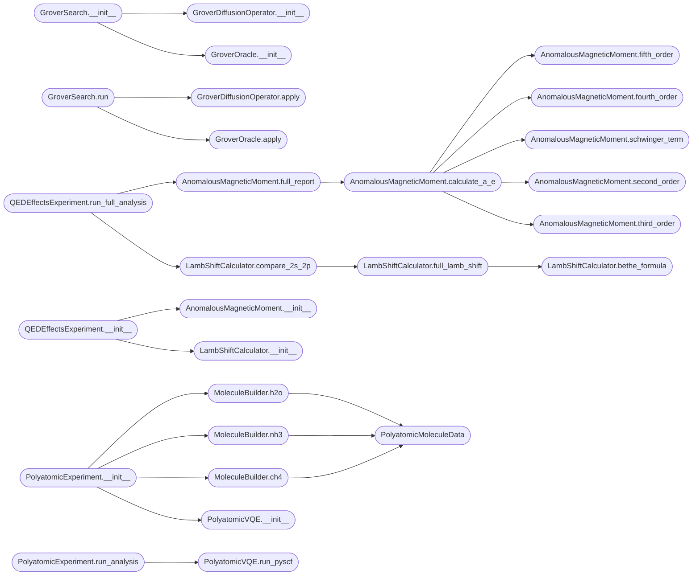

# `advanced_experiments`

> Source: [advanced_experiments.py:1](../../advanced_experiments.py#L1) | language `py` | coverage 81.6% | [API index](../index.md)

Advanced Quantum Experiments - Extension Pack ============================================== Extends the existing quantum simulator with:

1. GROVER'S ALGORITHM - Quantum search using quantum_computer.py
2. QED EFFECTS - Lamb shift, anomalous magnetic moment using relativistic_hydrogen.py
3. POLYATOMIC MOLECULES - H2O, NH3 using molecular_sim.py infrastructure

All built on top of existing PyTorch infrastructure.

Author: Gris Iscomeback
License: AGPL v3

## Contents

- **Classes:** [`GroverConfig`](#groverconfig), [`GroverOracle`](#groveroracle), [`GroverDiffusionOperator`](#groverdiffusionoperator), [`GroverSearch`](#groversearch), [`QEDConfig`](#qedconfig), [`LambShiftCalculator`](#lambshiftcalculator), [`AnomalousMagneticMoment`](#anomalousmagneticmoment), [`QEDEffectsExperiment`](#qedeffectsexperiment), [`PolyatomicMoleculeData`](#polyatomicmoleculedata), [`MoleculeBuilder`](#moleculebuilder), [`PolyatomicVQE`](#polyatomicvqe), [`PolyatomicExperiment`](#polyatomicexperiment), [`AdvancedExperimentRunner`](#advancedexperimentrunner)
- **Functions:** [`main`](#main)
- **Constants:** [`UPLOAD_DIR`](#upload_dir)

## Type Diagram

```mermaid
classDiagram
    direction LR
    class GroverConfig
    GroverConfig : int n_qubits
    GroverConfig : int marked_state
    GroverConfig : int num_iterations
    GroverConfig : str backend
    GroverConfig : int grid_size
    GroverConfig : int hidden_dim
    GroverConfig : int expansion_dim
    GroverConfig : int num_spectral_layers
    GroverConfig : str device
    GroverConfig : str hamiltonian_checkpoint
    GroverConfig : str schrodinger_checkpoint
    GroverConfig : str dirac_checkpoint
    class GroverOracle
    GroverOracle : __init__()
    GroverOracle : apply()
    class GroverDiffusionOperator
    GroverDiffusionOperator : __init__()
    GroverDiffusionOperator : apply()
    class GroverSearch
    GroverSearch : __init__()
    GroverSearch : run()
    class QEDConfig
    QEDConfig : float c_light
    QEDConfig : float alpha_fs
    QEDConfig : float hbar
    QEDConfig : float electron_mass
    QEDConfig : bool include_lamb_shift
    QEDConfig : bool include_anomalous_moment
    QEDConfig : bool include_vacuum_polarization
    QEDConfig : int z_max
    QEDConfig : int n_max
    QEDConfig : int grid_size
    QEDConfig : int hidden_dim
    QEDConfig : int expansion_dim
    QEDConfig : int num_spectral_layers
    QEDConfig : str device
    QEDConfig : str checkpoint_dir
    class LambShiftCalculator
    LambShiftCalculator : __init__()
    LambShiftCalculator : bethe_formula()
    LambShiftCalculator : full_lamb_shift()
    LambShiftCalculator : compare_2s_2p()
    class AnomalousMagneticMoment
    AnomalousMagneticMoment : __init__()
    AnomalousMagneticMoment : schwinger_term()
    AnomalousMagneticMoment : second_order()
    AnomalousMagneticMoment : third_order()
    AnomalousMagneticMoment : fourth_order()
    AnomalousMagneticMoment : fifth_order()
    AnomalousMagneticMoment : calculate_a_e()
    AnomalousMagneticMoment : full_report()
    class QEDEffectsExperiment
    QEDEffectsExperiment : __init__()
    QEDEffectsExperiment : run_full_analysis()
    class PolyatomicMoleculeData
    PolyatomicMoleculeData : str name
    PolyatomicMoleculeData : str formula
    PolyatomicMoleculeData : List[str] atoms
    PolyatomicMoleculeData : List[Tuple[str, Tuple[float, float, floa geometry
    PolyatomicMoleculeData : int n_electrons
    PolyatomicMoleculeData : int n_orbitals
    PolyatomicMoleculeData : int n_qubits
    PolyatomicMoleculeData : str basis
    PolyatomicMoleculeData : str description
    PolyatomicMoleculeData : Optional[float] hf_energy
    PolyatomicMoleculeData : Optional[float] fci_energy
    PolyatomicMoleculeData : Optional[float] nuclear_repulsion
    class MoleculeBuilder
    MoleculeBuilder : BOND_LENGTHS
    MoleculeBuilder : h2o()
    MoleculeBuilder : nh3()
    MoleculeBuilder : ch4()
    class PolyatomicVQE
    PolyatomicVQE : __init__()
    PolyatomicVQE : run_pyscf()
    class PolyatomicExperiment
    PolyatomicExperiment : __init__()
    PolyatomicExperiment : run_analysis()
    PolyatomicExperiment : run_all()
    PolyatomicExperiment : scan_bond_length()
    class AdvancedExperimentRunner
    AdvancedExperimentRunner : __init__()
    AdvancedExperimentRunner : run_grover()
    AdvancedExperimentRunner : run_qed()
    AdvancedExperimentRunner : run_polyatomic()
    AdvancedExperimentRunner : run_all()
```



## Call Graph

Solid arrows stay in this module, dashed arrows leave it.



## Classes

<a id="groverconfig"></a>

### `GroverConfig`

`class` `dataclass` | [advanced_experiments.py:141](../../advanced_experiments.py#L141)

Decorators: `@dataclass`

```python
class GroverConfig
```

Configuration for Grover's algorithm experiments.

**Attributes**

| Name | Type | Default | Description |
|---|---|---|---|
| [`n_qubits`](#groverconfig-n_qubits) | `int` | `3` |  |
| [`marked_state`](#groverconfig-marked_state) | `int` | `5` |  |
| [`num_iterations`](#groverconfig-num_iterations) | `int` | `2` |  |
| [`backend`](#groverconfig-backend) | `str` | `'schrodinger'` |  |
| [`grid_size`](#groverconfig-grid_size) | `int` | `16` |  |
| [`hidden_dim`](#groverconfig-hidden_dim) | `int` | `32` |  |
| [`expansion_dim`](#groverconfig-expansion_dim) | `int` | `64` |  |
| [`num_spectral_layers`](#groverconfig-num_spectral_layers) | `int` | `2` |  |
| [`device`](#groverconfig-device) | `str` | `'cpu'` |  |
| [`hamiltonian_checkpoint`](#groverconfig-hamiltonian_checkpoint) | `str` | `'weights/latest.pth'` |  |
| [`schrodinger_checkpoint`](#groverconfig-schrodinger_checkpoint) | `str` | `'weights/schrodinger_crystal_final.pth'` |  |
| [`dirac_checkpoint`](#groverconfig-dirac_checkpoint) | `str` | `'weights/dirac_phase5_latest.pth'` |  |

---

<a id="groveroracle"></a>

### `GroverOracle`

`class` | [advanced_experiments.py:159](../../advanced_experiments.py#L159)

```python
class GroverOracle
```

Oracle for Grover's algorithm.

Marks the target state by applying a phase flip.

Uses the existing MCZGate from quantum_computer.py for multi-controlled Z.

**Members**

| Member | Kind | Summary |
|---|---|---|
| [`__init__`](#groveroracle-__init__) | constructor |  |
| [`apply`](#groveroracle-apply) | method | Apply oracle: flip phase of marked state. \|x> -> (-1)^{f(x)} \|x> where f(x)=1 only for marked state. |

<a id="groveroracle-__init__"></a>

#### `GroverOracle.__init__`

`constructor` | [advanced_experiments.py:167](../../advanced_experiments.py#L167)

```python
def __init__(self, n_qubits: int, marked_state: int)
```

**Parameters**

| Name | Type | Default | Description |
|---|---|---|---|
| `n_qubits` | `int` |  |  |
| `marked_state` | `int` |  |  |

*Called by:* [`GroverSearch.__init__`](#groversearch-__init__)

<a id="groveroracle-apply"></a>

#### `GroverOracle.apply`

`method` | [advanced_experiments.py:176](../../advanced_experiments.py#L176)

```python
def apply(self, state: 'JointHilbertState', backend: 'IPhysicsBackend') -> 'JointHilbertState'
```

Apply oracle: flip phase of marked state. |x> -> (-1)^{f(x)} |x> where f(x)=1 only for marked state.

Uses amplitude-level phase manipulation for exact implementation.

**Parameters**

| Name | Type | Default | Description |
|---|---|---|---|
| `state` | `'JointHilbertState'` |  |  |
| `backend` | `'IPhysicsBackend'` |  |  |

**Returns:** `'JointHilbertState'`

*Calls:* [`JointHilbertState.__init__`](quantum_computer.py.md#jointhilbertstate-__init__)

*Called by:* [`GroverSearch.run`](#groversearch-run)

---

<a id="groverdiffusionoperator"></a>

### `GroverDiffusionOperator`

`class` | [advanced_experiments.py:194](../../advanced_experiments.py#L194)

```python
class GroverDiffusionOperator
```

Diffusion operator (Grover diffusion / inversion about mean).

D = 2|s><s| - I where |s> = H^⊗n |0>

Implemented using the existing gate infrastructure.

**Members**

| Member | Kind | Summary |
|---|---|---|
| [`__init__`](#groverdiffusionoperator-__init__) | constructor |  |
| [`apply`](#groverdiffusionoperator-apply) | method | Apply diffusion operator using Hadamard + Oracle on \|0> + Hadamard. |

<a id="groverdiffusionoperator-__init__"></a>

#### `GroverDiffusionOperator.__init__`

`constructor` | [advanced_experiments.py:203](../../advanced_experiments.py#L203)

```python
def __init__(self, n_qubits: int)
```

**Parameters**

| Name | Type | Default | Description |
|---|---|---|---|
| `n_qubits` | `int` |  |  |

*Called by:* [`GroverSearch.__init__`](#groversearch-__init__)

<a id="groverdiffusionoperator-apply"></a>

#### `GroverDiffusionOperator.apply`

`method` | [advanced_experiments.py:206](../../advanced_experiments.py#L206)

```python
def apply(self, state: 'JointHilbertState', backend: 'IPhysicsBackend') -> 'JointHilbertState'
```

Apply diffusion operator using Hadamard + Oracle on |0> + Hadamard.

D = H^⊗n (2|0><0| - I) H^⊗n

**Parameters**

| Name | Type | Default | Description |
|---|---|---|---|
| `state` | `'JointHilbertState'` |  |  |
| `backend` | `'IPhysicsBackend'` |  |  |

**Returns:** `'JointHilbertState'`

**Raises**

- `RuntimeError`: (raised in the body, not documented)

*Calls:* [`JointHilbertState.__init__`](quantum_computer.py.md#jointhilbertstate-__init__)

*Called by:* [`GroverSearch.run`](#groversearch-run)

---

<a id="groversearch"></a>

### `GroverSearch`

`class` | [advanced_experiments.py:240](../../advanced_experiments.py#L240)

```python
class GroverSearch
```

Complete Grover's algorithm implementation using existing quantum_computer.py infrastructure.

**Members**

| Member | Kind | Summary |
|---|---|---|
| [`__init__`](#groversearch-__init__) | constructor |  |
| [`run`](#groversearch-run) | method | Run Grover's search algorithm. |

<a id="groversearch-__init__"></a>

#### `GroverSearch.__init__`

`constructor` | [advanced_experiments.py:245](../../advanced_experiments.py#L245)

```python
def __init__(self, config: GroverConfig)
```

**Parameters**

| Name | Type | Default | Description |
|---|---|---|---|
| `config` | `GroverConfig` |  |  |

*Calls:* [`GroverDiffusionOperator.__init__`](#groverdiffusionoperator-__init__), [`GroverOracle.__init__`](#groveroracle-__init__)

*Called by:* [`AdvancedExperimentRunner.run_grover`](#advancedexperimentrunner-run_grover)

<a id="groversearch-run"></a>

#### `GroverSearch.run`

`method` | [advanced_experiments.py:300](../../advanced_experiments.py#L300)

```python
def run(self) -> Dict[str, Any]
```

Run Grover's search algorithm.

**Returns:** `Dict[str, Any]` - Dictionary with results including success probability and evolution history.

*Calls:* [`GroverDiffusionOperator.apply`](#groverdiffusionoperator-apply), [`GroverOracle.apply`](#groveroracle-apply)

*Called by:* [`AdvancedExperimentRunner.run_grover`](#advancedexperimentrunner-run_grover)

---

<a id="qedconfig"></a>

### `QEDConfig`

`class` `dataclass` | [advanced_experiments.py:404](../../advanced_experiments.py#L404)

Decorators: `@dataclass`

```python
class QEDConfig
```

Configuration for QED effects calculations.

**Attributes**

| Name | Type | Default | Description |
|---|---|---|---|
| [`c_light`](#qedconfig-c_light) | `float` | `137.035999084` |  |
| [`alpha_fs`](#qedconfig-alpha_fs) | `float` | `1.0 / 137.035999084` |  |
| [`hbar`](#qedconfig-hbar) | `float` | `1.0` |  |
| [`electron_mass`](#qedconfig-electron_mass) | `float` | `1.0` |  |
| [`include_lamb_shift`](#qedconfig-include_lamb_shift) | `bool` | `True` |  |
| [`include_anomalous_moment`](#qedconfig-include_anomalous_moment) | `bool` | `True` |  |
| [`include_vacuum_polarization`](#qedconfig-include_vacuum_polarization) | `bool` | `True` |  |
| [`z_max`](#qedconfig-z_max) | `int` | `10` |  |
| [`n_max`](#qedconfig-n_max) | `int` | `5` |  |
| [`grid_size`](#qedconfig-grid_size) | `int` | `16` |  |
| [`hidden_dim`](#qedconfig-hidden_dim) | `int` | `32` |  |
| [`expansion_dim`](#qedconfig-expansion_dim) | `int` | `64` |  |
| [`num_spectral_layers`](#qedconfig-num_spectral_layers) | `int` | `2` |  |
| [`device`](#qedconfig-device) | `str` | `'cpu'` |  |
| [`checkpoint_dir`](#qedconfig-checkpoint_dir) | `str` | `'checkpoints_dirac_phase4'` |  |

---

<a id="lambshiftcalculator"></a>

### `LambShiftCalculator`

`class` | [advanced_experiments.py:430](../../advanced_experiments.py#L430)

```python
class LambShiftCalculator
```

Calculates the Lamb shift using Bethe's formula and more accurate methods.

The Lamb shift is the small difference between 2s_{1/2} and 2p_{1/2} energy levels
due to QED effects (vacuum fluctuations and self-energy).

Uses the existing Dirac infrastructure from relativistic_hydrogen.py

**Members**

| Member | Kind | Summary |
|---|---|---|
| [`__init__`](#lambshiftcalculator-__init__) | constructor |  |
| [`bethe_formula`](#lambshiftcalculator-bethe_formula) | method | Bethe's non-relativistic formula for Lamb shift. |
| [`full_lamb_shift`](#lambshiftcalculator-full_lamb_shift) | method | Calculate full Lamb shift including radiative corrections. |
| [`compare_2s_2p`](#lambshiftcalculator-compare_2s_2p) | method | Compare Lamb shift for 2s_{1/2} and 2p_{1/2} states. |

<a id="lambshiftcalculator-__init__"></a>

#### `LambShiftCalculator.__init__`

`constructor` | [advanced_experiments.py:440](../../advanced_experiments.py#L440)

```python
def __init__(self, config: QEDConfig)
```

**Parameters**

| Name | Type | Default | Description |
|---|---|---|---|
| `config` | `QEDConfig` |  |  |

*Calls:* [`DiracHydrogenAtom.__init__`](quantum_simulator.py.md#dirachydrogenatom-__init__)

*Called by:* [`QEDEffectsExperiment.__init__`](#qedeffectsexperiment-__init__)

<a id="lambshiftcalculator-bethe_formula"></a>

#### `LambShiftCalculator.bethe_formula`

`method` | [advanced_experiments.py:462](../../advanced_experiments.py#L462)

```python
def bethe_formula(self, n: int, l: int, Z: int = 1) -> float
```

Bethe's non-relativistic formula for Lamb shift.

ΔE_Lamb = (8α^3 / 3πn^3) * |ψ_n(0)|^2 * ln(E_avg / E_n)

For s-states: |ψ_n(0)|^2 = Z^3 / (π n^3 a0^3)

**Parameters**

| Name | Type | Default | Description |
|---|---|---|---|
| `n` | `int` |  | Principal quantum number |
| `l` | `int` |  | Angular momentum quantum number |
| `Z` | `int` | `1` | Nuclear charge (default 1 for hydrogen) |

**Returns:** `float` - Lamb shift in atomic units

*Called by:* [`LambShiftCalculator.full_lamb_shift`](#lambshiftcalculator-full_lamb_shift), [`LambShiftCalculator.full_lamb_shift`](quantum_framework_physics.py.md#lambshiftcalculator-full_lamb_shift)

<a id="lambshiftcalculator-full_lamb_shift"></a>

#### `LambShiftCalculator.full_lamb_shift`

`method` | [advanced_experiments.py:518](../../advanced_experiments.py#L518)

```python
def full_lamb_shift(self, n: int, l: int, j: float, Z: int = 1) -> Dict[str, float]
```

Calculate full Lamb shift including radiative corrections.

ΔE = ΔE_SE + ΔE_Uehling + ΔE_rel

Where:
- ΔE_SE: Self-energy (main contribution)
- ΔE_Uehling: Vacuum polarization (Uehling potential)
- ΔE_rel: Relativistic corrections

**Parameters**

| Name | Type | Default | Description |
|---|---|---|---|
| `n` | `int` |  |  |
| `l` | `int` |  |  |
| `j` | `float` |  |  |
| `Z` | `int` | `1` |  |

**Returns:** `Dict[str, float]`

*Calls:* [`LambShiftCalculator.bethe_formula`](#lambshiftcalculator-bethe_formula)

*Called by:* [`LambShiftCalculator.compare_2s_2p`](#lambshiftcalculator-compare_2s_2p)

<a id="lambshiftcalculator-compare_2s_2p"></a>

#### `LambShiftCalculator.compare_2s_2p`

`method` | [advanced_experiments.py:558](../../advanced_experiments.py#L558)

```python
def compare_2s_2p(self, Z: int = 1) -> Dict[str, Any]
```

Compare Lamb shift for 2s_{1/2} and 2p_{1/2} states.

This is the classic Lamb shift measurement: the 2s_{1/2} - 2p_{1/2} splitting.
Experimentally: ~1057.8 MHz

**Parameters**

| Name | Type | Default | Description |
|---|---|---|---|
| `Z` | `int` | `1` |  |

**Returns:** `Dict[str, Any]`

*Calls:* [`LambShiftCalculator.full_lamb_shift`](#lambshiftcalculator-full_lamb_shift)

*Called by:* [`QEDEffectsExperiment.run_full_analysis`](#qedeffectsexperiment-run_full_analysis)

---

<a id="anomalousmagneticmoment"></a>

### `AnomalousMagneticMoment`

`class` | [advanced_experiments.py:595](../../advanced_experiments.py#L595)

```python
class AnomalousMagneticMoment
```

Calculates the electron's anomalous magnetic moment (g-2).

The electron g-factor is slightly different from 2 due to QED effects:
g = 2(1 + a_e) where a_e = α/(2π) + higher-order terms

Uses the existing Dirac infrastructure for baseline calculations.

**Members**

| Member | Kind | Summary |
|---|---|---|
| [`__init__`](#anomalousmagneticmoment-__init__) | constructor |  |
| [`schwinger_term`](#anomalousmagneticmoment-schwinger_term) | method | Schwinger's first-order result: a_e = α/(2π) |
| [`second_order`](#anomalousmagneticmoment-second_order) | method | Second-order correction: (α/π)^2 * C_2 C_2 ≈ 0.328478965... |
| [`third_order`](#anomalousmagneticmoment-third_order) | method | Third-order correction: (α/π)^3 * C_3 C_3 ≈ 1.181241456... |
| [`fourth_order`](#anomalousmagneticmoment-fourth_order) | method | Fourth-order correction: (α/π)^4 * C_4 C_4 ≈ -1.9144(35) |
| [`fifth_order`](#anomalousmagneticmoment-fifth_order) | method | Fifth-order correction: (α/π)^5 * C_5 C_5 ≈ 7.7(1.1) |
| [`calculate_a_e`](#anomalousmagneticmoment-calculate_a_e) | method | Calculate anomalous magnetic moment to specified order. |
| [`full_report`](#anomalousmagneticmoment-full_report) | method | Generate a full report on g-2 calculations. |

<a id="anomalousmagneticmoment-__init__"></a>

#### `AnomalousMagneticMoment.__init__`

`constructor` | [advanced_experiments.py:605](../../advanced_experiments.py#L605)

```python
def __init__(self, config: QEDConfig)
```

**Parameters**

| Name | Type | Default | Description |
|---|---|---|---|
| `config` | `QEDConfig` |  |  |

*Called by:* [`QEDEffectsExperiment.__init__`](#qedeffectsexperiment-__init__)

<a id="anomalousmagneticmoment-schwinger_term"></a>

#### `AnomalousMagneticMoment.schwinger_term`

`method` | [advanced_experiments.py:611](../../advanced_experiments.py#L611)

```python
def schwinger_term(self) -> float
```

Schwinger's first-order result: a_e = α/(2π)

This is the leading QED correction.

**Returns:** `float`

*Called by:* [`AnomalousMagneticMoment.calculate_a_e`](#anomalousmagneticmoment-calculate_a_e), [`AnomalousMagneticMoment.calculate_a_e`](quantum_framework_physics.py.md#anomalousmagneticmoment-calculate_a_e)

<a id="anomalousmagneticmoment-second_order"></a>

#### `AnomalousMagneticMoment.second_order`

`method` | [advanced_experiments.py:619](../../advanced_experiments.py#L619)

```python
def second_order(self) -> float
```

Second-order correction: (α/π)^2 * C_2 C_2 ≈ 0.328478965...

**Returns:** `float`

*Called by:* [`AnomalousMagneticMoment.calculate_a_e`](#anomalousmagneticmoment-calculate_a_e), [`AnomalousMagneticMoment.calculate_a_e`](quantum_framework_physics.py.md#anomalousmagneticmoment-calculate_a_e)

<a id="anomalousmagneticmoment-third_order"></a>

#### `AnomalousMagneticMoment.third_order`

`method` | [advanced_experiments.py:627](../../advanced_experiments.py#L627)

```python
def third_order(self) -> float
```

Third-order correction: (α/π)^3 * C_3 C_3 ≈ 1.181241456...

**Returns:** `float`

*Called by:* [`AnomalousMagneticMoment.calculate_a_e`](#anomalousmagneticmoment-calculate_a_e), [`AnomalousMagneticMoment.calculate_a_e`](quantum_framework_physics.py.md#anomalousmagneticmoment-calculate_a_e)

<a id="anomalousmagneticmoment-fourth_order"></a>

#### `AnomalousMagneticMoment.fourth_order`

`method` | [advanced_experiments.py:635](../../advanced_experiments.py#L635)

```python
def fourth_order(self) -> float
```

Fourth-order correction: (α/π)^4 * C_4 C_4 ≈ -1.9144(35)

**Returns:** `float`

*Called by:* [`AnomalousMagneticMoment.calculate_a_e`](#anomalousmagneticmoment-calculate_a_e), [`AnomalousMagneticMoment.calculate_a_e`](quantum_framework_physics.py.md#anomalousmagneticmoment-calculate_a_e)

<a id="anomalousmagneticmoment-fifth_order"></a>

#### `AnomalousMagneticMoment.fifth_order`

`method` | [advanced_experiments.py:643](../../advanced_experiments.py#L643)

```python
def fifth_order(self) -> float
```

Fifth-order correction: (α/π)^5 * C_5 C_5 ≈ 7.7(1.1)

**Returns:** `float`

*Called by:* [`AnomalousMagneticMoment.calculate_a_e`](#anomalousmagneticmoment-calculate_a_e), [`AnomalousMagneticMoment.calculate_a_e`](quantum_framework_physics.py.md#anomalousmagneticmoment-calculate_a_e)

<a id="anomalousmagneticmoment-calculate_a_e"></a>

#### `AnomalousMagneticMoment.calculate_a_e`

`method` | [advanced_experiments.py:651](../../advanced_experiments.py#L651)

```python
def calculate_a_e(self, order: int = 5) -> Dict[str, float]
```

Calculate anomalous magnetic moment to specified order.

**Parameters**

| Name | Type | Default | Description |
|---|---|---|---|
| `order` | `int` | `5` | Maximum order to include (1-5) |

**Returns:** `Dict[str, float]` - Dictionary with contributions at each order

*Calls:* [`AnomalousMagneticMoment.fifth_order`](#anomalousmagneticmoment-fifth_order), [`AnomalousMagneticMoment.fourth_order`](#anomalousmagneticmoment-fourth_order), [`AnomalousMagneticMoment.schwinger_term`](#anomalousmagneticmoment-schwinger_term), [`AnomalousMagneticMoment.second_order`](#anomalousmagneticmoment-second_order), [`AnomalousMagneticMoment.third_order`](#anomalousmagneticmoment-third_order)

*Called by:* [`AnomalousMagneticMoment.full_report`](#anomalousmagneticmoment-full_report)

<a id="anomalousmagneticmoment-full_report"></a>

#### `AnomalousMagneticMoment.full_report`

`method` | [advanced_experiments.py:686](../../advanced_experiments.py#L686)

```python
def full_report(self) -> Dict[str, Any]
```

Generate a full report on g-2 calculations.

**Returns:** `Dict[str, Any]`

*Calls:* [`AnomalousMagneticMoment.calculate_a_e`](#anomalousmagneticmoment-calculate_a_e)

*Called by:* [`QEDEffectsExperiment.run_full_analysis`](#qedeffectsexperiment-run_full_analysis)

---

<a id="qedeffectsexperiment"></a>

### `QEDEffectsExperiment`

`class` | [advanced_experiments.py:722](../../advanced_experiments.py#L722)

```python
class QEDEffectsExperiment
```

Complete QED effects experiment combining Lamb shift and g-2.

Uses existing relativistic_hydrogen.py infrastructure.

**Members**

| Member | Kind | Summary |
|---|---|---|
| [`__init__`](#qedeffectsexperiment-__init__) | constructor |  |
| [`run_full_analysis`](#qedeffectsexperiment-run_full_analysis) | method | Run complete QED analysis. |

<a id="qedeffectsexperiment-__init__"></a>

#### `QEDEffectsExperiment.__init__`

`constructor` | [advanced_experiments.py:728](../../advanced_experiments.py#L728)

```python
def __init__(self, config: QEDConfig)
```

**Parameters**

| Name | Type | Default | Description |
|---|---|---|---|
| `config` | `QEDConfig` |  |  |

*Calls:* [`AnomalousMagneticMoment.__init__`](#anomalousmagneticmoment-__init__), [`LambShiftCalculator.__init__`](#lambshiftcalculator-__init__)

*Called by:* [`AdvancedExperimentRunner.run_qed`](#advancedexperimentrunner-run_qed)

<a id="qedeffectsexperiment-run_full_analysis"></a>

#### `QEDEffectsExperiment.run_full_analysis`

`method` | [advanced_experiments.py:736](../../advanced_experiments.py#L736)

```python
def run_full_analysis(self) -> Dict[str, Any]
```

Run complete QED analysis.

**Returns:** `Dict[str, Any]`

*Calls:* [`AnomalousMagneticMoment.full_report`](#anomalousmagneticmoment-full_report), [`LambShiftCalculator.compare_2s_2p`](#lambshiftcalculator-compare_2s_2p)

*Called by:* [`AdvancedExperimentRunner.run_qed`](#advancedexperimentrunner-run_qed)

---

<a id="polyatomicmoleculedata"></a>

### `PolyatomicMoleculeData`

`class` `dataclass` | [advanced_experiments.py:831](../../advanced_experiments.py#L831)

Decorators: `@dataclass`

```python
class PolyatomicMoleculeData
```

Data for polyatomic molecules.

**Attributes**

| Name | Type | Default | Description |
|---|---|---|---|
| [`name`](#polyatomicmoleculedata-name) | `str` |  |  |
| [`formula`](#polyatomicmoleculedata-formula) | `str` |  |  |
| [`atoms`](#polyatomicmoleculedata-atoms) | `List[str]` |  |  |
| [`geometry`](#polyatomicmoleculedata-geometry) | `List[Tuple[str, Tuple[float, float, float]]]` |  |  |
| [`n_electrons`](#polyatomicmoleculedata-n_electrons) | `int` |  |  |
| [`n_orbitals`](#polyatomicmoleculedata-n_orbitals) | `int` |  |  |
| [`n_qubits`](#polyatomicmoleculedata-n_qubits) | `int` |  |  |
| [`basis`](#polyatomicmoleculedata-basis) | `str` | `'sto-3g'` |  |
| [`description`](#polyatomicmoleculedata-description) | `str` | `''` |  |
| [`hf_energy`](#polyatomicmoleculedata-hf_energy) | `Optional[float]` | `None` |  |
| [`fci_energy`](#polyatomicmoleculedata-fci_energy) | `Optional[float]` | `None` |  |
| [`nuclear_repulsion`](#polyatomicmoleculedata-nuclear_repulsion) | `Optional[float]` | `None` |  |

---

<a id="moleculebuilder"></a>

### `MoleculeBuilder`

`class` | [advanced_experiments.py:849](../../advanced_experiments.py#L849)

```python
class MoleculeBuilder
```

Build molecule data for VQE calculations.

Uses existing molecular_sim.py infrastructure.

**Attributes**

| Name | Type | Default | Description |
|---|---|---|---|
| [`BOND_LENGTHS`](#moleculebuilder-bond_lengths) |  | `{'OH': 0.9575, 'HOH': 104.5, 'NH': 1.012, 'HNH': 107.0, 'CC': 1.54, 'CH': 1.09}` |  |

**Members**

| Member | Kind | Summary |
|---|---|---|
| [`h2o`](#moleculebuilder-h2o) | staticmethod | Build water molecule geometry. |
| [`nh3`](#moleculebuilder-nh3) | staticmethod | Build ammonia molecule geometry. |
| [`ch4`](#moleculebuilder-ch4) | staticmethod | Build methane molecule geometry. |

<a id="moleculebuilder-h2o"></a>

#### `MoleculeBuilder.h2o`

`staticmethod` | [advanced_experiments.py:866](../../advanced_experiments.py#L866)

Decorators: `@staticmethod`

```python
def h2o(bond_length: float = None, angle_deg: float = None) -> PolyatomicMoleculeData
```

Build water molecule geometry.

H2O geometry:
    H1 at (0, 0, 0)
    O  at (r_OH, 0, 0)
    H2 at (r_OH + r_OH*cos(θ), r_OH*sin(θ), 0)

**Parameters**

| Name | Type | Default | Description |
|---|---|---|---|
| `bond_length` | `float` | `None` |  |
| `angle_deg` | `float` | `None` |  |

**Returns:** `PolyatomicMoleculeData`

*Calls:* [`PolyatomicMoleculeData`](#polyatomicmoleculedata)

*Called by:* [`PolyatomicExperiment.__init__`](#polyatomicexperiment-__init__), [`PolyatomicExperiment.scan_bond_length`](#polyatomicexperiment-scan_bond_length), [`run_vqe`](quantum_framework_molecular_v2.py.md#run_vqe)

<a id="moleculebuilder-nh3"></a>

#### `MoleculeBuilder.nh3`

`staticmethod` | [advanced_experiments.py:898](../../advanced_experiments.py#L898)

Decorators: `@staticmethod`

```python
def nh3(bond_length: float = None, angle_deg: float = None) -> PolyatomicMoleculeData
```

Build ammonia molecule geometry.

NH3 has trigonal pyramidal geometry.

**Parameters**

| Name | Type | Default | Description |
|---|---|---|---|
| `bond_length` | `float` | `None` |  |
| `angle_deg` | `float` | `None` |  |

**Returns:** `PolyatomicMoleculeData`

*Calls:* [`PolyatomicMoleculeData`](#polyatomicmoleculedata)

*Called by:* [`PolyatomicExperiment.__init__`](#polyatomicexperiment-__init__), [`PolyatomicExperiment.scan_bond_length`](#polyatomicexperiment-scan_bond_length)

<a id="moleculebuilder-ch4"></a>

#### `MoleculeBuilder.ch4`

`staticmethod` | [advanced_experiments.py:933](../../advanced_experiments.py#L933)

Decorators: `@staticmethod`

```python
def ch4(bond_length: float = None) -> PolyatomicMoleculeData
```

Build methane molecule geometry.

CH4 has tetrahedral geometry.

**Parameters**

| Name | Type | Default | Description |
|---|---|---|---|
| `bond_length` | `float` | `None` |  |

**Returns:** `PolyatomicMoleculeData`

*Calls:* [`PolyatomicMoleculeData`](#polyatomicmoleculedata)

*Called by:* [`PolyatomicExperiment.__init__`](#polyatomicexperiment-__init__)

---

<a id="polyatomicvqe"></a>

### `PolyatomicVQE`

`class` | [advanced_experiments.py:970](../../advanced_experiments.py#L970)

```python
class PolyatomicVQE
```

VQE solver for polyatomic molecules.

Uses existing molecular_sim.py infrastructure.

**Members**

| Member | Kind | Summary |
|---|---|---|
| [`__init__`](#polyatomicvqe-__init__) | constructor |  |
| [`run_pyscf`](#polyatomicvqe-run_pyscf) | method | Run PySCF calculation for the molecule. |

<a id="polyatomicvqe-__init__"></a>

#### `PolyatomicVQE.__init__`

`constructor` | [advanced_experiments.py:976](../../advanced_experiments.py#L976)

```python
def __init__(self, config: Optional['SimulatorConfig'] = None)
```

**Parameters**

| Name | Type | Default | Description |
|---|---|---|---|
| `config` | `Optional['SimulatorConfig']` | `None` |  |

*Calls:* [`QuantumComputer.__init__`](quantum_computer.py.md#quantumcomputer-__init__), [`SimulatorConfig`](quantum_computer.py.md#simulatorconfig)

*Called by:* [`PolyatomicExperiment.__init__`](#polyatomicexperiment-__init__)

<a id="polyatomicvqe-run_pyscf"></a>

#### `PolyatomicVQE.run_pyscf`

`method` | [advanced_experiments.py:999](../../advanced_experiments.py#L999)

```python
def run_pyscf(self, molecule: PolyatomicMoleculeData) -> Dict[str, Any]
```

Run PySCF calculation for the molecule.

**Parameters**

| Name | Type | Default | Description |
|---|---|---|---|
| `molecule` | `PolyatomicMoleculeData` |  |  |

**Returns:** `Dict[str, Any]`

*Called by:* [`PolyatomicExperiment.run_analysis`](#polyatomicexperiment-run_analysis), [`PolyatomicExperiment.scan_bond_length`](#polyatomicexperiment-scan_bond_length), [`build_jw_hamiltonian_of`](molecular_sim.py.md#build_jw_hamiltonian_of), [`HamiltonianBuilder.build_jw_hamiltonian`](quantum_framework_molecular_v2.py.md#hamiltonianbuilder-build_jw_hamiltonian), [`MoleculeBuilder.build`](quantum_framework_molecular_v2.py.md#moleculebuilder-build)

---

<a id="polyatomicexperiment"></a>

### `PolyatomicExperiment`

`class` | [advanced_experiments.py:1105](../../advanced_experiments.py#L1105)

```python
class PolyatomicExperiment
```

Complete polyatomic molecule experiment.

**Members**

| Member | Kind | Summary |
|---|---|---|
| [`__init__`](#polyatomicexperiment-__init__) | constructor |  |
| [`run_analysis`](#polyatomicexperiment-run_analysis) | method | Run complete analysis for a molecule. |
| [`run_all`](#polyatomicexperiment-run_all) | method | Run analysis for all molecules. |
| [`scan_bond_length`](#polyatomicexperiment-scan_bond_length) | method | Scan potential energy surface by varying bond length. |

<a id="polyatomicexperiment-__init__"></a>

#### `PolyatomicExperiment.__init__`

`constructor` | [advanced_experiments.py:1110](../../advanced_experiments.py#L1110)

```python
def __init__(self, config: Optional['SimulatorConfig'] = None)
```

**Parameters**

| Name | Type | Default | Description |
|---|---|---|---|
| `config` | `Optional['SimulatorConfig']` | `None` |  |

*Calls:* [`MoleculeBuilder.ch4`](#moleculebuilder-ch4), [`MoleculeBuilder.h2o`](#moleculebuilder-h2o), [`MoleculeBuilder.nh3`](#moleculebuilder-nh3), [`PolyatomicVQE.__init__`](#polyatomicvqe-__init__)

*Called by:* [`AdvancedExperimentRunner.run_polyatomic`](#advancedexperimentrunner-run_polyatomic)

<a id="polyatomicexperiment-run_analysis"></a>

#### `PolyatomicExperiment.run_analysis`

`method` | [advanced_experiments.py:1123](../../advanced_experiments.py#L1123)

```python
def run_analysis(self, molecule_name: str = 'H2O') -> Dict[str, Any]
```

Run complete analysis for a molecule.

**Parameters**

| Name | Type | Default | Description |
|---|---|---|---|
| `molecule_name` | `str` | `'H2O'` |  |

**Returns:** `Dict[str, Any]`

**Raises**

- `ValueError`: (raised in the body, not documented)

*Calls:* [`PolyatomicVQE.run_pyscf`](#polyatomicvqe-run_pyscf)

*Called by:* [`AdvancedExperimentRunner.run_polyatomic`](#advancedexperimentrunner-run_polyatomic), [`PolyatomicExperiment.run_all`](#polyatomicexperiment-run_all)

<a id="polyatomicexperiment-run_all"></a>

#### `PolyatomicExperiment.run_all`

`method` | [advanced_experiments.py:1164](../../advanced_experiments.py#L1164)

```python
def run_all(self) -> Dict[str, Dict]
```

Run analysis for all molecules.

**Returns:** `Dict[str, Dict]`

*Calls:* [`PolyatomicExperiment.run_analysis`](#polyatomicexperiment-run_analysis)

<a id="polyatomicexperiment-scan_bond_length"></a>

#### `PolyatomicExperiment.scan_bond_length`

`method` | [advanced_experiments.py:1175](../../advanced_experiments.py#L1175)

```python
def scan_bond_length(self, molecule_name: str = 'H2O', r_min: float = 0.7, r_max: float = 1.3, n_points: int = 10) -> Dict[str, Any]
```

Scan potential energy surface by varying bond length.

**Parameters**

| Name | Type | Default | Description |
|---|---|---|---|
| `molecule_name` | `str` | `'H2O'` |  |
| `r_min` | `float` | `0.7` |  |
| `r_max` | `float` | `1.3` |  |
| `n_points` | `int` | `10` |  |

**Returns:** `Dict[str, Any]`

*Calls:* [`MoleculeBuilder.h2o`](#moleculebuilder-h2o), [`MoleculeBuilder.nh3`](#moleculebuilder-nh3), [`PolyatomicVQE.run_pyscf`](#polyatomicvqe-run_pyscf)

---

<a id="advancedexperimentrunner"></a>

### `AdvancedExperimentRunner`

`class` | [advanced_experiments.py:1223](../../advanced_experiments.py#L1223)

```python
class AdvancedExperimentRunner
```

Runs all three advanced experiments.

**Members**

| Member | Kind | Summary |
|---|---|---|
| [`__init__`](#advancedexperimentrunner-__init__) | constructor |  |
| [`run_grover`](#advancedexperimentrunner-run_grover) | method | Run Grover's algorithm experiment. |
| [`run_qed`](#advancedexperimentrunner-run_qed) | method | Run QED effects experiment. |
| [`run_polyatomic`](#advancedexperimentrunner-run_polyatomic) | method | Run polyatomic molecule experiment. |
| [`run_all`](#advancedexperimentrunner-run_all) | method | Run all experiments. |

<a id="advancedexperimentrunner-__init__"></a>

#### `AdvancedExperimentRunner.__init__`

`constructor` | [advanced_experiments.py:1228](../../advanced_experiments.py#L1228)

```python
def __init__(self)
```

*Called by:* [`main`](#main)

<a id="advancedexperimentrunner-run_grover"></a>

#### `AdvancedExperimentRunner.run_grover`

`method` | [advanced_experiments.py:1235](../../advanced_experiments.py#L1235)

```python
def run_grover(self, n_qubits: int = 3, marked_state: int = 5) -> Dict
```

Run Grover's algorithm experiment.

**Parameters**

| Name | Type | Default | Description |
|---|---|---|---|
| `n_qubits` | `int` | `3` |  |
| `marked_state` | `int` | `5` |  |

**Returns:** `Dict`

*Calls:* [`GroverConfig`](#groverconfig), [`GroverSearch.__init__`](#groversearch-__init__), [`GroverSearch.run`](#groversearch-run)

*Called by:* [`AdvancedExperimentRunner.run_all`](#advancedexperimentrunner-run_all), [`main`](#main)

<a id="advancedexperimentrunner-run_qed"></a>

#### `AdvancedExperimentRunner.run_qed`

`method` | [advanced_experiments.py:1252](../../advanced_experiments.py#L1252)

```python
def run_qed(self) -> Dict
```

Run QED effects experiment.

**Returns:** `Dict`

*Calls:* [`QEDConfig`](#qedconfig), [`QEDEffectsExperiment.__init__`](#qedeffectsexperiment-__init__), [`QEDEffectsExperiment.run_full_analysis`](#qedeffectsexperiment-run_full_analysis)

*Called by:* [`AdvancedExperimentRunner.run_all`](#advancedexperimentrunner-run_all), [`main`](#main)

<a id="advancedexperimentrunner-run_polyatomic"></a>

#### `AdvancedExperimentRunner.run_polyatomic`

`method` | [advanced_experiments.py:1266](../../advanced_experiments.py#L1266)

```python
def run_polyatomic(self, molecule: str = 'H2O') -> Dict
```

Run polyatomic molecule experiment.

**Parameters**

| Name | Type | Default | Description |
|---|---|---|---|
| `molecule` | `str` | `'H2O'` |  |

**Returns:** `Dict`

*Calls:* [`PolyatomicExperiment.__init__`](#polyatomicexperiment-__init__), [`PolyatomicExperiment.run_analysis`](#polyatomicexperiment-run_analysis)

*Called by:* [`AdvancedExperimentRunner.run_all`](#advancedexperimentrunner-run_all), [`main`](#main)

<a id="advancedexperimentrunner-run_all"></a>

#### `AdvancedExperimentRunner.run_all`

`method` | [advanced_experiments.py:1278](../../advanced_experiments.py#L1278)

```python
def run_all(self) -> Dict
```

Run all experiments.

**Returns:** `Dict`

*Calls:* [`AdvancedExperimentRunner.run_grover`](#advancedexperimentrunner-run_grover), [`AdvancedExperimentRunner.run_polyatomic`](#advancedexperimentrunner-run_polyatomic), [`AdvancedExperimentRunner.run_qed`](#advancedexperimentrunner-run_qed)

*Called by:* [`main`](#main)

---

## Functions

<a id="main"></a>

### `main`

`function` | [advanced_experiments.py:1304](../../advanced_experiments.py#L1304)

```python
def main()
```

Main entry point.

*Calls:* [`AdvancedExperimentRunner.__init__`](#advancedexperimentrunner-__init__), [`AdvancedExperimentRunner.run_all`](#advancedexperimentrunner-run_all), [`AdvancedExperimentRunner.run_grover`](#advancedexperimentrunner-run_grover), [`AdvancedExperimentRunner.run_polyatomic`](#advancedexperimentrunner-run_polyatomic), [`AdvancedExperimentRunner.run_qed`](#advancedexperimentrunner-run_qed)

---

## Constants

<a id="upload_dir"></a>

### `UPLOAD_DIR`

`constant` | [advanced_experiments.py:40](../../advanced_experiments.py#L40)

```python
UPLOAD_DIR = os.path.dirname(os.path.abspath(__file__))
```

---
