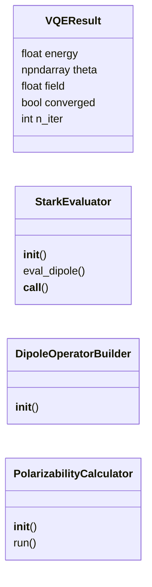
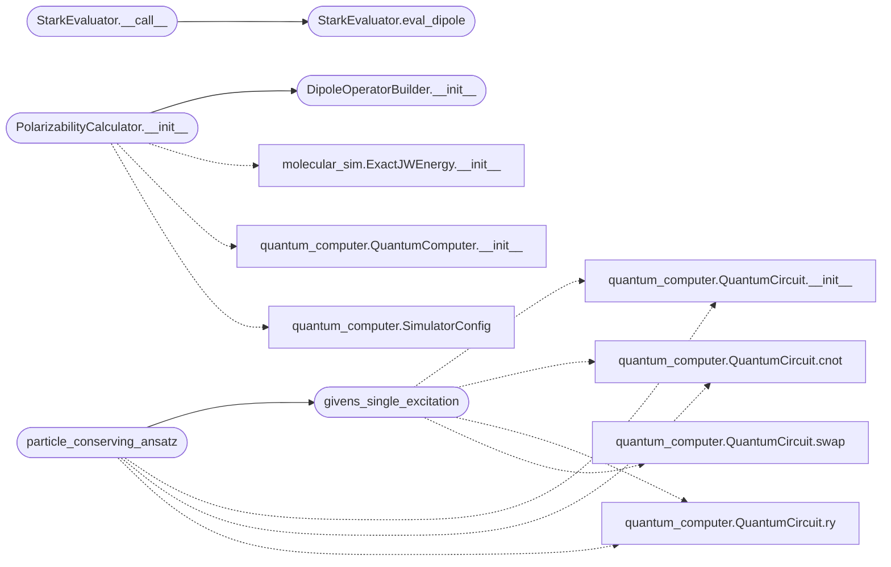

# `app`

> Source: [app.py:1](../../app.py#L1) | language `py` | coverage 23.1% | [API index](../index.md)

app.py — Corrected with proper particle-conserving ansatz =======================================================================

Root cause identified: The uccsd() function in molecular_sim.py implements
singles excitations incorrectly. For excitation (o→v), it does:
    CNOT ladder → RY(v) → CNOT ladder inverse
This ADDS an electron at v without REMOVING from o, producing |1110⟩
instead of |0110⟩. The states reachable by uccsd never include |0110⟩
or |1001⟩, which are exactly the states the dipole operator connects
to |1100⟩ (HF). Hence <μ>=0 always, giving α=0.

## Contents

- **Classes:** [`VQEResult`](#vqeresult), [`StarkEvaluator`](#starkevaluator), [`DipoleOperatorBuilder`](#dipoleoperatorbuilder), [`PolarizabilityCalculator`](#polarizabilitycalculator)
- **Functions:** [`givens_single_excitation`](#givens_single_excitation), [`particle_conserving_ansatz`](#particle_conserving_ansatz)

## Type Diagram



## Call Graph

Solid arrows stay in this module, dashed arrows leave it.



## Classes

<a id="vqeresult"></a>

### `VQEResult`

`class` `dataclass` | [app.py:39](../../app.py#L39)

Decorators: `@dataclass`

```python
class VQEResult
```

**Attributes**

| Name | Type | Default | Description |
|---|---|---|---|
| [`energy`](#vqeresult-energy) | `float` |  |  |
| [`theta`](#vqeresult-theta) | `np.ndarray` |  |  |
| [`field`](#vqeresult-field) | `float` |  |  |
| [`converged`](#vqeresult-converged) | `bool` |  |  |
| [`n_iter`](#vqeresult-n_iter) | `int` |  |  |

---

<a id="starkevaluator"></a>

### `StarkEvaluator`

`class` | [app.py:151](../../app.py#L151)

```python
class StarkEvaluator
```

**Members**

| Member | Kind | Summary |
|---|---|---|
| [`__init__`](#starkevaluator-__init__) | constructor |  |
| [`eval_dipole`](#starkevaluator-eval_dipole) | method |  |
| [`__call__`](#starkevaluator-__call__) | method |  |

<a id="starkevaluator-__init__"></a>

#### `StarkEvaluator.__init__`

`constructor` | [app.py:152](../../app.py#L152)

```python
def __init__(self, base_hamiltonian, dipole_paulis, dipole_identity, field, n_qubits)
```

**Parameters**

| Name | Type | Default | Description |
|---|---|---|---|
| `base_hamiltonian` |  |  |  |
| `dipole_paulis` |  |  |  |
| `dipole_identity` |  |  |  |
| `field` |  |  |  |
| `n_qubits` |  |  |  |

<a id="starkevaluator-eval_dipole"></a>

#### `StarkEvaluator.eval_dipole`

`method` | [app.py:184](../../app.py#L184)

```python
def eval_dipole(self, amps_raw)
```

**Parameters**

| Name | Type | Default | Description |
|---|---|---|---|
| `amps_raw` |  |  |  |

*Called by:* [`StarkEvaluator.__call__`](#starkevaluator-__call__), [`StarkEvaluator.__call__`](polarizability_v3.py.md#starkevaluator-__call__)

<a id="starkevaluator-__call__"></a>

#### `StarkEvaluator.__call__`

`method` | [app.py:197](../../app.py#L197)

```python
def __call__(self, amps)
```

**Parameters**

| Name | Type | Default | Description |
|---|---|---|---|
| `amps` |  |  |  |

*Calls:* [`StarkEvaluator.eval_dipole`](#starkevaluator-eval_dipole)

---

<a id="dipoleoperatorbuilder"></a>

### `DipoleOperatorBuilder`

`class` | [app.py:203](../../app.py#L203)

```python
class DipoleOperatorBuilder
```

**Members**

| Member | Kind | Summary |
|---|---|---|
| [`__init__`](#dipoleoperatorbuilder-__init__) | constructor |  |

<a id="dipoleoperatorbuilder-__init__"></a>

#### `DipoleOperatorBuilder.__init__`

`constructor` | [app.py:204](../../app.py#L204)

```python
def __init__(self, bond_length_angstrom=0.735)
```

**Parameters**

| Name | Type | Default | Description |
|---|---|---|---|
| `bond_length_angstrom` |  | `0.735` |  |

*Called by:* [`PolarizabilityCalculator.__init__`](#polarizabilitycalculator-__init__)

---

<a id="polarizabilitycalculator"></a>

### `PolarizabilityCalculator`

`class` | [app.py:237](../../app.py#L237)

```python
class PolarizabilityCalculator
```

**Members**

| Member | Kind | Summary |
|---|---|---|
| [`__init__`](#polarizabilitycalculator-__init__) | constructor |  |
| [`run`](#polarizabilitycalculator-run) | method |  |

<a id="polarizabilitycalculator-__init__"></a>

#### `PolarizabilityCalculator.__init__`

`constructor` | [app.py:238](../../app.py#L238)

```python
def __init__(self)
```

*Calls:* [`DipoleOperatorBuilder.__init__`](#dipoleoperatorbuilder-__init__), [`ExactJWEnergy.__init__`](molecular_sim.py.md#exactjwenergy-__init__), [`QuantumComputer.__init__`](quantum_computer.py.md#quantumcomputer-__init__), [`SimulatorConfig`](quantum_computer.py.md#simulatorconfig)

<a id="polarizabilitycalculator-run"></a>

#### `PolarizabilityCalculator.run`

`method` | [app.py:303](../../app.py#L303)

```python
def run(self)
```

---

## Functions

<a id="givens_single_excitation"></a>

### `givens_single_excitation`

`function` | [app.py:61](../../app.py#L61)

```python
def givens_single_excitation(state, o, v, theta, n_qubits, backend)
```

Apply a particle-conserving single excitation rotation between qubits o (occupied) and v (virtual).

Rotates in the {|1_o 0_v⟩, |0_o 1_v⟩} subspace:
    |1_o 0_v⟩ → cos(θ)|1_o 0_v⟩ + sin(θ)|0_o 1_v⟩
    |0_o 1_v⟩ → -sin(θ)|1_o 0_v⟩ + cos(θ)|0_o 1_v⟩

For adjacent qubits: CNOT(v,o) → RY(v, 2θ) → CNOT(v,o)
For non-adjacent: SWAP chain to make adjacent, apply, SWAP back.

**Parameters**

| Name | Type | Default | Description |
|---|---|---|---|
| `state` |  |  |  |
| `o` |  |  |  |
| `v` |  |  |  |
| `theta` |  |  |  |
| `n_qubits` |  |  |  |
| `backend` |  |  |  |

*Calls:* [`QuantumCircuit.__init__`](quantum_computer.py.md#quantumcircuit-__init__), [`QuantumCircuit.cnot`](quantum_computer.py.md#quantumcircuit-cnot), [`QuantumCircuit.ry`](quantum_computer.py.md#quantumcircuit-ry), [`QuantumCircuit.swap`](quantum_computer.py.md#quantumcircuit-swap)

*Called by:* [`particle_conserving_ansatz`](#particle_conserving_ansatz)

---

<a id="particle_conserving_ansatz"></a>

### `particle_conserving_ansatz`

`function` | [app.py:109](../../app.py#L109)

```python
def particle_conserving_ansatz(state, thetas, singles, doubles, backend)
```

Particle-conserving UCCSD-like ansatz: - Singles: Givens rotations (correct particle conservation) - Doubles: reuse uccsd's double excitation (works correctly)

**Parameters**

| Name | Type | Default | Description |
|---|---|---|---|
| `state` |  |  |  |
| `thetas` |  |  |  |
| `singles` |  |  |  |
| `doubles` |  |  |  |
| `backend` |  |  |  |

*Calls:* [`givens_single_excitation`](#givens_single_excitation), [`QuantumCircuit.__init__`](quantum_computer.py.md#quantumcircuit-__init__), [`QuantumCircuit.cnot`](quantum_computer.py.md#quantumcircuit-cnot), [`QuantumCircuit.ry`](quantum_computer.py.md#quantumcircuit-ry)

---
