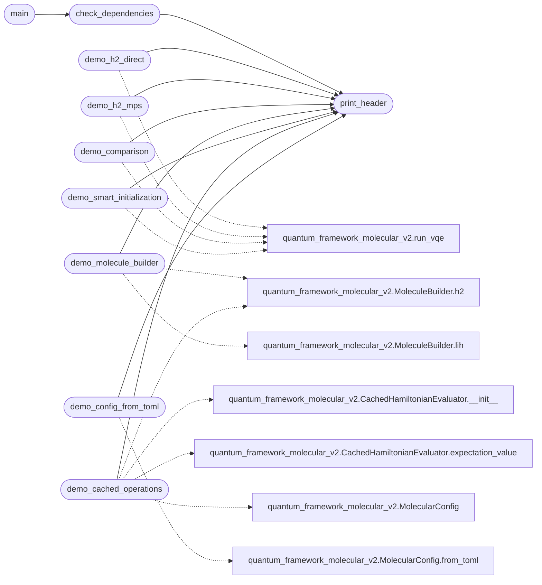

# `demo_molecular_vqe`

> Source: [demo_molecular_vqe.py:1](../../demo_molecular_vqe.py#L1) | language `py` | coverage 100.0% | [API index](../index.md)

Quantum Framework Demo - Production Version =========================================== Demonstrates all improvements and features of the refactored molecular module.

Improvements implemented:
1. OpenFermion for all Hamiltonians (NO hardcoded values)
2. Precision mode flag (direct vs MPS)
3. Smart initialization with MP2 + parameter scan
4. Cached Pauli operations (x10-100 speedup)
5. Particle-conserving subspace
6. TOML configuration

## Contents

- **Functions:** [`print_header`](#print_header), [`check_dependencies`](#check_dependencies), [`demo_h2_direct`](#demo_h2_direct), [`demo_h2_mps`](#demo_h2_mps), [`demo_comparison`](#demo_comparison), [`demo_molecule_builder`](#demo_molecule_builder), [`demo_smart_initialization`](#demo_smart_initialization), [`demo_cached_operations`](#demo_cached_operations), [`demo_config_from_toml`](#demo_config_from_toml), [`main`](#main)

## Call Graph

Solid arrows stay in this module, dashed arrows leave it.



## Functions

<a id="print_header"></a>

### `print_header`

`function` | [demo_molecular_vqe.py:47](../../demo_molecular_vqe.py#L47)

```python
def print_header(title: str)
```

Print formatted header.

**Parameters**

| Name | Type | Default | Description |
|---|---|---|---|
| `title` | `str` |  |  |

*Called by:* [`check_dependencies`](#check_dependencies), [`demo_cached_operations`](#demo_cached_operations), [`demo_comparison`](#demo_comparison), [`demo_config_from_toml`](#demo_config_from_toml), [`demo_h2_direct`](#demo_h2_direct), [`demo_h2_mps`](#demo_h2_mps), [`demo_molecule_builder`](#demo_molecule_builder), [`demo_smart_initialization`](#demo_smart_initialization)

---

<a id="check_dependencies"></a>

### `check_dependencies`

`function` | [demo_molecular_vqe.py:54](../../demo_molecular_vqe.py#L54)

```python
def check_dependencies()
```

Check and report available dependencies.

*Calls:* [`print_header`](#print_header)

*Called by:* [`main`](#main)

---

<a id="demo_h2_direct"></a>

### `demo_h2_direct`

`function` | [demo_molecular_vqe.py:78](../../demo_molecular_vqe.py#L78)

```python
def demo_h2_direct()
```

Demo: H2 with direct statevector (precision mode).

*Calls:* [`print_header`](#print_header), [`run_vqe`](quantum_framework_molecular_v2.py.md#run_vqe)

---

<a id="demo_h2_mps"></a>

### `demo_h2_mps`

`function` | [demo_molecular_vqe.py:104](../../demo_molecular_vqe.py#L104)

```python
def demo_h2_mps()
```

Demo: H2 with precision_mode=False (NOTE: solver is statevector; see module docs).

*Calls:* [`print_header`](#print_header), [`run_vqe`](quantum_framework_molecular_v2.py.md#run_vqe)

---

<a id="demo_comparison"></a>

### `demo_comparison`

`function` | [demo_molecular_vqe.py:132](../../demo_molecular_vqe.py#L132)

```python
def demo_comparison()
```

Demo: Compare direct vs MPS.

*Calls:* [`print_header`](#print_header), [`run_vqe`](quantum_framework_molecular_v2.py.md#run_vqe)

---

<a id="demo_molecule_builder"></a>

### `demo_molecule_builder`

`function` | [demo_molecular_vqe.py:168](../../demo_molecular_vqe.py#L168)

```python
def demo_molecule_builder()
```

Demo: OpenFermion molecule builder.

*Calls:* [`print_header`](#print_header), [`MoleculeBuilder.h2`](quantum_framework_molecular_v2.py.md#moleculebuilder-h2), [`MoleculeBuilder.lih`](quantum_framework_molecular_v2.py.md#moleculebuilder-lih)

---

<a id="demo_smart_initialization"></a>

### `demo_smart_initialization`

`function` | [demo_molecular_vqe.py:198](../../demo_molecular_vqe.py#L198)

```python
def demo_smart_initialization()
```

Demo: Smart parameter initialization.

*Calls:* [`print_header`](#print_header), [`run_vqe`](quantum_framework_molecular_v2.py.md#run_vqe)

---

<a id="demo_cached_operations"></a>

### `demo_cached_operations`

`function` | [demo_molecular_vqe.py:232](../../demo_molecular_vqe.py#L232)

```python
def demo_cached_operations()
```

Demo: Cached Pauli operations.

*Calls:* [`print_header`](#print_header), [`CachedHamiltonianEvaluator.__init__`](quantum_framework_molecular_v2.py.md#cachedhamiltonianevaluator-__init__), [`CachedHamiltonianEvaluator.expectation_value`](quantum_framework_molecular_v2.py.md#cachedhamiltonianevaluator-expectation_value), [`MolecularConfig`](quantum_framework_molecular_v2.py.md#molecularconfig), [`MoleculeBuilder.h2`](quantum_framework_molecular_v2.py.md#moleculebuilder-h2)

---

<a id="demo_config_from_toml"></a>

### `demo_config_from_toml`

`function` | [demo_molecular_vqe.py:278](../../demo_molecular_vqe.py#L278)

```python
def demo_config_from_toml()
```

Demo: Configuration from TOML.

*Calls:* [`print_header`](#print_header), [`MolecularConfig.from_toml`](quantum_framework_molecular_v2.py.md#molecularconfig-from_toml)

---

<a id="main"></a>

### `main`

`function` | [demo_molecular_vqe.py:303](../../demo_molecular_vqe.py#L303)

```python
def main()
```

Run all demos.

*Calls:* [`check_dependencies`](#check_dependencies)

---
