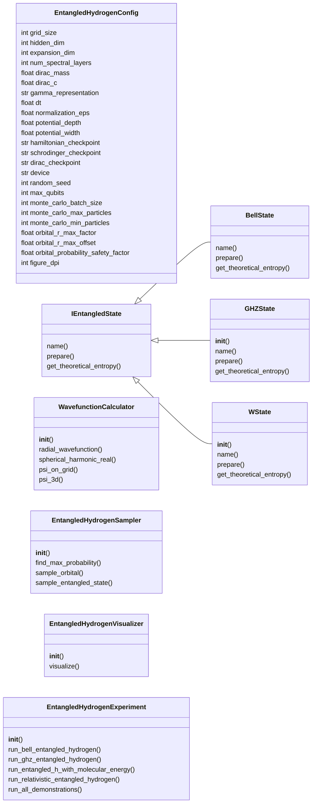

# `entangled_hydrogen`

> Source: [entangled_hydrogen.py:1](../../entangled_hydrogen.py#L1) | language `py` | coverage 85.7% | [API index](../index.md)

Entangled Hydrogen Visualization System ======================================== Demonstrates entangled hydrogen states using the trained quantum computer and molecular simulation backends.

This script IMPORTS and USES the existing modules:
    - quantum_computer.py for quantum state preparation and evolution
    - molecular_sim.py for molecular energy evaluation
    - relativistic_hydrogen.py for Dirac relativistic calculations
    - orbital_visualizer2.py for orbital visualization components

Author: Gris Iscomeback
License: AGPL v3

## Contents

- **Classes:** [`EntangledHydrogenConfig`](#entangledhydrogenconfig), [`IEntangledState`](#ientangledstate), [`BellState`](#bellstate), [`GHZState`](#ghzstate), [`WState`](#wstate), [`WavefunctionCalculator`](#wavefunctioncalculator), [`EntangledHydrogenSampler`](#entangledhydrogensampler), [`EntangledHydrogenVisualizer`](#entangledhydrogenvisualizer), [`EntangledHydrogenExperiment`](#entangledhydrogenexperiment)
- **Functions:** [`main`](#main)

## Type Diagram



## Call Graph

Solid arrows stay in this module, dashed arrows leave it.

```mermaid
flowchart LR
    n_entangled_hydrogen_py__WavefunctionCalculator_psi_on_grid(["WavefunctionCalculator.psi_on_grid"])
    n_entangled_hydrogen_py__WavefunctionCalculator_radial_wavefunction(["WavefunctionCalculator.radial_wavefunction"])
    n_entangled_hydrogen_py__WavefunctionCalculator_spherical_harmonic_real(["WavefunctionCalculator.spherical_harmonic_real"])
    n_entangled_hydrogen_py__WavefunctionCalculator_psi_3d(["WavefunctionCalculator.psi_3d"])
    n_entangled_hydrogen_py__EntangledHydrogenSampler_sample_orbital(["EntangledHydrogenSampler.sample_orbital"])
    n_entangled_hydrogen_py__EntangledHydrogenSampler_find_max_probability(["EntangledHydrogenSampler.find_max_probability"])
    n_entangled_hydrogen_py__EntangledHydrogenSampler_sample_entangled_state(["EntangledHydrogenSampler.sample_entangled_state"])
    n_entangled_hydrogen_py__EntangledHydrogenExperiment___init__(["EntangledHydrogenExperiment.__init__"])
    n_entangled_hydrogen_py__EntangledHydrogenSampler___init__(["EntangledHydrogenSampler.__init__"])
    n_entangled_hydrogen_py__EntangledHydrogenVisualizer___init__(["EntangledHydrogenVisualizer.__init__"])
    n_entangled_hydrogen_py__WavefunctionCalculator___init__(["WavefunctionCalculator.__init__"])
    n_entangled_hydrogen_py__EntangledHydrogenExperiment_run_bell_entangled_hydrogen(["EntangledHydrogenExperiment.run_bell_entangled_hydrogen"])
    n_entangled_hydrogen_py__BellState(["BellState"])
    n_entangled_hydrogen_py__BellState_get_theoretical_entropy(["BellState.get_theoretical_entropy"])
    n_entangled_hydrogen_py__BellState_prepare(["BellState.prepare"])
    n_entangled_hydrogen_py__EntangledHydrogenVisualizer_visualize(["EntangledHydrogenVisualizer.visualize"])
    n_entangled_hydrogen_py__EntangledHydrogenExperiment_run_ghz_entangled_hydrogen(["EntangledHydrogenExperiment.run_ghz_entangled_hydrogen"])
    n_entangled_hydrogen_py__GHZState___init__(["GHZState.__init__"])
    n_entangled_hydrogen_py__GHZState_get_theoretical_entropy(["GHZState.get_theoretical_entropy"])
    n_entangled_hydrogen_py__GHZState_prepare(["GHZState.prepare"])
    n_entangled_hydrogen_py__EntangledHydrogenExperiment_run_entangled_h_with_molecular_energy(["EntangledHydrogenExperiment.run_entangled_h_with_molecular_energy"])
    n_entangled_hydrogen_py__EntangledHydrogenExperiment_run_relativistic_entangled_hydrogen(["EntangledHydrogenExperiment.run_relativistic_entangled_hydrogen"])
    n_entangled_hydrogen_py__EntangledHydrogenExperiment_run_all_demonstrations(["EntangledHydrogenExperiment.run_all_demonstrations"])
    n_entangled_hydrogen_py__WavefunctionCalculator_psi_on_grid --> n_entangled_hydrogen_py__WavefunctionCalculator_radial_wavefunction
    n_entangled_hydrogen_py__WavefunctionCalculator_psi_on_grid --> n_entangled_hydrogen_py__WavefunctionCalculator_spherical_harmonic_real
    n_entangled_hydrogen_py__WavefunctionCalculator_psi_3d --> n_entangled_hydrogen_py__WavefunctionCalculator_radial_wavefunction
    n_entangled_hydrogen_py__WavefunctionCalculator_psi_3d --> n_entangled_hydrogen_py__WavefunctionCalculator_spherical_harmonic_real
    n_entangled_hydrogen_py__EntangledHydrogenSampler_sample_orbital --> n_entangled_hydrogen_py__EntangledHydrogenSampler_find_max_probability
    n_entangled_hydrogen_py__EntangledHydrogenSampler_sample_entangled_state --> n_entangled_hydrogen_py__EntangledHydrogenSampler_sample_orbital
    n_entangled_hydrogen_py__EntangledHydrogenExperiment___init__ --> n_entangled_hydrogen_py__EntangledHydrogenSampler___init__
    n_entangled_hydrogen_py__EntangledHydrogenExperiment___init__ --> n_entangled_hydrogen_py__EntangledHydrogenVisualizer___init__
    n_entangled_hydrogen_py__EntangledHydrogenExperiment___init__ --> n_entangled_hydrogen_py__WavefunctionCalculator___init__
    n_entangled_hydrogen_py__EntangledHydrogenExperiment_run_bell_entangled_hydrogen --> n_entangled_hydrogen_py__BellState
    n_entangled_hydrogen_py__EntangledHydrogenExperiment_run_bell_entangled_hydrogen --> n_entangled_hydrogen_py__BellState_get_theoretical_entropy
    n_entangled_hydrogen_py__EntangledHydrogenExperiment_run_bell_entangled_hydrogen --> n_entangled_hydrogen_py__BellState_prepare
    n_entangled_hydrogen_py__EntangledHydrogenExperiment_run_bell_entangled_hydrogen --> n_entangled_hydrogen_py__EntangledHydrogenSampler_sample_entangled_state
    n_entangled_hydrogen_py__EntangledHydrogenExperiment_run_bell_entangled_hydrogen --> n_entangled_hydrogen_py__EntangledHydrogenVisualizer_visualize
    n_entangled_hydrogen_py__EntangledHydrogenExperiment_run_ghz_entangled_hydrogen --> n_entangled_hydrogen_py__EntangledHydrogenSampler_sample_orbital
    n_entangled_hydrogen_py__EntangledHydrogenExperiment_run_ghz_entangled_hydrogen --> n_entangled_hydrogen_py__EntangledHydrogenVisualizer_visualize
    n_entangled_hydrogen_py__EntangledHydrogenExperiment_run_ghz_entangled_hydrogen --> n_entangled_hydrogen_py__GHZState___init__
    n_entangled_hydrogen_py__EntangledHydrogenExperiment_run_ghz_entangled_hydrogen --> n_entangled_hydrogen_py__GHZState_get_theoretical_entropy
    n_entangled_hydrogen_py__EntangledHydrogenExperiment_run_ghz_entangled_hydrogen --> n_entangled_hydrogen_py__GHZState_prepare
    n_entangled_hydrogen_py__EntangledHydrogenExperiment_run_entangled_h_with_molecular_energy --> n_entangled_hydrogen_py__EntangledHydrogenExperiment_run_bell_entangled_hydrogen
    n_entangled_hydrogen_py__EntangledHydrogenExperiment_run_relativistic_entangled_hydrogen --> n_entangled_hydrogen_py__EntangledHydrogenExperiment_run_bell_entangled_hydrogen
    n_entangled_hydrogen_py__EntangledHydrogenExperiment_run_all_demonstrations --> n_entangled_hydrogen_py__EntangledHydrogenExperiment_run_bell_entangled_hydrogen
    n_entangled_hydrogen_py__EntangledHydrogenExperiment_run_all_demonstrations --> n_entangled_hydrogen_py__EntangledHydrogenExperiment_run_entangled_h_with_molecular_energy
    n_entangled_hydrogen_py__EntangledHydrogenExperiment_run_all_demonstrations --> n_entangled_hydrogen_py__EntangledHydrogenExperiment_run_ghz_entangled_hydrogen
```



## Classes

<a id="entangledhydrogenconfig"></a>

### `EntangledHydrogenConfig`

`class` `dataclass` | [entangled_hydrogen.py:61](../../entangled_hydrogen.py#L61)

Decorators: `@dataclass`

```python
class EntangledHydrogenConfig
```

Configuration for entangled hydrogen visualization system.

All parameters are parametric and configurable from this class.

**Attributes**

| Name | Type | Default | Description |
|---|---|---|---|
| [`grid_size`](#entangledhydrogenconfig-grid_size) | `int` | `16` |  |
| [`hidden_dim`](#entangledhydrogenconfig-hidden_dim) | `int` | `32` |  |
| [`expansion_dim`](#entangledhydrogenconfig-expansion_dim) | `int` | `64` |  |
| [`num_spectral_layers`](#entangledhydrogenconfig-num_spectral_layers) | `int` | `2` |  |
| [`dirac_mass`](#entangledhydrogenconfig-dirac_mass) | `float` | `1.0` |  |
| [`dirac_c`](#entangledhydrogenconfig-dirac_c) | `float` | `1.0` |  |
| [`gamma_representation`](#entangledhydrogenconfig-gamma_representation) | `str` | `'dirac'` |  |
| [`dt`](#entangledhydrogenconfig-dt) | `float` | `0.01` |  |
| [`normalization_eps`](#entangledhydrogenconfig-normalization_eps) | `float` | `1e-08` |  |
| [`potential_depth`](#entangledhydrogenconfig-potential_depth) | `float` | `5.0` |  |
| [`potential_width`](#entangledhydrogenconfig-potential_width) | `float` | `0.3` |  |
| [`hamiltonian_checkpoint`](#entangledhydrogenconfig-hamiltonian_checkpoint) | `str` | `'weights/latest.pth'` |  |
| [`schrodinger_checkpoint`](#entangledhydrogenconfig-schrodinger_checkpoint) | `str` | `'weights/schrodinger_crystal_final.pth'` |  |
| [`dirac_checkpoint`](#entangledhydrogenconfig-dirac_checkpoint) | `str` | `'weights/dirac_phase5_latest.pth'` |  |
| [`device`](#entangledhydrogenconfig-device) | `str` | `'cuda' if torch.cuda.is_available() else 'cpu'` |  |
| [`random_seed`](#entangledhydrogenconfig-random_seed) | `int` | `42` |  |
| [`max_qubits`](#entangledhydrogenconfig-max_qubits) | `int` | `8` |  |
| [`monte_carlo_batch_size`](#entangledhydrogenconfig-monte_carlo_batch_size) | `int` | `100000` |  |
| [`monte_carlo_max_particles`](#entangledhydrogenconfig-monte_carlo_max_particles) | `int` | `500000` |  |
| [`monte_carlo_min_particles`](#entangledhydrogenconfig-monte_carlo_min_particles) | `int` | `5000` |  |
| [`orbital_r_max_factor`](#entangledhydrogenconfig-orbital_r_max_factor) | `float` | `4.0` |  |
| [`orbital_r_max_offset`](#entangledhydrogenconfig-orbital_r_max_offset) | `float` | `10.0` |  |
| [`orbital_probability_safety_factor`](#entangledhydrogenconfig-orbital_probability_safety_factor) | `float` | `1.05` |  |
| [`figure_dpi`](#entangledhydrogenconfig-figure_dpi) | `int` | `150` |  |
| [`figure_size_x`](#entangledhydrogenconfig-figure_size_x) | `int` | `24` |  |
| [`figure_size_y`](#entangledhydrogenconfig-figure_size_y) | `int` | `20` |  |
| [`histogram_bins`](#entangledhydrogenconfig-histogram_bins) | `int` | `300` |  |
| [`scatter_size_min`](#entangledhydrogenconfig-scatter_size_min) | `float` | `1.0` |  |
| [`scatter_size_max`](#entangledhydrogenconfig-scatter_size_max) | `float` | `8.0` |  |
| [`evolution_steps`](#entangledhydrogenconfig-evolution_steps) | `int` | `5` |  |
| [`evolution_dt`](#entangledhydrogenconfig-evolution_dt) | `float` | `0.005` |  |
| [`c_light`](#entangledhydrogenconfig-c_light) | `float` | `137.035999084` |  |
| [`alpha_fs`](#entangledhydrogenconfig-alpha_fs) | `float` | `1.0 / 137.035999084` |  |
| [`checkpoint_interval_minutes`](#entangledhydrogenconfig-checkpoint_interval_minutes) | `float` | `5.0` |  |
| [`output_dir`](#entangledhydrogenconfig-output_dir) | `str` | `'download'` |  |

---

<a id="ientangledstate"></a>

### `IEntangledState`

`class` `abstract` | [entangled_hydrogen.py:114](../../entangled_hydrogen.py#L114)

```python
class IEntangledState(ABC)
```

Bases: `ABC`

Subclasses: [`BellState`](#bellstate), [`GHZState`](#ghzstate), [`WState`](#wstate)

Abstract interface for entangled quantum states.

**Members**

| Member | Kind | Summary |
|---|---|---|
| [`name`](#ientangledstate-name) | property | Return the name of the entangled state. |
| [`prepare`](#ientangledstate-prepare) | method | Prepare the entangled state on n qubits. |
| [`get_theoretical_entropy`](#ientangledstate-get_theoretical_entropy) | method | Return the theoretical Shannon entropy in bits. |

<a id="ientangledstate-name"></a>

#### `IEntangledState.name`

`property` `abstract` | [entangled_hydrogen.py:119](../../entangled_hydrogen.py#L119)

Decorators: `@property`, `@abstractmethod`

```python
def name(self) -> str
```

Return the name of the entangled state.

**Returns:** `str`

<a id="ientangledstate-prepare"></a>

#### `IEntangledState.prepare`

`method` `abstract` | [entangled_hydrogen.py:123](../../entangled_hydrogen.py#L123)

Decorators: `@abstractmethod`

```python
def prepare(self, n_qubits: int) -> Any
```

Prepare the entangled state on n qubits.

**Parameters**

| Name | Type | Default | Description |
|---|---|---|---|
| `n_qubits` | `int` |  |  |

**Returns:** `Any`

<a id="ientangledstate-get_theoretical_entropy"></a>

#### `IEntangledState.get_theoretical_entropy`

`method` `abstract` | [entangled_hydrogen.py:127](../../entangled_hydrogen.py#L127)

Decorators: `@abstractmethod`

```python
def get_theoretical_entropy(self) -> float
```

Return the theoretical Shannon entropy in bits.

**Returns:** `float`

---

<a id="bellstate"></a>

### `BellState`

`class` | [entangled_hydrogen.py:131](../../entangled_hydrogen.py#L131)

```python
class BellState(IEntangledState)
```

Bases: [`IEntangledState`](#ientangledstate)

Bell state: |Phi+> = (|00> + |11>) / sqrt(2).

**Members**

| Member | Kind | Summary |
|---|---|---|
| [`name`](#bellstate-name) | property | Return the name of the entangled state. |
| [`prepare`](#bellstate-prepare) | method | Prepare the entangled state on n qubits. |
| [`get_theoretical_entropy`](#bellstate-get_theoretical_entropy) | method | Return the theoretical Shannon entropy in bits. |

<a id="bellstate-name"></a>

#### `BellState.name`

`property` | [entangled_hydrogen.py:135](../../entangled_hydrogen.py#L135)

Decorators: `@property`

```python
def name(self) -> str
```

Return the name of the entangled state.

**Returns:** `str`

> **Inherited:** Documentation from [`IEntangledState.name`](#ientangledstate-name) (entangled_hydrogen.py:119).

<a id="bellstate-prepare"></a>

#### `BellState.prepare`

`method` | [entangled_hydrogen.py:138](../../entangled_hydrogen.py#L138)

```python
def prepare(self, qc: Any, backend: str) -> Any
```

Prepare the entangled state on n qubits.

**Parameters**

| Name | Type | Default | Description |
|---|---|---|---|
| `qc` | `Any` |  |  |
| `backend` | `str` |  |  |

**Returns:** `Any`

> **Inherited:** Documentation from [`IEntangledState.prepare`](#ientangledstate-prepare) (entangled_hydrogen.py:123).

*Called by:* [`EntangledHydrogenExperiment.run_bell_entangled_hydrogen`](#entangledhydrogenexperiment-run_bell_entangled_hydrogen)

<a id="bellstate-get_theoretical_entropy"></a>

#### `BellState.get_theoretical_entropy`

`method` | [entangled_hydrogen.py:141](../../entangled_hydrogen.py#L141)

```python
def get_theoretical_entropy(self) -> float
```

Return the theoretical Shannon entropy in bits.

**Returns:** `float`

> **Inherited:** Documentation from [`IEntangledState.get_theoretical_entropy`](#ientangledstate-get_theoretical_entropy) (entangled_hydrogen.py:127).

*Called by:* [`EntangledHydrogenExperiment.run_bell_entangled_hydrogen`](#entangledhydrogenexperiment-run_bell_entangled_hydrogen)

---

<a id="ghzstate"></a>

### `GHZState`

`class` | [entangled_hydrogen.py:145](../../entangled_hydrogen.py#L145)

```python
class GHZState(IEntangledState)
```

Bases: [`IEntangledState`](#ientangledstate)

GHZ state: (|00...0> + |11...1>) / sqrt(2).

**Members**

| Member | Kind | Summary |
|---|---|---|
| [`__init__`](#ghzstate-__init__) | constructor |  |
| [`name`](#ghzstate-name) | property | Return the name of the entangled state. |
| [`prepare`](#ghzstate-prepare) | method | Prepare the entangled state on n qubits. |
| [`get_theoretical_entropy`](#ghzstate-get_theoretical_entropy) | method | Return the theoretical Shannon entropy in bits. |

<a id="ghzstate-__init__"></a>

#### `GHZState.__init__`

`constructor` | [entangled_hydrogen.py:148](../../entangled_hydrogen.py#L148)

```python
def __init__(self, n_qubits: int = 3)
```

**Parameters**

| Name | Type | Default | Description |
|---|---|---|---|
| `n_qubits` | `int` | `3` |  |

*Called by:* [`EntangledHydrogenExperiment.run_ghz_entangled_hydrogen`](#entangledhydrogenexperiment-run_ghz_entangled_hydrogen)

<a id="ghzstate-name"></a>

#### `GHZState.name`

`property` | [entangled_hydrogen.py:152](../../entangled_hydrogen.py#L152)

Decorators: `@property`

```python
def name(self) -> str
```

Return the name of the entangled state.

**Returns:** `str`

> **Inherited:** Documentation from [`IEntangledState.name`](#ientangledstate-name) (entangled_hydrogen.py:119).

<a id="ghzstate-prepare"></a>

#### `GHZState.prepare`

`method` | [entangled_hydrogen.py:155](../../entangled_hydrogen.py#L155)

```python
def prepare(self, qc: Any, backend: str) -> Any
```

Prepare the entangled state on n qubits.

**Parameters**

| Name | Type | Default | Description |
|---|---|---|---|
| `qc` | `Any` |  |  |
| `backend` | `str` |  |  |

**Returns:** `Any`

> **Inherited:** Documentation from [`IEntangledState.prepare`](#ientangledstate-prepare) (entangled_hydrogen.py:123).

*Called by:* [`EntangledHydrogenExperiment.run_ghz_entangled_hydrogen`](#entangledhydrogenexperiment-run_ghz_entangled_hydrogen)

<a id="ghzstate-get_theoretical_entropy"></a>

#### `GHZState.get_theoretical_entropy`

`method` | [entangled_hydrogen.py:158](../../entangled_hydrogen.py#L158)

```python
def get_theoretical_entropy(self) -> float
```

Return the theoretical Shannon entropy in bits.

**Returns:** `float`

> **Inherited:** Documentation from [`IEntangledState.get_theoretical_entropy`](#ientangledstate-get_theoretical_entropy) (entangled_hydrogen.py:127).

*Called by:* [`EntangledHydrogenExperiment.run_ghz_entangled_hydrogen`](#entangledhydrogenexperiment-run_ghz_entangled_hydrogen)

---

<a id="wstate"></a>

### `WState`

`class` | [entangled_hydrogen.py:162](../../entangled_hydrogen.py#L162)

```python
class WState(IEntangledState)
```

Bases: [`IEntangledState`](#ientangledstate)

W state: (|001> + |010> + |100>) / sqrt(3).

**Members**

| Member | Kind | Summary |
|---|---|---|
| [`__init__`](#wstate-__init__) | constructor |  |
| [`name`](#wstate-name) | property | Return the name of the entangled state. |
| [`prepare`](#wstate-prepare) | method | Prepare the entangled state on n qubits. |
| [`get_theoretical_entropy`](#wstate-get_theoretical_entropy) | method | Return the theoretical Shannon entropy in bits. |

<a id="wstate-__init__"></a>

#### `WState.__init__`

`constructor` | [entangled_hydrogen.py:165](../../entangled_hydrogen.py#L165)

```python
def __init__(self, n_qubits: int = 3)
```

**Parameters**

| Name | Type | Default | Description |
|---|---|---|---|
| `n_qubits` | `int` | `3` |  |

<a id="wstate-name"></a>

#### `WState.name`

`property` | [entangled_hydrogen.py:169](../../entangled_hydrogen.py#L169)

Decorators: `@property`

```python
def name(self) -> str
```

Return the name of the entangled state.

**Returns:** `str`

> **Inherited:** Documentation from [`IEntangledState.name`](#ientangledstate-name) (entangled_hydrogen.py:119).

<a id="wstate-prepare"></a>

#### `WState.prepare`

`method` | [entangled_hydrogen.py:172](../../entangled_hydrogen.py#L172)

```python
def prepare(self, qc: Any, backend: str, factory: Any) -> Any
```

Prepare the entangled state on n qubits.

**Parameters**

| Name | Type | Default | Description |
|---|---|---|---|
| `qc` | `Any` |  |  |
| `backend` | `str` |  |  |
| `factory` | `Any` |  |  |

**Returns:** `Any`

**Raises**

- `KeyError`: (raised in the body, not documented)

> **Inherited:** Documentation from [`IEntangledState.prepare`](#ientangledstate-prepare) (entangled_hydrogen.py:123).

*Calls:* [`QuantumCircuit.__init__`](quantum_computer.py.md#quantumcircuit-__init__), [`QuantumCircuit.cnot`](quantum_computer.py.md#quantumcircuit-cnot), [`QuantumCircuit.ry`](quantum_computer.py.md#quantumcircuit-ry)

<a id="wstate-get_theoretical_entropy"></a>

#### `WState.get_theoretical_entropy`

`method` | [entangled_hydrogen.py:190](../../entangled_hydrogen.py#L190)

```python
def get_theoretical_entropy(self) -> float
```

Return the theoretical Shannon entropy in bits.

**Returns:** `float`

> **Inherited:** Documentation from [`IEntangledState.get_theoretical_entropy`](#ientangledstate-get_theoretical_entropy) (entangled_hydrogen.py:127).

---

<a id="wavefunctioncalculator"></a>

### `WavefunctionCalculator`

`class` | [entangled_hydrogen.py:194](../../entangled_hydrogen.py#L194)

```python
class WavefunctionCalculator
```

Calculates hydrogen atom wavefunctions for entangled state visualization.

Uses the same implementation as orbital_visualizer2.py.

**Members**

| Member | Kind | Summary |
|---|---|---|
| [`__init__`](#wavefunctioncalculator-__init__) | constructor |  |
| [`radial_wavefunction`](#wavefunctioncalculator-radial_wavefunction) | staticmethod | Calculate non-relativistic radial wavefunction R_nl(r). |
| [`spherical_harmonic_real`](#wavefunctioncalculator-spherical_harmonic_real) | staticmethod | Calculate real spherical harmonics Y_lm(theta, phi). |
| [`psi_on_grid`](#wavefunctioncalculator-psi_on_grid) | method | Calculate wavefunction on 2D grid for quantum computer processing. |
| [`psi_3d`](#wavefunctioncalculator-psi_3d) | method | Calculate full 3D wavefunction psi_nlm(r, theta, phi). |

<a id="wavefunctioncalculator-__init__"></a>

#### `WavefunctionCalculator.__init__`

`constructor` | [entangled_hydrogen.py:200](../../entangled_hydrogen.py#L200)

```python
def __init__(self, config: EntangledHydrogenConfig)
```

**Parameters**

| Name | Type | Default | Description |
|---|---|---|---|
| `config` | `EntangledHydrogenConfig` |  |  |

*Called by:* [`EntangledHydrogenExperiment.__init__`](#entangledhydrogenexperiment-__init__)

<a id="wavefunctioncalculator-radial_wavefunction"></a>

#### `WavefunctionCalculator.radial_wavefunction`

`staticmethod` | [entangled_hydrogen.py:204](../../entangled_hydrogen.py#L204)

Decorators: `@staticmethod`

```python
def radial_wavefunction(n: int, l: int, r: np.ndarray) -> np.ndarray
```

Calculate non-relativistic radial wavefunction R_nl(r).

**Parameters**

| Name | Type | Default | Description |
|---|---|---|---|
| `n` | `int` |  |  |
| `l` | `int` |  |  |
| `r` | `np.ndarray` |  |  |

**Returns:** `np.ndarray`

*Called by:* [`WavefunctionCalculator.psi_3d`](#wavefunctioncalculator-psi_3d), [`WavefunctionCalculator.psi_on_grid`](#wavefunctioncalculator-psi_on_grid), [`MonteCarloSampler.find_max_probability`](orbital_visualizer2.py.md#montecarlosampler-find_max_probability), [`MonteCarloSampler.sample`](orbital_visualizer2.py.md#montecarlosampler-sample), [`WavefunctionCalculator.psi_on_grid`](orbital_visualizer2.py.md#wavefunctioncalculator-psi_on_grid), [`WavefunctionCalculator.psi_3d`](quantum_framework_visualization.py.md#wavefunctioncalculator-psi_3d), [`WavefunctionCalculator.psi_on_grid`](quantum_framework_visualization.py.md#wavefunctioncalculator-psi_on_grid), [`WavefunctionCalculator.psi_3d`](quantum_simulator.py.md#wavefunctioncalculator-psi_3d)

<a id="wavefunctioncalculator-spherical_harmonic_real"></a>

#### `WavefunctionCalculator.spherical_harmonic_real`

`staticmethod` | [entangled_hydrogen.py:215](../../entangled_hydrogen.py#L215)

Decorators: `@staticmethod`

```python
def spherical_harmonic_real(l: int, m: int, theta: np.ndarray, phi: np.ndarray) -> np.ndarray
```

Calculate real spherical harmonics Y_lm(theta, phi).

**Parameters**

| Name | Type | Default | Description |
|---|---|---|---|
| `l` | `int` |  |  |
| `m` | `int` |  |  |
| `theta` | `np.ndarray` |  |  |
| `phi` | `np.ndarray` |  |  |

**Returns:** `np.ndarray`

*Called by:* [`WavefunctionCalculator.psi_3d`](#wavefunctioncalculator-psi_3d), [`WavefunctionCalculator.psi_on_grid`](#wavefunctioncalculator-psi_on_grid), [`MonteCarloSampler.find_max_probability`](orbital_visualizer2.py.md#montecarlosampler-find_max_probability), [`MonteCarloSampler.sample`](orbital_visualizer2.py.md#montecarlosampler-sample), [`WavefunctionCalculator.psi_on_grid`](orbital_visualizer2.py.md#wavefunctioncalculator-psi_on_grid), [`WavefunctionCalculator.psi_3d`](quantum_framework_visualization.py.md#wavefunctioncalculator-psi_3d), [`WavefunctionCalculator.psi_on_grid`](quantum_framework_visualization.py.md#wavefunctioncalculator-psi_on_grid), [`WavefunctionCalculator.psi_3d`](quantum_simulator.py.md#wavefunctioncalculator-psi_3d)

<a id="wavefunctioncalculator-psi_on_grid"></a>

#### `WavefunctionCalculator.psi_on_grid`

`method` | [entangled_hydrogen.py:225](../../entangled_hydrogen.py#L225)

```python
def psi_on_grid(self, n: int, l: int, m: int) -> torch.Tensor
```

Calculate wavefunction on 2D grid for quantum computer processing.

**Parameters**

| Name | Type | Default | Description |
|---|---|---|---|
| `n` | `int` |  |  |
| `l` | `int` |  |  |
| `m` | `int` |  |  |

**Returns:** `torch.Tensor`

*Calls:* [`WavefunctionCalculator.radial_wavefunction`](#wavefunctioncalculator-radial_wavefunction), [`WavefunctionCalculator.spherical_harmonic_real`](#wavefunctioncalculator-spherical_harmonic_real)

*Called by:* [`HamiltonianNNProcessor.compute_expected_energy`](orbital_visualizer2.py.md#hamiltoniannnprocessor-compute_expected_energy)

<a id="wavefunctioncalculator-psi_3d"></a>

#### `WavefunctionCalculator.psi_3d`

`method` | [entangled_hydrogen.py:245](../../entangled_hydrogen.py#L245)

```python
def psi_3d(self, n: int, l: int, m: int, r: np.ndarray, theta: np.ndarray, phi: np.ndarray) -> np.ndarray
```

Calculate full 3D wavefunction psi_nlm(r, theta, phi).

**Parameters**

| Name | Type | Default | Description |
|---|---|---|---|
| `n` | `int` |  |  |
| `l` | `int` |  |  |
| `m` | `int` |  |  |
| `r` | `np.ndarray` |  |  |
| `theta` | `np.ndarray` |  |  |
| `phi` | `np.ndarray` |  |  |

**Returns:** `np.ndarray`

*Calls:* [`WavefunctionCalculator.radial_wavefunction`](#wavefunctioncalculator-radial_wavefunction), [`WavefunctionCalculator.spherical_harmonic_real`](#wavefunctioncalculator-spherical_harmonic_real)

---

<a id="entangledhydrogensampler"></a>

### `EntangledHydrogenSampler`

`class` | [entangled_hydrogen.py:253](../../entangled_hydrogen.py#L253)

```python
class EntangledHydrogenSampler
```

Monte Carlo sampler for entangled hydrogen states.

Samples from the joint probability distribution of entangled orbitals.

**Members**

| Member | Kind | Summary |
|---|---|---|
| [`__init__`](#entangledhydrogensampler-__init__) | constructor |  |
| [`find_max_probability`](#entangledhydrogensampler-find_max_probability) | method | Find maximum probability for rejection sampling. |
| [`sample_orbital`](#entangledhydrogensampler-sample_orbital) | method | Sample points from a single hydrogen orbital using Monte Carlo. |
| [`sample_entangled_state`](#entangledhydrogensampler-sample_entangled_state) | method | Sample from entangled hydrogen state. |

<a id="entangledhydrogensampler-__init__"></a>

#### `EntangledHydrogenSampler.__init__`

`constructor` | [entangled_hydrogen.py:259](../../entangled_hydrogen.py#L259)

```python
def __init__(self, config: EntangledHydrogenConfig, wavefunction_calc: WavefunctionCalculator)
```

**Parameters**

| Name | Type | Default | Description |
|---|---|---|---|
| `config` | `EntangledHydrogenConfig` |  |  |
| `wavefunction_calc` | `WavefunctionCalculator` |  |  |

*Called by:* [`EntangledHydrogenExperiment.__init__`](#entangledhydrogenexperiment-__init__)

<a id="entangledhydrogensampler-find_max_probability"></a>

#### `EntangledHydrogenSampler.find_max_probability`

`method` | [entangled_hydrogen.py:263](../../entangled_hydrogen.py#L263)

```python
def find_max_probability(self, n: int, l: int, m: int) -> Tuple[float, float, float, float]
```

Find maximum probability for rejection sampling.

**Parameters**

| Name | Type | Default | Description |
|---|---|---|---|
| `n` | `int` |  |  |
| `l` | `int` |  |  |
| `m` | `int` |  |  |

**Returns:** `Tuple[float, float, float, float]`

*Called by:* [`EntangledHydrogenSampler.sample_orbital`](#entangledhydrogensampler-sample_orbital)

<a id="entangledhydrogensampler-sample_orbital"></a>

#### `EntangledHydrogenSampler.sample_orbital`

`method` | [entangled_hydrogen.py:295](../../entangled_hydrogen.py#L295)

```python
def sample_orbital(self, n: int, l: int, m: int, num_samples: int) -> Dict[str, np.ndarray]
```

Sample points from a single hydrogen orbital using Monte Carlo.

**Parameters**

| Name | Type | Default | Description |
|---|---|---|---|
| `n` | `int` |  |  |
| `l` | `int` |  |  |
| `m` | `int` |  |  |
| `num_samples` | `int` |  |  |

**Returns:** `Dict[str, np.ndarray]`

*Calls:* [`EntangledHydrogenSampler.find_max_probability`](#entangledhydrogensampler-find_max_probability)

*Called by:* [`EntangledHydrogenExperiment.run_ghz_entangled_hydrogen`](#entangledhydrogenexperiment-run_ghz_entangled_hydrogen), [`EntangledHydrogenSampler.sample_entangled_state`](#entangledhydrogensampler-sample_entangled_state)

<a id="entangledhydrogensampler-sample_entangled_state"></a>

#### `EntangledHydrogenSampler.sample_entangled_state`

`method` | [entangled_hydrogen.py:362](../../entangled_hydrogen.py#L362)

```python
def sample_entangled_state(self, n1: int, l1: int, m1: int, n2: int, l2: int, m2: int, num_samples: int, entanglement_weight: float = 0.5) -> Dict[str, Any]
```

Sample from entangled hydrogen state.

Creates a superposition of two orbitals with entanglement_weight:
|psi> = sqrt(1-w) * |n1,l1,m1> + sqrt(w) * |n2,l2,m2>

For true entanglement visualization, we create a joint state:
|Psi> = (|n1,l1,m1>|n2,l2,m2> + |n2,l2,m2>|n1,l1,m1>) / sqrt(2)

**Parameters**

| Name | Type | Default | Description |
|---|---|---|---|
| `n1` | `int` |  |  |
| `l1` | `int` |  |  |
| `m1` | `int` |  |  |
| `n2` | `int` |  |  |
| `l2` | `int` |  |  |
| `m2` | `int` |  |  |
| `num_samples` | `int` |  |  |
| `entanglement_weight` | `float` | `0.5` |  |

**Returns:** `Dict[str, Any]`

*Calls:* [`EntangledHydrogenSampler.sample_orbital`](#entangledhydrogensampler-sample_orbital)

*Called by:* [`EntangledHydrogenExperiment.run_bell_entangled_hydrogen`](#entangledhydrogenexperiment-run_bell_entangled_hydrogen), [`RealOrbitalEngine.sample_entangled`](qc_dashboard.py.md#realorbitalengine-sample_entangled)

---

<a id="entangledhydrogenvisualizer"></a>

### `EntangledHydrogenVisualizer`

`class` | [entangled_hydrogen.py:408](../../entangled_hydrogen.py#L408)

```python
class EntangledHydrogenVisualizer
```

Visualizer for entangled hydrogen states.

Creates high-resolution visualizations similar to orbital_visualizer2.py.

**Members**

| Member | Kind | Summary |
|---|---|---|
| [`__init__`](#entangledhydrogenvisualizer-__init__) | constructor |  |
| [`visualize`](#entangledhydrogenvisualizer-visualize) | method | Create visualization of entangled hydrogen state. |

<a id="entangledhydrogenvisualizer-__init__"></a>

#### `EntangledHydrogenVisualizer.__init__`

`constructor` | [entangled_hydrogen.py:414](../../entangled_hydrogen.py#L414)

```python
def __init__(self, config: EntangledHydrogenConfig)
```

**Parameters**

| Name | Type | Default | Description |
|---|---|---|---|
| `config` | `EntangledHydrogenConfig` |  |  |

*Called by:* [`EntangledHydrogenExperiment.__init__`](#entangledhydrogenexperiment-__init__)

<a id="entangledhydrogenvisualizer-visualize"></a>

#### `EntangledHydrogenVisualizer.visualize`

`method` | [entangled_hydrogen.py:417](../../entangled_hydrogen.py#L417)

```python
def visualize(self, data: Dict[str, Any], quantum_result: Any, save_path: Optional[str] = None) -> None
```

Create visualization of entangled hydrogen state.

**Parameters**

| Name | Type | Default | Description |
|---|---|---|---|
| `data` | `Dict[str, Any]` |  |  |
| `quantum_result` | `Any` |  |  |
| `save_path` | `Optional[str]` | `None` |  |

*Called by:* [`EntangledHydrogenExperiment.run_bell_entangled_hydrogen`](#entangledhydrogenexperiment-run_bell_entangled_hydrogen), [`EntangledHydrogenExperiment.run_ghz_entangled_hydrogen`](#entangledhydrogenexperiment-run_ghz_entangled_hydrogen), [`RealOrbitalEngine.render_entangled_to_bytes`](qc_dashboard.py.md#realorbitalengine-render_entangled_to_bytes)

---

<a id="entangledhydrogenexperiment"></a>

### `EntangledHydrogenExperiment`

`class` | [entangled_hydrogen.py:569](../../entangled_hydrogen.py#L569)

```python
class EntangledHydrogenExperiment
```

Main experiment class for entangled hydrogen visualization.

Uses the existing quantum_computer.py, molecular_sim.py, and
visualization components from orbital_visualizer2.py and relativistic_hydrogen.py.

**Members**

| Member | Kind | Summary |
|---|---|---|
| [`__init__`](#entangledhydrogenexperiment-__init__) | constructor |  |
| [`run_bell_entangled_hydrogen`](#entangledhydrogenexperiment-run_bell_entangled_hydrogen) | method | Run Bell state entangled hydrogen visualization. |
| [`run_ghz_entangled_hydrogen`](#entangledhydrogenexperiment-run_ghz_entangled_hydrogen) | method | Run GHZ state entangled hydrogen visualization. |
| [`run_entangled_h_with_molecular_energy`](#entangledhydrogenexperiment-run_entangled_h_with_molecular_energy) | method | Run entangled hydrogen with molecular energy evaluation using molecular_sim.py. |
| [`run_relativistic_entangled_hydrogen`](#entangledhydrogenexperiment-run_relativistic_entangled_hydrogen) | method | Run entangled hydrogen with relativistic Dirac calculations. |
| [`run_all_demonstrations`](#entangledhydrogenexperiment-run_all_demonstrations) | method | Run all available entangled hydrogen demonstrations. |

<a id="entangledhydrogenexperiment-__init__"></a>

#### `EntangledHydrogenExperiment.__init__`

`constructor` | [entangled_hydrogen.py:577](../../entangled_hydrogen.py#L577)

```python
def __init__(self, config: EntangledHydrogenConfig)
```

**Parameters**

| Name | Type | Default | Description |
|---|---|---|---|
| `config` | `EntangledHydrogenConfig` |  |  |

*Calls:* [`EntangledHydrogenSampler.__init__`](#entangledhydrogensampler-__init__), [`EntangledHydrogenVisualizer.__init__`](#entangledhydrogenvisualizer-__init__), [`WavefunctionCalculator.__init__`](#wavefunctioncalculator-__init__)

*Called by:* [`main`](#main)

<a id="entangledhydrogenexperiment-run_bell_entangled_hydrogen"></a>

#### `EntangledHydrogenExperiment.run_bell_entangled_hydrogen`

`method` | [entangled_hydrogen.py:630](../../entangled_hydrogen.py#L630)

```python
def run_bell_entangled_hydrogen(self, n1: int = 1, l1: int = 0, m1: int = 0, n2: int = 2, l2: int = 0, m2: int = 0, backend: str = 'schrodinger', num_samples: int = 100000, suffix: str = '') -> Dict[str, Any]
```

Run Bell state entangled hydrogen visualization.

Creates a Bell state and correlates it with hydrogen orbitals.

**Parameters**

| Name | Type | Default | Description |
|---|---|---|---|
| `n1` | `int` | `1` |  |
| `l1` | `int` | `0` |  |
| `m1` | `int` | `0` |  |
| `n2` | `int` | `2` |  |
| `l2` | `int` | `0` |  |
| `m2` | `int` | `0` |  |
| `backend` | `str` | `'schrodinger'` |  |
| `num_samples` | `int` | `100000` |  |
| `suffix` | `str` | `''` |  |

**Returns:** `Dict[str, Any]`

*Calls:* [`BellState`](#bellstate), [`BellState.get_theoretical_entropy`](#bellstate-get_theoretical_entropy), [`BellState.prepare`](#bellstate-prepare), [`EntangledHydrogenSampler.sample_entangled_state`](#entangledhydrogensampler-sample_entangled_state), [`EntangledHydrogenVisualizer.visualize`](#entangledhydrogenvisualizer-visualize)

*Called by:* [`EntangledHydrogenExperiment.run_all_demonstrations`](#entangledhydrogenexperiment-run_all_demonstrations), [`EntangledHydrogenExperiment.run_entangled_h_with_molecular_energy`](#entangledhydrogenexperiment-run_entangled_h_with_molecular_energy), [`EntangledHydrogenExperiment.run_relativistic_entangled_hydrogen`](#entangledhydrogenexperiment-run_relativistic_entangled_hydrogen)

<a id="entangledhydrogenexperiment-run_ghz_entangled_hydrogen"></a>

#### `EntangledHydrogenExperiment.run_ghz_entangled_hydrogen`

`method` | [entangled_hydrogen.py:672](../../entangled_hydrogen.py#L672)

```python
def run_ghz_entangled_hydrogen(self, orbitals: List[Tuple[int, int, int]], backend: str = 'schrodinger', num_samples: int = 150000) -> Dict[str, Any]
```

Run GHZ state entangled hydrogen visualization.

Creates a GHZ state with n qubits and correlates with n orbitals.

**Parameters**

| Name | Type | Default | Description |
|---|---|---|---|
| `orbitals` | `List[Tuple[int, int, int]]` |  |  |
| `backend` | `str` | `'schrodinger'` |  |
| `num_samples` | `int` | `150000` |  |

**Returns:** `Dict[str, Any]`

*Calls:* [`EntangledHydrogenSampler.sample_orbital`](#entangledhydrogensampler-sample_orbital), [`EntangledHydrogenVisualizer.visualize`](#entangledhydrogenvisualizer-visualize), [`GHZState.__init__`](#ghzstate-__init__), [`GHZState.get_theoretical_entropy`](#ghzstate-get_theoretical_entropy), [`GHZState.prepare`](#ghzstate-prepare)

*Called by:* [`EntangledHydrogenExperiment.run_all_demonstrations`](#entangledhydrogenexperiment-run_all_demonstrations)

<a id="entangledhydrogenexperiment-run_entangled_h_with_molecular_energy"></a>

#### `EntangledHydrogenExperiment.run_entangled_h_with_molecular_energy`

`method` | [entangled_hydrogen.py:745](../../entangled_hydrogen.py#L745)

```python
def run_entangled_h_with_molecular_energy(self, n1: int = 1, l1: int = 0, m1: int = 0, n2: int = 2, l2: int = 0, m2: int = 0, backend: str = 'schrodinger', num_samples: int = 100000) -> Dict[str, Any]
```

Run entangled hydrogen with molecular energy evaluation using molecular_sim.py.

**Parameters**

| Name | Type | Default | Description |
|---|---|---|---|
| `n1` | `int` | `1` |  |
| `l1` | `int` | `0` |  |
| `m1` | `int` | `0` |  |
| `n2` | `int` | `2` |  |
| `l2` | `int` | `0` |  |
| `m2` | `int` | `0` |  |
| `backend` | `str` | `'schrodinger'` |  |
| `num_samples` | `int` | `100000` |  |

**Returns:** `Dict[str, Any]`

*Calls:* [`EntangledHydrogenExperiment.run_bell_entangled_hydrogen`](#entangledhydrogenexperiment-run_bell_entangled_hydrogen), [`ExactJWEnergy.__init__`](molecular_sim.py.md#exactjwenergy-__init__)

*Called by:* [`EntangledHydrogenExperiment.run_all_demonstrations`](#entangledhydrogenexperiment-run_all_demonstrations)

<a id="entangledhydrogenexperiment-run_relativistic_entangled_hydrogen"></a>

#### `EntangledHydrogenExperiment.run_relativistic_entangled_hydrogen`

`method` | [entangled_hydrogen.py:794](../../entangled_hydrogen.py#L794)

```python
def run_relativistic_entangled_hydrogen(self, n1: int = 1, l1: int = 0, m1: int = 0, n2: int = 2, l2: int = 0, m2: int = 0, backend: str = 'dirac', num_samples: int = 100000) -> Dict[str, Any]
```

Run entangled hydrogen with relativistic Dirac calculations.

Uses components from relativistic_hydrogen.py.

**Parameters**

| Name | Type | Default | Description |
|---|---|---|---|
| `n1` | `int` | `1` |  |
| `l1` | `int` | `0` |  |
| `m1` | `int` | `0` |  |
| `n2` | `int` | `2` |  |
| `l2` | `int` | `0` |  |
| `m2` | `int` | `0` |  |
| `backend` | `str` | `'dirac'` |  |
| `num_samples` | `int` | `100000` |  |

**Returns:** `Dict[str, Any]`

*Calls:* [`EntangledHydrogenExperiment.run_bell_entangled_hydrogen`](#entangledhydrogenexperiment-run_bell_entangled_hydrogen), [`DiracHydrogenAtom.energy_level_dirac`](quantum_framework_physics.py.md#dirachydrogenatom-energy_level_dirac), [`DiracHydrogenAtom.__init__`](relativistic_hydrogen.py.md#dirachydrogenatom-__init__)

*Called by:* [`EntangledHydrogenExperiment.run_all_demonstrations`](#entangledhydrogenexperiment-run_all_demonstrations)

<a id="entangledhydrogenexperiment-run_all_demonstrations"></a>

#### `EntangledHydrogenExperiment.run_all_demonstrations`

`method` | [entangled_hydrogen.py:852](../../entangled_hydrogen.py#L852)

```python
def run_all_demonstrations(self, num_samples: int = 100000) -> Dict[str, Any]
```

Run all available entangled hydrogen demonstrations.

**Parameters**

| Name | Type | Default | Description |
|---|---|---|---|
| `num_samples` | `int` | `100000` |  |

**Returns:** `Dict[str, Any]`

*Calls:* [`EntangledHydrogenExperiment.run_bell_entangled_hydrogen`](#entangledhydrogenexperiment-run_bell_entangled_hydrogen), [`EntangledHydrogenExperiment.run_entangled_h_with_molecular_energy`](#entangledhydrogenexperiment-run_entangled_h_with_molecular_energy), [`EntangledHydrogenExperiment.run_ghz_entangled_hydrogen`](#entangledhydrogenexperiment-run_ghz_entangled_hydrogen), [`EntangledHydrogenExperiment.run_relativistic_entangled_hydrogen`](#entangledhydrogenexperiment-run_relativistic_entangled_hydrogen)

*Called by:* [`main`](#main)

---

## Functions

<a id="main"></a>

### `main`

`function` | [entangled_hydrogen.py:893](../../entangled_hydrogen.py#L893)

```python
def main()
```

Main entry point for entangled hydrogen visualization.

*Calls:* [`EntangledHydrogenConfig`](#entangledhydrogenconfig), [`EntangledHydrogenExperiment.__init__`](#entangledhydrogenexperiment-__init__), [`EntangledHydrogenExperiment.run_all_demonstrations`](#entangledhydrogenexperiment-run_all_demonstrations)

---
