# `higgs_four_lepton_analysis`

> Source: [higgs_four_lepton_analysis.py:1](../../higgs_four_lepton_analysis.py#L1) | language `py` | coverage 35.1% | [API index](../index.md)

Higgs to Four Lepton Analysis - Quantum Backend Integration =================================================================

This script ACTUALLY uses the user's quantum computing backends:
- HamiltonianBackend: Spectral neural network for Hamiltonian operations
- SchrodingerBackend: Wave function evolution network
- DiracBackend: Relativistic spinor network with gamma matrices

No fake implementations. No placeholders. Uses the neural networks.

Author: Gris Iscomeback
License: AGPL v3

## Contents

- **Classes:** [`Config`](#config), [`FourMomentum`](#fourmomentum), [`Lepton`](#lepton), [`Event`](#event), [`QuantumSpinorProcessor`](#quantumspinorprocessor), [`EventParser`](#eventparser), [`Visualizer`](#visualizer), [`HiggsQuantumAnalysis`](#higgsquantumanalysis)
- **Enums:** [`LeptonType`](#leptontype), [`EventType`](#eventtype)
- **Functions:** [`main`](#main)

## Type Diagram

```mermaid
classDiagram
    direction LR
    class LeptonType
    <<enum>> LeptonType
    LeptonType : ELECTRON
    LeptonType : MUON
    LeptonType : UNKNOWN
    class EventType
    <<enum>> EventType
    EventType : FOUR_ELECTRONS
    EventType : FOUR_MUONS
    EventType : TWO_ELECTRONS_TWO_MUONS
    EventType : UNKNOWN
    class Config
    Config : float HIGGS_MASS_GEV
    Config : float ELECTRON_MASS_GEV
    Config : float MUON_MASS_GEV
    Config : float MASS_WINDOW_LOWER_GEV
    Config : float MASS_WINDOW_UPPER_GEV
    Config : str OUTPUT_DIR
    Config : str DATA_DIR
    Config : str BASE_URL
    Config : Tuple[str, ] FILES
    Config : int HISTOGRAM_BINS
    Config : str BACKGROUND_COLOR
    Config : str GRID_COLOR
    Config : str TEXT_COLOR
    Config : str COLOR_ELECTRON
    Config : str COLOR_MUON
    Config : str COLOR_HIGGS
    Config : str COLOR_POSITIVE
    Config : str COLOR_NEGATIVE
    Config : int SPIRAL_RESOLUTION
    Config : float SPIRAL_SCALE
    Config : float B_FIELD
    Config : float DETECTOR_RADIUS
    Config : float DETECTOR_LENGTH
    Config : int EXPLOSION_PARTICLES
    class FourMomentum
    FourMomentum : float energy
    FourMomentum : float px
    FourMomentum : float py
    FourMomentum : float pz
    FourMomentum : float pt
    FourMomentum : float eta
    FourMomentum : float phi
    FourMomentum : float mass
    FourMomentum : float p_mag
    FourMomentum : from_energy_momentum()
    class Lepton
    Lepton : FourMomentum four_momentum
    Lepton : LeptonType lepton_type
    Lepton : int charge
    Lepton : int pid
    Lepton : pt()
    Lepton : eta()
    Lepton : phi()
    Lepton : energy()
    Lepton : mass()
    class Event
    Event : List[Lepton] leptons
    Event : EventType event_type
    Event : int run
    Event : int event_num
    Event : float z1_mass
    Event : float z2_mass
    Event : float inv_mass
    Event : bool is_higgs
    Event : check_higgs()
    class QuantumSpinorProcessor
    QuantumSpinorProcessor : __init__()
    QuantumSpinorProcessor : momentum_to_spinor_wavefunction()
    QuantumSpinorProcessor : evolve_with_dirac_backend()
    QuantumSpinorProcessor : evolve_with_schrodinger_backend()
    QuantumSpinorProcessor : evolve_with_hamiltonian_backend()
    QuantumSpinorProcessor : compute_dirac_current()
    QuantumSpinorProcessor : compute_spinor_amplitude()
    class EventParser
    EventParser : __init__()
    EventParser : parse_file()
    class Visualizer
    Visualizer : __init__()
    Visualizer : compute_quantum_helix()
    Visualizer : create_visualization()
    class HiggsQuantumAnalysis
    HiggsQuantumAnalysis : __init__()
    HiggsQuantumAnalysis : fetch_data()
    HiggsQuantumAnalysis : load_events()
    HiggsQuantumAnalysis : analyze_with_quantum_backends()
    HiggsQuantumAnalysis : generate_visualization()
    HiggsQuantumAnalysis : run()
```



## Call Graph

Solid arrows stay in this module, dashed arrows leave it.

```mermaid
flowchart LR
    n_higgs_four_lepton_analysis_py__QuantumSpinorProcessor_compute_dirac_current(["QuantumSpinorProcessor.compute_dirac_current"])
    n_higgs_four_lepton_analysis_py__QuantumSpinorProcessor_evolve_with_dirac_backend(["QuantumSpinorProcessor.evolve_with_dirac_backend"])
    n_higgs_four_lepton_analysis_py__QuantumSpinorProcessor_evolve_with_hamiltonian_backend(["QuantumSpinorProcessor.evolve_with_hamiltonian_backend"])
    n_higgs_four_lepton_analysis_py__QuantumSpinorProcessor_evolve_with_schrodinger_backend(["QuantumSpinorProcessor.evolve_with_schrodinger_backend"])
    n_higgs_four_lepton_analysis_py__QuantumSpinorProcessor_momentum_to_spinor_wavefunction(["QuantumSpinorProcessor.momentum_to_spinor_wavefunction"])
    n_higgs_four_lepton_analysis_py__Visualizer_create_visualization(["Visualizer.create_visualization"])
    n_higgs_four_lepton_analysis_py__Visualizer_compute_quantum_helix(["Visualizer.compute_quantum_helix"])
    n_higgs_four_lepton_analysis_py__HiggsQuantumAnalysis___init__(["HiggsQuantumAnalysis.__init__"])
    n_higgs_four_lepton_analysis_py__Config(["Config"])
    n_higgs_four_lepton_analysis_py__EventParser___init__(["EventParser.__init__"])
    n_higgs_four_lepton_analysis_py__QuantumSpinorProcessor___init__(["QuantumSpinorProcessor.__init__"])
    n_higgs_four_lepton_analysis_py__HiggsQuantumAnalysis_load_events(["HiggsQuantumAnalysis.load_events"])
    n_higgs_four_lepton_analysis_py__EventParser_parse_file(["EventParser.parse_file"])
    n_higgs_four_lepton_analysis_py__HiggsQuantumAnalysis_analyze_with_quantum_backends(["HiggsQuantumAnalysis.analyze_with_quantum_backends"])
    n_higgs_four_lepton_analysis_py__HiggsQuantumAnalysis_generate_visualization(["HiggsQuantumAnalysis.generate_visualization"])
    n_higgs_four_lepton_analysis_py__Visualizer___init__(["Visualizer.__init__"])
    n_higgs_four_lepton_analysis_py__HiggsQuantumAnalysis_run(["HiggsQuantumAnalysis.run"])
    n_higgs_four_lepton_analysis_py__HiggsQuantumAnalysis_fetch_data(["HiggsQuantumAnalysis.fetch_data"])
    n_higgs_four_lepton_analysis_py__main(["main"])
    n_quantum_computer_py__QuantumComputer___init__["quantum_computer.QuantumComputer.__init__"]
    n_quantum_computer_py__SimulatorConfig["quantum_computer.SimulatorConfig"]
    n_quantum_framework_physics_py__DiracBackend_evolve_amplitude["quantum_framework_physics.DiracBackend.evolve_amplitude"]
    n_quantum_framework_physics_py__SchrodingerBackend_evolve_amplitude["quantum_framework_physics.SchrodingerBackend.evolve_amplitude"]
    n_quantum_framework_physics_py__HamiltonianBackend_evolve_amplitude["quantum_framework_physics.HamiltonianBackend.evolve_amplitude"]
    n_higgs_four_lepton_analysis_py__QuantumSpinorProcessor_compute_dirac_current --> n_higgs_four_lepton_analysis_py__QuantumSpinorProcessor_evolve_with_dirac_backend
    n_higgs_four_lepton_analysis_py__QuantumSpinorProcessor_compute_dirac_current --> n_higgs_four_lepton_analysis_py__QuantumSpinorProcessor_evolve_with_hamiltonian_backend
    n_higgs_four_lepton_analysis_py__QuantumSpinorProcessor_compute_dirac_current --> n_higgs_four_lepton_analysis_py__QuantumSpinorProcessor_evolve_with_schrodinger_backend
    n_higgs_four_lepton_analysis_py__QuantumSpinorProcessor_compute_dirac_current --> n_higgs_four_lepton_analysis_py__QuantumSpinorProcessor_momentum_to_spinor_wavefunction
    n_higgs_four_lepton_analysis_py__Visualizer_create_visualization --> n_higgs_four_lepton_analysis_py__Visualizer_compute_quantum_helix
    n_higgs_four_lepton_analysis_py__HiggsQuantumAnalysis___init__ --> n_higgs_four_lepton_analysis_py__Config
    n_higgs_four_lepton_analysis_py__HiggsQuantumAnalysis___init__ --> n_higgs_four_lepton_analysis_py__EventParser___init__
    n_higgs_four_lepton_analysis_py__HiggsQuantumAnalysis___init__ --> n_higgs_four_lepton_analysis_py__QuantumSpinorProcessor___init__
    n_higgs_four_lepton_analysis_py__HiggsQuantumAnalysis_load_events --> n_higgs_four_lepton_analysis_py__EventParser_parse_file
    n_higgs_four_lepton_analysis_py__HiggsQuantumAnalysis_analyze_with_quantum_backends --> n_higgs_four_lepton_analysis_py__QuantumSpinorProcessor_compute_dirac_current
    n_higgs_four_lepton_analysis_py__HiggsQuantumAnalysis_generate_visualization --> n_higgs_four_lepton_analysis_py__Visualizer___init__
    n_higgs_four_lepton_analysis_py__HiggsQuantumAnalysis_generate_visualization --> n_higgs_four_lepton_analysis_py__Visualizer_create_visualization
    n_higgs_four_lepton_analysis_py__HiggsQuantumAnalysis_run --> n_higgs_four_lepton_analysis_py__HiggsQuantumAnalysis_analyze_with_quantum_backends
    n_higgs_four_lepton_analysis_py__HiggsQuantumAnalysis_run --> n_higgs_four_lepton_analysis_py__HiggsQuantumAnalysis_fetch_data
    n_higgs_four_lepton_analysis_py__HiggsQuantumAnalysis_run --> n_higgs_four_lepton_analysis_py__HiggsQuantumAnalysis_generate_visualization
    n_higgs_four_lepton_analysis_py__HiggsQuantumAnalysis_run --> n_higgs_four_lepton_analysis_py__HiggsQuantumAnalysis_load_events
    n_higgs_four_lepton_analysis_py__main --> n_higgs_four_lepton_analysis_py__Config
    n_higgs_four_lepton_analysis_py__main --> n_higgs_four_lepton_analysis_py__HiggsQuantumAnalysis___init__
    n_higgs_four_lepton_analysis_py__main --> n_higgs_four_lepton_analysis_py__HiggsQuantumAnalysis_run
    n_higgs_four_lepton_analysis_py__QuantumSpinorProcessor___init__ -.-> n_quantum_computer_py__QuantumComputer___init__
    n_higgs_four_lepton_analysis_py__QuantumSpinorProcessor___init__ -.-> n_quantum_computer_py__SimulatorConfig
    n_higgs_four_lepton_analysis_py__QuantumSpinorProcessor_evolve_with_dirac_backend -.-> n_quantum_framework_physics_py__DiracBackend_evolve_amplitude
    n_higgs_four_lepton_analysis_py__QuantumSpinorProcessor_evolve_with_schrodinger_backend -.-> n_quantum_framework_physics_py__SchrodingerBackend_evolve_amplitude
    n_higgs_four_lepton_analysis_py__QuantumSpinorProcessor_evolve_with_hamiltonian_backend -.-> n_quantum_framework_physics_py__HamiltonianBackend_evolve_amplitude
```



## Classes

<a id="config"></a>

### `Config`

`class` `dataclass` | [higgs_four_lepton_analysis.py:86](../../higgs_four_lepton_analysis.py#L86)

Decorators: `@dataclass`

```python
class Config
```

**Attributes**

| Name | Type | Default | Description |
|---|---|---|---|
| [`HIGGS_MASS_GEV`](#config-higgs_mass_gev) | `float` | `125.25` |  |
| [`ELECTRON_MASS_GEV`](#config-electron_mass_gev) | `float` | `0.0005109989461` |  |
| [`MUON_MASS_GEV`](#config-muon_mass_gev) | `float` | `0.1056583745` |  |
| [`MASS_WINDOW_LOWER_GEV`](#config-mass_window_lower_gev) | `float` | `120.0` |  |
| [`MASS_WINDOW_UPPER_GEV`](#config-mass_window_upper_gev) | `float` | `130.0` |  |
| [`OUTPUT_DIR`](#config-output_dir) | `str` | `'download'` |  |
| [`DATA_DIR`](#config-data_dir) | `str` | `'download/higgs_data'` |  |
| [`BASE_URL`](#config-base_url) | `str` | `'https://opendata.cern.ch/record/5200/files'` |  |
| [`FILES`](#config-files) | `Tuple[str, ...]` | `('4e_2011.csv', '4e_2012.csv', '4mu_2011.csv', '4mu_2012.csv', '2e2mu_2011.csv', '2e2mu_2012.csv')` |  |
| [`HISTOGRAM_BINS`](#config-histogram_bins) | `int` | `50` |  |
| [`BACKGROUND_COLOR`](#config-background_color) | `str` | `'#111111'` |  |
| [`GRID_COLOR`](#config-grid_color) | `str` | `'#333333'` |  |
| [`TEXT_COLOR`](#config-text_color) | `str` | `'#FFFFFF'` |  |
| [`COLOR_ELECTRON`](#config-color_electron) | `str` | `'#FF4136'` |  |
| [`COLOR_MUON`](#config-color_muon) | `str` | `'#0074D9'` |  |
| [`COLOR_HIGGS`](#config-color_higgs) | `str` | `'#2ECC40'` |  |
| [`COLOR_POSITIVE`](#config-color_positive) | `str` | `'#FF6B6B'` |  |
| [`COLOR_NEGATIVE`](#config-color_negative) | `str` | `'#4ECDC4'` |  |
| [`SPIRAL_RESOLUTION`](#config-spiral_resolution) | `int` | `200` |  |
| [`SPIRAL_SCALE`](#config-spiral_scale) | `float` | `0.01` |  |
| [`B_FIELD`](#config-b_field) | `float` | `3.8` |  |
| [`DETECTOR_RADIUS`](#config-detector_radius) | `float` | `1.2` |  |
| [`DETECTOR_LENGTH`](#config-detector_length) | `float` | `2.5` |  |
| [`EXPLOSION_PARTICLES`](#config-explosion_particles) | `int` | `100` |  |
| [`EXPLOSION_RADIUS`](#config-explosion_radius) | `float` | `0.5` |  |
| [`GRID_SIZE`](#config-grid_size) | `int` | `16` |  |
| [`HIDDEN_DIM`](#config-hidden_dim) | `int` | `32` |  |
| [`EXPANSION_DIM`](#config-expansion_dim) | `int` | `64` |  |
| [`NUM_SPECTRAL_LAYERS`](#config-num_spectral_layers) | `int` | `2` |  |
| [`QUANTUM_DEVICE`](#config-quantum_device) | `str` | `'cpu'` |  |

---

<a id="fourmomentum"></a>

### `FourMomentum`

`class` `dataclass` | [higgs_four_lepton_analysis.py:125](../../higgs_four_lepton_analysis.py#L125)

Decorators: `@dataclass`

```python
class FourMomentum
```

**Attributes**

| Name | Type | Default | Description |
|---|---|---|---|
| [`energy`](#fourmomentum-energy) | `float` |  |  |
| [`px`](#fourmomentum-px) | `float` |  |  |
| [`py`](#fourmomentum-py) | `float` |  |  |
| [`pz`](#fourmomentum-pz) | `float` |  |  |
| [`pt`](#fourmomentum-pt) | `float` | `field(init=False)` |  |
| [`eta`](#fourmomentum-eta) | `float` | `field(init=False)` |  |
| [`phi`](#fourmomentum-phi) | `float` | `field(init=False)` |  |
| [`mass`](#fourmomentum-mass) | `float` | `field(init=False)` |  |
| [`p_mag`](#fourmomentum-p_mag) | `float` | `field(init=False)` |  |

**Members**

| Member | Kind | Summary |
|---|---|---|
| [`from_energy_momentum`](#fourmomentum-from_energy_momentum) | classmethod |  |

<a id="fourmomentum-from_energy_momentum"></a>

#### `FourMomentum.from_energy_momentum`

`classmethod` | [higgs_four_lepton_analysis.py:151](../../higgs_four_lepton_analysis.py#L151)

Decorators: `@classmethod`

```python
def from_energy_momentum(cls, E, px, py, pz)
```

**Parameters**

| Name | Type | Default | Description |
|---|---|---|---|
| `E` |  |  |  |
| `px` |  |  |  |
| `py` |  |  |  |
| `pz` |  |  |  |

---

<a id="lepton"></a>

### `Lepton`

`class` `dataclass` | [higgs_four_lepton_analysis.py:164](../../higgs_four_lepton_analysis.py#L164)

Decorators: `@dataclass`

```python
class Lepton
```

**Attributes**

| Name | Type | Default | Description |
|---|---|---|---|
| [`four_momentum`](#lepton-four_momentum) | `FourMomentum` |  |  |
| [`lepton_type`](#lepton-lepton_type) | `LeptonType` |  |  |
| [`charge`](#lepton-charge) | `int` |  |  |
| [`pid`](#lepton-pid) | `int` | `0` |  |

**Members**

| Member | Kind | Summary |
|---|---|---|
| [`pt`](#lepton-pt) | property |  |
| [`eta`](#lepton-eta) | property |  |
| [`phi`](#lepton-phi) | property |  |
| [`energy`](#lepton-energy) | property |  |
| [`mass`](#lepton-mass) | property |  |

<a id="lepton-pt"></a>

#### `Lepton.pt`

`property` | [higgs_four_lepton_analysis.py:171](../../higgs_four_lepton_analysis.py#L171)

Decorators: `@property`

```python
def pt(self)
```

<a id="lepton-eta"></a>

#### `Lepton.eta`

`property` | [higgs_four_lepton_analysis.py:173](../../higgs_four_lepton_analysis.py#L173)

Decorators: `@property`

```python
def eta(self)
```

<a id="lepton-phi"></a>

#### `Lepton.phi`

`property` | [higgs_four_lepton_analysis.py:175](../../higgs_four_lepton_analysis.py#L175)

Decorators: `@property`

```python
def phi(self)
```

<a id="lepton-energy"></a>

#### `Lepton.energy`

`property` | [higgs_four_lepton_analysis.py:177](../../higgs_four_lepton_analysis.py#L177)

Decorators: `@property`

```python
def energy(self)
```

<a id="lepton-mass"></a>

#### `Lepton.mass`

`property` | [higgs_four_lepton_analysis.py:179](../../higgs_four_lepton_analysis.py#L179)

Decorators: `@property`

```python
def mass(self)
```

---

<a id="event"></a>

### `Event`

`class` `dataclass` | [higgs_four_lepton_analysis.py:183](../../higgs_four_lepton_analysis.py#L183)

Decorators: `@dataclass`

```python
class Event
```

**Attributes**

| Name | Type | Default | Description |
|---|---|---|---|
| [`leptons`](#event-leptons) | `List[Lepton]` |  |  |
| [`event_type`](#event-event_type) | `EventType` |  |  |
| [`run`](#event-run) | `int` | `0` |  |
| [`event_num`](#event-event_num) | `int` | `0` |  |
| [`z1_mass`](#event-z1_mass) | `float` | `0.0` |  |
| [`z2_mass`](#event-z2_mass) | `float` | `0.0` |  |
| [`inv_mass`](#event-inv_mass) | `float` | `field(init=False)` |  |
| [`is_higgs`](#event-is_higgs) | `bool` | `field(init=False)` |  |

**Members**

| Member | Kind | Summary |
|---|---|---|
| [`check_higgs`](#event-check_higgs) | method |  |

<a id="event-check_higgs"></a>

#### `Event.check_higgs`

`method` | [higgs_four_lepton_analysis.py:200](../../higgs_four_lepton_analysis.py#L200)

```python
def check_higgs(self, cfg: Config) -> bool
```

**Parameters**

| Name | Type | Default | Description |
|---|---|---|---|
| `cfg` | `Config` |  |  |

**Returns:** `bool`

---

<a id="quantumspinorprocessor"></a>

### `QuantumSpinorProcessor`

`class` | [higgs_four_lepton_analysis.py:205](../../higgs_four_lepton_analysis.py#L205)

```python
class QuantumSpinorProcessor
```

Uses the ACTUAL DiracBackend from quantum_computer.py for spinor calculations.

This is NOT a fake implementation - it uses the neural network
spectral layers trained (or randomly initialized) for Dirac spinor evolution.

**Members**

| Member | Kind | Summary |
|---|---|---|
| [`__init__`](#quantumspinorprocessor-__init__) | constructor |  |
| [`momentum_to_spinor_wavefunction`](#quantumspinorprocessor-momentum_to_spinor_wavefunction) | method | Convert particle momentum to a 2-channel spatial wavefunction (2, G, G) suitable for processing by the DiracBackend. |
| [`evolve_with_dirac_backend`](#quantumspinorprocessor-evolve_with_dirac_backend) | method | Evolve a wavefunction using the DiracBackend neural network. |
| [`evolve_with_schrodinger_backend`](#quantumspinorprocessor-evolve_with_schrodinger_backend) | method | Evolve using the SchrodingerBackend neural network. |
| [`evolve_with_hamiltonian_backend`](#quantumspinorprocessor-evolve_with_hamiltonian_backend) | method | Evolve using the HamiltonianBackend neural network. |
| [`compute_dirac_current`](#quantumspinorprocessor-compute_dirac_current) | method | Compute the Dirac current using the actual neural network backends. |
| [`compute_spinor_amplitude`](#quantumspinorprocessor-compute_spinor_amplitude) | method | Compute complex amplitude from wavefunction for helicity analysis. |

<a id="quantumspinorprocessor-__init__"></a>

#### `QuantumSpinorProcessor.__init__`

`constructor` | [higgs_four_lepton_analysis.py:213](../../higgs_four_lepton_analysis.py#L213)

```python
def __init__(self, config: Config)
```

**Parameters**

| Name | Type | Default | Description |
|---|---|---|---|
| `config` | `Config` |  |  |

*Calls:* [`QuantumComputer.__init__`](quantum_computer.py.md#quantumcomputer-__init__), [`SimulatorConfig`](quantum_computer.py.md#simulatorconfig)

*Called by:* [`HiggsQuantumAnalysis.__init__`](#higgsquantumanalysis-__init__)

<a id="quantumspinorprocessor-momentum_to_spinor_wavefunction"></a>

#### `QuantumSpinorProcessor.momentum_to_spinor_wavefunction`

`method` | [higgs_four_lepton_analysis.py:255](../../higgs_four_lepton_analysis.py#L255)

```python
def momentum_to_spinor_wavefunction(self, px: float, py: float, pz: float, energy: float, mass: float, charge: int) -> torch.Tensor
```

Convert particle momentum to a 2-channel spatial wavefunction (2, G, G) suitable for processing by the DiracBackend.

The wavefunction encodes the momentum as a plane wave with the correct
relativistic dispersion relation.

**Parameters**

| Name | Type | Default | Description |
|---|---|---|---|
| `px` | `float` |  |  |
| `py` | `float` |  |  |
| `pz` | `float` |  |  |
| `energy` | `float` |  |  |
| `mass` | `float` |  |  |
| `charge` | `int` |  |  |

**Returns:** `torch.Tensor`

*Called by:* [`QuantumSpinorProcessor.compute_dirac_current`](#quantumspinorprocessor-compute_dirac_current), [`QuantumSpinorProcessor.compute_dirac_current`](higgs_quantum_analysis.py.md#quantumspinorprocessor-compute_dirac_current)

<a id="quantumspinorprocessor-evolve_with_dirac_backend"></a>

#### `QuantumSpinorProcessor.evolve_with_dirac_backend`

`method` | [higgs_four_lepton_analysis.py:296](../../higgs_four_lepton_analysis.py#L296)

```python
def evolve_with_dirac_backend(self, psi: torch.Tensor, steps: int = 5) -> torch.Tensor
```

Evolve a wavefunction using the DiracBackend neural network.

This applies the actual spectral layers from the trained (or random)
Dirac network.

**Parameters**

| Name | Type | Default | Description |
|---|---|---|---|
| `psi` | `torch.Tensor` |  |  |
| `steps` | `int` | `5` |  |

**Returns:** `torch.Tensor`

*Calls:* [`DiracBackend.evolve_amplitude`](quantum_framework_physics.py.md#diracbackend-evolve_amplitude)

*Called by:* [`QuantumSpinorProcessor.compute_dirac_current`](#quantumspinorprocessor-compute_dirac_current), [`QuantumSpinorProcessor.compute_dirac_current`](higgs_quantum_analysis.py.md#quantumspinorprocessor-compute_dirac_current)

<a id="quantumspinorprocessor-evolve_with_schrodinger_backend"></a>

#### `QuantumSpinorProcessor.evolve_with_schrodinger_backend`

`method` | [higgs_four_lepton_analysis.py:308](../../higgs_four_lepton_analysis.py#L308)

```python
def evolve_with_schrodinger_backend(self, psi: torch.Tensor, steps: int = 5) -> torch.Tensor
```

Evolve using the SchrodingerBackend neural network.

**Parameters**

| Name | Type | Default | Description |
|---|---|---|---|
| `psi` | `torch.Tensor` |  |  |
| `steps` | `int` | `5` |  |

**Returns:** `torch.Tensor`

*Calls:* [`SchrodingerBackend.evolve_amplitude`](quantum_framework_physics.py.md#schrodingerbackend-evolve_amplitude)

*Called by:* [`QuantumSpinorProcessor.compute_dirac_current`](#quantumspinorprocessor-compute_dirac_current), [`QuantumSpinorProcessor.compute_dirac_current`](higgs_quantum_analysis.py.md#quantumspinorprocessor-compute_dirac_current)

<a id="quantumspinorprocessor-evolve_with_hamiltonian_backend"></a>

#### `QuantumSpinorProcessor.evolve_with_hamiltonian_backend`

`method` | [higgs_four_lepton_analysis.py:315](../../higgs_four_lepton_analysis.py#L315)

```python
def evolve_with_hamiltonian_backend(self, psi: torch.Tensor, steps: int = 5) -> torch.Tensor
```

Evolve using the HamiltonianBackend neural network.

**Parameters**

| Name | Type | Default | Description |
|---|---|---|---|
| `psi` | `torch.Tensor` |  |  |
| `steps` | `int` | `5` |  |

**Returns:** `torch.Tensor`

*Calls:* [`HamiltonianBackend.evolve_amplitude`](quantum_framework_physics.py.md#hamiltonianbackend-evolve_amplitude)

*Called by:* [`QuantumSpinorProcessor.compute_dirac_current`](#quantumspinorprocessor-compute_dirac_current), [`QuantumSpinorProcessor.compute_dirac_current`](higgs_quantum_analysis.py.md#quantumspinorprocessor-compute_dirac_current)

<a id="quantumspinorprocessor-compute_dirac_current"></a>

#### `QuantumSpinorProcessor.compute_dirac_current`

`method` | [higgs_four_lepton_analysis.py:322](../../higgs_four_lepton_analysis.py#L322)

```python
def compute_dirac_current(self, px: float, py: float, pz: float, energy: float, mass: float, charge: int) -> Tuple[float, float, float, Dict[str, Any]]
```

Compute the Dirac current using the actual neural network backends.

Returns (jx, jy, jz, info_dict) where info contains quantum observables.

**Parameters**

| Name | Type | Default | Description |
|---|---|---|---|
| `px` | `float` |  |  |
| `py` | `float` |  |  |
| `pz` | `float` |  |  |
| `energy` | `float` |  |  |
| `mass` | `float` |  |  |
| `charge` | `int` |  |  |

**Returns:** `Tuple[float, float, float, Dict[str, Any]]`

*Calls:* [`QuantumSpinorProcessor.evolve_with_dirac_backend`](#quantumspinorprocessor-evolve_with_dirac_backend), [`QuantumSpinorProcessor.evolve_with_hamiltonian_backend`](#quantumspinorprocessor-evolve_with_hamiltonian_backend), [`QuantumSpinorProcessor.evolve_with_schrodinger_backend`](#quantumspinorprocessor-evolve_with_schrodinger_backend), [`QuantumSpinorProcessor.momentum_to_spinor_wavefunction`](#quantumspinorprocessor-momentum_to_spinor_wavefunction)

*Called by:* [`HiggsQuantumAnalysis.analyze_with_quantum_backends`](#higgsquantumanalysis-analyze_with_quantum_backends), [`HiggsQuantumAnalysis.analyze_with_quantum_backends`](higgs_quantum_analysis.py.md#higgsquantumanalysis-analyze_with_quantum_backends)

<a id="quantumspinorprocessor-compute_spinor_amplitude"></a>

#### `QuantumSpinorProcessor.compute_spinor_amplitude`

`method` | [higgs_four_lepton_analysis.py:370](../../higgs_four_lepton_analysis.py#L370)

```python
def compute_spinor_amplitude(self, psi: torch.Tensor) -> complex
```

Compute complex amplitude from wavefunction for helicity analysis.

**Parameters**

| Name | Type | Default | Description |
|---|---|---|---|
| `psi` | `torch.Tensor` |  |  |

**Returns:** `complex`

---

<a id="eventparser"></a>

### `EventParser`

`class` | [higgs_four_lepton_analysis.py:377](../../higgs_four_lepton_analysis.py#L377)

```python
class EventParser
```

Parse CMS CSV files with actual column names.

**Members**

| Member | Kind | Summary |
|---|---|---|
| [`__init__`](#eventparser-__init__) | constructor |  |
| [`parse_file`](#eventparser-parse_file) | method |  |

<a id="eventparser-__init__"></a>

#### `EventParser.__init__`

`constructor` | [higgs_four_lepton_analysis.py:380](../../higgs_four_lepton_analysis.py#L380)

```python
def __init__(self, config: Config)
```

**Parameters**

| Name | Type | Default | Description |
|---|---|---|---|
| `config` | `Config` |  |  |

*Called by:* [`HiggsQuantumAnalysis.__init__`](#higgsquantumanalysis-__init__)

<a id="eventparser-parse_file"></a>

#### `EventParser.parse_file`

`method` | [higgs_four_lepton_analysis.py:383](../../higgs_four_lepton_analysis.py#L383)

```python
def parse_file(self, filepath: str, event_type: EventType) -> List[Event]
```

**Parameters**

| Name | Type | Default | Description |
|---|---|---|---|
| `filepath` | `str` |  |  |
| `event_type` | `EventType` |  |  |

**Returns:** `List[Event]`

*Called by:* [`HiggsQuantumAnalysis.load_events`](#higgsquantumanalysis-load_events), [`HiggsQuantumAnalysis.load_events`](higgs_quantum_analysis.py.md#higgsquantumanalysis-load_events)

---

<a id="visualizer"></a>

### `Visualizer`

`class` | [higgs_four_lepton_analysis.py:436](../../higgs_four_lepton_analysis.py#L436)

```python
class Visualizer
```

3D visualization using Plotly with quantum-processed trajectories.

**Members**

| Member | Kind | Summary |
|---|---|---|
| [`__init__`](#visualizer-__init__) | constructor |  |
| [`compute_quantum_helix`](#visualizer-compute_quantum_helix) | method | Compute helical trajectory using actual DiracBackend evolution. |
| [`create_visualization`](#visualizer-create_visualization) | method |  |

<a id="visualizer-__init__"></a>

#### `Visualizer.__init__`

`constructor` | [higgs_four_lepton_analysis.py:439](../../higgs_four_lepton_analysis.py#L439)

```python
def __init__(self, config: Config, quantum_processor: QuantumSpinorProcessor)
```

**Parameters**

| Name | Type | Default | Description |
|---|---|---|---|
| `config` | `Config` |  |  |
| `quantum_processor` | `QuantumSpinorProcessor` |  |  |

*Called by:* [`HiggsQuantumAnalysis.generate_visualization`](#higgsquantumanalysis-generate_visualization)

<a id="visualizer-compute_quantum_helix"></a>

#### `Visualizer.compute_quantum_helix`

`method` | [higgs_four_lepton_analysis.py:443](../../higgs_four_lepton_analysis.py#L443)

```python
def compute_quantum_helix(self, px: float, py: float, pz: float, charge: int, mass: float, energy: float) -> Tuple[np.ndarray, np.ndarray, np.ndarray, Dict]
```

Compute helical trajectory using actual DiracBackend evolution.

**Parameters**

| Name | Type | Default | Description |
|---|---|---|---|
| `px` | `float` |  |  |
| `py` | `float` |  |  |
| `pz` | `float` |  |  |
| `charge` | `int` |  |  |
| `mass` | `float` |  |  |
| `energy` | `float` |  |  |

**Returns:** `Tuple[np.ndarray, np.ndarray, np.ndarray, Dict]`

*Called by:* [`Visualizer.create_visualization`](#visualizer-create_visualization), [`Visualizer.create_visualization`](higgs_quantum_analysis.py.md#visualizer-create_visualization)

<a id="visualizer-create_visualization"></a>

#### `Visualizer.create_visualization`

`method` | [higgs_four_lepton_analysis.py:474](../../higgs_four_lepton_analysis.py#L474)

```python
def create_visualization(self, events: List[Event], output_path: str) -> bool
```

**Parameters**

| Name | Type | Default | Description |
|---|---|---|---|
| `events` | `List[Event]` |  |  |
| `output_path` | `str` |  |  |

**Returns:** `bool`

*Calls:* [`Visualizer.compute_quantum_helix`](#visualizer-compute_quantum_helix)

*Called by:* [`HiggsQuantumAnalysis.generate_visualization`](#higgsquantumanalysis-generate_visualization), [`HiggsQuantumAnalysis.generate_visualization`](higgs_quantum_analysis.py.md#higgsquantumanalysis-generate_visualization)

---

<a id="higgsquantumanalysis"></a>

### `HiggsQuantumAnalysis`

`class` | [higgs_four_lepton_analysis.py:612](../../higgs_four_lepton_analysis.py#L612)

```python
class HiggsQuantumAnalysis
```

Main analysis class using quantum backends from quantum_computer.py

**Members**

| Member | Kind | Summary |
|---|---|---|
| [`__init__`](#higgsquantumanalysis-__init__) | constructor |  |
| [`fetch_data`](#higgsquantumanalysis-fetch_data) | method |  |
| [`load_events`](#higgsquantumanalysis-load_events) | method |  |
| [`analyze_with_quantum_backends`](#higgsquantumanalysis-analyze_with_quantum_backends) | method | Run analysis using actual quantum backends. |
| [`generate_visualization`](#higgsquantumanalysis-generate_visualization) | method |  |
| [`run`](#higgsquantumanalysis-run) | method |  |

<a id="higgsquantumanalysis-__init__"></a>

#### `HiggsQuantumAnalysis.__init__`

`constructor` | [higgs_four_lepton_analysis.py:617](../../higgs_four_lepton_analysis.py#L617)

```python
def __init__(self, config: Optional[Config] = None)
```

**Parameters**

| Name | Type | Default | Description |
|---|---|---|---|
| `config` | `Optional[Config]` | `None` |  |

*Calls:* [`Config`](#config), [`EventParser.__init__`](#eventparser-__init__), [`QuantumSpinorProcessor.__init__`](#quantumspinorprocessor-__init__)

*Called by:* [`main`](#main)

<a id="higgsquantumanalysis-fetch_data"></a>

#### `HiggsQuantumAnalysis.fetch_data`

`method` | [higgs_four_lepton_analysis.py:630](../../higgs_four_lepton_analysis.py#L630)

```python
def fetch_data(self) -> bool
```

**Returns:** `bool`

*Called by:* [`HiggsQuantumAnalysis.run`](#higgsquantumanalysis-run), [`HiggsQuantumAnalysis.run`](higgs_quantum_analysis.py.md#higgsquantumanalysis-run)

<a id="higgsquantumanalysis-load_events"></a>

#### `HiggsQuantumAnalysis.load_events`

`method` | [higgs_four_lepton_analysis.py:645](../../higgs_four_lepton_analysis.py#L645)

```python
def load_events(self) -> int
```

**Returns:** `int`

*Calls:* [`EventParser.parse_file`](#eventparser-parse_file)

*Called by:* [`HiggsQuantumAnalysis.run`](#higgsquantumanalysis-run), [`HiggsQuantumAnalysis.run`](higgs_quantum_analysis.py.md#higgsquantumanalysis-run)

<a id="higgsquantumanalysis-analyze_with_quantum_backends"></a>

#### `HiggsQuantumAnalysis.analyze_with_quantum_backends`

`method` | [higgs_four_lepton_analysis.py:672](../../higgs_four_lepton_analysis.py#L672)

```python
def analyze_with_quantum_backends(self) -> Dict[str, Any]
```

Run analysis using actual quantum backends.

**Returns:** `Dict[str, Any]`

*Calls:* [`QuantumSpinorProcessor.compute_dirac_current`](#quantumspinorprocessor-compute_dirac_current)

*Called by:* [`HiggsQuantumAnalysis.run`](#higgsquantumanalysis-run), [`HiggsQuantumAnalysis.run`](higgs_quantum_analysis.py.md#higgsquantumanalysis-run)

<a id="higgsquantumanalysis-generate_visualization"></a>

#### `HiggsQuantumAnalysis.generate_visualization`

`method` | [higgs_four_lepton_analysis.py:728](../../higgs_four_lepton_analysis.py#L728)

```python
def generate_visualization(self) -> str
```

**Returns:** `str`

*Calls:* [`Visualizer.__init__`](#visualizer-__init__), [`Visualizer.create_visualization`](#visualizer-create_visualization)

*Called by:* [`HiggsQuantumAnalysis.run`](#higgsquantumanalysis-run), [`HiggsQuantumAnalysis.run`](higgs_quantum_analysis.py.md#higgsquantumanalysis-run)

<a id="higgsquantumanalysis-run"></a>

#### `HiggsQuantumAnalysis.run`

`method` | [higgs_four_lepton_analysis.py:734](../../higgs_four_lepton_analysis.py#L734)

```python
def run(self) -> Dict[str, Any]
```

**Returns:** `Dict[str, Any]`

*Calls:* [`HiggsQuantumAnalysis.analyze_with_quantum_backends`](#higgsquantumanalysis-analyze_with_quantum_backends), [`HiggsQuantumAnalysis.fetch_data`](#higgsquantumanalysis-fetch_data), [`HiggsQuantumAnalysis.generate_visualization`](#higgsquantumanalysis-generate_visualization), [`HiggsQuantumAnalysis.load_events`](#higgsquantumanalysis-load_events)

*Called by:* [`main`](#main), [`main`](higgs_quantum_analysis.py.md#main)

---

## Enums

<a id="leptontype"></a>

### `LeptonType`

`enum` | [higgs_four_lepton_analysis.py:72](../../higgs_four_lepton_analysis.py#L72)

```python
class LeptonType(Enum)
```

Bases: `Enum`

**Attributes**

| Name | Type | Default | Description |
|---|---|---|---|
| [`ELECTRON`](#leptontype-electron) |  | `auto()` |  |
| [`MUON`](#leptontype-muon) |  | `auto()` |  |
| [`UNKNOWN`](#leptontype-unknown) |  | `auto()` |  |

---

<a id="eventtype"></a>

### `EventType`

`enum` | [higgs_four_lepton_analysis.py:78](../../higgs_four_lepton_analysis.py#L78)

```python
class EventType(Enum)
```

Bases: `Enum`

**Attributes**

| Name | Type | Default | Description |
|---|---|---|---|
| [`FOUR_ELECTRONS`](#eventtype-four_electrons) |  | `auto()` |  |
| [`FOUR_MUONS`](#eventtype-four_muons) |  | `auto()` |  |
| [`TWO_ELECTRONS_TWO_MUONS`](#eventtype-two_electrons_two_muons) |  | `auto()` |  |
| [`UNKNOWN`](#eventtype-unknown) |  | `auto()` |  |

---

## Functions

<a id="main"></a>

### `main`

`function` | [higgs_four_lepton_analysis.py:747](../../higgs_four_lepton_analysis.py#L747)

```python
def main()
```

*Calls:* [`Config`](#config), [`HiggsQuantumAnalysis.__init__`](#higgsquantumanalysis-__init__), [`HiggsQuantumAnalysis.run`](#higgsquantumanalysis-run)

---
