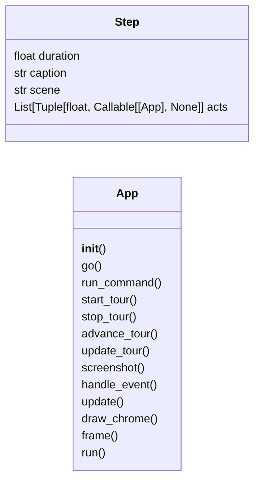
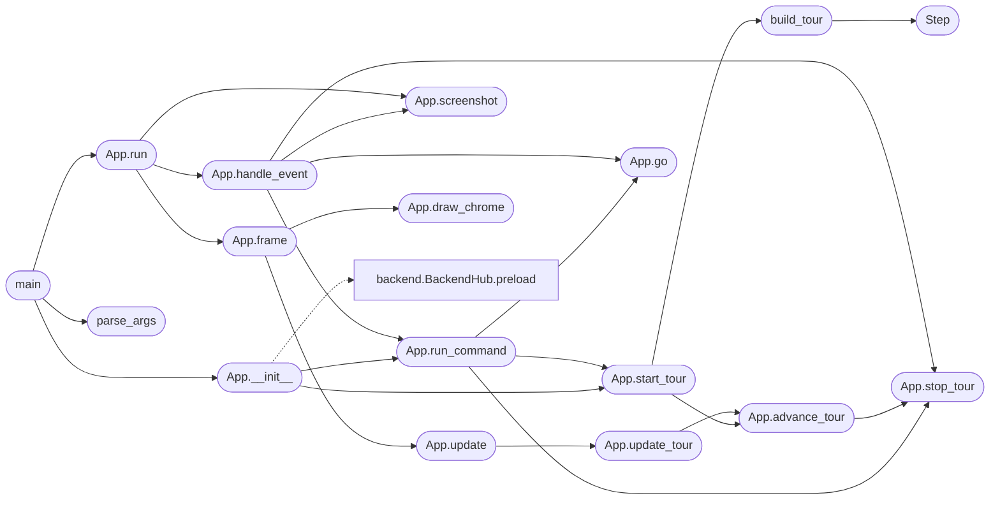

# `immersive.app`

> Source: [immersive/app.py:1](../../immersive/app.py#L1) | language `py` | coverage 5.3% | [API index](../index.md)

Immersive viewer entry: window, event loop, cinematic tour director.

## Contents

- **Classes:** [`Step`](#step), [`App`](#app)
- **Functions:** [`build_tour`](#build_tour), [`parse_args`](#parse_args), [`main`](#main)
- **Constants:** [`SCENE_ORDER`](#scene_order), [`FADE_SECONDS`](#fade_seconds), [`LETTERBOX`](#letterbox), [`SCREENSHOT_DT`](#screenshot_dt), [`TOUR_TEXT`](#tour_text)

## Type Diagram



## Call Graph

Solid arrows stay in this module, dashed arrows leave it.



## Classes

<a id="step"></a>

### `Step`

`class` `dataclass` | [immersive/app.py:64](../../immersive/app.py#L64)

Decorators: `@dataclass`

```python
class Step
```

**Attributes**

| Name | Type | Default | Description |
|---|---|---|---|
| [`duration`](#step-duration) | `float` |  |  |
| [`caption`](#step-caption) | `str` |  |  |
| [`scene`](#step-scene) | `str` |  |  |
| [`acts`](#step-acts) | `List[Tuple[float, Callable[['App'], None]]]` | `field(default_factory=list)` |  |

---

<a id="app"></a>

### `App`

`class` | [immersive/app.py:92](../../immersive/app.py#L92)

```python
class App
```

Subclasses: [`Launcher`](qc_launcher.py.md#launcher)

**Members**

| Member | Kind | Summary |
|---|---|---|
| [`__init__`](#app-__init__) | constructor |  |
| [`go`](#app-go) | method |  |
| [`run_command`](#app-run_command) | method |  |
| [`start_tour`](#app-start_tour) | method |  |
| [`stop_tour`](#app-stop_tour) | method |  |
| [`advance_tour`](#app-advance_tour) | method |  |
| [`update_tour`](#app-update_tour) | method |  |
| [`screenshot`](#app-screenshot) | method |  |
| [`handle_event`](#app-handle_event) | method |  |
| [`update`](#app-update) | method |  |
| [`draw_chrome`](#app-draw_chrome) | method |  |
| [`frame`](#app-frame) | method |  |
| [`run`](#app-run) | method |  |

<a id="app-__init__"></a>

#### `App.__init__`

`constructor` | [immersive/app.py:93](../../immersive/app.py#L93)

```python
def __init__(self, args)
```

**Parameters**

| Name | Type | Default | Description |
|---|---|---|---|
| `args` |  |  |  |

*Calls:* [`App.run_command`](#app-run_command), [`App.start_tour`](#app-start_tour), [`BackendHub.preload`](immersive.backend.py.md#backendhub-preload), [`FullscreenPass.__init__`](immersive.glkit.py.md#fullscreenpass-__init__), [`Program.__init__`](immersive.glkit.py.md#program-__init__), [`Hud.__init__`](immersive.hud.py.md#hud-__init__), [`Lang.__init__`](immersive.hud.py.md#lang-__init__), [`PostProcess.__init__`](immersive.postfx.py.md#postprocess-__init__), [`AtomScene.__init__`](immersive.scenes.py.md#atomscene-__init__), [`BlochScene.__init__`](immersive.scenes.py.md#blochscene-__init__), [`EntangleScene.__init__`](immersive.scenes.py.md#entanglescene-__init__), [`MatterScene.__init__`](immersive.scenes.py.md#matterscene-__init__) and 3 more

*Called by:* [`main`](#main)

<a id="app-go"></a>

#### `App.go`

`method` | [immersive/app.py:147](../../immersive/app.py#L147)

```python
def go(self, name: str, instant: bool = False)
```

**Parameters**

| Name | Type | Default | Description |
|---|---|---|---|
| `name` | `str` |  |  |
| `instant` | `bool` | `False` |  |

*Called by:* [`App.handle_event`](#app-handle_event), [`App.run_command`](#app-run_command)

<a id="app-run_command"></a>

#### `App.run_command`

`method` | [immersive/app.py:157](../../immersive/app.py#L157)

```python
def run_command(self, cmd: str)
```

**Parameters**

| Name | Type | Default | Description |
|---|---|---|---|
| `cmd` | `str` |  |  |

*Calls:* [`App.go`](#app-go), [`App.start_tour`](#app-start_tour), [`App.stop_tour`](#app-stop_tour), [`Lang.toggle`](immersive.hud.py.md#lang-toggle)

*Called by:* [`App.__init__`](#app-__init__), [`App.handle_event`](#app-handle_event)

<a id="app-start_tour"></a>

#### `App.start_tour`

`method` | [immersive/app.py:169](../../immersive/app.py#L169)

```python
def start_tour(self)
```

*Calls:* [`App.advance_tour`](#app-advance_tour), [`build_tour`](#build_tour)

*Called by:* [`App.__init__`](#app-__init__), [`App.run_command`](#app-run_command)

<a id="app-stop_tour"></a>

#### `App.stop_tour`

`method` | [immersive/app.py:176](../../immersive/app.py#L176)

```python
def stop_tour(self)
```

*Called by:* [`App.advance_tour`](#app-advance_tour), [`App.handle_event`](#app-handle_event), [`App.run_command`](#app-run_command)

<a id="app-advance_tour"></a>

#### `App.advance_tour`

`method` | [immersive/app.py:182](../../immersive/app.py#L182)

```python
def advance_tour(self)
```

*Calls:* [`App.stop_tour`](#app-stop_tour)

*Called by:* [`App.start_tour`](#app-start_tour), [`App.update_tour`](#app-update_tour)

<a id="app-update_tour"></a>

#### `App.update_tour`

`method` | [immersive/app.py:197](../../immersive/app.py#L197)

```python
def update_tour(self, dt: float)
```

**Parameters**

| Name | Type | Default | Description |
|---|---|---|---|
| `dt` | `float` |  |  |

*Calls:* [`App.advance_tour`](#app-advance_tour)

*Called by:* [`App.update`](#app-update)

<a id="app-screenshot"></a>

#### `App.screenshot`

`method` | [immersive/app.py:214](../../immersive/app.py#L214)

```python
def screenshot(self, path: str | None = None) -> str
```

**Parameters**

| Name | Type | Default | Description |
|---|---|---|---|
| `path` | `str \| None` | `None` |  |

**Returns:** `str`

*Called by:* [`App.handle_event`](#app-handle_event), [`App.run`](#app-run)

<a id="app-handle_event"></a>

#### `App.handle_event`

`method` | [immersive/app.py:224](../../immersive/app.py#L224)

```python
def handle_event(self, ev)
```

**Parameters**

| Name | Type | Default | Description |
|---|---|---|---|
| `ev` |  |  |  |

*Calls:* [`App.go`](#app-go), [`App.run_command`](#app-run_command), [`App.screenshot`](#app-screenshot), [`App.stop_tour`](#app-stop_tour), [`Hud.hit`](immersive.hud.py.md#hud-hit), [`Lang.toggle`](immersive.hud.py.md#lang-toggle)

*Called by:* [`App.run`](#app-run)

<a id="app-update"></a>

#### `App.update`

`method` | [immersive/app.py:264](../../immersive/app.py#L264)

```python
def update(self, dt: float)
```

**Parameters**

| Name | Type | Default | Description |
|---|---|---|---|
| `dt` | `float` |  |  |

*Calls:* [`App.update_tour`](#app-update_tour)

*Called by:* [`App.frame`](#app-frame)

<a id="app-draw_chrome"></a>

#### `App.draw_chrome`

`method` | [immersive/app.py:286](../../immersive/app.py#L286)

```python
def draw_chrome(self)
```

*Called by:* [`App.frame`](#app-frame)

<a id="app-frame"></a>

#### `App.frame`

`method` | [immersive/app.py:329](../../immersive/app.py#L329)

```python
def frame(self, dt: float)
```

**Parameters**

| Name | Type | Default | Description |
|---|---|---|---|
| `dt` | `float` |  |  |

*Calls:* [`App.draw_chrome`](#app-draw_chrome), [`App.update`](#app-update), [`Hud.begin`](immersive.hud.py.md#hud-begin), [`Hud.end`](immersive.hud.py.md#hud-end), [`Hud.resize`](immersive.hud.py.md#hud-resize), [`PostProcess.begin`](immersive.postfx.py.md#postprocess-begin), [`PostProcess.present`](immersive.postfx.py.md#postprocess-present), [`PostProcess.resize`](immersive.postfx.py.md#postprocess-resize)

*Called by:* [`App.run`](#app-run)

<a id="app-run"></a>

#### `App.run`

`method` | [immersive/app.py:344](../../immersive/app.py#L344)

```python
def run(self)
```

*Calls:* [`App.frame`](#app-frame), [`App.handle_event`](#app-handle_event), [`App.screenshot`](#app-screenshot)

*Called by:* [`main`](#main)

---

## Functions

<a id="build_tour"></a>

### `build_tour`

`function` | [immersive/app.py:71](../../immersive/app.py#L71)

```python
def build_tour() -> List[Step]
```

**Returns:** `List[Step]`

*Calls:* [`Step`](#step)

*Called by:* [`App.start_tour`](#app-start_tour)

---

<a id="parse_args"></a>

### `parse_args`

`function` | [immersive/app.py:369](../../immersive/app.py#L369)

```python
def parse_args(argv=None)
```

**Parameters**

| Name | Type | Default | Description |
|---|---|---|---|
| `argv` |  | `None` |  |

*Called by:* [`main`](#main)

---

<a id="main"></a>

### `main`

`function` | [immersive/app.py:382](../../immersive/app.py#L382)

```python
def main(argv=None)
```

**Parameters**

| Name | Type | Default | Description |
|---|---|---|---|
| `argv` |  | `None` |  |

*Calls:* [`App.__init__`](#app-__init__), [`App.run`](#app-run), [`parse_args`](#parse_args)

---

## Constants

<a id="scene_order"></a>

### `SCENE_ORDER`

`constant` | [immersive/app.py:26](../../immersive/app.py#L26)

```python
SCENE_ORDER = ('atom', 'spin', 'matter', 'bloch', 'entangle')
```

---

<a id="fade_seconds"></a>

### `FADE_SECONDS`

`constant` | [immersive/app.py:27](../../immersive/app.py#L27)

```python
FADE_SECONDS = 0.45
```

---

<a id="letterbox"></a>

### `LETTERBOX`

`constant` | [immersive/app.py:28](../../immersive/app.py#L28)

```python
LETTERBOX = 0.085
```

---

<a id="screenshot_dt"></a>

### `SCREENSHOT_DT`

`constant` | [immersive/app.py:29](../../immersive/app.py#L29)

```python
SCREENSHOT_DT = 1.0 / 30.0
```

---

<a id="tour_text"></a>

### `TOUR_TEXT`

`constant` | [immersive/app.py:31](../../immersive/app.py#L31)

```python
TOUR_TEXT
```

---
