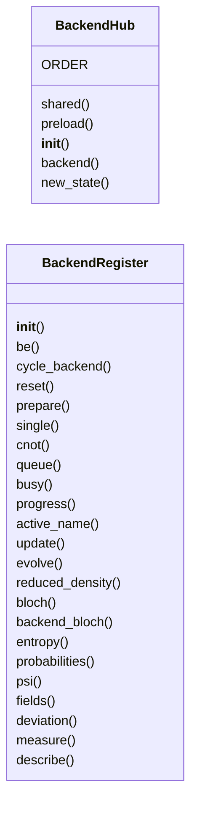
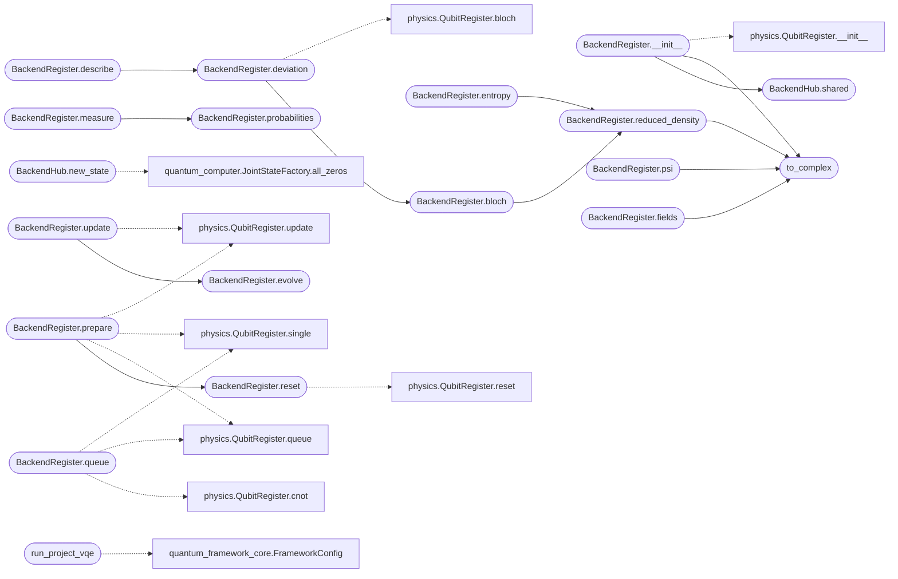

# `immersive.backend`

> Source: [immersive/backend.py:1](../../immersive/backend.py#L1) | language `py` | coverage 21.2% | [API index](../index.md)

Bridge between the viewer and the project's own simulator (quantum_computer.QuantumComputer).

Every state shown in the qubit scenes lives in a JointHilbertState (2^n amplitude fields on a GxG grid).
Gates are animated as partial unitaries applied to that tensor and committed with the project's gate registry,
so the picture is always a view of the project's computation. An independent ideal register runs in lockstep to
expose any deviation between the two.

## Contents

- **Classes:** [`BackendHub`](#backendhub), [`BackendRegister`](#backendregister)
- **Functions:** [`to_complex`](#to_complex), [`run_project_vqe`](#run_project_vqe)
- **Constants:** [`ROOT`](#root), [`COMMIT_PARAMS`](#commit_params), [`BACKEND_LABELS`](#backend_labels)

## Type Diagram



## Call Graph

Solid arrows stay in this module, dashed arrows leave it.



## Classes

<a id="backendhub"></a>

### `BackendHub`

`class` | [immersive/backend.py:31](../../immersive/backend.py#L31)

```python
class BackendHub
```

Loads the project's QuantumComputer once and exposes its physics backends.

**Attributes**

| Name | Type | Default | Description |
|---|---|---|---|
| [`ORDER`](#backendhub-order) |  | `('schrodinger', 'hamiltonian', 'dirac')` |  |

**Members**

| Member | Kind | Summary |
|---|---|---|
| [`shared`](#backendhub-shared) | classmethod |  |
| [`preload`](#backendhub-preload) | classmethod |  |
| [`__init__`](#backendhub-__init__) | constructor |  |
| [`backend`](#backendhub-backend) | method |  |
| [`new_state`](#backendhub-new_state) | method |  |

<a id="backendhub-shared"></a>

#### `BackendHub.shared`

`classmethod` | [immersive/backend.py:39](../../immersive/backend.py#L39)

Decorators: `@classmethod`

```python
def shared(cls) -> 'BackendHub'
```

**Returns:** `'BackendHub'`

*Called by:* [`BackendRegister.__init__`](#backendregister-__init__)

<a id="backendhub-preload"></a>

#### `BackendHub.preload`

`classmethod` | [immersive/backend.py:46](../../immersive/backend.py#L46)

Decorators: `@classmethod`

```python
def preload(cls)
```

*Called by:* [`App.__init__`](immersive.app.py.md#app-__init__)

<a id="backendhub-__init__"></a>

#### `BackendHub.__init__`

`constructor` | [immersive/backend.py:49](../../immersive/backend.py#L49)

```python
def __init__(self)
```

<a id="backendhub-backend"></a>

#### `BackendHub.backend`

`method` | [immersive/backend.py:67](../../immersive/backend.py#L67)

```python
def backend(self, name: str)
```

**Parameters**

| Name | Type | Default | Description |
|---|---|---|---|
| `name` | `str` |  |  |

<a id="backendhub-new_state"></a>

#### `BackendHub.new_state`

`method` | [immersive/backend.py:70](../../immersive/backend.py#L70)

```python
def new_state(self, n_qubits: int)
```

**Parameters**

| Name | Type | Default | Description |
|---|---|---|---|
| `n_qubits` | `int` |  |  |

*Calls:* [`JointStateFactory.all_zeros`](quantum_computer.py.md#jointstatefactory-all_zeros)

---

<a id="backendregister"></a>

### `BackendRegister`

`class` | [immersive/backend.py:85](../../immersive/backend.py#L85)

```python
class BackendRegister
```

Animated n-qubit register whose state is a JointHilbertState from the project's simulator.

**Members**

| Member | Kind | Summary |
|---|---|---|
| [`__init__`](#backendregister-__init__) | constructor |  |
| [`be`](#backendregister-be) | property |  |
| [`cycle_backend`](#backendregister-cycle_backend) | method |  |
| [`reset`](#backendregister-reset) | method |  |
| [`prepare`](#backendregister-prepare) | method |  |
| [`single`](#backendregister-single) | method |  |
| [`cnot`](#backendregister-cnot) | method |  |
| [`queue`](#backendregister-queue) | method |  |
| [`busy`](#backendregister-busy) | property |  |
| [`progress`](#backendregister-progress) | property |  |
| [`active_name`](#backendregister-active_name) | property |  |
| [`update`](#backendregister-update) | method |  |
| [`evolve`](#backendregister-evolve) | method | Advance every spatial amplitude field with the selected physics backend (EvolveGate). |
| [`reduced_density`](#backendregister-reduced_density) | method |  |
| [`bloch`](#backendregister-bloch) | method |  |
| [`backend_bloch`](#backendregister-backend_bloch) | method |  |
| [`entropy`](#backendregister-entropy) | method |  |
| [`probabilities`](#backendregister-probabilities) | method |  |
| [`psi`](#backendregister-psi) | property |  |
| [`fields`](#backendregister-fields) | method | Complex amplitude fields, shape (2^n, G, G). |
| [`deviation`](#backendregister-deviation) | method | Largest gap between the project's Bloch vectors and the ideal-unitary reference. |
| [`measure`](#backendregister-measure) | method |  |
| [`describe`](#backendregister-describe) | method |  |

<a id="backendregister-__init__"></a>

#### `BackendRegister.__init__`

`constructor` | [immersive/backend.py:88](../../immersive/backend.py#L88)

```python
def __init__(self, n_qubits: int, backend: str = 'schrodinger', seconds_per_gate: float = 1.1)
```

**Parameters**

| Name | Type | Default | Description |
|---|---|---|---|
| `n_qubits` | `int` |  |  |
| `backend` | `str` | `'schrodinger'` |  |
| `seconds_per_gate` | `float` | `1.1` |  |

*Calls:* [`BackendHub.shared`](#backendhub-shared), [`to_complex`](#to_complex), [`QubitRegister.__init__`](immersive.physics.py.md#qubitregister-__init__)

*Called by:* [`BlochScene.enter`](immersive.scenes.py.md#blochscene-enter), [`EntangleScene.enter`](immersive.scenes.py.md#entanglescene-enter)

<a id="backendregister-be"></a>

#### `BackendRegister.be`

`property` | [immersive/backend.py:107](../../immersive/backend.py#L107)

Decorators: `@property`

```python
def be(self)
```

<a id="backendregister-cycle_backend"></a>

#### `BackendRegister.cycle_backend`

`method` | [immersive/backend.py:110](../../immersive/backend.py#L110)

```python
def cycle_backend(self)
```

*Called by:* [`backend_command`](immersive.scenes.py.md#backend_command)

<a id="backendregister-reset"></a>

#### `BackendRegister.reset`

`method` | [immersive/backend.py:115](../../immersive/backend.py#L115)

```python
def reset(self)
```

*Calls:* [`QubitRegister.reset`](immersive.physics.py.md#qubitregister-reset)

*Called by:* [`BackendRegister.prepare`](#backendregister-prepare), [`BlochScene.command`](immersive.scenes.py.md#blochscene-command)

<a id="backendregister-prepare"></a>

#### `BackendRegister.prepare`

`method` | [immersive/backend.py:124](../../immersive/backend.py#L124)

```python
def prepare(self, kind: str)
```

**Parameters**

| Name | Type | Default | Description |
|---|---|---|---|
| `kind` | `str` |  |  |

*Calls:* [`BackendRegister.reset`](#backendregister-reset), [`QubitRegister.queue`](immersive.physics.py.md#qubitregister-queue), [`QubitRegister.single`](immersive.physics.py.md#qubitregister-single), [`QubitRegister.update`](immersive.physics.py.md#qubitregister-update)

*Called by:* [`BlochScene.command`](immersive.scenes.py.md#blochscene-command)

<a id="backendregister-single"></a>

#### `BackendRegister.single`

`method` | [immersive/backend.py:134](../../immersive/backend.py#L134)

```python
def single(self, name: str, qubit: int)
```

**Parameters**

| Name | Type | Default | Description |
|---|---|---|---|
| `name` | `str` |  |  |
| `qubit` | `int` |  |  |

*Called by:* [`BlochScene.command`](immersive.scenes.py.md#blochscene-command)

<a id="backendregister-cnot"></a>

#### `BackendRegister.cnot`

`method` | [immersive/backend.py:137](../../immersive/backend.py#L137)

```python
def cnot(self, control: int, target: int)
```

**Parameters**

| Name | Type | Default | Description |
|---|---|---|---|
| `control` | `int` |  |  |
| `target` | `int` |  |  |

<a id="backendregister-queue"></a>

#### `BackendRegister.queue`

`method` | [immersive/backend.py:140](../../immersive/backend.py#L140)

```python
def queue(self, spec: Tuple)
```

**Parameters**

| Name | Type | Default | Description |
|---|---|---|---|
| `spec` | `Tuple` |  |  |

*Calls:* [`QubitRegister.cnot`](immersive.physics.py.md#qubitregister-cnot), [`QubitRegister.queue`](immersive.physics.py.md#qubitregister-queue), [`QubitRegister.single`](immersive.physics.py.md#qubitregister-single)

*Called by:* [`BlochScene.command`](immersive.scenes.py.md#blochscene-command)

<a id="backendregister-busy"></a>

#### `BackendRegister.busy`

`property` | [immersive/backend.py:148](../../immersive/backend.py#L148)

Decorators: `@property`

```python
def busy(self) -> bool
```

**Returns:** `bool`

<a id="backendregister-progress"></a>

#### `BackendRegister.progress`

`property` | [immersive/backend.py:152](../../immersive/backend.py#L152)

Decorators: `@property`

```python
def progress(self) -> float
```

**Returns:** `float`

<a id="backendregister-active_name"></a>

#### `BackendRegister.active_name`

`property` | [immersive/backend.py:156](../../immersive/backend.py#L156)

Decorators: `@property`

```python
def active_name(self) -> str
```

**Returns:** `str`

<a id="backendregister-update"></a>

#### `BackendRegister.update`

`method` | [immersive/backend.py:177](../../immersive/backend.py#L177)

```python
def update(self, dt: float)
```

**Parameters**

| Name | Type | Default | Description |
|---|---|---|---|
| `dt` | `float` |  |  |

*Calls:* [`BackendRegister.evolve`](#backendregister-evolve), [`QubitRegister.update`](immersive.physics.py.md#qubitregister-update)

*Called by:* [`BlochScene.update`](immersive.scenes.py.md#blochscene-update), [`EntangleScene.update`](immersive.scenes.py.md#entanglescene-update)

<a id="backendregister-evolve"></a>

#### `BackendRegister.evolve`

`method` | [immersive/backend.py:197](../../immersive/backend.py#L197)

```python
def evolve(self, steps: int = 1, dt: float = 0.05)
```

Advance every spatial amplitude field with the selected physics backend (EvolveGate).

**Parameters**

| Name | Type | Default | Description |
|---|---|---|---|
| `steps` | `int` | `1` |  |
| `dt` | `float` | `0.05` |  |

*Called by:* [`BackendRegister.update`](#backendregister-update)

<a id="backendregister-reduced_density"></a>

#### `BackendRegister.reduced_density`

`method` | [immersive/backend.py:209](../../immersive/backend.py#L209)

```python
def reduced_density(self, qubit: int) -> np.ndarray
```

**Parameters**

| Name | Type | Default | Description |
|---|---|---|---|
| `qubit` | `int` |  |  |

**Returns:** `np.ndarray`

*Calls:* [`to_complex`](#to_complex)

*Called by:* [`BackendRegister.bloch`](#backendregister-bloch), [`BackendRegister.entropy`](#backendregister-entropy)

<a id="backendregister-bloch"></a>

#### `BackendRegister.bloch`

`method` | [immersive/backend.py:216](../../immersive/backend.py#L216)

```python
def bloch(self, qubit: int) -> np.ndarray
```

**Parameters**

| Name | Type | Default | Description |
|---|---|---|---|
| `qubit` | `int` |  |  |

**Returns:** `np.ndarray`

*Calls:* [`BackendRegister.reduced_density`](#backendregister-reduced_density)

*Called by:* [`BackendRegister.deviation`](#backendregister-deviation), [`BlochScene.draw_hud`](immersive.scenes.py.md#blochscene-draw_hud), [`BlochScene.render`](immersive.scenes.py.md#blochscene-render), [`BlochScene.update`](immersive.scenes.py.md#blochscene-update), [`EntangleScene.render`](immersive.scenes.py.md#entanglescene-render), [`EntangleScene.update`](immersive.scenes.py.md#entanglescene-update)

<a id="backendregister-backend_bloch"></a>

#### `BackendRegister.backend_bloch`

`method` | [immersive/backend.py:220](../../immersive/backend.py#L220)

```python
def backend_bloch(self, qubit: int) -> np.ndarray
```

**Parameters**

| Name | Type | Default | Description |
|---|---|---|---|
| `qubit` | `int` |  |  |

**Returns:** `np.ndarray`

<a id="backendregister-entropy"></a>

#### `BackendRegister.entropy`

`method` | [immersive/backend.py:223](../../immersive/backend.py#L223)

```python
def entropy(self, qubit: int = 0) -> float
```

**Parameters**

| Name | Type | Default | Description |
|---|---|---|---|
| `qubit` | `int` | `0` |  |

**Returns:** `float`

*Calls:* [`BackendRegister.reduced_density`](#backendregister-reduced_density)

*Called by:* [`EntangleScene.draw_hud`](immersive.scenes.py.md#entanglescene-draw_hud), [`EntangleScene.render`](immersive.scenes.py.md#entanglescene-render)

<a id="backendregister-probabilities"></a>

#### `BackendRegister.probabilities`

`method` | [immersive/backend.py:227](../../immersive/backend.py#L227)

```python
def probabilities(self) -> np.ndarray
```

**Returns:** `np.ndarray`

*Called by:* [`BackendRegister.measure`](#backendregister-measure), [`BlochScene.draw_hud`](immersive.scenes.py.md#blochscene-draw_hud), [`EntangleScene.draw_hud`](immersive.scenes.py.md#entanglescene-draw_hud)

<a id="backendregister-psi"></a>

#### `BackendRegister.psi`

`property` | [immersive/backend.py:231](../../immersive/backend.py#L231)

Decorators: `@property`

```python
def psi(self) -> np.ndarray
```

**Returns:** `np.ndarray`

*Calls:* [`to_complex`](#to_complex)

<a id="backendregister-fields"></a>

#### `BackendRegister.fields`

`method` | [immersive/backend.py:235](../../immersive/backend.py#L235)

```python
def fields(self) -> np.ndarray
```

Complex amplitude fields, shape (2^n, G, G).

**Returns:** `np.ndarray`

*Calls:* [`to_complex`](#to_complex)

*Called by:* [`draw_backend_panel`](immersive.scenes.py.md#draw_backend_panel)

<a id="backendregister-deviation"></a>

#### `BackendRegister.deviation`

`method` | [immersive/backend.py:239](../../immersive/backend.py#L239)

```python
def deviation(self) -> float
```

Largest gap between the project's Bloch vectors and the ideal-unitary reference.

**Returns:** `float`

*Calls:* [`BackendRegister.bloch`](#backendregister-bloch), [`QubitRegister.bloch`](immersive.physics.py.md#qubitregister-bloch)

*Called by:* [`BackendRegister.describe`](#backendregister-describe)

<a id="backendregister-measure"></a>

#### `BackendRegister.measure`

`method` | [immersive/backend.py:243](../../immersive/backend.py#L243)

```python
def measure(self, shots: int, rng: np.random.Generator | None = None) -> Dict[str, int]
```

**Parameters**

| Name | Type | Default | Description |
|---|---|---|---|
| `shots` | `int` |  |  |
| `rng` | `np.random.Generator \| None` | `None` |  |

**Returns:** `Dict[str, int]`

*Calls:* [`BackendRegister.probabilities`](#backendregister-probabilities)

<a id="backendregister-describe"></a>

#### `BackendRegister.describe`

`method` | [immersive/backend.py:251](../../immersive/backend.py#L251)

```python
def describe(self) -> Dict[str, object]
```

**Returns:** `Dict[str, object]`

*Calls:* [`BackendRegister.deviation`](#backendregister-deviation)

---

## Functions

<a id="to_complex"></a>

### `to_complex`

`function` | [immersive/backend.py:80](../../immersive/backend.py#L80)

```python
def to_complex(state) -> np.ndarray
```

**Parameters**

| Name | Type | Default | Description |
|---|---|---|---|
| `state` |  |  |  |

**Returns:** `np.ndarray`

*Called by:* [`BackendRegister.__init__`](#backendregister-__init__), [`BackendRegister.fields`](#backendregister-fields), [`BackendRegister.psi`](#backendregister-psi), [`BackendRegister.reduced_density`](#backendregister-reduced_density)

---

<a id="run_project_vqe"></a>

### `run_project_vqe`

`function` | [immersive/backend.py:265](../../immersive/backend.py#L265)

```python
def run_project_vqe() -> Dict[str, object]
```

Run the project's own live H2 VQE (MPSQuantumComputer + Jordan-Wigner Hamiltonian, 2-qubit STO-3G model).

**Returns:** `Dict[str, object]`

*Calls:* [`FrameworkConfig`](quantum_framework_core.py.md#frameworkconfig), [`MPSQuantumComputer.__init__`](quantum_framework_core.py.md#mpsquantumcomputer-__init__), [`H2VQEEngine.__init__`](quantum_lab.py.md#h2vqeengine-__init__), [`H2VQEEngine.optimize`](quantum_lab.py.md#h2vqeengine-optimize)

*Called by:* [`MatterScene.update`](immersive.scenes.py.md#matterscene-update)

---

## Constants

<a id="root"></a>

### `ROOT`

`constant` | [immersive/backend.py:22](../../immersive/backend.py#L22)

```python
ROOT = Path(__file__).resolve().parents[1]
```

---

<a id="commit_params"></a>

### `COMMIT_PARAMS`

`constant` | [immersive/backend.py:23](../../immersive/backend.py#L23)

```python
COMMIT_PARAMS = {'Rx': {'theta': math.pi / 2}, 'Ry': {'theta': math.pi / 2}}
```

---

<a id="backend_labels"></a>

### `BACKEND_LABELS`

`constant` | [immersive/backend.py:24](../../immersive/backend.py#L24)

```python
BACKEND_LABELS
```

---
