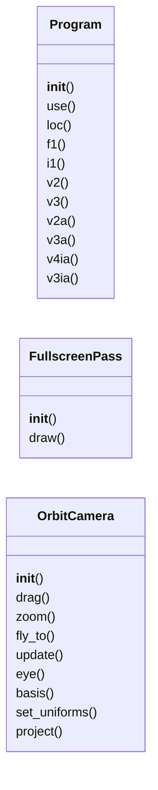
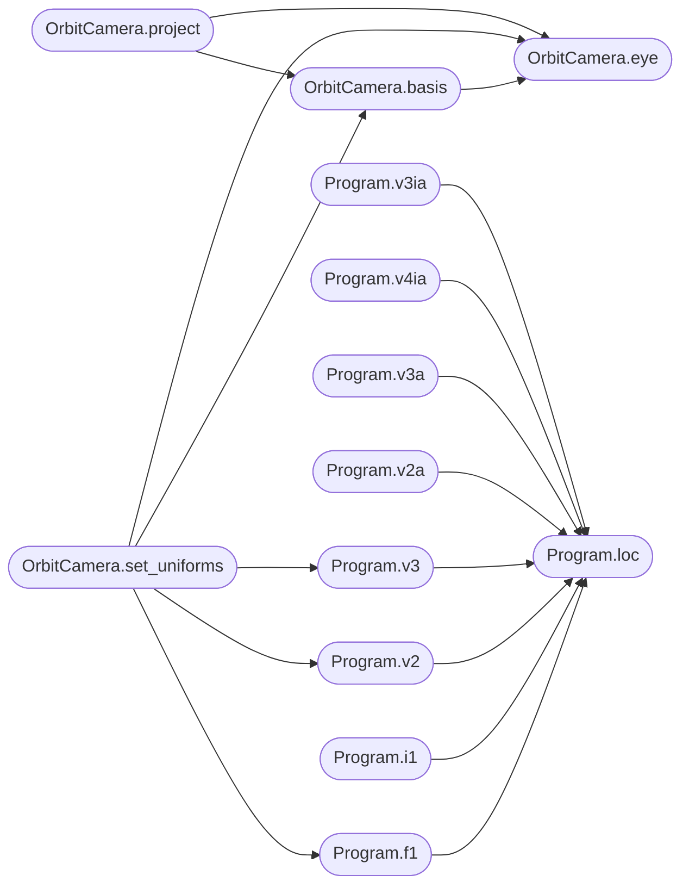

# `immersive.glkit`

> Source: [immersive/glkit.py:1](../../immersive/glkit.py#L1) | language `py` | coverage 20.7% | [API index](../index.md)

Thin OpenGL helpers: program compilation, uniforms, fullscreen pass, orbit camera.

## Contents

- **Classes:** [`Program`](#program), [`FullscreenPass`](#fullscreenpass), [`OrbitCamera`](#orbitcamera)
- **Functions:** [`make_texture`](#make_texture), [`upload_radial`](#upload_radial), [`upload_volume`](#upload_volume)
- **Constants:** [`FULLSCREEN_VERTEX`](#fullscreen_vertex)

## Type Diagram



## Call Graph

Solid arrows stay in this module, dashed arrows leave it.



## Classes

<a id="program"></a>

### `Program`

`class` | [immersive/glkit.py:32](../../immersive/glkit.py#L32)

```python
class Program
```

Linked shader program with cached uniform locations and typed setters.

**Members**

| Member | Kind | Summary |
|---|---|---|
| [`__init__`](#program-__init__) | constructor |  |
| [`use`](#program-use) | method |  |
| [`loc`](#program-loc) | method |  |
| [`f1`](#program-f1) | method |  |
| [`i1`](#program-i1) | method |  |
| [`v2`](#program-v2) | method |  |
| [`v3`](#program-v3) | method |  |
| [`v2a`](#program-v2a) | method |  |
| [`v3a`](#program-v3a) | method |  |
| [`v4ia`](#program-v4ia) | method |  |
| [`v3ia`](#program-v3ia) | method |  |

<a id="program-__init__"></a>

#### `Program.__init__`

`constructor` | [immersive/glkit.py:35](../../immersive/glkit.py#L35)

```python
def __init__(self, fragment_source: str, label: str, vertex_source: str = FULLSCREEN_VERTEX)
```

**Parameters**

| Name | Type | Default | Description |
|---|---|---|---|
| `fragment_source` | `str` |  |  |
| `label` | `str` |  |  |
| `vertex_source` | `str` | `FULLSCREEN_VERTEX` |  |

**Raises**

- `RuntimeError`: (raised in the body, not documented)

*Called by:* [`App.__init__`](immersive.app.py.md#app-__init__), [`Hud.__init__`](immersive.hud.py.md#hud-__init__), [`PostProcess.__init__`](immersive.postfx.py.md#postprocess-__init__)

<a id="program-use"></a>

#### `Program.use`

`method` | [immersive/glkit.py:49](../../immersive/glkit.py#L49)

```python
def use(self)
```

*Called by:* [`Hud.end`](immersive.hud.py.md#hud-end), [`PostProcess.present`](immersive.postfx.py.md#postprocess-present)

<a id="program-loc"></a>

#### `Program.loc`

`method` | [immersive/glkit.py:52](../../immersive/glkit.py#L52)

```python
def loc(self, name: str) -> int
```

**Parameters**

| Name | Type | Default | Description |
|---|---|---|---|
| `name` | `str` |  |  |

**Returns:** `int`

*Called by:* [`Program.f1`](#program-f1), [`Program.i1`](#program-i1), [`Program.v2`](#program-v2), [`Program.v2a`](#program-v2a), [`Program.v3`](#program-v3), [`Program.v3a`](#program-v3a), [`Program.v3ia`](#program-v3ia), [`Program.v4ia`](#program-v4ia)

<a id="program-f1"></a>

#### `Program.f1`

`method` | [immersive/glkit.py:57](../../immersive/glkit.py#L57)

```python
def f1(self, name, v)
```

**Parameters**

| Name | Type | Default | Description |
|---|---|---|---|
| `name` |  |  |  |
| `v` |  |  |  |

*Calls:* [`Program.loc`](#program-loc)

*Called by:* [`OrbitCamera.set_uniforms`](#orbitcamera-set_uniforms), [`PostProcess.present`](immersive.postfx.py.md#postprocess-present)

<a id="program-i1"></a>

#### `Program.i1`

`method` | [immersive/glkit.py:60](../../immersive/glkit.py#L60)

```python
def i1(self, name, v)
```

**Parameters**

| Name | Type | Default | Description |
|---|---|---|---|
| `name` |  |  |  |
| `v` |  |  |  |

*Calls:* [`Program.loc`](#program-loc)

*Called by:* [`Hud.end`](immersive.hud.py.md#hud-end), [`PostProcess.present`](immersive.postfx.py.md#postprocess-present)

<a id="program-v2"></a>

#### `Program.v2`

`method` | [immersive/glkit.py:63](../../immersive/glkit.py#L63)

```python
def v2(self, name, v)
```

**Parameters**

| Name | Type | Default | Description |
|---|---|---|---|
| `name` |  |  |  |
| `v` |  |  |  |

*Calls:* [`Program.loc`](#program-loc)

*Called by:* [`OrbitCamera.set_uniforms`](#orbitcamera-set_uniforms), [`Hud.end`](immersive.hud.py.md#hud-end), [`PostProcess.present`](immersive.postfx.py.md#postprocess-present)

<a id="program-v3"></a>

#### `Program.v3`

`method` | [immersive/glkit.py:66](../../immersive/glkit.py#L66)

```python
def v3(self, name, v)
```

**Parameters**

| Name | Type | Default | Description |
|---|---|---|---|
| `name` |  |  |  |
| `v` |  |  |  |

*Calls:* [`Program.loc`](#program-loc)

*Called by:* [`OrbitCamera.set_uniforms`](#orbitcamera-set_uniforms)

<a id="program-v2a"></a>

#### `Program.v2a`

`method` | [immersive/glkit.py:69](../../immersive/glkit.py#L69)

```python
def v2a(self, name, arr)
```

**Parameters**

| Name | Type | Default | Description |
|---|---|---|---|
| `name` |  |  |  |
| `arr` |  |  |  |

*Calls:* [`Program.loc`](#program-loc)

<a id="program-v3a"></a>

#### `Program.v3a`

`method` | [immersive/glkit.py:73](../../immersive/glkit.py#L73)

```python
def v3a(self, name, arr)
```

**Parameters**

| Name | Type | Default | Description |
|---|---|---|---|
| `name` |  |  |  |
| `arr` |  |  |  |

*Calls:* [`Program.loc`](#program-loc)

<a id="program-v4ia"></a>

#### `Program.v4ia`

`method` | [immersive/glkit.py:77](../../immersive/glkit.py#L77)

```python
def v4ia(self, name, arr)
```

**Parameters**

| Name | Type | Default | Description |
|---|---|---|---|
| `name` |  |  |  |
| `arr` |  |  |  |

*Calls:* [`Program.loc`](#program-loc)

<a id="program-v3ia"></a>

#### `Program.v3ia`

`method` | [immersive/glkit.py:81](../../immersive/glkit.py#L81)

```python
def v3ia(self, name, arr)
```

**Parameters**

| Name | Type | Default | Description |
|---|---|---|---|
| `name` |  |  |  |
| `arr` |  |  |  |

*Calls:* [`Program.loc`](#program-loc)

---

<a id="fullscreenpass"></a>

### `FullscreenPass`

`class` | [immersive/glkit.py:86](../../immersive/glkit.py#L86)

```python
class FullscreenPass
```

Empty VAO + one oversized triangle; every effect is a fragment shader.

**Members**

| Member | Kind | Summary |
|---|---|---|
| [`__init__`](#fullscreenpass-__init__) | constructor |  |
| [`draw`](#fullscreenpass-draw) | method |  |

<a id="fullscreenpass-__init__"></a>

#### `FullscreenPass.__init__`

`constructor` | [immersive/glkit.py:89](../../immersive/glkit.py#L89)

```python
def __init__(self)
```

*Called by:* [`App.__init__`](immersive.app.py.md#app-__init__), [`Hud.__init__`](immersive.hud.py.md#hud-__init__), [`PostProcess.__init__`](immersive.postfx.py.md#postprocess-__init__)

<a id="fullscreenpass-draw"></a>

#### `FullscreenPass.draw`

`method` | [immersive/glkit.py:92](../../immersive/glkit.py#L92)

```python
def draw(self)
```

*Called by:* [`Hud.end`](immersive.hud.py.md#hud-end), [`PostProcess.present`](immersive.postfx.py.md#postprocess-present)

---

<a id="orbitcamera"></a>

### `OrbitCamera`

`class` | [immersive/glkit.py:135](../../immersive/glkit.py#L135)

```python
class OrbitCamera
```

Z-up orbit camera with inertia, eased zoom and idle auto-rotation.

**Members**

| Member | Kind | Summary |
|---|---|---|
| [`__init__`](#orbitcamera-__init__) | constructor |  |
| [`drag`](#orbitcamera-drag) | method |  |
| [`zoom`](#orbitcamera-zoom) | method |  |
| [`fly_to`](#orbitcamera-fly_to) | method |  |
| [`update`](#orbitcamera-update) | method |  |
| [`eye`](#orbitcamera-eye) | method |  |
| [`basis`](#orbitcamera-basis) | method |  |
| [`set_uniforms`](#orbitcamera-set_uniforms) | method |  |
| [`project`](#orbitcamera-project) | method | Return (x, y, in_front) in pixel coordinates (origin top-left). |

<a id="orbitcamera-__init__"></a>

#### `OrbitCamera.__init__`

`constructor` | [immersive/glkit.py:138](../../immersive/glkit.py#L138)

```python
def __init__(self, dist: float = 14.0, yaw: float = 0.7, pitch: float = 0.35)
```

**Parameters**

| Name | Type | Default | Description |
|---|---|---|---|
| `dist` | `float` | `14.0` |  |
| `yaw` | `float` | `0.7` |  |
| `pitch` | `float` | `0.35` |  |

*Called by:* [`BlochScene.__init__`](immersive.scenes.py.md#blochscene-__init__), [`EntangleScene.__init__`](immersive.scenes.py.md#entanglescene-__init__), [`Scene.__init__`](immersive.scenes.py.md#scene-__init__)

<a id="orbitcamera-drag"></a>

#### `OrbitCamera.drag`

`method` | [immersive/glkit.py:151](../../immersive/glkit.py#L151)

```python
def drag(self, dx: float, dy: float, dt: float)
```

**Parameters**

| Name | Type | Default | Description |
|---|---|---|---|
| `dx` | `float` |  |  |
| `dy` | `float` |  |  |
| `dt` | `float` |  |  |

<a id="orbitcamera-zoom"></a>

#### `OrbitCamera.zoom`

`method` | [immersive/glkit.py:158](../../immersive/glkit.py#L158)

```python
def zoom(self, steps: float)
```

**Parameters**

| Name | Type | Default | Description |
|---|---|---|---|
| `steps` | `float` |  |  |

<a id="orbitcamera-fly_to"></a>

#### `OrbitCamera.fly_to`

`method` | [immersive/glkit.py:162](../../immersive/glkit.py#L162)

```python
def fly_to(self, dist: float)
```

**Parameters**

| Name | Type | Default | Description |
|---|---|---|---|
| `dist` | `float` |  |  |

*Called by:* [`BlochScene.__init__`](immersive.scenes.py.md#blochscene-__init__), [`EntangleScene.__init__`](immersive.scenes.py.md#entanglescene-__init__)

<a id="orbitcamera-update"></a>

#### `OrbitCamera.update`

`method` | [immersive/glkit.py:165](../../immersive/glkit.py#L165)

```python
def update(self, dt: float)
```

**Parameters**

| Name | Type | Default | Description |
|---|---|---|---|
| `dt` | `float` |  |  |

*Called by:* [`Scene.update`](immersive.scenes.py.md#scene-update)

<a id="orbitcamera-eye"></a>

#### `OrbitCamera.eye`

`method` | [immersive/glkit.py:175](../../immersive/glkit.py#L175)

```python
def eye(self) -> np.ndarray
```

**Returns:** `np.ndarray`

*Called by:* [`OrbitCamera.basis`](#orbitcamera-basis), [`OrbitCamera.project`](#orbitcamera-project), [`OrbitCamera.set_uniforms`](#orbitcamera-set_uniforms)

<a id="orbitcamera-basis"></a>

#### `OrbitCamera.basis`

`method` | [immersive/glkit.py:179](../../immersive/glkit.py#L179)

```python
def basis(self) -> Tuple[np.ndarray, np.ndarray, np.ndarray]
```

**Returns:** `Tuple[np.ndarray, np.ndarray, np.ndarray]`

*Calls:* [`OrbitCamera.eye`](#orbitcamera-eye)

*Called by:* [`OrbitCamera.project`](#orbitcamera-project), [`OrbitCamera.set_uniforms`](#orbitcamera-set_uniforms)

<a id="orbitcamera-set_uniforms"></a>

#### `OrbitCamera.set_uniforms`

`method` | [immersive/glkit.py:185](../../immersive/glkit.py#L185)

```python
def set_uniforms(self, prog: Program, width: int, height: int)
```

**Parameters**

| Name | Type | Default | Description |
|---|---|---|---|
| `prog` | `Program` |  |  |
| `width` | `int` |  |  |
| `height` | `int` |  |  |

*Calls:* [`OrbitCamera.basis`](#orbitcamera-basis), [`OrbitCamera.eye`](#orbitcamera-eye), [`Program.f1`](#program-f1), [`Program.v2`](#program-v2), [`Program.v3`](#program-v3)

*Called by:* [`BlochScene.render`](immersive.scenes.py.md#blochscene-render), [`EntangleScene.render`](immersive.scenes.py.md#entanglescene-render)

<a id="orbitcamera-project"></a>

#### `OrbitCamera.project`

`method` | [immersive/glkit.py:194](../../immersive/glkit.py#L194)

```python
def project(self, world: np.ndarray, width: int, height: int)
```

Return (x, y, in_front) in pixel coordinates (origin top-left).

**Parameters**

| Name | Type | Default | Description |
|---|---|---|---|
| `world` | `np.ndarray` |  |  |
| `width` | `int` |  |  |
| `height` | `int` |  |  |

*Calls:* [`OrbitCamera.basis`](#orbitcamera-basis), [`OrbitCamera.eye`](#orbitcamera-eye)

*Called by:* [`BlochScene.sphere_labels`](immersive.scenes.py.md#blochscene-sphere_labels), [`EntangleScene.draw_hud`](immersive.scenes.py.md#entanglescene-draw_hud)

---

## Functions

<a id="make_texture"></a>

### `make_texture`

`function` | [immersive/glkit.py:97](../../immersive/glkit.py#L97)

```python
def make_texture(width: int, height: int, internal, fmt, dtype, data=None, linear=True) -> int
```

**Parameters**

| Name | Type | Default | Description |
|---|---|---|---|
| `width` | `int` |  |  |
| `height` | `int` |  |  |
| `internal` |  |  |  |
| `fmt` |  |  |  |
| `dtype` |  |  |  |
| `data` |  | `None` |  |
| `linear` |  | `True` |  |

**Returns:** `int`

*Called by:* [`Hud.resize`](immersive.hud.py.md#hud-resize), [`VolumeScene.__init__`](immersive.scenes.py.md#volumescene-__init__)

---

<a id="upload_radial"></a>

### `upload_radial`

`function` | [immersive/glkit.py:110](../../immersive/glkit.py#L110)

```python
def upload_radial(tex: int, table: np.ndarray)
```

**Parameters**

| Name | Type | Default | Description |
|---|---|---|---|
| `tex` | `int` |  |  |
| `table` | `np.ndarray` |  |  |

*Called by:* [`AtomScene.set_states`](immersive.scenes.py.md#atomscene-set_states), [`SpinScene.refresh`](immersive.scenes.py.md#spinscene-refresh)

---

<a id="upload_volume"></a>

### `upload_volume`

`function` | [immersive/glkit.py:117](../../immersive/glkit.py#L117)

```python
def upload_volume(tex: int, volume: np.ndarray)
```

Upload a (x, y, z) float volume as a linear R32F 3D texture (texture axes s,t,r = x,y,z).

**Parameters**

| Name | Type | Default | Description |
|---|---|---|---|
| `tex` | `int` |  |  |
| `volume` | `np.ndarray` |  |  |

*Called by:* [`MatterScene.apply`](immersive.scenes.py.md#matterscene-apply)

---

## Constants

<a id="fullscreen_vertex"></a>

### `FULLSCREEN_VERTEX`

`constant` | [immersive/glkit.py:11](../../immersive/glkit.py#L11)

```python
FULLSCREEN_VERTEX
```

---
