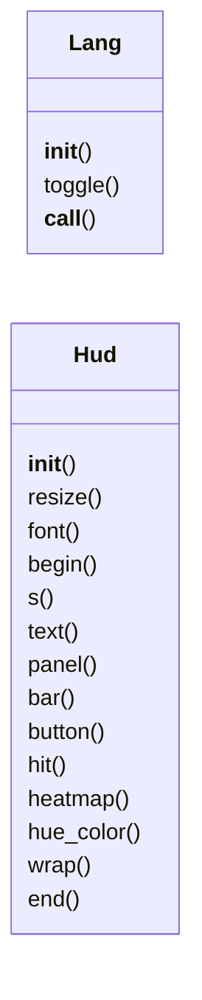
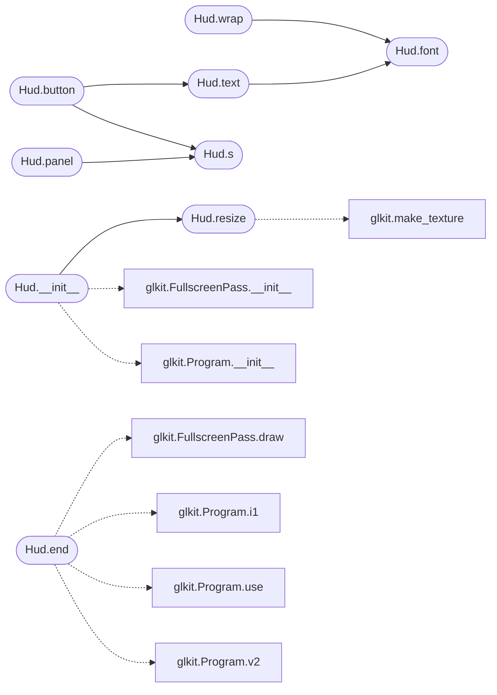

# `immersive.hud`

> Source: [immersive/hud.py:1](../../immersive/hud.py#L1) | language `py` | coverage 10.0% | [API index](../index.md)

2D heads-up display drawn with pygame into an RGBA surface and composited over the GL scene.

## Contents

- **Classes:** [`Lang`](#lang), [`Hud`](#hud)
- **Constants:** [`INK`](#ink), [`DIM`](#dim), [`ACCENT`](#accent), [`WARM`](#warm), [`PANEL`](#panel), [`PANEL_EDGE`](#panel_edge)

## Type Diagram



## Call Graph

Solid arrows stay in this module, dashed arrows leave it.



## Classes

<a id="lang"></a>

### `Lang`

`class` | [immersive/hud.py:24](../../immersive/hud.py#L24)

```python
class Lang
```

Tiny bilingual string table.

Keys missing in a language fall back to English.

**Members**

| Member | Kind | Summary |
|---|---|---|
| [`__init__`](#lang-__init__) | constructor |  |
| [`toggle`](#lang-toggle) | method |  |
| [`__call__`](#lang-__call__) | method |  |

<a id="lang-__init__"></a>

#### `Lang.__init__`

`constructor` | [immersive/hud.py:27](../../immersive/hud.py#L27)

```python
def __init__(self, table: Dict[str, Dict[str, str]], code: str = 'es')
```

**Parameters**

| Name | Type | Default | Description |
|---|---|---|---|
| `table` | `Dict[str, Dict[str, str]]` |  |  |
| `code` | `str` | `'es'` |  |

*Called by:* [`App.__init__`](immersive.app.py.md#app-__init__)

<a id="lang-toggle"></a>

#### `Lang.toggle`

`method` | [immersive/hud.py:31](../../immersive/hud.py#L31)

```python
def toggle(self)
```

*Called by:* [`App.handle_event`](immersive.app.py.md#app-handle_event), [`App.run_command`](immersive.app.py.md#app-run_command)

<a id="lang-__call__"></a>

#### `Lang.__call__`

`method` | [immersive/hud.py:34](../../immersive/hud.py#L34)

```python
def __call__(self, key: str, **kw) -> str
```

**Parameters**

| Name | Type | Default | Description |
|---|---|---|---|
| `key` | `str` |  |  |
| `**kw` |  |  |  |

**Returns:** `str`

---

<a id="hud"></a>

### `Hud`

`class` | [immersive/hud.py:40](../../immersive/hud.py#L40)

```python
class Hud
```

**Members**

| Member | Kind | Summary |
|---|---|---|
| [`__init__`](#hud-__init__) | constructor |  |
| [`resize`](#hud-resize) | method |  |
| [`font`](#hud-font) | method |  |
| [`begin`](#hud-begin) | method |  |
| [`s`](#hud-s) | method |  |
| [`text`](#hud-text) | method |  |
| [`panel`](#hud-panel) | method |  |
| [`bar`](#hud-bar) | method |  |
| [`button`](#hud-button) | method |  |
| [`hit`](#hud-hit) | method |  |
| [`heatmap`](#hud-heatmap) | method |  |
| [`hue_color`](#hud-hue_color) | method |  |
| [`wrap`](#hud-wrap) | method |  |
| [`end`](#hud-end) | method |  |

<a id="hud-__init__"></a>

#### `Hud.__init__`

`constructor` | [immersive/hud.py:41](../../immersive/hud.py#L41)

```python
def __init__(self, width: int, height: int)
```

**Parameters**

| Name | Type | Default | Description |
|---|---|---|---|
| `width` | `int` |  |  |
| `height` | `int` |  |  |

*Calls:* [`FullscreenPass.__init__`](immersive.glkit.py.md#fullscreenpass-__init__), [`Program.__init__`](immersive.glkit.py.md#program-__init__), [`Hud.resize`](#hud-resize)

*Called by:* [`App.__init__`](immersive.app.py.md#app-__init__)

<a id="hud-resize"></a>

#### `Hud.resize`

`method` | [immersive/hud.py:51](../../immersive/hud.py#L51)

```python
def resize(self, width: int, height: int)
```

**Parameters**

| Name | Type | Default | Description |
|---|---|---|---|
| `width` | `int` |  |  |
| `height` | `int` |  |  |

*Calls:* [`make_texture`](immersive.glkit.py.md#make_texture)

*Called by:* [`App.frame`](immersive.app.py.md#app-frame), [`Hud.__init__`](#hud-__init__)

<a id="hud-font"></a>

#### `Hud.font`

`method` | [immersive/hud.py:57](../../immersive/hud.py#L57)

```python
def font(self, size: int, bold: bool = False) -> pygame.font.Font
```

**Parameters**

| Name | Type | Default | Description |
|---|---|---|---|
| `size` | `int` |  |  |
| `bold` | `bool` | `False` |  |

**Returns:** `pygame.font.Font`

*Called by:* [`Hud.text`](#hud-text), [`Hud.wrap`](#hud-wrap), [`AtomScene.draw_hud`](immersive.scenes.py.md#atomscene-draw_hud)

<a id="hud-begin"></a>

#### `Hud.begin`

`method` | [immersive/hud.py:65](../../immersive/hud.py#L65)

```python
def begin(self)
```

*Called by:* [`App.frame`](immersive.app.py.md#app-frame)

<a id="hud-s"></a>

#### `Hud.s`

`method` | [immersive/hud.py:69](../../immersive/hud.py#L69)

```python
def s(self, v: float) -> int
```

**Parameters**

| Name | Type | Default | Description |
|---|---|---|---|
| `v` | `float` |  |  |

**Returns:** `int`

*Called by:* [`Hud.button`](#hud-button), [`Hud.panel`](#hud-panel), [`AtomScene.draw_energy_panel`](immersive.scenes.py.md#atomscene-draw_energy_panel), [`AtomScene.draw_hud`](immersive.scenes.py.md#atomscene-draw_hud), [`BlochScene.draw_hud`](immersive.scenes.py.md#blochscene-draw_hud), [`EntangleScene.draw_hud`](immersive.scenes.py.md#entanglescene-draw_hud), [`MatterScene.draw_hud`](immersive.scenes.py.md#matterscene-draw_hud), [`MatterScene.draw_vqe`](immersive.scenes.py.md#matterscene-draw_vqe), [`Scene.panel_rect`](immersive.scenes.py.md#scene-panel_rect), [`SpinScene.draw_hud`](immersive.scenes.py.md#spinscene-draw_hud), [`SpinScene.spin_inset`](immersive.scenes.py.md#spinscene-spin_inset), [`VolumeScene.phase_legend`](immersive.scenes.py.md#volumescene-phase_legend) and 1 more

<a id="hud-text"></a>

#### `Hud.text`

`method` | [immersive/hud.py:72](../../immersive/hud.py#L72)

```python
def text(self, msg: str, x: float, y: float, size: int = 16, color: Color = INK, bold=False, anchor: str = 'tl', alpha: int = 255, shadow: bool = True) -> pygame.Rect
```

**Parameters**

| Name | Type | Default | Description |
|---|---|---|---|
| `msg` | `str` |  |  |
| `x` | `float` |  |  |
| `y` | `float` |  |  |
| `size` | `int` | `16` |  |
| `color` | `Color` | `INK` |  |
| `bold` |  | `False` |  |
| `anchor` | `str` | `'tl'` |  |
| `alpha` | `int` | `255` |  |
| `shadow` | `bool` | `True` |  |

**Returns:** `pygame.Rect`

*Calls:* [`Hud.font`](#hud-font)

*Called by:* [`Hud.button`](#hud-button), [`AtomScene.draw_energy_panel`](immersive.scenes.py.md#atomscene-draw_energy_panel), [`AtomScene.draw_hud`](immersive.scenes.py.md#atomscene-draw_hud), [`BlochScene.draw_hud`](immersive.scenes.py.md#blochscene-draw_hud), [`BlochScene.sphere_labels`](immersive.scenes.py.md#blochscene-sphere_labels), [`EntangleScene.draw_hud`](immersive.scenes.py.md#entanglescene-draw_hud), [`MatterScene.draw_hud`](immersive.scenes.py.md#matterscene-draw_hud), [`MatterScene.draw_vqe`](immersive.scenes.py.md#matterscene-draw_vqe), [`SpinScene.draw_hud`](immersive.scenes.py.md#spinscene-draw_hud), [`VolumeScene.cut_hud`](immersive.scenes.py.md#volumescene-cut_hud), [`VolumeScene.phase_legend`](immersive.scenes.py.md#volumescene-phase_legend), [`draw_backend_panel`](immersive.scenes.py.md#draw_backend_panel)

<a id="hud-panel"></a>

#### `Hud.panel`

`method` | [immersive/hud.py:99](../../immersive/hud.py#L99)

```python
def panel(self, rect: pygame.Rect, radius: int = 12)
```

**Parameters**

| Name | Type | Default | Description |
|---|---|---|---|
| `rect` | `pygame.Rect` |  |  |
| `radius` | `int` | `12` |  |

*Calls:* [`Hud.s`](#hud-s)

*Called by:* [`Scene.panel_rect`](immersive.scenes.py.md#scene-panel_rect), [`draw_backend_panel`](immersive.scenes.py.md#draw_backend_panel)

<a id="hud-bar"></a>

#### `Hud.bar`

`method` | [immersive/hud.py:105](../../immersive/hud.py#L105)

```python
def bar(self, rect: pygame.Rect, frac: float, color: Color, back=(255, 255, 255, 28))
```

**Parameters**

| Name | Type | Default | Description |
|---|---|---|---|
| `rect` | `pygame.Rect` |  |  |
| `frac` | `float` |  |  |
| `color` | `Color` |  |  |
| `back` |  | `(255, 255, 255, 28)` |  |

*Called by:* [`BlochScene.draw_hud`](immersive.scenes.py.md#blochscene-draw_hud), [`EntangleScene.draw_hud`](immersive.scenes.py.md#entanglescene-draw_hud), [`SpinScene.draw_hud`](immersive.scenes.py.md#spinscene-draw_hud)

<a id="hud-button"></a>

#### `Hud.button`

`method` | [immersive/hud.py:113](../../immersive/hud.py#L113)

```python
def button(self, rect: pygame.Rect, label: str, action: str, hot: bool = False)
```

**Parameters**

| Name | Type | Default | Description |
|---|---|---|---|
| `rect` | `pygame.Rect` |  |  |
| `label` | `str` |  |  |
| `action` | `str` |  |  |
| `hot` | `bool` | `False` |  |

*Calls:* [`Hud.s`](#hud-s), [`Hud.text`](#hud-text)

*Called by:* [`BlochScene.draw_hud`](immersive.scenes.py.md#blochscene-draw_hud), [`EntangleScene.draw_hud`](immersive.scenes.py.md#entanglescene-draw_hud), [`MatterScene.draw_hud`](immersive.scenes.py.md#matterscene-draw_hud)

<a id="hud-hit"></a>

#### `Hud.hit`

`method` | [immersive/hud.py:122](../../immersive/hud.py#L122)

```python
def hit(self, pos) -> str | None
```

**Parameters**

| Name | Type | Default | Description |
|---|---|---|---|
| `pos` |  |  |  |

**Returns:** `str | None`

*Called by:* [`App.handle_event`](immersive.app.py.md#app-handle_event)

<a id="hud-heatmap"></a>

#### `Hud.heatmap`

`method` | [immersive/hud.py:128](../../immersive/hud.py#L128)

```python
def heatmap(self, values: np.ndarray, rect: pygame.Rect, peak: float | None = None)
```

**Parameters**

| Name | Type | Default | Description |
|---|---|---|---|
| `values` | `np.ndarray` |  |  |
| `rect` | `pygame.Rect` |  |  |
| `peak` | `float \| None` | `None` |  |

*Called by:* [`draw_backend_panel`](immersive.scenes.py.md#draw_backend_panel)

<a id="hud-hue_color"></a>

#### `Hud.hue_color`

`method` | [immersive/hud.py:138](../../immersive/hud.py#L138)

```python
def hue_color(self, phase: float) -> Color
```

**Parameters**

| Name | Type | Default | Description |
|---|---|---|---|
| `phase` | `float` |  |  |

**Returns:** `Color`

*Called by:* [`EntangleScene.draw_hud`](immersive.scenes.py.md#entanglescene-draw_hud), [`VolumeScene.phase_legend`](immersive.scenes.py.md#volumescene-phase_legend)

<a id="hud-wrap"></a>

#### `Hud.wrap`

`method` | [immersive/hud.py:142](../../immersive/hud.py#L142)

```python
def wrap(self, msg: str, width_px: int, size: int = 14, bold=False) -> List[str]
```

**Parameters**

| Name | Type | Default | Description |
|---|---|---|---|
| `msg` | `str` |  |  |
| `width_px` | `int` |  |  |
| `size` | `int` | `14` |  |
| `bold` |  | `False` |  |

**Returns:** `List[str]`

*Calls:* [`Hud.font`](#hud-font)

*Called by:* [`AtomScene.draw_hud`](immersive.scenes.py.md#atomscene-draw_hud), [`BlochScene.draw_hud`](immersive.scenes.py.md#blochscene-draw_hud), [`EntangleScene.draw_hud`](immersive.scenes.py.md#entanglescene-draw_hud), [`MatterScene.draw_hud`](immersive.scenes.py.md#matterscene-draw_hud), [`SpinScene.draw_hud`](immersive.scenes.py.md#spinscene-draw_hud)

<a id="hud-end"></a>

#### `Hud.end`

`method` | [immersive/hud.py:156](../../immersive/hud.py#L156)

```python
def end(self, fade: float = 0.0)
```

**Parameters**

| Name | Type | Default | Description |
|---|---|---|---|
| `fade` | `float` | `0.0` |  |

*Calls:* [`FullscreenPass.draw`](immersive.glkit.py.md#fullscreenpass-draw), [`Program.i1`](immersive.glkit.py.md#program-i1), [`Program.use`](immersive.glkit.py.md#program-use), [`Program.v2`](immersive.glkit.py.md#program-v2)

*Called by:* [`App.frame`](immersive.app.py.md#app-frame)

---

## Constants

<a id="ink"></a>

### `INK`

`constant` | [immersive/hud.py:16](../../immersive/hud.py#L16)

```python
INK: Color = (232, 240, 255)
```

---

<a id="dim"></a>

### `DIM`

`constant` | [immersive/hud.py:17](../../immersive/hud.py#L17)

```python
DIM: Color = (150, 168, 200)
```

---

<a id="accent"></a>

### `ACCENT`

`constant` | [immersive/hud.py:18](../../immersive/hud.py#L18)

```python
ACCENT: Color = (120, 200, 255)
```

---

<a id="warm"></a>

### `WARM`

`constant` | [immersive/hud.py:19](../../immersive/hud.py#L19)

```python
WARM: Color = (255, 190, 110)
```

---

<a id="panel"></a>

### `PANEL`

`constant` | [immersive/hud.py:20](../../immersive/hud.py#L20)

```python
PANEL = (8, 14, 30, 150)
```

---

<a id="panel_edge"></a>

### `PANEL_EDGE`

`constant` | [immersive/hud.py:21](../../immersive/hud.py#L21)

```python
PANEL_EDGE = (110, 170, 255, 70)
```

---
