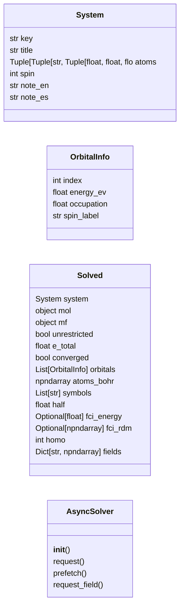
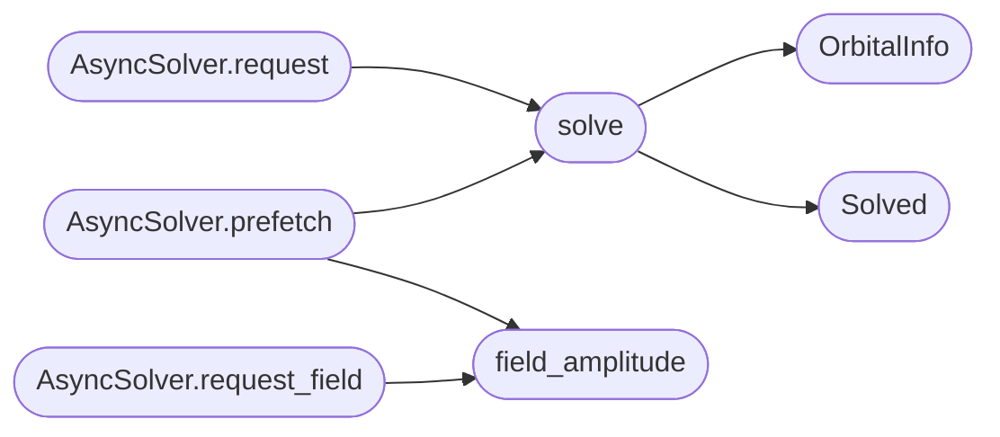

# `immersive.matter`

> Source: [immersive/matter.py:1](../../immersive/matter.py#L1) | language `py` | coverage 35.7% | [API index](../index.md)

Ab-initio fields for atoms and molecules (PySCF) sampled on a cubic grid for GPU volume rendering.

## Contents

- **Classes:** [`System`](#system), [`OrbitalInfo`](#orbitalinfo), [`Solved`](#solved), [`AsyncSolver`](#asyncsolver)
- **Functions:** [`pyscf_available`](#pyscf_available), [`solve`](#solve), [`field_amplitude`](#field_amplitude), [`exposure`](#exposure), [`bonds`](#bonds)
- **Constants:** [`BOHR_PER_ANGSTROM`](#bohr_per_angstrom), [`HARTREE_EV`](#hartree_ev), [`GRID`](#grid), [`MARGIN`](#margin), [`BASIS`](#basis), [`BOND_TOLERANCE`](#bond_tolerance), [`COVALENT_RADII`](#covalent_radii), [`CPK`](#cpk), [`DISPLAY_RADIUS`](#display_radius), [`UNPAIRED`](#unpaired), [`MOLECULES`](#molecules), [`ATOM_SYSTEMS`](#atom_systems), [`LIBRARY`](#library)

## Type Diagram



## Call Graph

Solid arrows stay in this module, dashed arrows leave it.



## Classes

<a id="system"></a>

### `System`

`class` `dataclass` | [immersive/matter.py:30](../../immersive/matter.py#L30)

Decorators: `@dataclass(frozen=True)`

```python
class System
```

**Attributes**

| Name | Type | Default | Description |
|---|---|---|---|
| [`key`](#system-key) | `str` |  |  |
| [`title`](#system-title) | `str` |  |  |
| [`atoms`](#system-atoms) | `Tuple[Tuple[str, Tuple[float, float, float]], ...]` |  |  |
| [`spin`](#system-spin) | `int` | `0` |  |
| [`note_en`](#system-note_en) | `str` | `''` |  |
| [`note_es`](#system-note_es) | `str` | `''` |  |

---

<a id="orbitalinfo"></a>

### `OrbitalInfo`

`class` `dataclass` | [immersive/matter.py:77](../../immersive/matter.py#L77)

Decorators: `@dataclass`

```python
class OrbitalInfo
```

**Attributes**

| Name | Type | Default | Description |
|---|---|---|---|
| [`index`](#orbitalinfo-index) | `int` |  |  |
| [`energy_ev`](#orbitalinfo-energy_ev) | `float` |  |  |
| [`occupation`](#orbitalinfo-occupation) | `float` |  |  |
| [`spin_label`](#orbitalinfo-spin_label) | `str` | `''` |  |

---

<a id="solved"></a>

### `Solved`

`class` `dataclass` | [immersive/matter.py:85](../../immersive/matter.py#L85)

Decorators: `@dataclass`

```python
class Solved
```

**Attributes**

| Name | Type | Default | Description |
|---|---|---|---|
| [`system`](#solved-system) | `System` |  |  |
| [`mol`](#solved-mol) | `object` |  |  |
| [`mf`](#solved-mf) | `object` |  |  |
| [`unrestricted`](#solved-unrestricted) | `bool` |  |  |
| [`e_total`](#solved-e_total) | `float` |  |  |
| [`converged`](#solved-converged) | `bool` |  |  |
| [`orbitals`](#solved-orbitals) | `List[OrbitalInfo]` |  |  |
| [`atoms_bohr`](#solved-atoms_bohr) | `np.ndarray` |  |  |
| [`symbols`](#solved-symbols) | `List[str]` |  |  |
| [`half`](#solved-half) | `float` |  |  |
| [`fci_energy`](#solved-fci_energy) | `Optional[float]` | `None` |  |
| [`fci_rdm`](#solved-fci_rdm) | `Optional[np.ndarray]` | `None` |  |
| [`homo`](#solved-homo) | `int` | `0` |  |
| [`fields`](#solved-fields) | `Dict[str, np.ndarray]` | `field(default_factory=dict)` |  |

---

<a id="asyncsolver"></a>

### `AsyncSolver`

`class` | [immersive/matter.py:211](../../immersive/matter.py#L211)

```python
class AsyncSolver
```

Runs PySCF off the render thread and caches finished systems.

**Members**

| Member | Kind | Summary |
|---|---|---|
| [`__init__`](#asyncsolver-__init__) | constructor |  |
| [`request`](#asyncsolver-request) | method |  |
| [`prefetch`](#asyncsolver-prefetch) | method | Solve [`system`](#solved-system) and sample the given fields in one background job. |
| [`request_field`](#asyncsolver-request_field) | method |  |

<a id="asyncsolver-__init__"></a>

#### `AsyncSolver.__init__`

`constructor` | [immersive/matter.py:214](../../immersive/matter.py#L214)

```python
def __init__(self)
```

*Called by:* [`MatterScene.__init__`](immersive.scenes.py.md#matterscene-__init__)

<a id="asyncsolver-request"></a>

#### `AsyncSolver.request`

`method` | [immersive/matter.py:220](../../immersive/matter.py#L220)

```python
def request(self, system: System)
```

**Parameters**

| Name | Type | Default | Description |
|---|---|---|---|
| `system` | `System` |  |  |

*Calls:* [`solve`](#solve)

*Called by:* [`MatterScene.update`](immersive.scenes.py.md#matterscene-update)

<a id="asyncsolver-prefetch"></a>

#### `AsyncSolver.prefetch`

`method` | [immersive/matter.py:236](../../immersive/matter.py#L236)

```python
def prefetch(self, system: System, kinds: Tuple[str, ...] = ('density',))
```

Solve [`system`](#solved-system) and sample the given fields in one background job.

**Parameters**

| Name | Type | Default | Description |
|---|---|---|---|
| `system` | `System` |  |  |
| `kinds` | `Tuple[str, ...]` | `('density',)` |  |

*Calls:* [`field_amplitude`](#field_amplitude), [`solve`](#solve)

*Called by:* [`MatterScene.warm_up`](immersive.scenes.py.md#matterscene-warm_up)

<a id="asyncsolver-request_field"></a>

#### `AsyncSolver.request_field`

`method` | [immersive/matter.py:261](../../immersive/matter.py#L261)

```python
def request_field(self, system: System, kind: str)
```

**Parameters**

| Name | Type | Default | Description |
|---|---|---|---|
| `system` | `System` |  |  |
| `kind` | `str` |  |  |

*Calls:* [`field_amplitude`](#field_amplitude)

*Called by:* [`MatterScene.update`](immersive.scenes.py.md#matterscene-update)

---

## Functions

<a id="pyscf_available"></a>

### `pyscf_available`

`function` | [immersive/matter.py:102](../../immersive/matter.py#L102)

```python
def pyscf_available() -> bool
```

**Returns:** `bool`

*Called by:* [`MatterScene.__init__`](immersive.scenes.py.md#matterscene-__init__)

---

<a id="solve"></a>

### `solve`

`function` | [immersive/matter.py:110](../../immersive/matter.py#L110)

```python
def solve(system: System) -> Solved
```

**Parameters**

| Name | Type | Default | Description |
|---|---|---|---|
| `system` | `System` |  |  |

**Returns:** `Solved`

*Calls:* [`OrbitalInfo`](#orbitalinfo), [`Solved`](#solved)

*Called by:* [`AsyncSolver.prefetch`](#asyncsolver-prefetch), [`AsyncSolver.request`](#asyncsolver-request)

---

<a id="field_amplitude"></a>

### `field_amplitude`

`function` | [immersive/matter.py:160](../../immersive/matter.py#L160)

```python
def field_amplitude(solved: Solved, kind: str) -> np.ndarray
```

Signed amplitude a(r) with density a^2: sqrt(rho), signed sqrt(spin density), or an orbital.

**Parameters**

| Name | Type | Default | Description |
|---|---|---|---|
| `solved` | `Solved` |  |  |
| `kind` | `str` |  |  |

**Returns:** `np.ndarray`

*Called by:* [`AsyncSolver.prefetch`](#asyncsolver-prefetch), [`AsyncSolver.request_field`](#asyncsolver-request_field), [`MatterScene.apply`](immersive.scenes.py.md#matterscene-apply)

---

<a id="exposure"></a>

### `exposure`

`function` | [immersive/matter.py:192](../../immersive/matter.py#L192)

```python
def exposure(amp: np.ndarray, half: float) -> float
```

1 / (99.7th percentile of a^2 inside the bounding sphere).

**Parameters**

| Name | Type | Default | Description |
|---|---|---|---|
| `amp` | `np.ndarray` |  |  |
| `half` | `float` |  |  |

**Returns:** `float`

---

<a id="bonds"></a>

### `bonds`

`function` | [immersive/matter.py:201](../../immersive/matter.py#L201)

```python
def bonds(symbols: List[str], coords: np.ndarray) -> List[Tuple[int, int]]
```

**Parameters**

| Name | Type | Default | Description |
|---|---|---|---|
| `symbols` | `List[str]` |  |  |
| `coords` | `np.ndarray` |  |  |

**Returns:** `List[Tuple[int, int]]`

*Called by:* [`MatterScene.apply`](immersive.scenes.py.md#matterscene-apply)

---

## Constants

<a id="bohr_per_angstrom"></a>

### `BOHR_PER_ANGSTROM`

`constant` | [immersive/matter.py:12](../../immersive/matter.py#L12)

```python
BOHR_PER_ANGSTROM = 1.0 / 0.529177210903
```

---

<a id="hartree_ev"></a>

### `HARTREE_EV`

`constant` | [immersive/matter.py:13](../../immersive/matter.py#L13)

```python
HARTREE_EV = 27.211386245988
```

---

<a id="grid"></a>

### `GRID`

`constant` | [immersive/matter.py:14](../../immersive/matter.py#L14)

```python
GRID = 88
```

---

<a id="margin"></a>

### `MARGIN`

`constant` | [immersive/matter.py:15](../../immersive/matter.py#L15)

```python
MARGIN = 4.2
```

---

<a id="basis"></a>

### `BASIS`

`constant` | [immersive/matter.py:16](../../immersive/matter.py#L16)

```python
BASIS = '6-31g'
```

---

<a id="bond_tolerance"></a>

### `BOND_TOLERANCE`

`constant` | [immersive/matter.py:17](../../immersive/matter.py#L17)

```python
BOND_TOLERANCE = 1.25
```

---

<a id="covalent_radii"></a>

### `COVALENT_RADII`

`constant` | [immersive/matter.py:19](../../immersive/matter.py#L19)

```python
COVALENT_RADII
```

---

<a id="cpk"></a>

### `CPK`

`constant` | [immersive/matter.py:20](../../immersive/matter.py#L20)

```python
CPK
```

---

<a id="display_radius"></a>

### `DISPLAY_RADIUS`

`constant` | [immersive/matter.py:25](../../immersive/matter.py#L25)

```python
DISPLAY_RADIUS
```

---

<a id="unpaired"></a>

### `UNPAIRED`

`constant` | [immersive/matter.py:26](../../immersive/matter.py#L26)

```python
UNPAIRED
```

---

<a id="molecules"></a>

### `MOLECULES`

`constant` | [immersive/matter.py:43](../../immersive/matter.py#L43)

```python
MOLECULES: List[System]
```

---

<a id="atom_systems"></a>

### `ATOM_SYSTEMS`

`constant` | [immersive/matter.py:68](../../immersive/matter.py#L68)

```python
ATOM_SYSTEMS: List[System]
```

---

<a id="library"></a>

### `LIBRARY`

`constant` | [immersive/matter.py:73](../../immersive/matter.py#L73)

```python
LIBRARY: List[System] = MOLECULES + ATOM_SYSTEMS
```

---
