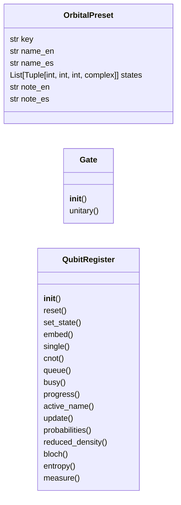
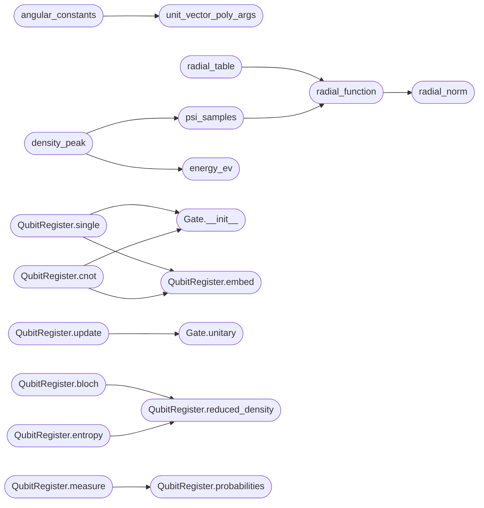

# `immersive.physics`

> Source: [immersive/physics.py:1](../../immersive/physics.py#L1) | language `py` | coverage 29.4% | [API index](../index.md)

Physics kernels for the immersive viewer: hydrogenic tables, angular constants, qubit registers.

## Contents

- **Classes:** [`OrbitalPreset`](#orbitalpreset), [`Gate`](#gate), [`QubitRegister`](#qubitregister)
- **Functions:** [`unit_vector_poly_args`](#unit_vector_poly_args), [`angular_constants`](#angular_constants), [`ylm_from_table`](#ylm_from_table), [`radial_norm`](#radial_norm), [`radial_function`](#radial_function), [`radial_table`](#radial_table), [`view_radius`](#view_radius), [`energy_ev`](#energy_ev), [`orbital_label`](#orbital_label), [`psi_samples`](#psi_samples), [`density_peak`](#density_peak), [`overlap_1s`](#overlap_1s)
- **Constants:** [`HARTREE_EV`](#hartree_ev), [`RYDBERG_EV`](#rydberg_ev), [`MAX_STATES`](#max_states), [`RADIAL_SAMPLES`](#radial_samples), [`ANGULAR_PROBE`](#angular_probe), [`ANGULAR_POLY`](#angular_poly), [`PRESETS`](#presets), [`I2`](#i2), [`PX`](#px), [`PY`](#py), [`PZ`](#pz), [`PAULI`](#pauli), [`P1`](#p1), [`PMINUS`](#pminus), [`SINGLE_GATES`](#single_gates)

## Type Diagram



## Call Graph

Solid arrows stay in this module, dashed arrows leave it.



## Classes

<a id="orbitalpreset"></a>

### `OrbitalPreset`

`class` `dataclass` | [immersive/physics.py:121](../../immersive/physics.py#L121)

Decorators: `@dataclass`

```python
class OrbitalPreset
```

**Attributes**

| Name | Type | Default | Description |
|---|---|---|---|
| [`key`](#orbitalpreset-key) | `str` |  |  |
| [`name_en`](#orbitalpreset-name_en) | `str` |  |  |
| [`name_es`](#orbitalpreset-name_es) | `str` |  |  |
| [`states`](#orbitalpreset-states) | `List[Tuple[int, int, int, complex]]` |  |  |
| [`note_en`](#orbitalpreset-note_en) | `str` | `''` |  |
| [`note_es`](#orbitalpreset-note_es) | `str` | `''` |  |

---

<a id="gate"></a>

### `Gate`

`class` | [immersive/physics.py:154](../../immersive/physics.py#L154)

```python
class Gate
```

A unitary exp(-i s H) with H Hermitian, so it can be animated for s in [0, 1].

**Members**

| Member | Kind | Summary |
|---|---|---|
| [`__init__`](#gate-__init__) | constructor |  |
| [`unitary`](#gate-unitary) | method |  |

<a id="gate-__init__"></a>

#### `Gate.__init__`

`constructor` | [immersive/physics.py:157](../../immersive/physics.py#L157)

```python
def __init__(self, name: str, hamiltonian: np.ndarray, qubits: Tuple[int, ...])
```

**Parameters**

| Name | Type | Default | Description |
|---|---|---|---|
| `name` | `str` |  |  |
| `hamiltonian` | `np.ndarray` |  |  |
| `qubits` | `Tuple[int, ...]` |  |  |

*Called by:* [`QubitRegister.cnot`](#qubitregister-cnot), [`QubitRegister.single`](#qubitregister-single)

<a id="gate-unitary"></a>

#### `Gate.unitary`

`method` | [immersive/physics.py:163](../../immersive/physics.py#L163)

```python
def unitary(self, s: float) -> np.ndarray
```

**Parameters**

| Name | Type | Default | Description |
|---|---|---|---|
| `s` | `float` |  |  |

**Returns:** `np.ndarray`

*Called by:* [`QubitRegister.update`](#qubitregister-update)

---

<a id="qubitregister"></a>

### `QubitRegister`

`class` | [immersive/physics.py:187](../../immersive/physics.py#L187)

```python
class QubitRegister
```

Small state-vector simulator with animated gate application and reduced Bloch vectors.

**Members**

| Member | Kind | Summary |
|---|---|---|
| [`__init__`](#qubitregister-__init__) | constructor |  |
| [`reset`](#qubitregister-reset) | method |  |
| [`set_state`](#qubitregister-set_state) | method |  |
| [`embed`](#qubitregister-embed) | method |  |
| [`single`](#qubitregister-single) | method |  |
| [`cnot`](#qubitregister-cnot) | method |  |
| [`queue`](#qubitregister-queue) | method |  |
| [`busy`](#qubitregister-busy) | property |  |
| [`progress`](#qubitregister-progress) | property |  |
| [`active_name`](#qubitregister-active_name) | property |  |
| [`update`](#qubitregister-update) | method |  |
| [`probabilities`](#qubitregister-probabilities) | method |  |
| [`reduced_density`](#qubitregister-reduced_density) | method |  |
| [`bloch`](#qubitregister-bloch) | method |  |
| [`entropy`](#qubitregister-entropy) | method |  |
| [`measure`](#qubitregister-measure) | method |  |

<a id="qubitregister-__init__"></a>

#### `QubitRegister.__init__`

`constructor` | [immersive/physics.py:190](../../immersive/physics.py#L190)

```python
def __init__(self, n_qubits: int, seconds_per_gate: float = 1.1)
```

**Parameters**

| Name | Type | Default | Description |
|---|---|---|---|
| `n_qubits` | `int` |  |  |
| `seconds_per_gate` | `float` | `1.1` |  |

*Called by:* [`BackendRegister.__init__`](immersive.backend.py.md#backendregister-__init__)

<a id="qubitregister-reset"></a>

#### `QubitRegister.reset`

`method` | [immersive/physics.py:201](../../immersive/physics.py#L201)

```python
def reset(self)
```

*Called by:* [`BackendRegister.reset`](immersive.backend.py.md#backendregister-reset)

<a id="qubitregister-set_state"></a>

#### `QubitRegister.set_state`

`method` | [immersive/physics.py:208](../../immersive/physics.py#L208)

```python
def set_state(self, vec: np.ndarray)
```

**Parameters**

| Name | Type | Default | Description |
|---|---|---|---|
| `vec` | `np.ndarray` |  |  |

<a id="qubitregister-embed"></a>

#### `QubitRegister.embed`

`method` | [immersive/physics.py:213](../../immersive/physics.py#L213)

```python
def embed(self, op: np.ndarray, qubit: int) -> np.ndarray
```

**Parameters**

| Name | Type | Default | Description |
|---|---|---|---|
| `op` | `np.ndarray` |  |  |
| `qubit` | `int` |  |  |

**Returns:** `np.ndarray`

*Called by:* [`QubitRegister.cnot`](#qubitregister-cnot), [`QubitRegister.single`](#qubitregister-single)

<a id="qubitregister-single"></a>

#### `QubitRegister.single`

`method` | [immersive/physics.py:221](../../immersive/physics.py#L221)

```python
def single(self, name: str, qubit: int) -> Gate
```

**Parameters**

| Name | Type | Default | Description |
|---|---|---|---|
| `name` | `str` |  |  |
| `qubit` | `int` |  |  |

**Returns:** `Gate`

*Calls:* [`Gate.__init__`](#gate-__init__), [`QubitRegister.embed`](#qubitregister-embed)

*Called by:* [`BackendRegister.prepare`](immersive.backend.py.md#backendregister-prepare), [`BackendRegister.queue`](immersive.backend.py.md#backendregister-queue)

<a id="qubitregister-cnot"></a>

#### `QubitRegister.cnot`

`method` | [immersive/physics.py:226](../../immersive/physics.py#L226)

```python
def cnot(self, control: int, target: int) -> Gate
```

**Parameters**

| Name | Type | Default | Description |
|---|---|---|---|
| `control` | `int` |  |  |
| `target` | `int` |  |  |

**Returns:** `Gate`

*Calls:* [`Gate.__init__`](#gate-__init__), [`QubitRegister.embed`](#qubitregister-embed)

*Called by:* [`BackendRegister.queue`](immersive.backend.py.md#backendregister-queue)

<a id="qubitregister-queue"></a>

#### `QubitRegister.queue`

`method` | [immersive/physics.py:231](../../immersive/physics.py#L231)

```python
def queue(self, gate: Gate)
```

**Parameters**

| Name | Type | Default | Description |
|---|---|---|---|
| `gate` | `Gate` |  |  |

*Called by:* [`BackendRegister.prepare`](immersive.backend.py.md#backendregister-prepare), [`BackendRegister.queue`](immersive.backend.py.md#backendregister-queue)

<a id="qubitregister-busy"></a>

#### `QubitRegister.busy`

`property` | [immersive/physics.py:235](../../immersive/physics.py#L235)

Decorators: `@property`

```python
def busy(self) -> bool
```

**Returns:** `bool`

<a id="qubitregister-progress"></a>

#### `QubitRegister.progress`

`property` | [immersive/physics.py:239](../../immersive/physics.py#L239)

Decorators: `@property`

```python
def progress(self) -> float
```

**Returns:** `float`

<a id="qubitregister-active_name"></a>

#### `QubitRegister.active_name`

`property` | [immersive/physics.py:243](../../immersive/physics.py#L243)

Decorators: `@property`

```python
def active_name(self) -> str
```

**Returns:** `str`

<a id="qubitregister-update"></a>

#### `QubitRegister.update`

`method` | [immersive/physics.py:246](../../immersive/physics.py#L246)

```python
def update(self, dt: float)
```

**Parameters**

| Name | Type | Default | Description |
|---|---|---|---|
| `dt` | `float` |  |  |

*Calls:* [`Gate.unitary`](#gate-unitary)

*Called by:* [`BackendRegister.prepare`](immersive.backend.py.md#backendregister-prepare), [`BackendRegister.update`](immersive.backend.py.md#backendregister-update)

<a id="qubitregister-probabilities"></a>

#### `QubitRegister.probabilities`

`method` | [immersive/physics.py:262](../../immersive/physics.py#L262)

```python
def probabilities(self) -> np.ndarray
```

**Returns:** `np.ndarray`

*Called by:* [`QubitRegister.measure`](#qubitregister-measure)

<a id="qubitregister-reduced_density"></a>

#### `QubitRegister.reduced_density`

`method` | [immersive/physics.py:265](../../immersive/physics.py#L265)

```python
def reduced_density(self, qubit: int) -> np.ndarray
```

**Parameters**

| Name | Type | Default | Description |
|---|---|---|---|
| `qubit` | `int` |  |  |

**Returns:** `np.ndarray`

*Called by:* [`QubitRegister.bloch`](#qubitregister-bloch), [`QubitRegister.entropy`](#qubitregister-entropy)

<a id="qubitregister-bloch"></a>

#### `QubitRegister.bloch`

`method` | [immersive/physics.py:270](../../immersive/physics.py#L270)

```python
def bloch(self, qubit: int) -> np.ndarray
```

**Parameters**

| Name | Type | Default | Description |
|---|---|---|---|
| `qubit` | `int` |  |  |

**Returns:** `np.ndarray`

*Calls:* [`QubitRegister.reduced_density`](#qubitregister-reduced_density)

*Called by:* [`BackendRegister.deviation`](immersive.backend.py.md#backendregister-deviation)

<a id="qubitregister-entropy"></a>

#### `QubitRegister.entropy`

`method` | [immersive/physics.py:274](../../immersive/physics.py#L274)

```python
def entropy(self, qubit: int = 0) -> float
```

**Parameters**

| Name | Type | Default | Description |
|---|---|---|---|
| `qubit` | `int` | `0` |  |

**Returns:** `float`

*Calls:* [`QubitRegister.reduced_density`](#qubitregister-reduced_density)

<a id="qubitregister-measure"></a>

#### `QubitRegister.measure`

`method` | [immersive/physics.py:278](../../immersive/physics.py#L278)

```python
def measure(self, shots: int, rng: np.random.Generator | None = None) -> Dict[str, int]
```

**Parameters**

| Name | Type | Default | Description |
|---|---|---|---|
| `shots` | `int` |  |  |
| `rng` | `np.random.Generator \| None` | `None` |  |

**Returns:** `Dict[str, int]`

*Calls:* [`QubitRegister.probabilities`](#qubitregister-probabilities)

---

## Functions

<a id="unit_vector_poly_args"></a>

### `unit_vector_poly_args`

`function` | [immersive/physics.py:32](../../immersive/physics.py#L32)

```python
def unit_vector_poly_args(theta: float, phi: float) -> Tuple[float, complex]
```

Return (cos(theta), sin(theta) e^{i phi}) used by the polynomial table.

**Parameters**

| Name | Type | Default | Description |
|---|---|---|---|
| `theta` | `float` |  |  |
| `phi` | `float` |  |  |

**Returns:** `Tuple[float, complex]`

*Called by:* [`angular_constants`](#angular_constants)

---

<a id="angular_constants"></a>

### `angular_constants`

`function` | [immersive/physics.py:37](../../immersive/physics.py#L37)

```python
def angular_constants() -> Dict[Tuple[int, int], float]
```

Derive normalisation constants of Y_l^m (m >= 0) against scipy so the GLSL table cannot drift.

**Returns:** `Dict[Tuple[int, int], float]`

*Calls:* [`unit_vector_poly_args`](#unit_vector_poly_args)

*Called by:* [`orbital_fragment`](immersive.shaders.py.md#orbital_fragment)

---

<a id="ylm_from_table"></a>

### `ylm_from_table`

`function` | [immersive/physics.py:48](../../immersive/physics.py#L48)

```python
def ylm_from_table(l: int, m: int, theta: np.ndarray, phi: np.ndarray, consts) -> np.ndarray
```

Evaluate Y_l^m through the same polynomial table the shader uses (for cross-checking).

**Parameters**

| Name | Type | Default | Description |
|---|---|---|---|
| `l` | `int` |  |  |
| `m` | `int` |  |  |
| `theta` | `np.ndarray` |  |  |
| `phi` | `np.ndarray` |  |  |
| `consts` |  |  |  |

**Returns:** `np.ndarray`

---

<a id="radial_norm"></a>

### `radial_norm`

`function` | [immersive/physics.py:59](../../immersive/physics.py#L59)

```python
def radial_norm(n: int, l: int) -> float
```

**Parameters**

| Name | Type | Default | Description |
|---|---|---|---|
| `n` | `int` |  |  |
| `l` | `int` |  |  |

**Returns:** `float`

*Called by:* [`radial_function`](#radial_function)

---

<a id="radial_function"></a>

### `radial_function`

`function` | [immersive/physics.py:63](../../immersive/physics.py#L63)

```python
def radial_function(n: int, l: int, r: np.ndarray) -> np.ndarray
```

Hydrogenic R_nl(r) in Bohr radii.

**Parameters**

| Name | Type | Default | Description |
|---|---|---|---|
| `n` | `int` |  |  |
| `l` | `int` |  |  |
| `r` | `np.ndarray` |  |  |

**Returns:** `np.ndarray`

*Calls:* [`radial_norm`](#radial_norm)

*Called by:* [`psi_samples`](#psi_samples), [`radial_table`](#radial_table), [`spinor_field`](immersive.spin.py.md#spinor_field)

---

<a id="radial_table"></a>

### `radial_table`

`function` | [immersive/physics.py:69](../../immersive/physics.py#L69)

```python
def radial_table(qn: Sequence[Tuple[int, int, int]], rmax: float, samples: int = RADIAL_SAMPLES) -> np.ndarray
```

**Parameters**

| Name | Type | Default | Description |
|---|---|---|---|
| `qn` | `Sequence[Tuple[int, int, int]]` |  |  |
| `rmax` | `float` |  |  |
| `samples` | `int` | `RADIAL_SAMPLES` |  |

**Returns:** `np.ndarray`

*Calls:* [`radial_function`](#radial_function)

*Called by:* [`AtomScene.set_states`](immersive.scenes.py.md#atomscene-set_states), [`SpinScene.refresh`](immersive.scenes.py.md#spinscene-refresh)

---

<a id="view_radius"></a>

### `view_radius`

`function` | [immersive/physics.py:75](../../immersive/physics.py#L75)

```python
def view_radius(n_max: int) -> float
```

Bounding-sphere radius (Bohr) that contains the visible cloud of shell n.

**Parameters**

| Name | Type | Default | Description |
|---|---|---|---|
| `n_max` | `int` |  |  |

**Returns:** `float`

*Called by:* [`AtomScene.set_states`](immersive.scenes.py.md#atomscene-set_states), [`SpinScene.refresh`](immersive.scenes.py.md#spinscene-refresh)

---

<a id="energy_ev"></a>

### `energy_ev`

`function` | [immersive/physics.py:80](../../immersive/physics.py#L80)

```python
def energy_ev(n: int) -> float
```

**Parameters**

| Name | Type | Default | Description |
|---|---|---|---|
| `n` | `int` |  |  |

**Returns:** `float`

*Called by:* [`density_peak`](#density_peak), [`AtomScene.draw_hud`](immersive.scenes.py.md#atomscene-draw_hud)

---

<a id="orbital_label"></a>

### `orbital_label`

`function` | [immersive/physics.py:84](../../immersive/physics.py#L84)

```python
def orbital_label(n: int, l: int, m: int) -> str
```

**Parameters**

| Name | Type | Default | Description |
|---|---|---|---|
| `n` | `int` |  |  |
| `l` | `int` |  |  |
| `m` | `int` |  |  |

**Returns:** `str`

*Called by:* [`AtomScene.command`](immersive.scenes.py.md#atomscene-command)

---

<a id="psi_samples"></a>

### `psi_samples`

`function` | [immersive/physics.py:88](../../immersive/physics.py#L88)

```python
def psi_samples(qn, coefs, r, theta, phi) -> np.ndarray
```

**Parameters**

| Name | Type | Default | Description |
|---|---|---|---|
| `qn` |  |  |  |
| `coefs` |  |  |  |
| `r` |  |  |  |
| `theta` |  |  |  |
| `phi` |  |  |  |

**Returns:** `np.ndarray`

*Calls:* [`radial_function`](#radial_function)

*Called by:* [`density_peak`](#density_peak)

---

<a id="density_peak"></a>

### `density_peak`

`function` | [immersive/physics.py:95](../../immersive/physics.py#L95)

```python
def density_peak(qn, coefs, rmax: float, phases: int = 8, percentile: float = 99.7) -> float
```

Exposure reference: a high percentile of |psi|^2 over the visible ball and a sweep of relative phases.

A plain maximum is dominated by the nuclear cusp of s states and would leave extended lobes invisible.

**Parameters**

| Name | Type | Default | Description |
|---|---|---|---|
| `qn` |  |  |  |
| `coefs` |  |  |  |
| `rmax` | `float` |  |  |
| `phases` | `int` | `8` |  |
| `percentile` | `float` | `99.7` |  |

**Returns:** `float`

*Calls:* [`energy_ev`](#energy_ev), [`psi_samples`](#psi_samples)

*Called by:* [`AtomScene.set_states`](immersive.scenes.py.md#atomscene-set_states)

---

<a id="overlap_1s"></a>

### `overlap_1s`

`function` | [immersive/physics.py:115](../../immersive/physics.py#L115)

```python
def overlap_1s(bond: float) -> float
```

Overlap integral of two 1s functions separated by `bond` Bohr.

**Parameters**

| Name | Type | Default | Description |
|---|---|---|---|
| `bond` | `float` |  |  |

**Returns:** `float`

---

## Constants

<a id="hartree_ev"></a>

### `HARTREE_EV`

`constant` | [immersive/physics.py:12](../../immersive/physics.py#L12)

```python
HARTREE_EV = 27.211386
```

---

<a id="rydberg_ev"></a>

### `RYDBERG_EV`

`constant` | [immersive/physics.py:13](../../immersive/physics.py#L13)

```python
RYDBERG_EV = HARTREE_EV / 2.0
```

---

<a id="max_states"></a>

### `MAX_STATES`

`constant` | [immersive/physics.py:14](../../immersive/physics.py#L14)

```python
MAX_STATES = 4
```

---

<a id="radial_samples"></a>

### `RADIAL_SAMPLES`

`constant` | [immersive/physics.py:15](../../immersive/physics.py#L15)

```python
RADIAL_SAMPLES = 1024
```

---

<a id="angular_probe"></a>

### `ANGULAR_PROBE`

`constant` | [immersive/physics.py:16](../../immersive/physics.py#L16)

```python
ANGULAR_PROBE = (0.7, 0.4)
```

---

<a id="angular_poly"></a>

### `ANGULAR_POLY`

`constant` | [immersive/physics.py:18](../../immersive/physics.py#L18)

```python
ANGULAR_POLY: Dict[Tuple[int, int], Callable[[float, complex], complex]]
```

---

<a id="presets"></a>

### `PRESETS`

`constant` | [immersive/physics.py:135](../../immersive/physics.py#L135)

```python
PRESETS: List[OrbitalPreset]
```

---

<a id="i2"></a>

### `I2`

`constant` | [immersive/physics.py:167](../../immersive/physics.py#L167)

```python
I2 = np.eye(2, dtype=complex)
```

---

<a id="px"></a>

### `PX`

`constant` | [immersive/physics.py:168](../../immersive/physics.py#L168)

```python
PX = np.array([[0, 1], [1, 0]], dtype=complex)
```

---

<a id="py"></a>

### `PY`

`constant` | [immersive/physics.py:169](../../immersive/physics.py#L169)

```python
PY = np.array([[0, -1j], [1j, 0]], dtype=complex)
```

---

<a id="pz"></a>

### `PZ`

`constant` | [immersive/physics.py:170](../../immersive/physics.py#L170)

```python
PZ = np.array([[1, 0], [0, -1]], dtype=complex)
```

---

<a id="pauli"></a>

### `PAULI`

`constant` | [immersive/physics.py:171](../../immersive/physics.py#L171)

```python
PAULI = (PX, PY, PZ)
```

---

<a id="p1"></a>

### `P1`

`constant` | [immersive/physics.py:172](../../immersive/physics.py#L172)

```python
P1 = np.array([[0, 0], [0, 1]], dtype=complex)
```

---

<a id="pminus"></a>

### `PMINUS`

`constant` | [immersive/physics.py:173](../../immersive/physics.py#L173)

```python
PMINUS = (I2 - PX) / 2
```

---

<a id="single_gates"></a>

### `SINGLE_GATES`

`constant` | [immersive/physics.py:175](../../immersive/physics.py#L175)

```python
SINGLE_GATES
```

---
