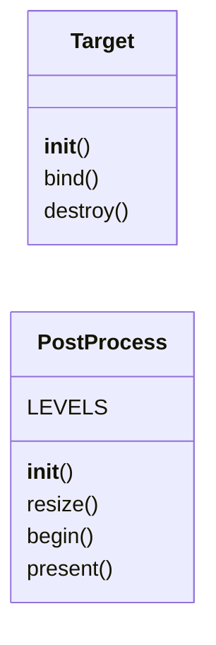
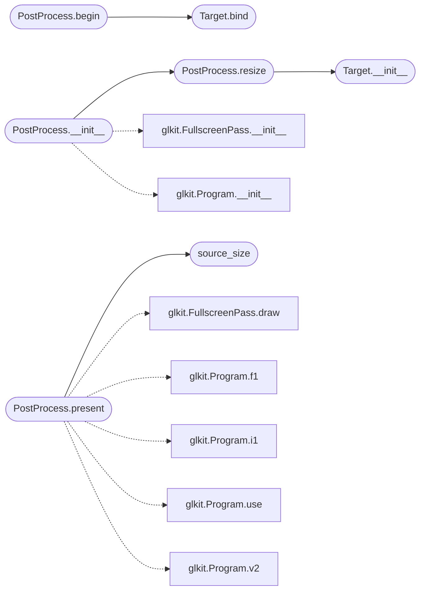

# `immersive.postfx`

> Source: [immersive/postfx.py:1](../../immersive/postfx.py#L1) | language `py` | coverage 27.3% | [API index](../index.md)

HDR post-processing: multi-level bloom, filmic tone mapping, grading, lens fringe, vignette and grain.

## Contents

- **Classes:** [`Target`](#target), [`PostProcess`](#postprocess)
- **Functions:** [`source_size`](#source_size)
- **Constants:** [`DOWNSAMPLE`](#downsample), [`BLUR`](#blur), [`COMPOSITE`](#composite)

## Type Diagram



## Call Graph

Solid arrows stay in this module, dashed arrows leave it.



## Classes

<a id="target"></a>

### `Target`

`class` | [immersive/postfx.py:87](../../immersive/postfx.py#L87)

```python
class Target
```

Colour-only framebuffer with a half-float texture.

**Members**

| Member | Kind | Summary |
|---|---|---|
| [`__init__`](#target-__init__) | constructor |  |
| [`bind`](#target-bind) | method |  |
| [`destroy`](#target-destroy) | method |  |

<a id="target-__init__"></a>

#### `Target.__init__`

`constructor` | [immersive/postfx.py:90](../../immersive/postfx.py#L90)

```python
def __init__(self, width: int, height: int)
```

**Parameters**

| Name | Type | Default | Description |
|---|---|---|---|
| `width` | `int` |  |  |
| `height` | `int` |  |  |

**Raises**

- `RuntimeError`: (raised in the body, not documented)

*Called by:* [`PostProcess.resize`](#postprocess-resize)

<a id="target-bind"></a>

#### `Target.bind`

`method` | [immersive/postfx.py:107](../../immersive/postfx.py#L107)

```python
def bind(self)
```

*Called by:* [`PostProcess.begin`](#postprocess-begin)

<a id="target-destroy"></a>

#### `Target.destroy`

`method` | [immersive/postfx.py:111](../../immersive/postfx.py#L111)

```python
def destroy(self)
```

---

<a id="postprocess"></a>

### `PostProcess`

`class` | [immersive/postfx.py:116](../../immersive/postfx.py#L116)

```python
class PostProcess
```

**Attributes**

| Name | Type | Default | Description |
|---|---|---|---|
| [`LEVELS`](#postprocess-levels) |  | `(2, 4, 8)` |  |

**Members**

| Member | Kind | Summary |
|---|---|---|
| [`__init__`](#postprocess-__init__) | constructor |  |
| [`resize`](#postprocess-resize) | method |  |
| [`begin`](#postprocess-begin) | method |  |
| [`present`](#postprocess-present) | method |  |

<a id="postprocess-__init__"></a>

#### `PostProcess.__init__`

`constructor` | [immersive/postfx.py:119](../../immersive/postfx.py#L119)

```python
def __init__(self, width: int, height: int)
```

**Parameters**

| Name | Type | Default | Description |
|---|---|---|---|
| `width` | `int` |  |  |
| `height` | `int` |  |  |

*Calls:* [`FullscreenPass.__init__`](immersive.glkit.py.md#fullscreenpass-__init__), [`Program.__init__`](immersive.glkit.py.md#program-__init__), [`PostProcess.resize`](#postprocess-resize)

*Called by:* [`App.__init__`](immersive.app.py.md#app-__init__)

<a id="postprocess-resize"></a>

#### `PostProcess.resize`

`method` | [immersive/postfx.py:133](../../immersive/postfx.py#L133)

```python
def resize(self, width: int, height: int)
```

**Parameters**

| Name | Type | Default | Description |
|---|---|---|---|
| `width` | `int` |  |  |
| `height` | `int` |  |  |

*Calls:* [`Target.__init__`](#target-__init__)

*Called by:* [`App.frame`](immersive.app.py.md#app-frame), [`PostProcess.__init__`](#postprocess-__init__)

<a id="postprocess-begin"></a>

#### `PostProcess.begin`

`method` | [immersive/postfx.py:142](../../immersive/postfx.py#L142)

```python
def begin(self)
```

*Calls:* [`Target.bind`](#target-bind)

*Called by:* [`App.frame`](immersive.app.py.md#app-frame)

<a id="postprocess-present"></a>

#### `PostProcess.present`

`method` | [immersive/postfx.py:154](../../immersive/postfx.py#L154)

```python
def present(self, time: float, width: int, height: int)
```

**Parameters**

| Name | Type | Default | Description |
|---|---|---|---|
| `time` | `float` |  |  |
| `width` | `int` |  |  |
| `height` | `int` |  |  |

*Calls:* [`FullscreenPass.draw`](immersive.glkit.py.md#fullscreenpass-draw), [`Program.f1`](immersive.glkit.py.md#program-f1), [`Program.i1`](immersive.glkit.py.md#program-i1), [`Program.use`](immersive.glkit.py.md#program-use), [`Program.v2`](immersive.glkit.py.md#program-v2), [`source_size`](#source_size)

*Called by:* [`App.frame`](immersive.app.py.md#app-frame)

---

## Functions

<a id="source_size"></a>

### `source_size`

`function` | [immersive/postfx.py:193](../../immersive/postfx.py#L193)

```python
def source_size(post: PostProcess, index: int)
```

Texel grid of the texture each downsample level reads from.

**Parameters**

| Name | Type | Default | Description |
|---|---|---|---|
| `post` | `PostProcess` |  |  |
| `index` | `int` |  |  |

*Called by:* [`PostProcess.present`](#postprocess-present)

---

## Constants

<a id="downsample"></a>

### `DOWNSAMPLE`

`constant` | [immersive/postfx.py:12](../../immersive/postfx.py#L12)

```python
DOWNSAMPLE
```

---

<a id="blur"></a>

### `BLUR`

`constant` | [immersive/postfx.py:33](../../immersive/postfx.py#L33)

```python
BLUR
```

---

<a id="composite"></a>

### `COMPOSITE`

`constant` | [immersive/postfx.py:47](../../immersive/postfx.py#L47)

```python
COMPOSITE
```

---
