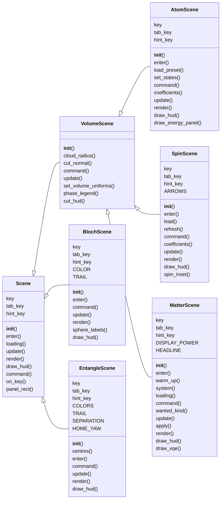
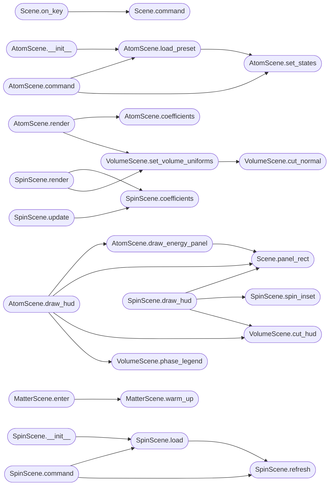

# `immersive.scenes`

> Source: [immersive/scenes.py:1](../../immersive/scenes.py#L1) | language `py` | coverage 6.8% | [API index](../index.md)

Interactive scenes: hydrogen orbital clouds, H2 molecular orbitals, Bloch sphere, entanglement.

## Contents

- **Classes:** [`Scene`](#scene), [`VolumeScene`](#volumescene), [`AtomScene`](#atomscene), [`SpinScene`](#spinscene), [`MatterScene`](#matterscene), [`BlochScene`](#blochscene), [`EntangleScene`](#entanglescene)
- **Functions:** [`fmt_c`](#fmt_c), [`backend_command`](#backend_command), [`draw_backend_panel`](#draw_backend_panel)
- **Constants:** [`TEXT`](#text), [`PHASE_BAR_STOPS`](#phase_bar_stops)

## Type Diagram



## Call Graph

Solid arrows stay in this module, dashed arrows leave it.



## Classes

<a id="scene"></a>

### `Scene`

`class` | [immersive/scenes.py:134](../../immersive/scenes.py#L134)

```python
class Scene
```

Subclasses: [`BlochScene`](#blochscene), [`EntangleScene`](#entanglescene), [`VolumeScene`](#volumescene)

**Attributes**

| Name | Type | Default | Description |
|---|---|---|---|
| [`key`](#scene-key) |  | `''` |  |
| [`tab_key`](#scene-tab_key) |  | `''` |  |
| [`hint_key`](#scene-hint_key) |  | `''` |  |

**Members**

| Member | Kind | Summary |
|---|---|---|
| [`__init__`](#scene-__init__) | constructor |  |
| [`enter`](#scene-enter) | method |  |
| [`loading`](#scene-loading) | method |  |
| [`update`](#scene-update) | method |  |
| [`render`](#scene-render) | method |  |
| [`draw_hud`](#scene-draw_hud) | method |  |
| [`command`](#scene-command) | method |  |
| [`on_key`](#scene-on_key) | method |  |
| [`panel_rect`](#scene-panel_rect) | method |  |

<a id="scene-__init__"></a>

#### `Scene.__init__`

`constructor` | [immersive/scenes.py:139](../../immersive/scenes.py#L139)

```python
def __init__(self, app)
```

**Parameters**

| Name | Type | Default | Description |
|---|---|---|---|
| `app` |  |  |  |

*Calls:* [`OrbitCamera.__init__`](immersive.glkit.py.md#orbitcamera-__init__)

<a id="scene-enter"></a>

#### `Scene.enter`

`method` | [immersive/scenes.py:144](../../immersive/scenes.py#L144)

```python
def enter(self)
```

<a id="scene-loading"></a>

#### `Scene.loading`

`method` | [immersive/scenes.py:147](../../immersive/scenes.py#L147)

```python
def loading(self) -> bool
```

**Returns:** `bool`

<a id="scene-update"></a>

#### `Scene.update`

`method` | [immersive/scenes.py:150](../../immersive/scenes.py#L150)

```python
def update(self, dt: float)
```

**Parameters**

| Name | Type | Default | Description |
|---|---|---|---|
| `dt` | `float` |  |  |

*Calls:* [`OrbitCamera.update`](immersive.glkit.py.md#orbitcamera-update)

<a id="scene-render"></a>

#### `Scene.render`

`method` | [immersive/scenes.py:153](../../immersive/scenes.py#L153)

```python
def render(self)
```

**Raises**

- `NotImplementedError`: (raised in the body, not documented)

<a id="scene-draw_hud"></a>

#### `Scene.draw_hud`

`method` | [immersive/scenes.py:156](../../immersive/scenes.py#L156)

```python
def draw_hud(self, hud: Hud, tr: Lang)
```

**Parameters**

| Name | Type | Default | Description |
|---|---|---|---|
| `hud` | `Hud` |  |  |
| `tr` | `Lang` |  |  |

<a id="scene-command"></a>

#### `Scene.command`

`method` | [immersive/scenes.py:159](../../immersive/scenes.py#L159)

```python
def command(self, cmd: str)
```

**Parameters**

| Name | Type | Default | Description |
|---|---|---|---|
| `cmd` | `str` |  |  |

*Called by:* [`Scene.on_key`](#scene-on_key)

<a id="scene-on_key"></a>

#### `Scene.on_key`

`method` | [immersive/scenes.py:162](../../immersive/scenes.py#L162)

```python
def on_key(self, ev: pygame.event.Event) -> bool
```

**Parameters**

| Name | Type | Default | Description |
|---|---|---|---|
| `ev` | `pygame.event.Event` |  |  |

**Returns:** `bool`

*Calls:* [`Scene.command`](#scene-command)

<a id="scene-panel_rect"></a>

#### `Scene.panel_rect`

`method` | [immersive/scenes.py:169](../../immersive/scenes.py#L169)

```python
def panel_rect(self, hud: Hud, x: float, y: float, w: float, h: float) -> pygame.Rect
```

**Parameters**

| Name | Type | Default | Description |
|---|---|---|---|
| `hud` | `Hud` |  |  |
| `x` | `float` |  |  |
| `y` | `float` |  |  |
| `w` | `float` |  |  |
| `h` | `float` |  |  |

**Returns:** `pygame.Rect`

*Calls:* [`Hud.panel`](immersive.hud.py.md#hud-panel), [`Hud.s`](immersive.hud.py.md#hud-s)

*Called by:* [`AtomScene.draw_energy_panel`](#atomscene-draw_energy_panel), [`AtomScene.draw_hud`](#atomscene-draw_hud), [`BlochScene.draw_hud`](#blochscene-draw_hud), [`EntangleScene.draw_hud`](#entanglescene-draw_hud), [`MatterScene.draw_hud`](#matterscene-draw_hud), [`MatterScene.draw_vqe`](#matterscene-draw_vqe), [`SpinScene.draw_hud`](#spinscene-draw_hud)

---

<a id="volumescene"></a>

### `VolumeScene`

`class` | [immersive/scenes.py:175](../../immersive/scenes.py#L175)

```python
class VolumeScene(Scene)
```

Bases: [`Scene`](#scene)

Subclasses: [`AtomScene`](#atomscene), [`MatterScene`](#matterscene), [`SpinScene`](#spinscene)

Shared raymarching state for atom and molecule scenes: slicing, colour, density.

**Members**

| Member | Kind | Summary |
|---|---|---|
| [`__init__`](#volumescene-__init__) | constructor |  |
| [`cloud_radius`](#volumescene-cloud_radius) | property |  |
| [`cut_normal`](#volumescene-cut_normal) | method |  |
| [`command`](#volumescene-command) | method |  |
| [`update`](#volumescene-update) | method |  |
| [`set_volume_uniforms`](#volumescene-set_volume_uniforms) | method |  |
| [`phase_legend`](#volumescene-phase_legend) | method |  |
| [`cut_hud`](#volumescene-cut_hud) | method |  |

<a id="volumescene-__init__"></a>

#### `VolumeScene.__init__`

`constructor` | [immersive/scenes.py:178](../../immersive/scenes.py#L178)

```python
def __init__(self, app)
```

**Parameters**

| Name | Type | Default | Description |
|---|---|---|---|
| `app` |  |  |  |

*Calls:* [`make_texture`](immersive.glkit.py.md#make_texture)

<a id="volumescene-cloud_radius"></a>

#### `VolumeScene.cloud_radius`

`property` | [immersive/scenes.py:201](../../immersive/scenes.py#L201)

Decorators: `@property`

```python
def cloud_radius(self) -> float
```

**Returns:** `float`

<a id="volumescene-cut_normal"></a>

#### `VolumeScene.cut_normal`

`method` | [immersive/scenes.py:204](../../immersive/scenes.py#L204)

```python
def cut_normal(self) -> Tuple[np.ndarray, float]
```

**Returns:** `Tuple[np.ndarray, float]`

*Called by:* [`VolumeScene.set_volume_uniforms`](#volumescene-set_volume_uniforms)

<a id="volumescene-command"></a>

#### `VolumeScene.command`

`method` | [immersive/scenes.py:213](../../immersive/scenes.py#L213)

```python
def command(self, cmd: str)
```

**Parameters**

| Name | Type | Default | Description |
|---|---|---|---|
| `cmd` | `str` |  |  |

<a id="volumescene-update"></a>

#### `VolumeScene.update`

`method` | [immersive/scenes.py:236](../../immersive/scenes.py#L236)

```python
def update(self, dt: float)
```

**Parameters**

| Name | Type | Default | Description |
|---|---|---|---|
| `dt` | `float` |  |  |

<a id="volumescene-set_volume_uniforms"></a>

#### `VolumeScene.set_volume_uniforms`

`method` | [immersive/scenes.py:243](../../immersive/scenes.py#L243)

```python
def set_volume_uniforms(self)
```

*Calls:* [`VolumeScene.cut_normal`](#volumescene-cut_normal)

*Called by:* [`AtomScene.render`](#atomscene-render), [`MatterScene.render`](#matterscene-render), [`SpinScene.render`](#spinscene-render)

<a id="volumescene-phase_legend"></a>

#### `VolumeScene.phase_legend`

`method` | [immersive/scenes.py:263](../../immersive/scenes.py#L263)

```python
def phase_legend(self, hud: Hud, tr: Lang, x: int, y: int)
```

**Parameters**

| Name | Type | Default | Description |
|---|---|---|---|
| `hud` | `Hud` |  |  |
| `tr` | `Lang` |  |  |
| `x` | `int` |  |  |
| `y` | `int` |  |  |

*Calls:* [`Hud.hue_color`](immersive.hud.py.md#hud-hue_color), [`Hud.s`](immersive.hud.py.md#hud-s), [`Hud.text`](immersive.hud.py.md#hud-text)

*Called by:* [`AtomScene.draw_hud`](#atomscene-draw_hud), [`MatterScene.draw_hud`](#matterscene-draw_hud)

<a id="volumescene-cut_hud"></a>

#### `VolumeScene.cut_hud`

`method` | [immersive/scenes.py:273](../../immersive/scenes.py#L273)

```python
def cut_hud(self, hud: Hud, tr: Lang, x: float, y: float)
```

**Parameters**

| Name | Type | Default | Description |
|---|---|---|---|
| `hud` | `Hud` |  |  |
| `tr` | `Lang` |  |  |
| `x` | `float` |  |  |
| `y` | `float` |  |  |

*Calls:* [`Hud.text`](immersive.hud.py.md#hud-text)

*Called by:* [`AtomScene.draw_hud`](#atomscene-draw_hud), [`MatterScene.draw_hud`](#matterscene-draw_hud), [`SpinScene.draw_hud`](#spinscene-draw_hud)

---

<a id="atomscene"></a>

### `AtomScene`

`class` | [immersive/scenes.py:282](../../immersive/scenes.py#L282)

```python
class AtomScene(VolumeScene)
```

Bases: [`VolumeScene`](#volumescene)

**Attributes**

| Name | Type | Default | Description |
|---|---|---|---|
| [`key`](#atomscene-key) |  | `'atom'` |  |
| [`tab_key`](#atomscene-tab_key) |  | `'tab_atom'` |  |
| [`hint_key`](#atomscene-hint_key) |  | `'hint_atom'` |  |

**Members**

| Member | Kind | Summary |
|---|---|---|
| [`__init__`](#atomscene-__init__) | constructor |  |
| [`enter`](#atomscene-enter) | method |  |
| [`load_preset`](#atomscene-load_preset) | method |  |
| [`set_states`](#atomscene-set_states) | method |  |
| [`command`](#atomscene-command) | method |  |
| [`coefficients`](#atomscene-coefficients) | method |  |
| [`update`](#atomscene-update) | method |  |
| [`render`](#atomscene-render) | method |  |
| [`draw_hud`](#atomscene-draw_hud) | method |  |
| [`draw_energy_panel`](#atomscene-draw_energy_panel) | method |  |

<a id="atomscene-__init__"></a>

#### `AtomScene.__init__`

`constructor` | [immersive/scenes.py:287](../../immersive/scenes.py#L287)

```python
def __init__(self, app)
```

**Parameters**

| Name | Type | Default | Description |
|---|---|---|---|
| `app` |  |  |  |

*Calls:* [`AtomScene.load_preset`](#atomscene-load_preset)

*Called by:* [`App.__init__`](immersive.app.py.md#app-__init__)

<a id="atomscene-enter"></a>

#### `AtomScene.enter`

`method` | [immersive/scenes.py:304](../../immersive/scenes.py#L304)

```python
def enter(self)
```

<a id="atomscene-load_preset"></a>

#### `AtomScene.load_preset`

`method` | [immersive/scenes.py:307](../../immersive/scenes.py#L307)

```python
def load_preset(self, preset)
```

**Parameters**

| Name | Type | Default | Description |
|---|---|---|---|
| `preset` |  |  |  |

*Calls:* [`AtomScene.set_states`](#atomscene-set_states)

*Called by:* [`AtomScene.__init__`](#atomscene-__init__), [`AtomScene.command`](#atomscene-command)

<a id="atomscene-set_states"></a>

#### `AtomScene.set_states`

`method` | [immersive/scenes.py:314](../../immersive/scenes.py#L314)

```python
def set_states(self, states, label: str)
```

**Parameters**

| Name | Type | Default | Description |
|---|---|---|---|
| `states` |  |  |  |
| `label` | `str` |  |  |

*Calls:* [`upload_radial`](immersive.glkit.py.md#upload_radial), [`density_peak`](immersive.physics.py.md#density_peak), [`radial_table`](immersive.physics.py.md#radial_table), [`view_radius`](immersive.physics.py.md#view_radius)

*Called by:* [`AtomScene.command`](#atomscene-command), [`AtomScene.load_preset`](#atomscene-load_preset)

<a id="atomscene-command"></a>

#### `AtomScene.command`

`method` | [immersive/scenes.py:328](../../immersive/scenes.py#L328)

```python
def command(self, cmd: str)
```

**Parameters**

| Name | Type | Default | Description |
|---|---|---|---|
| `cmd` | `str` |  |  |

*Calls:* [`orbital_label`](immersive.physics.py.md#orbital_label), [`AtomScene.load_preset`](#atomscene-load_preset), [`AtomScene.set_states`](#atomscene-set_states)

<a id="atomscene-coefficients"></a>

#### `AtomScene.coefficients`

`method` | [immersive/scenes.py:350](../../immersive/scenes.py#L350)

```python
def coefficients(self) -> Tuple[np.ndarray, np.ndarray]
```

**Returns:** `Tuple[np.ndarray, np.ndarray]`

*Called by:* [`AtomScene.render`](#atomscene-render)

<a id="atomscene-update"></a>

#### `AtomScene.update`

`method` | [immersive/scenes.py:364](../../immersive/scenes.py#L364)

```python
def update(self, dt: float)
```

**Parameters**

| Name | Type | Default | Description |
|---|---|---|---|
| `dt` | `float` |  |  |

<a id="atomscene-render"></a>

#### `AtomScene.render`

`method` | [immersive/scenes.py:368](../../immersive/scenes.py#L368)

```python
def render(self)
```

*Calls:* [`AtomScene.coefficients`](#atomscene-coefficients), [`VolumeScene.set_volume_uniforms`](#volumescene-set_volume_uniforms)

<a id="atomscene-draw_hud"></a>

#### `AtomScene.draw_hud`

`method` | [immersive/scenes.py:379](../../immersive/scenes.py#L379)

```python
def draw_hud(self, hud: Hud, tr: Lang)
```

**Parameters**

| Name | Type | Default | Description |
|---|---|---|---|
| `hud` | `Hud` |  |  |
| `tr` | `Lang` |  |  |

*Calls:* [`Hud.font`](immersive.hud.py.md#hud-font), [`Hud.s`](immersive.hud.py.md#hud-s), [`Hud.text`](immersive.hud.py.md#hud-text), [`Hud.wrap`](immersive.hud.py.md#hud-wrap), [`energy_ev`](immersive.physics.py.md#energy_ev), [`AtomScene.draw_energy_panel`](#atomscene-draw_energy_panel), [`Scene.panel_rect`](#scene-panel_rect), [`VolumeScene.cut_hud`](#volumescene-cut_hud), [`VolumeScene.phase_legend`](#volumescene-phase_legend)

<a id="atomscene-draw_energy_panel"></a>

#### `AtomScene.draw_energy_panel`

`method` | [immersive/scenes.py:416](../../immersive/scenes.py#L416)

```python
def draw_energy_panel(self, hud: Hud, tr: Lang, top: float)
```

**Parameters**

| Name | Type | Default | Description |
|---|---|---|---|
| `hud` | `Hud` |  |  |
| `tr` | `Lang` |  |  |
| `top` | `float` |  |  |

*Calls:* [`Hud.s`](immersive.hud.py.md#hud-s), [`Hud.text`](immersive.hud.py.md#hud-text), [`Scene.panel_rect`](#scene-panel_rect), [`SpinorComponent`](immersive.spin.py.md#spinorcomponent), [`real_time_label`](immersive.spin.py.md#real_time_label), [`shared_link`](immersive.spin.py.md#shared_link)

*Called by:* [`AtomScene.draw_hud`](#atomscene-draw_hud)

---

<a id="spinscene"></a>

### `SpinScene`

`class` | [immersive/scenes.py:450](../../immersive/scenes.py#L450)

```python
class SpinScene(VolumeScene)
```

Bases: [`VolumeScene`](#volumescene)

Pauli-spinor hydrogen states: spin direction as colour and arrows, driven by the project's Dirac energies.

**Attributes**

| Name | Type | Default | Description |
|---|---|---|---|
| [`key`](#spinscene-key) |  | `'spin'` |  |
| [`tab_key`](#spinscene-tab_key) |  | `'tab_spin'` |  |
| [`hint_key`](#spinscene-hint_key) |  | `'hint_spin'` |  |
| [`ARROWS`](#spinscene-arrows) |  | `40` |  |

**Members**

| Member | Kind | Summary |
|---|---|---|
| [`__init__`](#spinscene-__init__) | constructor |  |
| [`enter`](#spinscene-enter) | method |  |
| [`load`](#spinscene-load) | method |  |
| [`refresh`](#spinscene-refresh) | method |  |
| [`command`](#spinscene-command) | method |  |
| [`coefficients`](#spinscene-coefficients) | method |  |
| [`update`](#spinscene-update) | method |  |
| [`render`](#spinscene-render) | method |  |
| [`draw_hud`](#spinscene-draw_hud) | method |  |
| [`spin_inset`](#spinscene-spin_inset) | method |  |

<a id="spinscene-__init__"></a>

#### `SpinScene.__init__`

`constructor` | [immersive/scenes.py:458](../../immersive/scenes.py#L458)

```python
def __init__(self, app)
```

**Parameters**

| Name | Type | Default | Description |
|---|---|---|---|
| `app` |  |  |  |

*Calls:* [`SpinScene.load`](#spinscene-load), [`shared_link`](immersive.spin.py.md#shared_link)

*Called by:* [`App.__init__`](immersive.app.py.md#app-__init__)

<a id="spinscene-enter"></a>

#### `SpinScene.enter`

`method` | [immersive/scenes.py:476](../../immersive/scenes.py#L476)

```python
def enter(self)
```

<a id="spinscene-load"></a>

#### `SpinScene.load`

`method` | [immersive/scenes.py:479](../../immersive/scenes.py#L479)

```python
def load(self, preset: spin.SpinPreset)
```

**Parameters**

| Name | Type | Default | Description |
|---|---|---|---|
| `preset` | `spin.SpinPreset` |  |  |

*Calls:* [`SpinScene.refresh`](#spinscene-refresh)

*Called by:* [`SpinScene.__init__`](#spinscene-__init__), [`SpinScene.command`](#spinscene-command)

<a id="spinscene-refresh"></a>

#### `SpinScene.refresh`

`method` | [immersive/scenes.py:486](../../immersive/scenes.py#L486)

```python
def refresh(self)
```

*Calls:* [`upload_radial`](immersive.glkit.py.md#upload_radial), [`radial_table`](immersive.physics.py.md#radial_table), [`view_radius`](immersive.physics.py.md#view_radius), [`component_energy`](immersive.spin.py.md#component_energy), [`time_scale`](immersive.spin.py.md#time_scale)

*Called by:* [`SpinScene.command`](#spinscene-command), [`SpinScene.load`](#spinscene-load)

<a id="spinscene-command"></a>

#### `SpinScene.command`

`method` | [immersive/scenes.py:495](../../immersive/scenes.py#L495)

```python
def command(self, cmd: str)
```

**Parameters**

| Name | Type | Default | Description |
|---|---|---|---|
| `cmd` | `str` |  |  |

*Calls:* [`SpinScene.load`](#spinscene-load), [`SpinScene.refresh`](#spinscene-refresh)

<a id="spinscene-coefficients"></a>

#### `SpinScene.coefficients`

`method` | [immersive/scenes.py:508](../../immersive/scenes.py#L508)

```python
def coefficients(self) -> np.ndarray
```

**Returns:** `np.ndarray`

*Calls:* [`evolved_coefficients`](immersive.spin.py.md#evolved_coefficients)

*Called by:* [`SpinScene.render`](#spinscene-render), [`SpinScene.update`](#spinscene-update)

<a id="spinscene-update"></a>

#### `SpinScene.update`

`method` | [immersive/scenes.py:511](../../immersive/scenes.py#L511)

```python
def update(self, dt: float)
```

**Parameters**

| Name | Type | Default | Description |
|---|---|---|---|
| `dt` | `float` |  |  |

*Calls:* [`SpinScene.coefficients`](#spinscene-coefficients)

<a id="spinscene-render"></a>

#### `SpinScene.render`

`method` | [immersive/scenes.py:519](../../immersive/scenes.py#L519)

```python
def render(self)
```

*Calls:* [`SpinScene.coefficients`](#spinscene-coefficients), [`VolumeScene.set_volume_uniforms`](#volumescene-set_volume_uniforms)

<a id="spinscene-draw_hud"></a>

#### `SpinScene.draw_hud`

`method` | [immersive/scenes.py:549](../../immersive/scenes.py#L549)

```python
def draw_hud(self, hud: Hud, tr: Lang)
```

**Parameters**

| Name | Type | Default | Description |
|---|---|---|---|
| `hud` | `Hud` |  |  |
| `tr` | `Lang` |  |  |

*Calls:* [`Hud.bar`](immersive.hud.py.md#hud-bar), [`Hud.s`](immersive.hud.py.md#hud-s), [`Hud.text`](immersive.hud.py.md#hud-text), [`Hud.wrap`](immersive.hud.py.md#hud-wrap), [`Scene.panel_rect`](#scene-panel_rect), [`SpinScene.spin_inset`](#spinscene-spin_inset), [`VolumeScene.cut_hud`](#volumescene-cut_hud), [`real_time_label`](immersive.spin.py.md#real_time_label)

<a id="spinscene-spin_inset"></a>

#### `SpinScene.spin_inset`

`method` | [immersive/scenes.py:597](../../immersive/scenes.py#L597)

```python
def spin_inset(self, hud: Hud, cx: int, cy: int, radius: int, sigma: np.ndarray)
```

**Parameters**

| Name | Type | Default | Description |
|---|---|---|---|
| `hud` | `Hud` |  |  |
| `cx` | `int` |  |  |
| `cy` | `int` |  |  |
| `radius` | `int` |  |  |
| `sigma` | `np.ndarray` |  |  |

*Calls:* [`Hud.s`](immersive.hud.py.md#hud-s)

*Called by:* [`SpinScene.draw_hud`](#spinscene-draw_hud)

---

<a id="matterscene"></a>

### `MatterScene`

`class` | [immersive/scenes.py:609](../../immersive/scenes.py#L609)

```python
class MatterScene(VolumeScene)
```

Bases: [`VolumeScene`](#volumescene)

Atoms and molecules from PySCF (UHF/RHF, 6-31G) rendered from a 3D texture of the electron density.

**Attributes**

| Name | Type | Default | Description |
|---|---|---|---|
| [`key`](#matterscene-key) |  | `'matter'` |  |
| [`tab_key`](#matterscene-tab_key) |  | `'tab_matter'` |  |
| [`hint_key`](#matterscene-hint_key) |  | `'hint_matter'` |  |
| [`DISPLAY_POWER`](#matterscene-display_power) |  | `0.6` |  |
| [`HEADLINE`](#matterscene-headline) |  | `{'density': 'kind_density', 'spin': 'kind_spin', 'mo': 'kind_mo', 'fci': 'kind_fci'}` |  |

**Members**

| Member | Kind | Summary |
|---|---|---|
| [`__init__`](#matterscene-__init__) | constructor |  |
| [`enter`](#matterscene-enter) | method |  |
| [`warm_up`](#matterscene-warm_up) | method |  |
| [`system`](#matterscene-system) | property |  |
| [`loading`](#matterscene-loading) | method |  |
| [`command`](#matterscene-command) | method |  |
| [`wanted_kind`](#matterscene-wanted_kind) | method |  |
| [`update`](#matterscene-update) | method |  |
| [`apply`](#matterscene-apply) | method |  |
| [`render`](#matterscene-render) | method |  |
| [`draw_hud`](#matterscene-draw_hud) | method |  |
| [`draw_vqe`](#matterscene-draw_vqe) | method |  |

<a id="matterscene-__init__"></a>

#### `MatterScene.__init__`

`constructor` | [immersive/scenes.py:618](../../immersive/scenes.py#L618)

```python
def __init__(self, app)
```

**Parameters**

| Name | Type | Default | Description |
|---|---|---|---|
| `app` |  |  |  |

*Calls:* [`AsyncSolver.__init__`](immersive.matter.py.md#asyncsolver-__init__), [`pyscf_available`](immersive.matter.py.md#pyscf_available)

*Called by:* [`App.__init__`](immersive.app.py.md#app-__init__)

<a id="matterscene-enter"></a>

#### `MatterScene.enter`

`method` | [immersive/scenes.py:639](../../immersive/scenes.py#L639)

```python
def enter(self)
```

*Calls:* [`MatterScene.warm_up`](#matterscene-warm_up)

<a id="matterscene-warm_up"></a>

#### `MatterScene.warm_up`

`method` | [immersive/scenes.py:643](../../immersive/scenes.py#L643)

```python
def warm_up(self, keys=('H2O',))
```

**Parameters**

| Name | Type | Default | Description |
|---|---|---|---|
| `keys` |  | `('H2O',)` |  |

*Calls:* [`AsyncSolver.prefetch`](immersive.matter.py.md#asyncsolver-prefetch)

*Called by:* [`MatterScene.enter`](#matterscene-enter)

<a id="matterscene-system"></a>

#### `MatterScene.system`

`property` | [immersive/scenes.py:651](../../immersive/scenes.py#L651)

Decorators: `@property`

```python
def system(self) -> matter.System
```

**Returns:** `matter.System`

<a id="matterscene-loading"></a>

#### `MatterScene.loading`

`method` | [immersive/scenes.py:654](../../immersive/scenes.py#L654)

```python
def loading(self) -> bool
```

**Returns:** `bool`

*Calls:* [`MatterScene.wanted_kind`](#matterscene-wanted_kind)

<a id="matterscene-command"></a>

#### `MatterScene.command`

`method` | [immersive/scenes.py:658](../../immersive/scenes.py#L658)

```python
def command(self, cmd: str)
```

**Parameters**

| Name | Type | Default | Description |
|---|---|---|---|
| `cmd` | `str` |  |  |

<a id="matterscene-wanted_kind"></a>

#### `MatterScene.wanted_kind`

`method` | [immersive/scenes.py:688](../../immersive/scenes.py#L688)

```python
def wanted_kind(self) -> str
```

**Returns:** `str`

*Called by:* [`MatterScene.loading`](#matterscene-loading), [`MatterScene.update`](#matterscene-update)

<a id="matterscene-update"></a>

#### `MatterScene.update`

`method` | [immersive/scenes.py:699](../../immersive/scenes.py#L699)

```python
def update(self, dt: float)
```

**Parameters**

| Name | Type | Default | Description |
|---|---|---|---|
| `dt` | `float` |  |  |

*Calls:* [`run_project_vqe`](immersive.backend.py.md#run_project_vqe), [`AsyncSolver.request`](immersive.matter.py.md#asyncsolver-request), [`AsyncSolver.request_field`](immersive.matter.py.md#asyncsolver-request_field), [`MatterScene.apply`](#matterscene-apply), [`MatterScene.wanted_kind`](#matterscene-wanted_kind)

<a id="matterscene-apply"></a>

#### `MatterScene.apply`

`method` | [immersive/scenes.py:719](../../immersive/scenes.py#L719)

```python
def apply(self, solved: matter.Solved, kind: str, token)
```

**Parameters**

| Name | Type | Default | Description |
|---|---|---|---|
| `solved` | `matter.Solved` |  |  |
| `kind` | `str` |  |  |
| `token` |  |  |  |

*Calls:* [`upload_volume`](immersive.glkit.py.md#upload_volume), [`bonds`](immersive.matter.py.md#bonds), [`field_amplitude`](immersive.matter.py.md#field_amplitude)

*Called by:* [`MatterScene.update`](#matterscene-update)

<a id="matterscene-render"></a>

#### `MatterScene.render`

`method` | [immersive/scenes.py:744](../../immersive/scenes.py#L744)

```python
def render(self)
```

*Calls:* [`VolumeScene.set_volume_uniforms`](#volumescene-set_volume_uniforms)

<a id="matterscene-draw_hud"></a>

#### `MatterScene.draw_hud`

`method` | [immersive/scenes.py:769](../../immersive/scenes.py#L769)

```python
def draw_hud(self, hud: Hud, tr: Lang)
```

**Parameters**

| Name | Type | Default | Description |
|---|---|---|---|
| `hud` | `Hud` |  |  |
| `tr` | `Lang` |  |  |

*Calls:* [`Hud.button`](immersive.hud.py.md#hud-button), [`Hud.s`](immersive.hud.py.md#hud-s), [`Hud.text`](immersive.hud.py.md#hud-text), [`Hud.wrap`](immersive.hud.py.md#hud-wrap), [`MatterScene.draw_vqe`](#matterscene-draw_vqe), [`Scene.panel_rect`](#scene-panel_rect), [`VolumeScene.cut_hud`](#volumescene-cut_hud), [`VolumeScene.phase_legend`](#volumescene-phase_legend)

<a id="matterscene-draw_vqe"></a>

#### `MatterScene.draw_vqe`

`method` | [immersive/scenes.py:831](../../immersive/scenes.py#L831)

```python
def draw_vqe(self, hud: Hud, tr: Lang)
```

**Parameters**

| Name | Type | Default | Description |
|---|---|---|---|
| `hud` | `Hud` |  |  |
| `tr` | `Lang` |  |  |

*Calls:* [`Hud.s`](immersive.hud.py.md#hud-s), [`Hud.text`](immersive.hud.py.md#hud-text), [`Scene.panel_rect`](#scene-panel_rect)

*Called by:* [`MatterScene.draw_hud`](#matterscene-draw_hud)

---

<a id="blochscene"></a>

### `BlochScene`

`class` | [immersive/scenes.py:903](../../immersive/scenes.py#L903)

```python
class BlochScene(Scene)
```

Bases: [`Scene`](#scene)

**Attributes**

| Name | Type | Default | Description |
|---|---|---|---|
| [`key`](#blochscene-key) |  | `'bloch'` |  |
| [`tab_key`](#blochscene-tab_key) |  | `'tab_bloch'` |  |
| [`hint_key`](#blochscene-hint_key) |  | `'hint_bloch'` |  |
| [`COLOR`](#blochscene-color) |  | `(1.0, 0.62, 0.25)` |  |
| [`TRAIL`](#blochscene-trail) |  | `48` |  |

**Members**

| Member | Kind | Summary |
|---|---|---|
| [`__init__`](#blochscene-__init__) | constructor |  |
| [`enter`](#blochscene-enter) | method |  |
| [`command`](#blochscene-command) | method |  |
| [`update`](#blochscene-update) | method |  |
| [`render`](#blochscene-render) | method |  |
| [`sphere_labels`](#blochscene-sphere_labels) | method |  |
| [`draw_hud`](#blochscene-draw_hud) | method |  |

<a id="blochscene-__init__"></a>

#### `BlochScene.__init__`

`constructor` | [immersive/scenes.py:910](../../immersive/scenes.py#L910)

```python
def __init__(self, app)
```

**Parameters**

| Name | Type | Default | Description |
|---|---|---|---|
| `app` |  |  |  |

*Calls:* [`OrbitCamera.__init__`](immersive.glkit.py.md#orbitcamera-__init__), [`OrbitCamera.fly_to`](immersive.glkit.py.md#orbitcamera-fly_to)

*Called by:* [`App.__init__`](immersive.app.py.md#app-__init__)

<a id="blochscene-enter"></a>

#### `BlochScene.enter`

`method` | [immersive/scenes.py:926](../../immersive/scenes.py#L926)

```python
def enter(self)
```

*Calls:* [`BackendRegister.__init__`](immersive.backend.py.md#backendregister-__init__)

<a id="blochscene-command"></a>

#### `BlochScene.command`

`method` | [immersive/scenes.py:930](../../immersive/scenes.py#L930)

```python
def command(self, cmd: str)
```

**Parameters**

| Name | Type | Default | Description |
|---|---|---|---|
| `cmd` | `str` |  |  |

*Calls:* [`BackendRegister.prepare`](immersive.backend.py.md#backendregister-prepare), [`BackendRegister.queue`](immersive.backend.py.md#backendregister-queue), [`BackendRegister.reset`](immersive.backend.py.md#backendregister-reset), [`BackendRegister.single`](immersive.backend.py.md#backendregister-single), [`backend_command`](#backend_command)

<a id="blochscene-update"></a>

#### `BlochScene.update`

`method` | [immersive/scenes.py:945](../../immersive/scenes.py#L945)

```python
def update(self, dt: float)
```

**Parameters**

| Name | Type | Default | Description |
|---|---|---|---|
| `dt` | `float` |  |  |

*Calls:* [`BackendRegister.bloch`](immersive.backend.py.md#backendregister-bloch), [`BackendRegister.update`](immersive.backend.py.md#backendregister-update)

<a id="blochscene-render"></a>

#### `BlochScene.render`

`method` | [immersive/scenes.py:959](../../immersive/scenes.py#L959)

```python
def render(self)
```

*Calls:* [`BackendRegister.bloch`](immersive.backend.py.md#backendregister-bloch), [`OrbitCamera.set_uniforms`](immersive.glkit.py.md#orbitcamera-set_uniforms)

<a id="blochscene-sphere_labels"></a>

#### `BlochScene.sphere_labels`

`method` | [immersive/scenes.py:981](../../immersive/scenes.py#L981)

```python
def sphere_labels(self, hud: Hud, centre: np.ndarray, tag: str = '')
```

**Parameters**

| Name | Type | Default | Description |
|---|---|---|---|
| `hud` | `Hud` |  |  |
| `centre` | `np.ndarray` |  |  |
| `tag` | `str` | `''` |  |

*Calls:* [`OrbitCamera.project`](immersive.glkit.py.md#orbitcamera-project), [`Hud.text`](immersive.hud.py.md#hud-text)

*Called by:* [`BlochScene.draw_hud`](#blochscene-draw_hud), [`EntangleScene.draw_hud`](#entanglescene-draw_hud)

<a id="blochscene-draw_hud"></a>

#### `BlochScene.draw_hud`

`method` | [immersive/scenes.py:989](../../immersive/scenes.py#L989)

```python
def draw_hud(self, hud: Hud, tr: Lang)
```

**Parameters**

| Name | Type | Default | Description |
|---|---|---|---|
| `hud` | `Hud` |  |  |
| `tr` | `Lang` |  |  |

*Calls:* [`BackendRegister.bloch`](immersive.backend.py.md#backendregister-bloch), [`BackendRegister.probabilities`](immersive.backend.py.md#backendregister-probabilities), [`Hud.bar`](immersive.hud.py.md#hud-bar), [`Hud.button`](immersive.hud.py.md#hud-button), [`Hud.s`](immersive.hud.py.md#hud-s), [`Hud.text`](immersive.hud.py.md#hud-text), [`Hud.wrap`](immersive.hud.py.md#hud-wrap), [`BlochScene.sphere_labels`](#blochscene-sphere_labels), [`Scene.panel_rect`](#scene-panel_rect), [`draw_backend_panel`](#draw_backend_panel), [`fmt_c`](#fmt_c)

---

<a id="entanglescene"></a>

### `EntangleScene`

`class` | [immersive/scenes.py:1037](../../immersive/scenes.py#L1037)

```python
class EntangleScene(Scene)
```

Bases: [`Scene`](#scene)

**Attributes**

| Name | Type | Default | Description |
|---|---|---|---|
| [`key`](#entanglescene-key) |  | `'entangle'` |  |
| [`tab_key`](#entanglescene-tab_key) |  | `'tab_entangle'` |  |
| [`hint_key`](#entanglescene-hint_key) |  | `'hint_entangle'` |  |
| [`COLORS`](#entanglescene-colors) |  | `((1.0, 0.62, 0.25), (0.3, 0.85, 1.0))` |  |
| [`TRAIL`](#entanglescene-trail) |  | `48` |  |
| [`SEPARATION`](#entanglescene-separation) |  | `3.0` |  |
| [`HOME_YAW`](#entanglescene-home_yaw) |  | `-1.25` |  |

**Members**

| Member | Kind | Summary |
|---|---|---|
| [`__init__`](#entanglescene-__init__) | constructor |  |
| [`centres`](#entanglescene-centres) | method |  |
| [`enter`](#entanglescene-enter) | method |  |
| [`command`](#entanglescene-command) | method |  |
| [`update`](#entanglescene-update) | method |  |
| [`render`](#entanglescene-render) | method |  |
| [`draw_hud`](#entanglescene-draw_hud) | method |  |

<a id="entanglescene-__init__"></a>

#### `EntangleScene.__init__`

`constructor` | [immersive/scenes.py:1046](../../immersive/scenes.py#L1046)

```python
def __init__(self, app)
```

**Parameters**

| Name | Type | Default | Description |
|---|---|---|---|
| `app` |  |  |  |

*Calls:* [`OrbitCamera.__init__`](immersive.glkit.py.md#orbitcamera-__init__), [`OrbitCamera.fly_to`](immersive.glkit.py.md#orbitcamera-fly_to)

*Called by:* [`App.__init__`](immersive.app.py.md#app-__init__)

<a id="entanglescene-centres"></a>

#### `EntangleScene.centres`

`method` | [immersive/scenes.py:1062](../../immersive/scenes.py#L1062)

```python
def centres(self) -> np.ndarray
```

**Returns:** `np.ndarray`

*Called by:* [`EntangleScene.draw_hud`](#entanglescene-draw_hud), [`EntangleScene.render`](#entanglescene-render)

<a id="entanglescene-enter"></a>

#### `EntangleScene.enter`

`method` | [immersive/scenes.py:1065](../../immersive/scenes.py#L1065)

```python
def enter(self)
```

*Calls:* [`BackendRegister.__init__`](immersive.backend.py.md#backendregister-__init__)

<a id="entanglescene-command"></a>

#### `EntangleScene.command`

`method` | [immersive/scenes.py:1069](../../immersive/scenes.py#L1069)

```python
def command(self, cmd: str)
```

**Parameters**

| Name | Type | Default | Description |
|---|---|---|---|
| `cmd` | `str` |  |  |

*Calls:* [`backend_command`](#backend_command)

<a id="entanglescene-update"></a>

#### `EntangleScene.update`

`method` | [immersive/scenes.py:1099](../../immersive/scenes.py#L1099)

```python
def update(self, dt: float)
```

**Parameters**

| Name | Type | Default | Description |
|---|---|---|---|
| `dt` | `float` |  |  |

*Calls:* [`BackendRegister.bloch`](immersive.backend.py.md#backendregister-bloch), [`BackendRegister.update`](immersive.backend.py.md#backendregister-update)

<a id="entanglescene-render"></a>

#### `EntangleScene.render`

`method` | [immersive/scenes.py:1122](../../immersive/scenes.py#L1122)

```python
def render(self)
```

*Calls:* [`BackendRegister.bloch`](immersive.backend.py.md#backendregister-bloch), [`BackendRegister.entropy`](immersive.backend.py.md#backendregister-entropy), [`OrbitCamera.set_uniforms`](immersive.glkit.py.md#orbitcamera-set_uniforms), [`EntangleScene.centres`](#entanglescene-centres)

<a id="entanglescene-draw_hud"></a>

#### `EntangleScene.draw_hud`

`method` | [immersive/scenes.py:1147](../../immersive/scenes.py#L1147)

```python
def draw_hud(self, hud: Hud, tr: Lang)
```

**Parameters**

| Name | Type | Default | Description |
|---|---|---|---|
| `hud` | `Hud` |  |  |
| `tr` | `Lang` |  |  |

*Calls:* [`BackendRegister.entropy`](immersive.backend.py.md#backendregister-entropy), [`BackendRegister.probabilities`](immersive.backend.py.md#backendregister-probabilities), [`OrbitCamera.project`](immersive.glkit.py.md#orbitcamera-project), [`Hud.bar`](immersive.hud.py.md#hud-bar), [`Hud.button`](immersive.hud.py.md#hud-button), [`Hud.hue_color`](immersive.hud.py.md#hud-hue_color), [`Hud.s`](immersive.hud.py.md#hud-s), [`Hud.text`](immersive.hud.py.md#hud-text), [`Hud.wrap`](immersive.hud.py.md#hud-wrap), [`BlochScene.sphere_labels`](#blochscene-sphere_labels), [`EntangleScene.centres`](#entanglescene-centres), [`Scene.panel_rect`](#scene-panel_rect) and 1 more

---

## Functions

<a id="fmt_c"></a>

### `fmt_c`

`function` | [immersive/scenes.py:856](../../immersive/scenes.py#L856)

```python
def fmt_c(z: complex) -> str
```

**Parameters**

| Name | Type | Default | Description |
|---|---|---|---|
| `z` | `complex` |  |  |

**Returns:** `str`

*Called by:* [`BlochScene.draw_hud`](#blochscene-draw_hud)

---

<a id="backend_command"></a>

### `backend_command`

`function` | [immersive/scenes.py:860](../../immersive/scenes.py#L860)

```python
def backend_command(reg: BackendRegister, cmd: str)
```

**Parameters**

| Name | Type | Default | Description |
|---|---|---|---|
| `reg` | `BackendRegister` |  |  |
| `cmd` | `str` |  |  |

*Calls:* [`BackendRegister.cycle_backend`](immersive.backend.py.md#backendregister-cycle_backend)

*Called by:* [`BlochScene.command`](#blochscene-command), [`EntangleScene.command`](#entanglescene-command)

---

<a id="draw_backend_panel"></a>

### `draw_backend_panel`

`function` | [immersive/scenes.py:867](../../immersive/scenes.py#L867)

```python
def draw_backend_panel(hud: Hud, tr: Lang, reg: BackendRegister, x: float, y: float)
```

Show which engine produced the picture, plus the backend's spatial wavefunction fields.

**Parameters**

| Name | Type | Default | Description |
|---|---|---|---|
| `hud` | `Hud` |  |  |
| `tr` | `Lang` |  |  |
| `reg` | `BackendRegister` |  |  |
| `x` | `float` |  |  |
| `y` | `float` |  |  |

*Calls:* [`BackendRegister.fields`](immersive.backend.py.md#backendregister-fields), [`Hud.heatmap`](immersive.hud.py.md#hud-heatmap), [`Hud.panel`](immersive.hud.py.md#hud-panel), [`Hud.s`](immersive.hud.py.md#hud-s), [`Hud.text`](immersive.hud.py.md#hud-text)

*Called by:* [`BlochScene.draw_hud`](#blochscene-draw_hud), [`EntangleScene.draw_hud`](#entanglescene-draw_hud)

---

## Constants

<a id="text"></a>

### `TEXT`

`constant` | [immersive/scenes.py:21](../../immersive/scenes.py#L21)

```python
TEXT: Dict[str, Dict[str, str]]
```

---

<a id="phase_bar_stops"></a>

### `PHASE_BAR_STOPS`

`constant` | [immersive/scenes.py:131](../../immersive/scenes.py#L131)

```python
PHASE_BAR_STOPS = 24
```

---
