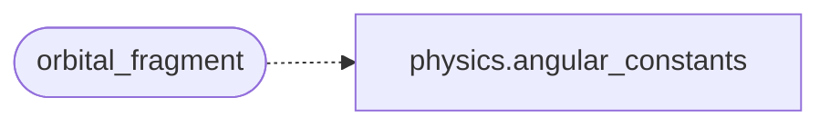

# `immersive.shaders`

> Source: [immersive/shaders.py:1](../../immersive/shaders.py#L1) | language `py` | coverage 33.3% | [API index](../index.md)

GLSL sources.

The orbital shader evaluates hydrogenic wavefunctions per pixel on the GPU.

## Contents

- **Functions:** [`orbital_fragment`](#orbital_fragment), [`bloch_fragment`](#bloch_fragment)
- **Constants:** [`COMMON`](#common), [`GEOM`](#geom), [`ORBITAL_BODY`](#orbital_body), [`BLOCH_BODY`](#bloch_body), [`HUD_FRAGMENT`](#hud_fragment)

## Call Graph

Solid arrows stay in this module, dashed arrows leave it.



## Functions

<a id="orbital_fragment"></a>

### `orbital_fragment`

`function` | [immersive/shaders.py:578](../../immersive/shaders.py#L578)

```python
def orbital_fragment() -> str
```

**Returns:** `str`

*Calls:* [`angular_constants`](immersive.physics.py.md#angular_constants)

*Called by:* [`App.__init__`](immersive.app.py.md#app-__init__)

---

<a id="bloch_fragment"></a>

### `bloch_fragment`

`function` | [immersive/shaders.py:585](../../immersive/shaders.py#L585)

```python
def bloch_fragment() -> str
```

**Returns:** `str`

*Called by:* [`App.__init__`](immersive.app.py.md#app-__init__)

---

## Constants

<a id="common"></a>

### `COMMON`

`constant` | [immersive/shaders.py:7](../../immersive/shaders.py#L7)

```python
COMMON
```

---

<a id="geom"></a>

### `GEOM`

`constant` | [immersive/shaders.py:83](../../immersive/shaders.py#L83)

```python
GEOM
```

---

<a id="orbital_body"></a>

### `ORBITAL_BODY`

`constant` | [immersive/shaders.py:130](../../immersive/shaders.py#L130)

```python
ORBITAL_BODY
```

---

<a id="bloch_body"></a>

### `BLOCH_BODY`

`constant` | [immersive/shaders.py:430](../../immersive/shaders.py#L430)

```python
BLOCH_BODY
```

---

<a id="hud_fragment"></a>

### `HUD_FRAGMENT`

`constant` | [immersive/shaders.py:568](../../immersive/shaders.py#L568)

```python
HUD_FRAGMENT
```

---
