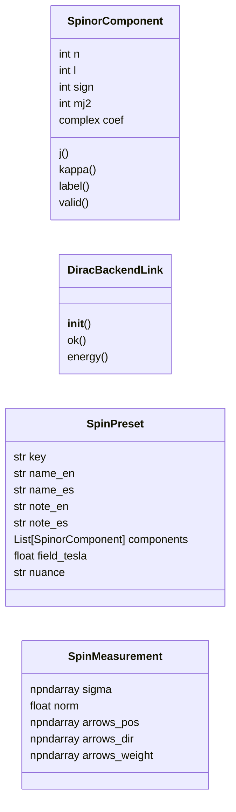
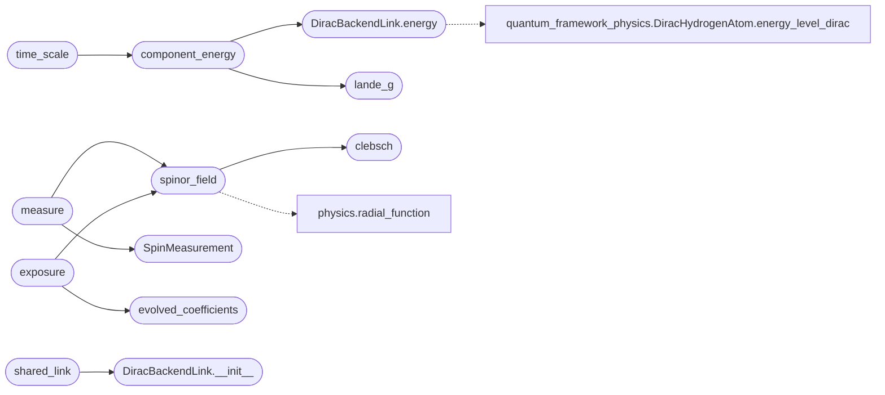

# `immersive.spin`

> Source: [immersive/spin.py:1](../../immersive/spin.py#L1) | language `py` | coverage 27.3% | [API index](../index.md)

Pauli-spinor hydrogen states |n l j m_j>: exact angular coupling, fine structure from the project's Dirac backend.

## Contents

- **Classes:** [`SpinorComponent`](#spinorcomponent), [`DiracBackendLink`](#diracbackendlink), [`SpinPreset`](#spinpreset), [`SpinMeasurement`](#spinmeasurement)
- **Functions:** [`clebsch`](#clebsch), [`lande_g`](#lande_g), [`component_energy`](#component_energy), [`time_scale`](#time_scale), [`real_time_label`](#real_time_label), [`evolved_coefficients`](#evolved_coefficients), [`spinor_field`](#spinor_field), [`measure`](#measure), [`exposure`](#exposure), [`shared_link`](#shared_link)
- **Constants:** [`AU_TIME_SECONDS`](#au_time_seconds), [`HARTREE_HZ`](#hartree_hz), [`TESLA_AU`](#tesla_au), [`BOHR_MAGNETON_AU`](#bohr_magneton_au), [`G_ELECTRON`](#g_electron), [`LATTICE`](#lattice), [`R2`](#r2), [`SPIN_PRESETS`](#spin_presets)

## Type Diagram



## Call Graph

Solid arrows stay in this module, dashed arrows leave it.



## Classes

<a id="spinorcomponent"></a>

### `SpinorComponent`

`class` `dataclass` | [immersive/spin.py:42](../../immersive/spin.py#L42)

Decorators: `@dataclass`

```python
class SpinorComponent
```

**Attributes**

| Name | Type | Default | Description |
|---|---|---|---|
| [`n`](#spinorcomponent-n) | `int` |  |  |
| [`l`](#spinorcomponent-l) | `int` |  |  |
| [`sign`](#spinorcomponent-sign) | `int` |  |  |
| [`mj2`](#spinorcomponent-mj2) | `int` |  |  |
| [`coef`](#spinorcomponent-coef) | `complex` |  |  |

**Members**

| Member | Kind | Summary |
|---|---|---|
| [`j`](#spinorcomponent-j) | property |  |
| [`kappa`](#spinorcomponent-kappa) | property |  |
| [`label`](#spinorcomponent-label) | property |  |
| [`valid`](#spinorcomponent-valid) | method |  |

<a id="spinorcomponent-j"></a>

#### `SpinorComponent.j`

`property` | [immersive/spin.py:50](../../immersive/spin.py#L50)

Decorators: `@property`

```python
def j(self) -> float
```

**Returns:** `float`

<a id="spinorcomponent-kappa"></a>

#### `SpinorComponent.kappa`

`property` | [immersive/spin.py:54](../../immersive/spin.py#L54)

Decorators: `@property`

```python
def kappa(self) -> int
```

**Returns:** `int`

<a id="spinorcomponent-label"></a>

#### `SpinorComponent.label`

`property` | [immersive/spin.py:58](../../immersive/spin.py#L58)

Decorators: `@property`

```python
def label(self) -> str
```

**Returns:** `str`

<a id="spinorcomponent-valid"></a>

#### `SpinorComponent.valid`

`method` | [immersive/spin.py:62](../../immersive/spin.py#L62)

```python
def valid(self) -> bool
```

**Returns:** `bool`

---

<a id="diracbackendlink"></a>

### `DiracBackendLink`

`class` | [immersive/spin.py:66](../../immersive/spin.py#L66)

```python
class DiracBackendLink
```

Fine-structure energies from relativistic_hydrogen.DiracHydrogenAtom (shimmed for SciPy >= 1.15).

**Members**

| Member | Kind | Summary |
|---|---|---|
| [`__init__`](#diracbackendlink-__init__) | constructor |  |
| [`ok`](#diracbackendlink-ok) | property |  |
| [`energy`](#diracbackendlink-energy) | method |  |

<a id="diracbackendlink-__init__"></a>

#### `DiracBackendLink.__init__`

`constructor` | [immersive/spin.py:69](../../immersive/spin.py#L69)

```python
def __init__(self)
```

*Called by:* [`shared_link`](#shared_link)

<a id="diracbackendlink-ok"></a>

#### `DiracBackendLink.ok`

`property` | [immersive/spin.py:89](../../immersive/spin.py#L89)

Decorators: `@property`

```python
def ok(self) -> bool
```

**Returns:** `bool`

<a id="diracbackendlink-energy"></a>

#### `DiracBackendLink.energy`

`method` | [immersive/spin.py:92](../../immersive/spin.py#L92)

```python
def energy(self, comp: SpinorComponent) -> float
```

**Parameters**

| Name | Type | Default | Description |
|---|---|---|---|
| `comp` | `SpinorComponent` |  |  |

**Returns:** `float`

*Calls:* [`DiracHydrogenAtom.energy_level_dirac`](quantum_framework_physics.py.md#dirachydrogenatom-energy_level_dirac)

*Called by:* [`component_energy`](#component_energy)

---

<a id="spinpreset"></a>

### `SpinPreset`

`class` `dataclass` | [immersive/spin.py:99](../../immersive/spin.py#L99)

Decorators: `@dataclass`

```python
class SpinPreset
```

**Attributes**

| Name | Type | Default | Description |
|---|---|---|---|
| [`key`](#spinpreset-key) | `str` |  |  |
| [`name_en`](#spinpreset-name_en) | `str` |  |  |
| [`name_es`](#spinpreset-name_es) | `str` |  |  |
| [`note_en`](#spinpreset-note_en) | `str` |  |  |
| [`note_es`](#spinpreset-note_es) | `str` |  |  |
| [`components`](#spinpreset-components) | `List[SpinorComponent]` |  |  |
| [`field_tesla`](#spinpreset-field_tesla) | `float` | `0.0` |  |
| [`nuance`](#spinpreset-nuance) | `str` | `''` |  |

---

<a id="spinmeasurement"></a>

### `SpinMeasurement`

`class` `dataclass` | [immersive/spin.py:188](../../immersive/spin.py#L188)

Decorators: `@dataclass`

```python
class SpinMeasurement
```

**Attributes**

| Name | Type | Default | Description |
|---|---|---|---|
| [`sigma`](#spinmeasurement-sigma) | `np.ndarray` |  |  |
| [`norm`](#spinmeasurement-norm) | `float` |  |  |
| [`arrows_pos`](#spinmeasurement-arrows_pos) | `np.ndarray` |  |  |
| [`arrows_dir`](#spinmeasurement-arrows_dir) | `np.ndarray` |  |  |
| [`arrows_weight`](#spinmeasurement-arrows_weight) | `np.ndarray` |  |  |

---

## Functions

<a id="clebsch"></a>

### `clebsch`

`function` | [immersive/spin.py:24](../../immersive/spin.py#L24)

```python
def clebsch(l: int, mj2: int, sign: int) -> Tuple[float, float]
```

Coefficients (c_up, c_down) of |l, s=1/2; j=l+sign/2, m_j> on (Y_l^{mj-1/2} up, Y_l^{mj+1/2} down).

**Parameters**

| Name | Type | Default | Description |
|---|---|---|---|
| `l` | `int` |  |  |
| `mj2` | `int` |  |  |
| `sign` | `int` |  |  |

**Returns:** `Tuple[float, float]`

*Called by:* [`spinor_field`](#spinor_field)

---

<a id="lande_g"></a>

### `lande_g`

`function` | [immersive/spin.py:33](../../immersive/spin.py#L33)

```python
def lande_g(l: int, sign: int) -> float
```

**Parameters**

| Name | Type | Default | Description |
|---|---|---|---|
| `l` | `int` |  |  |
| `sign` | `int` |  |  |

**Returns:** `float`

*Called by:* [`component_energy`](#component_energy)

---

<a id="component_energy"></a>

### `component_energy`

`function` | [immersive/spin.py:141](../../immersive/spin.py#L141)

```python
def component_energy(comp: SpinorComponent, link: DiracBackendLink, field_tesla: float) -> float
```

**Parameters**

| Name | Type | Default | Description |
|---|---|---|---|
| `comp` | `SpinorComponent` |  |  |
| `link` | `DiracBackendLink` |  |  |
| `field_tesla` | `float` |  |  |

**Returns:** `float`

*Calls:* [`DiracBackendLink.energy`](#diracbackendlink-energy), [`lande_g`](#lande_g)

*Called by:* [`SpinScene.refresh`](immersive.scenes.py.md#spinscene-refresh), [`time_scale`](#time_scale)

---

<a id="time_scale"></a>

### `time_scale`

`function` | [immersive/spin.py:146](../../immersive/spin.py#L146)

```python
def time_scale(components: Sequence[SpinorComponent], link: DiracBackendLink, field_tesla: float, beat_seconds: float = 6.0) -> float
```

Atomic-time units advanced per screen second, chosen so the dominant beat lasts `beat_seconds` on screen.

**Parameters**

| Name | Type | Default | Description |
|---|---|---|---|
| `components` | `Sequence[SpinorComponent]` |  |  |
| `link` | `DiracBackendLink` |  |  |
| `field_tesla` | `float` |  |  |
| `beat_seconds` | `float` | `6.0` |  |

**Returns:** `float`

*Calls:* [`component_energy`](#component_energy)

*Called by:* [`SpinScene.refresh`](immersive.scenes.py.md#spinscene-refresh)

---

<a id="real_time_label"></a>

### `real_time_label`

`function` | [immersive/spin.py:155](../../immersive/spin.py#L155)

```python
def real_time_label(au_per_screen_second: float) -> str
```

**Parameters**

| Name | Type | Default | Description |
|---|---|---|---|
| `au_per_screen_second` | `float` |  |  |

**Returns:** `str`

*Called by:* [`AtomScene.draw_energy_panel`](immersive.scenes.py.md#atomscene-draw_energy_panel), [`SpinScene.draw_hud`](immersive.scenes.py.md#spinscene-draw_hud)

---

<a id="evolved_coefficients"></a>

### `evolved_coefficients`

`function` | [immersive/spin.py:163](../../immersive/spin.py#L163)

```python
def evolved_coefficients(components: Sequence[SpinorComponent], energies: Sequence[float], t_au: float) -> np.ndarray
```

**Parameters**

| Name | Type | Default | Description |
|---|---|---|---|
| `components` | `Sequence[SpinorComponent]` |  |  |
| `energies` | `Sequence[float]` |  |  |
| `t_au` | `float` |  |  |

**Returns:** `np.ndarray`

*Called by:* [`SpinScene.coefficients`](immersive.scenes.py.md#spinscene-coefficients), [`exposure`](#exposure)

---

<a id="spinor_field"></a>

### `spinor_field`

`function` | [immersive/spin.py:168](../../immersive/spin.py#L168)

```python
def spinor_field(components: Sequence[SpinorComponent], coefs: np.ndarray, points: np.ndarray) -> Tuple[np.ndarray, np.ndarray]
```

Two-component spinor (up, down) at cartesian `points` (N, 3).

**Parameters**

| Name | Type | Default | Description |
|---|---|---|---|
| `components` | `Sequence[SpinorComponent]` |  |  |
| `coefs` | `np.ndarray` |  |  |
| `points` | `np.ndarray` |  |  |

**Returns:** `Tuple[np.ndarray, np.ndarray]`

*Calls:* [`radial_function`](immersive.physics.py.md#radial_function), [`clebsch`](#clebsch)

*Called by:* [`exposure`](#exposure), [`measure`](#measure)

---

<a id="measure"></a>

### `measure`

`function` | [immersive/spin.py:196](../../immersive/spin.py#L196)

```python
def measure(components: Sequence[SpinorComponent], coefs: np.ndarray, reach: float, arrows: int = 40) -> SpinMeasurement
```

**Parameters**

| Name | Type | Default | Description |
|---|---|---|---|
| `components` | `Sequence[SpinorComponent]` |  |  |
| `coefs` | `np.ndarray` |  |  |
| `reach` | `float` |  |  |
| `arrows` | `int` | `40` |  |

**Returns:** `SpinMeasurement`

*Calls:* [`SpinMeasurement`](#spinmeasurement), [`spinor_field`](#spinor_field)

---

<a id="exposure"></a>

### `exposure`

`function` | [immersive/spin.py:216](../../immersive/spin.py#L216)

```python
def exposure(components: Sequence[SpinorComponent], energies: Sequence[float], rmax: float, percentile: float = 99.7) -> float
```

1 / percentile of the spinor density over the visible ball, over several beat phases.

**Parameters**

| Name | Type | Default | Description |
|---|---|---|---|
| `components` | `Sequence[SpinorComponent]` |  |  |
| `energies` | `Sequence[float]` |  |  |
| `rmax` | `float` |  |  |
| `percentile` | `float` | `99.7` |  |

**Returns:** `float`

*Calls:* [`evolved_coefficients`](#evolved_coefficients), [`spinor_field`](#spinor_field)

---

<a id="shared_link"></a>

### `shared_link`

`function` | [immersive/spin.py:238](../../immersive/spin.py#L238)

```python
def shared_link() -> DiracBackendLink
```

**Returns:** `DiracBackendLink`

*Calls:* [`DiracBackendLink.__init__`](#diracbackendlink-__init__)

*Called by:* [`AtomScene.draw_energy_panel`](immersive.scenes.py.md#atomscene-draw_energy_panel), [`SpinScene.__init__`](immersive.scenes.py.md#spinscene-__init__)

---

## Constants

<a id="au_time_seconds"></a>

### `AU_TIME_SECONDS`

`constant` | [immersive/spin.py:16](../../immersive/spin.py#L16)

```python
AU_TIME_SECONDS = 2.4188843265857e-17
```

---

<a id="hartree_hz"></a>

### `HARTREE_HZ`

`constant` | [immersive/spin.py:17](../../immersive/spin.py#L17)

```python
HARTREE_HZ = 6579683920502000.0
```

---

<a id="tesla_au"></a>

### `TESLA_AU`

`constant` | [immersive/spin.py:18](../../immersive/spin.py#L18)

```python
TESLA_AU = 235051.756758
```

---

<a id="bohr_magneton_au"></a>

### `BOHR_MAGNETON_AU`

`constant` | [immersive/spin.py:19](../../immersive/spin.py#L19)

```python
BOHR_MAGNETON_AU = 0.5
```

---

<a id="g_electron"></a>

### `G_ELECTRON`

`constant` | [immersive/spin.py:20](../../immersive/spin.py#L20)

```python
G_ELECTRON = 2.00231930436
```

---

<a id="lattice"></a>

### `LATTICE`

`constant` | [immersive/spin.py:21](../../immersive/spin.py#L21)

```python
LATTICE = 31
```

---

<a id="r2"></a>

### `R2`

`constant` | [immersive/spin.py:114](../../immersive/spin.py#L114)

```python
R2 = 1 / math.sqrt(2)
```

---

<a id="spin_presets"></a>

### `SPIN_PRESETS`

`constant` | [immersive/spin.py:115](../../immersive/spin.py#L115)

```python
SPIN_PRESETS: List[SpinPreset]
```

---
