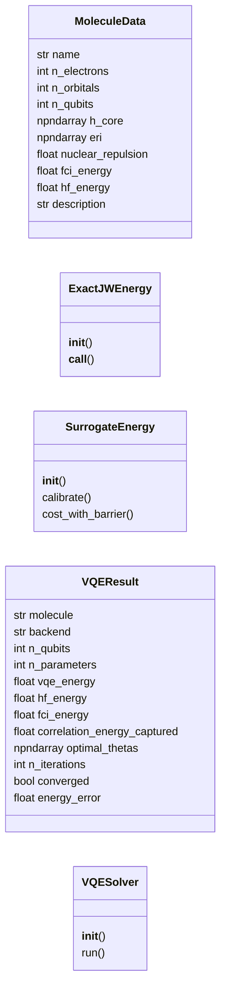
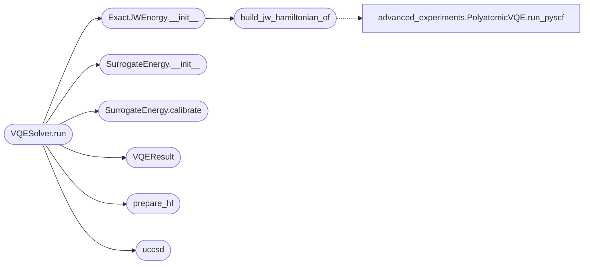

# `molecular_sim`

> Source: [molecular_sim.py:1](../../molecular_sim.py#L1) | language `py` | coverage 31.2% | [API index](../index.md)

molecular_simulator.py - VERSIÓN CON OPENFERMION CORREGIDO

## Contents

- **Classes:** [`MoleculeData`](#moleculedata), [`ExactJWEnergy`](#exactjwenergy), [`SurrogateEnergy`](#surrogateenergy), [`VQEResult`](#vqeresult), [`VQESolver`](#vqesolver)
- **Functions:** [`build_jw_hamiltonian_of`](#build_jw_hamiltonian_of), [`prepare_hf`](#prepare_hf), [`uccsd`](#uccsd)
- **Constants:** [`MOLECULES`](#molecules)

## Type Diagram



## Call Graph

Solid arrows stay in this module, dashed arrows leave it.



## Classes

<a id="moleculedata"></a>

### `MoleculeData`

`class` `dataclass` | [molecular_sim.py:35](../../molecular_sim.py#L35)

Decorators: `@dataclass`

```python
class MoleculeData
```

**Attributes**

| Name | Type | Default | Description |
|---|---|---|---|
| [`name`](#moleculedata-name) | `str` |  |  |
| [`n_electrons`](#moleculedata-n_electrons) | `int` |  |  |
| [`n_orbitals`](#moleculedata-n_orbitals) | `int` |  |  |
| [`n_qubits`](#moleculedata-n_qubits) | `int` |  |  |
| [`h_core`](#moleculedata-h_core) | `np.ndarray` |  |  |
| [`eri`](#moleculedata-eri) | `np.ndarray` |  |  |
| [`nuclear_repulsion`](#moleculedata-nuclear_repulsion) | `float` |  |  |
| [`fci_energy`](#moleculedata-fci_energy) | `float` |  |  |
| [`hf_energy`](#moleculedata-hf_energy) | `float` |  |  |
| [`description`](#moleculedata-description) | `str` | `''` |  |

---

<a id="exactjwenergy"></a>

### `ExactJWEnergy`

`class` | [molecular_sim.py:305](../../molecular_sim.py#L305)

```python
class ExactJWEnergy
```

Evaluador exacto de energía en codificación JW.

Usa OpenFermion cuando está disponible; si no, construye el
Hamiltoniano desde las integrales h_core/eri de la molécula
(ab initio, mismas matemáticas).  Solo lanza RuntimeError si no hay
ninguna fuente de Hamiltoniano.

**Members**

| Member | Kind | Summary |
|---|---|---|
| [`__init__`](#exactjwenergy-__init__) | constructor |  |
| [`__call__`](#exactjwenergy-__call__) | method |  |

<a id="exactjwenergy-__init__"></a>

#### `ExactJWEnergy.__init__`

`constructor` | [molecular_sim.py:315](../../molecular_sim.py#L315)

```python
def __init__(self, mol: MoleculeData, n_qubits: int)
```

**Parameters**

| Name | Type | Default | Description |
|---|---|---|---|
| `mol` | `MoleculeData` |  |  |
| `n_qubits` | `int` |  |  |

**Raises**

- `RuntimeError`: (raised in the body, not documented)

*Calls:* [`build_jw_hamiltonian_of`](#build_jw_hamiltonian_of)

*Called by:* [`PolarizabilityCalculator.__init__`](app.py.md#polarizabilitycalculator-__init__), [`EntangledHydrogenExperiment.run_entangled_h_with_molecular_energy`](entangled_hydrogen.py.md#entangledhydrogenexperiment-run_entangled_h_with_molecular_energy), [`VQESolver.run`](#vqesolver-run), [`PolarizabilityCalculator.__init__`](polarizability_v3.py.md#polarizabilitycalculator-__init__)

<a id="exactjwenergy-__call__"></a>

#### `ExactJWEnergy.__call__`

`method` | [molecular_sim.py:421](../../molecular_sim.py#L421)

```python
def __call__(self, amps: torch.Tensor) -> float
```

**Parameters**

| Name | Type | Default | Description |
|---|---|---|---|
| `amps` | `torch.Tensor` |  |  |

**Returns:** `float`

---

<a id="surrogateenergy"></a>

### `SurrogateEnergy`

`class` | [molecular_sim.py:429](../../molecular_sim.py#L429)

```python
class SurrogateEnergy
```

Backend neuronal con calibración.

**Members**

| Member | Kind | Summary |
|---|---|---|
| [`__init__`](#surrogateenergy-__init__) | constructor |  |
| [`calibrate`](#surrogateenergy-calibrate) | method |  |
| [`cost_with_barrier`](#surrogateenergy-cost_with_barrier) | method |  |

<a id="surrogateenergy-__init__"></a>

#### `SurrogateEnergy.__init__`

`constructor` | [molecular_sim.py:432](../../molecular_sim.py#L432)

```python
def __init__(self, mol, n_qubits, exact_eval, backend)
```

**Parameters**

| Name | Type | Default | Description |
|---|---|---|---|
| `mol` |  |  |  |
| `n_qubits` |  |  |  |
| `exact_eval` |  |  |  |
| `backend` |  |  |  |

*Called by:* [`VQESolver.run`](#vqesolver-run)

<a id="surrogateenergy-calibrate"></a>

#### `SurrogateEnergy.calibrate`

`method` | [molecular_sim.py:441](../../molecular_sim.py#L441)

```python
def calibrate(self, hf_amps)
```

**Parameters**

| Name | Type | Default | Description |
|---|---|---|---|
| `hf_amps` |  |  |  |

*Called by:* [`VQESolver.run`](#vqesolver-run)

<a id="surrogateenergy-cost_with_barrier"></a>

#### `SurrogateEnergy.cost_with_barrier`

`method` | [molecular_sim.py:454](../../molecular_sim.py#L454)

```python
def cost_with_barrier(self, amps)
```

**Parameters**

| Name | Type | Default | Description |
|---|---|---|---|
| `amps` |  |  |  |

---

<a id="vqeresult"></a>

### `VQEResult`

`class` `dataclass` | [molecular_sim.py:573](../../molecular_sim.py#L573)

Decorators: `@dataclass`

```python
class VQEResult
```

**Attributes**

| Name | Type | Default | Description |
|---|---|---|---|
| [`molecule`](#vqeresult-molecule) | `str` |  |  |
| [`backend`](#vqeresult-backend) | `str` |  |  |
| [`n_qubits`](#vqeresult-n_qubits) | `int` |  |  |
| [`n_parameters`](#vqeresult-n_parameters) | `int` |  |  |
| [`vqe_energy`](#vqeresult-vqe_energy) | `float` |  |  |
| [`hf_energy`](#vqeresult-hf_energy) | `float` |  |  |
| [`fci_energy`](#vqeresult-fci_energy) | `float` |  |  |
| [`correlation_energy_captured`](#vqeresult-correlation_energy_captured) | `float` |  |  |
| [`optimal_thetas`](#vqeresult-optimal_thetas) | `np.ndarray` |  |  |
| [`n_iterations`](#vqeresult-n_iterations) | `int` |  |  |
| [`converged`](#vqeresult-converged) | `bool` |  |  |
| [`energy_error`](#vqeresult-energy_error) | `float` |  |  |

---

<a id="vqesolver"></a>

### `VQESolver`

`class` | [molecular_sim.py:592](../../molecular_sim.py#L592)

```python
class VQESolver
```

**Members**

| Member | Kind | Summary |
|---|---|---|
| [`__init__`](#vqesolver-__init__) | constructor |  |
| [`run`](#vqesolver-run) | method |  |

<a id="vqesolver-__init__"></a>

#### `VQESolver.__init__`

`constructor` | [molecular_sim.py:593](../../molecular_sim.py#L593)

```python
def __init__(self, qc, config)
```

**Parameters**

| Name | Type | Default | Description |
|---|---|---|---|
| `qc` |  |  |  |
| `config` |  |  |  |

<a id="vqesolver-run"></a>

#### `VQESolver.run`

`method` | [molecular_sim.py:605](../../molecular_sim.py#L605)

```python
def run(self, mol, backend='hamiltonian', max_iter=200, tol=1e-08)
```

**Parameters**

| Name | Type | Default | Description |
|---|---|---|---|
| `mol` |  |  |  |
| `backend` |  | `'hamiltonian'` |  |
| `max_iter` |  | `200` |  |
| `tol` |  | `1e-08` |  |

**Raises**

- `RuntimeError`: (raised in the body, not documented)

*Calls:* [`ExactJWEnergy.__init__`](#exactjwenergy-__init__), [`SurrogateEnergy.__init__`](#surrogateenergy-__init__), [`SurrogateEnergy.calibrate`](#surrogateenergy-calibrate), [`VQEResult`](#vqeresult), [`prepare_hf`](#prepare_hf), [`uccsd`](#uccsd)

*Called by:* [`run_all_experiments`](quantum_framework_menu.py.md#run_all_experiments), [`run_vqe_h2`](quantum_framework_molecular.py.md#run_vqe_h2), [`run_vqe`](quantum_framework_molecular_v2.py.md#run_vqe)

---

## Functions

<a id="build_jw_hamiltonian_of"></a>

### `build_jw_hamiltonian_of`

`function` | [molecular_sim.py:176](../../molecular_sim.py#L176)

```python
def build_jw_hamiltonian_of(mol: MoleculeData)
```

Construye Hamiltoniano JW usando OpenFermion correctamente.

Usa MolecularData de OpenFermion para asegurar consistencia.

**Parameters**

| Name | Type | Default | Description |
|---|---|---|---|
| `mol` | `MoleculeData` |  |  |

*Calls:* [`PolyatomicVQE.run_pyscf`](advanced_experiments.py.md#polyatomicvqe-run_pyscf)

*Called by:* [`ExactJWEnergy.__init__`](#exactjwenergy-__init__)

---

<a id="prepare_hf"></a>

### `prepare_hf`

`function` | [molecular_sim.py:468](../../molecular_sim.py#L468)

```python
def prepare_hf(mol, factory, backend)
```

**Parameters**

| Name | Type | Default | Description |
|---|---|---|---|
| `mol` |  |  |  |
| `factory` |  |  |  |
| `backend` |  |  |  |

*Called by:* [`VQESolver.run`](#vqesolver-run)

---

<a id="uccsd"></a>

### `uccsd`

`function` | [molecular_sim.py:539](../../molecular_sim.py#L539)

```python
def uccsd(state, thetas, singles, doubles, backend, runner)
```

UCCSD ansatz (fermiónico, con signos Jordan-Wigner exactos).

- Singles y doubles se aplican como rotaciones de Givens con el signo
  de paridad JW sobre las amplitudes del estado conjunto: exactas,
  unitarias, conservan número de partículas.
- Reemplaza la implementación anterior: las singles usaban escaleras
  CNOT+Ry que no conservan número de partículas y las doubles
  ignoraban los índices de la excitación (pivote dinámico por argmax).
- theta=0 para cualquier parámetro → identidad exacta.
- `[`backend`](#vqeresult-backend)` y ``runner`` se conservan por compatibilidad de firma;
  la rotación directa sobre amplitudes no los necesita.

**Parameters**

| Name | Type | Default | Description |
|---|---|---|---|
| `state` |  |  |  |
| `thetas` |  |  |  |
| `singles` |  |  |  |
| `doubles` |  |  |  |
| `backend` |  |  |  |
| `runner` |  |  |  |

*Called by:* [`VQESolver.run`](#vqesolver-run)

---

## Constants

<a id="molecules"></a>

### `MOLECULES`

`constant` | [molecular_sim.py:169](../../molecular_sim.py#L169)

```python
MOLECULES = _LazyMoleculeRegistry({'H2': _h2_sto3g_pyscf})
```

---
