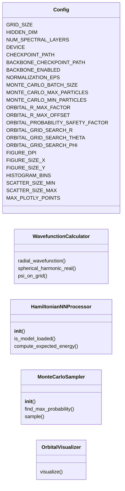
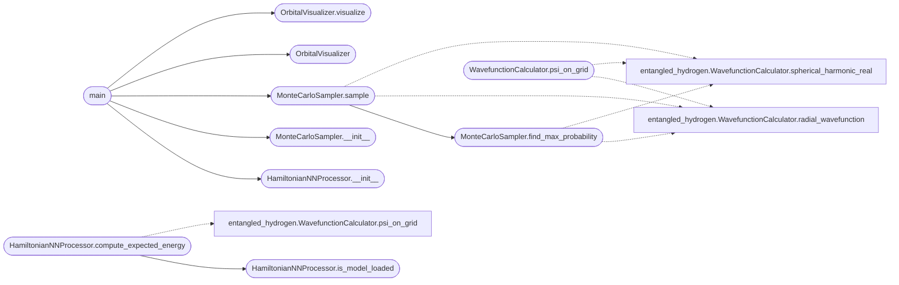

# `orbital_visualizer2`

> Source: [orbital_visualizer2.py:1](../../orbital_visualizer2.py#L1) | language `py` | coverage 29.4% | [API index](../index.md)

Hydrogen Orbital Visualizer ============================ HIGH RESOLUTION visualization with Hamiltonian NN.

FIXED: Large image size, proper point sizes, high quality output.

## Contents

- **Classes:** [`Config`](#config), [`WavefunctionCalculator`](#wavefunctioncalculator), [`HamiltonianNNProcessor`](#hamiltoniannnprocessor), [`MonteCarloSampler`](#montecarlosampler), [`OrbitalVisualizer`](#orbitalvisualizer)
- **Functions:** [`main`](#main)
- **Constants:** [`ORBITALS`](#orbitals)

## Type Diagram



## Call Graph

Solid arrows stay in this module, dashed arrows leave it.



## Classes

<a id="config"></a>

### `Config`

`class` | [orbital_visualizer2.py:44](../../orbital_visualizer2.py#L44)

```python
class Config
```

**Attributes**

| Name | Type | Default | Description |
|---|---|---|---|
| [`GRID_SIZE`](#config-grid_size) |  | `16` |  |
| [`HIDDEN_DIM`](#config-hidden_dim) |  | `32` |  |
| [`NUM_SPECTRAL_LAYERS`](#config-num_spectral_layers) |  | `2` |  |
| [`DEVICE`](#config-device) |  | `'cuda' if torch.cuda.is_available() else 'cpu'` |  |
| [`CHECKPOINT_PATH`](#config-checkpoint_path) |  | `'checkpoint_phase3_training_epoch_4994_20260216_142858.pth'` |  |
| [`BACKBONE_CHECKPOINT_PATH`](#config-backbone_checkpoint_path) |  | `'weights/latest.pth'` |  |
| [`BACKBONE_ENABLED`](#config-backbone_enabled) |  | `True` |  |
| [`NORMALIZATION_EPS`](#config-normalization_eps) |  | `1e-08` |  |
| [`MONTE_CARLO_BATCH_SIZE`](#config-monte_carlo_batch_size) |  | `100000` |  |
| [`MONTE_CARLO_MAX_PARTICLES`](#config-monte_carlo_max_particles) |  | `2000000` |  |
| [`MONTE_CARLO_MIN_PARTICLES`](#config-monte_carlo_min_particles) |  | `5000` |  |
| [`ORBITAL_R_MAX_FACTOR`](#config-orbital_r_max_factor) |  | `4` |  |
| [`ORBITAL_R_MAX_OFFSET`](#config-orbital_r_max_offset) |  | `10` |  |
| [`ORBITAL_PROBABILITY_SAFETY_FACTOR`](#config-orbital_probability_safety_factor) |  | `1.05` |  |
| [`ORBITAL_GRID_SEARCH_R`](#config-orbital_grid_search_r) |  | `300` |  |
| [`ORBITAL_GRID_SEARCH_THETA`](#config-orbital_grid_search_theta) |  | `150` |  |
| [`ORBITAL_GRID_SEARCH_PHI`](#config-orbital_grid_search_phi) |  | `150` |  |
| [`FIGURE_DPI`](#config-figure_dpi) |  | `150` |  |
| [`FIGURE_SIZE_X`](#config-figure_size_x) |  | `24` |  |
| [`FIGURE_SIZE_Y`](#config-figure_size_y) |  | `18` |  |
| [`HISTOGRAM_BINS`](#config-histogram_bins) |  | `300` |  |
| [`SCATTER_SIZE_MIN`](#config-scatter_size_min) |  | `1.0` |  |
| [`SCATTER_SIZE_MAX`](#config-scatter_size_max) |  | `8.0` |  |
| [`MAX_PLOTLY_POINTS`](#config-max_plotly_points) |  | `100000` |  |
| [`HAMILTONIAN_EVOLUTION_STEPS`](#config-hamiltonian_evolution_steps) |  | `5` |  |
| [`HAMILTONIAN_DT`](#config-hamiltonian_dt) |  | `0.005` |  |

---

<a id="wavefunctioncalculator"></a>

### `WavefunctionCalculator`

`class` | [orbital_visualizer2.py:83](../../orbital_visualizer2.py#L83)

```python
class WavefunctionCalculator
```

Calculates hydrogen atom wavefunctions.

**Members**

| Member | Kind | Summary |
|---|---|---|
| [`radial_wavefunction`](#wavefunctioncalculator-radial_wavefunction) | staticmethod |  |
| [`spherical_harmonic_real`](#wavefunctioncalculator-spherical_harmonic_real) | staticmethod |  |
| [`psi_on_grid`](#wavefunctioncalculator-psi_on_grid) | staticmethod |  |

<a id="wavefunctioncalculator-radial_wavefunction"></a>

#### `WavefunctionCalculator.radial_wavefunction`

`staticmethod` | [orbital_visualizer2.py:87](../../orbital_visualizer2.py#L87)

Decorators: `@staticmethod`

```python
def radial_wavefunction(n: int, l: int, r: np.ndarray) -> np.ndarray
```

**Parameters**

| Name | Type | Default | Description |
|---|---|---|---|
| `n` | `int` |  |  |
| `l` | `int` |  |  |
| `r` | `np.ndarray` |  |  |

**Returns:** `np.ndarray`

<a id="wavefunctioncalculator-spherical_harmonic_real"></a>

#### `WavefunctionCalculator.spherical_harmonic_real`

`staticmethod` | [orbital_visualizer2.py:97](../../orbital_visualizer2.py#L97)

Decorators: `@staticmethod`

```python
def spherical_harmonic_real(l: int, m: int, theta: np.ndarray, phi: np.ndarray) -> np.ndarray
```

**Parameters**

| Name | Type | Default | Description |
|---|---|---|---|
| `l` | `int` |  |  |
| `m` | `int` |  |  |
| `theta` | `np.ndarray` |  |  |
| `phi` | `np.ndarray` |  |  |

**Returns:** `np.ndarray`

<a id="wavefunctioncalculator-psi_on_grid"></a>

#### `WavefunctionCalculator.psi_on_grid`

`staticmethod` | [orbital_visualizer2.py:107](../../orbital_visualizer2.py#L107)

Decorators: `@staticmethod`

```python
def psi_on_grid(n: int, l: int, m: int, grid_size: int = 16) -> torch.Tensor
```

**Parameters**

| Name | Type | Default | Description |
|---|---|---|---|
| `n` | `int` |  |  |
| `l` | `int` |  |  |
| `m` | `int` |  |  |
| `grid_size` | `int` | `16` |  |

**Returns:** `torch.Tensor`

*Calls:* [`WavefunctionCalculator.radial_wavefunction`](entangled_hydrogen.py.md#wavefunctioncalculator-radial_wavefunction), [`WavefunctionCalculator.spherical_harmonic_real`](entangled_hydrogen.py.md#wavefunctioncalculator-spherical_harmonic_real)

---

<a id="hamiltoniannnprocessor"></a>

### `HamiltonianNNProcessor`

`class` | [orbital_visualizer2.py:126](../../orbital_visualizer2.py#L126)

```python
class HamiltonianNNProcessor
```

Uses YOUR TRAINED MODEL for calculations.

**Members**

| Member | Kind | Summary |
|---|---|---|
| [`__init__`](#hamiltoniannnprocessor-__init__) | constructor |  |
| [`is_model_loaded`](#hamiltoniannnprocessor-is_model_loaded) | method |  |
| [`compute_expected_energy`](#hamiltoniannnprocessor-compute_expected_energy) | method |  |

<a id="hamiltoniannnprocessor-__init__"></a>

#### `HamiltonianNNProcessor.__init__`

`constructor` | [orbital_visualizer2.py:129](../../orbital_visualizer2.py#L129)

```python
def __init__(self, engine)
```

**Parameters**

| Name | Type | Default | Description |
|---|---|---|---|
| `engine` |  |  |  |

*Called by:* [`main`](#main)

<a id="hamiltoniannnprocessor-is_model_loaded"></a>

#### `HamiltonianNNProcessor.is_model_loaded`

`method` | [orbital_visualizer2.py:133](../../orbital_visualizer2.py#L133)

```python
def is_model_loaded(self) -> bool
```

**Returns:** `bool`

*Called by:* [`HamiltonianNNProcessor.compute_expected_energy`](#hamiltoniannnprocessor-compute_expected_energy)

<a id="hamiltoniannnprocessor-compute_expected_energy"></a>

#### `HamiltonianNNProcessor.compute_expected_energy`

`method` | [orbital_visualizer2.py:136](../../orbital_visualizer2.py#L136)

```python
def compute_expected_energy(self, n: int, l: int, m: int) -> Dict[str, float]
```

**Parameters**

| Name | Type | Default | Description |
|---|---|---|---|
| `n` | `int` |  |  |
| `l` | `int` |  |  |
| `m` | `int` |  |  |

**Returns:** `Dict[str, float]`

*Calls:* [`WavefunctionCalculator.psi_on_grid`](entangled_hydrogen.py.md#wavefunctioncalculator-psi_on_grid), [`HamiltonianNNProcessor.is_model_loaded`](#hamiltoniannnprocessor-is_model_loaded)

---

<a id="montecarlosampler"></a>

### `MonteCarloSampler`

`class` | [orbital_visualizer2.py:160](../../orbital_visualizer2.py#L160)

```python
class MonteCarloSampler
```

Monte Carlo sampling for orbital visualization.

**Members**

| Member | Kind | Summary |
|---|---|---|
| [`__init__`](#montecarlosampler-__init__) | constructor |  |
| [`find_max_probability`](#montecarlosampler-find_max_probability) | method |  |
| [`sample`](#montecarlosampler-sample) | method |  |

<a id="montecarlosampler-__init__"></a>

#### `MonteCarloSampler.__init__`

`constructor` | [orbital_visualizer2.py:163](../../orbital_visualizer2.py#L163)

```python
def __init__(self, hamiltonian_processor=None)
```

**Parameters**

| Name | Type | Default | Description |
|---|---|---|---|
| `hamiltonian_processor` |  | `None` |  |

*Called by:* [`main`](#main)

<a id="montecarlosampler-find_max_probability"></a>

#### `MonteCarloSampler.find_max_probability`

`method` | [orbital_visualizer2.py:166](../../orbital_visualizer2.py#L166)

```python
def find_max_probability(self, n: int, l: int, m: int) -> Tuple[float, float, float, float]
```

**Parameters**

| Name | Type | Default | Description |
|---|---|---|---|
| `n` | `int` |  |  |
| `l` | `int` |  |  |
| `m` | `int` |  |  |

**Returns:** `Tuple[float, float, float, float]`

*Calls:* [`WavefunctionCalculator.radial_wavefunction`](entangled_hydrogen.py.md#wavefunctioncalculator-radial_wavefunction), [`WavefunctionCalculator.spherical_harmonic_real`](entangled_hydrogen.py.md#wavefunctioncalculator-spherical_harmonic_real)

*Called by:* [`MonteCarloSampler.sample`](#montecarlosampler-sample), [`MonteCarloSampler.sample`](quantum_framework_visualization.py.md#montecarlosampler-sample), [`MonteCarloSampler.sample_orbital`](quantum_simulator.py.md#montecarlosampler-sample_orbital)

<a id="montecarlosampler-sample"></a>

#### `MonteCarloSampler.sample`

`method` | [orbital_visualizer2.py:195](../../orbital_visualizer2.py#L195)

```python
def sample(self, n: int, l: int, m: int, num_samples: int) -> Dict[str, Any]
```

**Parameters**

| Name | Type | Default | Description |
|---|---|---|---|
| `n` | `int` |  |  |
| `l` | `int` |  |  |
| `m` | `int` |  |  |
| `num_samples` | `int` |  |  |

**Returns:** `Dict[str, Any]`

*Calls:* [`WavefunctionCalculator.radial_wavefunction`](entangled_hydrogen.py.md#wavefunctioncalculator-radial_wavefunction), [`WavefunctionCalculator.spherical_harmonic_real`](entangled_hydrogen.py.md#wavefunctioncalculator-spherical_harmonic_real), [`MonteCarloSampler.find_max_probability`](#montecarlosampler-find_max_probability)

*Called by:* [`main`](#main), [`RealOrbitalEngine.sample`](qc_dashboard.py.md#realorbitalengine-sample), [`EntangledHydrogenSampler.sample_entangled_state`](quantum_framework_visualization.py.md#entangledhydrogensampler-sample_entangled_state)

---

<a id="orbitalvisualizer"></a>

### `OrbitalVisualizer`

`class` | [orbital_visualizer2.py:265](../../orbital_visualizer2.py#L265)

```python
class OrbitalVisualizer
```

HIGH RESOLUTION visualization - NOT 16x16!

**Members**

| Member | Kind | Summary |
|---|---|---|
| [`visualize`](#orbitalvisualizer-visualize) | method |  |

<a id="orbitalvisualizer-visualize"></a>

#### `OrbitalVisualizer.visualize`

`method` | [orbital_visualizer2.py:268](../../orbital_visualizer2.py#L268)

```python
def visualize(self, data: Dict, save_path: str = None, hamiltonian_processor=None)
```

**Parameters**

| Name | Type | Default | Description |
|---|---|---|---|
| `data` | `Dict` |  |  |
| `save_path` | `str` | `None` |  |
| `hamiltonian_processor` |  | `None` |  |

*Called by:* [`main`](#main), [`RealOrbitalEngine.render_to_bytes`](qc_dashboard.py.md#realorbitalengine-render_to_bytes), [`QuantumSimulationFramework.visualize_atom_orbitals`](quantum_simulator.py.md#quantumsimulationframework-visualize_atom_orbitals), [`QuantumSimulationFramework.visualize_orbital`](quantum_simulator.py.md#quantumsimulationframework-visualize_orbital)

---

## Functions

<a id="main"></a>

### `main`

`function` | [orbital_visualizer2.py:433](../../orbital_visualizer2.py#L433)

```python
def main()
```

*Calls:* [`HamiltonianNNProcessor.__init__`](#hamiltoniannnprocessor-__init__), [`MonteCarloSampler.__init__`](#montecarlosampler-__init__), [`MonteCarloSampler.sample`](#montecarlosampler-sample), [`OrbitalVisualizer`](#orbitalvisualizer), [`OrbitalVisualizer.visualize`](#orbitalvisualizer-visualize)

---

## Constants

<a id="orbitals"></a>

### `ORBITALS`

`constant` | [orbital_visualizer2.py:420](../../orbital_visualizer2.py#L420)

```python
ORBITALS
```

---
