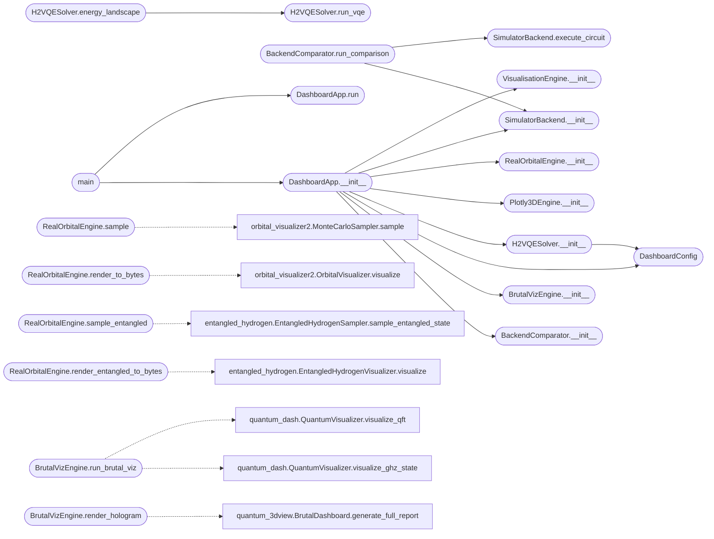

# `qc_dashboard`

> Source: [qc_dashboard.py:1](../../qc_dashboard.py#L1) | language `py` | coverage 34.0% | [API index](../index.md)

QC Dashboard - Streamlit web application for real-time quantum playground.

Provides an interactive web-based quantum circuit builder with:
  - Interactive circuit construction via gate buttons
  - Real-time state visualisation (probability bars, Bloch spheres, phase space)
  - OpenQASM code editor with live preview and export/import
  - Entropy evolution tracking + entanglement analysis (cut-position sweep, scaling)
  - Molecular H2 VQE simulation (energy convergence, landscape, orbital visualisation)
  - 3D visualisation via Plotly (Bloch spheres, probability bars, state vector)
  - Backend comparison (MPS, statevector)

Architecture
------------
  DashboardConfig         -- centralised configuration (no magic numbers)
  VisualisationEngine     -- renders matplotlib figures from snapshots
  SimulatorBackend        -- thin wrapper around MPS / statevector / synthetic
  H2VQESolver             -- self-contained H2 VQE (numpy only, no PySCF)
  DashboardApp            -- top-level Streamlit application orchestrator

Usage
-----
  streamlit run qc_dashboard.py

Or programmatically:
  from qc_dashboard import DashboardApp, DashboardConfig
  app = DashboardApp(DashboardConfig())
  app.run()

## Contents

- **Classes:** [`DashboardConfig`](#dashboardconfig), [`GateItem`](#gateitem), [`SnapshotData`](#snapshotdata), [`H2VQESolver`](#h2vqesolver), [`VisualisationEngine`](#visualisationengine), [`SimulatorBackend`](#simulatorbackend), [`Plotly3DEngine`](#plotly3dengine), [`RealOrbitalEngine`](#realorbitalengine), [`BrutalVizEngine`](#brutalvizengine), [`BackendComparator`](#backendcomparator), [`DashboardApp`](#dashboardapp)
- **Functions:** [`main`](#main)

## Type Diagram

```mermaid
classDiagram
    direction LR
    class DashboardConfig
    DashboardConfig : str app_title
    DashboardConfig : str app_icon
    DashboardConfig : str layout
    DashboardConfig : str initial_sidebar_state
    DashboardConfig : int max_qubits
    DashboardConfig : int default_qubits
    DashboardConfig : int figure_dpi
    DashboardConfig : int figure_width_inches
    DashboardConfig : int figure_height_inches
    DashboardConfig : float probability_threshold
    DashboardConfig : float entropy_base
    DashboardConfig : int bloch_sphere_resolution
    DashboardConfig : float scatter_point_size_min
    DashboardConfig : float scatter_point_size_max
    DashboardConfig : float phase_point_size_base
    DashboardConfig : str color_primary
    DashboardConfig : str color_secondary
    DashboardConfig : str color_tertiary
    DashboardConfig : str color_accent
    DashboardConfig : str color_background
    DashboardConfig : str color_grid
    DashboardConfig : str color_text
    DashboardConfig : str color_surface
    DashboardConfig : Tuple[str, ] supported_gates
    class GateItem
    GateItem : str name
    GateItem : int target
    GateItem : int target_b
    GateItem : float param
    class SnapshotData
    SnapshotData : int step
    SnapshotData : str gate_name
    SnapshotData : npndarray probabilities
    SnapshotData : npndarray phases
    SnapshotData : float entropy
    SnapshotData : List[Tuple[float, float, float]] bloch_vectors
    SnapshotData : int n_qubits
    class H2VQESolver
    H2VQESolver : __init__()
    H2VQESolver : run_vqe()
    H2VQESolver : energy_landscape()
    H2VQESolver : orbital_wavefunction()
    class VisualisationEngine
    VisualisationEngine : __init__()
    VisualisationEngine : available()
    VisualisationEngine : render_full_dashboard()
    VisualisationEngine : render_entropy_chart()
    VisualisationEngine : render_entanglement_profile()
    VisualisationEngine : render_vqe_convergence()
    VisualisationEngine : render_energy_landscape()
    VisualisationEngine : render_orbital_plot()
    VisualisationEngine : render_entropy_scaling()
    VisualisationEngine : render_orbital_2d_projections()
    class SimulatorBackend
    SimulatorBackend : __init__()
    SimulatorBackend : execute_circuit()
    class Plotly3DEngine
    Plotly3DEngine : __init__()
    Plotly3DEngine : available()
    Plotly3DEngine : render_bloch_3d()
    Plotly3DEngine : render_probability_3d()
    Plotly3DEngine : render_state_3d()
    class RealOrbitalEngine
    RealOrbitalEngine : __init__()
    RealOrbitalEngine : available()
    RealOrbitalEngine : entangled_available()
    RealOrbitalEngine : sample()
    RealOrbitalEngine : render_to_bytes()
    RealOrbitalEngine : sample_entangled()
    RealOrbitalEngine : render_entangled_to_bytes()
    class BrutalVizEngine
    BrutalVizEngine : __init__()
    BrutalVizEngine : dash_available()
    BrutalVizEngine : hologram_available()
    BrutalVizEngine : run_brutal_viz()
    BrutalVizEngine : render_hologram()
    class BackendComparator
    BackendComparator : __init__()
    BackendComparator : run_comparison()
    class DashboardApp
    DashboardApp : __init__()
    DashboardApp : run()
```



## Call Graph

Solid arrows stay in this module, dashed arrows leave it.



## Classes

<a id="dashboardconfig"></a>

### `DashboardConfig`

`class` `dataclass` | [qc_dashboard.py:55](../../qc_dashboard.py#L55)

Decorators: `@dataclass`

```python
class DashboardConfig
```

Centralised configuration for the dashboard.

**Attributes**

| Name | Type | Default | Description |
|---|---|---|---|
| [`app_title`](#dashboardconfig-app_title) | `str` | `'QC Quantum Playground'` |  |
| [`app_icon`](#dashboardconfig-app_icon) | `str` | `'atom_symbol'` |  |
| [`layout`](#dashboardconfig-layout) | `str` | `'wide'` |  |
| [`initial_sidebar_state`](#dashboardconfig-initial_sidebar_state) | `str` | `'expanded'` |  |
| [`max_qubits`](#dashboardconfig-max_qubits) | `int` | `8` |  |
| [`default_qubits`](#dashboardconfig-default_qubits) | `int` | `2` |  |
| [`figure_dpi`](#dashboardconfig-figure_dpi) | `int` | `120` |  |
| [`figure_width_inches`](#dashboardconfig-figure_width_inches) | `int` | `10` |  |
| [`figure_height_inches`](#dashboardconfig-figure_height_inches) | `int` | `6` |  |
| [`probability_threshold`](#dashboardconfig-probability_threshold) | `float` | `1e-06` |  |
| [`entropy_base`](#dashboardconfig-entropy_base) | `float` | `2.0` |  |
| [`bloch_sphere_resolution`](#dashboardconfig-bloch_sphere_resolution) | `int` | `30` |  |
| [`scatter_point_size_min`](#dashboardconfig-scatter_point_size_min) | `float` | `20.0` |  |
| [`scatter_point_size_max`](#dashboardconfig-scatter_point_size_max) | `float` | `200.0` |  |
| [`phase_point_size_base`](#dashboardconfig-phase_point_size_base) | `float` | `100.0` |  |
| [`color_primary`](#dashboardconfig-color_primary) | `str` | `'#FF006E'` |  |
| [`color_secondary`](#dashboardconfig-color_secondary) | `str` | `'#00F5FF'` |  |
| [`color_tertiary`](#dashboardconfig-color_tertiary) | `str` | `'#FFBE0B'` |  |
| [`color_accent`](#dashboardconfig-color_accent) | `str` | `'#8338EC'` |  |
| [`color_background`](#dashboardconfig-color_background) | `str` | `'#0A0A0F'` |  |
| [`color_grid`](#dashboardconfig-color_grid) | `str` | `'#1A1A2E'` |  |
| [`color_text`](#dashboardconfig-color_text) | `str` | `'#FFFFFF'` |  |
| [`color_surface`](#dashboardconfig-color_surface) | `str` | `'#16213E'` |  |
| [`supported_gates`](#dashboardconfig-supported_gates) | `Tuple[str, ...]` | `('H', 'X', 'Y', 'Z', 'S', 'T', 'Rx', 'Ry', 'Rz', 'CNOT', 'CZ', 'SWAP')` |  |
| [`qasm_initial`](#dashboardconfig-qasm_initial) | `str` | `'// QC Quantum Playground\nOPENQASM 2.0;\ninclude "qelib1.inc";\nqreg q[2];\ncreg c[2];\nh q[0];\ncx q[0],q[1];\n'` |  |
| [`session_state_key`](#dashboardconfig-session_state_key) | `str` | `'qc_dashboard_state'` |  |
| [`auto_run`](#dashboardconfig-auto_run) | `bool` | `True` |  |
| [`h2_nuclear_repulsion`](#dashboardconfig-h2_nuclear_repulsion) | `float` | `0.71996899` |  |
| [`h2_zz_coeff`](#dashboardconfig-h2_zz_coeff) | `float` | `1.83672827` |  |
| [`h2_xx_coeff`](#dashboardconfig-h2_xx_coeff) | `float` | `0.01026228` |  |
| [`h2_yy_coeff`](#dashboardconfig-h2_yy_coeff) | `float` | `0.01026228` |  |
| [`molecule_bond_min`](#dashboardconfig-molecule_bond_min) | `float` | `0.4` |  |
| [`molecule_bond_max`](#dashboardconfig-molecule_bond_max) | `float` | `4.0` |  |
| [`molecule_bond_steps`](#dashboardconfig-molecule_bond_steps) | `int` | `40` |  |
| [`molecule_vqe_max_iter`](#dashboardconfig-molecule_vqe_max_iter) | `int` | `200` |  |
| [`entanglement_max_cut`](#dashboardconfig-entanglement_max_cut) | `int` | `-1` |  |
| [`plotly_marker_size`](#dashboardconfig-plotly_marker_size) | `int` | `8` |  |

---

<a id="gateitem"></a>

### `GateItem`

`class` `dataclass` | [qc_dashboard.py:120](../../qc_dashboard.py#L120)

Decorators: `@dataclass`

```python
class GateItem
```

A gate placed in the circuit builder.

**Attributes**

| Name | Type | Default | Description |
|---|---|---|---|
| [`name`](#gateitem-name) | `str` |  |  |
| [`target`](#gateitem-target) | `int` |  |  |
| [`target_b`](#gateitem-target_b) | `int` | `-1` |  |
| [`param`](#gateitem-param) | `float` | `0.0` |  |

---

<a id="snapshotdata"></a>

### `SnapshotData`

`class` `dataclass` | [qc_dashboard.py:130](../../qc_dashboard.py#L130)

Decorators: `@dataclass`

```python
class SnapshotData
```

Quantum state snapshot for visualisation.

**Attributes**

| Name | Type | Default | Description |
|---|---|---|---|
| [`step`](#snapshotdata-step) | `int` |  |  |
| [`gate_name`](#snapshotdata-gate_name) | `str` |  |  |
| [`probabilities`](#snapshotdata-probabilities) | `np.ndarray` |  |  |
| [`phases`](#snapshotdata-phases) | `np.ndarray` |  |  |
| [`entropy`](#snapshotdata-entropy) | `float` |  |  |
| [`bloch_vectors`](#snapshotdata-bloch_vectors) | `List[Tuple[float, float, float]]` |  |  |
| [`n_qubits`](#snapshotdata-n_qubits) | `int` |  |  |

---

<a id="h2vqesolver"></a>

### `H2VQESolver`

`class` | [qc_dashboard.py:147](../../qc_dashboard.py#L147)

```python
class H2VQESolver
```

Self-contained H2 VQE solver using the hardcoded STO-3G Hamiltonian.

The Hamiltonian in the Jordan-Wigner 2-qubit active space:
    H = E_nuc + hZZ * Z0Z1 + hXX * X0X1 + hYY * Y0Y1

Reference energies:
    E_HF = -1.11675928 Ha,  E_FCI = -1.13728383 Ha,  E_nuc = 0.71996899 Ha

Usage
-----
    solver = H2VQESolver()
    result = solver.run_vqe()
    print(result["energy"])  # converged VQE energy

    landscape = solver.energy_landscape()
    print(landscape["bond_lengths"], landscape["energies"])

**Members**

| Member | Kind | Summary |
|---|---|---|
| [`__init__`](#h2vqesolver-__init__) | constructor |  |
| [`run_vqe`](#h2vqesolver-run_vqe) | method |  |
| [`energy_landscape`](#h2vqesolver-energy_landscape) | method | Sweep bond length and return VQE energy curve. |
| [`orbital_wavefunction`](#h2vqesolver-orbital_wavefunction) | staticmethod | Compute hydrogen 1s orbital wavefunction along the internuclear axis. |

<a id="h2vqesolver-__init__"></a>

#### `H2VQESolver.__init__`

`constructor` | [qc_dashboard.py:166](../../qc_dashboard.py#L166)

```python
def __init__(self, config: Optional[DashboardConfig] = None) -> None
```

**Parameters**

| Name | Type | Default | Description |
|---|---|---|---|
| `config` | `Optional[DashboardConfig]` | `None` |  |

*Calls:* [`DashboardConfig`](#dashboardconfig)

*Called by:* [`DashboardApp.__init__`](#dashboardapp-__init__)

<a id="h2vqesolver-run_vqe"></a>

#### `H2VQESolver.run_vqe`

`method` | [qc_dashboard.py:248](../../qc_dashboard.py#L248)

```python
def run_vqe(self, bond_length: float = 0.74, max_iter: int = -1) -> Dict[str, Any]
```

**Parameters**

| Name | Type | Default | Description |
|---|---|---|---|
| `bond_length` | `float` | `0.74` |  |
| `max_iter` | `int` | `-1` |  |

**Returns:** `Dict[str, Any]`

*Called by:* [`H2VQESolver.energy_landscape`](#h2vqesolver-energy_landscape)

<a id="h2vqesolver-energy_landscape"></a>

#### `H2VQESolver.energy_landscape`

`method` | [qc_dashboard.py:293](../../qc_dashboard.py#L293)

```python
def energy_landscape(self) -> Dict[str, Any]
```

Sweep bond length and return VQE energy curve.

**Returns:** `Dict[str, Any]`

*Calls:* [`H2VQESolver.run_vqe`](#h2vqesolver-run_vqe)

<a id="h2vqesolver-orbital_wavefunction"></a>

#### `H2VQESolver.orbital_wavefunction`

`staticmethod` | [qc_dashboard.py:318](../../qc_dashboard.py#L318)

Decorators: `@staticmethod`

```python
def orbital_wavefunction(bond_length: float = 0.74, grid_points: int = 50) -> Dict[str, Any]
```

Compute hydrogen 1s orbital wavefunction along the internuclear axis.

**Parameters**

| Name | Type | Default | Description |
|---|---|---|---|
| `bond_length` | `float` | `0.74` |  |
| `grid_points` | `int` | `50` |  |

**Returns:** `Dict[str, Any]`

---

<a id="visualisationengine"></a>

### `VisualisationEngine`

`class` | [qc_dashboard.py:340](../../qc_dashboard.py#L340)

```python
class VisualisationEngine
```

Renders figures from quantum state snapshots using matplotlib.

**Members**

| Member | Kind | Summary |
|---|---|---|
| [`__init__`](#visualisationengine-__init__) | constructor |  |
| [`available`](#visualisationengine-available) | property |  |
| [`render_full_dashboard`](#visualisationengine-render_full_dashboard) | method |  |
| [`render_entropy_chart`](#visualisationengine-render_entropy_chart) | method |  |
| [`render_entanglement_profile`](#visualisationengine-render_entanglement_profile) | method | Entropy vs cut position for the latest snapshot. |
| [`render_vqe_convergence`](#visualisationengine-render_vqe_convergence) | method |  |
| [`render_energy_landscape`](#visualisationengine-render_energy_landscape) | method |  |
| [`render_orbital_plot`](#visualisationengine-render_orbital_plot) | method |  |
| [`render_entropy_scaling`](#visualisationengine-render_entropy_scaling) | method |  |
| [`render_orbital_2d_projections`](#visualisationengine-render_orbital_2d_projections) | method |  |

<a id="visualisationengine-__init__"></a>

#### `VisualisationEngine.__init__`

`constructor` | [qc_dashboard.py:343](../../qc_dashboard.py#L343)

```python
def __init__(self, config: DashboardConfig) -> None
```

**Parameters**

| Name | Type | Default | Description |
|---|---|---|---|
| `config` | `DashboardConfig` |  |  |

*Called by:* [`DashboardApp.__init__`](#dashboardapp-__init__)

<a id="visualisationengine-available"></a>

#### `VisualisationEngine.available`

`property` | [qc_dashboard.py:362](../../qc_dashboard.py#L362)

Decorators: `@property`

```python
def available(self) -> bool
```

**Returns:** `bool`

<a id="visualisationengine-render_full_dashboard"></a>

#### `VisualisationEngine.render_full_dashboard`

`method` | [qc_dashboard.py:365](../../qc_dashboard.py#L365)

```python
def render_full_dashboard(self, snapshots: List[SnapshotData], current: Optional[SnapshotData]) -> Optional[bytes]
```

**Parameters**

| Name | Type | Default | Description |
|---|---|---|---|
| `snapshots` | `List[SnapshotData]` |  |  |
| `current` | `Optional[SnapshotData]` |  |  |

**Returns:** `Optional[bytes]`

<a id="visualisationengine-render_entropy_chart"></a>

#### `VisualisationEngine.render_entropy_chart`

`method` | [qc_dashboard.py:403](../../qc_dashboard.py#L403)

```python
def render_entropy_chart(self, snapshots: List[SnapshotData]) -> Optional[bytes]
```

**Parameters**

| Name | Type | Default | Description |
|---|---|---|---|
| `snapshots` | `List[SnapshotData]` |  |  |

**Returns:** `Optional[bytes]`

<a id="visualisationengine-render_entanglement_profile"></a>

#### `VisualisationEngine.render_entanglement_profile`

`method` | [qc_dashboard.py:429](../../qc_dashboard.py#L429)

```python
def render_entanglement_profile(self, snapshots: List[SnapshotData]) -> Optional[bytes]
```

Entropy vs cut position for the latest snapshot.

**Parameters**

| Name | Type | Default | Description |
|---|---|---|---|
| `snapshots` | `List[SnapshotData]` |  |  |

**Returns:** `Optional[bytes]`

<a id="visualisationengine-render_vqe_convergence"></a>

#### `VisualisationEngine.render_vqe_convergence`

`method` | [qc_dashboard.py:474](../../qc_dashboard.py#L474)

```python
def render_vqe_convergence(self, convergence: List[float], e_hf: float, e_fci: float) -> Optional[bytes]
```

**Parameters**

| Name | Type | Default | Description |
|---|---|---|---|
| `convergence` | `List[float]` |  |  |
| `e_hf` | `float` |  |  |
| `e_fci` | `float` |  |  |

**Returns:** `Optional[bytes]`

<a id="visualisationengine-render_energy_landscape"></a>

#### `VisualisationEngine.render_energy_landscape`

`method` | [qc_dashboard.py:501](../../qc_dashboard.py#L501)

```python
def render_energy_landscape(self, bond_lengths: List[float], vqe_energies: List[float], hf_energies: List[float], fci_energies: List[float]) -> Optional[bytes]
```

**Parameters**

| Name | Type | Default | Description |
|---|---|---|---|
| `bond_lengths` | `List[float]` |  |  |
| `vqe_energies` | `List[float]` |  |  |
| `hf_energies` | `List[float]` |  |  |
| `fci_energies` | `List[float]` |  |  |

**Returns:** `Optional[bytes]`

<a id="visualisationengine-render_orbital_plot"></a>

#### `VisualisationEngine.render_orbital_plot`

`method` | [qc_dashboard.py:533](../../qc_dashboard.py#L533)

```python
def render_orbital_plot(self, orbital_data: Dict[str, Any]) -> Optional[bytes]
```

**Parameters**

| Name | Type | Default | Description |
|---|---|---|---|
| `orbital_data` | `Dict[str, Any]` |  |  |

**Returns:** `Optional[bytes]`

<a id="visualisationengine-render_entropy_scaling"></a>

#### `VisualisationEngine.render_entropy_scaling`

`method` | [qc_dashboard.py:562](../../qc_dashboard.py#L562)

```python
def render_entropy_scaling(self, data: Dict[int, float]) -> Optional[bytes]
```

**Parameters**

| Name | Type | Default | Description |
|---|---|---|---|
| `data` | `Dict[int, float]` |  |  |

**Returns:** `Optional[bytes]`

<a id="visualisationengine-render_orbital_2d_projections"></a>

#### `VisualisationEngine.render_orbital_2d_projections`

`method` | [qc_dashboard.py:670](../../qc_dashboard.py#L670)

```python
def render_orbital_2d_projections(self, data: Dict[str, Any]) -> Optional[bytes]
```

**Parameters**

| Name | Type | Default | Description |
|---|---|---|---|
| `data` | `Dict[str, Any]` |  |  |

**Returns:** `Optional[bytes]`

---

<a id="simulatorbackend"></a>

### `SimulatorBackend`

`class` | [qc_dashboard.py:725](../../qc_dashboard.py#L725)

```python
class SimulatorBackend
```

Thin wrapper around the QC framework simulator for dashboard use.

**Members**

| Member | Kind | Summary |
|---|---|---|
| [`__init__`](#simulatorbackend-__init__) | constructor |  |
| [`execute_circuit`](#simulatorbackend-execute_circuit) | method |  |

<a id="simulatorbackend-__init__"></a>

#### `SimulatorBackend.__init__`

`constructor` | [qc_dashboard.py:728](../../qc_dashboard.py#L728)

```python
def __init__(self, config: DashboardConfig) -> None
```

**Parameters**

| Name | Type | Default | Description |
|---|---|---|---|
| `config` | `DashboardConfig` |  |  |

*Called by:* [`BackendComparator.run_comparison`](#backendcomparator-run_comparison), [`DashboardApp.__init__`](#dashboardapp-__init__)

<a id="simulatorbackend-execute_circuit"></a>

#### `SimulatorBackend.execute_circuit`

`method` | [qc_dashboard.py:775](../../qc_dashboard.py#L775)

```python
def execute_circuit(self, gates: List[GateItem], n_qubits: int) -> Tuple[List[SnapshotData], Optional[SnapshotData]]
```

**Parameters**

| Name | Type | Default | Description |
|---|---|---|---|
| `gates` | `List[GateItem]` |  |  |
| `n_qubits` | `int` |  |  |

**Returns:** `Tuple[List[SnapshotData], Optional[SnapshotData]]`

*Called by:* [`BackendComparator.run_comparison`](#backendcomparator-run_comparison)

---

<a id="plotly3dengine"></a>

### `Plotly3DEngine`

`class` | [qc_dashboard.py:979](../../qc_dashboard.py#L979)

```python
class Plotly3DEngine
```

Optional Plotly-based 3D visualisations.

**Members**

| Member | Kind | Summary |
|---|---|---|
| [`__init__`](#plotly3dengine-__init__) | constructor |  |
| [`available`](#plotly3dengine-available) | property |  |
| [`render_bloch_3d`](#plotly3dengine-render_bloch_3d) | method |  |
| [`render_probability_3d`](#plotly3dengine-render_probability_3d) | method |  |
| [`render_state_3d`](#plotly3dengine-render_state_3d) | method | 3D scatter plot: X=real, Y=imaginary, Z=probability. |

<a id="plotly3dengine-__init__"></a>

#### `Plotly3DEngine.__init__`

`constructor` | [qc_dashboard.py:982](../../qc_dashboard.py#L982)

```python
def __init__(self, config: DashboardConfig) -> None
```

**Parameters**

| Name | Type | Default | Description |
|---|---|---|---|
| `config` | `DashboardConfig` |  |  |

*Called by:* [`DashboardApp.__init__`](#dashboardapp-__init__)

<a id="plotly3dengine-available"></a>

#### `Plotly3DEngine.available`

`property` | [qc_dashboard.py:998](../../qc_dashboard.py#L998)

Decorators: `@property`

```python
def available(self) -> bool
```

**Returns:** `bool`

<a id="plotly3dengine-render_bloch_3d"></a>

#### `Plotly3DEngine.render_bloch_3d`

`method` | [qc_dashboard.py:1001](../../qc_dashboard.py#L1001)

```python
def render_bloch_3d(self, bloch_vectors: List[Tuple[float, float, float]]) -> Any
```

**Parameters**

| Name | Type | Default | Description |
|---|---|---|---|
| `bloch_vectors` | `List[Tuple[float, float, float]]` |  |  |

**Returns:** `Any`

<a id="plotly3dengine-render_probability_3d"></a>

#### `Plotly3DEngine.render_probability_3d`

`method` | [qc_dashboard.py:1049](../../qc_dashboard.py#L1049)

```python
def render_probability_3d(self, probabilities: np.ndarray, n_qubits: int) -> Any
```

**Parameters**

| Name | Type | Default | Description |
|---|---|---|---|
| `probabilities` | `np.ndarray` |  |  |
| `n_qubits` | `int` |  |  |

**Returns:** `Any`

<a id="plotly3dengine-render_state_3d"></a>

#### `Plotly3DEngine.render_state_3d`

`method` | [qc_dashboard.py:1080](../../qc_dashboard.py#L1080)

```python
def render_state_3d(self, probabilities: np.ndarray, phases: np.ndarray) -> Any
```

3D scatter plot: X=real, Y=imaginary, Z=probability.

**Parameters**

| Name | Type | Default | Description |
|---|---|---|---|
| `probabilities` | `np.ndarray` |  |  |
| `phases` | `np.ndarray` |  |  |

**Returns:** `Any`

---

<a id="realorbitalengine"></a>

### `RealOrbitalEngine`

`class` | [qc_dashboard.py:1151](../../qc_dashboard.py#L1151)

```python
class RealOrbitalEngine
```

Wrapper around the repo's real orbital_visualizer2.py scripts.

**Members**

| Member | Kind | Summary |
|---|---|---|
| [`__init__`](#realorbitalengine-__init__) | constructor |  |
| [`available`](#realorbitalengine-available) | property |  |
| [`entangled_available`](#realorbitalengine-entangled_available) | property |  |
| [`sample`](#realorbitalengine-sample) | method |  |
| [`render_to_bytes`](#realorbitalengine-render_to_bytes) | method |  |
| [`sample_entangled`](#realorbitalengine-sample_entangled) | method |  |
| [`render_entangled_to_bytes`](#realorbitalengine-render_entangled_to_bytes) | method |  |

<a id="realorbitalengine-__init__"></a>

#### `RealOrbitalEngine.__init__`

`constructor` | [qc_dashboard.py:1154](../../qc_dashboard.py#L1154)

```python
def __init__(self) -> None
```

*Called by:* [`DashboardApp.__init__`](#dashboardapp-__init__)

<a id="realorbitalengine-available"></a>

#### `RealOrbitalEngine.available`

`property` | [qc_dashboard.py:1210](../../qc_dashboard.py#L1210)

Decorators: `@property`

```python
def available(self) -> bool
```

**Returns:** `bool`

<a id="realorbitalengine-entangled_available"></a>

#### `RealOrbitalEngine.entangled_available`

`property` | [qc_dashboard.py:1214](../../qc_dashboard.py#L1214)

Decorators: `@property`

```python
def entangled_available(self) -> bool
```

**Returns:** `bool`

<a id="realorbitalengine-sample"></a>

#### `RealOrbitalEngine.sample`

`method` | [qc_dashboard.py:1217](../../qc_dashboard.py#L1217)

```python
def sample(self, n: int, l: int, m: int, num_samples: int) -> Optional[Dict[str, Any]]
```

**Parameters**

| Name | Type | Default | Description |
|---|---|---|---|
| `n` | `int` |  |  |
| `l` | `int` |  |  |
| `m` | `int` |  |  |
| `num_samples` | `int` |  |  |

**Returns:** `Optional[Dict[str, Any]]`

*Calls:* [`MonteCarloSampler.sample`](orbital_visualizer2.py.md#montecarlosampler-sample)

<a id="realorbitalengine-render_to_bytes"></a>

#### `RealOrbitalEngine.render_to_bytes`

`method` | [qc_dashboard.py:1222](../../qc_dashboard.py#L1222)

```python
def render_to_bytes(self, data: Dict[str, Any]) -> Optional[bytes]
```

**Parameters**

| Name | Type | Default | Description |
|---|---|---|---|
| `data` | `Dict[str, Any]` |  |  |

**Returns:** `Optional[bytes]`

*Calls:* [`OrbitalVisualizer.visualize`](orbital_visualizer2.py.md#orbitalvisualizer-visualize)

<a id="realorbitalengine-sample_entangled"></a>

#### `RealOrbitalEngine.sample_entangled`

`method` | [qc_dashboard.py:1240](../../qc_dashboard.py#L1240)

```python
def sample_entangled(self, n1: int, l1: int, m1: int, n2: int, l2: int, m2: int, num_samples: int) -> Optional[Dict[str, Any]]
```

**Parameters**

| Name | Type | Default | Description |
|---|---|---|---|
| `n1` | `int` |  |  |
| `l1` | `int` |  |  |
| `m1` | `int` |  |  |
| `n2` | `int` |  |  |
| `l2` | `int` |  |  |
| `m2` | `int` |  |  |
| `num_samples` | `int` |  |  |

**Returns:** `Optional[Dict[str, Any]]`

*Calls:* [`EntangledHydrogenSampler.sample_entangled_state`](entangled_hydrogen.py.md#entangledhydrogensampler-sample_entangled_state)

<a id="realorbitalengine-render_entangled_to_bytes"></a>

#### `RealOrbitalEngine.render_entangled_to_bytes`

`method` | [qc_dashboard.py:1250](../../qc_dashboard.py#L1250)

```python
def render_entangled_to_bytes(self, data: Dict[str, Any]) -> Optional[bytes]
```

**Parameters**

| Name | Type | Default | Description |
|---|---|---|---|
| `data` | `Dict[str, Any]` |  |  |

**Returns:** `Optional[bytes]`

*Calls:* [`EntangledHydrogenVisualizer.visualize`](entangled_hydrogen.py.md#entangledhydrogenvisualizer-visualize)

---

<a id="brutalvizengine"></a>

### `BrutalVizEngine`

`class` | [qc_dashboard.py:1269](../../qc_dashboard.py#L1269)

```python
class BrutalVizEngine
```

Wrapper around the repo's real quantum_dash.py and quantum_3dview.py.

**Members**

| Member | Kind | Summary |
|---|---|---|
| [`__init__`](#brutalvizengine-__init__) | constructor |  |
| [`dash_available`](#brutalvizengine-dash_available) | property |  |
| [`hologram_available`](#brutalvizengine-hologram_available) | property |  |
| [`run_brutal_viz`](#brutalvizengine-run_brutal_viz) | method |  |
| [`render_hologram`](#brutalvizengine-render_hologram) | method |  |

<a id="brutalvizengine-__init__"></a>

#### `BrutalVizEngine.__init__`

`constructor` | [qc_dashboard.py:1272](../../qc_dashboard.py#L1272)

```python
def __init__(self) -> None
```

*Called by:* [`DashboardApp.__init__`](#dashboardapp-__init__)

<a id="brutalvizengine-dash_available"></a>

#### `BrutalVizEngine.dash_available`

`property` | [qc_dashboard.py:1297](../../qc_dashboard.py#L1297)

Decorators: `@property`

```python
def dash_available(self) -> bool
```

**Returns:** `bool`

<a id="brutalvizengine-hologram_available"></a>

#### `BrutalVizEngine.hologram_available`

`property` | [qc_dashboard.py:1301](../../qc_dashboard.py#L1301)

Decorators: `@property`

```python
def hologram_available(self) -> bool
```

**Returns:** `bool`

<a id="brutalvizengine-run_brutal_viz"></a>

#### `BrutalVizEngine.run_brutal_viz`

`method` | [qc_dashboard.py:1304](../../qc_dashboard.py#L1304)

```python
def run_brutal_viz(self, circuit_name: str = 'bell') -> Optional[bytes]
```

**Parameters**

| Name | Type | Default | Description |
|---|---|---|---|
| `circuit_name` | `str` | `'bell'` |  |

**Returns:** `Optional[bytes]`

*Calls:* [`QuantumVisualizer.visualize_ghz_state`](quantum_dash.py.md#quantumvisualizer-visualize_ghz_state), [`QuantumVisualizer.visualize_qft`](quantum_dash.py.md#quantumvisualizer-visualize_qft)

<a id="brutalvizengine-render_hologram"></a>

#### `BrutalVizEngine.render_hologram`

`method` | [qc_dashboard.py:1327](../../qc_dashboard.py#L1327)

```python
def render_hologram(self, snapshots: List[Any], backend_comp: Dict[str, List[Any]]) -> Optional[Any]
```

**Parameters**

| Name | Type | Default | Description |
|---|---|---|---|
| `snapshots` | `List[Any]` |  |  |
| `backend_comp` | `Dict[str, List[Any]]` |  |  |

**Returns:** `Optional[Any]`

*Calls:* [`BrutalDashboard.generate_full_report`](quantum_3dview.py.md#brutaldashboard-generate_full_report)

---

<a id="backendcomparator"></a>

### `BackendComparator`

`class` | [qc_dashboard.py:1344](../../qc_dashboard.py#L1344)

```python
class BackendComparator
```

Compare circuit execution across all available backends.

**Members**

| Member | Kind | Summary |
|---|---|---|
| [`__init__`](#backendcomparator-__init__) | constructor |  |
| [`run_comparison`](#backendcomparator-run_comparison) | method |  |

<a id="backendcomparator-__init__"></a>

#### `BackendComparator.__init__`

`constructor` | [qc_dashboard.py:1347](../../qc_dashboard.py#L1347)

```python
def __init__(self, config: DashboardConfig) -> None
```

**Parameters**

| Name | Type | Default | Description |
|---|---|---|---|
| `config` | `DashboardConfig` |  |  |

*Called by:* [`DashboardApp.__init__`](#dashboardapp-__init__)

<a id="backendcomparator-run_comparison"></a>

#### `BackendComparator.run_comparison`

`method` | [qc_dashboard.py:1351](../../qc_dashboard.py#L1351)

```python
def run_comparison(self, gates: List[GateItem], n_qubits: int) -> Dict[str, Any]
```

**Parameters**

| Name | Type | Default | Description |
|---|---|---|---|
| `gates` | `List[GateItem]` |  |  |
| `n_qubits` | `int` |  |  |

**Returns:** `Dict[str, Any]`

*Calls:* [`SimulatorBackend.__init__`](#simulatorbackend-__init__), [`SimulatorBackend.execute_circuit`](#simulatorbackend-execute_circuit)

---

<a id="dashboardapp"></a>

### `DashboardApp`

`class` | [qc_dashboard.py:1371](../../qc_dashboard.py#L1371)

```python
class DashboardApp
```

Streamlit-based interactive quantum playground.

**Members**

| Member | Kind | Summary |
|---|---|---|
| [`__init__`](#dashboardapp-__init__) | constructor |  |
| [`run`](#dashboardapp-run) | method |  |

<a id="dashboardapp-__init__"></a>

#### `DashboardApp.__init__`

`constructor` | [qc_dashboard.py:1374](../../qc_dashboard.py#L1374)

```python
def __init__(self, config: Optional[DashboardConfig] = None) -> None
```

**Parameters**

| Name | Type | Default | Description |
|---|---|---|---|
| `config` | `Optional[DashboardConfig]` | `None` |  |

*Calls:* [`BackendComparator.__init__`](#backendcomparator-__init__), [`BrutalVizEngine.__init__`](#brutalvizengine-__init__), [`DashboardConfig`](#dashboardconfig), [`H2VQESolver.__init__`](#h2vqesolver-__init__), [`Plotly3DEngine.__init__`](#plotly3dengine-__init__), [`RealOrbitalEngine.__init__`](#realorbitalengine-__init__), [`SimulatorBackend.__init__`](#simulatorbackend-__init__), [`VisualisationEngine.__init__`](#visualisationengine-__init__)

*Called by:* [`main`](#main)

<a id="dashboardapp-run"></a>

#### `DashboardApp.run`

`method` | [qc_dashboard.py:1384](../../qc_dashboard.py#L1384)

```python
def run(self) -> None
```

*Called by:* [`main`](#main)

---

## Functions

<a id="main"></a>

### `main`

`function` | [qc_dashboard.py:1994](../../qc_dashboard.py#L1994)

```python
def main() -> None
```

Launch the Streamlit dashboard.

*Calls:* [`DashboardApp.__init__`](#dashboardapp-__init__), [`DashboardApp.run`](#dashboardapp-run)

---
