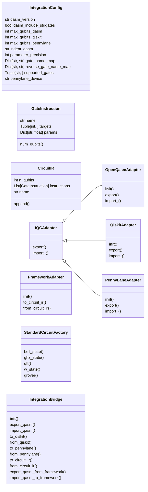
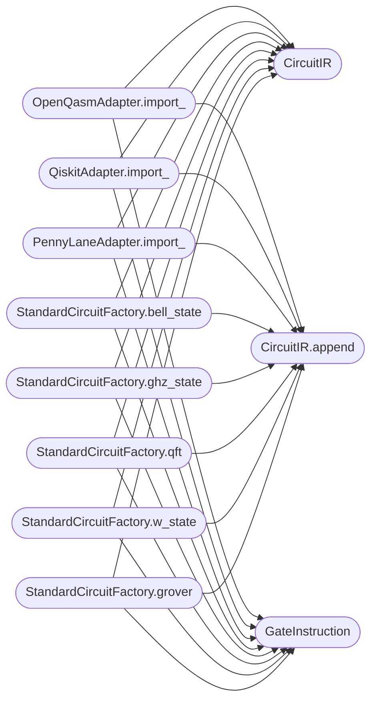

# `qc_integration`

> Source: [qc_integration.py:1](../../qc_integration.py#L1) | language `py` | coverage 50.0% | [API index](../index.md)

QC Integration Bridge - OpenQASM, Qiskit, and PennyLane interoperability layer.

Provides bidirectional conversion between the QC quantum circuit representation
and standard quantum computing formats:
  - OpenQASM 2.0 (export/import)
  - Qiskit QuantumCircuit (export/import when qiskit is installed)
  - PennyLane QNode / tape (export/import when pennylane is installed)

Architecture
------------
  IntegrationConfig    -- centralised configuration (no hardcoded values)
  IQCAdapter          -- abstract interface for each target format
  OpenQasmAdapter     -- OpenQASM 2.0 string <-> internal circuit
  QiskitAdapter       -- Qiskit QuantumCircuit <-> internal circuit
  PennyLaneAdapter    -- PennyLane operations <-> internal circuit
  IntegrationBridge   -- facade that delegates to the correct adapter

Usage
-----
  from qc_integration import IntegrationBridge, IntegrationConfig

  config = IntegrationConfig()
  bridge = IntegrationBridge(config)

  # Export to OpenQASM
  qasm_str = bridge.export_qasm(circuit)

  # Import from OpenQASM
  circuit = bridge.import_qasm(qasm_str)

  # Convert to Qiskit (requires qiskit)
  qc_qiskit = bridge.to_qiskit(circuit)

  # Convert from Qiskit
  circuit = bridge.from_qiskit(qc_qiskit)

  # Convert to PennyLane (requires pennylane)
  tape = bridge.to_pennylane(circuit)

Gate mapping
------------
  H       -> OpenQASM h, Qiskit h, PennyLane Hadamard
  X       -> OpenQASM x, Qiskit x, PennyLane PauliX
  Y       -> OpenQASM y, Qiskit y, PennyLane PauliY
  Z       -> OpenQASM z, Qiskit z, PennyLane PauliZ
  S       -> OpenQASM s, Qiskit s, PennyLane S
  T       -> OpenQASM t, Qiskit t, PennyLane T
  Rx      -> OpenQASM rx, Qiskit rx, PennyLane RX
  Ry      -> OpenQASM ry, Qiskit ry, PennyLane RY
  Rz      -> OpenQASM rz, Qiskit rz, PennyLane RZ
  CNOT    -> OpenQASM cx, Qiskit cx, PennyLane CNOT
  CZ      -> OpenQASM cz, Qiskit cz, PennyLane CZ
  SWAP    -> OpenQASM swap, Qiskit swap, PennyLane SWAP
  CCX     -> OpenQASM ccx, Qiskit ccx, PennyLane Toffoli

## Contents

- **Classes:** [`IntegrationConfig`](#integrationconfig), [`GateInstruction`](#gateinstruction), [`CircuitIR`](#circuitir), [`IQCAdapter`](#iqcadapter), [`OpenQasmAdapter`](#openqasmadapter), [`QiskitAdapter`](#qiskitadapter), [`PennyLaneAdapter`](#pennylaneadapter), [`FrameworkAdapter`](#frameworkadapter), [`StandardCircuitFactory`](#standardcircuitfactory), [`IntegrationBridge`](#integrationbridge)
- **Functions:** [`main`](#main)

## Type Diagram



## Call Graph

Solid arrows stay in this module, dashed arrows leave it.



## Classes

<a id="integrationconfig"></a>

### `IntegrationConfig`

`class` `dataclass` | [qc_integration.py:77](../../qc_integration.py#L77)

Decorators: `@dataclass`

```python
class IntegrationConfig
```

Centralised configuration for the integration bridge.

All tunable parameters live here -- no hardcoded values in logic.

**Attributes**

| Name | Type | Default | Description |
|---|---|---|---|
| [`qasm_version`](#integrationconfig-qasm_version) | `str` | `'2.0'` |  |
| [`qasm_include_stdgates`](#integrationconfig-qasm_include_stdgates) | `bool` | `True` |  |
| [`max_qubits_qasm`](#integrationconfig-max_qubits_qasm) | `int` | `256` |  |
| [`max_qubits_qiskit`](#integrationconfig-max_qubits_qiskit) | `int` | `256` |  |
| [`max_qubits_pennylane`](#integrationconfig-max_qubits_pennylane) | `int` | `256` |  |
| [`indent_qasm`](#integrationconfig-indent_qasm) | `str` | `' '` |  |
| [`parameter_precision`](#integrationconfig-parameter_precision) | `int` | `15` |  |
| [`gate_name_map`](#integrationconfig-gate_name_map) | `Dict[str, str]` | `field(default_factory=lambda: {'H': 'h', 'X': 'x', 'Y': 'y', 'Z': 'z', 'S': 's', 'T': 't', 'Rx': 'rx', 'Ry': 'ry', 'Rz': 'rz', 'CNOT': 'cx', 'CZ': 'cz', 'SWAP': 'swap', 'CCX': 'ccx'})` |  |
| [`reverse_gate_name_map`](#integrationconfig-reverse_gate_name_map) | `Dict[str, str]` | `field(init=False)` |  |
| [`supported_gates`](#integrationconfig-supported_gates) | `Tuple[str, ...]` | `('H', 'X', 'Y', 'Z', 'S', 'T', 'Rx', 'Ry', 'Rz', 'CNOT', 'CZ', 'SWAP', 'CCX')` |  |
| [`pennylane_device`](#integrationconfig-pennylane_device) | `str` | `'default.qubit'` |  |

---

<a id="gateinstruction"></a>

### `GateInstruction`

`class` `dataclass` | [qc_integration.py:130](../../qc_integration.py#L130)

Decorators: `@dataclass`

```python
class GateInstruction
```

A single quantum gate instruction.

**Attributes**

| Name | Type | Default | Description |
|---|---|---|---|
| [`name`](#gateinstruction-name) | `str` |  |  |
| [`targets`](#gateinstruction-targets) | `Tuple[int, ...]` |  |  |
| [`params`](#gateinstruction-params) | `Dict[str, float]` | `field(default_factory=dict)` |  |

**Members**

| Member | Kind | Summary |
|---|---|---|
| [`num_qubits`](#gateinstruction-num_qubits) | property |  |

<a id="gateinstruction-num_qubits"></a>

#### `GateInstruction.num_qubits`

`property` | [qc_integration.py:141](../../qc_integration.py#L141)

Decorators: `@property`

```python
def num_qubits(self) -> int
```

**Returns:** `int`

---

<a id="circuitir"></a>

### `CircuitIR`

`class` `dataclass` | [qc_integration.py:146](../../qc_integration.py#L146)

Decorators: `@dataclass`

```python
class CircuitIR
```

Intermediate representation of a quantum circuit.

This is the lingua franca between the QC framework and external formats.

**Attributes**

| Name | Type | Default | Description |
|---|---|---|---|
| [`n_qubits`](#circuitir-n_qubits) | `int` |  |  |
| [`instructions`](#circuitir-instructions) | `List[GateInstruction]` | `field(default_factory=list)` |  |
| [`name`](#circuitir-name) | `str` | `'qcir'` |  |

**Members**

| Member | Kind | Summary |
|---|---|---|
| [`append`](#circuitir-append) | method |  |

<a id="circuitir-append"></a>

#### `CircuitIR.append`

`method` | [qc_integration.py:156](../../qc_integration.py#L156)

```python
def append(self, gate: GateInstruction) -> None
```

**Parameters**

| Name | Type | Default | Description |
|---|---|---|---|
| `gate` | `GateInstruction` |  |  |

**Raises**

- `IndexError`: (raised in the body, not documented)

*Called by:* [`OpenQasmAdapter.import_`](#openqasmadapter-import_), [`PennyLaneAdapter.import_`](#pennylaneadapter-import_), [`QiskitAdapter.import_`](#qiskitadapter-import_), [`StandardCircuitFactory.bell_state`](#standardcircuitfactory-bell_state), [`StandardCircuitFactory.ghz_state`](#standardcircuitfactory-ghz_state), [`StandardCircuitFactory.grover`](#standardcircuitfactory-grover), [`StandardCircuitFactory.qft`](#standardcircuitfactory-qft), [`StandardCircuitFactory.w_state`](#standardcircuitfactory-w_state)

---

<a id="iqcadapter"></a>

### `IQCAdapter`

`class` `abstract` | [qc_integration.py:181](../../qc_integration.py#L181)

```python
class IQCAdapter(ABC)
```

Bases: `ABC`

Subclasses: [`OpenQasmAdapter`](#openqasmadapter), [`PennyLaneAdapter`](#pennylaneadapter), [`QiskitAdapter`](#qiskitadapter)

Interface for a format-specific adapter (Interface Segregation).

**Members**

| Member | Kind | Summary |
|---|---|---|
| [`export`](#iqcadapter-export) | method | Export a CircuitIR to the target format. |
| [`import_`](#iqcadapter-import_) | method | Import from the target format into a CircuitIR. |

<a id="iqcadapter-export"></a>

#### `IQCAdapter.export`

`method` `abstract` | [qc_integration.py:185](../../qc_integration.py#L185)

Decorators: `@abstractmethod`

```python
def export(self, circuit: CircuitIR, **kwargs: Any) -> Any
```

Export a CircuitIR to the target format.

**Parameters**

| Name | Type | Default | Description |
|---|---|---|---|
| `circuit` | `CircuitIR` |  |  |
| `**kwargs` | `Any` |  |  |

**Returns:** `Any`

<a id="iqcadapter-import_"></a>

#### `IQCAdapter.import_`

`method` `abstract` | [qc_integration.py:189](../../qc_integration.py#L189)

Decorators: `@abstractmethod`

```python
def import_(self, data: Any, **kwargs: Any) -> CircuitIR
```

Import from the target format into a CircuitIR.

**Parameters**

| Name | Type | Default | Description |
|---|---|---|---|
| `data` | `Any` |  |  |
| `**kwargs` | `Any` |  |  |

**Returns:** `CircuitIR`

---

<a id="openqasmadapter"></a>

### `OpenQasmAdapter`

`class` | [qc_integration.py:226](../../qc_integration.py#L226)

```python
class OpenQasmAdapter(IQCAdapter)
```

Bases: [`IQCAdapter`](#iqcadapter)

Adapter for OpenQASM 2.0 format.

**Members**

| Member | Kind | Summary |
|---|---|---|
| [`__init__`](#openqasmadapter-__init__) | constructor |  |
| [`export`](#openqasmadapter-export) | method | Export a CircuitIR to the target format. |
| [`import_`](#openqasmadapter-import_) | method | Parse an OpenQASM 2.0 string into a CircuitIR. |

<a id="openqasmadapter-__init__"></a>

#### `OpenQasmAdapter.__init__`

`constructor` | [qc_integration.py:238](../../qc_integration.py#L238)

```python
def __init__(self, config: IntegrationConfig) -> None
```

**Parameters**

| Name | Type | Default | Description |
|---|---|---|---|
| `config` | `IntegrationConfig` |  |  |

*Called by:* [`IntegrationBridge.__init__`](#integrationbridge-__init__)

<a id="openqasmadapter-export"></a>

#### `OpenQasmAdapter.export`

`method` | [qc_integration.py:243](../../qc_integration.py#L243)

```python
def export(self, circuit: CircuitIR, **kwargs: Any) -> str
```

Export a CircuitIR to the target format.

**Parameters**

| Name | Type | Default | Description |
|---|---|---|---|
| `circuit` | `CircuitIR` |  |  |
| `**kwargs` | `Any` |  |  |

**Returns:** `str`

**Raises**

- `ValueError`: (raised in the body, not documented)

> **Inherited:** Documentation from [`IQCAdapter.export`](#iqcadapter-export) (qc_integration.py:185).

*Called by:* [`IntegrationBridge.export_qasm`](#integrationbridge-export_qasm)

<a id="openqasmadapter-import_"></a>

#### `OpenQasmAdapter.import_`

`method` | [qc_integration.py:277](../../qc_integration.py#L277)

```python
def import_(self, data: str, **kwargs: Any) -> CircuitIR
```

Parse an OpenQASM 2.0 string into a CircuitIR.

**Parameters**

| Name | Type | Default | Description |
|---|---|---|---|
| `data` | `str` |  |  |
| `**kwargs` | `Any` |  |  |

**Returns:** `CircuitIR`

*Calls:* [`CircuitIR`](#circuitir), [`CircuitIR.append`](#circuitir-append), [`GateInstruction`](#gateinstruction)

*Called by:* [`IntegrationBridge.import_qasm`](#integrationbridge-import_qasm)

---

<a id="qiskitadapter"></a>

### `QiskitAdapter`

`class` | [qc_integration.py:358](../../qc_integration.py#L358)

```python
class QiskitAdapter(IQCAdapter)
```

Bases: [`IQCAdapter`](#iqcadapter)

Adapter for Qiskit QuantumCircuit format.

**Members**

| Member | Kind | Summary |
|---|---|---|
| [`__init__`](#qiskitadapter-__init__) | constructor |  |
| [`export`](#qiskitadapter-export) | method | Export a CircuitIR to the target format. |
| [`import_`](#qiskitadapter-import_) | method | Import from the target format into a CircuitIR. |

<a id="qiskitadapter-__init__"></a>

#### `QiskitAdapter.__init__`

`constructor` | [qc_integration.py:361](../../qc_integration.py#L361)

```python
def __init__(self, config: IntegrationConfig) -> None
```

**Parameters**

| Name | Type | Default | Description |
|---|---|---|---|
| `config` | `IntegrationConfig` |  |  |

<a id="qiskitadapter-export"></a>

#### `QiskitAdapter.export`

`method` | [qc_integration.py:364](../../qc_integration.py#L364)

```python
def export(self, circuit: CircuitIR, **kwargs: Any) -> Any
```

Export a CircuitIR to the target format.

**Parameters**

| Name | Type | Default | Description |
|---|---|---|---|
| `circuit` | `CircuitIR` |  |  |
| `**kwargs` | `Any` |  |  |

**Returns:** `Any`

**Raises**

- `ValueError`: (raised in the body, not documented)

> **Inherited:** Documentation from [`IQCAdapter.export`](#iqcadapter-export) (qc_integration.py:185).

*Called by:* [`IntegrationBridge.to_qiskit`](#integrationbridge-to_qiskit)

<a id="qiskitadapter-import_"></a>

#### `QiskitAdapter.import_`

`method` | [qc_integration.py:379](../../qc_integration.py#L379)

```python
def import_(self, data: Any, **kwargs: Any) -> CircuitIR
```

Import from the target format into a CircuitIR.

**Parameters**

| Name | Type | Default | Description |
|---|---|---|---|
| `data` | `Any` |  |  |
| `**kwargs` | `Any` |  |  |

**Returns:** `CircuitIR`

**Raises**

- `TypeError`: (raised in the body, not documented)

> **Inherited:** Documentation from [`IQCAdapter.import_`](#iqcadapter-import_) (qc_integration.py:189).

*Calls:* [`CircuitIR`](#circuitir), [`CircuitIR.append`](#circuitir-append), [`GateInstruction`](#gateinstruction)

*Called by:* [`IntegrationBridge.from_qiskit`](#integrationbridge-from_qiskit)

---

<a id="pennylaneadapter"></a>

### `PennyLaneAdapter`

`class` | [qc_integration.py:455](../../qc_integration.py#L455)

```python
class PennyLaneAdapter(IQCAdapter)
```

Bases: [`IQCAdapter`](#iqcadapter)

Adapter for PennyLane format.

**Members**

| Member | Kind | Summary |
|---|---|---|
| [`__init__`](#pennylaneadapter-__init__) | constructor |  |
| [`export`](#pennylaneadapter-export) | method | Export a CircuitIR to the target format. |
| [`import_`](#pennylaneadapter-import_) | method | Import from the target format into a CircuitIR. |

<a id="pennylaneadapter-__init__"></a>

#### `PennyLaneAdapter.__init__`

`constructor` | [qc_integration.py:458](../../qc_integration.py#L458)

```python
def __init__(self, config: IntegrationConfig) -> None
```

**Parameters**

| Name | Type | Default | Description |
|---|---|---|---|
| `config` | `IntegrationConfig` |  |  |

<a id="pennylaneadapter-export"></a>

#### `PennyLaneAdapter.export`

`method` | [qc_integration.py:461](../../qc_integration.py#L461)

```python
def export(self, circuit: CircuitIR, **kwargs: Any) -> Any
```

Export a CircuitIR to the target format.

**Parameters**

| Name | Type | Default | Description |
|---|---|---|---|
| `circuit` | `CircuitIR` |  |  |
| `**kwargs` | `Any` |  |  |

**Returns:** `Any`

> **Inherited:** Documentation from [`IQCAdapter.export`](#iqcadapter-export) (qc_integration.py:185).

*Called by:* [`IntegrationBridge.to_pennylane`](#integrationbridge-to_pennylane)

<a id="pennylaneadapter-import_"></a>

#### `PennyLaneAdapter.import_`

`method` | [qc_integration.py:483](../../qc_integration.py#L483)

```python
def import_(self, data: Any, **kwargs: Any) -> CircuitIR
```

Import from the target format into a CircuitIR.

**Parameters**

| Name | Type | Default | Description |
|---|---|---|---|
| `data` | `Any` |  |  |
| `**kwargs` | `Any` |  |  |

**Returns:** `CircuitIR`

**Raises**

- `TypeError`: (raised in the body, not documented)

> **Inherited:** Documentation from [`IQCAdapter.import_`](#iqcadapter-import_) (qc_integration.py:189).

*Calls:* [`CircuitIR`](#circuitir), [`CircuitIR.append`](#circuitir-append), [`GateInstruction`](#gateinstruction)

*Called by:* [`IntegrationBridge.from_pennylane`](#integrationbridge-from_pennylane)

---

<a id="frameworkadapter"></a>

### `FrameworkAdapter`

`class` | [qc_integration.py:557](../../qc_integration.py#L557)

```python
class FrameworkAdapter
```

Converts between CircuitIR and the actual QC framework circuit types.

Supports both:
  - quantum_framework_core.MPSQuantumComputer / QuantumCircuit (MPS)
  - quantum_computer.QuantumComputer / QuantumCircuit (statevector)

**Members**

| Member | Kind | Summary |
|---|---|---|
| [`__init__`](#frameworkadapter-__init__) | constructor |  |
| [`to_circuit_ir`](#frameworkadapter-to_circuit_ir) | method | Extract a CircuitIR from a framework circuit object. |
| [`from_circuit_ir`](#frameworkadapter-from_circuit_ir) | method | Build a framework circuit object from a CircuitIR. |

<a id="frameworkadapter-__init__"></a>

#### `FrameworkAdapter.__init__`

`constructor` | [qc_integration.py:565](../../qc_integration.py#L565)

```python
def __init__(self, config: IntegrationConfig) -> None
```

**Parameters**

| Name | Type | Default | Description |
|---|---|---|---|
| `config` | `IntegrationConfig` |  |  |

*Called by:* [`IntegrationBridge.__init__`](#integrationbridge-__init__)

<a id="frameworkadapter-to_circuit_ir"></a>

#### `FrameworkAdapter.to_circuit_ir`

`method` | [qc_integration.py:568](../../qc_integration.py#L568)

```python
def to_circuit_ir(self, circuit: Any, framework_type: str = 'auto') -> CircuitIR
```

Extract a CircuitIR from a framework circuit object.

**Parameters**

| Name | Type | Default | Description |
|---|---|---|---|
| `circuit` | `Any` |  |  |
| `framework_type` | `str` | `'auto'` |  |

**Returns:** `CircuitIR`

**Raises**

- `ValueError`: (raised in the body, not documented)

*Called by:* [`IntegrationBridge.to_circuit_ir`](#integrationbridge-to_circuit_ir)

<a id="frameworkadapter-from_circuit_ir"></a>

#### `FrameworkAdapter.from_circuit_ir`

`method` | [qc_integration.py:584](../../qc_integration.py#L584)

```python
def from_circuit_ir(self, cir: CircuitIR, framework_type: str = 'mps') -> Any
```

Build a framework circuit object from a CircuitIR.

**Parameters**

| Name | Type | Default | Description |
|---|---|---|---|
| `cir` | `CircuitIR` |  |  |
| `framework_type` | `str` | `'mps'` |  |

**Returns:** `Any`

**Raises**

- `ValueError`: (raised in the body, not documented)

*Called by:* [`IntegrationBridge.from_circuit_ir`](#integrationbridge-from_circuit_ir)

---

<a id="standardcircuitfactory"></a>

### `StandardCircuitFactory`

`class` | [qc_integration.py:659](../../qc_integration.py#L659)

```python
class StandardCircuitFactory
```

Build CircuitIR instances for common quantum algorithms.

**Members**

| Member | Kind | Summary |
|---|---|---|
| [`bell_state`](#standardcircuitfactory-bell_state) | staticmethod |  |
| [`ghz_state`](#standardcircuitfactory-ghz_state) | staticmethod |  |
| [`qft`](#standardcircuitfactory-qft) | staticmethod |  |
| [`w_state`](#standardcircuitfactory-w_state) | staticmethod |  |
| [`grover`](#standardcircuitfactory-grover) | staticmethod |  |

<a id="standardcircuitfactory-bell_state"></a>

#### `StandardCircuitFactory.bell_state`

`staticmethod` | [qc_integration.py:663](../../qc_integration.py#L663)

Decorators: `@staticmethod`

```python
def bell_state() -> CircuitIR
```

**Returns:** `CircuitIR`

*Calls:* [`CircuitIR`](#circuitir), [`CircuitIR.append`](#circuitir-append), [`GateInstruction`](#gateinstruction)

<a id="standardcircuitfactory-ghz_state"></a>

#### `StandardCircuitFactory.ghz_state`

`staticmethod` | [qc_integration.py:670](../../qc_integration.py#L670)

Decorators: `@staticmethod`

```python
def ghz_state(n_qubits: int) -> CircuitIR
```

**Parameters**

| Name | Type | Default | Description |
|---|---|---|---|
| `n_qubits` | `int` |  |  |

**Returns:** `CircuitIR`

*Calls:* [`CircuitIR`](#circuitir), [`CircuitIR.append`](#circuitir-append), [`GateInstruction`](#gateinstruction)

*Called by:* [`main`](#main)

<a id="standardcircuitfactory-qft"></a>

#### `StandardCircuitFactory.qft`

`staticmethod` | [qc_integration.py:678](../../qc_integration.py#L678)

Decorators: `@staticmethod`

```python
def qft(n_qubits: int) -> CircuitIR
```

**Parameters**

| Name | Type | Default | Description |
|---|---|---|---|
| `n_qubits` | `int` |  |  |

**Returns:** `CircuitIR`

*Calls:* [`CircuitIR`](#circuitir), [`CircuitIR.append`](#circuitir-append), [`GateInstruction`](#gateinstruction)

*Called by:* [`main`](#main)

<a id="standardcircuitfactory-w_state"></a>

#### `StandardCircuitFactory.w_state`

`staticmethod` | [qc_integration.py:693](../../qc_integration.py#L693)

Decorators: `@staticmethod`

```python
def w_state(n_qubits: int) -> CircuitIR
```

**Parameters**

| Name | Type | Default | Description |
|---|---|---|---|
| `n_qubits` | `int` |  |  |

**Returns:** `CircuitIR`

*Calls:* [`CircuitIR`](#circuitir), [`CircuitIR.append`](#circuitir-append), [`GateInstruction`](#gateinstruction)

*Called by:* [`main`](#main)

<a id="standardcircuitfactory-grover"></a>

#### `StandardCircuitFactory.grover`

`staticmethod` | [qc_integration.py:701](../../qc_integration.py#L701)

Decorators: `@staticmethod`

```python
def grover(n_qubits: int, marked: int = 5, iterations: int = 2) -> CircuitIR
```

**Parameters**

| Name | Type | Default | Description |
|---|---|---|---|
| `n_qubits` | `int` |  |  |
| `marked` | `int` | `5` |  |
| `iterations` | `int` | `2` |  |

**Returns:** `CircuitIR`

*Calls:* [`CircuitIR`](#circuitir), [`CircuitIR.append`](#circuitir-append), [`GateInstruction`](#gateinstruction)

*Called by:* [`main`](#main)

---

<a id="integrationbridge"></a>

### `IntegrationBridge`

`class` | [qc_integration.py:727](../../qc_integration.py#L727)

```python
class IntegrationBridge
```

Facade that exposes all format conversions through a single API.

Usage
-----
    bridge = IntegrationBridge()
    cir = StandardCircuitFactory.bell_state()

    # OpenQASM
    qasm_str = bridge.export_qasm(cir)
    assert isinstance(qasm_str, str)

    cir_restored = bridge.import_qasm(qasm_str)
    assert cir_restored.n_qubits == cir.n_qubits

    # Qiskit (if installed)
    if bridge._qiskit_available:
        qc_qiskit = bridge.to_qiskit(cir)
        cir_back = bridge.from_qiskit(qc_qiskit)

    # PennyLane (if installed)
    if bridge._pennylane_available:
        qnode = bridge.to_pennylane(cir)
        result = qnode()

**Members**

| Member | Kind | Summary |
|---|---|---|
| [`__init__`](#integrationbridge-__init__) | constructor |  |
| [`export_qasm`](#integrationbridge-export_qasm) | method |  |
| [`import_qasm`](#integrationbridge-import_qasm) | method |  |
| [`to_qiskit`](#integrationbridge-to_qiskit) | method |  |
| [`from_qiskit`](#integrationbridge-from_qiskit) | method |  |
| [`to_pennylane`](#integrationbridge-to_pennylane) | method |  |
| [`from_pennylane`](#integrationbridge-from_pennylane) | method |  |
| [`to_circuit_ir`](#integrationbridge-to_circuit_ir) | method |  |
| [`from_circuit_ir`](#integrationbridge-from_circuit_ir) | method |  |
| [`export_qasm_from_framework`](#integrationbridge-export_qasm_from_framework) | method |  |
| [`import_qasm_to_framework`](#integrationbridge-import_qasm_to_framework) | method |  |

<a id="integrationbridge-__init__"></a>

#### `IntegrationBridge.__init__`

`constructor` | [qc_integration.py:753](../../qc_integration.py#L753)

```python
def __init__(self, config: Optional[IntegrationConfig] = None) -> None
```

**Parameters**

| Name | Type | Default | Description |
|---|---|---|---|
| `config` | `Optional[IntegrationConfig]` | `None` |  |

*Calls:* [`FrameworkAdapter.__init__`](#frameworkadapter-__init__), [`IntegrationConfig`](#integrationconfig), [`OpenQasmAdapter.__init__`](#openqasmadapter-__init__)

*Called by:* [`main`](#main)

<a id="integrationbridge-export_qasm"></a>

#### `IntegrationBridge.export_qasm`

`method` | [qc_integration.py:780](../../qc_integration.py#L780)

```python
def export_qasm(self, circuit: CircuitIR, **kwargs: Any) -> str
```

**Parameters**

| Name | Type | Default | Description |
|---|---|---|---|
| `circuit` | `CircuitIR` |  |  |
| `**kwargs` | `Any` |  |  |

**Returns:** `str`

*Calls:* [`OpenQasmAdapter.export`](#openqasmadapter-export)

*Called by:* [`IntegrationBridge.export_qasm_from_framework`](#integrationbridge-export_qasm_from_framework), [`main`](#main)

<a id="integrationbridge-import_qasm"></a>

#### `IntegrationBridge.import_qasm`

`method` | [qc_integration.py:783](../../qc_integration.py#L783)

```python
def import_qasm(self, qasm_str: str, **kwargs: Any) -> CircuitIR
```

**Parameters**

| Name | Type | Default | Description |
|---|---|---|---|
| `qasm_str` | `str` |  |  |
| `**kwargs` | `Any` |  |  |

**Returns:** `CircuitIR`

*Calls:* [`OpenQasmAdapter.import_`](#openqasmadapter-import_)

*Called by:* [`IntegrationBridge.import_qasm_to_framework`](#integrationbridge-import_qasm_to_framework), [`main`](#main)

<a id="integrationbridge-to_qiskit"></a>

#### `IntegrationBridge.to_qiskit`

`method` | [qc_integration.py:788](../../qc_integration.py#L788)

```python
def to_qiskit(self, circuit: CircuitIR, **kwargs: Any) -> Any
```

**Parameters**

| Name | Type | Default | Description |
|---|---|---|---|
| `circuit` | `CircuitIR` |  |  |
| `**kwargs` | `Any` |  |  |

**Returns:** `Any`

**Raises**

- `ImportError`: (raised in the body, not documented)

*Calls:* [`QiskitAdapter.export`](#qiskitadapter-export)

<a id="integrationbridge-from_qiskit"></a>

#### `IntegrationBridge.from_qiskit`

`method` | [qc_integration.py:793](../../qc_integration.py#L793)

```python
def from_qiskit(self, qiskit_circuit: Any, **kwargs: Any) -> CircuitIR
```

**Parameters**

| Name | Type | Default | Description |
|---|---|---|---|
| `qiskit_circuit` | `Any` |  |  |
| `**kwargs` | `Any` |  |  |

**Returns:** `CircuitIR`

**Raises**

- `ImportError`: (raised in the body, not documented)

*Calls:* [`QiskitAdapter.import_`](#qiskitadapter-import_)

<a id="integrationbridge-to_pennylane"></a>

#### `IntegrationBridge.to_pennylane`

`method` | [qc_integration.py:800](../../qc_integration.py#L800)

```python
def to_pennylane(self, circuit: CircuitIR, **kwargs: Any) -> Any
```

**Parameters**

| Name | Type | Default | Description |
|---|---|---|---|
| `circuit` | `CircuitIR` |  |  |
| `**kwargs` | `Any` |  |  |

**Returns:** `Any`

**Raises**

- `ImportError`: (raised in the body, not documented)

*Calls:* [`PennyLaneAdapter.export`](#pennylaneadapter-export)

<a id="integrationbridge-from_pennylane"></a>

#### `IntegrationBridge.from_pennylane`

`method` | [qc_integration.py:805](../../qc_integration.py#L805)

```python
def from_pennylane(self, pennylane_data: Any, **kwargs: Any) -> CircuitIR
```

**Parameters**

| Name | Type | Default | Description |
|---|---|---|---|
| `pennylane_data` | `Any` |  |  |
| `**kwargs` | `Any` |  |  |

**Returns:** `CircuitIR`

**Raises**

- `ImportError`: (raised in the body, not documented)

*Calls:* [`PennyLaneAdapter.import_`](#pennylaneadapter-import_)

<a id="integrationbridge-to_circuit_ir"></a>

#### `IntegrationBridge.to_circuit_ir`

`method` | [qc_integration.py:812](../../qc_integration.py#L812)

```python
def to_circuit_ir(self, circuit: Any, framework_type: str = 'auto') -> CircuitIR
```

**Parameters**

| Name | Type | Default | Description |
|---|---|---|---|
| `circuit` | `Any` |  |  |
| `framework_type` | `str` | `'auto'` |  |

**Returns:** `CircuitIR`

*Calls:* [`FrameworkAdapter.to_circuit_ir`](#frameworkadapter-to_circuit_ir)

*Called by:* [`IntegrationBridge.export_qasm_from_framework`](#integrationbridge-export_qasm_from_framework)

<a id="integrationbridge-from_circuit_ir"></a>

#### `IntegrationBridge.from_circuit_ir`

`method` | [qc_integration.py:819](../../qc_integration.py#L819)

```python
def from_circuit_ir(self, cir: CircuitIR, framework_type: str = 'mps') -> Any
```

**Parameters**

| Name | Type | Default | Description |
|---|---|---|---|
| `cir` | `CircuitIR` |  |  |
| `framework_type` | `str` | `'mps'` |  |

**Returns:** `Any`

*Calls:* [`FrameworkAdapter.from_circuit_ir`](#frameworkadapter-from_circuit_ir)

*Called by:* [`IntegrationBridge.import_qasm_to_framework`](#integrationbridge-import_qasm_to_framework)

<a id="integrationbridge-export_qasm_from_framework"></a>

#### `IntegrationBridge.export_qasm_from_framework`

`method` | [qc_integration.py:828](../../qc_integration.py#L828)

```python
def export_qasm_from_framework(self, circuit: Any, framework_type: str = 'auto', **kwargs: Any) -> str
```

**Parameters**

| Name | Type | Default | Description |
|---|---|---|---|
| `circuit` | `Any` |  |  |
| `framework_type` | `str` | `'auto'` |  |
| `**kwargs` | `Any` |  |  |

**Returns:** `str`

*Calls:* [`IntegrationBridge.export_qasm`](#integrationbridge-export_qasm), [`IntegrationBridge.to_circuit_ir`](#integrationbridge-to_circuit_ir)

<a id="integrationbridge-import_qasm_to_framework"></a>

#### `IntegrationBridge.import_qasm_to_framework`

`method` | [qc_integration.py:837](../../qc_integration.py#L837)

```python
def import_qasm_to_framework(self, qasm_str: str, framework_type: str = 'mps', **kwargs: Any) -> Any
```

**Parameters**

| Name | Type | Default | Description |
|---|---|---|---|
| `qasm_str` | `str` |  |  |
| `framework_type` | `str` | `'mps'` |  |
| `**kwargs` | `Any` |  |  |

**Returns:** `Any`

*Calls:* [`IntegrationBridge.from_circuit_ir`](#integrationbridge-from_circuit_ir), [`IntegrationBridge.import_qasm`](#integrationbridge-import_qasm)

---

## Functions

<a id="main"></a>

### `main`

`function` | [qc_integration.py:851](../../qc_integration.py#L851)

```python
def main() -> None
```

Command-line interface for the integration bridge.

*Calls:* [`IntegrationBridge.__init__`](#integrationbridge-__init__), [`IntegrationBridge.export_qasm`](#integrationbridge-export_qasm), [`IntegrationBridge.import_qasm`](#integrationbridge-import_qasm), [`IntegrationConfig`](#integrationconfig), [`StandardCircuitFactory`](#standardcircuitfactory), [`StandardCircuitFactory.ghz_state`](#standardcircuitfactory-ghz_state), [`StandardCircuitFactory.grover`](#standardcircuitfactory-grover), [`StandardCircuitFactory.qft`](#standardcircuitfactory-qft), [`StandardCircuitFactory.w_state`](#standardcircuitfactory-w_state)

---
