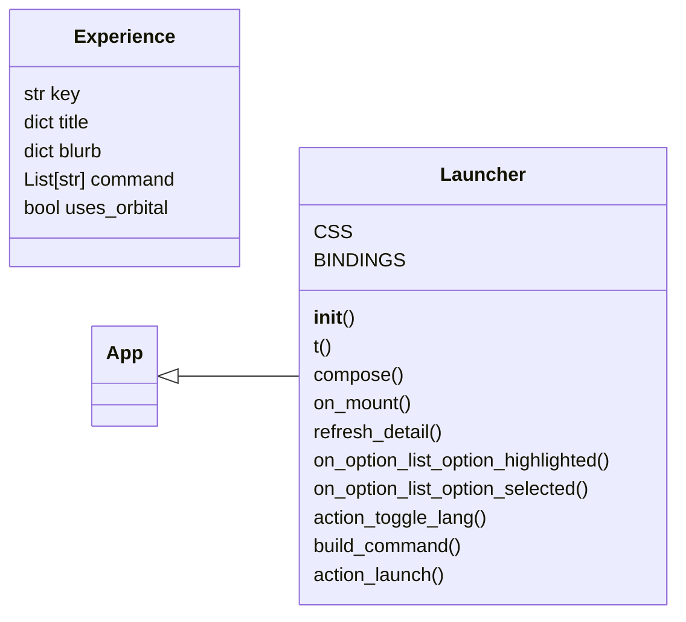
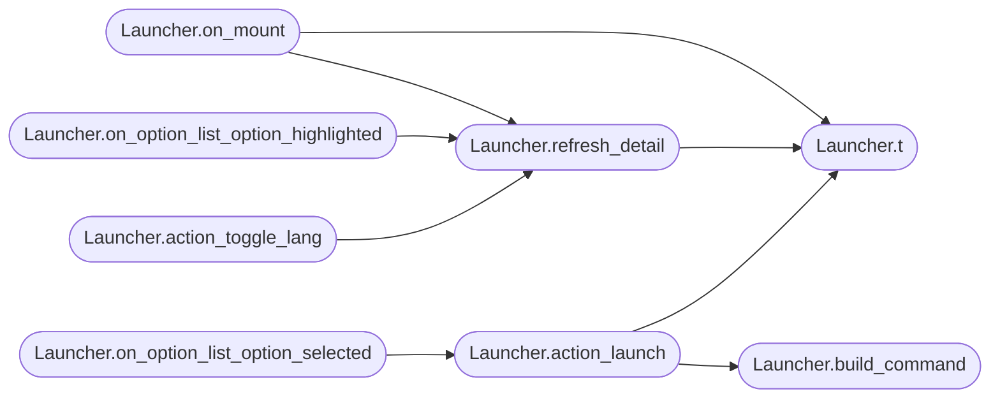

# `qc_launcher`

> Source: [qc_launcher.py:1](../../qc_launcher.py#L1) | language `py` | coverage 7.7% | [API index](../index.md)

Q2C launcher: a Textual front door to the immersive GPU viewer and the rich Quantum Lab.

## Contents

- **Classes:** [`Experience`](#experience), [`Launcher`](#launcher)
- **Constants:** [`ROOT`](#root), [`PYTHON`](#python), [`VIEWER`](#viewer), [`LAB`](#lab), [`ORBITALS`](#orbitals), [`RESOLUTIONS`](#resolutions), [`LOGO`](#logo), [`EXPERIENCES`](#experiences), [`CHROME`](#chrome)

## Type Diagram



## Call Graph

Solid arrows stay in this module, dashed arrows leave it.



## Classes

<a id="experience"></a>

### `Experience`

`class` `dataclass` | [qc_launcher.py:38](../../qc_launcher.py#L38)

Decorators: `@dataclass`

```python
class Experience
```

**Attributes**

| Name | Type | Default | Description |
|---|---|---|---|
| [`key`](#experience-key) | `str` |  |  |
| [`title`](#experience-title) | `dict` |  |  |
| [`blurb`](#experience-blurb) | `dict` |  |  |
| [`command`](#experience-command) | `List[str]` |  |  |
| [`uses_orbital`](#experience-uses_orbital) | `bool` | `False` |  |

---

<a id="launcher"></a>

### `Launcher`

`class` | [qc_launcher.py:87](../../qc_launcher.py#L87)

```python
class Launcher(App)
```

Bases: [`App`](immersive.app.py.md#app)

**Attributes**

| Name | Type | Default | Description |
|---|---|---|---|
| [`CSS`](#launcher-css) |  | `'\n Screen { background: #070b18; }\n #logo { height: 6; padding: 1 2; }\n #menu { width: 38; border: round #3a5a99; padding: 0 1; }\n #detail { border: round #3a5a99; padding: 1 2; }\n #blurb { height: auto; margin-bottom: 1; }\n #options { height: auto; }\n Select { margin-bottom: 1; }\n #status { color: #ffbe6e; margin-top: 1; }\n Label { color: #96a8c8; }\n '` |  |
| [`BINDINGS`](#launcher-bindings) |  | `[Binding('l', 'toggle_lang', 'Lang'), Binding('q', 'quit', 'Quit'), Binding('enter', 'launch', 'Launch', priority=True)]` |  |

**Members**

| Member | Kind | Summary |
|---|---|---|
| [`__init__`](#launcher-__init__) | constructor |  |
| [`t`](#launcher-t) | method |  |
| [`compose`](#launcher-compose) | method |  |
| [`on_mount`](#launcher-on_mount) | method |  |
| [`refresh_detail`](#launcher-refresh_detail) | method |  |
| [`on_option_list_option_highlighted`](#launcher-on_option_list_option_highlighted) | method |  |
| [`on_option_list_option_selected`](#launcher-on_option_list_option_selected) | method |  |
| [`action_toggle_lang`](#launcher-action_toggle_lang) | method |  |
| [`build_command`](#launcher-build_command) | method |  |
| [`action_launch`](#launcher-action_launch) | method |  |

<a id="launcher-__init__"></a>

#### `Launcher.__init__`

`constructor` | [qc_launcher.py:105](../../qc_launcher.py#L105)

```python
def __init__(self)
```

<a id="launcher-t"></a>

#### `Launcher.t`

`method` | [qc_launcher.py:111](../../qc_launcher.py#L111)

```python
def t(self, key: str, **kw) -> str
```

**Parameters**

| Name | Type | Default | Description |
|---|---|---|---|
| `key` | `str` |  |  |
| `**kw` |  |  |  |

**Returns:** `str`

*Called by:* [`Launcher.action_launch`](#launcher-action_launch), [`Launcher.on_mount`](#launcher-on_mount), [`Launcher.refresh_detail`](#launcher-refresh_detail)

<a id="launcher-compose"></a>

#### `Launcher.compose`

`method` `generator` | [qc_launcher.py:114](../../qc_launcher.py#L114)

```python
def compose(self) -> ComposeResult
```

**Returns:** `ComposeResult`

<a id="launcher-on_mount"></a>

#### `Launcher.on_mount`

`method` | [qc_launcher.py:131](../../qc_launcher.py#L131)

```python
def on_mount(self)
```

*Calls:* [`Launcher.refresh_detail`](#launcher-refresh_detail), [`Launcher.t`](#launcher-t)

<a id="launcher-refresh_detail"></a>

#### `Launcher.refresh_detail`

`method` | [qc_launcher.py:136](../../qc_launcher.py#L136)

```python
def refresh_detail(self)
```

*Calls:* [`Launcher.t`](#launcher-t)

*Called by:* [`Launcher.action_toggle_lang`](#launcher-action_toggle_lang), [`Launcher.on_mount`](#launcher-on_mount), [`Launcher.on_option_list_option_highlighted`](#launcher-on_option_list_option_highlighted)

<a id="launcher-on_option_list_option_highlighted"></a>

#### `Launcher.on_option_list_option_highlighted`

`method` | [qc_launcher.py:143](../../qc_launcher.py#L143)

```python
def on_option_list_option_highlighted(self, event: OptionList.OptionHighlighted)
```

**Parameters**

| Name | Type | Default | Description |
|---|---|---|---|
| `event` | `OptionList.OptionHighlighted` |  |  |

*Calls:* [`Launcher.refresh_detail`](#launcher-refresh_detail)

<a id="launcher-on_option_list_option_selected"></a>

#### `Launcher.on_option_list_option_selected`

`method` | [qc_launcher.py:147](../../qc_launcher.py#L147)

```python
def on_option_list_option_selected(self, event: OptionList.OptionSelected)
```

**Parameters**

| Name | Type | Default | Description |
|---|---|---|---|
| `event` | `OptionList.OptionSelected` |  |  |

*Calls:* [`Launcher.action_launch`](#launcher-action_launch)

<a id="launcher-action_toggle_lang"></a>

#### `Launcher.action_toggle_lang`

`method` | [qc_launcher.py:151](../../qc_launcher.py#L151)

```python
def action_toggle_lang(self)
```

*Calls:* [`Launcher.refresh_detail`](#launcher-refresh_detail)

<a id="launcher-build_command"></a>

#### `Launcher.build_command`

`method` | [qc_launcher.py:159](../../qc_launcher.py#L159)

```python
def build_command(self, exp: Experience) -> List[str]
```

**Parameters**

| Name | Type | Default | Description |
|---|---|---|---|
| `exp` | `Experience` |  |  |

**Returns:** `List[str]`

*Called by:* [`Launcher.action_launch`](#launcher-action_launch)

<a id="launcher-action_launch"></a>

#### `Launcher.action_launch`

`method` | [qc_launcher.py:167](../../qc_launcher.py#L167)

```python
def action_launch(self)
```

*Calls:* [`Launcher.build_command`](#launcher-build_command), [`Launcher.t`](#launcher-t)

*Called by:* [`Launcher.on_option_list_option_selected`](#launcher-on_option_list_option_selected)

---

## Constants

<a id="root"></a>

### `ROOT`

`constant` | [qc_launcher.py:18](../../qc_launcher.py#L18)

```python
ROOT = Path(__file__).resolve().parent
```

---

<a id="python"></a>

### `PYTHON`

`constant` | [qc_launcher.py:19](../../qc_launcher.py#L19)

```python
PYTHON
```

---

<a id="viewer"></a>

### `VIEWER`

`constant` | [qc_launcher.py:20](../../qc_launcher.py#L20)

```python
VIEWER = [PYTHON, '-W', 'ignore', str(ROOT / 'qc_immersive.py')]
```

---

<a id="lab"></a>

### `LAB`

`constant` | [qc_launcher.py:21](../../qc_launcher.py#L21)

```python
LAB = [sys.executable, '-W', 'ignore', str(ROOT / 'quantum_lab.py')]
```

---

<a id="orbitals"></a>

### `ORBITALS`

`constant` | [qc_launcher.py:23](../../qc_launcher.py#L23)

```python
ORBITALS
```

---

<a id="resolutions"></a>

### `RESOLUTIONS`

`constant` | [qc_launcher.py:28](../../qc_launcher.py#L28)

```python
RESOLUTIONS
```

---

<a id="logo"></a>

### `LOGO`

`constant` | [qc_launcher.py:30](../../qc_launcher.py#L30)

```python
LOGO
```

---

<a id="experiences"></a>

### `EXPERIENCES`

`constant` | [qc_launcher.py:46](../../qc_launcher.py#L46)

```python
EXPERIENCES
```

---

<a id="chrome"></a>

### `CHROME`

`constant` | [qc_launcher.py:77](../../qc_launcher.py#L77)

```python
CHROME
```

---
