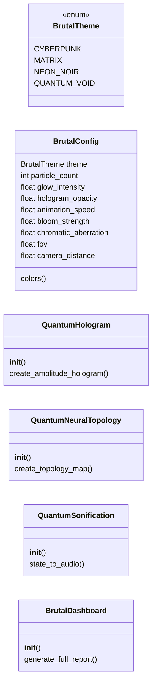
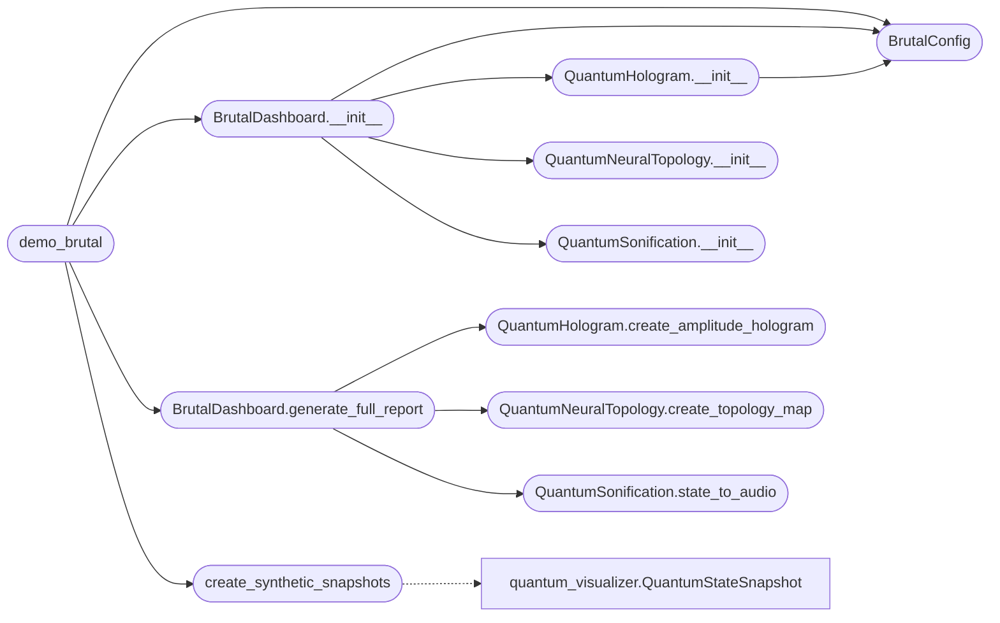

# `quantum_3dview`

> Source: [quantum_3dview.py:1](../../quantum_3dview.py#L1) | language `py` | coverage 61.1% | [API index](../index.md)

quantum_brutalist.py - Ultra-High Fidelity Quantum Visualization ================================================================ Real-time holographic quantum state visualization with particle effects, neural network topology mapping, and immersive 3D interaction.

Author: Gris Iscomeback

## Contents

- **Classes:** [`BrutalConfig`](#brutalconfig), [`QuantumHologram`](#quantumhologram), [`QuantumNeuralTopology`](#quantumneuraltopology), [`QuantumSonification`](#quantumsonification), [`BrutalDashboard`](#brutaldashboard)
- **Enums:** [`BrutalTheme`](#brutaltheme)
- **Functions:** [`demo_brutal`](#demo_brutal), [`create_synthetic_snapshots`](#create_synthetic_snapshots)

## Type Diagram



## Call Graph

Solid arrows stay in this module, dashed arrows leave it.



## Classes

<a id="brutalconfig"></a>

### `BrutalConfig`

`class` `dataclass` | [quantum_3dview.py:39](../../quantum_3dview.py#L39)

Decorators: `@dataclass`

```python
class BrutalConfig
```

**Attributes**

| Name | Type | Default | Description |
|---|---|---|---|
| [`theme`](#brutalconfig-theme) | `BrutalTheme` | `BrutalTheme.CYBERPUNK` |  |
| [`particle_count`](#brutalconfig-particle_count) | `int` | `1000` |  |
| [`glow_intensity`](#brutalconfig-glow_intensity) | `float` | `2.5` |  |
| [`hologram_opacity`](#brutalconfig-hologram_opacity) | `float` | `0.7` |  |
| [`animation_speed`](#brutalconfig-animation_speed) | `float` | `0.05` |  |
| [`bloom_strength`](#brutalconfig-bloom_strength) | `float` | `1.5` |  |
| [`chromatic_aberration`](#brutalconfig-chromatic_aberration) | `float` | `0.02` |  |
| [`fov`](#brutalconfig-fov) | `float` | `75` |  |
| [`camera_distance`](#brutalconfig-camera_distance) | `float` | `3.0` |  |

**Members**

| Member | Kind | Summary |
|---|---|---|
| [`colors`](#brutalconfig-colors) | property |  |

<a id="brutalconfig-colors"></a>

#### `BrutalConfig.colors`

`property` | [quantum_3dview.py:52](../../quantum_3dview.py#L52)

Decorators: `@property`

```python
def colors(self) -> Dict[str, str]
```

**Returns:** `Dict[str, str]`

---

<a id="quantumhologram"></a>

### `QuantumHologram`

`class` | [quantum_3dview.py:84](../../quantum_3dview.py#L84)

```python
class QuantumHologram
```

Visualizador holográfico 3D de estados cuánticos

**Members**

| Member | Kind | Summary |
|---|---|---|
| [`__init__`](#quantumhologram-__init__) | constructor |  |
| [`create_amplitude_hologram`](#quantumhologram-create_amplitude_hologram) | method | Crea visualización holográfica de amplitudes en 3D con efecto de partículas |

<a id="quantumhologram-__init__"></a>

#### `QuantumHologram.__init__`

`constructor` | [quantum_3dview.py:87](../../quantum_3dview.py#L87)

```python
def __init__(self, config: BrutalConfig = None)
```

**Parameters**

| Name | Type | Default | Description |
|---|---|---|---|
| `config` | `BrutalConfig` | `None` |  |

*Calls:* [`BrutalConfig`](#brutalconfig)

*Called by:* [`BrutalDashboard.__init__`](#brutaldashboard-__init__)

<a id="quantumhologram-create_amplitude_hologram"></a>

#### `QuantumHologram.create_amplitude_hologram`

`method` | [quantum_3dview.py:92](../../quantum_3dview.py#L92)

```python
def create_amplitude_hologram(self, snapshots: List[QuantumStateSnapshot], backend_comparison: Dict[str, List[QuantumStateSnapshot]]) -> go.Figure
```

Crea visualización holográfica de amplitudes en 3D con efecto de partículas

**Parameters**

| Name | Type | Default | Description |
|---|---|---|---|
| `snapshots` | `List[QuantumStateSnapshot]` |  |  |
| `backend_comparison` | `Dict[str, List[QuantumStateSnapshot]]` |  |  |

**Returns:** `go.Figure`

*Called by:* [`BrutalDashboard.generate_full_report`](#brutaldashboard-generate_full_report)

---

<a id="quantumneuraltopology"></a>

### `QuantumNeuralTopology`

`class` | [quantum_3dview.py:403](../../quantum_3dview.py#L403)

```python
class QuantumNeuralTopology
```

Visualiza la topología interna de las redes neuronales cuánticas

**Members**

| Member | Kind | Summary |
|---|---|---|
| [`__init__`](#quantumneuraltopology-__init__) | constructor |  |
| [`create_topology_map`](#quantumneuraltopology-create_topology_map) | method | Crea mapa 3D de la arquitectura neuronal con activaciones en tiempo real |

<a id="quantumneuraltopology-__init__"></a>

#### `QuantumNeuralTopology.__init__`

`constructor` | [quantum_3dview.py:406](../../quantum_3dview.py#L406)

```python
def __init__(self, model: torch.nn.Module = None)
```

**Parameters**

| Name | Type | Default | Description |
|---|---|---|---|
| `model` | `torch.nn.Module` | `None` |  |

*Called by:* [`BrutalDashboard.__init__`](#brutaldashboard-__init__)

<a id="quantumneuraltopology-create_topology_map"></a>

#### `QuantumNeuralTopology.create_topology_map`

`method` | [quantum_3dview.py:410](../../quantum_3dview.py#L410)

```python
def create_topology_map(self) -> go.Figure
```

Crea mapa 3D de la arquitectura neuronal con activaciones en tiempo real

**Returns:** `go.Figure`

*Called by:* [`BrutalDashboard.generate_full_report`](#brutaldashboard-generate_full_report)

---

<a id="quantumsonification"></a>

### `QuantumSonification`

`class` | [quantum_3dview.py:500](../../quantum_3dview.py#L500)

```python
class QuantumSonification
```

Convierte estados cuánticos en audio para percepción alternativa

**Members**

| Member | Kind | Summary |
|---|---|---|
| [`__init__`](#quantumsonification-__init__) | constructor |  |
| [`state_to_audio`](#quantumsonification-state_to_audio) | method | Convierte un estado cuántico en onda de audio - Amplitudes controlan volumen - Fases controlan paneo estéreo - Probabilidades controlan frecuencia |

<a id="quantumsonification-__init__"></a>

#### `QuantumSonification.__init__`

`constructor` | [quantum_3dview.py:503](../../quantum_3dview.py#L503)

```python
def __init__(self, sample_rate: int = 44100)
```

**Parameters**

| Name | Type | Default | Description |
|---|---|---|---|
| `sample_rate` | `int` | `44100` |  |

*Called by:* [`BrutalDashboard.__init__`](#brutaldashboard-__init__)

<a id="quantumsonification-state_to_audio"></a>

#### `QuantumSonification.state_to_audio`

`method` | [quantum_3dview.py:506](../../quantum_3dview.py#L506)

```python
def state_to_audio(self, snapshot: QuantumStateSnapshot, duration: float = 2.0) -> np.ndarray
```

Convierte un estado cuántico en onda de audio - Amplitudes controlan volumen - Fases controlan paneo estéreo - Probabilidades controlan frecuencia

**Parameters**

| Name | Type | Default | Description |
|---|---|---|---|
| `snapshot` | `QuantumStateSnapshot` |  |  |
| `duration` | `float` | `2.0` |  |

**Returns:** `np.ndarray`

*Called by:* [`BrutalDashboard.generate_full_report`](#brutaldashboard-generate_full_report)

---

<a id="brutaldashboard"></a>

### `BrutalDashboard`

`class` | [quantum_3dview.py:560](../../quantum_3dview.py#L560)

```python
class BrutalDashboard
```

Dashboard interactivo completo con todas las visualizaciones brutales

**Members**

| Member | Kind | Summary |
|---|---|---|
| [`__init__`](#brutaldashboard-__init__) | constructor |  |
| [`generate_full_report`](#brutaldashboard-generate_full_report) | method | Genera reporte completo con múltiples visualizaciones |

<a id="brutaldashboard-__init__"></a>

#### `BrutalDashboard.__init__`

`constructor` | [quantum_3dview.py:563](../../quantum_3dview.py#L563)

```python
def __init__(self, config: BrutalConfig = None)
```

**Parameters**

| Name | Type | Default | Description |
|---|---|---|---|
| `config` | `BrutalConfig` | `None` |  |

*Calls:* [`BrutalConfig`](#brutalconfig), [`QuantumHologram.__init__`](#quantumhologram-__init__), [`QuantumNeuralTopology.__init__`](#quantumneuraltopology-__init__), [`QuantumSonification.__init__`](#quantumsonification-__init__)

*Called by:* [`demo_brutal`](#demo_brutal)

<a id="brutaldashboard-generate_full_report"></a>

#### `BrutalDashboard.generate_full_report`

`method` | [quantum_3dview.py:570](../../quantum_3dview.py#L570)

```python
def generate_full_report(self, snapshots: List[QuantumStateSnapshot], backend_comparison: Dict[str, List[QuantumStateSnapshot]]) -> Dict
```

Genera reporte completo con múltiples visualizaciones

**Parameters**

| Name | Type | Default | Description |
|---|---|---|---|
| `snapshots` | `List[QuantumStateSnapshot]` |  |  |
| `backend_comparison` | `Dict[str, List[QuantumStateSnapshot]]` |  |  |

**Returns:** `Dict`

*Calls:* [`QuantumHologram.create_amplitude_hologram`](#quantumhologram-create_amplitude_hologram), [`QuantumNeuralTopology.create_topology_map`](#quantumneuraltopology-create_topology_map), [`QuantumSonification.state_to_audio`](#quantumsonification-state_to_audio)

*Called by:* [`BrutalVizEngine.render_hologram`](qc_dashboard.py.md#brutalvizengine-render_hologram), [`demo_brutal`](#demo_brutal)

---

## Enums

<a id="brutaltheme"></a>

### `BrutalTheme`

`enum` | [quantum_3dview.py:32](../../quantum_3dview.py#L32)

```python
class BrutalTheme(Enum)
```

Bases: `Enum`

**Attributes**

| Name | Type | Default | Description |
|---|---|---|---|
| [`CYBERPUNK`](#brutaltheme-cyberpunk) |  | `'cyberpunk'` |  |
| [`MATRIX`](#brutaltheme-matrix) |  | `'matrix'` |  |
| [`NEON_NOIR`](#brutaltheme-neon_noir) |  | `'neon_noir'` |  |
| [`QUANTUM_VOID`](#brutaltheme-quantum_void) |  | `'quantum_void'` |  |

---

## Functions

<a id="demo_brutal"></a>

### `demo_brutal`

`function` | [quantum_3dview.py:614](../../quantum_3dview.py#L614)

```python
def demo_brutal()
```

Demostración de visualización brutal

*Calls:* [`BrutalConfig`](#brutalconfig), [`BrutalDashboard.__init__`](#brutaldashboard-__init__), [`BrutalDashboard.generate_full_report`](#brutaldashboard-generate_full_report), [`create_synthetic_snapshots`](#create_synthetic_snapshots)

---

<a id="create_synthetic_snapshots"></a>

### `create_synthetic_snapshots`

`function` | [quantum_3dview.py:653](../../quantum_3dview.py#L653)

```python
def create_synthetic_snapshots() -> List[QuantumStateSnapshot]
```

Crea datos sintéticos para demostración

**Returns:** `List[QuantumStateSnapshot]`

*Calls:* [`QuantumStateSnapshot`](quantum_visualizer.py.md#quantumstatesnapshot)

*Called by:* [`demo_brutal`](#demo_brutal)

---
