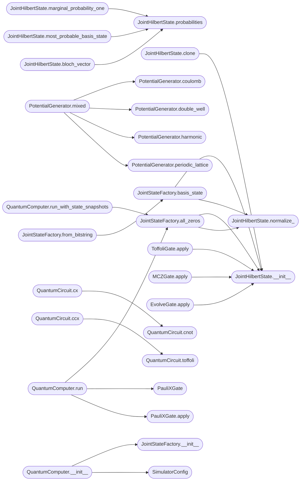

# `quantum_computer`

> Source: [quantum_computer.py:1](../../quantum_computer.py#L1) | language `py` | coverage 78.9% | [API index](../index.md)

quantum_computer.py

Author: Gris Iscomeback
License: AGPL v3

Collapse-Free Quantum Computer Simulator on Classical Hardware.

The state of n qubits lives in the JOINT Hilbert space C^(2^n).
The state vector has 2^n complex amplitudes: one per computational basis state.
This is the only representation that correctly supports entanglement.

Each amplitude alpha_k (k in {0,...,2^n - 1}) is encoded as a 2D spatial
wavefunction on a (G, G) grid, using the neural physics backends as the
time-evolution engine. The joint state tensor has shape:

    amplitudes: (2^n, 2, G, G)
        dim 0 : computational basis index  (2^n states)
        dim 1 : real / imaginary channel   (2 channels)
        dim 2 : spatial x                  (G points)
        dim 3 : spatial y                  (G points)

Single-qubit gates act via einsum on the qubit index within dim 0.
Two-qubit gates (CNOT, CZ, SWAP) permute and mix amplitude pairs in dim 0.
Measurement reads Born probabilities from norm-squared without collapsing.

Architecture (SOLID):
    - IQuantumGate         : gate abstraction (Interface Segregation)
    - IPhysicsBackend      : physics engine abstraction (Dependency Inversion)
    - JointHilbertState    : joint 2^n amplitude state (Single Responsibility)
    - HamiltonianBackend   : H(nn) spectral operator backend
    - SchrodingerBackend   : Schrodinger network backend
    - DiracBackend         : Dirac relativistic spinor backend
    - QuantumCircuit       : circuit builder (Open/Closed via IQuantumGate)
    - QuantumComputer      : top-level orchestrator (Single Responsibility)

## Contents

- **Classes:** [`SimulatorConfig`](#simulatorconfig), [`JointHilbertState`](#jointhilbertstate), [`PotentialGenerator`](#potentialgenerator), [`JointStateFactory`](#jointstatefactory), [`IQuantumGate`](#iquantumgate), [`HadamardGate`](#hadamardgate), [`PauliXGate`](#paulixgate), [`PauliYGate`](#pauliygate), [`PauliZGate`](#paulizgate), [`SGate`](#sgate), [`TGate`](#tgate), [`RxGate`](#rxgate), [`RyGate`](#rygate), [`RzGate`](#rzgate), [`CNOTGate`](#cnotgate), [`CZGate`](#czgate), [`SWAPGate`](#swapgate), [`ToffoliGate`](#toffoligate), [`MCZGate`](#mczgate), [`EvolveGate`](#evolvegate), [`CircuitInstruction`](#circuitinstruction), [`QuantumCircuit`](#quantumcircuit), [`MeasurementResult`](#measurementresult), [`QuantumComputer`](#quantumcomputer)
- **Functions:** [`register_gate`](#register_gate), [`run_phase_tests`](#run_phase_tests)

## Type Diagram

```mermaid
classDiagram
    direction LR
    class SimulatorConfig
    SimulatorConfig : int grid_size
    SimulatorConfig : int hidden_dim
    SimulatorConfig : int expansion_dim
    SimulatorConfig : int num_spectral_layers
    SimulatorConfig : float dirac_mass
    SimulatorConfig : float dirac_c
    SimulatorConfig : str gamma_representation
    SimulatorConfig : float dt
    SimulatorConfig : float normalization_eps
    SimulatorConfig : float potential_depth
    SimulatorConfig : float potential_width
    SimulatorConfig : str hamiltonian_checkpoint
    SimulatorConfig : str schrodinger_checkpoint
    SimulatorConfig : str dirac_checkpoint
    SimulatorConfig : str device
    SimulatorConfig : int random_seed
    SimulatorConfig : int max_qubits
    SimulatorConfig : float propagator_dt
    class JointHilbertState
    JointHilbertState : __init__()
    JointHilbertState : normalize_()
    JointHilbertState : probabilities()
    JointHilbertState : marginal_probability_one()
    JointHilbertState : most_probable_basis_state()
    JointHilbertState : bloch_vector()
    JointHilbertState : clone()
    class PotentialGenerator
    PotentialGenerator : __init__()
    PotentialGenerator : harmonic()
    PotentialGenerator : double_well()
    PotentialGenerator : coulomb()
    PotentialGenerator : periodic_lattice()
    PotentialGenerator : mixed()
    class JointStateFactory
    JointStateFactory : __init__()
    JointStateFactory : all_zeros()
    JointStateFactory : basis_state()
    JointStateFactory : from_bitstring()
    class IQuantumGate
    IQuantumGate : name()
    IQuantumGate : apply()
    class HadamardGate
    HadamardGate : name()
    HadamardGate : apply()
    class PauliXGate
    PauliXGate : name()
    PauliXGate : apply()
    class PauliYGate
    PauliYGate : name()
    PauliYGate : apply()
    class PauliZGate
    PauliZGate : name()
    PauliZGate : apply()
    class SGate
    SGate : name()
    SGate : apply()
    class TGate
    TGate : name()
    TGate : apply()
    class RxGate
    RxGate : name()
    RxGate : apply()
    class RyGate
    RyGate : name()
    RyGate : apply()
    class RzGate
    RzGate : name()
    RzGate : apply()
    class CNOTGate
    CNOTGate : name()
    CNOTGate : apply()
    class CZGate
    CZGate : name()
    CZGate : apply()
    class SWAPGate
    SWAPGate : name()
    SWAPGate : apply()
    class ToffoliGate
    ToffoliGate : name()
    ToffoliGate : apply()
    class MCZGate
    MCZGate : name()
    MCZGate : apply()
    class EvolveGate
    EvolveGate : name()
    EvolveGate : apply()
    class CircuitInstruction
    CircuitInstruction : str gate_name
    CircuitInstruction : List[int] targets
    CircuitInstruction : Optional[Dict[str, float]] params
    class QuantumCircuit
    QuantumCircuit : __init__()
    QuantumCircuit : h()
    QuantumCircuit : x()
    QuantumCircuit : y()
    QuantumCircuit : z()
    QuantumCircuit : s()
    QuantumCircuit : t()
    QuantumCircuit : rx()
    QuantumCircuit : ry()
    QuantumCircuit : rz()
    QuantumCircuit : cnot()
    QuantumCircuit : cx()
    QuantumCircuit : cz()
    QuantumCircuit : swap()
    QuantumCircuit : toffoli()
    QuantumCircuit : ccx()
    QuantumCircuit : evolve()
    QuantumCircuit : barrier()
    QuantumCircuit : depth()
    class MeasurementResult
    MeasurementResult : Dict[str, float] full_distribution
    MeasurementResult : Dict[int, float] marginal_p1
    MeasurementResult : Dict[int, Tuple[float, float, float]] bloch_vectors
    MeasurementResult : int n_qubits
    MeasurementResult : probabilities()
    MeasurementResult : most_probable_bitstring()
    MeasurementResult : expectation_z()
    MeasurementResult : entropy()
    class QuantumComputer
    QuantumComputer : __init__()
    QuantumComputer : run()
    QuantumComputer : run_with_state_snapshots()
    QuantumComputer : bell_state()
    QuantumComputer : ghz_state()
    QuantumComputer : quantum_fourier_transform()
    QuantumComputer : grover_oracle_search()
    QuantumComputer : variational_ansatz()
    QuantumComputer : teleportation()
    QuantumComputer : deutsch_jozsa()
    IQuantumGate <|-- HadamardGate
    IQuantumGate <|-- PauliXGate
    IQuantumGate <|-- PauliYGate
    IQuantumGate <|-- PauliZGate
    IQuantumGate <|-- SGate
    IQuantumGate <|-- TGate
    IQuantumGate <|-- RxGate
    IQuantumGate <|-- RyGate
    IQuantumGate <|-- RzGate
    IQuantumGate <|-- CNOTGate
    IQuantumGate <|-- CZGate
    IQuantumGate <|-- SWAPGate
    IQuantumGate <|-- ToffoliGate
    IQuantumGate <|-- MCZGate
    IQuantumGate <|-- EvolveGate
```



## Call Graph

Solid arrows stay in this module, dashed arrows leave it.



## Classes

<a id="simulatorconfig"></a>

### `SimulatorConfig`

`class` `dataclass` | [quantum_computer.py:87](../../quantum_computer.py#L87)

Decorators: `@dataclass`

```python
class SimulatorConfig
```

Global configuration for the quantum computer simulator.

grid_size, hidden_dim, expansion_dim, num_spectral_layers must match
the values used when training the checkpoint files.

**Attributes**

| Name | Type | Default | Description |
|---|---|---|---|
| [`grid_size`](#simulatorconfig-grid_size) | `int` | `16` |  |
| [`hidden_dim`](#simulatorconfig-hidden_dim) | `int` | `32` |  |
| [`expansion_dim`](#simulatorconfig-expansion_dim) | `int` | `64` |  |
| [`num_spectral_layers`](#simulatorconfig-num_spectral_layers) | `int` | `2` |  |
| [`dirac_mass`](#simulatorconfig-dirac_mass) | `float` | `1.0` |  |
| [`dirac_c`](#simulatorconfig-dirac_c) | `float` | `1.0` |  |
| [`gamma_representation`](#simulatorconfig-gamma_representation) | `str` | `'dirac'` |  |
| [`dt`](#simulatorconfig-dt) | `float` | `0.01` |  |
| [`normalization_eps`](#simulatorconfig-normalization_eps) | `float` | `1e-08` |  |
| [`potential_depth`](#simulatorconfig-potential_depth) | `float` | `5.0` |  |
| [`potential_width`](#simulatorconfig-potential_width) | `float` | `0.3` |  |
| [`hamiltonian_checkpoint`](#simulatorconfig-hamiltonian_checkpoint) | `str` | `'hamiltonian.pth'` |  |
| [`schrodinger_checkpoint`](#simulatorconfig-schrodinger_checkpoint) | `str` | `'checkpoint_phase3_training_epoch_18921_20260224_154739.pth'` |  |
| [`dirac_checkpoint`](#simulatorconfig-dirac_checkpoint) | `str` | `'best_dirac.pth'` |  |
| [`device`](#simulatorconfig-device) | `str` | `'cuda' if torch.cuda.is_available() else 'cpu'` |  |
| [`random_seed`](#simulatorconfig-random_seed) | `int` | `42` |  |
| [`max_qubits`](#simulatorconfig-max_qubits) | `int` | `8` |  |
| [`propagator_dt`](#simulatorconfig-propagator_dt) | `float` | `0.01` |  |

---

<a id="jointhilbertstate"></a>

### `JointHilbertState`

`class` | [quantum_computer.py:119](../../quantum_computer.py#L119)

```python
class JointHilbertState
```

Joint quantum state of n qubits in the full 2^n dimensional Hilbert space.

The state is stored as a tensor of shape (2^n, 2, G, G):
    - dim 0: computational basis index k in {0, ..., 2^n - 1}
             bit j of k is the state of qubit j (MSB = qubit 0)
    - dim 1: channel 0 = real part, channel 1 = imaginary part
    - dim 2: spatial x (G grid points)
    - dim 3: spatial y (G grid points)

Each amplitude alpha_k is a spatial wavefunction. The overall quantum
amplitude for basis state |k> is the complex field alpha_k(x,y).
The Born probability of measuring |k> is:

    P(k) = integral |alpha_k(x,y)|^2 dx dy
         = sum_{x,y} (alpha_k_real^2 + alpha_k_imag^2)

normalized so that sum_k P(k) = 1.

This representation correctly supports:
    - Superposition: multiple k indices have non-zero amplitude
    - Entanglement: amplitudes do not factorize across qubits
    - Coherent multi-qubit gates: exact permutation and mixing of amplitudes

**Members**

| Member | Kind | Summary |
|---|---|---|
| [`__init__`](#jointhilbertstate-__init__) | constructor |  |
| [`normalize_`](#jointhilbertstate-normalize_) | method | In-place normalization: sum_k P(k) = 1. |
| [`probabilities`](#jointhilbertstate-probabilities) | method | Return (2^n,) tensor of Born probabilities P(k) for each basis state. |
| [`marginal_probability_one`](#jointhilbertstate-marginal_probability_one) | method | Marginal Born probability P(qubit_j = \|1>). |
| [`most_probable_basis_state`](#jointhilbertstate-most_probable_basis_state) | method | Return the index k with the highest probability. |
| [`bloch_vector`](#jointhilbertstate-bloch_vector) | method | Compute the reduced Bloch vector for qubit j by partial trace. |
| [`clone`](#jointhilbertstate-clone) | method | Return a deep copy. |

<a id="jointhilbertstate-__init__"></a>

#### `JointHilbertState.__init__`

`constructor` | [quantum_computer.py:145](../../quantum_computer.py#L145)

```python
def __init__(self, amplitudes: torch.Tensor, n_qubits: int) -> None
```

**Parameters**

| Name | Type | Default | Description |
|---|---|---|---|
| `amplitudes` | `torch.Tensor` |  |  |
| `n_qubits` | `int` |  |  |

**Raises**

- `ValueError`: (raised in the body, not documented)

*Called by:* [`GroverDiffusionOperator.apply`](advanced_experiments.py.md#groverdiffusionoperator-apply), [`GroverOracle.apply`](advanced_experiments.py.md#groveroracle-apply), [`EvolveGate.apply`](#evolvegate-apply), [`JointHilbertState.clone`](#jointhilbertstate-clone), [`JointStateFactory.all_zeros`](#jointstatefactory-all_zeros), [`JointStateFactory.basis_state`](#jointstatefactory-basis_state), [`MCZGate.apply`](#mczgate-apply), [`ToffoliGate.apply`](#toffoligate-apply)

<a id="jointhilbertstate-normalize_"></a>

#### `JointHilbertState.normalize_`

`method` | [quantum_computer.py:157](../../quantum_computer.py#L157)

```python
def normalize_(self) -> None
```

In-place normalization: sum_k P(k) = 1.

*Called by:* [`JointStateFactory.all_zeros`](#jointstatefactory-all_zeros), [`JointStateFactory.basis_state`](#jointstatefactory-basis_state), [`JointStateFactory.all_zeros`](quantum_simulator.py.md#jointstatefactory-all_zeros), [`JointStateFactory.basis_state`](quantum_simulator.py.md#jointstatefactory-basis_state), [`ToffoliGate.apply`](quantum_simulator.py.md#toffoligate-apply)

<a id="jointhilbertstate-probabilities"></a>

#### `JointHilbertState.probabilities`

`method` | [quantum_computer.py:163](../../quantum_computer.py#L163)

```python
def probabilities(self) -> torch.Tensor
```

Return (2^n,) tensor of Born probabilities P(k) for each basis state.

**Returns:** `torch.Tensor`

*Called by:* [`JointHilbertState.bloch_vector`](#jointhilbertstate-bloch_vector), [`JointHilbertState.marginal_probability_one`](#jointhilbertstate-marginal_probability_one), [`JointHilbertState.most_probable_basis_state`](#jointhilbertstate-most_probable_basis_state), [`QuantumStateAnalyzer.compute_probabilities`](quantum_dash.py.md#quantumstateanalyzer-compute_probabilities), [`JointHilbertState.entropy`](quantum_simulator.py.md#jointhilbertstate-entropy), [`JointHilbertState.most_probable_bitstring`](quantum_simulator.py.md#jointhilbertstate-most_probable_bitstring), [`QuantumStateAnalyzer.compute_probabilities`](quantum_visualizer.py.md#quantumstateanalyzer-compute_probabilities)

<a id="jointhilbertstate-marginal_probability_one"></a>

#### `JointHilbertState.marginal_probability_one`

`method` | [quantum_computer.py:168](../../quantum_computer.py#L168)

```python
def marginal_probability_one(self, qubit: int) -> float
```

Marginal Born probability P(qubit_j = |1>).

Sums P(k) over all basis states k where bit j == 1.
Bit ordering: qubit 0 is the MSB of k.

**Parameters**

| Name | Type | Default | Description |
|---|---|---|---|
| `qubit` | `int` |  |  |

**Returns:** `float`

*Calls:* [`JointHilbertState.probabilities`](#jointhilbertstate-probabilities)

<a id="jointhilbertstate-most_probable_basis_state"></a>

#### `JointHilbertState.most_probable_basis_state`

`method` | [quantum_computer.py:183](../../quantum_computer.py#L183)

```python
def most_probable_basis_state(self) -> int
```

Return the index k with the highest probability.

**Returns:** `int`

*Calls:* [`JointHilbertState.probabilities`](#jointhilbertstate-probabilities)

<a id="jointhilbertstate-bloch_vector"></a>

#### `JointHilbertState.bloch_vector`

`method` | [quantum_computer.py:187](../../quantum_computer.py#L187)

```python
def bloch_vector(self, qubit: int) -> Tuple[float, float, float]
```

Compute the reduced Bloch vector for qubit j by partial trace.

rho_j[0,0] = P(qubit=0), rho_j[1,1] = P(qubit=1)
rho_j[0,1] = sum_{pairs} alpha_{k0}^* alpha_{k1} (off-diagonal coherence)
bx = 2 Re(rho_j[0,1]), by = -2 Im(rho_j[0,1]), bz = P(0) - P(1)

**Parameters**

| Name | Type | Default | Description |
|---|---|---|---|
| `qubit` | `int` |  |  |

**Returns:** `Tuple[float, float, float]`

*Calls:* [`JointHilbertState.probabilities`](#jointhilbertstate-probabilities)

*Called by:* [`QuantumStateAnalyzer.compute_bloch_vectors`](quantum_dash.py.md#quantumstateanalyzer-compute_bloch_vectors), [`QuantumStateAnalyzer.compute_bloch_vectors`](quantum_visualizer.py.md#quantumstateanalyzer-compute_bloch_vectors)

<a id="jointhilbertstate-clone"></a>

#### `JointHilbertState.clone`

`method` | [quantum_computer.py:225](../../quantum_computer.py#L225)

```python
def clone(self) -> 'JointHilbertState'
```

Return a deep copy.

**Returns:** `'JointHilbertState'`

*Calls:* [`JointHilbertState.__init__`](#jointhilbertstate-__init__)

---

<a id="potentialgenerator"></a>

### `PotentialGenerator`

`class` | [quantum_computer.py:230](../../quantum_computer.py#L230)

```python
class PotentialGenerator
```

Spatial potentials for eigenstate initialization.

**Members**

| Member | Kind | Summary |
|---|---|---|
| [`__init__`](#potentialgenerator-__init__) | constructor |  |
| [`harmonic`](#potentialgenerator-harmonic) | method | V = k/2 * r^2. |
| [`double_well`](#potentialgenerator-double_well) | method | Double-well along x. |
| [`coulomb`](#potentialgenerator-coulomb) | method | Coulomb-like V ~ -1/r. |
| [`periodic_lattice`](#potentialgenerator-periodic_lattice) | method | Periodic cosine lattice. |
| [`mixed`](#potentialgenerator-mixed) | method | Dirichlet-weighted mixture of all four potentials. |

<a id="potentialgenerator-__init__"></a>

#### `PotentialGenerator.__init__`

`constructor` | [quantum_computer.py:233](../../quantum_computer.py#L233)

```python
def __init__(self, config: SimulatorConfig) -> None
```

**Parameters**

| Name | Type | Default | Description |
|---|---|---|---|
| `config` | `SimulatorConfig` |  |  |

<a id="potentialgenerator-harmonic"></a>

#### `PotentialGenerator.harmonic`

`method` | [quantum_computer.py:242](../../quantum_computer.py#L242)

```python
def harmonic(self) -> torch.Tensor
```

V = k/2 * r^2.

**Returns:** `torch.Tensor`

*Called by:* [`PotentialGenerator.mixed`](#potentialgenerator-mixed), [`PotentialGenerator.mixed`](quantum_framework_physics.py.md#potentialgenerator-mixed), [`PotentialGenerator.mixed`](quantum_simulator.py.md#potentialgenerator-mixed)

<a id="potentialgenerator-double_well"></a>

#### `PotentialGenerator.double_well`

`method` | [quantum_computer.py:250](../../quantum_computer.py#L250)

```python
def double_well(self) -> torch.Tensor
```

Double-well along x.

**Returns:** `torch.Tensor`

*Called by:* [`PotentialGenerator.mixed`](#potentialgenerator-mixed), [`PotentialGenerator.mixed`](quantum_framework_physics.py.md#potentialgenerator-mixed), [`PotentialGenerator.mixed`](quantum_simulator.py.md#potentialgenerator-mixed)

<a id="potentialgenerator-coulomb"></a>

#### `PotentialGenerator.coulomb`

`method` | [quantum_computer.py:257](../../quantum_computer.py#L257)

```python
def coulomb(self) -> torch.Tensor
```

Coulomb-like V ~ -1/r.

**Returns:** `torch.Tensor`

*Called by:* [`PotentialGenerator.mixed`](#potentialgenerator-mixed), [`PotentialGenerator.mixed`](quantum_framework_physics.py.md#potentialgenerator-mixed), [`PotentialGenerator.mixed`](quantum_simulator.py.md#potentialgenerator-mixed)

<a id="potentialgenerator-periodic_lattice"></a>

#### `PotentialGenerator.periodic_lattice`

`method` | [quantum_computer.py:264](../../quantum_computer.py#L264)

```python
def periodic_lattice(self) -> torch.Tensor
```

Periodic cosine lattice.

**Returns:** `torch.Tensor`

*Called by:* [`PotentialGenerator.mixed`](#potentialgenerator-mixed), [`PotentialGenerator.mixed`](quantum_framework_physics.py.md#potentialgenerator-mixed), [`PotentialGenerator.mixed`](quantum_simulator.py.md#potentialgenerator-mixed)

<a id="potentialgenerator-mixed"></a>

#### `PotentialGenerator.mixed`

`method` | [quantum_computer.py:269](../../quantum_computer.py#L269)

```python
def mixed(self, seed: int) -> torch.Tensor
```

Dirichlet-weighted mixture of all four potentials.

**Parameters**

| Name | Type | Default | Description |
|---|---|---|---|
| `seed` | `int` |  |  |

**Returns:** `torch.Tensor`

*Calls:* [`PotentialGenerator.coulomb`](#potentialgenerator-coulomb), [`PotentialGenerator.double_well`](#potentialgenerator-double_well), [`PotentialGenerator.harmonic`](#potentialgenerator-harmonic), [`PotentialGenerator.periodic_lattice`](#potentialgenerator-periodic_lattice)

---

<a id="jointstatefactory"></a>

### `JointStateFactory`

`class` | [quantum_computer.py:326](../../quantum_computer.py#L326)

```python
class JointStateFactory
```

Builds JointHilbertState tensors for common initial conditions.

**Members**

| Member | Kind | Summary |
|---|---|---|
| [`__init__`](#jointstatefactory-__init__) | constructor |  |
| [`all_zeros`](#jointstatefactory-all_zeros) | method | Initialize register in \|00...0>. |
| [`basis_state`](#jointstatefactory-basis_state) | method | Initialize register in computational basis state \|k>. |
| [`from_bitstring`](#jointstatefactory-from_bitstring) | method | Initialize in the basis state given by binary string. |

<a id="jointstatefactory-__init__"></a>

#### `JointStateFactory.__init__`

`constructor` | [quantum_computer.py:329](../../quantum_computer.py#L329)

```python
def __init__(self, config: SimulatorConfig) -> None
```

**Parameters**

| Name | Type | Default | Description |
|---|---|---|---|
| `config` | `SimulatorConfig` |  |  |

*Called by:* [`QuantumComputer.__init__`](#quantumcomputer-__init__)

<a id="jointstatefactory-all_zeros"></a>

#### `JointStateFactory.all_zeros`

`method` | [quantum_computer.py:338](../../quantum_computer.py#L338)

```python
def all_zeros(self, n_qubits: int) -> JointHilbertState
```

Initialize register in |00...0>.

**Parameters**

| Name | Type | Default | Description |
|---|---|---|---|
| `n_qubits` | `int` |  |  |

**Returns:** `JointHilbertState`

*Calls:* [`JointHilbertState.__init__`](#jointhilbertstate-__init__), [`JointHilbertState.normalize_`](#jointhilbertstate-normalize_)

*Called by:* [`BackendHub.new_state`](immersive.backend.py.md#backendhub-new_state), [`QuantumComputer.run`](#quantumcomputer-run), [`QuantumComputer.run_with_state_snapshots`](#quantumcomputer-run_with_state_snapshots), [`QuantumComputer.run_circuit`](quantum_simulator.py.md#quantumcomputer-run_circuit)

<a id="jointstatefactory-basis_state"></a>

#### `JointStateFactory.basis_state`

`method` | [quantum_computer.py:346](../../quantum_computer.py#L346)

```python
def basis_state(self, n_qubits: int, k: int) -> JointHilbertState
```

Initialize register in computational basis state |k>.

**Parameters**

| Name | Type | Default | Description |
|---|---|---|---|
| `n_qubits` | `int` |  |  |
| `k` | `int` |  |  |

**Returns:** `JointHilbertState`

**Raises**

- `ValueError`: (raised in the body, not documented)

*Calls:* [`JointHilbertState.__init__`](#jointhilbertstate-__init__), [`JointHilbertState.normalize_`](#jointhilbertstate-normalize_)

*Called by:* [`JointStateFactory.from_bitstring`](#jointstatefactory-from_bitstring), [`JointStateFactory.from_bitstring`](quantum_simulator.py.md#jointstatefactory-from_bitstring)

<a id="jointstatefactory-from_bitstring"></a>

#### `JointStateFactory.from_bitstring`

`method` | [quantum_computer.py:356](../../quantum_computer.py#L356)

```python
def from_bitstring(self, bitstring: str) -> JointHilbertState
```

Initialize in the basis state given by binary string.

**Parameters**

| Name | Type | Default | Description |
|---|---|---|---|
| `bitstring` | `str` |  |  |

**Returns:** `JointHilbertState`

*Calls:* [`JointStateFactory.basis_state`](#jointstatefactory-basis_state)

---

<a id="iquantumgate"></a>

### `IQuantumGate`

`class` `abstract` | [quantum_computer.py:466](../../quantum_computer.py#L466)

```python
class IQuantumGate(ABC)
```

Bases: `ABC`

Subclasses: [`CNOTGate`](#cnotgate), [`CZGate`](#czgate), [`EvolveGate`](#evolvegate), [`HadamardGate`](#hadamardgate), [`MCZGate`](#mczgate), [`PauliXGate`](#paulixgate), [`PauliYGate`](#pauliygate), [`PauliZGate`](#paulizgate), [`RxGate`](#rxgate), [`RyGate`](#rygate), [`RzGate`](#rzgate), [`SGate`](#sgate), [`SWAPGate`](#swapgate), [`TGate`](#tgate), [`ToffoliGate`](#toffoligate)

Abstract quantum gate operating on the joint Hilbert space.

**Members**

| Member | Kind | Summary |
|---|---|---|
| [`name`](#iquantumgate-name) | property | Gate identifier. |
| [`apply`](#iquantumgate-apply) | method | Apply gate to joint state, return new joint state. |

<a id="iquantumgate-name"></a>

#### `IQuantumGate.name`

`property` `abstract` | [quantum_computer.py:471](../../quantum_computer.py#L471)

Decorators: `@property`, `@abstractmethod`

```python
def name(self) -> str
```

Gate identifier.

**Returns:** `str`

<a id="iquantumgate-apply"></a>

#### `IQuantumGate.apply`

`method` `abstract` | [quantum_computer.py:475](../../quantum_computer.py#L475)

Decorators: `@abstractmethod`

```python
def apply(self, state: JointHilbertState, backend: IPhysicsBackend, targets: Sequence[int], params: Optional[Dict[str, float]]) -> JointHilbertState
```

Apply gate to joint state, return new joint state.

**Parameters**

| Name | Type | Default | Description |
|---|---|---|---|
| `state` | `JointHilbertState` |  |  |
| `backend` | `IPhysicsBackend` |  |  |
| `targets` | `Sequence[int]` |  |  |
| `params` | `Optional[Dict[str, float]]` |  |  |

**Returns:** `JointHilbertState`

---

<a id="hadamardgate"></a>

### `HadamardGate`

`class` | [quantum_computer.py:485](../../quantum_computer.py#L485)

```python
class HadamardGate(IQuantumGate)
```

Bases: [`IQuantumGate`](#iquantumgate)

H = [[1,1],[1,-1]] / sqrt(2).

**Members**

| Member | Kind | Summary |
|---|---|---|
| [`name`](#hadamardgate-name) | property | Gate identifier. |
| [`apply`](#hadamardgate-apply) | method | Apply gate to joint state, return new joint state. |

<a id="hadamardgate-name"></a>

#### `HadamardGate.name`

`property` | [quantum_computer.py:489](../../quantum_computer.py#L489)

Decorators: `@property`

```python
def name(self) -> str
```

Gate identifier.

**Returns:** `str`

> **Inherited:** Documentation from [`IQuantumGate.name`](#iquantumgate-name) (quantum_computer.py:471).

<a id="hadamardgate-apply"></a>

#### `HadamardGate.apply`

`method` | [quantum_computer.py:492](../../quantum_computer.py#L492)

```python
def apply(self, state, backend, targets, params)
```

Apply gate to joint state, return new joint state.

**Parameters**

| Name | Type | Default | Description |
|---|---|---|---|
| `state` |  |  |  |
| `backend` |  |  |  |
| `targets` |  |  |  |
| `params` |  |  |  |

> **Inherited:** Documentation from [`IQuantumGate.apply`](#iquantumgate-apply) (quantum_computer.py:475).

---

<a id="paulixgate"></a>

### `PauliXGate`

`class` | [quantum_computer.py:500](../../quantum_computer.py#L500)

```python
class PauliXGate(IQuantumGate)
```

Bases: [`IQuantumGate`](#iquantumgate)

X = [[0,1],[1,0]].

**Members**

| Member | Kind | Summary |
|---|---|---|
| [`name`](#paulixgate-name) | property | Gate identifier. |
| [`apply`](#paulixgate-apply) | method | Apply gate to joint state, return new joint state. |

<a id="paulixgate-name"></a>

#### `PauliXGate.name`

`property` | [quantum_computer.py:504](../../quantum_computer.py#L504)

Decorators: `@property`

```python
def name(self) -> str
```

Gate identifier.

**Returns:** `str`

> **Inherited:** Documentation from [`IQuantumGate.name`](#iquantumgate-name) (quantum_computer.py:471).

<a id="paulixgate-apply"></a>

#### `PauliXGate.apply`

`method` | [quantum_computer.py:507](../../quantum_computer.py#L507)

```python
def apply(self, state, backend, targets, params)
```

Apply gate to joint state, return new joint state.

**Parameters**

| Name | Type | Default | Description |
|---|---|---|---|
| `state` |  |  |  |
| `backend` |  |  |  |
| `targets` |  |  |  |
| `params` |  |  |  |

> **Inherited:** Documentation from [`IQuantumGate.apply`](#iquantumgate-apply) (quantum_computer.py:475).

*Called by:* [`QuantumComputer.run`](#quantumcomputer-run)

---

<a id="pauliygate"></a>

### `PauliYGate`

`class` | [quantum_computer.py:514](../../quantum_computer.py#L514)

```python
class PauliYGate(IQuantumGate)
```

Bases: [`IQuantumGate`](#iquantumgate)

Y = [[0,-i],[i,0]].

**Members**

| Member | Kind | Summary |
|---|---|---|
| [`name`](#pauliygate-name) | property | Gate identifier. |
| [`apply`](#pauliygate-apply) | method | Apply gate to joint state, return new joint state. |

<a id="pauliygate-name"></a>

#### `PauliYGate.name`

`property` | [quantum_computer.py:518](../../quantum_computer.py#L518)

Decorators: `@property`

```python
def name(self) -> str
```

Gate identifier.

**Returns:** `str`

> **Inherited:** Documentation from [`IQuantumGate.name`](#iquantumgate-name) (quantum_computer.py:471).

<a id="pauliygate-apply"></a>

#### `PauliYGate.apply`

`method` | [quantum_computer.py:521](../../quantum_computer.py#L521)

```python
def apply(self, state, backend, targets, params)
```

Apply gate to joint state, return new joint state.

**Parameters**

| Name | Type | Default | Description |
|---|---|---|---|
| `state` |  |  |  |
| `backend` |  |  |  |
| `targets` |  |  |  |
| `params` |  |  |  |

> **Inherited:** Documentation from [`IQuantumGate.apply`](#iquantumgate-apply) (quantum_computer.py:475).

---

<a id="paulizgate"></a>

### `PauliZGate`

`class` | [quantum_computer.py:528](../../quantum_computer.py#L528)

```python
class PauliZGate(IQuantumGate)
```

Bases: [`IQuantumGate`](#iquantumgate)

Z = [[1,0],[0,-1]].

**Members**

| Member | Kind | Summary |
|---|---|---|
| [`name`](#paulizgate-name) | property | Gate identifier. |
| [`apply`](#paulizgate-apply) | method | Apply gate to joint state, return new joint state. |

<a id="paulizgate-name"></a>

#### `PauliZGate.name`

`property` | [quantum_computer.py:532](../../quantum_computer.py#L532)

Decorators: `@property`

```python
def name(self) -> str
```

Gate identifier.

**Returns:** `str`

> **Inherited:** Documentation from [`IQuantumGate.name`](#iquantumgate-name) (quantum_computer.py:471).

<a id="paulizgate-apply"></a>

#### `PauliZGate.apply`

`method` | [quantum_computer.py:535](../../quantum_computer.py#L535)

```python
def apply(self, state, backend, targets, params)
```

Apply gate to joint state, return new joint state.

**Parameters**

| Name | Type | Default | Description |
|---|---|---|---|
| `state` |  |  |  |
| `backend` |  |  |  |
| `targets` |  |  |  |
| `params` |  |  |  |

> **Inherited:** Documentation from [`IQuantumGate.apply`](#iquantumgate-apply) (quantum_computer.py:475).

---

<a id="sgate"></a>

### `SGate`

`class` | [quantum_computer.py:542](../../quantum_computer.py#L542)

```python
class SGate(IQuantumGate)
```

Bases: [`IQuantumGate`](#iquantumgate)

S = [[1,0],[0,i]].

**Members**

| Member | Kind | Summary |
|---|---|---|
| [`name`](#sgate-name) | property | Gate identifier. |
| [`apply`](#sgate-apply) | method | Apply gate to joint state, return new joint state. |

<a id="sgate-name"></a>

#### `SGate.name`

`property` | [quantum_computer.py:546](../../quantum_computer.py#L546)

Decorators: `@property`

```python
def name(self) -> str
```

Gate identifier.

**Returns:** `str`

> **Inherited:** Documentation from [`IQuantumGate.name`](#iquantumgate-name) (quantum_computer.py:471).

<a id="sgate-apply"></a>

#### `SGate.apply`

`method` | [quantum_computer.py:549](../../quantum_computer.py#L549)

```python
def apply(self, state, backend, targets, params)
```

Apply gate to joint state, return new joint state.

**Parameters**

| Name | Type | Default | Description |
|---|---|---|---|
| `state` |  |  |  |
| `backend` |  |  |  |
| `targets` |  |  |  |
| `params` |  |  |  |

> **Inherited:** Documentation from [`IQuantumGate.apply`](#iquantumgate-apply) (quantum_computer.py:475).

---

<a id="tgate"></a>

### `TGate`

`class` | [quantum_computer.py:556](../../quantum_computer.py#L556)

```python
class TGate(IQuantumGate)
```

Bases: [`IQuantumGate`](#iquantumgate)

T = [[1,0],[0,e^{i*pi/4}]].

**Members**

| Member | Kind | Summary |
|---|---|---|
| [`name`](#tgate-name) | property | Gate identifier. |
| [`apply`](#tgate-apply) | method | Apply gate to joint state, return new joint state. |

<a id="tgate-name"></a>

#### `TGate.name`

`property` | [quantum_computer.py:560](../../quantum_computer.py#L560)

Decorators: `@property`

```python
def name(self) -> str
```

Gate identifier.

**Returns:** `str`

> **Inherited:** Documentation from [`IQuantumGate.name`](#iquantumgate-name) (quantum_computer.py:471).

<a id="tgate-apply"></a>

#### `TGate.apply`

`method` | [quantum_computer.py:563](../../quantum_computer.py#L563)

```python
def apply(self, state, backend, targets, params)
```

Apply gate to joint state, return new joint state.

**Parameters**

| Name | Type | Default | Description |
|---|---|---|---|
| `state` |  |  |  |
| `backend` |  |  |  |
| `targets` |  |  |  |
| `params` |  |  |  |

> **Inherited:** Documentation from [`IQuantumGate.apply`](#iquantumgate-apply) (quantum_computer.py:475).

---

<a id="rxgate"></a>

### `RxGate`

`class` | [quantum_computer.py:571](../../quantum_computer.py#L571)

```python
class RxGate(IQuantumGate)
```

Bases: [`IQuantumGate`](#iquantumgate)

Rx(theta) = exp(-i*theta/2 * X).

**Members**

| Member | Kind | Summary |
|---|---|---|
| [`name`](#rxgate-name) | property | Gate identifier. |
| [`apply`](#rxgate-apply) | method | Apply gate to joint state, return new joint state. |

<a id="rxgate-name"></a>

#### `RxGate.name`

`property` | [quantum_computer.py:575](../../quantum_computer.py#L575)

Decorators: `@property`

```python
def name(self) -> str
```

Gate identifier.

**Returns:** `str`

> **Inherited:** Documentation from [`IQuantumGate.name`](#iquantumgate-name) (quantum_computer.py:471).

<a id="rxgate-apply"></a>

#### `RxGate.apply`

`method` | [quantum_computer.py:578](../../quantum_computer.py#L578)

```python
def apply(self, state, backend, targets, params)
```

Apply gate to joint state, return new joint state.

**Parameters**

| Name | Type | Default | Description |
|---|---|---|---|
| `state` |  |  |  |
| `backend` |  |  |  |
| `targets` |  |  |  |
| `params` |  |  |  |

> **Inherited:** Documentation from [`IQuantumGate.apply`](#iquantumgate-apply) (quantum_computer.py:475).

---

<a id="rygate"></a>

### `RyGate`

`class` | [quantum_computer.py:587](../../quantum_computer.py#L587)

```python
class RyGate(IQuantumGate)
```

Bases: [`IQuantumGate`](#iquantumgate)

Ry(theta) = exp(-i*theta/2 * Y).

**Members**

| Member | Kind | Summary |
|---|---|---|
| [`name`](#rygate-name) | property | Gate identifier. |
| [`apply`](#rygate-apply) | method | Apply gate to joint state, return new joint state. |

<a id="rygate-name"></a>

#### `RyGate.name`

`property` | [quantum_computer.py:591](../../quantum_computer.py#L591)

Decorators: `@property`

```python
def name(self) -> str
```

Gate identifier.

**Returns:** `str`

> **Inherited:** Documentation from [`IQuantumGate.name`](#iquantumgate-name) (quantum_computer.py:471).

<a id="rygate-apply"></a>

#### `RyGate.apply`

`method` | [quantum_computer.py:594](../../quantum_computer.py#L594)

```python
def apply(self, state, backend, targets, params)
```

Apply gate to joint state, return new joint state.

**Parameters**

| Name | Type | Default | Description |
|---|---|---|---|
| `state` |  |  |  |
| `backend` |  |  |  |
| `targets` |  |  |  |
| `params` |  |  |  |

> **Inherited:** Documentation from [`IQuantumGate.apply`](#iquantumgate-apply) (quantum_computer.py:475).

---

<a id="rzgate"></a>

### `RzGate`

`class` | [quantum_computer.py:603](../../quantum_computer.py#L603)

```python
class RzGate(IQuantumGate)
```

Bases: [`IQuantumGate`](#iquantumgate)

Rz(theta) = exp(-i*theta/2 * Z).

**Members**

| Member | Kind | Summary |
|---|---|---|
| [`name`](#rzgate-name) | property | Gate identifier. |
| [`apply`](#rzgate-apply) | method | Apply gate to joint state, return new joint state. |

<a id="rzgate-name"></a>

#### `RzGate.name`

`property` | [quantum_computer.py:607](../../quantum_computer.py#L607)

Decorators: `@property`

```python
def name(self) -> str
```

Gate identifier.

**Returns:** `str`

> **Inherited:** Documentation from [`IQuantumGate.name`](#iquantumgate-name) (quantum_computer.py:471).

<a id="rzgate-apply"></a>

#### `RzGate.apply`

`method` | [quantum_computer.py:610](../../quantum_computer.py#L610)

```python
def apply(self, state, backend, targets, params)
```

Apply gate to joint state, return new joint state.

**Parameters**

| Name | Type | Default | Description |
|---|---|---|---|
| `state` |  |  |  |
| `backend` |  |  |  |
| `targets` |  |  |  |
| `params` |  |  |  |

> **Inherited:** Documentation from [`IQuantumGate.apply`](#iquantumgate-apply) (quantum_computer.py:475).

---

<a id="cnotgate"></a>

### `CNOTGate`

`class` | [quantum_computer.py:620](../../quantum_computer.py#L620)

```python
class CNOTGate(IQuantumGate)
```

Bases: [`IQuantumGate`](#iquantumgate)

CNOT: |ctrl tgt> -> |ctrl, ctrl XOR tgt>.

4x4 matrix (|00>,|01>,|10>,|11>):
    |00>->|00>, |01>->|01>, |10>->|11>, |11>->|10>

**Members**

| Member | Kind | Summary |
|---|---|---|
| [`name`](#cnotgate-name) | property | Gate identifier. |
| [`apply`](#cnotgate-apply) | method | Apply gate to joint state, return new joint state. |

<a id="cnotgate-name"></a>

#### `CNOTGate.name`

`property` | [quantum_computer.py:629](../../quantum_computer.py#L629)

Decorators: `@property`

```python
def name(self) -> str
```

Gate identifier.

**Returns:** `str`

> **Inherited:** Documentation from [`IQuantumGate.name`](#iquantumgate-name) (quantum_computer.py:471).

<a id="cnotgate-apply"></a>

#### `CNOTGate.apply`

`method` | [quantum_computer.py:632](../../quantum_computer.py#L632)

```python
def apply(self, state, backend, targets, params)
```

Apply gate to joint state, return new joint state.

**Parameters**

| Name | Type | Default | Description |
|---|---|---|---|
| `state` |  |  |  |
| `backend` |  |  |  |
| `targets` |  |  |  |
| `params` |  |  |  |

**Raises**

- `ValueError`: (raised in the body, not documented)

> **Inherited:** Documentation from [`IQuantumGate.apply`](#iquantumgate-apply) (quantum_computer.py:475).

---

<a id="czgate"></a>

### `CZGate`

`class` | [quantum_computer.py:644](../../quantum_computer.py#L644)

```python
class CZGate(IQuantumGate)
```

Bases: [`IQuantumGate`](#iquantumgate)

CZ: applies phase -1 to |11>.

4x4 matrix: diag(1, 1, 1, -1).

**Members**

| Member | Kind | Summary |
|---|---|---|
| [`name`](#czgate-name) | property | Gate identifier. |
| [`apply`](#czgate-apply) | method | Apply gate to joint state, return new joint state. |

<a id="czgate-name"></a>

#### `CZGate.name`

`property` | [quantum_computer.py:652](../../quantum_computer.py#L652)

Decorators: `@property`

```python
def name(self) -> str
```

Gate identifier.

**Returns:** `str`

> **Inherited:** Documentation from [`IQuantumGate.name`](#iquantumgate-name) (quantum_computer.py:471).

<a id="czgate-apply"></a>

#### `CZGate.apply`

`method` | [quantum_computer.py:655](../../quantum_computer.py#L655)

```python
def apply(self, state, backend, targets, params)
```

Apply gate to joint state, return new joint state.

**Parameters**

| Name | Type | Default | Description |
|---|---|---|---|
| `state` |  |  |  |
| `backend` |  |  |  |
| `targets` |  |  |  |
| `params` |  |  |  |

**Raises**

- `ValueError`: (raised in the body, not documented)

> **Inherited:** Documentation from [`IQuantumGate.apply`](#iquantumgate-apply) (quantum_computer.py:475).

---

<a id="swapgate"></a>

### `SWAPGate`

`class` | [quantum_computer.py:667](../../quantum_computer.py#L667)

```python
class SWAPGate(IQuantumGate)
```

Bases: [`IQuantumGate`](#iquantumgate)

SWAP: exchanges two qubits.

4x4 matrix: |01>->|10>, |10>->|01>, others unchanged.

**Members**

| Member | Kind | Summary |
|---|---|---|
| [`name`](#swapgate-name) | property | Gate identifier. |
| [`apply`](#swapgate-apply) | method | Apply gate to joint state, return new joint state. |

<a id="swapgate-name"></a>

#### `SWAPGate.name`

`property` | [quantum_computer.py:675](../../quantum_computer.py#L675)

Decorators: `@property`

```python
def name(self) -> str
```

Gate identifier.

**Returns:** `str`

> **Inherited:** Documentation from [`IQuantumGate.name`](#iquantumgate-name) (quantum_computer.py:471).

<a id="swapgate-apply"></a>

#### `SWAPGate.apply`

`method` | [quantum_computer.py:678](../../quantum_computer.py#L678)

```python
def apply(self, state, backend, targets, params)
```

Apply gate to joint state, return new joint state.

**Parameters**

| Name | Type | Default | Description |
|---|---|---|---|
| `state` |  |  |  |
| `backend` |  |  |  |
| `targets` |  |  |  |
| `params` |  |  |  |

**Raises**

- `ValueError`: (raised in the body, not documented)

> **Inherited:** Documentation from [`IQuantumGate.apply`](#iquantumgate-apply) (quantum_computer.py:475).

---

<a id="toffoligate"></a>

### `ToffoliGate`

`class` | [quantum_computer.py:690](../../quantum_computer.py#L690)

```python
class ToffoliGate(IQuantumGate)
```

Bases: [`IQuantumGate`](#iquantumgate)

Toffoli (CCX): flips target iff both controls are |1>.

Exact amplitude permutation in the 8-element 3-qubit subspace.

**Members**

| Member | Kind | Summary |
|---|---|---|
| [`name`](#toffoligate-name) | property | Gate identifier. |
| [`apply`](#toffoligate-apply) | method | Apply gate to joint state, return new joint state. |

<a id="toffoligate-name"></a>

#### `ToffoliGate.name`

`property` | [quantum_computer.py:698](../../quantum_computer.py#L698)

Decorators: `@property`

```python
def name(self) -> str
```

Gate identifier.

**Returns:** `str`

> **Inherited:** Documentation from [`IQuantumGate.name`](#iquantumgate-name) (quantum_computer.py:471).

<a id="toffoligate-apply"></a>

#### `ToffoliGate.apply`

`method` | [quantum_computer.py:701](../../quantum_computer.py#L701)

```python
def apply(self, state, backend, targets, params)
```

Apply gate to joint state, return new joint state.

**Parameters**

| Name | Type | Default | Description |
|---|---|---|---|
| `state` |  |  |  |
| `backend` |  |  |  |
| `targets` |  |  |  |
| `params` |  |  |  |

**Raises**

- `ValueError`: (raised in the body, not documented)

> **Inherited:** Documentation from [`IQuantumGate.apply`](#iquantumgate-apply) (quantum_computer.py:475).

*Calls:* [`JointHilbertState.__init__`](#jointhilbertstate-__init__)

---

<a id="mczgate"></a>

### `MCZGate`

`class` | [quantum_computer.py:719](../../quantum_computer.py#L719)

```python
class MCZGate(IQuantumGate)
```

Bases: [`IQuantumGate`](#iquantumgate)

Multi-Controlled Z gate: applies phase -1 to the single basis state where ALL qubits in targets are |1>.

This is the exact oracle primitive needed by Grover's algorithm.
For n target qubits it marks the state |11...1> with a global phase of -1
and leaves all other basis states unchanged.

Implementation: iterate over all basis states k; if every bit
corresponding to a qubit in targets is set to 1, negate that amplitude
(multiply real and imaginary parts by -1).

targets: list of qubit indices that must all be |1> for the phase flip.

**Members**

| Member | Kind | Summary |
|---|---|---|
| [`name`](#mczgate-name) | property | Gate identifier. |
| [`apply`](#mczgate-apply) | method | Apply gate to joint state, return new joint state. |

<a id="mczgate-name"></a>

#### `MCZGate.name`

`property` | [quantum_computer.py:736](../../quantum_computer.py#L736)

Decorators: `@property`

```python
def name(self) -> str
```

Gate identifier.

**Returns:** `str`

> **Inherited:** Documentation from [`IQuantumGate.name`](#iquantumgate-name) (quantum_computer.py:471).

<a id="mczgate-apply"></a>

#### `MCZGate.apply`

`method` | [quantum_computer.py:739](../../quantum_computer.py#L739)

```python
def apply(self, state, backend, targets, params)
```

Apply gate to joint state, return new joint state.

**Parameters**

| Name | Type | Default | Description |
|---|---|---|---|
| `state` |  |  |  |
| `backend` |  |  |  |
| `targets` |  |  |  |
| `params` |  |  |  |

**Raises**

- `ValueError`: (raised in the body, not documented)

> **Inherited:** Documentation from [`IQuantumGate.apply`](#iquantumgate-apply) (quantum_computer.py:475).

*Calls:* [`JointHilbertState.__init__`](#jointhilbertstate-__init__)

---

<a id="evolvegate"></a>

### `EvolveGate`

`class` | [quantum_computer.py:751](../../quantum_computer.py#L751)

```python
class EvolveGate(IQuantumGate)
```

Bases: [`IQuantumGate`](#iquantumgate)

Free Hamiltonian evolution applied to every amplitude in the joint state.

Uses the active physics backend.  The evolution preserves each
amplitude's norm (unitary dynamics keeps ||U psi|| = ||psi||), so the
Born weights of a superposition are conserved -- previously each
amplitude was renormalized to 1, which silently flattened any
non-uniform superposition into a uniform one.

Note: in the joint Hilbert space representation every computational
basis amplitude is a full spatial wavefunction, so the evolution is
inherently global; `[`targets`](#circuitinstruction-targets)` is accepted for API compatibility.
`[`dt`](#simulatorconfig-dt)` defaults to the backend configuration value.

params: {"dt": float, "steps": int}

**Members**

| Member | Kind | Summary |
|---|---|---|
| [`name`](#evolvegate-name) | property | Gate identifier. |
| [`apply`](#evolvegate-apply) | method | Apply gate to joint state, return new joint state. |

<a id="evolvegate-name"></a>

#### `EvolveGate.name`

`property` | [quantum_computer.py:770](../../quantum_computer.py#L770)

Decorators: `@property`

```python
def name(self) -> str
```

Gate identifier.

**Returns:** `str`

> **Inherited:** Documentation from [`IQuantumGate.name`](#iquantumgate-name) (quantum_computer.py:471).

<a id="evolvegate-apply"></a>

#### `EvolveGate.apply`

`method` | [quantum_computer.py:773](../../quantum_computer.py#L773)

```python
def apply(self, state, backend, targets, params)
```

Apply gate to joint state, return new joint state.

**Parameters**

| Name | Type | Default | Description |
|---|---|---|---|
| `state` |  |  |  |
| `backend` |  |  |  |
| `targets` |  |  |  |
| `params` |  |  |  |

> **Inherited:** Documentation from [`IQuantumGate.apply`](#iquantumgate-apply) (quantum_computer.py:475).

*Calls:* [`JointHilbertState.__init__`](#jointhilbertstate-__init__)

---

<a id="circuitinstruction"></a>

### `CircuitInstruction`

`class` `dataclass` | [quantum_computer.py:818](../../quantum_computer.py#L818)

Decorators: `@dataclass`

```python
class CircuitInstruction
```

Single gate instruction.

**Attributes**

| Name | Type | Default | Description |
|---|---|---|---|
| [`gate_name`](#circuitinstruction-gate_name) | `str` |  |  |
| [`targets`](#circuitinstruction-targets) | `List[int]` |  |  |
| [`params`](#circuitinstruction-params) | `Optional[Dict[str, float]]` | `None` |  |

---

<a id="quantumcircuit"></a>

### `QuantumCircuit`

`class` | [quantum_computer.py:825](../../quantum_computer.py#L825)

```python
class QuantumCircuit
```

Ordered sequence of quantum gate instructions.

Pure data structure: stores instructions, does not execute them.

**Members**

| Member | Kind | Summary |
|---|---|---|
| [`__init__`](#quantumcircuit-__init__) | constructor |  |
| [`h`](#quantumcircuit-h) | method |  |
| [`x`](#quantumcircuit-x) | method |  |
| [`y`](#quantumcircuit-y) | method |  |
| [`z`](#quantumcircuit-z) | method |  |
| [`s`](#quantumcircuit-s) | method |  |
| [`t`](#quantumcircuit-t) | method |  |
| [`rx`](#quantumcircuit-rx) | method |  |
| [`ry`](#quantumcircuit-ry) | method |  |
| [`rz`](#quantumcircuit-rz) | method |  |
| [`cnot`](#quantumcircuit-cnot) | method |  |
| [`cx`](#quantumcircuit-cx) | method |  |
| [`cz`](#quantumcircuit-cz) | method |  |
| [`swap`](#quantumcircuit-swap) | method |  |
| [`toffoli`](#quantumcircuit-toffoli) | method |  |
| [`ccx`](#quantumcircuit-ccx) | method |  |
| [`evolve`](#quantumcircuit-evolve) | method |  |
| [`barrier`](#quantumcircuit-barrier) | method |  |
| [`depth`](#quantumcircuit-depth) | method |  |

<a id="quantumcircuit-__init__"></a>

#### `QuantumCircuit.__init__`

`constructor` | [quantum_computer.py:832](../../quantum_computer.py#L832)

```python
def __init__(self, n_qubits: int) -> None
```

**Parameters**

| Name | Type | Default | Description |
|---|---|---|---|
| `n_qubits` | `int` |  |  |

**Raises**

- `ValueError`: (raised in the body, not documented)

*Called by:* [`givens_single_excitation`](app.py.md#givens_single_excitation), [`particle_conserving_ansatz`](app.py.md#particle_conserving_ansatz), [`WState.prepare`](entangled_hydrogen.py.md#wstate-prepare), [`givens_single_excitation`](polarizability_v3.py.md#givens_single_excitation), [`particle_conserving_ansatz`](polarizability_v3.py.md#particle_conserving_ansatz), [`QuantumComputer.bell_state`](#quantumcomputer-bell_state), [`QuantumComputer.deutsch_jozsa`](#quantumcomputer-deutsch_jozsa), [`QuantumComputer.ghz_state`](#quantumcomputer-ghz_state), [`QuantumComputer.grover_oracle_search`](#quantumcomputer-grover_oracle_search), [`QuantumComputer.quantum_fourier_transform`](#quantumcomputer-quantum_fourier_transform), [`QuantumComputer.teleportation`](#quantumcomputer-teleportation), [`QuantumComputer.variational_ansatz`](#quantumcomputer-variational_ansatz) and 1 more

<a id="quantumcircuit-h"></a>

#### `QuantumCircuit.h`

`method` | [quantum_computer.py:838](../../quantum_computer.py#L838)

```python
def h(self, q: int) -> 'QuantumCircuit'
```

**Parameters**

| Name | Type | Default | Description |
|---|---|---|---|
| `q` | `int` |  |  |

**Returns:** `'QuantumCircuit'`

*Called by:* [`QuantumComputer.bell_state`](#quantumcomputer-bell_state), [`QuantumComputer.deutsch_jozsa`](#quantumcomputer-deutsch_jozsa), [`QuantumComputer.ghz_state`](#quantumcomputer-ghz_state), [`QuantumComputer.grover_oracle_search`](#quantumcomputer-grover_oracle_search), [`QuantumComputer.quantum_fourier_transform`](#quantumcomputer-quantum_fourier_transform), [`QuantumComputer.teleportation`](#quantumcomputer-teleportation), [`run_phase_tests`](#run_phase_tests)

<a id="quantumcircuit-x"></a>

#### `QuantumCircuit.x`

`method` | [quantum_computer.py:841](../../quantum_computer.py#L841)

```python
def x(self, q: int) -> 'QuantumCircuit'
```

**Parameters**

| Name | Type | Default | Description |
|---|---|---|---|
| `q` | `int` |  |  |

**Returns:** `'QuantumCircuit'`

*Called by:* [`QuantumComputer.deutsch_jozsa`](#quantumcomputer-deutsch_jozsa), [`QuantumComputer.grover_oracle_search`](#quantumcomputer-grover_oracle_search), [`run_phase_tests`](#run_phase_tests)

<a id="quantumcircuit-y"></a>

#### `QuantumCircuit.y`

`method` | [quantum_computer.py:844](../../quantum_computer.py#L844)

```python
def y(self, q: int) -> 'QuantumCircuit'
```

**Parameters**

| Name | Type | Default | Description |
|---|---|---|---|
| `q` | `int` |  |  |

**Returns:** `'QuantumCircuit'`

<a id="quantumcircuit-z"></a>

#### `QuantumCircuit.z`

`method` | [quantum_computer.py:847](../../quantum_computer.py#L847)

```python
def z(self, q: int) -> 'QuantumCircuit'
```

**Parameters**

| Name | Type | Default | Description |
|---|---|---|---|
| `q` | `int` |  |  |

**Returns:** `'QuantumCircuit'`

<a id="quantumcircuit-s"></a>

#### `QuantumCircuit.s`

`method` | [quantum_computer.py:850](../../quantum_computer.py#L850)

```python
def s(self, q: int) -> 'QuantumCircuit'
```

**Parameters**

| Name | Type | Default | Description |
|---|---|---|---|
| `q` | `int` |  |  |

**Returns:** `'QuantumCircuit'`

<a id="quantumcircuit-t"></a>

#### `QuantumCircuit.t`

`method` | [quantum_computer.py:853](../../quantum_computer.py#L853)

```python
def t(self, q: int) -> 'QuantumCircuit'
```

**Parameters**

| Name | Type | Default | Description |
|---|---|---|---|
| `q` | `int` |  |  |

**Returns:** `'QuantumCircuit'`

<a id="quantumcircuit-rx"></a>

#### `QuantumCircuit.rx`

`method` | [quantum_computer.py:856](../../quantum_computer.py#L856)

```python
def rx(self, q: int, theta: float) -> 'QuantumCircuit'
```

**Parameters**

| Name | Type | Default | Description |
|---|---|---|---|
| `q` | `int` |  |  |
| `theta` | `float` |  |  |

**Returns:** `'QuantumCircuit'`

*Called by:* [`run_phase_tests`](#run_phase_tests)

<a id="quantumcircuit-ry"></a>

#### `QuantumCircuit.ry`

`method` | [quantum_computer.py:859](../../quantum_computer.py#L859)

```python
def ry(self, q: int, theta: float) -> 'QuantumCircuit'
```

**Parameters**

| Name | Type | Default | Description |
|---|---|---|---|
| `q` | `int` |  |  |
| `theta` | `float` |  |  |

**Returns:** `'QuantumCircuit'`

*Called by:* [`givens_single_excitation`](app.py.md#givens_single_excitation), [`particle_conserving_ansatz`](app.py.md#particle_conserving_ansatz), [`WState.prepare`](entangled_hydrogen.py.md#wstate-prepare), [`givens_single_excitation`](polarizability_v3.py.md#givens_single_excitation), [`particle_conserving_ansatz`](polarizability_v3.py.md#particle_conserving_ansatz), [`QuantumComputer.teleportation`](#quantumcomputer-teleportation), [`QuantumComputer.variational_ansatz`](#quantumcomputer-variational_ansatz), [`run_phase_tests`](#run_phase_tests)

<a id="quantumcircuit-rz"></a>

#### `QuantumCircuit.rz`

`method` | [quantum_computer.py:862](../../quantum_computer.py#L862)

```python
def rz(self, q: int, theta: float) -> 'QuantumCircuit'
```

**Parameters**

| Name | Type | Default | Description |
|---|---|---|---|
| `q` | `int` |  |  |
| `theta` | `float` |  |  |

**Returns:** `'QuantumCircuit'`

*Called by:* [`QuantumComputer.quantum_fourier_transform`](#quantumcomputer-quantum_fourier_transform)

<a id="quantumcircuit-cnot"></a>

#### `QuantumCircuit.cnot`

`method` | [quantum_computer.py:865](../../quantum_computer.py#L865)

```python
def cnot(self, ctrl: int, tgt: int) -> 'QuantumCircuit'
```

**Parameters**

| Name | Type | Default | Description |
|---|---|---|---|
| `ctrl` | `int` |  |  |
| `tgt` | `int` |  |  |

**Returns:** `'QuantumCircuit'`

*Called by:* [`givens_single_excitation`](app.py.md#givens_single_excitation), [`particle_conserving_ansatz`](app.py.md#particle_conserving_ansatz), [`WState.prepare`](entangled_hydrogen.py.md#wstate-prepare), [`givens_single_excitation`](polarizability_v3.py.md#givens_single_excitation), [`particle_conserving_ansatz`](polarizability_v3.py.md#particle_conserving_ansatz), [`QuantumCircuit.cx`](#quantumcircuit-cx), [`QuantumComputer.deutsch_jozsa`](#quantumcomputer-deutsch_jozsa), [`QuantumComputer.ghz_state`](#quantumcomputer-ghz_state), [`QuantumComputer.teleportation`](#quantumcomputer-teleportation), [`QuantumComputer.variational_ansatz`](#quantumcomputer-variational_ansatz), [`run_phase_tests`](#run_phase_tests)

<a id="quantumcircuit-cx"></a>

#### `QuantumCircuit.cx`

`method` | [quantum_computer.py:868](../../quantum_computer.py#L868)

```python
def cx(self, ctrl: int, tgt: int) -> 'QuantumCircuit'
```

**Parameters**

| Name | Type | Default | Description |
|---|---|---|---|
| `ctrl` | `int` |  |  |
| `tgt` | `int` |  |  |

**Returns:** `'QuantumCircuit'`

*Calls:* [`QuantumCircuit.cnot`](#quantumcircuit-cnot)

*Called by:* [`QuantumComputer.teleportation`](#quantumcomputer-teleportation)

<a id="quantumcircuit-cz"></a>

#### `QuantumCircuit.cz`

`method` | [quantum_computer.py:871](../../quantum_computer.py#L871)

```python
def cz(self, ctrl: int, tgt: int) -> 'QuantumCircuit'
```

**Parameters**

| Name | Type | Default | Description |
|---|---|---|---|
| `ctrl` | `int` |  |  |
| `tgt` | `int` |  |  |

**Returns:** `'QuantumCircuit'`

<a id="quantumcircuit-swap"></a>

#### `QuantumCircuit.swap`

`method` | [quantum_computer.py:874](../../quantum_computer.py#L874)

```python
def swap(self, a: int, b: int) -> 'QuantumCircuit'
```

**Parameters**

| Name | Type | Default | Description |
|---|---|---|---|
| `a` | `int` |  |  |
| `b` | `int` |  |  |

**Returns:** `'QuantumCircuit'`

*Called by:* [`givens_single_excitation`](app.py.md#givens_single_excitation), [`givens_single_excitation`](polarizability_v3.py.md#givens_single_excitation), [`run_phase_tests`](#run_phase_tests)

<a id="quantumcircuit-toffoli"></a>

#### `QuantumCircuit.toffoli`

`method` | [quantum_computer.py:877](../../quantum_computer.py#L877)

```python
def toffoli(self, c0: int, c1: int, tgt: int) -> 'QuantumCircuit'
```

**Parameters**

| Name | Type | Default | Description |
|---|---|---|---|
| `c0` | `int` |  |  |
| `c1` | `int` |  |  |
| `tgt` | `int` |  |  |

**Returns:** `'QuantumCircuit'`

*Called by:* [`QuantumCircuit.ccx`](#quantumcircuit-ccx)

<a id="quantumcircuit-ccx"></a>

#### `QuantumCircuit.ccx`

`method` | [quantum_computer.py:880](../../quantum_computer.py#L880)

```python
def ccx(self, c0: int, c1: int, tgt: int) -> 'QuantumCircuit'
```

**Parameters**

| Name | Type | Default | Description |
|---|---|---|---|
| `c0` | `int` |  |  |
| `c1` | `int` |  |  |
| `tgt` | `int` |  |  |

**Returns:** `'QuantumCircuit'`

*Calls:* [`QuantumCircuit.toffoli`](#quantumcircuit-toffoli)

<a id="quantumcircuit-evolve"></a>

#### `QuantumCircuit.evolve`

`method` | [quantum_computer.py:883](../../quantum_computer.py#L883)

```python
def evolve(self, qubits: List[int], dt: Optional[float] = None, steps: int = 1) -> 'QuantumCircuit'
```

**Parameters**

| Name | Type | Default | Description |
|---|---|---|---|
| `qubits` | `List[int]` |  |  |
| `dt` | `Optional[float]` | `None` |  |
| `steps` | `int` | `1` |  |

**Returns:** `'QuantumCircuit'`

<a id="quantumcircuit-barrier"></a>

#### `QuantumCircuit.barrier`

`method` | [quantum_computer.py:886](../../quantum_computer.py#L886)

```python
def barrier(self) -> 'QuantumCircuit'
```

**Returns:** `'QuantumCircuit'`

<a id="quantumcircuit-depth"></a>

#### `QuantumCircuit.depth`

`method` | [quantum_computer.py:897](../../quantum_computer.py#L897)

```python
def depth(self) -> int
```

**Returns:** `int`

---

<a id="measurementresult"></a>

### `MeasurementResult`

`class` `dataclass` | [quantum_computer.py:911](../../quantum_computer.py#L911)

Decorators: `@dataclass`

```python
class MeasurementResult
```

Non-destructive Born-rule measurement of the full register.

Contains the complete probability distribution over all 2^n basis states,
per-qubit marginals, and Bloch vectors. The state is never modified.

**Attributes**

| Name | Type | Default | Description |
|---|---|---|---|
| [`full_distribution`](#measurementresult-full_distribution) | `Dict[str, float]` |  |  |
| [`marginal_p1`](#measurementresult-marginal_p1) | `Dict[int, float]` |  |  |
| [`bloch_vectors`](#measurementresult-bloch_vectors) | `Dict[int, Tuple[float, float, float]]` |  |  |
| [`n_qubits`](#measurementresult-n_qubits) | `int` |  |  |

**Members**

| Member | Kind | Summary |
|---|---|---|
| [`probabilities`](#measurementresult-probabilities) | property | Alias: marginal P(\|1>) per qubit index. |
| [`most_probable_bitstring`](#measurementresult-most_probable_bitstring) | method | Return the bitstring with the highest probability. |
| [`expectation_z`](#measurementresult-expectation_z) | method | <Z>_j = P(0) - P(1) in [-1, +1]. |
| [`entropy`](#measurementresult-entropy) | method | Shannon entropy of the full probability distribution in bits. |

<a id="measurementresult-probabilities"></a>

#### `MeasurementResult.probabilities`

`property` | [quantum_computer.py:925](../../quantum_computer.py#L925)

Decorators: `@property`

```python
def probabilities(self) -> Dict[int, float]
```

Alias: marginal P(|1>) per qubit index.

**Returns:** `Dict[int, float]`

<a id="measurementresult-most_probable_bitstring"></a>

#### `MeasurementResult.most_probable_bitstring`

`method` | [quantum_computer.py:929](../../quantum_computer.py#L929)

```python
def most_probable_bitstring(self) -> str
```

Return the bitstring with the highest probability.

**Returns:** `str`

<a id="measurementresult-expectation_z"></a>

#### `MeasurementResult.expectation_z`

`method` | [quantum_computer.py:933](../../quantum_computer.py#L933)

```python
def expectation_z(self, qubit: int) -> float
```

<Z>_j = P(0) - P(1) in [-1, +1].

**Parameters**

| Name | Type | Default | Description |
|---|---|---|---|
| `qubit` | `int` |  |  |

**Returns:** `float`

<a id="measurementresult-entropy"></a>

#### `MeasurementResult.entropy`

`method` | [quantum_computer.py:937](../../quantum_computer.py#L937)

```python
def entropy(self) -> float
```

Shannon entropy of the full probability distribution in bits.

**Returns:** `float`

---

<a id="quantumcomputer"></a>

### `QuantumComputer`

`class` | [quantum_computer.py:965](../../quantum_computer.py#L965)

```python
class QuantumComputer
```

Collapse-free quantum computer simulator with joint Hilbert space.

The n-qubit state is stored as a (2^n, 2, G, G) tensor. All gates
operate via exact unitary transformations on amplitude pairs. Measurement
is non-destructive Born-rule readout — the state is never collapsed.

Backends:
    "hamiltonian" : Hamiltonian NN spectral operator
    "schrodinger" : Schrodinger evolution network
    "dirac"       : Dirac relativistic spinor network

Usage:
    config = SimulatorConfig(
        hamiltonian_checkpoint="weights/latest.pth",
        schrodinger_checkpoint="weights/schrodinger_crystal_final.pth",
        dirac_checkpoint="weights/dirac_phase5_latest.pth",
    )
    qc = QuantumComputer(config)
    circuit = QuantumCircuit(2)
    circuit.h(0).cnot(0, 1)
    result = qc.run(circuit, backend="schrodinger")
    print(result)
    # Most probable: |00> P=0.5  or  |11> P=0.5
    # Shannon entropy: 1.0000 bits  <- true entanglement

**Members**

| Member | Kind | Summary |
|---|---|---|
| [`__init__`](#quantumcomputer-__init__) | constructor |  |
| [`run`](#quantumcomputer-run) | method | Execute a quantum circuit on the joint Hilbert space. |
| [`run_with_state_snapshots`](#quantumcomputer-run_with_state_snapshots) | method | Execute circuit with non-destructive probability snapshots. |
| [`bell_state`](#quantumcomputer-bell_state) | method | \|Phi+> = (\|00> + \|11>) / sqrt(2). |
| [`ghz_state`](#quantumcomputer-ghz_state) | method | (\|00...0> + \|11...1>) / sqrt(2). |
| [`quantum_fourier_transform`](#quantumcomputer-quantum_fourier_transform) | method | QFT on \|00...0>. |
| [`grover_oracle_search`](#quantumcomputer-grover_oracle_search) | method | Grover's search algorithm with correct phase oracle and diffusion operator. |
| [`variational_ansatz`](#quantumcomputer-variational_ansatz) | method | Hardware-efficient ansatz: Ry layers + CNOT chain. len(thetas)=n_qubits*n_layers. |
| [`teleportation`](#quantumcomputer-teleportation) | method | 3-qubit teleportation protocol. |
| [`deutsch_jozsa`](#quantumcomputer-deutsch_jozsa) | method | Deutsch-Jozsa: constant -> all inputs \|0>, balanced -> at least one \|1>. |

<a id="quantumcomputer-__init__"></a>

#### `QuantumComputer.__init__`

`constructor` | [quantum_computer.py:993](../../quantum_computer.py#L993)

```python
def __init__(self, config: Optional[SimulatorConfig] = None) -> None
```

**Parameters**

| Name | Type | Default | Description |
|---|---|---|---|
| `config` | `Optional[SimulatorConfig]` | `None` |  |

*Calls:* [`JointStateFactory.__init__`](#jointstatefactory-__init__), [`SimulatorConfig`](#simulatorconfig), [`DiracBackend.__init__`](quantum_framework_physics.py.md#diracbackend-__init__), [`HamiltonianBackend.__init__`](quantum_framework_physics.py.md#hamiltonianbackend-__init__), [`SchrodingerBackend.__init__`](quantum_framework_physics.py.md#schrodingerbackend-__init__)

*Called by:* [`PolyatomicVQE.__init__`](advanced_experiments.py.md#polyatomicvqe-__init__), [`PolarizabilityCalculator.__init__`](app.py.md#polarizabilitycalculator-__init__), [`QuantumSpinorProcessor.__init__`](higgs_four_lepton_analysis.py.md#quantumspinorprocessor-__init__), [`QuantumSpinorProcessor.__init__`](higgs_quantum_analysis.py.md#quantumspinorprocessor-__init__), [`PolarizabilityCalculator.__init__`](polarizability_v3.py.md#polarizabilitycalculator-__init__), [`run_phase_tests`](#run_phase_tests)

<a id="quantumcomputer-run"></a>

#### `QuantumComputer.run`

`method` | [quantum_computer.py:1020](../../quantum_computer.py#L1020)

```python
def run(self, circuit: QuantumCircuit, backend: str = 'schrodinger', initial_states: Optional[Dict[int, str]] = None) -> MeasurementResult
```

Execute a quantum circuit on the joint Hilbert space.

**Parameters**

| Name | Type | Default | Description |
|---|---|---|---|
| `circuit` | `QuantumCircuit` |  | The QuantumCircuit to execute. |
| `backend` | `str` | `'schrodinger'` | Physics backend name. |
| `initial_states` | `Optional[Dict[int, str]]` | `None` | Optional {qubit_idx: "0" or "1"}. |

**Returns:** `MeasurementResult` - Non-destructive MeasurementResult with full distribution.

**Raises**

- `KeyError`: (raised in the body, not documented)
- `ValueError`: (raised in the body, not documented)

*Calls:* [`JointStateFactory.all_zeros`](#jointstatefactory-all_zeros), [`PauliXGate`](#paulixgate), [`PauliXGate.apply`](#paulixgate-apply)

*Called by:* [`QuantumComputer.bell_state`](#quantumcomputer-bell_state), [`QuantumComputer.deutsch_jozsa`](#quantumcomputer-deutsch_jozsa), [`QuantumComputer.ghz_state`](#quantumcomputer-ghz_state), [`QuantumComputer.grover_oracle_search`](#quantumcomputer-grover_oracle_search), [`QuantumComputer.quantum_fourier_transform`](#quantumcomputer-quantum_fourier_transform), [`QuantumComputer.teleportation`](#quantumcomputer-teleportation), [`QuantumComputer.variational_ansatz`](#quantumcomputer-variational_ansatz), [`run_phase_tests`](#run_phase_tests)

<a id="quantumcomputer-run_with_state_snapshots"></a>

#### `QuantumComputer.run_with_state_snapshots`

`method` | [quantum_computer.py:1052](../../quantum_computer.py#L1052)

```python
def run_with_state_snapshots(self, circuit: QuantumCircuit, backend: str = 'schrodinger', snapshot_after: Optional[List[int]] = None) -> Tuple[MeasurementResult, List[Dict[str, float]]]
```

Execute circuit with non-destructive probability snapshots.

The state is never collapsed between snapshots.

**Parameters**

| Name | Type | Default | Description |
|---|---|---|---|
| `circuit` | `QuantumCircuit` |  |  |
| `backend` | `str` | `'schrodinger'` |  |
| `snapshot_after` | `Optional[List[int]]` | `None` |  |

**Returns:** `Tuple[MeasurementResult, List[Dict[str, float]]]`

**Raises**

- `KeyError`: (raised in the body, not documented)

*Calls:* [`JointStateFactory.all_zeros`](#jointstatefactory-all_zeros)

<a id="quantumcomputer-bell_state"></a>

#### `QuantumComputer.bell_state`

`method` | [quantum_computer.py:1081](../../quantum_computer.py#L1081)

```python
def bell_state(self, backend: str = 'schrodinger') -> MeasurementResult
```

|Phi+> = (|00> + |11>) / sqrt(2).

Expected: P(|00>)=0.5, P(|11>)=0.5, entropy=1 bit.

**Parameters**

| Name | Type | Default | Description |
|---|---|---|---|
| `backend` | `str` | `'schrodinger'` |  |

**Returns:** `MeasurementResult`

*Calls:* [`QuantumCircuit.__init__`](#quantumcircuit-__init__), [`QuantumCircuit.h`](#quantumcircuit-h), [`QuantumComputer.run`](#quantumcomputer-run)

*Called by:* [`run_phase_tests`](#run_phase_tests), [`QuantumSimulationFramework.run_all_demonstrations`](quantum_simulator.py.md#quantumsimulationframework-run_all_demonstrations), [`QuantumSimulationFramework.visualize_entangled_state`](quantum_simulator.py.md#quantumsimulationframework-visualize_entangled_state)

<a id="quantumcomputer-ghz_state"></a>

#### `QuantumComputer.ghz_state`

`method` | [quantum_computer.py:1091](../../quantum_computer.py#L1091)

```python
def ghz_state(self, n_qubits: int = 3, backend: str = 'schrodinger') -> MeasurementResult
```

(|00...0> + |11...1>) / sqrt(2).

Expected: P(|00...0>)=P(|11...1>)=0.5, all others 0.

**Parameters**

| Name | Type | Default | Description |
|---|---|---|---|
| `n_qubits` | `int` | `3` |  |
| `backend` | `str` | `'schrodinger'` |  |

**Returns:** `MeasurementResult`

*Calls:* [`QuantumCircuit.__init__`](#quantumcircuit-__init__), [`QuantumCircuit.cnot`](#quantumcircuit-cnot), [`QuantumCircuit.h`](#quantumcircuit-h), [`QuantumComputer.run`](#quantumcomputer-run)

*Called by:* [`run_phase_tests`](#run_phase_tests), [`QuantumSimulationFramework.run_all_demonstrations`](quantum_simulator.py.md#quantumsimulationframework-run_all_demonstrations)

<a id="quantumcomputer-quantum_fourier_transform"></a>

#### `QuantumComputer.quantum_fourier_transform`

`method` | [quantum_computer.py:1103](../../quantum_computer.py#L1103)

```python
def quantum_fourier_transform(self, n_qubits: int, backend: str = 'schrodinger') -> MeasurementResult
```

QFT on |00...0>.

Standard H + controlled-Rz decomposition.

**Parameters**

| Name | Type | Default | Description |
|---|---|---|---|
| `n_qubits` | `int` |  |  |
| `backend` | `str` | `'schrodinger'` |  |

**Returns:** `MeasurementResult`

*Calls:* [`QuantumCircuit.__init__`](#quantumcircuit-__init__), [`QuantumCircuit.h`](#quantumcircuit-h), [`QuantumCircuit.rz`](#quantumcircuit-rz), [`QuantumComputer.run`](#quantumcomputer-run)

*Called by:* [`run_phase_tests`](#run_phase_tests)

<a id="quantumcomputer-grover_oracle_search"></a>

#### `QuantumComputer.grover_oracle_search`

`method` | [quantum_computer.py:1113](../../quantum_computer.py#L1113)

```python
def grover_oracle_search(self, n_qubits: int, target_bitstring: str, backend: str = 'schrodinger', n_iterations: Optional[int] = None) -> MeasurementResult
```

Grover's search algorithm with correct phase oracle and diffusion operator.

The optimal number of iterations is floor(pi/4 * sqrt(2^n)) which gives
the highest probability of measuring the target state.

Oracle construction for target |t_0 t_1 ... t_{n-1}>:
    1. Apply X to every qubit i where t_i == '0'.
       This maps the target bitstring to |11...1>.
    2. Apply MCZ on all n qubits.
       MCZ flips the phase of |11...1> -> exactly the target state
       (after the X conjugation) gets phase -1.
    3. Undo the X gates from step 1.

Diffusion operator (inversion about the mean):
    H^n  X^n  MCZ  X^n  H^n

Both steps use MCZGate which applies phase -1 to the unique basis state
where all specified qubits are |1>. This is exact for any n.

**Parameters**

| Name | Type | Default | Description |
|---|---|---|---|
| `n_qubits` | `int` |  | Number of qubits. |
| `target_bitstring` | `str` |  | Binary string of length n_qubits. |
| `backend` | `str` | `'schrodinger'` | Physics backend name. |
| `n_iterations` | `Optional[int]` | `None` | Number of Grover iterations. Defaults to max(1, round(pi/4 * sqrt(2^n_qubits))). |

**Returns:** `MeasurementResult` - MeasurementResult. The target bitstring should have the highest
probability after the optimal number of iterations.

**Raises**

- `ValueError`: (raised in the body, not documented)

*Calls:* [`QuantumCircuit.__init__`](#quantumcircuit-__init__), [`QuantumCircuit.h`](#quantumcircuit-h), [`QuantumCircuit.x`](#quantumcircuit-x), [`QuantumComputer.run`](#quantumcomputer-run)

<a id="quantumcomputer-variational_ansatz"></a>

#### `QuantumComputer.variational_ansatz`

`method` | [quantum_computer.py:1191](../../quantum_computer.py#L1191)

```python
def variational_ansatz(self, n_qubits: int, n_layers: int, thetas: List[float], backend: str = 'schrodinger') -> MeasurementResult
```

Hardware-efficient ansatz: Ry layers + CNOT chain. len(thetas)=n_qubits*n_layers.

**Parameters**

| Name | Type | Default | Description |
|---|---|---|---|
| `n_qubits` | `int` |  |  |
| `n_layers` | `int` |  |  |
| `thetas` | `List[float]` |  |  |
| `backend` | `str` | `'schrodinger'` |  |

**Returns:** `MeasurementResult`

**Raises**

- `ValueError`: (raised in the body, not documented)

*Calls:* [`QuantumCircuit.__init__`](#quantumcircuit-__init__), [`QuantumCircuit.cnot`](#quantumcircuit-cnot), [`QuantumCircuit.ry`](#quantumcircuit-ry), [`QuantumComputer.run`](#quantumcomputer-run)

<a id="quantumcomputer-teleportation"></a>

#### `QuantumComputer.teleportation`

`method` | [quantum_computer.py:1204](../../quantum_computer.py#L1204)

```python
def teleportation(self, backend: str = 'schrodinger') -> MeasurementResult
```

3-qubit teleportation protocol.

q0 prepared in Ry(pi/3). q2 should match q0's state after corrections.

**Parameters**

| Name | Type | Default | Description |
|---|---|---|---|
| `backend` | `str` | `'schrodinger'` |  |

**Returns:** `MeasurementResult`

*Calls:* [`QuantumCircuit.__init__`](#quantumcircuit-__init__), [`QuantumCircuit.cnot`](#quantumcircuit-cnot), [`QuantumCircuit.cx`](#quantumcircuit-cx), [`QuantumCircuit.h`](#quantumcircuit-h), [`QuantumCircuit.ry`](#quantumcircuit-ry), [`QuantumComputer.run`](#quantumcomputer-run)

<a id="quantumcomputer-deutsch_jozsa"></a>

#### `QuantumComputer.deutsch_jozsa`

`method` | [quantum_computer.py:1217](../../quantum_computer.py#L1217)

```python
def deutsch_jozsa(self, n_input_qubits: int, is_constant: bool, backend: str = 'schrodinger') -> MeasurementResult
```

Deutsch-Jozsa: constant -> all inputs |0>, balanced -> at least one |1>.

**Parameters**

| Name | Type | Default | Description |
|---|---|---|---|
| `n_input_qubits` | `int` |  |  |
| `is_constant` | `bool` |  |  |
| `backend` | `str` | `'schrodinger'` |  |

**Returns:** `MeasurementResult`

*Calls:* [`QuantumCircuit.__init__`](#quantumcircuit-__init__), [`QuantumCircuit.cnot`](#quantumcircuit-cnot), [`QuantumCircuit.h`](#quantumcircuit-h), [`QuantumCircuit.x`](#quantumcircuit-x), [`QuantumComputer.run`](#quantumcomputer-run)

---

## Functions

<a id="register_gate"></a>

### `register_gate`

`function` | [quantum_computer.py:811](../../quantum_computer.py#L811)

```python
def register_gate(name: str, gate: IQuantumGate) -> None
```

Register a custom gate without modifying existing code (Open/Closed Principle).

**Parameters**

| Name | Type | Default | Description |
|---|---|---|---|
| `name` | `str` |  |  |
| `gate` | `IQuantumGate` |  |  |

---

<a id="run_phase_tests"></a>

### `run_phase_tests`

`function` | [quantum_computer.py:1245](../../quantum_computer.py#L1245)

```python
def run_phase_tests(config: SimulatorConfig) -> int
```

Property-based test suite for quantum phase coherence and unitarity.

Each test has a known exact analytic answer derived from the unitary
algebra. Tests are designed to be sensitive to phase errors — circuits
where wrong relative phases produce DIFFERENT probabilities, not just
different phases that cancel out at measurement.

Returns the number of failed tests.

**Parameters**

| Name | Type | Default | Description |
|---|---|---|---|
| `config` | `SimulatorConfig` |  |  |

**Returns:** `int`

*Calls:* [`QuantumCircuit.__init__`](#quantumcircuit-__init__), [`QuantumCircuit.cnot`](#quantumcircuit-cnot), [`QuantumCircuit.h`](#quantumcircuit-h), [`QuantumCircuit.rx`](#quantumcircuit-rx), [`QuantumCircuit.ry`](#quantumcircuit-ry), [`QuantumCircuit.swap`](#quantumcircuit-swap), [`QuantumCircuit.x`](#quantumcircuit-x), [`QuantumComputer.__init__`](#quantumcomputer-__init__), [`QuantumComputer.bell_state`](#quantumcomputer-bell_state), [`QuantumComputer.ghz_state`](#quantumcomputer-ghz_state), [`QuantumComputer.quantum_fourier_transform`](#quantumcomputer-quantum_fourier_transform), [`QuantumComputer.run`](#quantumcomputer-run)

---
