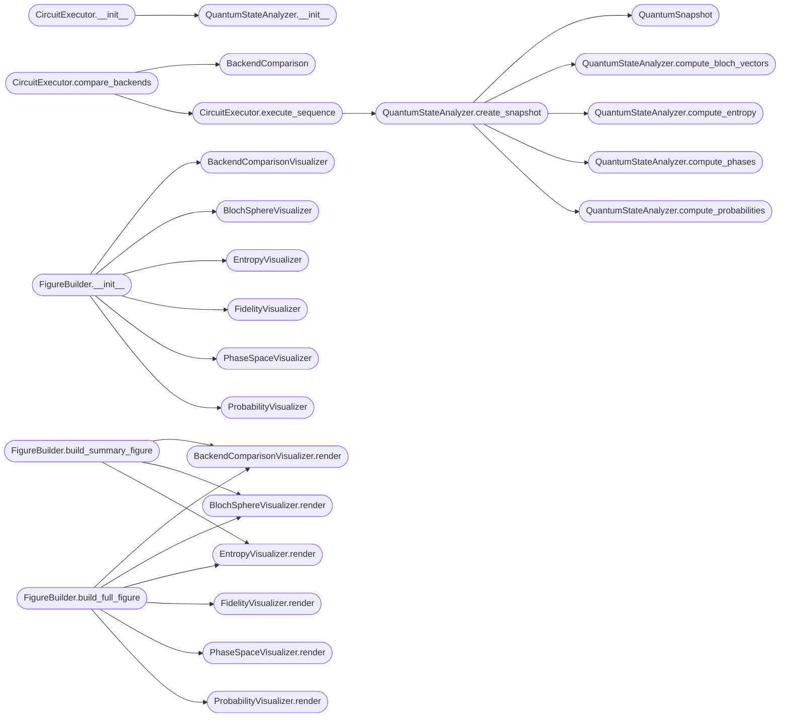

# `quantum_dash`

> Source: [quantum_dash.py:1](../../quantum_dash.py#L1) | language `py` | coverage 2.0% | [API index](../index.md)

quantum_brutalist_viz.py - Production Quantum State Visualizer ============================================================== High-fidelity 3D holographic visualization of quantum states using trained neural network backends (Hamiltonian, Schrodinger, Dirac).

Author: Gris Iscomeback
License: AGPL v3

## Contents

- **Classes:** [`BrutalistConfig`](#brutalistconfig), [`QuantumSnapshot`](#quantumsnapshot), [`BackendComparison`](#backendcomparison), [`VisualizationOutput`](#visualizationoutput), [`IVisualComponent`](#ivisualcomponent), [`ProbabilityVisualizer`](#probabilityvisualizer), [`BlochSphereVisualizer`](#blochspherevisualizer), [`PhaseSpaceVisualizer`](#phasespacevisualizer), [`EntropyVisualizer`](#entropyvisualizer), [`BackendComparisonVisualizer`](#backendcomparisonvisualizer), [`FidelityVisualizer`](#fidelityvisualizer), [`QuantumStateAnalyzer`](#quantumstateanalyzer), [`StandardCircuits`](#standardcircuits), [`CircuitExecutor`](#circuitexecutor), [`FigureBuilder`](#figurebuilder), [`QuantumVisualizer`](#quantumvisualizer)
- **Enums:** [`ColorScheme`](#colorscheme)
- **Functions:** [`main`](#main)
- **Constants:** [`UPLOAD_DIR`](#upload_dir)

## Type Diagram

```mermaid
classDiagram
    direction LR
    class ColorScheme
    <<enum>> ColorScheme
    ColorScheme : CYBERPUNK
    ColorScheme : MATRIX
    ColorScheme : QUANTUM_VOID
    ColorScheme : NEON_NOIR
    ColorScheme : PLASMA
    class BrutalistConfig
    BrutalistConfig : int grid_size
    BrutalistConfig : int hidden_dim
    BrutalistConfig : int expansion_dim
    BrutalistConfig : int num_spectral_layers
    BrutalistConfig : float dirac_mass
    BrutalistConfig : float dirac_c
    BrutalistConfig : str gamma_representation
    BrutalistConfig : float dt
    BrutalistConfig : float normalization_eps
    BrutalistConfig : float potential_depth
    BrutalistConfig : float potential_width
    BrutalistConfig : str hamiltonian_checkpoint
    BrutalistConfig : str schrodinger_checkpoint
    BrutalistConfig : str dirac_checkpoint
    BrutalistConfig : str device
    BrutalistConfig : int random_seed
    BrutalistConfig : int max_qubits
    BrutalistConfig : ColorScheme color_scheme
    BrutalistConfig : int figure_dpi
    BrutalistConfig : int figure_width_inches
    BrutalistConfig : int figure_height_inches
    BrutalistConfig : int particle_count
    BrutalistConfig : float glow_intensity
    BrutalistConfig : float hologram_opacity
    class QuantumSnapshot
    QuantumSnapshot : int step
    QuantumSnapshot : str gate_name
    QuantumSnapshot : npndarray probabilities
    QuantumSnapshot : npndarray phases
    QuantumSnapshot : float entropy
    QuantumSnapshot : List[Tuple[float, float, float]] bloch_vectors
    QuantumSnapshot : npndarray amplitudes
    QuantumSnapshot : int most_probable
    QuantumSnapshot : float norm
    QuantumSnapshot : int n_qubits
    QuantumSnapshot : float timestamp
    QuantumSnapshot : str backend_name
    class BackendComparison
    BackendComparison : str backend_name
    BackendComparison : List[QuantumSnapshot] snapshots
    BackendComparison : npndarray final_probabilities
    BackendComparison : float final_entropy
    BackendComparison : int most_probable_state
    BackendComparison : List[Tuple[int, float]] top_states
    BackendComparison : List[Tuple[float, float, float]] bloch_vectors
    BackendComparison : float fidelity_with_reference
    BackendComparison : float execution_time
    class VisualizationOutput
    VisualizationOutput : str html_path
    VisualizationOutput : str png_path
    VisualizationOutput : str npz_data_path
    VisualizationOutput : Dict[str, Any] metadata
    class IVisualComponent
    IVisualComponent : render()
    class ProbabilityVisualizer
    ProbabilityVisualizer : render()
    class BlochSphereVisualizer
    BlochSphereVisualizer : render()
    class PhaseSpaceVisualizer
    PhaseSpaceVisualizer : render()
    class EntropyVisualizer
    EntropyVisualizer : render()
    class BackendComparisonVisualizer
    BackendComparisonVisualizer : render()
    class FidelityVisualizer
    FidelityVisualizer : render()
    class QuantumStateAnalyzer
    QuantumStateAnalyzer : __init__()
    QuantumStateAnalyzer : compute_probabilities()
    QuantumStateAnalyzer : compute_phases()
    QuantumStateAnalyzer : compute_entropy()
    QuantumStateAnalyzer : compute_bloch_vectors()
    QuantumStateAnalyzer : create_snapshot()
    class StandardCircuits
    StandardCircuits : bell_state()
    StandardCircuits : ghz_state()
    StandardCircuits : qft()
    StandardCircuits : grover_oracle()
    StandardCircuits : grover_diffusion()
    class CircuitExecutor
    CircuitExecutor : __init__()
    CircuitExecutor : execute_sequence()
    CircuitExecutor : compare_backends()
    class FigureBuilder
    FigureBuilder : __init__()
    FigureBuilder : build_full_figure()
    FigureBuilder : build_summary_figure()
    class QuantumVisualizer
    QuantumVisualizer : __init__()
    QuantumVisualizer : visualize_bell_state()
    QuantumVisualizer : visualize_ghz_state()
    QuantumVisualizer : visualize_qft()
    QuantumVisualizer : visualize_grover()
    QuantumVisualizer : run_all()
    IVisualComponent <|-- ProbabilityVisualizer
    IVisualComponent <|-- BlochSphereVisualizer
    IVisualComponent <|-- PhaseSpaceVisualizer
    IVisualComponent <|-- EntropyVisualizer
    IVisualComponent <|-- BackendComparisonVisualizer
    IVisualComponent <|-- FidelityVisualizer
```



## Call Graph

Solid arrows stay in this module, dashed arrows leave it.



## Classes

<a id="brutalistconfig"></a>

### `BrutalistConfig`

`class` `dataclass` | [quantum_dash.py:115](../../quantum_dash.py#L115)

Decorators: `@dataclass`

```python
class BrutalistConfig
```

**Attributes**

| Name | Type | Default | Description |
|---|---|---|---|
| [`grid_size`](#brutalistconfig-grid_size) | `int` | `16` |  |
| [`hidden_dim`](#brutalistconfig-hidden_dim) | `int` | `32` |  |
| [`expansion_dim`](#brutalistconfig-expansion_dim) | `int` | `64` |  |
| [`num_spectral_layers`](#brutalistconfig-num_spectral_layers) | `int` | `2` |  |
| [`dirac_mass`](#brutalistconfig-dirac_mass) | `float` | `1.0` |  |
| [`dirac_c`](#brutalistconfig-dirac_c) | `float` | `1.0` |  |
| [`gamma_representation`](#brutalistconfig-gamma_representation) | `str` | `'dirac'` |  |
| [`dt`](#brutalistconfig-dt) | `float` | `0.01` |  |
| [`normalization_eps`](#brutalistconfig-normalization_eps) | `float` | `1e-08` |  |
| [`potential_depth`](#brutalistconfig-potential_depth) | `float` | `5.0` |  |
| [`potential_width`](#brutalistconfig-potential_width) | `float` | `0.3` |  |
| [`hamiltonian_checkpoint`](#brutalistconfig-hamiltonian_checkpoint) | `str` | `'hamiltonian.pth'` |  |
| [`schrodinger_checkpoint`](#brutalistconfig-schrodinger_checkpoint) | `str` | `'checkpoint_phase3_training_epoch_18921_20260224_154739.pth'` |  |
| [`dirac_checkpoint`](#brutalistconfig-dirac_checkpoint) | `str` | `'best_dirac.pth'` |  |
| [`device`](#brutalistconfig-device) | `str` | `'cpu'` |  |
| [`random_seed`](#brutalistconfig-random_seed) | `int` | `42` |  |
| [`max_qubits`](#brutalistconfig-max_qubits) | `int` | `8` |  |
| [`color_scheme`](#brutalistconfig-color_scheme) | `ColorScheme` | `ColorScheme.CYBERPUNK` |  |
| [`figure_dpi`](#brutalistconfig-figure_dpi) | `int` | `200` |  |
| [`figure_width_inches`](#brutalistconfig-figure_width_inches) | `int` | `24` |  |
| [`figure_height_inches`](#brutalistconfig-figure_height_inches) | `int` | `18` |  |
| [`particle_count`](#brutalistconfig-particle_count) | `int` | `2000` |  |
| [`glow_intensity`](#brutalistconfig-glow_intensity) | `float` | `2.0` |  |
| [`hologram_opacity`](#brutalistconfig-hologram_opacity) | `float` | `0.7` |  |
| [`bloom_strength`](#brutalistconfig-bloom_strength) | `float` | `1.5` |  |
| [`chromatic_aberration`](#brutalistconfig-chromatic_aberration) | `float` | `0.02` |  |
| [`camera_distance`](#brutalistconfig-camera_distance) | `float` | `3.0` |  |
| [`animation_frames`](#brutalistconfig-animation_frames) | `int` | `100` |  |
| [`sphere_resolution`](#brutalistconfig-sphere_resolution) | `int` | `40` |  |
| [`contour_levels`](#brutalistconfig-contour_levels) | `int` | `20` |  |
| [`entropy_base`](#brutalistconfig-entropy_base) | `float` | `2.0` |  |
| [`probability_threshold`](#brutalistconfig-probability_threshold) | `float` | `1e-06` |  |
| [`phase_normalization`](#brutalistconfig-phase_normalization) | `float` | `math.pi` |  |
| [`output_dir`](#brutalistconfig-output_dir) | `str` | `'download'` |  |
| [`backend_order`](#brutalistconfig-backend_order) | `Tuple[str, str, str]` | `('hamiltonian', 'schrodinger', 'dirac')` |  |
| [`default_n_qubits`](#brutalistconfig-default_n_qubits) | `int` | `3` |  |
| [`grover_iterations`](#brutalistconfig-grover_iterations) | `int` | `2` |  |
| [`grover_marked_state`](#brutalistconfig-grover_marked_state) | `int` | `5` |  |
| [`vqe_max_iterations`](#brutalistconfig-vqe_max_iterations) | `int` | `200` |  |
| [`vqe_tolerance`](#brutalistconfig-vqe_tolerance) | `float` | `1e-08` |  |
| [`scatter_point_size_min`](#brutalistconfig-scatter_point_size_min) | `float` | `5.0` |  |
| [`scatter_point_size_max`](#brutalistconfig-scatter_point_size_max) | `float` | `50.0` |  |
| [`line_width_base`](#brutalistconfig-line_width_base) | `float` | `2.0` |  |
| [`vector_scale`](#brutalistconfig-vector_scale) | `float` | `1.0` |  |
| [`field_resolution`](#brutalistconfig-field_resolution) | `int` | `25` |  |
| [`isosurface_count`](#brutalistconfig-isosurface_count) | `int` | `5` |  |
| [`trail_length`](#brutalistconfig-trail_length) | `int` | `50` |  |
| [`uncertainty_ring_radius`](#brutalistconfig-uncertainty_ring_radius) | `float` | `0.15` |  |
| [`grid_alpha`](#brutalistconfig-grid_alpha) | `float` | `0.3` |  |
| [`background_alpha`](#brutalistconfig-background_alpha) | `float` | `0.95` |  |

**Members**

| Member | Kind | Summary |
|---|---|---|
| [`colors`](#brutalistconfig-colors) | property |  |
| [`plotly_template`](#brutalistconfig-plotly_template) | property |  |

<a id="brutalistconfig-colors"></a>

#### `BrutalistConfig.colors`

`property` | [quantum_dash.py:168](../../quantum_dash.py#L168)

Decorators: `@property`

```python
def colors(self) -> Dict[str, str]
```

**Returns:** `Dict[str, str]`

<a id="brutalistconfig-plotly_template"></a>

#### `BrutalistConfig.plotly_template`

`property` | [quantum_dash.py:234](../../quantum_dash.py#L234)

Decorators: `@property`

```python
def plotly_template(self) -> str
```

**Returns:** `str`

---

<a id="quantumsnapshot"></a>

### `QuantumSnapshot`

`class` `dataclass` | [quantum_dash.py:239](../../quantum_dash.py#L239)

Decorators: `@dataclass`

```python
class QuantumSnapshot
```

**Attributes**

| Name | Type | Default | Description |
|---|---|---|---|
| [`step`](#quantumsnapshot-step) | `int` |  |  |
| [`gate_name`](#quantumsnapshot-gate_name) | `str` |  |  |
| [`probabilities`](#quantumsnapshot-probabilities) | `np.ndarray` |  |  |
| [`phases`](#quantumsnapshot-phases) | `np.ndarray` |  |  |
| [`entropy`](#quantumsnapshot-entropy) | `float` |  |  |
| [`bloch_vectors`](#quantumsnapshot-bloch_vectors) | `List[Tuple[float, float, float]]` |  |  |
| [`amplitudes`](#quantumsnapshot-amplitudes) | `np.ndarray` |  |  |
| [`most_probable`](#quantumsnapshot-most_probable) | `int` |  |  |
| [`norm`](#quantumsnapshot-norm) | `float` |  |  |
| [`n_qubits`](#quantumsnapshot-n_qubits) | `int` |  |  |
| [`timestamp`](#quantumsnapshot-timestamp) | `float` | `0.0` |  |
| [`backend_name`](#quantumsnapshot-backend_name) | `str` | `'unknown'` |  |

---

<a id="backendcomparison"></a>

### `BackendComparison`

`class` `dataclass` | [quantum_dash.py:255](../../quantum_dash.py#L255)

Decorators: `@dataclass`

```python
class BackendComparison
```

**Attributes**

| Name | Type | Default | Description |
|---|---|---|---|
| [`backend_name`](#backendcomparison-backend_name) | `str` |  |  |
| [`snapshots`](#backendcomparison-snapshots) | `List[QuantumSnapshot]` |  |  |
| [`final_probabilities`](#backendcomparison-final_probabilities) | `np.ndarray` |  |  |
| [`final_entropy`](#backendcomparison-final_entropy) | `float` |  |  |
| [`most_probable_state`](#backendcomparison-most_probable_state) | `int` |  |  |
| [`top_states`](#backendcomparison-top_states) | `List[Tuple[int, float]]` |  |  |
| [`bloch_vectors`](#backendcomparison-bloch_vectors) | `List[Tuple[float, float, float]]` |  |  |
| [`fidelity_with_reference`](#backendcomparison-fidelity_with_reference) | `float` |  |  |
| [`execution_time`](#backendcomparison-execution_time) | `float` |  |  |

---

<a id="visualizationoutput"></a>

### `VisualizationOutput`

`class` `dataclass` | [quantum_dash.py:268](../../quantum_dash.py#L268)

Decorators: `@dataclass`

```python
class VisualizationOutput
```

**Attributes**

| Name | Type | Default | Description |
|---|---|---|---|
| [`html_path`](#visualizationoutput-html_path) | `str` |  |  |
| [`png_path`](#visualizationoutput-png_path) | `str` |  |  |
| [`npz_data_path`](#visualizationoutput-npz_data_path) | `str` |  |  |
| [`metadata`](#visualizationoutput-metadata) | `Dict[str, Any]` |  |  |

---

<a id="ivisualcomponent"></a>

### `IVisualComponent`

`class` `abstract` | [quantum_dash.py:275](../../quantum_dash.py#L275)

```python
class IVisualComponent(ABC)
```

Bases: `ABC`

Subclasses: [`BackendComparisonVisualizer`](#backendcomparisonvisualizer), [`BlochSphereVisualizer`](#blochspherevisualizer), [`EntropyVisualizer`](#entropyvisualizer), [`FidelityVisualizer`](#fidelityvisualizer), [`PhaseSpaceVisualizer`](#phasespacevisualizer), [`ProbabilityVisualizer`](#probabilityvisualizer)

**Members**

| Member | Kind | Summary |
|---|---|---|
| [`render`](#ivisualcomponent-render) | method |  |

<a id="ivisualcomponent-render"></a>

#### `IVisualComponent.render`

`method` `abstract` | [quantum_dash.py:277](../../quantum_dash.py#L277)

Decorators: `@abstractmethod`

```python
def render(self, data: Any, axes: Any, config: BrutalistConfig) -> None
```

**Parameters**

| Name | Type | Default | Description |
|---|---|---|---|
| `data` | `Any` |  |  |
| `axes` | `Any` |  |  |
| `config` | `BrutalistConfig` |  |  |

---

<a id="probabilityvisualizer"></a>

### `ProbabilityVisualizer`

`class` | [quantum_dash.py:281](../../quantum_dash.py#L281)

```python
class ProbabilityVisualizer(IVisualComponent)
```

Bases: [`IVisualComponent`](#ivisualcomponent)

**Members**

| Member | Kind | Summary |
|---|---|---|
| [`render`](#probabilityvisualizer-render) | method |  |

<a id="probabilityvisualizer-render"></a>

#### `ProbabilityVisualizer.render`

`method` | [quantum_dash.py:282](../../quantum_dash.py#L282)

```python
def render(self, snapshot: QuantumSnapshot, axes: Any, config: BrutalistConfig) -> None
```

**Parameters**

| Name | Type | Default | Description |
|---|---|---|---|
| `snapshot` | `QuantumSnapshot` |  |  |
| `axes` | `Any` |  |  |
| `config` | `BrutalistConfig` |  |  |

*Called by:* [`FigureBuilder.build_full_figure`](#figurebuilder-build_full_figure), [`FigureBuilder.build_summary_figure`](#figurebuilder-build_summary_figure)

---

<a id="blochspherevisualizer"></a>

### `BlochSphereVisualizer`

`class` | [quantum_dash.py:340](../../quantum_dash.py#L340)

```python
class BlochSphereVisualizer(IVisualComponent)
```

Bases: [`IVisualComponent`](#ivisualcomponent)

**Members**

| Member | Kind | Summary |
|---|---|---|
| [`render`](#blochspherevisualizer-render) | method |  |

<a id="blochspherevisualizer-render"></a>

#### `BlochSphereVisualizer.render`

`method` | [quantum_dash.py:341](../../quantum_dash.py#L341)

```python
def render(self, snapshot: QuantumSnapshot, axes: Any, config: BrutalistConfig) -> None
```

**Parameters**

| Name | Type | Default | Description |
|---|---|---|---|
| `snapshot` | `QuantumSnapshot` |  |  |
| `axes` | `Any` |  |  |
| `config` | `BrutalistConfig` |  |  |

*Called by:* [`FigureBuilder.build_full_figure`](#figurebuilder-build_full_figure), [`FigureBuilder.build_summary_figure`](#figurebuilder-build_summary_figure)

---

<a id="phasespacevisualizer"></a>

### `PhaseSpaceVisualizer`

`class` | [quantum_dash.py:447](../../quantum_dash.py#L447)

```python
class PhaseSpaceVisualizer(IVisualComponent)
```

Bases: [`IVisualComponent`](#ivisualcomponent)

**Members**

| Member | Kind | Summary |
|---|---|---|
| [`render`](#phasespacevisualizer-render) | method |  |

<a id="phasespacevisualizer-render"></a>

#### `PhaseSpaceVisualizer.render`

`method` | [quantum_dash.py:448](../../quantum_dash.py#L448)

```python
def render(self, snapshot: QuantumSnapshot, axes: Any, config: BrutalistConfig) -> None
```

**Parameters**

| Name | Type | Default | Description |
|---|---|---|---|
| `snapshot` | `QuantumSnapshot` |  |  |
| `axes` | `Any` |  |  |
| `config` | `BrutalistConfig` |  |  |

*Called by:* [`FigureBuilder.build_full_figure`](#figurebuilder-build_full_figure), [`FigureBuilder.build_summary_figure`](#figurebuilder-build_summary_figure)

---

<a id="entropyvisualizer"></a>

### `EntropyVisualizer`

`class` | [quantum_dash.py:509](../../quantum_dash.py#L509)

```python
class EntropyVisualizer(IVisualComponent)
```

Bases: [`IVisualComponent`](#ivisualcomponent)

**Members**

| Member | Kind | Summary |
|---|---|---|
| [`render`](#entropyvisualizer-render) | method |  |

<a id="entropyvisualizer-render"></a>

#### `EntropyVisualizer.render`

`method` | [quantum_dash.py:510](../../quantum_dash.py#L510)

```python
def render(self, snapshots: List[QuantumSnapshot], axes: Any, config: BrutalistConfig) -> None
```

**Parameters**

| Name | Type | Default | Description |
|---|---|---|---|
| `snapshots` | `List[QuantumSnapshot]` |  |  |
| `axes` | `Any` |  |  |
| `config` | `BrutalistConfig` |  |  |

*Called by:* [`FigureBuilder.build_full_figure`](#figurebuilder-build_full_figure), [`FigureBuilder.build_summary_figure`](#figurebuilder-build_summary_figure)

---

<a id="backendcomparisonvisualizer"></a>

### `BackendComparisonVisualizer`

`class` | [quantum_dash.py:583](../../quantum_dash.py#L583)

```python
class BackendComparisonVisualizer(IVisualComponent)
```

Bases: [`IVisualComponent`](#ivisualcomponent)

**Members**

| Member | Kind | Summary |
|---|---|---|
| [`render`](#backendcomparisonvisualizer-render) | method |  |

<a id="backendcomparisonvisualizer-render"></a>

#### `BackendComparisonVisualizer.render`

`method` | [quantum_dash.py:584](../../quantum_dash.py#L584)

```python
def render(self, comparisons: List[BackendComparison], axes: Any, config: BrutalistConfig) -> None
```

**Parameters**

| Name | Type | Default | Description |
|---|---|---|---|
| `comparisons` | `List[BackendComparison]` |  |  |
| `axes` | `Any` |  |  |
| `config` | `BrutalistConfig` |  |  |

*Called by:* [`FigureBuilder.build_full_figure`](#figurebuilder-build_full_figure), [`FigureBuilder.build_summary_figure`](#figurebuilder-build_summary_figure)

---

<a id="fidelityvisualizer"></a>

### `FidelityVisualizer`

`class` | [quantum_dash.py:633](../../quantum_dash.py#L633)

```python
class FidelityVisualizer(IVisualComponent)
```

Bases: [`IVisualComponent`](#ivisualcomponent)

**Members**

| Member | Kind | Summary |
|---|---|---|
| [`render`](#fidelityvisualizer-render) | method |  |

<a id="fidelityvisualizer-render"></a>

#### `FidelityVisualizer.render`

`method` | [quantum_dash.py:634](../../quantum_dash.py#L634)

```python
def render(self, comparisons: List[BackendComparison], axes: Any, config: BrutalistConfig) -> None
```

**Parameters**

| Name | Type | Default | Description |
|---|---|---|---|
| `comparisons` | `List[BackendComparison]` |  |  |
| `axes` | `Any` |  |  |
| `config` | `BrutalistConfig` |  |  |

*Called by:* [`FigureBuilder.build_full_figure`](#figurebuilder-build_full_figure), [`FigureBuilder.build_summary_figure`](#figurebuilder-build_summary_figure)

---

<a id="quantumstateanalyzer"></a>

### `QuantumStateAnalyzer`

`class` | [quantum_dash.py:674](../../quantum_dash.py#L674)

```python
class QuantumStateAnalyzer
```

**Members**

| Member | Kind | Summary |
|---|---|---|
| [`__init__`](#quantumstateanalyzer-__init__) | constructor |  |
| [`compute_probabilities`](#quantumstateanalyzer-compute_probabilities) | method |  |
| [`compute_phases`](#quantumstateanalyzer-compute_phases) | method |  |
| [`compute_entropy`](#quantumstateanalyzer-compute_entropy) | method |  |
| [`compute_bloch_vectors`](#quantumstateanalyzer-compute_bloch_vectors) | method |  |
| [`create_snapshot`](#quantumstateanalyzer-create_snapshot) | method |  |

<a id="quantumstateanalyzer-__init__"></a>

#### `QuantumStateAnalyzer.__init__`

`constructor` | [quantum_dash.py:675](../../quantum_dash.py#L675)

```python
def __init__(self, config: BrutalistConfig)
```

**Parameters**

| Name | Type | Default | Description |
|---|---|---|---|
| `config` | `BrutalistConfig` |  |  |

*Called by:* [`CircuitExecutor.__init__`](#circuitexecutor-__init__)

<a id="quantumstateanalyzer-compute_probabilities"></a>

#### `QuantumStateAnalyzer.compute_probabilities`

`method` | [quantum_dash.py:678](../../quantum_dash.py#L678)

```python
def compute_probabilities(self, state: JointHilbertState) -> np.ndarray
```

**Parameters**

| Name | Type | Default | Description |
|---|---|---|---|
| `state` | `JointHilbertState` |  |  |

**Returns:** `np.ndarray`

*Calls:* [`JointHilbertState.probabilities`](quantum_computer.py.md#jointhilbertstate-probabilities)

*Called by:* [`QuantumStateAnalyzer.create_snapshot`](#quantumstateanalyzer-create_snapshot), [`QuantumStateAnalyzer.create_snapshot`](quantum_visualizer.py.md#quantumstateanalyzer-create_snapshot)

<a id="quantumstateanalyzer-compute_phases"></a>

#### `QuantumStateAnalyzer.compute_phases`

`method` | [quantum_dash.py:684](../../quantum_dash.py#L684)

```python
def compute_phases(self, state: JointHilbertState) -> np.ndarray
```

**Parameters**

| Name | Type | Default | Description |
|---|---|---|---|
| `state` | `JointHilbertState` |  |  |

**Returns:** `np.ndarray`

*Called by:* [`QuantumStateAnalyzer.create_snapshot`](#quantumstateanalyzer-create_snapshot), [`QuantumStateAnalyzer.create_snapshot`](quantum_visualizer.py.md#quantumstateanalyzer-create_snapshot)

<a id="quantumstateanalyzer-compute_entropy"></a>

#### `QuantumStateAnalyzer.compute_entropy`

`method` | [quantum_dash.py:696](../../quantum_dash.py#L696)

```python
def compute_entropy(self, probs: np.ndarray) -> float
```

**Parameters**

| Name | Type | Default | Description |
|---|---|---|---|
| `probs` | `np.ndarray` |  |  |

**Returns:** `float`

*Called by:* [`QuantumStateAnalyzer.create_snapshot`](#quantumstateanalyzer-create_snapshot), [`QuantumStateAnalyzer.create_snapshot`](quantum_visualizer.py.md#quantumstateanalyzer-create_snapshot)

<a id="quantumstateanalyzer-compute_bloch_vectors"></a>

#### `QuantumStateAnalyzer.compute_bloch_vectors`

`method` | [quantum_dash.py:704](../../quantum_dash.py#L704)

```python
def compute_bloch_vectors(self, state: JointHilbertState) -> List[Tuple[float, float, float]]
```

**Parameters**

| Name | Type | Default | Description |
|---|---|---|---|
| `state` | `JointHilbertState` |  |  |

**Returns:** `List[Tuple[float, float, float]]`

*Calls:* [`JointHilbertState.bloch_vector`](quantum_computer.py.md#jointhilbertstate-bloch_vector)

*Called by:* [`QuantumStateAnalyzer.create_snapshot`](#quantumstateanalyzer-create_snapshot), [`QuantumStateAnalyzer.create_snapshot`](quantum_visualizer.py.md#quantumstateanalyzer-create_snapshot)

<a id="quantumstateanalyzer-create_snapshot"></a>

#### `QuantumStateAnalyzer.create_snapshot`

`method` | [quantum_dash.py:713](../../quantum_dash.py#L713)

```python
def create_snapshot(self, state: JointHilbertState, step: int, gate_name: str, backend_name: str = 'unknown') -> QuantumSnapshot
```

**Parameters**

| Name | Type | Default | Description |
|---|---|---|---|
| `state` | `JointHilbertState` |  |  |
| `step` | `int` |  |  |
| `gate_name` | `str` |  |  |
| `backend_name` | `str` | `'unknown'` |  |

**Returns:** `QuantumSnapshot`

*Calls:* [`QuantumSnapshot`](#quantumsnapshot), [`QuantumStateAnalyzer.compute_bloch_vectors`](#quantumstateanalyzer-compute_bloch_vectors), [`QuantumStateAnalyzer.compute_entropy`](#quantumstateanalyzer-compute_entropy), [`QuantumStateAnalyzer.compute_phases`](#quantumstateanalyzer-compute_phases), [`QuantumStateAnalyzer.compute_probabilities`](#quantumstateanalyzer-compute_probabilities)

*Called by:* [`CircuitExecutor.execute_sequence`](#circuitexecutor-execute_sequence), [`CircuitExecutor.execute_sequence`](quantum_visualizer.py.md#circuitexecutor-execute_sequence)

---

<a id="standardcircuits"></a>

### `StandardCircuits`

`class` | [quantum_dash.py:754](../../quantum_dash.py#L754)

```python
class StandardCircuits
```

**Members**

| Member | Kind | Summary |
|---|---|---|
| [`bell_state`](#standardcircuits-bell_state) | staticmethod |  |
| [`ghz_state`](#standardcircuits-ghz_state) | staticmethod |  |
| [`qft`](#standardcircuits-qft) | staticmethod |  |
| [`grover_oracle`](#standardcircuits-grover_oracle) | staticmethod |  |
| [`grover_diffusion`](#standardcircuits-grover_diffusion) | staticmethod |  |

<a id="standardcircuits-bell_state"></a>

#### `StandardCircuits.bell_state`

`staticmethod` | [quantum_dash.py:756](../../quantum_dash.py#L756)

Decorators: `@staticmethod`

```python
def bell_state() -> List[Tuple[str, List[int], Dict[str, float]]]
```

**Returns:** `List[Tuple[str, List[int], Dict[str, float]]]`

*Called by:* [`QuantumVisualizer.visualize_bell_state`](#quantumvisualizer-visualize_bell_state), [`QuantumVisualizer.visualize_bell_state`](quantum_visualizer.py.md#quantumvisualizer-visualize_bell_state)

<a id="standardcircuits-ghz_state"></a>

#### `StandardCircuits.ghz_state`

`staticmethod` | [quantum_dash.py:760](../../quantum_dash.py#L760)

Decorators: `@staticmethod`

```python
def ghz_state(n_qubits: int) -> List[Tuple[str, List[int], Dict[str, float]]]
```

**Parameters**

| Name | Type | Default | Description |
|---|---|---|---|
| `n_qubits` | `int` |  |  |

**Returns:** `List[Tuple[str, List[int], Dict[str, float]]]`

*Called by:* [`QuantumVisualizer.visualize_ghz_state`](#quantumvisualizer-visualize_ghz_state), [`QuantumVisualizer.visualize_ghz_state`](quantum_visualizer.py.md#quantumvisualizer-visualize_ghz_state)

<a id="standardcircuits-qft"></a>

#### `StandardCircuits.qft`

`staticmethod` | [quantum_dash.py:767](../../quantum_dash.py#L767)

Decorators: `@staticmethod`

```python
def qft(n_qubits: int) -> List[Tuple[str, List[int], Dict[str, float]]]
```

**Parameters**

| Name | Type | Default | Description |
|---|---|---|---|
| `n_qubits` | `int` |  |  |

**Returns:** `List[Tuple[str, List[int], Dict[str, float]]]`

*Called by:* [`QuantumVisualizer.visualize_qft`](#quantumvisualizer-visualize_qft), [`QuantumVisualizer.visualize_qft`](quantum_visualizer.py.md#quantumvisualizer-visualize_qft)

<a id="standardcircuits-grover_oracle"></a>

#### `StandardCircuits.grover_oracle`

`staticmethod` | [quantum_dash.py:782](../../quantum_dash.py#L782)

Decorators: `@staticmethod`

```python
def grover_oracle(n_qubits: int, marked: int) -> List[Tuple[str, List[int], Dict[str, float]]]
```

**Parameters**

| Name | Type | Default | Description |
|---|---|---|---|
| `n_qubits` | `int` |  |  |
| `marked` | `int` |  |  |

**Returns:** `List[Tuple[str, List[int], Dict[str, float]]]`

*Called by:* [`QuantumVisualizer.visualize_grover`](#quantumvisualizer-visualize_grover), [`QuantumVisualizer.visualize_grover`](quantum_visualizer.py.md#quantumvisualizer-visualize_grover)

<a id="standardcircuits-grover_diffusion"></a>

#### `StandardCircuits.grover_diffusion`

`staticmethod` | [quantum_dash.py:794](../../quantum_dash.py#L794)

Decorators: `@staticmethod`

```python
def grover_diffusion(n_qubits: int) -> List[Tuple[str, List[int], Dict[str, float]]]
```

**Parameters**

| Name | Type | Default | Description |
|---|---|---|---|
| `n_qubits` | `int` |  |  |

**Returns:** `List[Tuple[str, List[int], Dict[str, float]]]`

*Called by:* [`QuantumVisualizer.visualize_grover`](#quantumvisualizer-visualize_grover), [`QuantumVisualizer.visualize_grover`](quantum_visualizer.py.md#quantumvisualizer-visualize_grover)

---

<a id="circuitexecutor"></a>

### `CircuitExecutor`

`class` | [quantum_dash.py:806](../../quantum_dash.py#L806)

```python
class CircuitExecutor
```

**Members**

| Member | Kind | Summary |
|---|---|---|
| [`__init__`](#circuitexecutor-__init__) | constructor |  |
| [`execute_sequence`](#circuitexecutor-execute_sequence) | method |  |
| [`compare_backends`](#circuitexecutor-compare_backends) | method |  |

<a id="circuitexecutor-__init__"></a>

#### `CircuitExecutor.__init__`

`constructor` | [quantum_dash.py:807](../../quantum_dash.py#L807)

```python
def __init__(self, qc: QuantumComputer, config: BrutalistConfig)
```

**Parameters**

| Name | Type | Default | Description |
|---|---|---|---|
| `qc` | `QuantumComputer` |  |  |
| `config` | `BrutalistConfig` |  |  |

*Calls:* [`QuantumStateAnalyzer.__init__`](#quantumstateanalyzer-__init__)

<a id="circuitexecutor-execute_sequence"></a>

#### `CircuitExecutor.execute_sequence`

`method` | [quantum_dash.py:812](../../quantum_dash.py#L812)

```python
def execute_sequence(self, gates: Sequence[Tuple[str, List[int], Dict[str, float]]], n_qubits: int, backend_name: str) -> List[QuantumSnapshot]
```

**Parameters**

| Name | Type | Default | Description |
|---|---|---|---|
| `gates` | `Sequence[Tuple[str, List[int], Dict[str, float]]]` |  |  |
| `n_qubits` | `int` |  |  |
| `backend_name` | `str` |  |  |

**Returns:** `List[QuantumSnapshot]`

*Calls:* [`QuantumStateAnalyzer.create_snapshot`](#quantumstateanalyzer-create_snapshot)

*Called by:* [`CircuitExecutor.compare_backends`](#circuitexecutor-compare_backends), [`CircuitExecutor.compare_backends`](quantum_visualizer.py.md#circuitexecutor-compare_backends), [`QuantumVisualizer.visualize_bell_state`](quantum_visualizer.py.md#quantumvisualizer-visualize_bell_state), [`QuantumVisualizer.visualize_custom_circuit`](quantum_visualizer.py.md#quantumvisualizer-visualize_custom_circuit), [`QuantumVisualizer.visualize_ghz_state`](quantum_visualizer.py.md#quantumvisualizer-visualize_ghz_state), [`QuantumVisualizer.visualize_grover`](quantum_visualizer.py.md#quantumvisualizer-visualize_grover), [`QuantumVisualizer.visualize_qft`](quantum_visualizer.py.md#quantumvisualizer-visualize_qft)

<a id="circuitexecutor-compare_backends"></a>

#### `CircuitExecutor.compare_backends`

`method` | [quantum_dash.py:835](../../quantum_dash.py#L835)

```python
def compare_backends(self, gates: Sequence[Tuple[str, List[int], Dict[str, float]]], n_qubits: int) -> List[BackendComparison]
```

**Parameters**

| Name | Type | Default | Description |
|---|---|---|---|
| `gates` | `Sequence[Tuple[str, List[int], Dict[str, float]]]` |  |  |
| `n_qubits` | `int` |  |  |

**Returns:** `List[BackendComparison]`

*Calls:* [`BackendComparison`](#backendcomparison), [`CircuitExecutor.execute_sequence`](#circuitexecutor-execute_sequence)

*Called by:* [`QuantumVisualizer.visualize_bell_state`](quantum_visualizer.py.md#quantumvisualizer-visualize_bell_state), [`QuantumVisualizer.visualize_custom_circuit`](quantum_visualizer.py.md#quantumvisualizer-visualize_custom_circuit), [`QuantumVisualizer.visualize_ghz_state`](quantum_visualizer.py.md#quantumvisualizer-visualize_ghz_state), [`QuantumVisualizer.visualize_grover`](quantum_visualizer.py.md#quantumvisualizer-visualize_grover), [`QuantumVisualizer.visualize_qft`](quantum_visualizer.py.md#quantumvisualizer-visualize_qft)

---

<a id="figurebuilder"></a>

### `FigureBuilder`

`class` | [quantum_dash.py:873](../../quantum_dash.py#L873)

```python
class FigureBuilder
```

**Members**

| Member | Kind | Summary |
|---|---|---|
| [`__init__`](#figurebuilder-__init__) | constructor |  |
| [`build_full_figure`](#figurebuilder-build_full_figure) | method |  |
| [`build_summary_figure`](#figurebuilder-build_summary_figure) | method |  |

<a id="figurebuilder-__init__"></a>

#### `FigureBuilder.__init__`

`constructor` | [quantum_dash.py:874](../../quantum_dash.py#L874)

```python
def __init__(self, config: BrutalistConfig)
```

**Parameters**

| Name | Type | Default | Description |
|---|---|---|---|
| `config` | `BrutalistConfig` |  |  |

*Calls:* [`BackendComparisonVisualizer`](#backendcomparisonvisualizer), [`BlochSphereVisualizer`](#blochspherevisualizer), [`EntropyVisualizer`](#entropyvisualizer), [`FidelityVisualizer`](#fidelityvisualizer), [`PhaseSpaceVisualizer`](#phasespacevisualizer), [`ProbabilityVisualizer`](#probabilityvisualizer)

<a id="figurebuilder-build_full_figure"></a>

#### `FigureBuilder.build_full_figure`

`method` | [quantum_dash.py:883](../../quantum_dash.py#L883)

```python
def build_full_figure(self, snapshots: List[QuantumSnapshot], comparisons: List[BackendComparison]) -> Any
```

**Parameters**

| Name | Type | Default | Description |
|---|---|---|---|
| `snapshots` | `List[QuantumSnapshot]` |  |  |
| `comparisons` | `List[BackendComparison]` |  |  |

**Returns:** `Any`

*Calls:* [`BackendComparisonVisualizer.render`](#backendcomparisonvisualizer-render), [`BlochSphereVisualizer.render`](#blochspherevisualizer-render), [`EntropyVisualizer.render`](#entropyvisualizer-render), [`FidelityVisualizer.render`](#fidelityvisualizer-render), [`PhaseSpaceVisualizer.render`](#phasespacevisualizer-render), [`ProbabilityVisualizer.render`](#probabilityvisualizer-render)

<a id="figurebuilder-build_summary_figure"></a>

#### `FigureBuilder.build_summary_figure`

`method` | [quantum_dash.py:923](../../quantum_dash.py#L923)

```python
def build_summary_figure(self, snapshots: List[QuantumSnapshot], comparisons: List[BackendComparison]) -> Any
```

**Parameters**

| Name | Type | Default | Description |
|---|---|---|---|
| `snapshots` | `List[QuantumSnapshot]` |  |  |
| `comparisons` | `List[BackendComparison]` |  |  |

**Returns:** `Any`

*Calls:* [`BackendComparisonVisualizer.render`](#backendcomparisonvisualizer-render), [`BlochSphereVisualizer.render`](#blochspherevisualizer-render), [`EntropyVisualizer.render`](#entropyvisualizer-render), [`FidelityVisualizer.render`](#fidelityvisualizer-render), [`PhaseSpaceVisualizer.render`](#phasespacevisualizer-render), [`ProbabilityVisualizer.render`](#probabilityvisualizer-render)

*Called by:* [`QuantumVisualizer.visualize_bell_state`](quantum_visualizer.py.md#quantumvisualizer-visualize_bell_state), [`QuantumVisualizer.visualize_custom_circuit`](quantum_visualizer.py.md#quantumvisualizer-visualize_custom_circuit), [`QuantumVisualizer.visualize_ghz_state`](quantum_visualizer.py.md#quantumvisualizer-visualize_ghz_state), [`QuantumVisualizer.visualize_grover`](quantum_visualizer.py.md#quantumvisualizer-visualize_grover), [`QuantumVisualizer.visualize_qft`](quantum_visualizer.py.md#quantumvisualizer-visualize_qft)

---

<a id="quantumvisualizer"></a>

### `QuantumVisualizer`

`class` | [quantum_dash.py:958](../../quantum_dash.py#L958)

```python
class QuantumVisualizer
```

**Members**

| Member | Kind | Summary |
|---|---|---|
| [`__init__`](#quantumvisualizer-__init__) | constructor |  |
| [`visualize_bell_state`](#quantumvisualizer-visualize_bell_state) | method |  |
| [`visualize_ghz_state`](#quantumvisualizer-visualize_ghz_state) | method |  |
| [`visualize_qft`](#quantumvisualizer-visualize_qft) | method |  |
| [`visualize_grover`](#quantumvisualizer-visualize_grover) | method |  |
| [`run_all`](#quantumvisualizer-run_all) | method |  |

<a id="quantumvisualizer-__init__"></a>

#### `QuantumVisualizer.__init__`

`constructor` | [quantum_dash.py:959](../../quantum_dash.py#L959)

```python
def __init__(self, config: BrutalistConfig)
```

**Parameters**

| Name | Type | Default | Description |
|---|---|---|---|
| `config` | `BrutalistConfig` |  |  |

*Called by:* [`main`](#main)

<a id="quantumvisualizer-visualize_bell_state"></a>

#### `QuantumVisualizer.visualize_bell_state`

`method` | [quantum_dash.py:1010](../../quantum_dash.py#L1010)

```python
def visualize_bell_state(self) -> VisualizationOutput
```

**Returns:** `VisualizationOutput`

*Calls:* [`StandardCircuits.bell_state`](#standardcircuits-bell_state)

*Called by:* [`QuantumVisualizer.run_all`](#quantumvisualizer-run_all), [`main`](#main), [`QuantumVisualizer.run_all_visualizations`](quantum_visualizer.py.md#quantumvisualizer-run_all_visualizations), [`main`](quantum_visualizer.py.md#main)

<a id="quantumvisualizer-visualize_ghz_state"></a>

#### `QuantumVisualizer.visualize_ghz_state`

`method` | [quantum_dash.py:1016](../../quantum_dash.py#L1016)

```python
def visualize_ghz_state(self, n_qubits: int = None) -> VisualizationOutput
```

**Parameters**

| Name | Type | Default | Description |
|---|---|---|---|
| `n_qubits` | `int` | `None` |  |

**Returns:** `VisualizationOutput`

*Calls:* [`StandardCircuits.ghz_state`](#standardcircuits-ghz_state)

*Called by:* [`BrutalVizEngine.run_brutal_viz`](qc_dashboard.py.md#brutalvizengine-run_brutal_viz), [`QuantumVisualizer.run_all`](#quantumvisualizer-run_all), [`main`](#main), [`QuantumVisualizer.run_all_visualizations`](quantum_visualizer.py.md#quantumvisualizer-run_all_visualizations), [`main`](quantum_visualizer.py.md#main)

<a id="quantumvisualizer-visualize_qft"></a>

#### `QuantumVisualizer.visualize_qft`

`method` | [quantum_dash.py:1022](../../quantum_dash.py#L1022)

```python
def visualize_qft(self, n_qubits: int = None) -> VisualizationOutput
```

**Parameters**

| Name | Type | Default | Description |
|---|---|---|---|
| `n_qubits` | `int` | `None` |  |

**Returns:** `VisualizationOutput`

*Calls:* [`StandardCircuits.qft`](#standardcircuits-qft)

*Called by:* [`BrutalVizEngine.run_brutal_viz`](qc_dashboard.py.md#brutalvizengine-run_brutal_viz), [`QuantumVisualizer.run_all`](#quantumvisualizer-run_all), [`main`](#main), [`QuantumVisualizer.run_all_visualizations`](quantum_visualizer.py.md#quantumvisualizer-run_all_visualizations), [`main`](quantum_visualizer.py.md#main)

<a id="quantumvisualizer-visualize_grover"></a>

#### `QuantumVisualizer.visualize_grover`

`method` | [quantum_dash.py:1028](../../quantum_dash.py#L1028)

```python
def visualize_grover(self, n_qubits: int = None, marked_state: int = None) -> VisualizationOutput
```

**Parameters**

| Name | Type | Default | Description |
|---|---|---|---|
| `n_qubits` | `int` | `None` |  |
| `marked_state` | `int` | `None` |  |

**Returns:** `VisualizationOutput`

*Calls:* [`StandardCircuits.grover_diffusion`](#standardcircuits-grover_diffusion), [`StandardCircuits.grover_oracle`](#standardcircuits-grover_oracle)

*Called by:* [`QuantumVisualizer.run_all`](#quantumvisualizer-run_all), [`main`](#main), [`QuantumVisualizer.run_all_visualizations`](quantum_visualizer.py.md#quantumvisualizer-run_all_visualizations), [`main`](quantum_visualizer.py.md#main)

<a id="quantumvisualizer-run_all"></a>

#### `QuantumVisualizer.run_all`

`method` | [quantum_dash.py:1174](../../quantum_dash.py#L1174)

```python
def run_all(self) -> Dict[str, VisualizationOutput]
```

**Returns:** `Dict[str, VisualizationOutput]`

*Calls:* [`QuantumVisualizer.visualize_bell_state`](#quantumvisualizer-visualize_bell_state), [`QuantumVisualizer.visualize_ghz_state`](#quantumvisualizer-visualize_ghz_state), [`QuantumVisualizer.visualize_grover`](#quantumvisualizer-visualize_grover), [`QuantumVisualizer.visualize_qft`](#quantumvisualizer-visualize_qft)

*Called by:* [`main`](#main)

---

## Enums

<a id="colorscheme"></a>

### `ColorScheme`

`enum` | [quantum_dash.py:106](../../quantum_dash.py#L106)

```python
class ColorScheme(Enum)
```

Bases: `Enum`

**Attributes**

| Name | Type | Default | Description |
|---|---|---|---|
| [`CYBERPUNK`](#colorscheme-cyberpunk) |  | `'cyberpunk'` |  |
| [`MATRIX`](#colorscheme-matrix) |  | `'matrix'` |  |
| [`QUANTUM_VOID`](#colorscheme-quantum_void) |  | `'quantum_void'` |  |
| [`NEON_NOIR`](#colorscheme-neon_noir) |  | `'neon_noir'` |  |
| [`PLASMA`](#colorscheme-plasma) |  | `'plasma'` |  |

---

## Functions

<a id="main"></a>

### `main`

`function` | [quantum_dash.py:1199](../../quantum_dash.py#L1199)

```python
def main()
```

*Calls:* [`BrutalistConfig`](#brutalistconfig), [`QuantumVisualizer.__init__`](#quantumvisualizer-__init__), [`QuantumVisualizer.run_all`](#quantumvisualizer-run_all), [`QuantumVisualizer.visualize_bell_state`](#quantumvisualizer-visualize_bell_state), [`QuantumVisualizer.visualize_ghz_state`](#quantumvisualizer-visualize_ghz_state), [`QuantumVisualizer.visualize_grover`](#quantumvisualizer-visualize_grover), [`QuantumVisualizer.visualize_qft`](#quantumvisualizer-visualize_qft)

---

## Constants

<a id="upload_dir"></a>

### `UPLOAD_DIR`

`constant` | [quantum_dash.py:29](../../quantum_dash.py#L29)

```python
UPLOAD_DIR = os.path.dirname(os.path.abspath(__file__))
```

---
