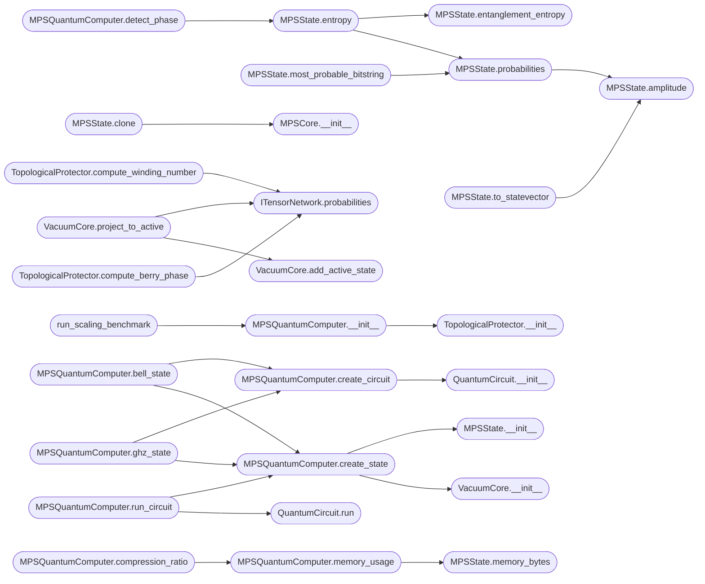

# `quantum_framework_core`

> Source: [quantum_framework_core.py:1](../../quantum_framework_core.py#L1) | language `py` | coverage 85.3% | [API index](../index.md)

Quantum Framework Core Module ============================= Unified core module for quantum simulation using MPS-based Hilbert space representation.

Achieves sub-exponential memory scaling O(n * chi^2) instead of O(2^n) for full statevector representation.

This module consolidates:
    - Configuration loading from TOML
    - MPS (Matrix Product State) tensor network representation
    - Physics backends (Hamiltonian, Schrodinger, Dirac)
    - Quantum gate registry with MPS-compatible operations
    - Quantum circuit builder and executor

Author: Gris Iscomeback
License: AGPL v3

## Contents

- **Classes:** [`FrameworkConfig`](#frameworkconfig), [`AtomData`](#atomdata), [`MoleculeData`](#moleculedata), [`OrbitalData`](#orbitaldata), [`ConfigLoader`](#configloader), [`ITensorNetwork`](#itensornetwork), [`MPSCore`](#mpscore), [`MPSState`](#mpsstate), [`VacuumCore`](#vacuumcore), [`TopologicalProtector`](#topologicalprotector), [`IQuantumGate`](#iquantumgate), [`HadamardGate`](#hadamardgate), [`PauliXGate`](#paulixgate), [`PauliYGate`](#pauliygate), [`PauliZGate`](#paulizgate), [`SGate`](#sgate), [`TGate`](#tgate), [`RxGate`](#rxgate), [`RyGate`](#rygate), [`RzGate`](#rzgate), [`CRzGate`](#crzgate), [`CNOTGate`](#cnotgate), [`CZGate`](#czgate), [`SWAPGate`](#swapgate), [`CircuitInstruction`](#circuitinstruction), [`QuantumCircuit`](#quantumcircuit), [`MPSQuantumComputer`](#mpsquantumcomputer)
- **Enums:** [`HilbertPhase`](#hilbertphase)
- **Functions:** [`run_scaling_benchmark`](#run_scaling_benchmark), [`run_grover_search`](#run_grover_search)

## Type Diagram

```mermaid
classDiagram
    direction LR
    class HilbertPhase
    <<enum>> HilbertPhase
    HilbertPhase : HOT_GLASS
    HilbertPhase : COLD_GLASS
    HilbertPhase : POLYCRYSTAL
    HilbertPhase : TOPOLOGICAL_INSULATOR
    HilbertPhase : PERFECT_CRYSTAL
    class FrameworkConfig
    FrameworkConfig : int grid_size
    FrameworkConfig : int hidden_dim
    FrameworkConfig : int expansion_dim
    FrameworkConfig : int num_spectral_layers
    FrameworkConfig : int spinor_components
    FrameworkConfig : float c_light
    FrameworkConfig : float alpha_fs
    FrameworkConfig : float hbar
    FrameworkConfig : float electron_mass
    FrameworkConfig : float proton_mass
    FrameworkConfig : float dt
    FrameworkConfig : float normalization_eps
    FrameworkConfig : float potential_depth
    FrameworkConfig : float potential_width
    FrameworkConfig : float dirac_mass
    FrameworkConfig : str gamma_representation
    FrameworkConfig : str device
    FrameworkConfig : torchdtype dtype
    FrameworkConfig : int random_seed
    FrameworkConfig : int max_qubits
    FrameworkConfig : int bond_dimension
    FrameworkConfig : int max_bond_dimension
    FrameworkConfig : float svd_threshold
    FrameworkConfig : float truncation_error
    class AtomData
    AtomData : str symbol
    AtomData : str name
    AtomData : int atomic_number
    AtomData : float mass
    AtomData : float nuclear_charge
    AtomData : List[str] electron_configuration
    AtomData : int max_qubits_needed
    class MoleculeData
    MoleculeData : str name
    MoleculeData : str formula
    MoleculeData : str description
    MoleculeData : List[str] atoms
    MoleculeData : int n_electrons
    MoleculeData : int n_orbitals
    MoleculeData : int n_qubits
    MoleculeData : float bond_length_angstrom
    MoleculeData : float hf_energy_hartree
    MoleculeData : float fci_energy_hartree
    MoleculeData : float nuclear_repulsion_hartree
    MoleculeData : Dict[str, Any] geometry
    MoleculeData : str basis
    MoleculeData : Optional[npndarray] h_core
    MoleculeData : Optional[npndarray] eri
    class OrbitalData
    OrbitalData : str name
    OrbitalData : int n
    OrbitalData : int l
    OrbitalData : int m
    OrbitalData : str description
    class ConfigLoader
    ConfigLoader : __init__()
    ConfigLoader : get_atom()
    ConfigLoader : get_molecule()
    ConfigLoader : get_orbital()
    ConfigLoader : get_experiment()
    ConfigLoader : atoms()
    ConfigLoader : molecules()
    ConfigLoader : orbitals()
    ConfigLoader : experiments()
    ConfigLoader : get_molecules_by_qubits()
    ConfigLoader : get_atoms_by_qubits()
    class ITensorNetwork
    ITensorNetwork : n_qubits()
    ITensorNetwork : amplitude()
    ITensorNetwork : apply_single_qubit_gate()
    ITensorNetwork : apply_two_qubit_gate()
    ITensorNetwork : norm()
    ITensorNetwork : probabilities()
    ITensorNetwork : entropy()
    ITensorNetwork : memory_bytes()
    class MPSCore
    MPSCore : __init__()
    MPSCore : tensor()
    MPSCore : tensor()
    MPSCore : left_canonicalize()
    MPSCore : right_canonicalize()
    class MPSState
    MPSState : __init__()
    MPSState : n_qubits()
    MPSState : amplitude()
    MPSState : apply_single_qubit_gate()
    MPSState : apply_two_qubit_gate()
    MPSState : norm()
    MPSState : probabilities()
    MPSState : entropy()
    MPSState : memory_bytes()
    MPSState : entanglement_entropy()
    MPSState : to_statevector()
    MPSState : most_probable_bitstring()
    MPSState : truncation_error()
    MPSState : cumulative_truncation_error()
    MPSState : clone()
    class VacuumCore
    VacuumCore : __init__()
    VacuumCore : add_active_state()
    VacuumCore : is_topologically_protected()
    VacuumCore : sparsity()
    VacuumCore : project_to_active()
    class TopologicalProtector
    TopologicalProtector : __init__()
    TopologicalProtector : compute_winding_number()
    TopologicalProtector : compute_berry_phase()
    TopologicalProtector : is_protected()
    class IQuantumGate
    IQuantumGate : name()
    IQuantumGate : apply()
    class HadamardGate
    HadamardGate : name()
    HadamardGate : apply()
    class PauliXGate
    PauliXGate : name()
    PauliXGate : apply()
    class PauliYGate
    PauliYGate : name()
    PauliYGate : apply()
    class PauliZGate
    PauliZGate : name()
    PauliZGate : apply()
    class SGate
    SGate : name()
    SGate : apply()
    class TGate
    TGate : name()
    TGate : apply()
    class RxGate
    RxGate : name()
    RxGate : apply()
    class RyGate
    RyGate : name()
    RyGate : apply()
    class RzGate
    RzGate : name()
    RzGate : apply()
    class CRzGate
    CRzGate : name()
    CRzGate : apply()
    class CNOTGate
    CNOTGate : name()
    CNOTGate : apply()
    class CZGate
    CZGate : name()
    CZGate : apply()
    ITensorNetwork <|-- MPSState
    IQuantumGate <|-- HadamardGate
    IQuantumGate <|-- PauliXGate
    IQuantumGate <|-- PauliYGate
    IQuantumGate <|-- PauliZGate
    IQuantumGate <|-- SGate
    IQuantumGate <|-- TGate
    IQuantumGate <|-- RxGate
    IQuantumGate <|-- RyGate
    IQuantumGate <|-- RzGate
    IQuantumGate <|-- CRzGate
    IQuantumGate <|-- CNOTGate
    IQuantumGate <|-- CZGate
```



## Call Graph

Solid arrows stay in this module, dashed arrows leave it.



## Classes

<a id="frameworkconfig"></a>

### `FrameworkConfig`

`class` `dataclass` | [quantum_framework_core.py:85](../../quantum_framework_core.py#L85)

Decorators: `@dataclass`

```python
class FrameworkConfig
```

Unified configuration for the quantum simulation framework.

Loads from TOML file with fallback to sensible defaults.

**Attributes**

| Name | Type | Default | Description |
|---|---|---|---|
| [`grid_size`](#frameworkconfig-grid_size) | `int` | `16` |  |
| [`hidden_dim`](#frameworkconfig-hidden_dim) | `int` | `32` |  |
| [`expansion_dim`](#frameworkconfig-expansion_dim) | `int` | `64` |  |
| [`num_spectral_layers`](#frameworkconfig-num_spectral_layers) | `int` | `2` |  |
| [`spinor_components`](#frameworkconfig-spinor_components) | `int` | `4` |  |
| [`c_light`](#frameworkconfig-c_light) | `float` | `137.035999084` |  |
| [`alpha_fs`](#frameworkconfig-alpha_fs) | `float` | `0.0072973525693` |  |
| [`hbar`](#frameworkconfig-hbar) | `float` | `1.0` |  |
| [`electron_mass`](#frameworkconfig-electron_mass) | `float` | `1.0` |  |
| [`proton_mass`](#frameworkconfig-proton_mass) | `float` | `1836.15267343` |  |
| [`dt`](#frameworkconfig-dt) | `float` | `0.01` |  |
| [`normalization_eps`](#frameworkconfig-normalization_eps) | `float` | `1e-08` |  |
| [`potential_depth`](#frameworkconfig-potential_depth) | `float` | `5.0` |  |
| [`potential_width`](#frameworkconfig-potential_width) | `float` | `0.3` |  |
| [`dirac_mass`](#frameworkconfig-dirac_mass) | `float` | `1.0` |  |
| [`gamma_representation`](#frameworkconfig-gamma_representation) | `str` | `'dirac'` |  |
| [`device`](#frameworkconfig-device) | `str` | `'cpu'` |  |
| [`dtype`](#frameworkconfig-dtype) | `torch.dtype` | `torch.float64` |  |
| [`random_seed`](#frameworkconfig-random_seed) | `int` | `42` |  |
| [`max_qubits`](#frameworkconfig-max_qubits) | `int` | `33` |  |
| [`bond_dimension`](#frameworkconfig-bond_dimension) | `int` | `16` |  |
| [`max_bond_dimension`](#frameworkconfig-max_bond_dimension) | `int` | `64` |  |
| [`svd_threshold`](#frameworkconfig-svd_threshold) | `float` | `1e-10` |  |
| [`truncation_error`](#frameworkconfig-truncation_error) | `float` | `1e-08` |  |
| [`max_probabilities_qubits`](#frameworkconfig-max_probabilities_qubits) | `int` | `24` |  |
| [`vacuum_sparsity_target`](#frameworkconfig-vacuum_sparsity_target) | `float` | `0.9999` |  |
| [`winding_number_threshold`](#frameworkconfig-winding_number_threshold) | `float` | `1.5` |  |
| [`berry_phase_threshold`](#frameworkconfig-berry_phase_threshold) | `float` | `0.1` |  |
| [`entanglement_entropy_threshold`](#frameworkconfig-entanglement_entropy_threshold) | `float` | `1.0` |  |
| [`mc_batch_size`](#frameworkconfig-mc_batch_size) | `int` | `100000` |  |
| [`mc_max_particles`](#frameworkconfig-mc_max_particles) | `int` | `2000000` |  |
| [`mc_min_particles`](#frameworkconfig-mc_min_particles) | `int` | `5000` |  |
| [`r_max_factor`](#frameworkconfig-r_max_factor) | `float` | `4.0` |  |
| [`r_max_offset`](#frameworkconfig-r_max_offset) | `float` | `10.0` |  |
| [`prob_safety_factor`](#frameworkconfig-prob_safety_factor) | `float` | `1.05` |  |
| [`grid_search_r`](#frameworkconfig-grid_search_r) | `int` | `300` |  |
| [`grid_search_theta`](#frameworkconfig-grid_search_theta) | `int` | `150` |  |
| [`grid_search_phi`](#frameworkconfig-grid_search_phi) | `int` | `150` |  |
| [`figure_dpi`](#frameworkconfig-figure_dpi) | `int` | `150` |  |
| [`figure_size_x`](#frameworkconfig-figure_size_x) | `int` | `24` |  |
| [`figure_size_y`](#frameworkconfig-figure_size_y) | `int` | `20` |  |
| [`histogram_bins`](#frameworkconfig-histogram_bins) | `int` | `300` |  |
| [`scatter_size_min`](#frameworkconfig-scatter_size_min) | `float` | `1.0` |  |
| [`scatter_size_max`](#frameworkconfig-scatter_size_max) | `float` | `8.0` |  |
| [`background_color`](#frameworkconfig-background_color) | `str` | `'#000008'` |  |
| [`hamiltonian_checkpoint`](#frameworkconfig-hamiltonian_checkpoint) | `str` | `'hamiltonian.pth'` |  |
| [`schrodinger_checkpoint`](#frameworkconfig-schrodinger_checkpoint) | `str` | `'checkpoint_phase3_training_epoch_18921_20260224_154739.pth'` |  |
| [`dirac_checkpoint`](#frameworkconfig-dirac_checkpoint) | `str` | `'best_dirac.pth'` |  |
| [`propagator_dt`](#frameworkconfig-propagator_dt) | `float` | `0.01` |  |
| [`output_dir`](#frameworkconfig-output_dir) | `str` | `'download'` |  |
| [`default_num_samples`](#frameworkconfig-default_num_samples) | `int` | `100000` |  |
| [`enable_vacuum_core`](#frameworkconfig-enable_vacuum_core) | `bool` | `False` |  |
| [`precision_mode`](#frameworkconfig-precision_mode) | `bool` | `False` |  |
| [`max_iterations`](#frameworkconfig-max_iterations) | `int` | `200` |  |
| [`convergence_tolerance`](#frameworkconfig-convergence_tolerance) | `float` | `1e-08` |  |

**Members**

| Member | Kind | Summary |
|---|---|---|
| [`__post_init__`](#frameworkconfig-__post_init__) | method | Initialize random seeds after configuration. |
| [`from_toml`](#frameworkconfig-from_toml) | classmethod | Load configuration from TOML file. |

<a id="frameworkconfig-__post_init__"></a>

#### `FrameworkConfig.__post_init__`

`method` | [quantum_framework_core.py:153](../../quantum_framework_core.py#L153)

```python
def __post_init__(self) -> None
```

Initialize random seeds after configuration.

<a id="frameworkconfig-from_toml"></a>

#### `FrameworkConfig.from_toml`

`classmethod` | [quantum_framework_core.py:161](../../quantum_framework_core.py#L161)

Decorators: `@classmethod`

```python
def from_toml(cls, toml_path: str) -> 'FrameworkConfig'
```

Load configuration from TOML file.

**Parameters**

| Name | Type | Default | Description |
|---|---|---|---|
| `toml_path` | `str` |  |  |

**Returns:** `'FrameworkConfig'`

*Called by:* [`main`](quantum_framework_main.py.md#main), [`launch_quantum_lab`](quantum_lab.py.md#launch_quantum_lab), [`QuantumSimulationFramework.__init__`](quantum_simulator.py.md#quantumsimulationframework-__init__)

---

<a id="atomdata"></a>

### `AtomData`

`class` `dataclass` | [quantum_framework_core.py:233](../../quantum_framework_core.py#L233)

Decorators: `@dataclass`

```python
class AtomData
```

Atomic data structure.

**Attributes**

| Name | Type | Default | Description |
|---|---|---|---|
| [`symbol`](#atomdata-symbol) | `str` |  |  |
| [`name`](#atomdata-name) | `str` |  |  |
| [`atomic_number`](#atomdata-atomic_number) | `int` |  |  |
| [`mass`](#atomdata-mass) | `float` |  |  |
| [`nuclear_charge`](#atomdata-nuclear_charge) | `float` |  |  |
| [`electron_configuration`](#atomdata-electron_configuration) | `List[str]` |  |  |
| [`max_qubits_needed`](#atomdata-max_qubits_needed) | `int` |  |  |

---

<a id="moleculedata"></a>

### `MoleculeData`

`class` `dataclass` | [quantum_framework_core.py:245](../../quantum_framework_core.py#L245)

Decorators: `@dataclass`

```python
class MoleculeData
```

Molecular data structure.

**Attributes**

| Name | Type | Default | Description |
|---|---|---|---|
| [`name`](#moleculedata-name) | `str` |  |  |
| [`formula`](#moleculedata-formula) | `str` |  |  |
| [`description`](#moleculedata-description) | `str` |  |  |
| [`atoms`](#moleculedata-atoms) | `List[str]` |  |  |
| [`n_electrons`](#moleculedata-n_electrons) | `int` |  |  |
| [`n_orbitals`](#moleculedata-n_orbitals) | `int` |  |  |
| [`n_qubits`](#moleculedata-n_qubits) | `int` |  |  |
| [`bond_length_angstrom`](#moleculedata-bond_length_angstrom) | `float` |  |  |
| [`hf_energy_hartree`](#moleculedata-hf_energy_hartree) | `float` |  |  |
| [`fci_energy_hartree`](#moleculedata-fci_energy_hartree) | `float` |  |  |
| [`nuclear_repulsion_hartree`](#moleculedata-nuclear_repulsion_hartree) | `float` |  |  |
| [`geometry`](#moleculedata-geometry) | `Dict[str, Any]` |  |  |
| [`basis`](#moleculedata-basis) | `str` | `'sto-3g'` |  |
| [`h_core`](#moleculedata-h_core) | `Optional[np.ndarray]` | `None` |  |
| [`eri`](#moleculedata-eri) | `Optional[np.ndarray]` | `None` |  |

---

<a id="orbitaldata"></a>

### `OrbitalData`

`class` `dataclass` | [quantum_framework_core.py:265](../../quantum_framework_core.py#L265)

Decorators: `@dataclass`

```python
class OrbitalData
```

Atomic orbital data structure.

**Attributes**

| Name | Type | Default | Description |
|---|---|---|---|
| [`name`](#orbitaldata-name) | `str` |  |  |
| [`n`](#orbitaldata-n) | `int` |  |  |
| [`l`](#orbitaldata-l) | `int` |  |  |
| [`m`](#orbitaldata-m) | `int` |  |  |
| [`description`](#orbitaldata-description) | `str` |  |  |

---

<a id="configloader"></a>

### `ConfigLoader`

`class` | [quantum_framework_core.py:274](../../quantum_framework_core.py#L274)

```python
class ConfigLoader
```

Configuration loader that parses TOML files and provides access to atoms, molecules, and orbitals data.

**Members**

| Member | Kind | Summary |
|---|---|---|
| [`__init__`](#configloader-__init__) | constructor |  |
| [`get_atom`](#configloader-get_atom) | method | Get atom data by symbol (case-insensitive). |
| [`get_molecule`](#configloader-get_molecule) | method | Get molecule data by name (case-insensitive). |
| [`get_orbital`](#configloader-get_orbital) | method | Get orbital data by name (case-insensitive). |
| [`get_experiment`](#configloader-get_experiment) | method | Get experiment data by name. |
| [`atoms`](#configloader-atoms) | property | Return all atoms. |
| [`molecules`](#configloader-molecules) | property | Return all molecules. |
| [`orbitals`](#configloader-orbitals) | property | Return all orbitals. |
| [`experiments`](#configloader-experiments) | property | Return all experiments. |
| [`get_molecules_by_qubits`](#configloader-get_molecules_by_qubits) | method | Get molecules that fit within qubit budget. |
| [`get_atoms_by_qubits`](#configloader-get_atoms_by_qubits) | method | Get atoms that fit within qubit budget. |

<a id="configloader-__init__"></a>

#### `ConfigLoader.__init__`

`constructor` | [quantum_framework_core.py:280](../../quantum_framework_core.py#L280)

```python
def __init__(self, config_path: Optional[str] = None)
```

**Parameters**

| Name | Type | Default | Description |
|---|---|---|---|
| `config_path` | `Optional[str]` | `None` |  |

*Called by:* [`main`](quantum_framework_main.py.md#main), [`launch_quantum_lab`](quantum_lab.py.md#launch_quantum_lab)

<a id="configloader-get_atom"></a>

#### `ConfigLoader.get_atom`

`method` | [quantum_framework_core.py:390](../../quantum_framework_core.py#L390)

```python
def get_atom(self, symbol: str) -> Optional[AtomData]
```

Get atom data by symbol (case-insensitive).

**Parameters**

| Name | Type | Default | Description |
|---|---|---|---|
| `symbol` | `str` |  |  |

**Returns:** `Optional[AtomData]`

*Called by:* [`QuantumSimulationFramework.get_atom`](quantum_simulator.py.md#quantumsimulationframework-get_atom)

<a id="configloader-get_molecule"></a>

#### `ConfigLoader.get_molecule`

`method` | [quantum_framework_core.py:399](../../quantum_framework_core.py#L399)

```python
def get_molecule(self, name: str) -> Optional[MoleculeData]
```

Get molecule data by name (case-insensitive).

**Parameters**

| Name | Type | Default | Description |
|---|---|---|---|
| `name` | `str` |  |  |

**Returns:** `Optional[MoleculeData]`

*Called by:* [`run_molecular_simulation`](quantum_framework_main.py.md#run_molecular_simulation), [`run_all_experiments`](quantum_framework_menu.py.md#run_all_experiments), [`QuantumSimulationFramework.get_molecule`](quantum_simulator.py.md#quantumsimulationframework-get_molecule)

<a id="configloader-get_orbital"></a>

#### `ConfigLoader.get_orbital`

`method` | [quantum_framework_core.py:408](../../quantum_framework_core.py#L408)

```python
def get_orbital(self, name: str) -> Optional[OrbitalData]
```

Get orbital data by name (case-insensitive).

**Parameters**

| Name | Type | Default | Description |
|---|---|---|---|
| `name` | `str` |  |  |

**Returns:** `Optional[OrbitalData]`

*Called by:* [`run_orbital_visualization`](quantum_framework_main.py.md#run_orbital_visualization), [`QuantumSimulationFramework.get_orbital`](quantum_simulator.py.md#quantumsimulationframework-get_orbital)

<a id="configloader-get_experiment"></a>

#### `ConfigLoader.get_experiment`

`method` | [quantum_framework_core.py:417](../../quantum_framework_core.py#L417)

```python
def get_experiment(self, name: str) -> Optional[Dict[str, Any]]
```

Get experiment data by name.

**Parameters**

| Name | Type | Default | Description |
|---|---|---|---|
| `name` | `str` |  |  |

**Returns:** `Optional[Dict[str, Any]]`

*Called by:* [`run_experiment`](quantum_framework_main.py.md#run_experiment)

<a id="configloader-atoms"></a>

#### `ConfigLoader.atoms`

`property` | [quantum_framework_core.py:422](../../quantum_framework_core.py#L422)

Decorators: `@property`

```python
def atoms(self) -> Dict[str, AtomData]
```

Return all atoms.

**Returns:** `Dict[str, AtomData]`

<a id="configloader-molecules"></a>

#### `ConfigLoader.molecules`

`property` | [quantum_framework_core.py:427](../../quantum_framework_core.py#L427)

Decorators: `@property`

```python
def molecules(self) -> Dict[str, MoleculeData]
```

Return all molecules.

**Returns:** `Dict[str, MoleculeData]`

<a id="configloader-orbitals"></a>

#### `ConfigLoader.orbitals`

`property` | [quantum_framework_core.py:432](../../quantum_framework_core.py#L432)

Decorators: `@property`

```python
def orbitals(self) -> Dict[str, OrbitalData]
```

Return all orbitals.

**Returns:** `Dict[str, OrbitalData]`

<a id="configloader-experiments"></a>

#### `ConfigLoader.experiments`

`property` | [quantum_framework_core.py:437](../../quantum_framework_core.py#L437)

Decorators: `@property`

```python
def experiments(self) -> Dict[str, Dict[str, Any]]
```

Return all experiments.

**Returns:** `Dict[str, Dict[str, Any]]`

<a id="configloader-get_molecules_by_qubits"></a>

#### `ConfigLoader.get_molecules_by_qubits`

`method` | [quantum_framework_core.py:441](../../quantum_framework_core.py#L441)

```python
def get_molecules_by_qubits(self, max_qubits: int) -> List[MoleculeData]
```

Get molecules that fit within qubit budget.

**Parameters**

| Name | Type | Default | Description |
|---|---|---|---|
| `max_qubits` | `int` |  |  |

**Returns:** `List[MoleculeData]`

<a id="configloader-get_atoms_by_qubits"></a>

#### `ConfigLoader.get_atoms_by_qubits`

`method` | [quantum_framework_core.py:445](../../quantum_framework_core.py#L445)

```python
def get_atoms_by_qubits(self, max_qubits: int) -> List[AtomData]
```

Get atoms that fit within qubit budget.

**Parameters**

| Name | Type | Default | Description |
|---|---|---|---|
| `max_qubits` | `int` |  |  |

**Returns:** `List[AtomData]`

---

<a id="itensornetwork"></a>

### `ITensorNetwork`

`class` `abstract` | [quantum_framework_core.py:450](../../quantum_framework_core.py#L450)

```python
class ITensorNetwork(ABC)
```

Bases: `ABC`

Subclasses: [`MPSState`](#mpsstate)

Abstract interface for tensor network quantum states.

**Members**

| Member | Kind | Summary |
|---|---|---|
| [`n_qubits`](#itensornetwork-n_qubits) | property | Return number of qubits. |
| [`amplitude`](#itensornetwork-amplitude) | method | Compute amplitude for a computational basis state. |
| [`apply_single_qubit_gate`](#itensornetwork-apply_single_qubit_gate) | method | Apply single-qubit gate in-place. |
| [`apply_two_qubit_gate`](#itensornetwork-apply_two_qubit_gate) | method | Apply two-qubit gate in-place. |
| [`norm`](#itensornetwork-norm) | method | Compute state norm. |
| [`probabilities`](#itensornetwork-probabilities) | method | Compute measurement probabilities. |
| [`entropy`](#itensornetwork-entropy) | method | Compute von Neumann entropy. |
| [`memory_bytes`](#itensornetwork-memory_bytes) | method | Return memory usage in bytes. |

<a id="itensornetwork-n_qubits"></a>

#### `ITensorNetwork.n_qubits`

`property` `abstract` | [quantum_framework_core.py:455](../../quantum_framework_core.py#L455)

Decorators: `@property`, `@abstractmethod`

```python
def n_qubits(self) -> int
```

Return number of qubits.

**Returns:** `int`

<a id="itensornetwork-amplitude"></a>

#### `ITensorNetwork.amplitude`

`method` `abstract` | [quantum_framework_core.py:460](../../quantum_framework_core.py#L460)

Decorators: `@abstractmethod`

```python
def amplitude(self, basis_index: int) -> torch.Tensor
```

Compute amplitude for a computational basis state.

**Parameters**

| Name | Type | Default | Description |
|---|---|---|---|
| `basis_index` | `int` |  |  |

**Returns:** `torch.Tensor`

<a id="itensornetwork-apply_single_qubit_gate"></a>

#### `ITensorNetwork.apply_single_qubit_gate`

`method` `abstract` | [quantum_framework_core.py:465](../../quantum_framework_core.py#L465)

Decorators: `@abstractmethod`

```python
def apply_single_qubit_gate(self, qubit: int, gate: torch.Tensor) -> None
```

Apply single-qubit gate in-place.

**Parameters**

| Name | Type | Default | Description |
|---|---|---|---|
| `qubit` | `int` |  |  |
| `gate` | `torch.Tensor` |  |  |

*Called by:* [`MPSBackend.apply_gate`](topological_hilbert_compression2.py.md#mpsbackend-apply_gate)

<a id="itensornetwork-apply_two_qubit_gate"></a>

#### `ITensorNetwork.apply_two_qubit_gate`

`method` `abstract` | [quantum_framework_core.py:470](../../quantum_framework_core.py#L470)

Decorators: `@abstractmethod`

```python
def apply_two_qubit_gate(self, qubit_a: int, qubit_b: int, gate: torch.Tensor) -> None
```

Apply two-qubit gate in-place.

**Parameters**

| Name | Type | Default | Description |
|---|---|---|---|
| `qubit_a` | `int` |  |  |
| `qubit_b` | `int` |  |  |
| `gate` | `torch.Tensor` |  |  |

*Called by:* [`MPSBackend.apply_gate`](topological_hilbert_compression2.py.md#mpsbackend-apply_gate)

<a id="itensornetwork-norm"></a>

#### `ITensorNetwork.norm`

`method` `abstract` | [quantum_framework_core.py:475](../../quantum_framework_core.py#L475)

Decorators: `@abstractmethod`

```python
def norm(self) -> float
```

Compute state norm.

**Returns:** `float`

<a id="itensornetwork-probabilities"></a>

#### `ITensorNetwork.probabilities`

`method` `abstract` | [quantum_framework_core.py:480](../../quantum_framework_core.py#L480)

Decorators: `@abstractmethod`

```python
def probabilities(self) -> torch.Tensor
```

Compute measurement probabilities.

**Returns:** `torch.Tensor`

*Called by:* [`TopologicalProtector.compute_berry_phase`](#topologicalprotector-compute_berry_phase), [`TopologicalProtector.compute_winding_number`](#topologicalprotector-compute_winding_number), [`VacuumCore.project_to_active`](#vacuumcore-project_to_active), [`TopologicalHilbertSimulator.entropy`](topological_hilbert_compression2.py.md#topologicalhilbertsimulator-entropy), [`TopologicalHilbertSimulator.probabilities`](topological_hilbert_compression2.py.md#topologicalhilbertsimulator-probabilities), [`TopologicalProtector.compute_berry_phase`](topological_hilbert_compression2.py.md#topologicalprotector-compute_berry_phase), [`TopologicalProtector.compute_winding_number`](topological_hilbert_compression2.py.md#topologicalprotector-compute_winding_number), [`VacuumCore.project_to_active`](topological_hilbert_compression2.py.md#vacuumcore-project_to_active)

<a id="itensornetwork-entropy"></a>

#### `ITensorNetwork.entropy`

`method` `abstract` | [quantum_framework_core.py:485](../../quantum_framework_core.py#L485)

Decorators: `@abstractmethod`

```python
def entropy(self) -> float
```

Compute von Neumann entropy.

**Returns:** `float`

*Called by:* [`TopologicalHilbertSimulator.entropy`](topological_hilbert_compression2.py.md#topologicalhilbertsimulator-entropy)

<a id="itensornetwork-memory_bytes"></a>

#### `ITensorNetwork.memory_bytes`

`method` `abstract` | [quantum_framework_core.py:490](../../quantum_framework_core.py#L490)

Decorators: `@abstractmethod`

```python
def memory_bytes(self) -> int
```

Return memory usage in bytes.

**Returns:** `int`

*Called by:* [`TopologicalHilbertSimulator.memory_usage`](topological_hilbert_compression2.py.md#topologicalhilbertsimulator-memory_usage)

---

<a id="mpscore"></a>

### `MPSCore`

`class` | [quantum_framework_core.py:495](../../quantum_framework_core.py#L495)

```python
class MPSCore
```

Matrix Product State core tensor A^{[k]}_{i_k} with bond indices.

Shape: (chi_left, d, chi_right) where d=2 for qubits.
Memory per core: O(chi^2 * d) = O(chi^2)

**Members**

| Member | Kind | Summary |
|---|---|---|
| [`__init__`](#mpscore-__init__) | constructor |  |
| [`tensor`](#mpscore-tensor) | property | Set the core tensor, preserving complex dtype when needed. |
| [`tensor`](#mpscore-tensor) | property | Set the core tensor, preserving complex dtype when needed. |
| [`left_canonicalize`](#mpscore-left_canonicalize) | method | Bring core to left-canonical form; return the residual matrix ``diag(s) @ vh`` that MUST be absorbed into the next core to the right (otherwise the represented... |
| [`right_canonicalize`](#mpscore-right_canonicalize) | method | Bring core to right-canonical form; return the residual matrix ``u @ diag(s)`` that MUST be absorbed into the previous core to the left (otherwise the... |

<a id="mpscore-__init__"></a>

#### `MPSCore.__init__`

`constructor` | [quantum_framework_core.py:503](../../quantum_framework_core.py#L503)

```python
def __init__(self, chi_left: int, chi_right: int, d: int = 2, device: str = 'cpu', dtype: torch.dtype = torch.float64) -> None
```

**Parameters**

| Name | Type | Default | Description |
|---|---|---|---|
| `chi_left` | `int` |  |  |
| `chi_right` | `int` |  |  |
| `d` | `int` | `2` |  |
| `device` | `str` | `'cpu'` |  |
| `dtype` | `torch.dtype` | `torch.float64` |  |

*Called by:* [`MPSState.clone`](#mpsstate-clone)

<a id="mpscore-tensor"></a>

#### `MPSCore.tensor`

`property` | [quantum_framework_core.py:539](../../quantum_framework_core.py#L539)

Decorators: `@tensor.setter`

```python
def tensor(self, value: torch.Tensor) -> None
```

Set the core tensor, preserving complex dtype when needed.

**Parameters**

| Name | Type | Default | Description |
|---|---|---|---|
| `value` | `torch.Tensor` |  |  |

<a id="mpscore-tensor"></a>

#### `MPSCore.tensor`

`property` | [quantum_framework_core.py:539](../../quantum_framework_core.py#L539)

Decorators: `@tensor.setter`

```python
def tensor(self, value: torch.Tensor) -> None
```

Set the core tensor, preserving complex dtype when needed.

**Parameters**

| Name | Type | Default | Description |
|---|---|---|---|
| `value` | `torch.Tensor` |  |  |

<a id="mpscore-left_canonicalize"></a>

#### `MPSCore.left_canonicalize`

`method` | [quantum_framework_core.py:548](../../quantum_framework_core.py#L548)

```python
def left_canonicalize(self) -> torch.Tensor
```

Bring core to left-canonical form; return the residual matrix ``diag(s) @ vh`` that MUST be absorbed into the next core to the right (otherwise the represented state changes).

**Returns:** `torch.Tensor`

<a id="mpscore-right_canonicalize"></a>

#### `MPSCore.right_canonicalize`

`method` | [quantum_framework_core.py:563](../../quantum_framework_core.py#L563)

```python
def right_canonicalize(self) -> torch.Tensor
```

Bring core to right-canonical form; return the residual matrix ``u @ diag(s)`` that MUST be absorbed into the previous core to the left (otherwise the represented state changes).

**Returns:** `torch.Tensor`

---

<a id="mpsstate"></a>

### `MPSState`

`class` | [quantum_framework_core.py:577](../../quantum_framework_core.py#L577)

```python
class MPSState(ITensorNetwork)
```

Bases: [`ITensorNetwork`](#itensornetwork)

Matrix Product State representation of n-qubit quantum state.

|psi> = sum_{i_1...i_n} A^{[1]}_{i_1} A^{[2]}_{i_2} ... A^{[n]}_{i_n} |i_1...i_n>

Memory: O(n * chi^2 * d) vs O(d^n) for full statevector.

Example scaling:
    n=30, chi=16: ~30KB vs 8GB for statevector
    n=33, chi=16: ~33KB vs 64GB for statevector

**Members**

| Member | Kind | Summary |
|---|---|---|
| [`__init__`](#mpsstate-__init__) | constructor |  |
| [`n_qubits`](#mpsstate-n_qubits) | property | Return number of qubits. |
| [`amplitude`](#mpsstate-amplitude) | method | Compute amplitude for computational basis state. |
| [`apply_single_qubit_gate`](#mpsstate-apply_single_qubit_gate) | method | Apply single-qubit gate in-place. |
| [`apply_two_qubit_gate`](#mpsstate-apply_two_qubit_gate) | method | Apply two-qubit gate in-place. |
| [`norm`](#mpsstate-norm) | method | Compute the state norm. |
| [`probabilities`](#mpsstate-probabilities) | method | Compute the full measurement probability distribution. |
| [`entropy`](#mpsstate-entropy) | method | Compute maximum entanglement entropy across all cuts. |
| [`memory_bytes`](#mpsstate-memory_bytes) | method | Return memory usage in bytes. |
| [`entanglement_entropy`](#mpsstate-entanglement_entropy) | method | Compute the entanglement entropy at the cut between qubits cut-1 and cut, from the Schmidt coefficients of the MPS. |
| [`to_statevector`](#mpsstate-to_statevector) | method | Convert MPS to full statevector (only for small systems). |
| [`most_probable_bitstring`](#mpsstate-most_probable_bitstring) | method | Return most probable basis state as bitstring. |
| [`truncation_error`](#mpsstate-truncation_error) | property | Relative weight discarded by the most recent SVD truncation. |
| [`cumulative_truncation_error`](#mpsstate-cumulative_truncation_error) | property | Sum of relative truncation errors over all two-qubit gates applied. |
| [`clone`](#mpsstate-clone) | method | Return a deep copy. |

<a id="mpsstate-__init__"></a>

#### `MPSState.__init__`

`constructor` | [quantum_framework_core.py:590](../../quantum_framework_core.py#L590)

```python
def __init__(self, n_qubits: int, config: FrameworkConfig) -> None
```

**Parameters**

| Name | Type | Default | Description |
|---|---|---|---|
| `n_qubits` | `int` |  |  |
| `config` | `FrameworkConfig` |  |  |

*Called by:* [`MPSQuantumComputer.create_state`](#mpsquantumcomputer-create_state)

<a id="mpsstate-n_qubits"></a>

#### `MPSState.n_qubits`

`property` | [quantum_framework_core.py:626](../../quantum_framework_core.py#L626)

Decorators: `@property`

```python
def n_qubits(self) -> int
```

Return number of qubits.

**Returns:** `int`

> **Inherited:** Documentation from [`ITensorNetwork.n_qubits`](#itensornetwork-n_qubits) (quantum_framework_core.py:455).

<a id="mpsstate-amplitude"></a>

#### `MPSState.amplitude`

`method` | [quantum_framework_core.py:629](../../quantum_framework_core.py#L629)

```python
def amplitude(self, basis_index: int) -> torch.Tensor
```

Compute amplitude for computational basis state.

**Parameters**

| Name | Type | Default | Description |
|---|---|---|---|
| `basis_index` | `int` |  |  |

**Returns:** `torch.Tensor`

**Raises**

- `ValueError`: (raised in the body, not documented)

*Called by:* [`MPSState.probabilities`](#mpsstate-probabilities), [`MPSState.to_statevector`](#mpsstate-to_statevector), [`MPSState.probabilities`](topological_hilbert_compression2.py.md#mpsstate-probabilities)

<a id="mpsstate-apply_single_qubit_gate"></a>

#### `MPSState.apply_single_qubit_gate`

`method` | [quantum_framework_core.py:650](../../quantum_framework_core.py#L650)

```python
def apply_single_qubit_gate(self, qubit: int, gate: torch.Tensor) -> None
```

Apply single-qubit gate in-place.

Works in complex128 so that gates with imaginary entries (Y, S, T, Rz…)
are handled correctly.  The core tensor is promoted to complex128 when
the result has a non-negligible imaginary component; otherwise it is
kept as the config dtype (typically float64).

**Parameters**

| Name | Type | Default | Description |
|---|---|---|---|
| `qubit` | `int` |  |  |
| `gate` | `torch.Tensor` |  |  |

**Raises**

- `ValueError`: (raised in the body, not documented)

<a id="mpsstate-apply_two_qubit_gate"></a>

#### `MPSState.apply_two_qubit_gate`

`method` | [quantum_framework_core.py:674](../../quantum_framework_core.py#L674)

```python
def apply_two_qubit_gate(self, qubit_a: int, qubit_b: int, gate: torch.Tensor) -> None
```

Apply two-qubit gate in-place.

**Parameters**

| Name | Type | Default | Description |
|---|---|---|---|
| `qubit_a` | `int` |  |  |
| `qubit_b` | `int` |  |  |
| `gate` | `torch.Tensor` |  |  |

**Raises**

- `ValueError`: (raised in the body, not documented)

<a id="mpsstate-norm"></a>

#### `MPSState.norm`

`method` | [quantum_framework_core.py:802](../../quantum_framework_core.py#L802)

```python
def norm(self) -> float
```

Compute the state norm.

Brings the MPS to mixed canonical form (a representation change
that preserves the state exactly), then reads the norm of the
orthogonality center.  Safe to call: it no longer corrupts the
state (regression: the residuals of the SVD sweeps used to be
discarded, scaling amplitudes by O(1) factors).

**Returns:** `float`

<a id="mpsstate-probabilities"></a>

#### `MPSState.probabilities`

`method` | [quantum_framework_core.py:846](../../quantum_framework_core.py#L846)

```python
def probabilities(self) -> torch.Tensor
```

Compute the full measurement probability distribution.

Cost is O(2^n): guarded by config.max_probabilities_qubits to
avoid accidental multi-GB allocations / days-long contractions
(the MPS advantage is storage and gate application, not
exponential readout).

**Returns:** `torch.Tensor`

**Raises**

- `MemoryError`: (raised in the body, not documented)

*Calls:* [`MPSState.amplitude`](#mpsstate-amplitude)

*Called by:* [`MPSState.entropy`](#mpsstate-entropy), [`MPSState.most_probable_bitstring`](#mpsstate-most_probable_bitstring)

<a id="mpsstate-entropy"></a>

#### `MPSState.entropy`

`method` | [quantum_framework_core.py:876](../../quantum_framework_core.py#L876)

```python
def entropy(self) -> float
```

Compute maximum entanglement entropy across all cuts.

For n=1 qubits, returns Shannon entropy of the probability distribution
(a single qubit has no entanglement; this convention is kept for
backward compatibility with the framework's UI/tests).
For n>1, returns the maximum entanglement entropy across all bipartite cuts.

**Returns:** `float`

*Calls:* [`MPSState.entanglement_entropy`](#mpsstate-entanglement_entropy), [`MPSState.probabilities`](#mpsstate-probabilities)

*Called by:* [`MPSQuantumComputer.detect_phase`](#mpsquantumcomputer-detect_phase)

<a id="mpsstate-memory_bytes"></a>

#### `MPSState.memory_bytes`

`method` | [quantum_framework_core.py:905](../../quantum_framework_core.py#L905)

```python
def memory_bytes(self) -> int
```

Return memory usage in bytes.

**Returns:** `int`

*Called by:* [`MPSQuantumComputer.memory_usage`](#mpsquantumcomputer-memory_usage)

<a id="mpsstate-entanglement_entropy"></a>

#### `MPSState.entanglement_entropy`

`method` | [quantum_framework_core.py:912](../../quantum_framework_core.py#L912)

```python
def entanglement_entropy(self, cut: int) -> float
```

Compute the entanglement entropy at the cut between qubits cut-1 and cut, from the Schmidt coefficients of the MPS.

Brings the state to mixed canonical form with the orthogonality
center at site ``cut - 1`` and SVDs the center core: its singular
values are exactly the Schmidt coefficients across the cut.  Cost
is O(n * chi^3) for any n (previously this materialized the full
2^n statevector for n <= 12 and an exponential-in-cut contraction
for n > 12).

**Parameters**

| Name | Type | Default | Description |
|---|---|---|---|
| `cut` | `int` |  |  |

**Returns:** `float`

*Called by:* [`MPSState.entropy`](#mpsstate-entropy), [`MPSState.entropy`](topological_hilbert_compression2.py.md#mpsstate-entropy)

<a id="mpsstate-to_statevector"></a>

#### `MPSState.to_statevector`

`method` | [quantum_framework_core.py:940](../../quantum_framework_core.py#L940)

```python
def to_statevector(self) -> torch.Tensor
```

Convert MPS to full statevector (only for small systems).

**Returns:** `torch.Tensor`

**Raises**

- `MemoryError`: (raised in the body, not documented)

*Calls:* [`MPSState.amplitude`](#mpsstate-amplitude)

<a id="mpsstate-most_probable_bitstring"></a>

#### `MPSState.most_probable_bitstring`

`method` | [quantum_framework_core.py:956](../../quantum_framework_core.py#L956)

```python
def most_probable_bitstring(self) -> str
```

Return most probable basis state as bitstring.

**Returns:** `str`

*Calls:* [`MPSState.probabilities`](#mpsstate-probabilities)

<a id="mpsstate-truncation_error"></a>

#### `MPSState.truncation_error`

`property` | [quantum_framework_core.py:963](../../quantum_framework_core.py#L963)

Decorators: `@property`

```python
def truncation_error(self) -> float
```

Relative weight discarded by the most recent SVD truncation.

**Returns:** `float`

<a id="mpsstate-cumulative_truncation_error"></a>

#### `MPSState.cumulative_truncation_error`

`property` | [quantum_framework_core.py:968](../../quantum_framework_core.py#L968)

Decorators: `@property`

```python
def cumulative_truncation_error(self) -> float
```

Sum of relative truncation errors over all two-qubit gates applied.

**Returns:** `float`

<a id="mpsstate-clone"></a>

#### `MPSState.clone`

`method` | [quantum_framework_core.py:972](../../quantum_framework_core.py#L972)

```python
def clone(self) -> 'MPSState'
```

Return a deep copy.

**Returns:** `'MPSState'`

*Calls:* [`MPSCore.__init__`](#mpscore-__init__)

---

<a id="vacuumcore"></a>

### `VacuumCore`

`class` | [quantum_framework_core.py:995](../../quantum_framework_core.py#L995)

```python
class VacuumCore
```

Vacuum Core architecture for topological protection.

Projects irrelevant Hilbert subspace to zero, achieving
high sparsity (target 99.99%) while preserving quantum information.

**Members**

| Member | Kind | Summary |
|---|---|---|
| [`__init__`](#vacuumcore-__init__) | constructor |  |
| [`add_active_state`](#vacuumcore-add_active_state) | method | Add a basis state to the active subspace. |
| [`is_topologically_protected`](#vacuumcore-is_topologically_protected) | method | Check if state is topologically protected. |
| [`sparsity`](#vacuumcore-sparsity) | method | Compute vacuum sparsity. |
| [`project_to_active`](#vacuumcore-project_to_active) | method | Project state onto active subspace. |

<a id="vacuumcore-__init__"></a>

#### `VacuumCore.__init__`

`constructor` | [quantum_framework_core.py:1003](../../quantum_framework_core.py#L1003)

```python
def __init__(self, n_qubits: int, config: FrameworkConfig) -> None
```

**Parameters**

| Name | Type | Default | Description |
|---|---|---|---|
| `n_qubits` | `int` |  |  |
| `config` | `FrameworkConfig` |  |  |

*Called by:* [`MPSQuantumComputer.create_state`](#mpsquantumcomputer-create_state)

<a id="vacuumcore-add_active_state"></a>

#### `VacuumCore.add_active_state`

`method` | [quantum_framework_core.py:1027](../../quantum_framework_core.py#L1027)

```python
def add_active_state(self, basis_index: int, winding_number: float = 0.0) -> None
```

Add a basis state to the active subspace.

**Parameters**

| Name | Type | Default | Description |
|---|---|---|---|
| `basis_index` | `int` |  |  |
| `winding_number` | `float` | `0.0` |  |

**Raises**

- `ValueError`: (raised in the body, not documented)

*Called by:* [`VacuumCore.project_to_active`](#vacuumcore-project_to_active), [`VacuumCore.project_to_active`](topological_hilbert_compression2.py.md#vacuumcore-project_to_active)

<a id="vacuumcore-is_topologically_protected"></a>

#### `VacuumCore.is_topologically_protected`

`method` | [quantum_framework_core.py:1047](../../quantum_framework_core.py#L1047)

```python
def is_topologically_protected(self, basis_index: int) -> bool
```

Check if state is topologically protected.

**Parameters**

| Name | Type | Default | Description |
|---|---|---|---|
| `basis_index` | `int` |  |  |

**Returns:** `bool`

<a id="vacuumcore-sparsity"></a>

#### `VacuumCore.sparsity`

`method` | [quantum_framework_core.py:1052](../../quantum_framework_core.py#L1052)

```python
def sparsity(self) -> float
```

Compute vacuum sparsity.

**Returns:** `float`

*Called by:* [`TopologicalHilbertSimulator.detect_phase`](topological_hilbert_compression2.py.md#topologicalhilbertsimulator-detect_phase)

<a id="vacuumcore-project_to_active"></a>

#### `VacuumCore.project_to_active`

`method` | [quantum_framework_core.py:1058](../../quantum_framework_core.py#L1058)

```python
def project_to_active(self, state: ITensorNetwork) -> ITensorNetwork
```

Project state onto active subspace.

**Parameters**

| Name | Type | Default | Description |
|---|---|---|---|
| `state` | `ITensorNetwork` |  |  |

**Returns:** `ITensorNetwork`

*Calls:* [`ITensorNetwork.probabilities`](#itensornetwork-probabilities), [`VacuumCore.add_active_state`](#vacuumcore-add_active_state)

*Called by:* [`TopologicalHilbertSimulator.run`](topological_hilbert_compression2.py.md#topologicalhilbertsimulator-run)

---

<a id="topologicalprotector"></a>

### `TopologicalProtector`

`class` | [quantum_framework_core.py:1067](../../quantum_framework_core.py#L1067)

```python
class TopologicalProtector
```

Provides topological protection for quantum states.

Monitors:
    - Winding numbers
    - Berry phases
    - Edge state preservation

**Members**

| Member | Kind | Summary |
|---|---|---|
| [`__init__`](#topologicalprotector-__init__) | constructor |  |
| [`compute_winding_number`](#topologicalprotector-compute_winding_number) | method | Compute winding number for a qubit. |
| [`compute_berry_phase`](#topologicalprotector-compute_berry_phase) | method | Compute Berry phase between two qubits. |
| [`is_protected`](#topologicalprotector-is_protected) | method | Check if state is topologically protected. |

<a id="topologicalprotector-__init__"></a>

#### `TopologicalProtector.__init__`

`constructor` | [quantum_framework_core.py:1077](../../quantum_framework_core.py#L1077)

```python
def __init__(self, config: FrameworkConfig) -> None
```

**Parameters**

| Name | Type | Default | Description |
|---|---|---|---|
| `config` | `FrameworkConfig` |  |  |

*Called by:* [`MPSQuantumComputer.__init__`](#mpsquantumcomputer-__init__)

<a id="topologicalprotector-compute_winding_number"></a>

#### `TopologicalProtector.compute_winding_number`

`method` | [quantum_framework_core.py:1082](../../quantum_framework_core.py#L1082)

```python
def compute_winding_number(self, state: ITensorNetwork, qubit: int) -> float
```

Compute winding number for a qubit.

**Parameters**

| Name | Type | Default | Description |
|---|---|---|---|
| `state` | `ITensorNetwork` |  |  |
| `qubit` | `int` |  |  |

**Returns:** `float`

*Calls:* [`ITensorNetwork.probabilities`](#itensornetwork-probabilities)

<a id="topologicalprotector-compute_berry_phase"></a>

#### `TopologicalProtector.compute_berry_phase`

`method` | [quantum_framework_core.py:1094](../../quantum_framework_core.py#L1094)

```python
def compute_berry_phase(self, state: ITensorNetwork, qubit_a: int, qubit_b: int) -> float
```

Compute Berry phase between two qubits.

**Parameters**

| Name | Type | Default | Description |
|---|---|---|---|
| `state` | `ITensorNetwork` |  |  |
| `qubit_a` | `int` |  |  |
| `qubit_b` | `int` |  |  |

**Returns:** `float`

*Calls:* [`ITensorNetwork.probabilities`](#itensornetwork-probabilities)

<a id="topologicalprotector-is_protected"></a>

#### `TopologicalProtector.is_protected`

`method` | [quantum_framework_core.py:1110](../../quantum_framework_core.py#L1110)

```python
def is_protected(self, state: ITensorNetwork, vacuum_core: VacuumCore) -> bool
```

Check if state is topologically protected.

**Parameters**

| Name | Type | Default | Description |
|---|---|---|---|
| `state` | `ITensorNetwork` |  |  |
| `vacuum_core` | `VacuumCore` |  |  |

**Returns:** `bool`

---

<a id="iquantumgate"></a>

### `IQuantumGate`

`class` `abstract` | [quantum_framework_core.py:1119](../../quantum_framework_core.py#L1119)

```python
class IQuantumGate(ABC)
```

Bases: `ABC`

Subclasses: [`CNOTGate`](#cnotgate), [`CRzGate`](#crzgate), [`CZGate`](#czgate), [`HadamardGate`](#hadamardgate), [`PauliXGate`](#paulixgate), [`PauliYGate`](#pauliygate), [`PauliZGate`](#paulizgate), [`RxGate`](#rxgate), [`RyGate`](#rygate), [`RzGate`](#rzgate), [`SGate`](#sgate), [`SWAPGate`](#swapgate), [`TGate`](#tgate)

Abstract interface for quantum gates.

**Members**

| Member | Kind | Summary |
|---|---|---|
| [`name`](#iquantumgate-name) | property | Return gate name. |
| [`apply`](#iquantumgate-apply) | method | Apply gate to state and return new state. |

<a id="iquantumgate-name"></a>

#### `IQuantumGate.name`

`property` `abstract` | [quantum_framework_core.py:1124](../../quantum_framework_core.py#L1124)

Decorators: `@property`, `@abstractmethod`

```python
def name(self) -> str
```

Return gate name.

**Returns:** `str`

<a id="iquantumgate-apply"></a>

#### `IQuantumGate.apply`

`method` `abstract` | [quantum_framework_core.py:1129](../../quantum_framework_core.py#L1129)

Decorators: `@abstractmethod`

```python
def apply(self, state: MPSState, targets: Sequence[int], params: Optional[Dict[str, float]] = None) -> MPSState
```

Apply gate to state and return new state.

**Parameters**

| Name | Type | Default | Description |
|---|---|---|---|
| `state` | `MPSState` |  |  |
| `targets` | `Sequence[int]` |  |  |
| `params` | `Optional[Dict[str, float]]` | `None` |  |

**Returns:** `MPSState`

---

<a id="hadamardgate"></a>

### `HadamardGate`

`class` | [quantum_framework_core.py:1139](../../quantum_framework_core.py#L1139)

```python
class HadamardGate(IQuantumGate)
```

Bases: [`IQuantumGate`](#iquantumgate)

Hadamard gate: H = [[1,1],[1,-1]] / sqrt(2).

**Members**

| Member | Kind | Summary |
|---|---|---|
| [`name`](#hadamardgate-name) | property | Return gate name. |
| [`apply`](#hadamardgate-apply) | method | Apply gate to state and return new state. |

<a id="hadamardgate-name"></a>

#### `HadamardGate.name`

`property` | [quantum_framework_core.py:1143](../../quantum_framework_core.py#L1143)

Decorators: `@property`

```python
def name(self) -> str
```

Return gate name.

**Returns:** `str`

> **Inherited:** Documentation from [`IQuantumGate.name`](#iquantumgate-name) (quantum_framework_core.py:1124).

<a id="hadamardgate-apply"></a>

#### `HadamardGate.apply`

`method` | [quantum_framework_core.py:1146](../../quantum_framework_core.py#L1146)

```python
def apply(self, state, targets, params=None)
```

Apply gate to state and return new state.

**Parameters**

| Name | Type | Default | Description |
|---|---|---|---|
| `state` |  |  |  |
| `targets` |  |  |  |
| `params` |  | `None` |  |

> **Inherited:** Documentation from [`IQuantumGate.apply`](#iquantumgate-apply) (quantum_framework_core.py:1129).

---

<a id="paulixgate"></a>

### `PauliXGate`

`class` | [quantum_framework_core.py:1154](../../quantum_framework_core.py#L1154)

```python
class PauliXGate(IQuantumGate)
```

Bases: [`IQuantumGate`](#iquantumgate)

Pauli-X gate: X = [[0,1],[1,0]].

**Members**

| Member | Kind | Summary |
|---|---|---|
| [`name`](#paulixgate-name) | property | Return gate name. |
| [`apply`](#paulixgate-apply) | method | Apply gate to state and return new state. |

<a id="paulixgate-name"></a>

#### `PauliXGate.name`

`property` | [quantum_framework_core.py:1158](../../quantum_framework_core.py#L1158)

Decorators: `@property`

```python
def name(self) -> str
```

Return gate name.

**Returns:** `str`

> **Inherited:** Documentation from [`IQuantumGate.name`](#iquantumgate-name) (quantum_framework_core.py:1124).

<a id="paulixgate-apply"></a>

#### `PauliXGate.apply`

`method` | [quantum_framework_core.py:1161](../../quantum_framework_core.py#L1161)

```python
def apply(self, state, targets, params=None)
```

Apply gate to state and return new state.

**Parameters**

| Name | Type | Default | Description |
|---|---|---|---|
| `state` |  |  |  |
| `targets` |  |  |  |
| `params` |  | `None` |  |

> **Inherited:** Documentation from [`IQuantumGate.apply`](#iquantumgate-apply) (quantum_framework_core.py:1129).

---

<a id="pauliygate"></a>

### `PauliYGate`

`class` | [quantum_framework_core.py:1168](../../quantum_framework_core.py#L1168)

```python
class PauliYGate(IQuantumGate)
```

Bases: [`IQuantumGate`](#iquantumgate)

Pauli-Y gate: Y = [[0,-i],[i,0]].

**Members**

| Member | Kind | Summary |
|---|---|---|
| [`name`](#pauliygate-name) | property | Return gate name. |
| [`apply`](#pauliygate-apply) | method | Apply gate to state and return new state. |

<a id="pauliygate-name"></a>

#### `PauliYGate.name`

`property` | [quantum_framework_core.py:1172](../../quantum_framework_core.py#L1172)

Decorators: `@property`

```python
def name(self) -> str
```

Return gate name.

**Returns:** `str`

> **Inherited:** Documentation from [`IQuantumGate.name`](#iquantumgate-name) (quantum_framework_core.py:1124).

<a id="pauliygate-apply"></a>

#### `PauliYGate.apply`

`method` | [quantum_framework_core.py:1175](../../quantum_framework_core.py#L1175)

```python
def apply(self, state, targets, params=None)
```

Apply gate to state and return new state.

**Parameters**

| Name | Type | Default | Description |
|---|---|---|---|
| `state` |  |  |  |
| `targets` |  |  |  |
| `params` |  | `None` |  |

> **Inherited:** Documentation from [`IQuantumGate.apply`](#iquantumgate-apply) (quantum_framework_core.py:1129).

---

<a id="paulizgate"></a>

### `PauliZGate`

`class` | [quantum_framework_core.py:1182](../../quantum_framework_core.py#L1182)

```python
class PauliZGate(IQuantumGate)
```

Bases: [`IQuantumGate`](#iquantumgate)

Pauli-Z gate: Z = [[1,0],[0,-1]].

**Members**

| Member | Kind | Summary |
|---|---|---|
| [`name`](#paulizgate-name) | property | Return gate name. |
| [`apply`](#paulizgate-apply) | method | Apply gate to state and return new state. |

<a id="paulizgate-name"></a>

#### `PauliZGate.name`

`property` | [quantum_framework_core.py:1186](../../quantum_framework_core.py#L1186)

Decorators: `@property`

```python
def name(self) -> str
```

Return gate name.

**Returns:** `str`

> **Inherited:** Documentation from [`IQuantumGate.name`](#iquantumgate-name) (quantum_framework_core.py:1124).

<a id="paulizgate-apply"></a>

#### `PauliZGate.apply`

`method` | [quantum_framework_core.py:1189](../../quantum_framework_core.py#L1189)

```python
def apply(self, state, targets, params=None)
```

Apply gate to state and return new state.

**Parameters**

| Name | Type | Default | Description |
|---|---|---|---|
| `state` |  |  |  |
| `targets` |  |  |  |
| `params` |  | `None` |  |

> **Inherited:** Documentation from [`IQuantumGate.apply`](#iquantumgate-apply) (quantum_framework_core.py:1129).

---

<a id="sgate"></a>

### `SGate`

`class` | [quantum_framework_core.py:1196](../../quantum_framework_core.py#L1196)

```python
class SGate(IQuantumGate)
```

Bases: [`IQuantumGate`](#iquantumgate)

S gate: S = [[1,0],[0,i]].

**Members**

| Member | Kind | Summary |
|---|---|---|
| [`name`](#sgate-name) | property | Return gate name. |
| [`apply`](#sgate-apply) | method | Apply gate to state and return new state. |

<a id="sgate-name"></a>

#### `SGate.name`

`property` | [quantum_framework_core.py:1200](../../quantum_framework_core.py#L1200)

Decorators: `@property`

```python
def name(self) -> str
```

Return gate name.

**Returns:** `str`

> **Inherited:** Documentation from [`IQuantumGate.name`](#iquantumgate-name) (quantum_framework_core.py:1124).

<a id="sgate-apply"></a>

#### `SGate.apply`

`method` | [quantum_framework_core.py:1203](../../quantum_framework_core.py#L1203)

```python
def apply(self, state, targets, params=None)
```

Apply gate to state and return new state.

**Parameters**

| Name | Type | Default | Description |
|---|---|---|---|
| `state` |  |  |  |
| `targets` |  |  |  |
| `params` |  | `None` |  |

> **Inherited:** Documentation from [`IQuantumGate.apply`](#iquantumgate-apply) (quantum_framework_core.py:1129).

---

<a id="tgate"></a>

### `TGate`

`class` | [quantum_framework_core.py:1210](../../quantum_framework_core.py#L1210)

```python
class TGate(IQuantumGate)
```

Bases: [`IQuantumGate`](#iquantumgate)

T gate: T = [[1,0],[0,e^{i*pi/4}]].

**Members**

| Member | Kind | Summary |
|---|---|---|
| [`name`](#tgate-name) | property | Return gate name. |
| [`apply`](#tgate-apply) | method | Apply gate to state and return new state. |

<a id="tgate-name"></a>

#### `TGate.name`

`property` | [quantum_framework_core.py:1214](../../quantum_framework_core.py#L1214)

Decorators: `@property`

```python
def name(self) -> str
```

Return gate name.

**Returns:** `str`

> **Inherited:** Documentation from [`IQuantumGate.name`](#iquantumgate-name) (quantum_framework_core.py:1124).

<a id="tgate-apply"></a>

#### `TGate.apply`

`method` | [quantum_framework_core.py:1217](../../quantum_framework_core.py#L1217)

```python
def apply(self, state, targets, params=None)
```

Apply gate to state and return new state.

**Parameters**

| Name | Type | Default | Description |
|---|---|---|---|
| `state` |  |  |  |
| `targets` |  |  |  |
| `params` |  | `None` |  |

> **Inherited:** Documentation from [`IQuantumGate.apply`](#iquantumgate-apply) (quantum_framework_core.py:1129).

---

<a id="rxgate"></a>

### `RxGate`

`class` | [quantum_framework_core.py:1225](../../quantum_framework_core.py#L1225)

```python
class RxGate(IQuantumGate)
```

Bases: [`IQuantumGate`](#iquantumgate)

Rotation-X gate: Rx(theta) = exp(-i*theta/2 * X).

**Members**

| Member | Kind | Summary |
|---|---|---|
| [`name`](#rxgate-name) | property | Return gate name. |
| [`apply`](#rxgate-apply) | method | Apply gate to state and return new state. |

<a id="rxgate-name"></a>

#### `RxGate.name`

`property` | [quantum_framework_core.py:1229](../../quantum_framework_core.py#L1229)

Decorators: `@property`

```python
def name(self) -> str
```

Return gate name.

**Returns:** `str`

> **Inherited:** Documentation from [`IQuantumGate.name`](#iquantumgate-name) (quantum_framework_core.py:1124).

<a id="rxgate-apply"></a>

#### `RxGate.apply`

`method` | [quantum_framework_core.py:1232](../../quantum_framework_core.py#L1232)

```python
def apply(self, state, targets, params=None)
```

Apply gate to state and return new state.

**Parameters**

| Name | Type | Default | Description |
|---|---|---|---|
| `state` |  |  |  |
| `targets` |  |  |  |
| `params` |  | `None` |  |

> **Inherited:** Documentation from [`IQuantumGate.apply`](#iquantumgate-apply) (quantum_framework_core.py:1129).

---

<a id="rygate"></a>

### `RyGate`

`class` | [quantum_framework_core.py:1241](../../quantum_framework_core.py#L1241)

```python
class RyGate(IQuantumGate)
```

Bases: [`IQuantumGate`](#iquantumgate)

Rotation-Y gate: Ry(theta) = exp(-i*theta/2 * Y).

**Members**

| Member | Kind | Summary |
|---|---|---|
| [`name`](#rygate-name) | property | Return gate name. |
| [`apply`](#rygate-apply) | method | Apply gate to state and return new state. |

<a id="rygate-name"></a>

#### `RyGate.name`

`property` | [quantum_framework_core.py:1245](../../quantum_framework_core.py#L1245)

Decorators: `@property`

```python
def name(self) -> str
```

Return gate name.

**Returns:** `str`

> **Inherited:** Documentation from [`IQuantumGate.name`](#iquantumgate-name) (quantum_framework_core.py:1124).

<a id="rygate-apply"></a>

#### `RyGate.apply`

`method` | [quantum_framework_core.py:1248](../../quantum_framework_core.py#L1248)

```python
def apply(self, state, targets, params=None)
```

Apply gate to state and return new state.

**Parameters**

| Name | Type | Default | Description |
|---|---|---|---|
| `state` |  |  |  |
| `targets` |  |  |  |
| `params` |  | `None` |  |

> **Inherited:** Documentation from [`IQuantumGate.apply`](#iquantumgate-apply) (quantum_framework_core.py:1129).

---

<a id="rzgate"></a>

### `RzGate`

`class` | [quantum_framework_core.py:1257](../../quantum_framework_core.py#L1257)

```python
class RzGate(IQuantumGate)
```

Bases: [`IQuantumGate`](#iquantumgate)

Rotation-Z gate: Rz(theta) = exp(-i*theta/2 * Z).

**Members**

| Member | Kind | Summary |
|---|---|---|
| [`name`](#rzgate-name) | property | Return gate name. |
| [`apply`](#rzgate-apply) | method | Apply gate to state and return new state. |

<a id="rzgate-name"></a>

#### `RzGate.name`

`property` | [quantum_framework_core.py:1261](../../quantum_framework_core.py#L1261)

Decorators: `@property`

```python
def name(self) -> str
```

Return gate name.

**Returns:** `str`

> **Inherited:** Documentation from [`IQuantumGate.name`](#iquantumgate-name) (quantum_framework_core.py:1124).

<a id="rzgate-apply"></a>

#### `RzGate.apply`

`method` | [quantum_framework_core.py:1264](../../quantum_framework_core.py#L1264)

```python
def apply(self, state, targets, params=None)
```

Apply gate to state and return new state.

**Parameters**

| Name | Type | Default | Description |
|---|---|---|---|
| `state` |  |  |  |
| `targets` |  |  |  |
| `params` |  | `None` |  |

> **Inherited:** Documentation from [`IQuantumGate.apply`](#iquantumgate-apply) (quantum_framework_core.py:1129).

---

<a id="crzgate"></a>

### `CRzGate`

`class` | [quantum_framework_core.py:1274](../../quantum_framework_core.py#L1274)

```python
class CRzGate(IQuantumGate)
```

Bases: [`IQuantumGate`](#iquantumgate)

Controlled-Rz gate: applies Rz to target if control is |1>.

**Members**

| Member | Kind | Summary |
|---|---|---|
| [`name`](#crzgate-name) | property | Return gate name. |
| [`apply`](#crzgate-apply) | method | Apply gate to state and return new state. |

<a id="crzgate-name"></a>

#### `CRzGate.name`

`property` | [quantum_framework_core.py:1278](../../quantum_framework_core.py#L1278)

Decorators: `@property`

```python
def name(self) -> str
```

Return gate name.

**Returns:** `str`

> **Inherited:** Documentation from [`IQuantumGate.name`](#iquantumgate-name) (quantum_framework_core.py:1124).

<a id="crzgate-apply"></a>

#### `CRzGate.apply`

`method` | [quantum_framework_core.py:1281](../../quantum_framework_core.py#L1281)

```python
def apply(self, state, targets, params=None)
```

Apply gate to state and return new state.

**Parameters**

| Name | Type | Default | Description |
|---|---|---|---|
| `state` |  |  |  |
| `targets` |  |  |  |
| `params` |  | `None` |  |

> **Inherited:** Documentation from [`IQuantumGate.apply`](#iquantumgate-apply) (quantum_framework_core.py:1129).

---

<a id="cnotgate"></a>

### `CNOTGate`

`class` | [quantum_framework_core.py:1299](../../quantum_framework_core.py#L1299)

```python
class CNOTGate(IQuantumGate)
```

Bases: [`IQuantumGate`](#iquantumgate)

CNOT gate: flips target if control is |1>.

**Members**

| Member | Kind | Summary |
|---|---|---|
| [`name`](#cnotgate-name) | property | Return gate name. |
| [`apply`](#cnotgate-apply) | method | Apply gate to state and return new state. |

<a id="cnotgate-name"></a>

#### `CNOTGate.name`

`property` | [quantum_framework_core.py:1303](../../quantum_framework_core.py#L1303)

Decorators: `@property`

```python
def name(self) -> str
```

Return gate name.

**Returns:** `str`

> **Inherited:** Documentation from [`IQuantumGate.name`](#iquantumgate-name) (quantum_framework_core.py:1124).

<a id="cnotgate-apply"></a>

#### `CNOTGate.apply`

`method` | [quantum_framework_core.py:1306](../../quantum_framework_core.py#L1306)

```python
def apply(self, state, targets, params=None)
```

Apply gate to state and return new state.

**Parameters**

| Name | Type | Default | Description |
|---|---|---|---|
| `state` |  |  |  |
| `targets` |  |  |  |
| `params` |  | `None` |  |

**Raises**

- `ValueError`: (raised in the body, not documented)

> **Inherited:** Documentation from [`IQuantumGate.apply`](#iquantumgate-apply) (quantum_framework_core.py:1129).

---

<a id="czgate"></a>

### `CZGate`

`class` | [quantum_framework_core.py:1319](../../quantum_framework_core.py#L1319)

```python
class CZGate(IQuantumGate)
```

Bases: [`IQuantumGate`](#iquantumgate)

Controlled-Z gate: applies phase -1 to |11>.

**Members**

| Member | Kind | Summary |
|---|---|---|
| [`name`](#czgate-name) | property | Return gate name. |
| [`apply`](#czgate-apply) | method | Apply gate to state and return new state. |

<a id="czgate-name"></a>

#### `CZGate.name`

`property` | [quantum_framework_core.py:1323](../../quantum_framework_core.py#L1323)

Decorators: `@property`

```python
def name(self) -> str
```

Return gate name.

**Returns:** `str`

> **Inherited:** Documentation from [`IQuantumGate.name`](#iquantumgate-name) (quantum_framework_core.py:1124).

<a id="czgate-apply"></a>

#### `CZGate.apply`

`method` | [quantum_framework_core.py:1326](../../quantum_framework_core.py#L1326)

```python
def apply(self, state, targets, params=None)
```

Apply gate to state and return new state.

**Parameters**

| Name | Type | Default | Description |
|---|---|---|---|
| `state` |  |  |  |
| `targets` |  |  |  |
| `params` |  | `None` |  |

**Raises**

- `ValueError`: (raised in the body, not documented)

> **Inherited:** Documentation from [`IQuantumGate.apply`](#iquantumgate-apply) (quantum_framework_core.py:1129).

---

<a id="swapgate"></a>

### `SWAPGate`

`class` | [quantum_framework_core.py:1339](../../quantum_framework_core.py#L1339)

```python
class SWAPGate(IQuantumGate)
```

Bases: [`IQuantumGate`](#iquantumgate)

SWAP gate: exchanges two qubits.

**Members**

| Member | Kind | Summary |
|---|---|---|
| [`name`](#swapgate-name) | property | Return gate name. |
| [`apply`](#swapgate-apply) | method | Apply gate to state and return new state. |

<a id="swapgate-name"></a>

#### `SWAPGate.name`

`property` | [quantum_framework_core.py:1343](../../quantum_framework_core.py#L1343)

Decorators: `@property`

```python
def name(self) -> str
```

Return gate name.

**Returns:** `str`

> **Inherited:** Documentation from [`IQuantumGate.name`](#iquantumgate-name) (quantum_framework_core.py:1124).

<a id="swapgate-apply"></a>

#### `SWAPGate.apply`

`method` | [quantum_framework_core.py:1346](../../quantum_framework_core.py#L1346)

```python
def apply(self, state, targets, params=None)
```

Apply gate to state and return new state.

**Parameters**

| Name | Type | Default | Description |
|---|---|---|---|
| `state` |  |  |  |
| `targets` |  |  |  |
| `params` |  | `None` |  |

**Raises**

- `ValueError`: (raised in the body, not documented)

> **Inherited:** Documentation from [`IQuantumGate.apply`](#iquantumgate-apply) (quantum_framework_core.py:1129).

---

<a id="circuitinstruction"></a>

### `CircuitInstruction`

`class` `dataclass` | [quantum_framework_core.py:1377](../../quantum_framework_core.py#L1377)

Decorators: `@dataclass`

```python
class CircuitInstruction
```

Single instruction in a quantum circuit.

**Attributes**

| Name | Type | Default | Description |
|---|---|---|---|
| [`gate_name`](#circuitinstruction-gate_name) | `str` |  |  |
| [`targets`](#circuitinstruction-targets) | `List[int]` |  |  |
| [`params`](#circuitinstruction-params) | `Dict[str, float]` | `field(default_factory=dict)` |  |

---

<a id="quantumcircuit"></a>

### `QuantumCircuit`

`class` | [quantum_framework_core.py:1384](../../quantum_framework_core.py#L1384)

```python
class QuantumCircuit
```

Quantum circuit builder for MPS states.

**Members**

| Member | Kind | Summary |
|---|---|---|
| [`__init__`](#quantumcircuit-__init__) | constructor |  |
| [`h`](#quantumcircuit-h) | method |  |
| [`x`](#quantumcircuit-x) | method |  |
| [`y`](#quantumcircuit-y) | method |  |
| [`z`](#quantumcircuit-z) | method |  |
| [`s`](#quantumcircuit-s) | method |  |
| [`t`](#quantumcircuit-t) | method |  |
| [`rx`](#quantumcircuit-rx) | method |  |
| [`ry`](#quantumcircuit-ry) | method |  |
| [`rz`](#quantumcircuit-rz) | method |  |
| [`crz`](#quantumcircuit-crz) | method |  |
| [`cnot`](#quantumcircuit-cnot) | method |  |
| [`cz`](#quantumcircuit-cz) | method |  |
| [`swap`](#quantumcircuit-swap) | method |  |
| [`__len__`](#quantumcircuit-__len__) | method | Return number of instructions. |
| [`__bool__`](#quantumcircuit-__bool__) | method | True if circuit has instructions. |
| [`run`](#quantumcircuit-run) | method | Execute circuit on state. |

<a id="quantumcircuit-__init__"></a>

#### `QuantumCircuit.__init__`

`constructor` | [quantum_framework_core.py:1387](../../quantum_framework_core.py#L1387)

```python
def __init__(self, n_qubits: int) -> None
```

**Parameters**

| Name | Type | Default | Description |
|---|---|---|---|
| `n_qubits` | `int` |  |  |

*Called by:* [`MPSQuantumComputer.create_circuit`](#mpsquantumcomputer-create_circuit)

<a id="quantumcircuit-h"></a>

#### `QuantumCircuit.h`

`method` | [quantum_framework_core.py:1402](../../quantum_framework_core.py#L1402)

```python
def h(self, qubit: int) -> None
```

**Parameters**

| Name | Type | Default | Description |
|---|---|---|---|
| `qubit` | `int` |  |  |

<a id="quantumcircuit-x"></a>

#### `QuantumCircuit.x`

`method` | [quantum_framework_core.py:1405](../../quantum_framework_core.py#L1405)

```python
def x(self, qubit: int) -> None
```

**Parameters**

| Name | Type | Default | Description |
|---|---|---|---|
| `qubit` | `int` |  |  |

<a id="quantumcircuit-y"></a>

#### `QuantumCircuit.y`

`method` | [quantum_framework_core.py:1408](../../quantum_framework_core.py#L1408)

```python
def y(self, qubit: int) -> None
```

**Parameters**

| Name | Type | Default | Description |
|---|---|---|---|
| `qubit` | `int` |  |  |

<a id="quantumcircuit-z"></a>

#### `QuantumCircuit.z`

`method` | [quantum_framework_core.py:1411](../../quantum_framework_core.py#L1411)

```python
def z(self, qubit: int) -> None
```

**Parameters**

| Name | Type | Default | Description |
|---|---|---|---|
| `qubit` | `int` |  |  |

<a id="quantumcircuit-s"></a>

#### `QuantumCircuit.s`

`method` | [quantum_framework_core.py:1414](../../quantum_framework_core.py#L1414)

```python
def s(self, qubit: int) -> None
```

**Parameters**

| Name | Type | Default | Description |
|---|---|---|---|
| `qubit` | `int` |  |  |

<a id="quantumcircuit-t"></a>

#### `QuantumCircuit.t`

`method` | [quantum_framework_core.py:1417](../../quantum_framework_core.py#L1417)

```python
def t(self, qubit: int) -> None
```

**Parameters**

| Name | Type | Default | Description |
|---|---|---|---|
| `qubit` | `int` |  |  |

<a id="quantumcircuit-rx"></a>

#### `QuantumCircuit.rx`

`method` | [quantum_framework_core.py:1420](../../quantum_framework_core.py#L1420)

```python
def rx(self, qubit: int, theta: float) -> None
```

**Parameters**

| Name | Type | Default | Description |
|---|---|---|---|
| `qubit` | `int` |  |  |
| `theta` | `float` |  |  |

<a id="quantumcircuit-ry"></a>

#### `QuantumCircuit.ry`

`method` | [quantum_framework_core.py:1423](../../quantum_framework_core.py#L1423)

```python
def ry(self, qubit: int, theta: float) -> None
```

**Parameters**

| Name | Type | Default | Description |
|---|---|---|---|
| `qubit` | `int` |  |  |
| `theta` | `float` |  |  |

<a id="quantumcircuit-rz"></a>

#### `QuantumCircuit.rz`

`method` | [quantum_framework_core.py:1426](../../quantum_framework_core.py#L1426)

```python
def rz(self, qubit: int, theta: float) -> None
```

**Parameters**

| Name | Type | Default | Description |
|---|---|---|---|
| `qubit` | `int` |  |  |
| `theta` | `float` |  |  |

<a id="quantumcircuit-crz"></a>

#### `QuantumCircuit.crz`

`method` | [quantum_framework_core.py:1429](../../quantum_framework_core.py#L1429)

```python
def crz(self, control: int, target: int, theta: float) -> None
```

**Parameters**

| Name | Type | Default | Description |
|---|---|---|---|
| `control` | `int` |  |  |
| `target` | `int` |  |  |
| `theta` | `float` |  |  |

<a id="quantumcircuit-cnot"></a>

#### `QuantumCircuit.cnot`

`method` | [quantum_framework_core.py:1432](../../quantum_framework_core.py#L1432)

```python
def cnot(self, control: int, target: int) -> None
```

**Parameters**

| Name | Type | Default | Description |
|---|---|---|---|
| `control` | `int` |  |  |
| `target` | `int` |  |  |

<a id="quantumcircuit-cz"></a>

#### `QuantumCircuit.cz`

`method` | [quantum_framework_core.py:1435](../../quantum_framework_core.py#L1435)

```python
def cz(self, control: int, target: int) -> None
```

**Parameters**

| Name | Type | Default | Description |
|---|---|---|---|
| `control` | `int` |  |  |
| `target` | `int` |  |  |

<a id="quantumcircuit-swap"></a>

#### `QuantumCircuit.swap`

`method` | [quantum_framework_core.py:1438](../../quantum_framework_core.py#L1438)

```python
def swap(self, qubit1: int, qubit2: int) -> None
```

**Parameters**

| Name | Type | Default | Description |
|---|---|---|---|
| `qubit1` | `int` |  |  |
| `qubit2` | `int` |  |  |

<a id="quantumcircuit-__len__"></a>

#### `QuantumCircuit.__len__`

`method` | [quantum_framework_core.py:1441](../../quantum_framework_core.py#L1441)

```python
def __len__(self) -> int
```

Return number of instructions.

**Returns:** `int`

<a id="quantumcircuit-__bool__"></a>

#### `QuantumCircuit.__bool__`

`method` | [quantum_framework_core.py:1445](../../quantum_framework_core.py#L1445)

```python
def __bool__(self) -> bool
```

True if circuit has instructions.

**Returns:** `bool`

<a id="quantumcircuit-run"></a>

#### `QuantumCircuit.run`

`method` | [quantum_framework_core.py:1449](../../quantum_framework_core.py#L1449)

```python
def run(self, state: MPSState) -> MPSState
```

Execute circuit on state.

**Parameters**

| Name | Type | Default | Description |
|---|---|---|---|
| `state` | `MPSState` |  |  |

**Returns:** `MPSState`

**Raises**

- `KeyError`: (raised in the body, not documented)

*Called by:* [`MPSQuantumComputer.run_circuit`](#mpsquantumcomputer-run_circuit), [`QuantumComputer.run_circuit`](quantum_simulator.py.md#quantumcomputer-run_circuit)

---

<a id="mpsquantumcomputer"></a>

### `MPSQuantumComputer`

`class` | [quantum_framework_core.py:1459](../../quantum_framework_core.py#L1459)

```python
class MPSQuantumComputer
```

Main quantum computer using MPS representation.

Provides:
    - State preparation
    - Circuit execution
    - Backend selection
    - Memory-efficient simulation for up to 33+ qubits

**Members**

| Member | Kind | Summary |
|---|---|---|
| [`__init__`](#mpsquantumcomputer-__init__) | constructor |  |
| [`create_circuit`](#mpsquantumcomputer-create_circuit) | method | Create a new quantum circuit. |
| [`create_state`](#mpsquantumcomputer-create_state) | method | Create initial state \|00...0>. |
| [`bell_state`](#mpsquantumcomputer-bell_state) | method | Prepare Bell state \|Phi+> = (\|00> + \|11>) / sqrt(2). |
| [`ghz_state`](#mpsquantumcomputer-ghz_state) | method | Prepare GHZ state (\|00...0> + \|11...1>) / sqrt(2). |
| [`w_state`](#mpsquantumcomputer-w_state) | method | Prepare W state: \|W_n⟩ = (\|100...0⟩ + \|010...0⟩ + ... + \|000...1⟩) / √n |
| [`run_circuit`](#mpsquantumcomputer-run_circuit) | method | Execute circuit on state. |
| [`get_backend`](#mpsquantumcomputer-get_backend) | method | Get physics backend by name. |
| [`memory_usage`](#mpsquantumcomputer-memory_usage) | method | Compute memory usage for a state. |
| [`compression_ratio`](#mpsquantumcomputer-compression_ratio) | method | Compute compression ratio vs a full statevector of the same qubit count (2^n complex128 amplitudes = 2^n * 16 bytes). |
| [`detect_phase`](#mpsquantumcomputer-detect_phase) | method | Detect Hilbert space phase from state properties. |

<a id="mpsquantumcomputer-__init__"></a>

#### `MPSQuantumComputer.__init__`

`constructor` | [quantum_framework_core.py:1470](../../quantum_framework_core.py#L1470)

```python
def __init__(self, config: FrameworkConfig) -> None
```

**Parameters**

| Name | Type | Default | Description |
|---|---|---|---|
| `config` | `FrameworkConfig` |  |  |

*Calls:* [`TopologicalProtector.__init__`](#topologicalprotector-__init__), [`DiracBackend.__init__`](quantum_framework_physics.py.md#diracbackend-__init__), [`HamiltonianBackend.__init__`](quantum_framework_physics.py.md#hamiltonianbackend-__init__), [`SchrodingerBackend.__init__`](quantum_framework_physics.py.md#schrodingerbackend-__init__)

*Called by:* [`run_project_vqe`](immersive.backend.py.md#run_project_vqe), [`run_scaling_benchmark`](#run_scaling_benchmark), [`run_experiment`](quantum_framework_main.py.md#run_experiment), [`MenuSystem.__init__`](quantum_framework_menu.py.md#menusystem-__init__), [`run_all_experiments`](quantum_framework_menu.py.md#run_all_experiments), [`QuantumLab.__init__`](quantum_lab.py.md#quantumlab-__init__)

<a id="mpsquantumcomputer-create_circuit"></a>

#### `MPSQuantumComputer.create_circuit`

`method` | [quantum_framework_core.py:1486](../../quantum_framework_core.py#L1486)

```python
def create_circuit(self, n_qubits: int) -> QuantumCircuit
```

Create a new quantum circuit.

**Parameters**

| Name | Type | Default | Description |
|---|---|---|---|
| `n_qubits` | `int` |  |  |

**Returns:** `QuantumCircuit`

**Raises**

- `ValueError`: (raised in the body, not documented)

*Calls:* [`QuantumCircuit.__init__`](#quantumcircuit-__init__)

*Called by:* [`MPSQuantumComputer.bell_state`](#mpsquantumcomputer-bell_state), [`MPSQuantumComputer.ghz_state`](#mpsquantumcomputer-ghz_state), [`run_all_experiments`](quantum_framework_menu.py.md#run_all_experiments)

<a id="mpsquantumcomputer-create_state"></a>

#### `MPSQuantumComputer.create_state`

`method` | [quantum_framework_core.py:1494](../../quantum_framework_core.py#L1494)

```python
def create_state(self, n_qubits: int) -> MPSState
```

Create initial state |00...0>.

**Parameters**

| Name | Type | Default | Description |
|---|---|---|---|
| `n_qubits` | `int` |  |  |

**Returns:** `MPSState`

**Raises**

- `ValueError`: (raised in the body, not documented)

*Calls:* [`MPSState.__init__`](#mpsstate-__init__), [`VacuumCore.__init__`](#vacuumcore-__init__)

*Called by:* [`MPSQuantumComputer.bell_state`](#mpsquantumcomputer-bell_state), [`MPSQuantumComputer.ghz_state`](#mpsquantumcomputer-ghz_state), [`MPSQuantumComputer.run_circuit`](#mpsquantumcomputer-run_circuit), [`run_all_experiments`](quantum_framework_menu.py.md#run_all_experiments)

<a id="mpsquantumcomputer-bell_state"></a>

#### `MPSQuantumComputer.bell_state`

`method` | [quantum_framework_core.py:1508](../../quantum_framework_core.py#L1508)

```python
def bell_state(self, n_qubits: int = 2) -> MPSState
```

Prepare Bell state |Phi+> = (|00> + |11>) / sqrt(2).

**Parameters**

| Name | Type | Default | Description |
|---|---|---|---|
| `n_qubits` | `int` | `2` |  |

**Returns:** `MPSState`

*Calls:* [`MPSQuantumComputer.create_circuit`](#mpsquantumcomputer-create_circuit), [`MPSQuantumComputer.create_state`](#mpsquantumcomputer-create_state)

*Called by:* [`run_experiment`](quantum_framework_main.py.md#run_experiment), [`run_all_experiments`](quantum_framework_menu.py.md#run_all_experiments)

<a id="mpsquantumcomputer-ghz_state"></a>

#### `MPSQuantumComputer.ghz_state`

`method` | [quantum_framework_core.py:1516](../../quantum_framework_core.py#L1516)

```python
def ghz_state(self, n_qubits: int) -> MPSState
```

Prepare GHZ state (|00...0> + |11...1>) / sqrt(2).

**Parameters**

| Name | Type | Default | Description |
|---|---|---|---|
| `n_qubits` | `int` |  |  |

**Returns:** `MPSState`

*Calls:* [`MPSQuantumComputer.create_circuit`](#mpsquantumcomputer-create_circuit), [`MPSQuantumComputer.create_state`](#mpsquantumcomputer-create_state)

*Called by:* [`run_scaling_benchmark`](#run_scaling_benchmark), [`run_experiment`](quantum_framework_main.py.md#run_experiment), [`run_all_experiments`](quantum_framework_menu.py.md#run_all_experiments)

<a id="mpsquantumcomputer-w_state"></a>

#### `MPSQuantumComputer.w_state`

`method` | [quantum_framework_core.py:1525](../../quantum_framework_core.py#L1525)

```python
def w_state(self, n_qubits: int) -> MPSState
```

Prepare W state: |W_n⟩ = (|100...0⟩ + |010...0⟩ + ... + |000...1⟩) / √n

Uses direct statevector-to-MPS conversion via successive SVD.
This guarantees exact representation (up to numerical precision).

The W state has a unique entanglement structure:
- The entanglement entropy for a cut separating k qubits from (n-k) is:
  S(k) = H({k/n, (n-k)/n}) where H is the binary entropy function
- Maximum entropy is 1 bit when n is even and k = n/2
- For W₃: S_max ≈ 0.9183 bits (H({1/3, 2/3}))
- This is DIFFERENT from GHZ which has entropy = 1 bit for any cut

**Parameters**

| Name | Type | Default | Description |
|---|---|---|---|
| `n_qubits` | `int` |  |  |

**Returns:** `MPSState` - The W state in MPS representation

*Called by:* [`run_experiment`](quantum_framework_main.py.md#run_experiment), [`run_all_experiments`](quantum_framework_menu.py.md#run_all_experiments)

<a id="mpsquantumcomputer-run_circuit"></a>

#### `MPSQuantumComputer.run_circuit`

`method` | [quantum_framework_core.py:1628](../../quantum_framework_core.py#L1628)

```python
def run_circuit(self, circuit: QuantumCircuit, initial_state: Optional[MPSState] = None) -> MPSState
```

Execute circuit on state.

**Parameters**

| Name | Type | Default | Description |
|---|---|---|---|
| `circuit` | `QuantumCircuit` |  |  |
| `initial_state` | `Optional[MPSState]` | `None` |  |

**Returns:** `MPSState`

*Calls:* [`MPSQuantumComputer.create_state`](#mpsquantumcomputer-create_state), [`QuantumCircuit.run`](#quantumcircuit-run)

<a id="mpsquantumcomputer-get_backend"></a>

#### `MPSQuantumComputer.get_backend`

`method` | [quantum_framework_core.py:1638](../../quantum_framework_core.py#L1638)

```python
def get_backend(self, name: str) -> IPhysicsBackend
```

Get physics backend by name.

**Parameters**

| Name | Type | Default | Description |
|---|---|---|---|
| `name` | `str` |  |  |

**Returns:** `IPhysicsBackend`

<a id="mpsquantumcomputer-memory_usage"></a>

#### `MPSQuantumComputer.memory_usage`

`method` | [quantum_framework_core.py:1642](../../quantum_framework_core.py#L1642)

```python
def memory_usage(self, state: MPSState) -> Dict[str, int]
```

Compute memory usage for a state.

**Parameters**

| Name | Type | Default | Description |
|---|---|---|---|
| `state` | `MPSState` |  |  |

**Returns:** `Dict[str, int]`

*Calls:* [`MPSState.memory_bytes`](#mpsstate-memory_bytes)

*Called by:* [`MPSQuantumComputer.compression_ratio`](#mpsquantumcomputer-compression_ratio), [`run_scaling_benchmark`](#run_scaling_benchmark)

<a id="mpsquantumcomputer-compression_ratio"></a>

#### `MPSQuantumComputer.compression_ratio`

`method` | [quantum_framework_core.py:1655](../../quantum_framework_core.py#L1655)

```python
def compression_ratio(self, state: MPSState) -> float
```

Compute compression ratio vs a full statevector of the same qubit count (2^n complex128 amplitudes = 2^n * 16 bytes).

**Parameters**

| Name | Type | Default | Description |
|---|---|---|---|
| `state` | `MPSState` |  |  |

**Returns:** `float`

*Calls:* [`MPSQuantumComputer.memory_usage`](#mpsquantumcomputer-memory_usage)

*Called by:* [`run_scaling_benchmark`](#run_scaling_benchmark)

<a id="mpsquantumcomputer-detect_phase"></a>

#### `MPSQuantumComputer.detect_phase`

`method` | [quantum_framework_core.py:1665](../../quantum_framework_core.py#L1665)

```python
def detect_phase(self, state: MPSState) -> HilbertPhase
```

Detect Hilbert space phase from state properties.

**Parameters**

| Name | Type | Default | Description |
|---|---|---|---|
| `state` | `MPSState` |  |  |

**Returns:** `HilbertPhase`

*Calls:* [`MPSState.entropy`](#mpsstate-entropy)

*Called by:* [`run_experiment`](quantum_framework_main.py.md#run_experiment)

---

## Enums

<a id="hilbertphase"></a>

### `HilbertPhase`

`enum` | [quantum_framework_core.py:75](../../quantum_framework_core.py#L75)

```python
class HilbertPhase(Enum)
```

Bases: `Enum`

Phase classification for Hilbert space compression.

**Attributes**

| Name | Type | Default | Description |
|---|---|---|---|
| [`HOT_GLASS`](#hilbertphase-hot_glass) |  | `auto()` |  |
| [`COLD_GLASS`](#hilbertphase-cold_glass) |  | `auto()` |  |
| [`POLYCRYSTAL`](#hilbertphase-polycrystal) |  | `auto()` |  |
| [`TOPOLOGICAL_INSULATOR`](#hilbertphase-topological_insulator) |  | `auto()` |  |
| [`PERFECT_CRYSTAL`](#hilbertphase-perfect_crystal) |  | `auto()` |  |

---

## Functions

<a id="run_scaling_benchmark"></a>

### `run_scaling_benchmark`

`function` | [quantum_framework_core.py:1691](../../quantum_framework_core.py#L1691)

```python
def run_scaling_benchmark(config: FrameworkConfig, max_qubits: int = 33) -> Dict[str, Any]
```

Run scaling benchmark to demonstrate MPS memory efficiency.

**Parameters**

| Name | Type | Default | Description |
|---|---|---|---|
| `config` | `FrameworkConfig` |  |  |
| `max_qubits` | `int` | `33` |  |

**Returns:** `Dict[str, Any]` - Dictionary with qubit counts, memory usage, compression ratios.

*Calls:* [`MPSQuantumComputer.__init__`](#mpsquantumcomputer-__init__), [`MPSQuantumComputer.compression_ratio`](#mpsquantumcomputer-compression_ratio), [`MPSQuantumComputer.ghz_state`](#mpsquantumcomputer-ghz_state), [`MPSQuantumComputer.memory_usage`](#mpsquantumcomputer-memory_usage)

*Called by:* [`run_benchmark`](quantum_framework_main.py.md#run_benchmark), [`run_experiment`](quantum_framework_main.py.md#run_experiment), [`run_all_experiments`](quantum_framework_menu.py.md#run_all_experiments)

---

<a id="run_grover_search"></a>

### `run_grover_search`

`function` | [quantum_framework_core.py:1747](../../quantum_framework_core.py#L1747)

```python
def run_grover_search(qc: 'MPSQuantumComputer', n_qubits: int, marked_states: list) -> dict
```

Run Grover's search algorithm and return results.

Implements the algorithm at the statevector level for correctness
(exact oracle via direct phase flip), then reads off probabilities.

**Parameters**

| Name | Type | Default | Description |
|---|---|---|---|
| `qc` | `'MPSQuantumComputer'` |  | MPSQuantumComputer instance (unused for computation, kept for API compatibility) |
| `n_qubits` | `int` |  | number of qubits |
| `marked_states` | `list` |  | list of integers representing marked computational basis states |

**Returns:** `dict` - dict with keys: probability, marked_states (as bit strings), speedup, iterations

---
