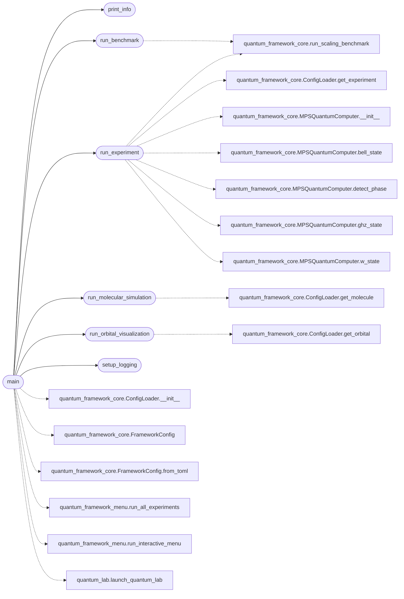

# `quantum_framework_main`

> Source: [quantum_framework_main.py:1](../../quantum_framework_main.py#L1) | language `py` | coverage 100.0% | [API index](../index.md)

Quantum Simulation Framework - Main Entry Point ================================================ Main entry point for the quantum simulation framework with command-line interface and interactive menu support.

Usage:
    python quantum_framework_main.py [OPTIONS]

Options:
    --config PATH       Path to TOML configuration file
    --learn             Launch the educational Quantum Lab TUI (EN/ES)
    --interactive       Launch interactive menu mode
    --all               Run ALL experiments automatically (for debugging)
    --experiment NAME   Run specific experiment by name
    --benchmark         Run scaling benchmark
    --max-qubits N      Maximum qubits for benchmark
    --molecule NAME     Specify molecule for experiments
    --orbital NAME      Specify orbital for visualization
    --qubits N          Number of qubits for experiments
    --output DIR        Output directory
    --verbose           Enable verbose logging
    --help              Show help message

Author: Gris Iscomeback
License: AGPL v3

## Contents

- **Functions:** [`setup_logging`](#setup_logging), [`run_benchmark`](#run_benchmark), [`run_experiment`](#run_experiment), [`run_molecular_simulation`](#run_molecular_simulation), [`run_orbital_visualization`](#run_orbital_visualization), [`print_info`](#print_info), [`main`](#main)

## Call Graph

Solid arrows stay in this module, dashed arrows leave it.



## Functions

<a id="setup_logging"></a>

### `setup_logging`

`function` | [quantum_framework_main.py:52](../../quantum_framework_main.py#L52)

```python
def setup_logging(verbose: bool = False) -> None
```

Configure logging level based on verbosity.

**Parameters**

| Name | Type | Default | Description |
|---|---|---|---|
| `verbose` | `bool` | `False` |  |

*Called by:* [`main`](#main)

---

<a id="run_benchmark"></a>

### `run_benchmark`

`function` | [quantum_framework_main.py:61](../../quantum_framework_main.py#L61)

```python
def run_benchmark(args: argparse.Namespace, config: FrameworkConfig) -> None
```

Run scaling benchmark.

**Parameters**

| Name | Type | Default | Description |
|---|---|---|---|
| `args` | `argparse.Namespace` |  |  |
| `config` | `FrameworkConfig` |  |  |

*Calls:* [`run_scaling_benchmark`](quantum_framework_core.py.md#run_scaling_benchmark)

*Called by:* [`main`](#main)

---

<a id="run_experiment"></a>

### `run_experiment`

`function` | [quantum_framework_main.py:101](../../quantum_framework_main.py#L101)

```python
def run_experiment(args: argparse.Namespace, config: FrameworkConfig, config_loader: ConfigLoader) -> None
```

Run a specific experiment by name.

**Parameters**

| Name | Type | Default | Description |
|---|---|---|---|
| `args` | `argparse.Namespace` |  |  |
| `config` | `FrameworkConfig` |  |  |
| `config_loader` | `ConfigLoader` |  |  |

*Calls:* [`ConfigLoader.get_experiment`](quantum_framework_core.py.md#configloader-get_experiment), [`MPSQuantumComputer.__init__`](quantum_framework_core.py.md#mpsquantumcomputer-__init__), [`MPSQuantumComputer.bell_state`](quantum_framework_core.py.md#mpsquantumcomputer-bell_state), [`MPSQuantumComputer.detect_phase`](quantum_framework_core.py.md#mpsquantumcomputer-detect_phase), [`MPSQuantumComputer.ghz_state`](quantum_framework_core.py.md#mpsquantumcomputer-ghz_state), [`MPSQuantumComputer.w_state`](quantum_framework_core.py.md#mpsquantumcomputer-w_state), [`run_scaling_benchmark`](quantum_framework_core.py.md#run_scaling_benchmark)

*Called by:* [`main`](#main)

---

<a id="run_molecular_simulation"></a>

### `run_molecular_simulation`

`function` | [quantum_framework_main.py:173](../../quantum_framework_main.py#L173)

```python
def run_molecular_simulation(args: argparse.Namespace, config: FrameworkConfig, config_loader: ConfigLoader) -> None
```

Run molecular simulation.

**Parameters**

| Name | Type | Default | Description |
|---|---|---|---|
| `args` | `argparse.Namespace` |  |  |
| `config` | `FrameworkConfig` |  |  |
| `config_loader` | `ConfigLoader` |  |  |

*Calls:* [`ConfigLoader.get_molecule`](quantum_framework_core.py.md#configloader-get_molecule)

*Called by:* [`main`](#main)

---

<a id="run_orbital_visualization"></a>

### `run_orbital_visualization`

`function` | [quantum_framework_main.py:210](../../quantum_framework_main.py#L210)

```python
def run_orbital_visualization(args: argparse.Namespace, config: FrameworkConfig, config_loader: ConfigLoader) -> None
```

Run orbital visualization.

**Parameters**

| Name | Type | Default | Description |
|---|---|---|---|
| `args` | `argparse.Namespace` |  |  |
| `config` | `FrameworkConfig` |  |  |
| `config_loader` | `ConfigLoader` |  |  |

*Calls:* [`ConfigLoader.get_orbital`](quantum_framework_core.py.md#configloader-get_orbital)

*Called by:* [`main`](#main)

---

<a id="print_info"></a>

### `print_info`

`function` | [quantum_framework_main.py:242](../../quantum_framework_main.py#L242)

```python
def print_info(config: FrameworkConfig, config_loader: ConfigLoader) -> None
```

Print framework information.

**Parameters**

| Name | Type | Default | Description |
|---|---|---|---|
| `config` | `FrameworkConfig` |  |  |
| `config_loader` | `ConfigLoader` |  |  |

*Called by:* [`main`](#main)

---

<a id="main"></a>

### `main`

`function` | [quantum_framework_main.py:292](../../quantum_framework_main.py#L292)

```python
def main() -> None
```

Main entry point.

*Calls:* [`ConfigLoader.__init__`](quantum_framework_core.py.md#configloader-__init__), [`FrameworkConfig`](quantum_framework_core.py.md#frameworkconfig), [`FrameworkConfig.from_toml`](quantum_framework_core.py.md#frameworkconfig-from_toml), [`print_info`](#print_info), [`run_benchmark`](#run_benchmark), [`run_experiment`](#run_experiment), [`run_molecular_simulation`](#run_molecular_simulation), [`run_orbital_visualization`](#run_orbital_visualization), [`setup_logging`](#setup_logging), [`run_all_experiments`](quantum_framework_menu.py.md#run_all_experiments), [`run_interactive_menu`](quantum_framework_menu.py.md#run_interactive_menu), [`launch_quantum_lab`](quantum_lab.py.md#launch_quantum_lab)

---
