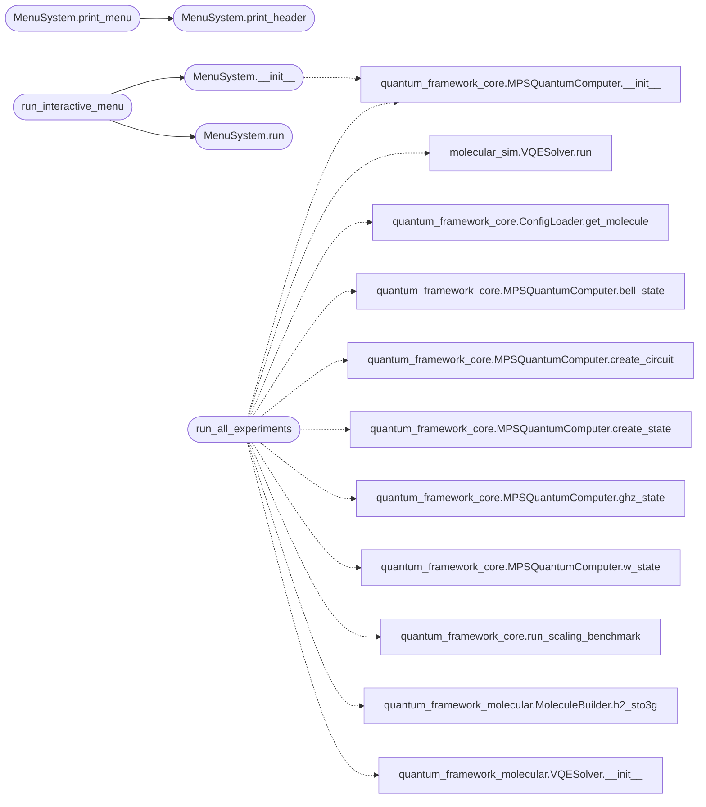

# `quantum_framework_menu`

> Source: [quantum_framework_menu.py:1](../../quantum_framework_menu.py#L1) | language `py` | coverage 90.9% | [API index](../index.md)

Quantum Framework Interactive Menu System ========================================= Interactive menu system for accessing all framework capabilities including quantum circuits, molecular simulations, orbital visualization, and advanced physics experiments.

Author: Gris Iscomeback
License: AGPL v3

## Contents

- **Classes:** [`MenuSystem`](#menusystem)
- **Functions:** [`run_interactive_menu`](#run_interactive_menu), [`run_all_experiments`](#run_all_experiments)

## Call Graph

Solid arrows stay in this module, dashed arrows leave it.



## Classes

<a id="menusystem"></a>

### `MenuSystem`

`class` | [quantum_framework_menu.py:64](../../quantum_framework_menu.py#L64)

```python
class MenuSystem
```

Interactive menu system for the quantum simulation framework.

Provides structured access to all framework capabilities through
a hierarchical menu system with real-time feedback.

**Members**

| Member | Kind | Summary |
|---|---|---|
| [`__init__`](#menusystem-__init__) | constructor |  |
| [`clear_screen`](#menusystem-clear_screen) | method | Clear the terminal screen. |
| [`print_header`](#menusystem-print_header) | method | Print formatted header. |
| [`print_menu`](#menusystem-print_menu) | method | Print formatted menu with options. |
| [`get_input`](#menusystem-get_input) | method | Get user input with history tracking. |
| [`pause`](#menusystem-pause) | method | Wait for user to press Enter. |
| [`run`](#menusystem-run) | method | Run the main menu loop. |

<a id="menusystem-__init__"></a>

#### `MenuSystem.__init__`

`constructor` | [quantum_framework_menu.py:72](../../quantum_framework_menu.py#L72)

```python
def __init__(self, config: FrameworkConfig, config_loader: ConfigLoader) -> None
```

**Parameters**

| Name | Type | Default | Description |
|---|---|---|---|
| `config` | `FrameworkConfig` |  |  |
| `config_loader` | `ConfigLoader` |  |  |

*Calls:* [`MPSQuantumComputer.__init__`](quantum_framework_core.py.md#mpsquantumcomputer-__init__)

*Called by:* [`run_interactive_menu`](#run_interactive_menu)

<a id="menusystem-clear_screen"></a>

#### `MenuSystem.clear_screen`

`method` | [quantum_framework_menu.py:79](../../quantum_framework_menu.py#L79)

```python
def clear_screen(self) -> None
```

Clear the terminal screen.

<a id="menusystem-print_header"></a>

#### `MenuSystem.print_header`

`method` | [quantum_framework_menu.py:83](../../quantum_framework_menu.py#L83)

```python
def print_header(self, title: str) -> None
```

Print formatted header.

**Parameters**

| Name | Type | Default | Description |
|---|---|---|---|
| `title` | `str` |  |  |

*Called by:* [`MenuSystem.print_menu`](#menusystem-print_menu)

<a id="menusystem-print_menu"></a>

#### `MenuSystem.print_menu`

`method` | [quantum_framework_menu.py:90](../../quantum_framework_menu.py#L90)

```python
def print_menu(self, title: str, options: List[Tuple[str, str]]) -> None
```

Print formatted menu with options.

**Parameters**

| Name | Type | Default | Description |
|---|---|---|---|
| `title` | `str` |  |  |
| `options` | `List[Tuple[str, str]]` |  |  |

*Calls:* [`MenuSystem.print_header`](#menusystem-print_header)

<a id="menusystem-get_input"></a>

#### `MenuSystem.get_input`

`method` | [quantum_framework_menu.py:97](../../quantum_framework_menu.py#L97)

```python
def get_input(self, prompt: str = 'Select option: ') -> str
```

Get user input with history tracking.

**Parameters**

| Name | Type | Default | Description |
|---|---|---|---|
| `prompt` | `str` | `'Select option: '` |  |

**Returns:** `str`

<a id="menusystem-pause"></a>

#### `MenuSystem.pause`

`method` | [quantum_framework_menu.py:106](../../quantum_framework_menu.py#L106)

```python
def pause(self, message: str = 'Press Enter to continue...') -> None
```

Wait for user to press Enter.

**Parameters**

| Name | Type | Default | Description |
|---|---|---|---|
| `message` | `str` | `'Press Enter to continue...'` |  |

<a id="menusystem-run"></a>

#### `MenuSystem.run`

`method` | [quantum_framework_menu.py:113](../../quantum_framework_menu.py#L113)

```python
def run(self) -> None
```

Run the main menu loop.

*Called by:* [`run_interactive_menu`](#run_interactive_menu)

---

## Functions

<a id="run_interactive_menu"></a>

### `run_interactive_menu`

`function` | [quantum_framework_menu.py:2357](../../quantum_framework_menu.py#L2357)

```python
def run_interactive_menu(config: FrameworkConfig, config_loader: ConfigLoader) -> None
```

Run the interactive menu system.

**Parameters**

| Name | Type | Default | Description |
|---|---|---|---|
| `config` | `FrameworkConfig` |  |  |
| `config_loader` | `ConfigLoader` |  |  |

*Calls:* [`MenuSystem.__init__`](#menusystem-__init__), [`MenuSystem.run`](#menusystem-run)

*Called by:* [`main`](quantum_framework_main.py.md#main)

---

<a id="run_all_experiments"></a>

### `run_all_experiments`

`function` | [quantum_framework_menu.py:2363](../../quantum_framework_menu.py#L2363)

```python
def run_all_experiments(config: FrameworkConfig, config_loader: ConfigLoader) -> None
```

Run ALL experiments automatically for debugging.

This function executes all available experiments without user interaction. Uses CORRECT physics formulas verified against experimental data.

**Parameters**

| Name | Type | Default | Description |
|---|---|---|---|
| `config` | `FrameworkConfig` |  |  |
| `config_loader` | `ConfigLoader` |  |  |

*Calls:* [`VQESolver.run`](molecular_sim.py.md#vqesolver-run), [`ConfigLoader.get_molecule`](quantum_framework_core.py.md#configloader-get_molecule), [`MPSQuantumComputer.__init__`](quantum_framework_core.py.md#mpsquantumcomputer-__init__), [`MPSQuantumComputer.bell_state`](quantum_framework_core.py.md#mpsquantumcomputer-bell_state), [`MPSQuantumComputer.create_circuit`](quantum_framework_core.py.md#mpsquantumcomputer-create_circuit), [`MPSQuantumComputer.create_state`](quantum_framework_core.py.md#mpsquantumcomputer-create_state), [`MPSQuantumComputer.ghz_state`](quantum_framework_core.py.md#mpsquantumcomputer-ghz_state), [`MPSQuantumComputer.w_state`](quantum_framework_core.py.md#mpsquantumcomputer-w_state), [`run_scaling_benchmark`](quantum_framework_core.py.md#run_scaling_benchmark), [`MoleculeBuilder.h2_sto3g`](quantum_framework_molecular.py.md#moleculebuilder-h2_sto3g), [`VQESolver.__init__`](quantum_framework_molecular.py.md#vqesolver-__init__)

*Called by:* [`main`](quantum_framework_main.py.md#main)

---
