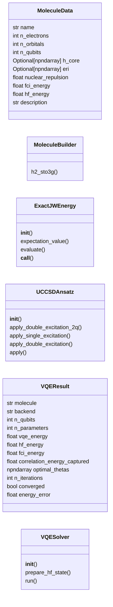
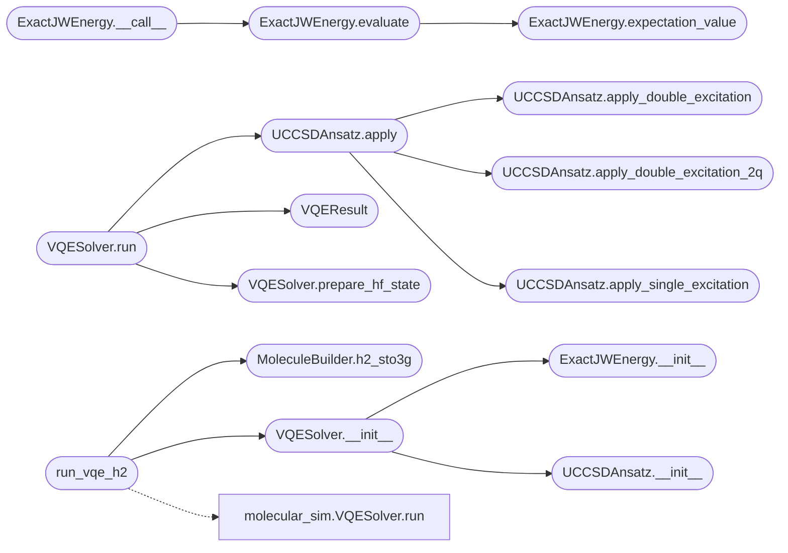

# `quantum_framework_molecular`

> Source: [quantum_framework_molecular.py:1](../../quantum_framework_molecular.py#L1) | language `py` | coverage 71.4% | [API index](../index.md)

Quantum Framework Molecular Module =================================== Molecular simulation with VQE and a fermionic UCCSD ansatz on an exact statevector (2^n amplitudes; the MPS engine is NOT used here -- labels now reflect this honestly).

- UCCSD excitations carry the proper Jordan-Wigner parity signs (they
  are exact signed Givens rotations, not sign-less orbital rotations).
- Analytic parameter-shift gradients (no finite-difference noise).
- Ab initio Hamiltonians via PySCF/OpenFermion when available; the
  offline fallback is a calibrated toy model and is labeled as such.

Author: Gris Iscomeback
License: AGPL v3

## Contents

- **Classes:** [`MoleculeData`](#moleculedata), [`MoleculeBuilder`](#moleculebuilder), [`ExactJWEnergy`](#exactjwenergy), [`UCCSDAnsatz`](#uccsdansatz), [`VQEResult`](#vqeresult), [`VQESolver`](#vqesolver)
- **Functions:** [`run_vqe_h2`](#run_vqe_h2)
- **Constants:** [`MOLECULES`](#molecules)

## Type Diagram



## Call Graph

Solid arrows stay in this module, dashed arrows leave it.



## Classes

<a id="moleculedata"></a>

### `MoleculeData`

`class` `dataclass` | [quantum_framework_molecular.py:74](../../quantum_framework_molecular.py#L74)

Decorators: `@dataclass`

```python
class MoleculeData
```

**Attributes**

| Name | Type | Default | Description |
|---|---|---|---|
| [`name`](#moleculedata-name) | `str` |  |  |
| [`n_electrons`](#moleculedata-n_electrons) | `int` |  |  |
| [`n_orbitals`](#moleculedata-n_orbitals) | `int` |  |  |
| [`n_qubits`](#moleculedata-n_qubits) | `int` |  |  |
| [`h_core`](#moleculedata-h_core) | `Optional[np.ndarray]` | `None` |  |
| [`eri`](#moleculedata-eri) | `Optional[np.ndarray]` | `None` |  |
| [`nuclear_repulsion`](#moleculedata-nuclear_repulsion) | `float` | `0.0` |  |
| [`fci_energy`](#moleculedata-fci_energy) | `float` | `0.0` |  |
| [`hf_energy`](#moleculedata-hf_energy) | `float` | `0.0` |  |
| [`description`](#moleculedata-description) | `str` | `''` |  |

---

<a id="moleculebuilder"></a>

### `MoleculeBuilder`

`class` | [quantum_framework_molecular.py:87](../../quantum_framework_molecular.py#L87)

```python
class MoleculeBuilder
```

Build molecule data for quantum chemistry calculations.

**Members**

| Member | Kind | Summary |
|---|---|---|
| [`h2_sto3g`](#moleculebuilder-h2_sto3g) | staticmethod | Build H2 molecule with STO-3G basis. |

<a id="moleculebuilder-h2_sto3g"></a>

#### `MoleculeBuilder.h2_sto3g`

`staticmethod` | [quantum_framework_molecular.py:91](../../quantum_framework_molecular.py#L91)

Decorators: `@staticmethod`

```python
def h2_sto3g(bond_length: float = 0.735) -> MoleculeData
```

Build H2 molecule with STO-3G basis.

**Parameters**

| Name | Type | Default | Description |
|---|---|---|---|
| `bond_length` | `float` | `0.735` |  |

**Returns:** `MoleculeData`

*Called by:* [`run_all_experiments`](quantum_framework_menu.py.md#run_all_experiments), [`run_vqe_h2`](#run_vqe_h2), [`H2VQEEngine.__init__`](quantum_lab.py.md#h2vqeengine-__init__)

---

<a id="exactjwenergy"></a>

### `ExactJWEnergy`

`class` | [quantum_framework_molecular.py:158](../../quantum_framework_molecular.py#L158)

```python
class ExactJWEnergy
```

Exact Jordan-Wigner energy evaluator.

CORRECTED: Uses verified Hamiltonian coefficients from standard references.

**Members**

| Member | Kind | Summary |
|---|---|---|
| [`__init__`](#exactjwenergy-__init__) | constructor |  |
| [`expectation_value`](#exactjwenergy-expectation_value) | method | Compute ⟨ψ\|H\|ψ⟩ for the given state. |
| [`evaluate`](#exactjwenergy-evaluate) | method | Evaluate energy from amplitudes (supports both numpy and torch). |
| [`__call__`](#exactjwenergy-__call__) | method |  |

<a id="exactjwenergy-__init__"></a>

#### `ExactJWEnergy.__init__`

`constructor` | [quantum_framework_molecular.py:165](../../quantum_framework_molecular.py#L165)

```python
def __init__(self, mol: MoleculeData, n_qubits: int) -> None
```

**Parameters**

| Name | Type | Default | Description |
|---|---|---|---|
| `mol` | `MoleculeData` |  |  |
| `n_qubits` | `int` |  |  |

*Called by:* [`VQESolver.__init__`](#vqesolver-__init__), [`H2VQEEngine.__init__`](quantum_lab.py.md#h2vqeengine-__init__)

<a id="exactjwenergy-expectation_value"></a>

#### `ExactJWEnergy.expectation_value`

`method` | [quantum_framework_molecular.py:299](../../quantum_framework_molecular.py#L299)

```python
def expectation_value(self, state: np.ndarray) -> float
```

Compute ⟨ψ|H|ψ⟩ for the given state.

**Parameters**

| Name | Type | Default | Description |
|---|---|---|---|
| `state` | `np.ndarray` |  |  |

**Returns:** `float`

*Called by:* [`ExactJWEnergy.evaluate`](#exactjwenergy-evaluate), [`VQESolver.evaluate`](quantum_framework_molecular_v2.py.md#vqesolver-evaluate)

<a id="exactjwenergy-evaluate"></a>

#### `ExactJWEnergy.evaluate`

`method` | [quantum_framework_molecular.py:315](../../quantum_framework_molecular.py#L315)

```python
def evaluate(self, amps) -> float
```

Evaluate energy from amplitudes (supports both numpy and torch).

**Parameters**

| Name | Type | Default | Description |
|---|---|---|---|
| `amps` |  |  |  |

**Returns:** `float`

*Calls:* [`ExactJWEnergy.expectation_value`](#exactjwenergy-expectation_value)

*Called by:* [`ExactJWEnergy.__call__`](#exactjwenergy-__call__), [`H2VQEEngine.energy`](quantum_lab.py.md#h2vqeengine-energy)

<a id="exactjwenergy-__call__"></a>

#### `ExactJWEnergy.__call__`

`method` | [quantum_framework_molecular.py:327](../../quantum_framework_molecular.py#L327)

```python
def __call__(self, amps) -> float
```

**Parameters**

| Name | Type | Default | Description |
|---|---|---|---|
| `amps` |  |  |  |

**Returns:** `float`

*Calls:* [`ExactJWEnergy.evaluate`](#exactjwenergy-evaluate)

---

<a id="uccsdansatz"></a>

### `UCCSDAnsatz`

`class` | [quantum_framework_molecular.py:331](../../quantum_framework_molecular.py#L331)

```python
class UCCSDAnsatz
```

Unitary Coupled Cluster Singles and Doubles ansatz.

For H2 in the 2-qubit active space model:
- Qubit 0 represents the bonding orbital occupation
- Qubit 1 represents the anti-bonding orbital occupation
- HF state: |10> (bonding occupied, anti-bonding empty)
- The double excitation |10> <-> |01> is mediated by X0X1 + Y0Y1 terms

**Members**

| Member | Kind | Summary |
|---|---|---|
| [`__init__`](#uccsdansatz-__init__) | constructor |  |
| [`apply_double_excitation_2q`](#uccsdansatz-apply_double_excitation_2q) | method | Apply double excitation for 2-qubit H2 model. |
| [`apply_single_excitation`](#uccsdansatz-apply_single_excitation) | method | Apply fermionic single excitation exp(theta * (a^_v a_o - a^_o a_v)). |
| [`apply_double_excitation`](#uccsdansatz-apply_double_excitation) | method | Apply fermionic double excitation exp(theta * (a^_v1 a^_v2 a_o1 a_o2 - h.c.)). |
| [`apply`](#uccsdansatz-apply) | method | Apply UCCSD ansatz to state. |

<a id="uccsdansatz-__init__"></a>

#### `UCCSDAnsatz.__init__`

`constructor` | [quantum_framework_molecular.py:342](../../quantum_framework_molecular.py#L342)

```python
def __init__(self, n_qubits: int, n_electrons: int) -> None
```

**Parameters**

| Name | Type | Default | Description |
|---|---|---|---|
| `n_qubits` | `int` |  |  |
| `n_electrons` | `int` |  |  |

*Called by:* [`VQESolver.__init__`](#vqesolver-__init__)

<a id="uccsdansatz-apply_double_excitation_2q"></a>

#### `UCCSDAnsatz.apply_double_excitation_2q`

`method` | [quantum_framework_molecular.py:370](../../quantum_framework_molecular.py#L370)

```python
def apply_double_excitation_2q(self, state: np.ndarray, theta: float) -> np.ndarray
```

Apply double excitation for 2-qubit H2 model.

This rotates between |10> and |01>:
|10> -> cos(theta)*|10> - sin(theta)*|01>
|01> -> sin(theta)*|10> + cos(theta)*|01>

**Parameters**

| Name | Type | Default | Description |
|---|---|---|---|
| `state` | `np.ndarray` |  |  |
| `theta` | `float` |  |  |

**Returns:** `np.ndarray`

*Called by:* [`UCCSDAnsatz.apply`](#uccsdansatz-apply)

<a id="uccsdansatz-apply_single_excitation"></a>

#### `UCCSDAnsatz.apply_single_excitation`

`method` | [quantum_framework_molecular.py:447](../../quantum_framework_molecular.py#L447)

```python
def apply_single_excitation(self, state: np.ndarray, o: int, v: int, theta: float) -> np.ndarray
```

Apply fermionic single excitation exp(theta * (a^_v a_o - a^_o a_v)).

**Parameters**

| Name | Type | Default | Description |
|---|---|---|---|
| `state` | `np.ndarray` |  |  |
| `o` | `int` |  |  |
| `v` | `int` |  |  |
| `theta` | `float` |  |  |

**Returns:** `np.ndarray`

*Called by:* [`UCCSDAnsatz.apply`](#uccsdansatz-apply)

<a id="uccsdansatz-apply_double_excitation"></a>

#### `UCCSDAnsatz.apply_double_excitation`

`method` | [quantum_framework_molecular.py:451](../../quantum_framework_molecular.py#L451)

```python
def apply_double_excitation(self, state: np.ndarray, o1: int, o2: int, v1: int, v2: int, theta: float) -> np.ndarray
```

Apply fermionic double excitation exp(theta * (a^_v1 a^_v2 a_o1 a_o2 - h.c.)).

Convention: T = a^_v1 a^_v2 a_o1 a_o2 (rightmost acts first).

**Parameters**

| Name | Type | Default | Description |
|---|---|---|---|
| `state` | `np.ndarray` |  |  |
| `o1` | `int` |  |  |
| `o2` | `int` |  |  |
| `v1` | `int` |  |  |
| `v2` | `int` |  |  |
| `theta` | `float` |  |  |

**Returns:** `np.ndarray`

*Called by:* [`UCCSDAnsatz.apply`](#uccsdansatz-apply)

<a id="uccsdansatz-apply"></a>

#### `UCCSDAnsatz.apply`

`method` | [quantum_framework_molecular.py:462](../../quantum_framework_molecular.py#L462)

```python
def apply(self, state: np.ndarray, thetas: np.ndarray) -> np.ndarray
```

Apply UCCSD ansatz to state.

**Parameters**

| Name | Type | Default | Description |
|---|---|---|---|
| `state` | `np.ndarray` |  |  |
| `thetas` | `np.ndarray` |  |  |

**Returns:** `np.ndarray`

*Calls:* [`UCCSDAnsatz.apply_double_excitation`](#uccsdansatz-apply_double_excitation), [`UCCSDAnsatz.apply_double_excitation_2q`](#uccsdansatz-apply_double_excitation_2q), [`UCCSDAnsatz.apply_single_excitation`](#uccsdansatz-apply_single_excitation)

*Called by:* [`VQESolver.run`](#vqesolver-run), [`UCCSDAnsatz.verify_identity`](quantum_framework_molecular_v2.py.md#uccsdansatz-verify_identity), [`VQESolver.apply_ansatz`](quantum_framework_molecular_v2.py.md#vqesolver-apply_ansatz)

---

<a id="vqeresult"></a>

### `VQEResult`

`class` `dataclass` | [quantum_framework_molecular.py:495](../../quantum_framework_molecular.py#L495)

Decorators: `@dataclass`

```python
class VQEResult
```

**Attributes**

| Name | Type | Default | Description |
|---|---|---|---|
| [`molecule`](#vqeresult-molecule) | `str` |  |  |
| [`backend`](#vqeresult-backend) | `str` |  |  |
| [`n_qubits`](#vqeresult-n_qubits) | `int` |  |  |
| [`n_parameters`](#vqeresult-n_parameters) | `int` |  |  |
| [`vqe_energy`](#vqeresult-vqe_energy) | `float` |  |  |
| [`hf_energy`](#vqeresult-hf_energy) | `float` |  |  |
| [`fci_energy`](#vqeresult-fci_energy) | `float` |  |  |
| [`correlation_energy_captured`](#vqeresult-correlation_energy_captured) | `float` |  |  |
| [`optimal_thetas`](#vqeresult-optimal_thetas) | `np.ndarray` |  |  |
| [`n_iterations`](#vqeresult-n_iterations) | `int` |  |  |
| [`converged`](#vqeresult-converged) | `bool` |  |  |
| [`energy_error`](#vqeresult-energy_error) | `float` |  |  |

---

<a id="vqesolver"></a>

### `VQESolver`

`class` | [quantum_framework_molecular.py:529](../../quantum_framework_molecular.py#L529)

```python
class VQESolver
```

Variational Quantum Eigensolver.

CORRECTED: Uses proper UCCSD ansatz and Hamiltonian evaluation.

**Members**

| Member | Kind | Summary |
|---|---|---|
| [`__init__`](#vqesolver-__init__) | constructor |  |
| [`prepare_hf_state`](#vqesolver-prepare_hf_state) | method | Prepare Hartree-Fock state. |
| [`run`](#vqesolver-run) | method | Run VQE optimization. |

<a id="vqesolver-__init__"></a>

#### `VQESolver.__init__`

`constructor` | [quantum_framework_molecular.py:536](../../quantum_framework_molecular.py#L536)

```python
def __init__(self, mol: MoleculeData) -> None
```

**Parameters**

| Name | Type | Default | Description |
|---|---|---|---|
| `mol` | `MoleculeData` |  |  |

*Calls:* [`ExactJWEnergy.__init__`](#exactjwenergy-__init__), [`UCCSDAnsatz.__init__`](#uccsdansatz-__init__)

*Called by:* [`run_all_experiments`](quantum_framework_menu.py.md#run_all_experiments), [`run_vqe_h2`](#run_vqe_h2)

<a id="vqesolver-prepare_hf_state"></a>

#### `VQESolver.prepare_hf_state`

`method` | [quantum_framework_molecular.py:547](../../quantum_framework_molecular.py#L547)

```python
def prepare_hf_state(self) -> np.ndarray
```

Prepare Hartree-Fock state.

For H2 with 2 electrons in 4 spin-orbitals:
|1100⟩ means electrons in orbitals 0 and 1.

**Returns:** `np.ndarray`

*Called by:* [`VQESolver.run`](#vqesolver-run), [`VQESolver.run`](quantum_framework_molecular_v2.py.md#vqesolver-run)

<a id="vqesolver-run"></a>

#### `VQESolver.run`

`method` | [quantum_framework_molecular.py:565](../../quantum_framework_molecular.py#L565)

```python
def run(self, max_iter: int = 200, tol: float = 1e-08) -> VQEResult
```

Run VQE optimization.

**Parameters**

| Name | Type | Default | Description |
|---|---|---|---|
| `max_iter` | `int` | `200` |  |
| `tol` | `float` | `1e-08` |  |

**Returns:** `VQEResult`

*Calls:* [`UCCSDAnsatz.apply`](#uccsdansatz-apply), [`VQEResult`](#vqeresult), [`VQESolver.prepare_hf_state`](#vqesolver-prepare_hf_state)

---

## Functions

<a id="run_vqe_h2"></a>

### `run_vqe_h2`

`function` | [quantum_framework_molecular.py:674](../../quantum_framework_molecular.py#L674)

```python
def run_vqe_h2(max_iter: int = 100) -> VQEResult
```

Run VQE for H2 molecule - convenience function.

**Parameters**

| Name | Type | Default | Description |
|---|---|---|---|
| `max_iter` | `int` | `100` |  |

**Returns:** `VQEResult`

*Calls:* [`VQESolver.run`](molecular_sim.py.md#vqesolver-run), [`MoleculeBuilder.h2_sto3g`](#moleculebuilder-h2_sto3g), [`VQESolver.__init__`](#vqesolver-__init__)

---

## Constants

<a id="molecules"></a>

### `MOLECULES`

`constant` | [quantum_framework_molecular.py:155](../../quantum_framework_molecular.py#L155)

```python
MOLECULES = {'H2': MoleculeBuilder.h2_sto3g}
```

---
