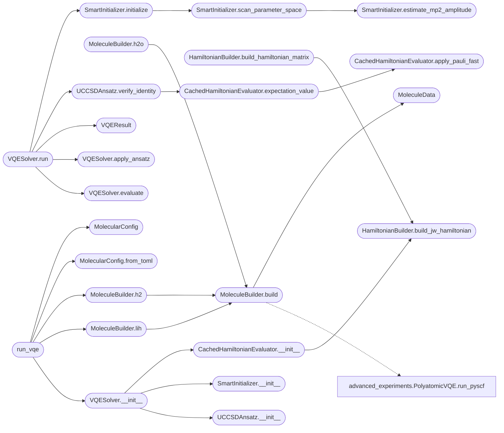

# `quantum_framework_molecular_v2`

> Source: [quantum_framework_molecular_v2.py:1](../../quantum_framework_molecular_v2.py#L1) | language `py` | coverage 85.4% | [API index](../index.md)

Quantum Framework Molecular Module - Production Version ======================================================== Molecular VQE simulation with OpenFermion integration.

HONEST SCOPE NOTE: the VQE solver runs on an exact statevector
(2^n amplitudes).  The `[`MPSState`](#mpsstate)` class below is experimental and is
NOT used by the solver (``use_mps`` only gates validation warnings).
The UCCSD ansatz carries exact Jordan-Wigner parity signs.

Features:
- OpenFermion for all Hamiltonians (NO hardcoded values)
- Integration with Schrodinger, Dirac, Hamiltonian backends
- Smart initialization with MP2 + parameter scan
- Cached Pauli operations for x10-100 speedup
- TOML configuration

Author: Gris Iscomeback
License: AGPL v3

## Contents

- **Classes:** [`MolecularConfig`](#molecularconfig), [`MoleculeData`](#moleculedata), [`MoleculeBuilder`](#moleculebuilder), [`HamiltonianBuilder`](#hamiltonianbuilder), [`CachedPauliOperation`](#cachedpaulioperation), [`CachedHamiltonianEvaluator`](#cachedhamiltonianevaluator), [`SmartInitializer`](#smartinitializer), [`UCCSDAnsatz`](#uccsdansatz), [`MPSState`](#mpsstate), [`ParticleConservingState`](#particleconservingstate), [`VQEResult`](#vqeresult), [`VQESolver`](#vqesolver), [`BackendIntegrator`](#backendintegrator)
- **Functions:** [`run_vqe`](#run_vqe)

## Type Diagram

```mermaid
classDiagram
    direction LR
    class MolecularConfig
    MolecularConfig : bool precision_mode
    MolecularConfig : int max_qubits_direct
    MolecularConfig : int bond_dimension
    MolecularConfig : int max_bond_dimension
    MolecularConfig : float svd_threshold
    MolecularConfig : float truncation_error
    MolecularConfig : bool adaptive_bond
    MolecularConfig : int max_iterations
    MolecularConfig : float convergence_tol
    MolecularConfig : float gradient_tol
    MolecularConfig : int scan_samples
    MolecularConfig : float scan_range
    MolecularConfig : bool use_mp2_init
    MolecularConfig : str backend
    MolecularConfig : str device
    MolecularConfig : bool use_cache
    MolecularConfig : int cache_size
    MolecularConfig : str output_dir
    MolecularConfig : bool verbose
    MolecularConfig : from_toml()
    class MoleculeData
    MoleculeData : str name
    MoleculeData : str formula
    MoleculeData : int n_electrons
    MoleculeData : int n_orbitals
    MoleculeData : int n_qubits
    MoleculeData : int charge
    MoleculeData : int multiplicity
    MoleculeData : List[Tuple[str, Tuple[float, float, floa geometry
    MoleculeData : str basis
    MoleculeData : str description
    MoleculeData : float hf_energy
    MoleculeData : float fci_energy
    MoleculeData : float nuclear_repulsion
    MoleculeData : Optional[npndarray] one_body_integrals
    MoleculeData : Optional[npndarray] two_body_integrals
    MoleculeData : Optional[npndarray] orbital_energies
    MoleculeData : List[Tuple[complex, List[Tuple[int, str] hamiltonian_terms
    MoleculeData : Optional[npndarray] hamiltonian_matrix
    class MoleculeBuilder
    MoleculeBuilder : build()
    MoleculeBuilder : h2()
    MoleculeBuilder : h2o()
    MoleculeBuilder : lih()
    class HamiltonianBuilder
    HamiltonianBuilder : build_jw_hamiltonian()
    HamiltonianBuilder : build_hamiltonian_matrix()
    class CachedPauliOperation
    CachedPauliOperation : npndarray forward_indices
    CachedPauliOperation : npndarray phases_real
    CachedPauliOperation : npndarray phases_imag
    CachedPauliOperation : float coeff_real
    CachedPauliOperation : float coeff_imag
    class CachedHamiltonianEvaluator
    CachedHamiltonianEvaluator : __init__()
    CachedHamiltonianEvaluator : apply_pauli_fast()
    CachedHamiltonianEvaluator : expectation_value()
    CachedHamiltonianEvaluator : batch_expectation()
    class SmartInitializer
    SmartInitializer : __init__()
    SmartInitializer : estimate_mp2_amplitude()
    SmartInitializer : scan_parameter_space()
    SmartInitializer : initialize()
    class UCCSDAnsatz
    UCCSDAnsatz : __init__()
    UCCSDAnsatz : apply()
    UCCSDAnsatz : verify_identity()
    class MPSState
    MPSState : __init__()
    MPSState : to_statevector()
    MPSState : from_statevector()
    MPSState : compute_entanglement()
    class ParticleConservingState
    ParticleConservingState : __init__()
    ParticleConservingState : hf_state()
    ParticleConservingState : apply_excitation()
    ParticleConservingState : to_full_statevector()
    class VQEResult
    VQEResult : str molecule
    VQEResult : str backend
    VQEResult : bool precision_mode
    VQEResult : int n_qubits
    VQEResult : int n_parameters
    VQEResult : float vqe_energy
    VQEResult : float hf_energy
    VQEResult : float fci_energy
    VQEResult : float correlation_captured
    VQEResult : npndarray optimal_thetas
    VQEResult : int n_evaluations
    VQEResult : bool converged
    VQEResult : float energy_error
    VQEResult : float elapsed_time
    class VQESolver
    VQESolver : __init__()
    VQESolver : prepare_hf_state()
    VQESolver : evaluate()
    VQESolver : apply_ansatz()
    VQESolver : run()
    class BackendIntegrator
    BackendIntegrator : __init__()
    BackendIntegrator : get_backend_energy()
```



## Call Graph

Solid arrows stay in this module, dashed arrows leave it.



## Classes

<a id="molecularconfig"></a>

### `MolecularConfig`

`class` `dataclass` | [quantum_framework_molecular_v2.py:96](../../quantum_framework_molecular_v2.py#L96)

Decorators: `@dataclass`

```python
class MolecularConfig
```

Configuration for molecular VQE simulations.

**Attributes**

| Name | Type | Default | Description |
|---|---|---|---|
| [`precision_mode`](#molecularconfig-precision_mode) | `bool` | `False` |  |
| [`max_qubits_direct`](#molecularconfig-max_qubits_direct) | `int` | `14` |  |
| [`bond_dimension`](#molecularconfig-bond_dimension) | `int` | `16` |  |
| [`max_bond_dimension`](#molecularconfig-max_bond_dimension) | `int` | `64` |  |
| [`svd_threshold`](#molecularconfig-svd_threshold) | `float` | `1e-10` |  |
| [`truncation_error`](#molecularconfig-truncation_error) | `float` | `1e-08` |  |
| [`adaptive_bond`](#molecularconfig-adaptive_bond) | `bool` | `True` |  |
| [`max_iterations`](#molecularconfig-max_iterations) | `int` | `200` |  |
| [`convergence_tol`](#molecularconfig-convergence_tol) | `float` | `1e-08` |  |
| [`gradient_tol`](#molecularconfig-gradient_tol) | `float` | `1e-07` |  |
| [`scan_samples`](#molecularconfig-scan_samples) | `int` | `21` |  |
| [`scan_range`](#molecularconfig-scan_range) | `float` | `0.5` |  |
| [`use_mp2_init`](#molecularconfig-use_mp2_init) | `bool` | `True` |  |
| [`backend`](#molecularconfig-backend) | `str` | `'hamiltonian'` |  |
| [`device`](#molecularconfig-device) | `str` | `'cpu'` |  |
| [`use_cache`](#molecularconfig-use_cache) | `bool` | `True` |  |
| [`cache_size`](#molecularconfig-cache_size) | `int` | `1000` |  |
| [`output_dir`](#molecularconfig-output_dir) | `str` | `'download'` |  |
| [`verbose`](#molecularconfig-verbose) | `bool` | `True` |  |

**Members**

| Member | Kind | Summary |
|---|---|---|
| [`from_toml`](#molecularconfig-from_toml) | classmethod | Load configuration from TOML file. |

<a id="molecularconfig-from_toml"></a>

#### `MolecularConfig.from_toml`

`classmethod` | [quantum_framework_molecular_v2.py:132](../../quantum_framework_molecular_v2.py#L132)

Decorators: `@classmethod`

```python
def from_toml(cls, toml_path: str) -> 'MolecularConfig'
```

Load configuration from TOML file.

**Parameters**

| Name | Type | Default | Description |
|---|---|---|---|
| `toml_path` | `str` |  |  |

**Returns:** `'MolecularConfig'`

*Called by:* [`demo_config_from_toml`](demo_molecular_vqe.py.md#demo_config_from_toml), [`run_vqe`](#run_vqe)

---

<a id="moleculedata"></a>

### `MoleculeData`

`class` `dataclass` | [quantum_framework_molecular_v2.py:173](../../quantum_framework_molecular_v2.py#L173)

Decorators: `@dataclass`

```python
class MoleculeData
```

Molecular data structure with all necessary information.

**Attributes**

| Name | Type | Default | Description |
|---|---|---|---|
| [`name`](#moleculedata-name) | `str` |  |  |
| [`formula`](#moleculedata-formula) | `str` |  |  |
| [`n_electrons`](#moleculedata-n_electrons) | `int` |  |  |
| [`n_orbitals`](#moleculedata-n_orbitals) | `int` |  |  |
| [`n_qubits`](#moleculedata-n_qubits) | `int` |  |  |
| [`charge`](#moleculedata-charge) | `int` |  |  |
| [`multiplicity`](#moleculedata-multiplicity) | `int` |  |  |
| [`geometry`](#moleculedata-geometry) | `List[Tuple[str, Tuple[float, float, float]]]` |  |  |
| [`basis`](#moleculedata-basis) | `str` |  |  |
| [`description`](#moleculedata-description) | `str` | `''` |  |
| [`hf_energy`](#moleculedata-hf_energy) | `float` | `0.0` |  |
| [`fci_energy`](#moleculedata-fci_energy) | `float` | `0.0` |  |
| [`nuclear_repulsion`](#moleculedata-nuclear_repulsion) | `float` | `0.0` |  |
| [`one_body_integrals`](#moleculedata-one_body_integrals) | `Optional[np.ndarray]` | `None` |  |
| [`two_body_integrals`](#moleculedata-two_body_integrals) | `Optional[np.ndarray]` | `None` |  |
| [`orbital_energies`](#moleculedata-orbital_energies) | `Optional[np.ndarray]` | `None` |  |
| [`hamiltonian_terms`](#moleculedata-hamiltonian_terms) | `List[Tuple[complex, List[Tuple[int, str]]]]` | `field(default_factory=list)` |  |
| [`hamiltonian_matrix`](#moleculedata-hamiltonian_matrix) | `Optional[np.ndarray]` | `None` |  |

---

<a id="moleculebuilder"></a>

### `MoleculeBuilder`

`class` | [quantum_framework_molecular_v2.py:201](../../quantum_framework_molecular_v2.py#L201)

```python
class MoleculeBuilder
```

Build molecules using OpenFermion + PySCF.

NO hardcoded values - everything comes from quantum chemistry calculations.

**Members**

| Member | Kind | Summary |
|---|---|---|
| [`build`](#moleculebuilder-build) | staticmethod | Build molecule using OpenFermion. |
| [`h2`](#moleculebuilder-h2) | staticmethod | Build H2 molecule. |
| [`h2o`](#moleculebuilder-h2o) | staticmethod | Build H2O molecule. |
| [`lih`](#moleculebuilder-lih) | staticmethod | Build LiH molecule. |

<a id="moleculebuilder-build"></a>

#### `MoleculeBuilder.build`

`staticmethod` | [quantum_framework_molecular_v2.py:209](../../quantum_framework_molecular_v2.py#L209)

Decorators: `@staticmethod`

```python
def build(name: str, geometry: List[Tuple[str, Tuple[float, float, float]]], basis: str = 'sto-3g', charge: int = 0, multiplicity: int = 1, description: str = '') -> MoleculeData
```

Build molecule using OpenFermion.

**Parameters**

| Name | Type | Default | Description |
|---|---|---|---|
| `name` | `str` |  | Molecule name (e.g., "H2", "H2O") |
| `geometry` | `List[Tuple[str, Tuple[float, float, float]]]` |  | List of (atom_symbol, (x, y, z)) in Angstrom |
| `basis` | `str` | `'sto-3g'` | Basis set (e.g., "sto-3g", "6-31g") |
| `charge` | `int` | `0` | Molecular charge |
| `multiplicity` | `int` | `1` | Spin multiplicity |
| `description` | `str` | `''` | Optional description |

**Returns:** `MoleculeData` - MoleculeData with all properties computed

**Raises**

- `RuntimeError`: (raised in the body, not documented)

*Calls:* [`PolyatomicVQE.run_pyscf`](advanced_experiments.py.md#polyatomicvqe-run_pyscf), [`MoleculeData`](#moleculedata)

*Called by:* [`MoleculeBuilder.h2`](#moleculebuilder-h2), [`MoleculeBuilder.h2o`](#moleculebuilder-h2o), [`MoleculeBuilder.lih`](#moleculebuilder-lih)

<a id="moleculebuilder-h2"></a>

#### `MoleculeBuilder.h2`

`staticmethod` | [quantum_framework_molecular_v2.py:325](../../quantum_framework_molecular_v2.py#L325)

Decorators: `@staticmethod`

```python
def h2(bond_length: float = 0.735, basis: str = 'sto-3g') -> MoleculeData
```

Build H2 molecule.

**Parameters**

| Name | Type | Default | Description |
|---|---|---|---|
| `bond_length` | `float` | `0.735` |  |
| `basis` | `str` | `'sto-3g'` |  |

**Returns:** `MoleculeData`

*Calls:* [`MoleculeBuilder.build`](#moleculebuilder-build)

*Called by:* [`demo_cached_operations`](demo_molecular_vqe.py.md#demo_cached_operations), [`demo_molecule_builder`](demo_molecular_vqe.py.md#demo_molecule_builder), [`run_vqe`](#run_vqe)

<a id="moleculebuilder-h2o"></a>

#### `MoleculeBuilder.h2o`

`staticmethod` | [quantum_framework_molecular_v2.py:331](../../quantum_framework_molecular_v2.py#L331)

Decorators: `@staticmethod`

```python
def h2o(bond_length_oh: float = 0.9575, angle_hoh: float = 104.5, basis: str = 'sto-3g') -> MoleculeData
```

Build H2O molecule.

**Parameters**

| Name | Type | Default | Description |
|---|---|---|---|
| `bond_length_oh` | `float` | `0.9575` |  |
| `angle_hoh` | `float` | `104.5` |  |
| `basis` | `str` | `'sto-3g'` |  |

**Returns:** `MoleculeData`

*Calls:* [`MoleculeBuilder.build`](#moleculebuilder-build)

<a id="moleculebuilder-lih"></a>

#### `MoleculeBuilder.lih`

`staticmethod` | [quantum_framework_molecular_v2.py:343](../../quantum_framework_molecular_v2.py#L343)

Decorators: `@staticmethod`

```python
def lih(bond_length: float = 1.546, basis: str = 'sto-3g') -> MoleculeData
```

Build LiH molecule.

**Parameters**

| Name | Type | Default | Description |
|---|---|---|---|
| `bond_length` | `float` | `1.546` |  |
| `basis` | `str` | `'sto-3g'` |  |

**Returns:** `MoleculeData`

*Calls:* [`MoleculeBuilder.build`](#moleculebuilder-build)

*Called by:* [`demo_molecule_builder`](demo_molecular_vqe.py.md#demo_molecule_builder), [`run_vqe`](#run_vqe)

---

<a id="hamiltonianbuilder"></a>

### `HamiltonianBuilder`

`class` | [quantum_framework_molecular_v2.py:353](../../quantum_framework_molecular_v2.py#L353)

```python
class HamiltonianBuilder
```

Build molecular Hamiltonians using OpenFermion.

NO hardcoded coefficients - everything from first principles.

**Members**

| Member | Kind | Summary |
|---|---|---|
| [`build_jw_hamiltonian`](#hamiltonianbuilder-build_jw_hamiltonian) | staticmethod | Build Jordan-Wigner transformed Hamiltonian using OpenFermion. |
| [`build_hamiltonian_matrix`](#hamiltonianbuilder-build_hamiltonian_matrix) | staticmethod | Build full Hamiltonian matrix for small systems. |

<a id="hamiltonianbuilder-build_jw_hamiltonian"></a>

#### `HamiltonianBuilder.build_jw_hamiltonian`

`staticmethod` | [quantum_framework_molecular_v2.py:361](../../quantum_framework_molecular_v2.py#L361)

Decorators: `@staticmethod`

```python
def build_jw_hamiltonian(mol: MoleculeData) -> Tuple[List[Tuple[complex, List[Tuple[int, str]]]], float]
```

Build Jordan-Wigner transformed Hamiltonian using OpenFermion.

**Parameters**

| Name | Type | Default | Description |
|---|---|---|---|
| `mol` | `MoleculeData` |  | MoleculeData with geometry, basis, etc. |

**Returns:** `Tuple[List[Tuple[complex, List[Tuple[int, str]]]], float]` - (pauli_terms, nuclear_repulsion)

**Raises**

- `RuntimeError`: (raised in the body, not documented)

*Calls:* [`PolyatomicVQE.run_pyscf`](advanced_experiments.py.md#polyatomicvqe-run_pyscf)

*Called by:* [`CachedHamiltonianEvaluator.__init__`](#cachedhamiltonianevaluator-__init__), [`HamiltonianBuilder.build_hamiltonian_matrix`](#hamiltonianbuilder-build_hamiltonian_matrix)

<a id="hamiltonianbuilder-build_hamiltonian_matrix"></a>

#### `HamiltonianBuilder.build_hamiltonian_matrix`

`staticmethod` | [quantum_framework_molecular_v2.py:418](../../quantum_framework_molecular_v2.py#L418)

Decorators: `@staticmethod`

```python
def build_hamiltonian_matrix(mol: MoleculeData, n_qubits: int) -> np.ndarray
```

Build full Hamiltonian matrix for small systems.

**Parameters**

| Name | Type | Default | Description |
|---|---|---|---|
| `mol` | `MoleculeData` |  | MoleculeData |
| `n_qubits` | `int` |  | Number of qubits |

**Returns:** `np.ndarray` - Hamiltonian matrix (2^n_qubits, 2^n_qubits)

*Calls:* [`HamiltonianBuilder.build_jw_hamiltonian`](#hamiltonianbuilder-build_jw_hamiltonian)

---

<a id="cachedpaulioperation"></a>

### `CachedPauliOperation`

`class` `dataclass` | [quantum_framework_molecular_v2.py:469](../../quantum_framework_molecular_v2.py#L469)

Decorators: `@dataclass`

```python
class CachedPauliOperation
```

Precomputed Pauli operation for fast application.

**Attributes**

| Name | Type | Default | Description |
|---|---|---|---|
| [`forward_indices`](#cachedpaulioperation-forward_indices) | `np.ndarray` |  |  |
| [`phases_real`](#cachedpaulioperation-phases_real) | `np.ndarray` |  |  |
| [`phases_imag`](#cachedpaulioperation-phases_imag) | `np.ndarray` |  |  |
| [`coeff_real`](#cachedpaulioperation-coeff_real) | `float` |  |  |
| [`coeff_imag`](#cachedpaulioperation-coeff_imag) | `float` |  |  |

---

<a id="cachedhamiltonianevaluator"></a>

### `CachedHamiltonianEvaluator`

`class` | [quantum_framework_molecular_v2.py:478](../../quantum_framework_molecular_v2.py#L478)

```python
class CachedHamiltonianEvaluator
```

Hamiltonian evaluator with cached Pauli operations.

Improvement: x10-100 speedup for repeated evaluations.

**Members**

| Member | Kind | Summary |
|---|---|---|
| [`__init__`](#cachedhamiltonianevaluator-__init__) | constructor |  |
| [`apply_pauli_fast`](#cachedhamiltonianevaluator-apply_pauli_fast) | method | Apply cached Pauli operation. |
| [`expectation_value`](#cachedhamiltonianevaluator-expectation_value) | method | Compute energy expectation value. |
| [`batch_expectation`](#cachedhamiltonianevaluator-batch_expectation) | method | Compute expectation for batch of states. |

<a id="cachedhamiltonianevaluator-__init__"></a>

#### `CachedHamiltonianEvaluator.__init__`

`constructor` | [quantum_framework_molecular_v2.py:485](../../quantum_framework_molecular_v2.py#L485)

```python
def __init__(self, mol: MoleculeData, config: MolecularConfig)
```

**Parameters**

| Name | Type | Default | Description |
|---|---|---|---|
| `mol` | `MoleculeData` |  |  |
| `config` | `MolecularConfig` |  |  |

*Calls:* [`HamiltonianBuilder.build_jw_hamiltonian`](#hamiltonianbuilder-build_jw_hamiltonian)

*Called by:* [`demo_cached_operations`](demo_molecular_vqe.py.md#demo_cached_operations), [`VQESolver.__init__`](#vqesolver-__init__)

<a id="cachedhamiltonianevaluator-apply_pauli_fast"></a>

#### `CachedHamiltonianEvaluator.apply_pauli_fast`

`method` | [quantum_framework_molecular_v2.py:562](../../quantum_framework_molecular_v2.py#L562)

```python
def apply_pauli_fast(self, state: np.ndarray, op: CachedPauliOperation) -> np.ndarray
```

Apply cached Pauli operation.

**Parameters**

| Name | Type | Default | Description |
|---|---|---|---|
| `state` | `np.ndarray` |  |  |
| `op` | `CachedPauliOperation` |  |  |

**Returns:** `np.ndarray`

*Called by:* [`CachedHamiltonianEvaluator.expectation_value`](#cachedhamiltonianevaluator-expectation_value)

<a id="cachedhamiltonianevaluator-expectation_value"></a>

#### `CachedHamiltonianEvaluator.expectation_value`

`method` | [quantum_framework_molecular_v2.py:569](../../quantum_framework_molecular_v2.py#L569)

```python
def expectation_value(self, state: np.ndarray) -> float
```

Compute energy expectation value.

**Parameters**

| Name | Type | Default | Description |
|---|---|---|---|
| `state` | `np.ndarray` |  |  |

**Returns:** `float`

*Calls:* [`CachedHamiltonianEvaluator.apply_pauli_fast`](#cachedhamiltonianevaluator-apply_pauli_fast)

*Called by:* [`demo_cached_operations`](demo_molecular_vqe.py.md#demo_cached_operations), [`UCCSDAnsatz.verify_identity`](#uccsdansatz-verify_identity)

<a id="cachedhamiltonianevaluator-batch_expectation"></a>

#### `CachedHamiltonianEvaluator.batch_expectation`

`method` | [quantum_framework_molecular_v2.py:588](../../quantum_framework_molecular_v2.py#L588)

```python
def batch_expectation(self, states: np.ndarray) -> np.ndarray
```

Compute expectation for batch of states.

**Parameters**

| Name | Type | Default | Description |
|---|---|---|---|
| `states` | `np.ndarray` |  |  |

**Returns:** `np.ndarray`

---

<a id="smartinitializer"></a>

### `SmartInitializer`

`class` | [quantum_framework_molecular_v2.py:614](../../quantum_framework_molecular_v2.py#L614)

```python
class SmartInitializer
```

Smart parameter initialization for VQE.

Improvements:
- MP2 amplitude estimation
- Systematic parameter scan
- Parabolic refinement
- Sensitivity analysis

**Members**

| Member | Kind | Summary |
|---|---|---|
| [`__init__`](#smartinitializer-__init__) | constructor |  |
| [`estimate_mp2_amplitude`](#smartinitializer-estimate_mp2_amplitude) | method | Estimate doubles amplitude from MP2 theory. |
| [`scan_parameter_space`](#smartinitializer-scan_parameter_space) | method | Systematic scan of parameter space. |
| [`initialize`](#smartinitializer-initialize) | method | Complete initialization with all techniques. |

<a id="smartinitializer-__init__"></a>

#### `SmartInitializer.__init__`

`constructor` | [quantum_framework_molecular_v2.py:625](../../quantum_framework_molecular_v2.py#L625)

```python
def __init__(self, mol: MoleculeData, ansatz: Any, evaluator: CachedHamiltonianEvaluator, config: MolecularConfig)
```

**Parameters**

| Name | Type | Default | Description |
|---|---|---|---|
| `mol` | `MoleculeData` |  |  |
| `ansatz` | `Any` |  |  |
| `evaluator` | `CachedHamiltonianEvaluator` |  |  |
| `config` | `MolecularConfig` |  |  |

*Called by:* [`VQESolver.__init__`](#vqesolver-__init__)

<a id="smartinitializer-estimate_mp2_amplitude"></a>

#### `SmartInitializer.estimate_mp2_amplitude`

`method` | [quantum_framework_molecular_v2.py:631](../../quantum_framework_molecular_v2.py#L631)

```python
def estimate_mp2_amplitude(self) -> float
```

Estimate doubles amplitude from MP2 theory.

θ_MP2 ≈ t_2^(1) / 2
where t_2^(1) = <ij||ab> / (ε_i + ε_j - ε_a - ε_b)

**Returns:** `float`

*Called by:* [`SmartInitializer.scan_parameter_space`](#smartinitializer-scan_parameter_space)

<a id="smartinitializer-scan_parameter_space"></a>

#### `SmartInitializer.scan_parameter_space`

`method` | [quantum_framework_molecular_v2.py:658](../../quantum_framework_molecular_v2.py#L658)

```python
def scan_parameter_space(self, hf_state: np.ndarray, n_samples: Optional[int] = None, param_range: Optional[float] = None) -> Tuple[np.ndarray, float]
```

Systematic scan of parameter space.

**Parameters**

| Name | Type | Default | Description |
|---|---|---|---|
| `hf_state` | `np.ndarray` |  |  |
| `n_samples` | `Optional[int]` | `None` |  |
| `param_range` | `Optional[float]` | `None` |  |

**Returns:** `Tuple[np.ndarray, float]` - (best_thetas, best_energy)

*Calls:* [`SmartInitializer.estimate_mp2_amplitude`](#smartinitializer-estimate_mp2_amplitude)

*Called by:* [`SmartInitializer.initialize`](#smartinitializer-initialize)

<a id="smartinitializer-initialize"></a>

#### `SmartInitializer.initialize`

`method` | [quantum_framework_molecular_v2.py:736](../../quantum_framework_molecular_v2.py#L736)

```python
def initialize(self, hf_state: np.ndarray) -> Tuple[np.ndarray, float]
```

Complete initialization with all techniques.

**Parameters**

| Name | Type | Default | Description |
|---|---|---|---|
| `hf_state` | `np.ndarray` |  |  |

**Returns:** `Tuple[np.ndarray, float]`

*Calls:* [`SmartInitializer.scan_parameter_space`](#smartinitializer-scan_parameter_space)

*Called by:* [`VQESolver.run`](#vqesolver-run)

---

<a id="uccsdansatz"></a>

### `UCCSDAnsatz`

`class` | [quantum_framework_molecular_v2.py:747](../../quantum_framework_molecular_v2.py#L747)

```python
class UCCSDAnsatz
```

Unitary Coupled Cluster Singles and Doubles ansatz.

Features:
- Particle-conserving excitations
- Works with both direct and MPS representations
- Identity check (θ=0 → HF state)

**Members**

| Member | Kind | Summary |
|---|---|---|
| [`__init__`](#uccsdansatz-__init__) | constructor |  |
| [`apply`](#uccsdansatz-apply) | method | Apply UCCSD ansatz to state. |
| [`verify_identity`](#uccsdansatz-verify_identity) | method | Verify that θ=0 gives HF state. |

<a id="uccsdansatz-__init__"></a>

#### `UCCSDAnsatz.__init__`

`constructor` | [quantum_framework_molecular_v2.py:757](../../quantum_framework_molecular_v2.py#L757)

```python
def __init__(self, n_qubits: int, n_electrons: int, config: MolecularConfig)
```

**Parameters**

| Name | Type | Default | Description |
|---|---|---|---|
| `n_qubits` | `int` |  |  |
| `n_electrons` | `int` |  |  |
| `config` | `MolecularConfig` |  |  |

*Called by:* [`VQESolver.__init__`](#vqesolver-__init__)

<a id="uccsdansatz-apply"></a>

#### `UCCSDAnsatz.apply`

`method` | [quantum_framework_molecular_v2.py:786](../../quantum_framework_molecular_v2.py#L786)

```python
def apply(self, state: np.ndarray, thetas: np.ndarray) -> np.ndarray
```

Apply UCCSD ansatz to state.

**Parameters**

| Name | Type | Default | Description |
|---|---|---|---|
| `state` | `np.ndarray` |  | State vector (2^n_qubits,) |
| `thetas` | `np.ndarray` |  | Parameters (n_params,) |

**Returns:** `np.ndarray` - Transformed state vector

<a id="uccsdansatz-verify_identity"></a>

#### `UCCSDAnsatz.verify_identity`

`method` | [quantum_framework_molecular_v2.py:872](../../quantum_framework_molecular_v2.py#L872)

```python
def verify_identity(self, hf_state: np.ndarray, evaluator: CachedHamiltonianEvaluator, hf_energy: float) -> bool
```

Verify that θ=0 gives HF state.

**Parameters**

| Name | Type | Default | Description |
|---|---|---|---|
| `hf_state` | `np.ndarray` |  |  |
| `evaluator` | `CachedHamiltonianEvaluator` |  |  |
| `hf_energy` | `float` |  |  |

**Returns:** `bool`

*Calls:* [`UCCSDAnsatz.apply`](quantum_framework_molecular.py.md#uccsdansatz-apply), [`CachedHamiltonianEvaluator.expectation_value`](#cachedhamiltonianevaluator-expectation_value)

*Called by:* [`VQESolver.run`](#vqesolver-run)

---

<a id="mpsstate"></a>

### `MPSState`

`class` | [quantum_framework_molecular_v2.py:889](../../quantum_framework_molecular_v2.py#L889)

```python
class MPSState
```

Matrix Product State for scalable quantum simulation.

Features:
- Adaptive bond dimension
- Efficient gate application
- Entanglement tracking

**Members**

| Member | Kind | Summary |
|---|---|---|
| [`__init__`](#mpsstate-__init__) | constructor |  |
| [`to_statevector`](#mpsstate-to_statevector) | method | Convert MPS to full statevector. |
| [`from_statevector`](#mpsstate-from_statevector) | classmethod | Create MPS from statevector. |
| [`compute_entanglement`](#mpsstate-compute_entanglement) | method | Compute entanglement entropy at bond. |

<a id="mpsstate-__init__"></a>

#### `MPSState.__init__`

`constructor` | [quantum_framework_molecular_v2.py:899](../../quantum_framework_molecular_v2.py#L899)

```python
def __init__(self, n_qubits: int, config: MolecularConfig)
```

**Parameters**

| Name | Type | Default | Description |
|---|---|---|---|
| `n_qubits` | `int` |  |  |
| `config` | `MolecularConfig` |  |  |

<a id="mpsstate-to_statevector"></a>

#### `MPSState.to_statevector`

`method` | [quantum_framework_molecular_v2.py:920](../../quantum_framework_molecular_v2.py#L920)

```python
def to_statevector(self) -> np.ndarray
```

Convert MPS to full statevector.

**Returns:** `np.ndarray`

<a id="mpsstate-from_statevector"></a>

#### `MPSState.from_statevector`

`classmethod` | [quantum_framework_molecular_v2.py:928](../../quantum_framework_molecular_v2.py#L928)

Decorators: `@classmethod`

```python
def from_statevector(cls, state: np.ndarray, n_qubits: int, config: MolecularConfig) -> 'MPSState'
```

Create MPS from statevector.

**Parameters**

| Name | Type | Default | Description |
|---|---|---|---|
| `state` | `np.ndarray` |  |  |
| `n_qubits` | `int` |  |  |
| `config` | `MolecularConfig` |  |  |

**Returns:** `'MPSState'`

<a id="mpsstate-compute_entanglement"></a>

#### `MPSState.compute_entanglement`

`method` | [quantum_framework_molecular_v2.py:963](../../quantum_framework_molecular_v2.py#L963)

```python
def compute_entanglement(self, bond_idx: int) -> float
```

Compute entanglement entropy at bond.

**Parameters**

| Name | Type | Default | Description |
|---|---|---|---|
| `bond_idx` | `int` |  |  |

**Returns:** `float`

---

<a id="particleconservingstate"></a>

### `ParticleConservingState`

`class` | [quantum_framework_molecular_v2.py:992](../../quantum_framework_molecular_v2.py#L992)

```python
class ParticleConservingState
```

State representation that preserves particle number symmetry.

Improvement: x4 reduction in Hilbert space, better convergence.

**Members**

| Member | Kind | Summary |
|---|---|---|
| [`__init__`](#particleconservingstate-__init__) | constructor |  |
| [`hf_state`](#particleconservingstate-hf_state) | method | Create HF state in subspace. |
| [`apply_excitation`](#particleconservingstate-apply_excitation) | method | Apply excitation preserving particle number. |
| [`to_full_statevector`](#particleconservingstate-to_full_statevector) | method | Convert subspace state to full statevector. |

<a id="particleconservingstate-__init__"></a>

#### `ParticleConservingState.__init__`

`constructor` | [quantum_framework_molecular_v2.py:999](../../quantum_framework_molecular_v2.py#L999)

```python
def __init__(self, n_qubits: int, n_particles: int)
```

**Parameters**

| Name | Type | Default | Description |
|---|---|---|---|
| `n_qubits` | `int` |  |  |
| `n_particles` | `int` |  |  |

<a id="particleconservingstate-hf_state"></a>

#### `ParticleConservingState.hf_state`

`method` | [quantum_framework_molecular_v2.py:1023](../../quantum_framework_molecular_v2.py#L1023)

```python
def hf_state(self) -> np.ndarray
```

Create HF state in subspace.

**Returns:** `np.ndarray`

**Raises**

- `ValueError`: (raised in the body, not documented)

<a id="particleconservingstate-apply_excitation"></a>

#### `ParticleConservingState.apply_excitation`

`method` | [quantum_framework_molecular_v2.py:1037](../../quantum_framework_molecular_v2.py#L1037)

```python
def apply_excitation(self, state: np.ndarray, occ: int, vir: int, theta: float) -> np.ndarray
```

Apply excitation preserving particle number.

**Parameters**

| Name | Type | Default | Description |
|---|---|---|---|
| `state` | `np.ndarray` |  |  |
| `occ` | `int` |  |  |
| `vir` | `int` |  |  |
| `theta` | `float` |  |  |

**Returns:** `np.ndarray`

<a id="particleconservingstate-to_full_statevector"></a>

#### `ParticleConservingState.to_full_statevector`

`method` | [quantum_framework_molecular_v2.py:1061](../../quantum_framework_molecular_v2.py#L1061)

```python
def to_full_statevector(self, state: np.ndarray) -> np.ndarray
```

Convert subspace state to full statevector.

**Parameters**

| Name | Type | Default | Description |
|---|---|---|---|
| `state` | `np.ndarray` |  |  |

**Returns:** `np.ndarray`

---

<a id="vqeresult"></a>

### `VQEResult`

`class` `dataclass` | [quantum_framework_molecular_v2.py:1074](../../quantum_framework_molecular_v2.py#L1074)

Decorators: `@dataclass`

```python
class VQEResult
```

VQE result container.

**Attributes**

| Name | Type | Default | Description |
|---|---|---|---|
| [`molecule`](#vqeresult-molecule) | `str` |  |  |
| [`backend`](#vqeresult-backend) | `str` |  |  |
| [`precision_mode`](#vqeresult-precision_mode) | `bool` |  |  |
| [`n_qubits`](#vqeresult-n_qubits) | `int` |  |  |
| [`n_parameters`](#vqeresult-n_parameters) | `int` |  |  |
| [`vqe_energy`](#vqeresult-vqe_energy) | `float` |  |  |
| [`hf_energy`](#vqeresult-hf_energy) | `float` |  |  |
| [`fci_energy`](#vqeresult-fci_energy) | `float` |  |  |
| [`correlation_captured`](#vqeresult-correlation_captured) | `float` |  |  |
| [`optimal_thetas`](#vqeresult-optimal_thetas) | `np.ndarray` |  |  |
| [`n_evaluations`](#vqeresult-n_evaluations) | `int` |  |  |
| [`converged`](#vqeresult-converged) | `bool` |  |  |
| [`energy_error`](#vqeresult-energy_error) | `float` |  |  |
| [`elapsed_time`](#vqeresult-elapsed_time) | `float` | `0.0` |  |

---

<a id="vqesolver"></a>

### `VQESolver`

`class` | [quantum_framework_molecular_v2.py:1114](../../quantum_framework_molecular_v2.py#L1114)

```python
class VQESolver
```

Production VQE solver with all improvements.

Features:
- OpenFermion Hamiltonians (no hardcoded values)
- Precision mode flag (direct vs MPS)
- Smart initialization with MP2 + scan
- Cached Pauli operations
- Particle conservation option
- Backend integration

**Members**

| Member | Kind | Summary |
|---|---|---|
| [`__init__`](#vqesolver-__init__) | constructor |  |
| [`prepare_hf_state`](#vqesolver-prepare_hf_state) | method | Prepare Hartree-Fock state. |
| [`evaluate`](#vqesolver-evaluate) | method | Evaluate energy. |
| [`apply_ansatz`](#vqesolver-apply_ansatz) | method | Apply UCCSD ansatz. |
| [`run`](#vqesolver-run) | method | Run VQE optimization. |

<a id="vqesolver-__init__"></a>

#### `VQESolver.__init__`

`constructor` | [quantum_framework_molecular_v2.py:1127](../../quantum_framework_molecular_v2.py#L1127)

```python
def __init__(self, mol: MoleculeData, config: MolecularConfig)
```

**Parameters**

| Name | Type | Default | Description |
|---|---|---|---|
| `mol` | `MoleculeData` |  |  |
| `config` | `MolecularConfig` |  |  |

*Calls:* [`CachedHamiltonianEvaluator.__init__`](#cachedhamiltonianevaluator-__init__), [`SmartInitializer.__init__`](#smartinitializer-__init__), [`UCCSDAnsatz.__init__`](#uccsdansatz-__init__)

*Called by:* [`run_vqe`](#run_vqe)

<a id="vqesolver-prepare_hf_state"></a>

#### `VQESolver.prepare_hf_state`

`method` | [quantum_framework_molecular_v2.py:1155](../../quantum_framework_molecular_v2.py#L1155)

```python
def prepare_hf_state(self) -> np.ndarray
```

Prepare Hartree-Fock state.

**Returns:** `np.ndarray`

<a id="vqesolver-evaluate"></a>

#### `VQESolver.evaluate`

`method` | [quantum_framework_molecular_v2.py:1170](../../quantum_framework_molecular_v2.py#L1170)

```python
def evaluate(self, state: np.ndarray) -> float
```

Evaluate energy.

**Parameters**

| Name | Type | Default | Description |
|---|---|---|---|
| `state` | `np.ndarray` |  |  |

**Returns:** `float`

*Calls:* [`ExactJWEnergy.expectation_value`](quantum_framework_molecular.py.md#exactjwenergy-expectation_value)

*Called by:* [`VQESolver.run`](#vqesolver-run)

<a id="vqesolver-apply_ansatz"></a>

#### `VQESolver.apply_ansatz`

`method` | [quantum_framework_molecular_v2.py:1177](../../quantum_framework_molecular_v2.py#L1177)

```python
def apply_ansatz(self, state: np.ndarray, thetas: np.ndarray) -> np.ndarray
```

Apply UCCSD ansatz.

**Parameters**

| Name | Type | Default | Description |
|---|---|---|---|
| `state` | `np.ndarray` |  |  |
| `thetas` | `np.ndarray` |  |  |

**Returns:** `np.ndarray`

*Calls:* [`UCCSDAnsatz.apply`](quantum_framework_molecular.py.md#uccsdansatz-apply)

*Called by:* [`VQESolver.run`](#vqesolver-run)

<a id="vqesolver-run"></a>

#### `VQESolver.run`

`method` | [quantum_framework_molecular_v2.py:1202](../../quantum_framework_molecular_v2.py#L1202)

```python
def run(self) -> VQEResult
```

Run VQE optimization.

**Returns:** `VQEResult`

*Calls:* [`VQESolver.prepare_hf_state`](quantum_framework_molecular.py.md#vqesolver-prepare_hf_state), [`SmartInitializer.initialize`](#smartinitializer-initialize), [`UCCSDAnsatz.verify_identity`](#uccsdansatz-verify_identity), [`VQEResult`](#vqeresult), [`VQESolver.apply_ansatz`](#vqesolver-apply_ansatz), [`VQESolver.evaluate`](#vqesolver-evaluate)

---

<a id="backendintegrator"></a>

### `BackendIntegrator`

`class` | [quantum_framework_molecular_v2.py:1304](../../quantum_framework_molecular_v2.py#L1304)

```python
class BackendIntegrator
```

Integration with existing backends (Hamiltonian, Schrodinger, Dirac).

Uses pre-trained models from QC repository.

**Members**

| Member | Kind | Summary |
|---|---|---|
| [`__init__`](#backendintegrator-__init__) | constructor |  |
| [`get_backend_energy`](#backendintegrator-get_backend_energy) | method | Get energy estimate from backend model. |

<a id="backendintegrator-__init__"></a>

#### `BackendIntegrator.__init__`

`constructor` | [quantum_framework_molecular_v2.py:1311](../../quantum_framework_molecular_v2.py#L1311)

```python
def __init__(self, config: MolecularConfig)
```

**Parameters**

| Name | Type | Default | Description |
|---|---|---|---|
| `config` | `MolecularConfig` |  |  |

<a id="backendintegrator-get_backend_energy"></a>

#### `BackendIntegrator.get_backend_energy`

`method` | [quantum_framework_molecular_v2.py:1335](../../quantum_framework_molecular_v2.py#L1335)

```python
def get_backend_energy(self, state: np.ndarray, backend_name: str) -> float
```

Get energy estimate from backend model.

**Parameters**

| Name | Type | Default | Description |
|---|---|---|---|
| `state` | `np.ndarray` |  |  |
| `backend_name` | `str` |  |  |

**Returns:** `float`

---

## Functions

<a id="run_vqe"></a>

### `run_vqe`

`function` | [quantum_framework_molecular_v2.py:1349](../../quantum_framework_molecular_v2.py#L1349)

```python
def run_vqe(molecule: str = 'H2', precision_mode: bool = False, config_path: Optional[str] = None, **kwargs) -> VQEResult
```

Convenience function to run VQE.

**Parameters**

| Name | Type | Default | Description |
|---|---|---|---|
| `molecule` | `str` | `'H2'` | Molecule name ("H2", "H2O", "LiH") |
| `precision_mode` | `bool` | `False` | Kept for API compatibility. The VQE always runs on an exact statevector; this flag only controls validation warnings. |
| `config_path` | `Optional[str]` | `None` | Path to TOML config file |
| `**kwargs` |  |  | Additional config overrides |

**Returns:** `VQEResult` - VQEResult

**Raises**

- `ValueError`: (raised in the body, not documented)

*Calls:* [`MoleculeBuilder.h2o`](advanced_experiments.py.md#moleculebuilder-h2o), [`VQESolver.run`](molecular_sim.py.md#vqesolver-run), [`MolecularConfig`](#molecularconfig), [`MolecularConfig.from_toml`](#molecularconfig-from_toml), [`MoleculeBuilder.h2`](#moleculebuilder-h2), [`MoleculeBuilder.lih`](#moleculebuilder-lih), [`VQESolver.__init__`](#vqesolver-__init__)

*Called by:* [`demo_comparison`](demo_molecular_vqe.py.md#demo_comparison), [`demo_h2_direct`](demo_molecular_vqe.py.md#demo_h2_direct), [`demo_h2_mps`](demo_molecular_vqe.py.md#demo_h2_mps), [`demo_smart_initialization`](demo_molecular_vqe.py.md#demo_smart_initialization)

---
