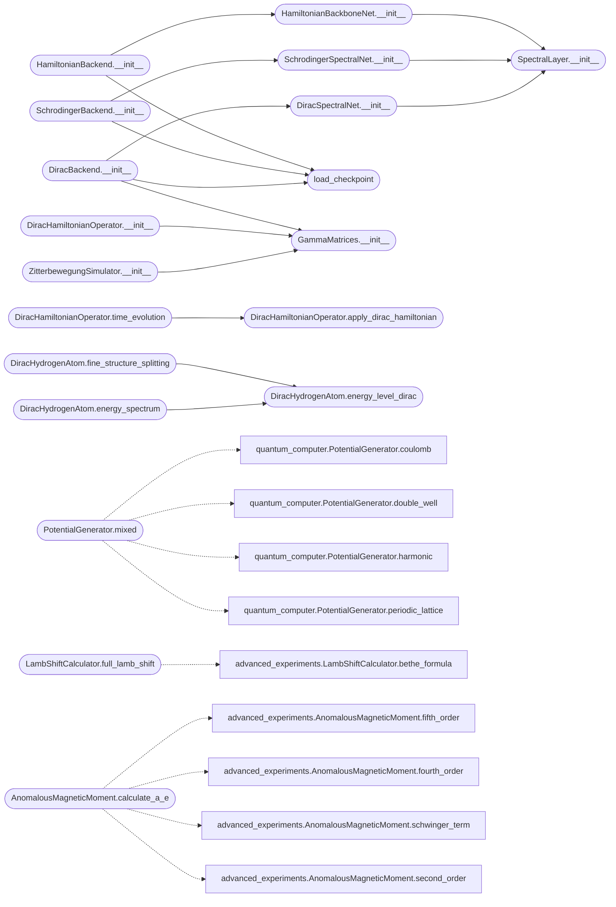

# `quantum_framework_physics`

> Source: [quantum_framework_physics.py:1](../../quantum_framework_physics.py#L1) | language `py` | coverage 57.6% | [API index](../index.md)

Quantum Framework Physics Module (canonical) ============================================ Single source of truth for the neural physics stack used across the repo:

- `[`SpectralLayer`](#spectrallayer)` / `[`HamiltonianBackboneNet`](#hamiltonianbackbonenet)` / `[`SchrodingerSpectralNet`](#schrodingerspectralnet)`
  / `[`DiracSpectralNet`](#diracspectralnet)`: FFT-based spectral networks (checkpoint-compatible).
- `[`GammaMatrices`](#gammamatrices)`: Dirac gamma matrices (Dirac and Weyl representations).
- `[`load_checkpoint`](#load_checkpoint)`: safe checkpoint loading (shape validation, no silent
  partial loads, ``weights_only=True`` first with explicit trusted fallback).
- `[`HamiltonianBackend`](#hamiltonianbackend)` / `[`SchrodingerBackend`](#schrodingerbackend)` / `[`DiracBackend`](#diracbackend)`:
  physics evolution engines.  Key invariants:

  * `[`evolve_amplitude`](#iphysicsbackend-evolve_amplitude)` **preserves the input norm** (unitary evolution keeps
    ``||U psi|| = ||psi||``).  Previously every amplitude was renormalized to
    1, which destroyed superposition weights in the joint Hilbert space.
  * ``dt`` is honoured by every backend (learned propagators use a residual
    update scaled by ``dt / propagator_dt``).
  * If a checkpoint is missing or incompatible, the backend falls back to an
    **exact analytical evolution** and logs a WARNING (never a silent random
    network).  The analytical Hamiltonian path uses the exact unitary
    ``exp(-i k^2 dt / 2)`` free-particle propagator in Fourier space.

This module supersedes the duplicated copies that lived in
``quantum_computer.py``, ``quantum_simulator.py`` and
``quantum_framework_core.py``.

Author: Gris Iscomeback
License: AGPL v3

## Contents

- **Classes:** [`SpectralLayer`](#spectrallayer), [`HamiltonianBackboneNet`](#hamiltonianbackbonenet), [`SchrodingerSpectralNet`](#schrodingerspectralnet), [`DiracSpectralNet`](#diracspectralnet), [`GammaMatrices`](#gammamatrices), [`IPhysicsBackend`](#iphysicsbackend), [`HamiltonianBackend`](#hamiltonianbackend), [`SchrodingerBackend`](#schrodingerbackend), [`DiracBackend`](#diracbackend), [`PotentialGenerator`](#potentialgenerator), [`DiracHamiltonianOperator`](#dirachamiltonianoperator), [`LambShiftCalculator`](#lambshiftcalculator), [`AnomalousMagneticMoment`](#anomalousmagneticmoment), [`DiracHydrogenAtom`](#dirachydrogenatom), [`ZitterbewegungSimulator`](#zitterbewegungsimulator)
- **Functions:** [`load_checkpoint`](#load_checkpoint)

## Type Diagram

```mermaid
classDiagram
    direction LR
    class SpectralLayer
    SpectralLayer : __init__()
    SpectralLayer : forward()
    class HamiltonianBackboneNet
    HamiltonianBackboneNet : __init__()
    HamiltonianBackboneNet : forward()
    class SchrodingerSpectralNet
    SchrodingerSpectralNet : __init__()
    SchrodingerSpectralNet : forward()
    class DiracSpectralNet
    DiracSpectralNet : __init__()
    DiracSpectralNet : forward()
    class GammaMatrices
    GammaMatrices : __init__()
    GammaMatrices : to()
    class IPhysicsBackend
    IPhysicsBackend : evolve_amplitude()
    IPhysicsBackend : apply_phase()
    class HamiltonianBackend
    HamiltonianBackend : __init__()
    HamiltonianBackend : evolve_amplitude()
    HamiltonianBackend : apply_phase()
    class SchrodingerBackend
    SchrodingerBackend : __init__()
    SchrodingerBackend : evolve_amplitude()
    SchrodingerBackend : apply_phase()
    class DiracBackend
    DiracBackend : __init__()
    DiracBackend : evolve_amplitude()
    DiracBackend : apply_phase()
    DiracBackend : evolve_spinor()
    class PotentialGenerator
    PotentialGenerator : __init__()
    PotentialGenerator : harmonic()
    PotentialGenerator : double_well()
    PotentialGenerator : coulomb()
    PotentialGenerator : periodic_lattice()
    PotentialGenerator : mixed()
    class DiracHamiltonianOperator
    DiracHamiltonianOperator : __init__()
    DiracHamiltonianOperator : apply_dirac_hamiltonian()
    DiracHamiltonianOperator : time_evolution()
    class LambShiftCalculator
    LambShiftCalculator : __init__()
    LambShiftCalculator : bethe_formula()
    LambShiftCalculator : full_lamb_shift()
    class AnomalousMagneticMoment
    AnomalousMagneticMoment : __init__()
    AnomalousMagneticMoment : schwinger_term()
    AnomalousMagneticMoment : second_order()
    AnomalousMagneticMoment : third_order()
    AnomalousMagneticMoment : fourth_order()
    AnomalousMagneticMoment : fifth_order()
    AnomalousMagneticMoment : calculate_a_e()
    class DiracHydrogenAtom
    DiracHydrogenAtom : __init__()
    DiracHydrogenAtom : energy_level_dirac()
    DiracHydrogenAtom : fine_structure_splitting()
    DiracHydrogenAtom : energy_spectrum()
    class ZitterbewegungSimulator
    ZitterbewegungSimulator : __init__()
    ZitterbewegungSimulator : create_gaussian_wave_packet()
    ZitterbewegungSimulator : compute_position_expectation()
    ZitterbewegungSimulator : compute_velocity_expectation()
    IPhysicsBackend <|-- HamiltonianBackend
    IPhysicsBackend <|-- SchrodingerBackend
    IPhysicsBackend <|-- DiracBackend
```



## Call Graph

Solid arrows stay in this module, dashed arrows leave it.



## Classes

<a id="spectrallayer"></a>

### `SpectralLayer`

`class` | [quantum_framework_physics.py:66](../../quantum_framework_physics.py#L66)

```python
class SpectralLayer(nn.Module)
```

Bases: `nn.Module`

Spectral convolution in frequency domain.

Learns complex kernels of shape ``(channels, channels, G//2+1, G)`` that
modulate the RFFT2 coefficients of the input.

Modes:
    ``channel_mixing=False`` (default, legacy): the kernel is averaged
    over the output-channel dimension (``.mean(dim=0)``) and the same
    filter is applied to every channel.  This is the behaviour the
    pre-trained checkpoints were trained with, so it stays the default
    for backward compatibility.

    ``channel_mixing=True``: full per-channel-pair complex kernel applied
    via einsum (true channel mixing, higher expressivity).  Use this for
    newly trained models; the parameter layout is identical, so old
    checkpoints still load (they simply behave differently).

**Members**

| Member | Kind | Summary |
|---|---|---|
| [`__init__`](#spectrallayer-__init__) | constructor |  |
| [`forward`](#spectrallayer-forward) | method | Apply spectral convolution via RFFT2. |

<a id="spectrallayer-__init__"></a>

#### `SpectralLayer.__init__`

`constructor` | [quantum_framework_physics.py:86](../../quantum_framework_physics.py#L86)

```python
def __init__(self, channels: int, grid_size: int, channel_mixing: bool = False) -> None
```

**Parameters**

| Name | Type | Default | Description |
|---|---|---|---|
| `channels` | `int` |  |  |
| `grid_size` | `int` |  |  |
| `channel_mixing` | `bool` | `False` |  |

*Called by:* [`DiracSpectralNet.__init__`](#diracspectralnet-__init__), [`HamiltonianBackboneNet.__init__`](#hamiltonianbackbonenet-__init__), [`SchrodingerSpectralNet.__init__`](#schrodingerspectralnet-__init__), [`SpectralLayer.__init__`](relativistic_hydrogen.py.md#spectrallayer-__init__)

<a id="spectrallayer-forward"></a>

#### `SpectralLayer.forward`

`method` | [quantum_framework_physics.py:98](../../quantum_framework_physics.py#L98)

```python
def forward(self, x: torch.Tensor) -> torch.Tensor
```

Apply spectral convolution via RFFT2.

**Parameters**

| Name | Type | Default | Description |
|---|---|---|---|
| `x` | `torch.Tensor` |  |  |

**Returns:** `torch.Tensor`

---

<a id="hamiltonianbackbonenet"></a>

### `HamiltonianBackboneNet`

`class` | [quantum_framework_physics.py:133](../../quantum_framework_physics.py#L133)

```python
class HamiltonianBackboneNet(nn.Module)
```

Bases: `nn.Module`

Hamiltonian backbone: single-channel field -> H|psi>.

**Members**

| Member | Kind | Summary |
|---|---|---|
| [`__init__`](#hamiltonianbackbonenet-__init__) | constructor |  |
| [`forward`](#hamiltonianbackbonenet-forward) | method | Accepts (G,G), (1,G,G), or (B,1,G,G). |

<a id="hamiltonianbackbonenet-__init__"></a>

#### `HamiltonianBackboneNet.__init__`

`constructor` | [quantum_framework_physics.py:136](../../quantum_framework_physics.py#L136)

```python
def __init__(self, grid_size: int, hidden_dim: int, num_spectral_layers: int) -> None
```

**Parameters**

| Name | Type | Default | Description |
|---|---|---|---|
| `grid_size` | `int` |  |  |
| `hidden_dim` | `int` |  |  |
| `num_spectral_layers` | `int` |  |  |

*Calls:* [`SpectralLayer.__init__`](#spectrallayer-__init__)

*Called by:* [`HamiltonianBackend.__init__`](#hamiltonianbackend-__init__)

<a id="hamiltonianbackbonenet-forward"></a>

#### `HamiltonianBackboneNet.forward`

`method` | [quantum_framework_physics.py:145](../../quantum_framework_physics.py#L145)

```python
def forward(self, x: torch.Tensor) -> torch.Tensor
```

Accepts (G,G), (1,G,G), or (B,1,G,G).

Returns squeezed output.

**Parameters**

| Name | Type | Default | Description |
|---|---|---|---|
| `x` | `torch.Tensor` |  |  |

**Returns:** `torch.Tensor`

---

<a id="schrodingerspectralnet"></a>

### `SchrodingerSpectralNet`

`class` | [quantum_framework_physics.py:157](../../quantum_framework_physics.py#L157)

```python
class SchrodingerSpectralNet(nn.Module)
```

Bases: `nn.Module`

Schrodinger network: 2-channel [psi_real, psi_imag] -> evolved wavefunction.

**Members**

| Member | Kind | Summary |
|---|---|---|
| [`__init__`](#schrodingerspectralnet-__init__) | constructor |  |
| [`forward`](#schrodingerspectralnet-forward) | method | (2,G,G) or (B,2,G,G) -> same shape. |

<a id="schrodingerspectralnet-__init__"></a>

#### `SchrodingerSpectralNet.__init__`

`constructor` | [quantum_framework_physics.py:160](../../quantum_framework_physics.py#L160)

```python
def __init__(self, grid_size: int, hidden_dim: int, expansion_dim: int, num_spectral_layers: int) -> None
```

**Parameters**

| Name | Type | Default | Description |
|---|---|---|---|
| `grid_size` | `int` |  |  |
| `hidden_dim` | `int` |  |  |
| `expansion_dim` | `int` |  |  |
| `num_spectral_layers` | `int` |  |  |

*Calls:* [`SpectralLayer.__init__`](#spectrallayer-__init__)

*Called by:* [`SchrodingerBackend.__init__`](#schrodingerbackend-__init__)

<a id="schrodingerspectralnet-forward"></a>

#### `SchrodingerSpectralNet.forward`

`method` | [quantum_framework_physics.py:172](../../quantum_framework_physics.py#L172)

```python
def forward(self, x: torch.Tensor) -> torch.Tensor
```

(2,G,G) or (B,2,G,G) -> same shape.

**Parameters**

| Name | Type | Default | Description |
|---|---|---|---|
| `x` | `torch.Tensor` |  |  |

**Returns:** `torch.Tensor`

---

<a id="diracspectralnet"></a>

### `DiracSpectralNet`

`class` | [quantum_framework_physics.py:184](../../quantum_framework_physics.py#L184)

```python
class DiracSpectralNet(nn.Module)
```

Bases: `nn.Module`

Dirac network: 8-channel spinor [4 components x (real,imag)] -> evolved spinor.

**Members**

| Member | Kind | Summary |
|---|---|---|
| [`__init__`](#diracspectralnet-__init__) | constructor |  |
| [`forward`](#diracspectralnet-forward) | method | (8,G,G) or (B,8,G,G) -> same shape. |

<a id="diracspectralnet-__init__"></a>

#### `DiracSpectralNet.__init__`

`constructor` | [quantum_framework_physics.py:187](../../quantum_framework_physics.py#L187)

```python
def __init__(self, grid_size: int, hidden_dim: int, expansion_dim: int, num_spectral_layers: int) -> None
```

**Parameters**

| Name | Type | Default | Description |
|---|---|---|---|
| `grid_size` | `int` |  |  |
| `hidden_dim` | `int` |  |  |
| `expansion_dim` | `int` |  |  |
| `num_spectral_layers` | `int` |  |  |

*Calls:* [`SpectralLayer.__init__`](#spectrallayer-__init__)

*Called by:* [`DiracBackend.__init__`](#diracbackend-__init__)

<a id="diracspectralnet-forward"></a>

#### `DiracSpectralNet.forward`

`method` | [quantum_framework_physics.py:199](../../quantum_framework_physics.py#L199)

```python
def forward(self, x: torch.Tensor) -> torch.Tensor
```

(8,G,G) or (B,8,G,G) -> same shape.

**Parameters**

| Name | Type | Default | Description |
|---|---|---|---|
| `x` | `torch.Tensor` |  |  |

**Returns:** `torch.Tensor`

---

<a id="gammamatrices"></a>

### `GammaMatrices`

`class` | [quantum_framework_physics.py:215](../../quantum_framework_physics.py#L215)

```python
class GammaMatrices
```

Dirac gamma matrices in Dirac (standard) or Weyl representation.

gamma^0 = beta, gamma^i = beta * alpha_i.
Stored in complex128: entries are exact (0, ±1, ±i) and the higher
precision avoids limiting float64 pipelines.

**Members**

| Member | Kind | Summary |
|---|---|---|
| [`__init__`](#gammamatrices-__init__) | constructor |  |
| [`to`](#gammamatrices-to) | method | Move all matrices to device. |

<a id="gammamatrices-__init__"></a>

#### `GammaMatrices.__init__`

`constructor` | [quantum_framework_physics.py:224](../../quantum_framework_physics.py#L224)

```python
def __init__(self, representation: str = 'dirac', device: str = 'cpu') -> None
```

**Parameters**

| Name | Type | Default | Description |
|---|---|---|---|
| `representation` | `str` | `'dirac'` |  |
| `device` | `str` | `'cpu'` |  |

*Called by:* [`DiracBackend.__init__`](#diracbackend-__init__), [`DiracHamiltonianOperator.__init__`](#dirachamiltonianoperator-__init__), [`ZitterbewegungSimulator.__init__`](#zitterbewegungsimulator-__init__)

<a id="gammamatrices-to"></a>

#### `GammaMatrices.to`

`method` | [quantum_framework_physics.py:269](../../quantum_framework_physics.py#L269)

```python
def to(self, device: str) -> 'GammaMatrices'
```

Move all matrices to device.

**Parameters**

| Name | Type | Default | Description |
|---|---|---|---|
| `device` | `str` |  |  |

**Returns:** `'GammaMatrices'`

---

<a id="iphysicsbackend"></a>

### `IPhysicsBackend`

`class` | [quantum_framework_physics.py:379](../../quantum_framework_physics.py#L379)

```python
class IPhysicsBackend
```

Subclasses: [`DiracBackend`](#diracbackend), [`HamiltonianBackend`](#hamiltonianbackend), [`SchrodingerBackend`](#schrodingerbackend)

Interface for spatial wavefunction evolution backends.

**Members**

| Member | Kind | Summary |
|---|---|---|
| [`evolve_amplitude`](#iphysicsbackend-evolve_amplitude) | method | Evolve a single (2, G, G) wavefunction by dt. |
| [`apply_phase`](#iphysicsbackend-apply_phase) | method | Apply global phase e^{i*phi} to a (2, G, G) amplitude. |

<a id="iphysicsbackend-evolve_amplitude"></a>

#### `IPhysicsBackend.evolve_amplitude`

`method` | [quantum_framework_physics.py:382](../../quantum_framework_physics.py#L382)

```python
def evolve_amplitude(self, amp: torch.Tensor, dt: float) -> torch.Tensor
```

Evolve a single (2, G, G) wavefunction by dt.

Preserves input norm.

**Parameters**

| Name | Type | Default | Description |
|---|---|---|---|
| `amp` | `torch.Tensor` |  |  |
| `dt` | `float` |  |  |

**Returns:** `torch.Tensor`

**Raises**

- `NotImplementedError`: (raised in the body, not documented)

<a id="iphysicsbackend-apply_phase"></a>

#### `IPhysicsBackend.apply_phase`

`method` | [quantum_framework_physics.py:386](../../quantum_framework_physics.py#L386)

```python
def apply_phase(self, amp: torch.Tensor, phase_angle: float) -> torch.Tensor
```

Apply global phase e^{i*phi} to a (2, G, G) amplitude.

**Parameters**

| Name | Type | Default | Description |
|---|---|---|---|
| `amp` | `torch.Tensor` |  |  |
| `phase_angle` | `float` |  |  |

**Returns:** `torch.Tensor`

**Raises**

- `NotImplementedError`: (raised in the body, not documented)

---

<a id="hamiltonianbackend"></a>

### `HamiltonianBackend`

`class` | [quantum_framework_physics.py:391](../../quantum_framework_physics.py#L391)

```python
class HamiltonianBackend(IPhysicsBackend)
```

Bases: [`IPhysicsBackend`](#iphysicsbackend)

Hamiltonian physics backend.

With a valid checkpoint the neural network acts as the Hamiltonian
operator H (first-order Euler step, norm-preserving — an approximation,
documented as such).  Without a checkpoint, falls back to the exact
free-particle Hamiltonian H = -laplacian/2 evolved with the unitary
spectral propagator exp(-i k^2 dt / 2).

**Members**

| Member | Kind | Summary |
|---|---|---|
| [`__init__`](#hamiltonianbackend-__init__) | constructor |  |
| [`evolve_amplitude`](#hamiltonianbackend-evolve_amplitude) | method | Evolve by dt preserving the input norm (unitary evolution keeps \|\|psi\|\|). |
| [`apply_phase`](#hamiltonianbackend-apply_phase) | method | Apply global phase e^{i*phi} to a (2, G, G) amplitude. |

<a id="hamiltonianbackend-__init__"></a>

#### `HamiltonianBackend.__init__`

`constructor` | [quantum_framework_physics.py:402](../../quantum_framework_physics.py#L402)

```python
def __init__(self, config: Any, checkpoint_attr: str = 'hamiltonian_checkpoint') -> None
```

**Parameters**

| Name | Type | Default | Description |
|---|---|---|---|
| `config` | `Any` |  |  |
| `checkpoint_attr` | `str` | `'hamiltonian_checkpoint'` |  |

*Calls:* [`HamiltonianBackboneNet.__init__`](#hamiltonianbackbonenet-__init__), [`load_checkpoint`](#load_checkpoint)

*Called by:* [`QuantumComputer.__init__`](quantum_computer.py.md#quantumcomputer-__init__), [`MPSQuantumComputer.__init__`](quantum_framework_core.py.md#mpsquantumcomputer-__init__), [`QuantumComputer.__init__`](quantum_simulator.py.md#quantumcomputer-__init__)

<a id="hamiltonianbackend-evolve_amplitude"></a>

#### `HamiltonianBackend.evolve_amplitude`

`method` | [quantum_framework_physics.py:438](../../quantum_framework_physics.py#L438)

```python
def evolve_amplitude(self, amp: torch.Tensor, dt: float) -> torch.Tensor
```

Evolve by dt preserving the input norm (unitary evolution keeps ||psi||).

Analytical path uses the exact unitary propagator.

**Parameters**

| Name | Type | Default | Description |
|---|---|---|---|
| `amp` | `torch.Tensor` |  |  |
| `dt` | `float` |  |  |

**Returns:** `torch.Tensor`

*Called by:* [`QuantumSpinorProcessor.evolve_with_hamiltonian_backend`](higgs_four_lepton_analysis.py.md#quantumspinorprocessor-evolve_with_hamiltonian_backend), [`QuantumSpinorProcessor.evolve_with_hamiltonian_backend`](higgs_quantum_analysis.py.md#quantumspinorprocessor-evolve_with_hamiltonian_backend)

<a id="hamiltonianbackend-apply_phase"></a>

#### `HamiltonianBackend.apply_phase`

`method` | [quantum_framework_physics.py:467](../../quantum_framework_physics.py#L467)

```python
def apply_phase(self, amp: torch.Tensor, phase_angle: float) -> torch.Tensor
```

Apply global phase e^{i*phi} to a (2, G, G) amplitude.

**Parameters**

| Name | Type | Default | Description |
|---|---|---|---|
| `amp` | `torch.Tensor` |  |  |
| `phase_angle` | `float` |  |  |

**Returns:** `torch.Tensor`

> **Inherited:** Documentation from [`IPhysicsBackend.apply_phase`](#iphysicsbackend-apply_phase) (quantum_framework_physics.py:386).

---

<a id="schrodingerbackend"></a>

### `SchrodingerBackend`

`class` | [quantum_framework_physics.py:473](../../quantum_framework_physics.py#L473)

```python
class SchrodingerBackend(IPhysicsBackend)
```

Bases: [`IPhysicsBackend`](#iphysicsbackend)

Schrodinger physics backend driven by the learned 2-channel propagator.

The network is treated as a propagator trained for a fixed step
``propagator_dt``; arbitrary dt values are honoured through a residual
update ``psi + (dt/propagator_dt) * (Net(psi) - psi)`` (identity at
dt=0).  Without a checkpoint, delegates to the Hamiltonian backend
(which itself falls back to exact unitary evolution).

**Members**

| Member | Kind | Summary |
|---|---|---|
| [`__init__`](#schrodingerbackend-__init__) | constructor |  |
| [`evolve_amplitude`](#schrodingerbackend-evolve_amplitude) | method | Evolve a single (2, G, G) wavefunction by dt. |
| [`apply_phase`](#schrodingerbackend-apply_phase) | method | Apply global phase e^{i*phi} to a (2, G, G) amplitude. |

<a id="schrodingerbackend-__init__"></a>

#### `SchrodingerBackend.__init__`

`constructor` | [quantum_framework_physics.py:484](../../quantum_framework_physics.py#L484)

```python
def __init__(self, config: Any, hamiltonian: HamiltonianBackend) -> None
```

**Parameters**

| Name | Type | Default | Description |
|---|---|---|---|
| `config` | `Any` |  |  |
| `hamiltonian` | `HamiltonianBackend` |  |  |

*Calls:* [`SchrodingerSpectralNet.__init__`](#schrodingerspectralnet-__init__), [`load_checkpoint`](#load_checkpoint)

*Called by:* [`QuantumComputer.__init__`](quantum_computer.py.md#quantumcomputer-__init__), [`MPSQuantumComputer.__init__`](quantum_framework_core.py.md#mpsquantumcomputer-__init__), [`QuantumComputer.__init__`](quantum_simulator.py.md#quantumcomputer-__init__)

<a id="schrodingerbackend-evolve_amplitude"></a>

#### `SchrodingerBackend.evolve_amplitude`

`method` | [quantum_framework_physics.py:499](../../quantum_framework_physics.py#L499)

```python
def evolve_amplitude(self, amp: torch.Tensor, dt: float) -> torch.Tensor
```

Evolve a single (2, G, G) wavefunction by dt.

Preserves input norm.

**Parameters**

| Name | Type | Default | Description |
|---|---|---|---|
| `amp` | `torch.Tensor` |  |  |
| `dt` | `float` |  |  |

**Returns:** `torch.Tensor`

> **Inherited:** Documentation from [`IPhysicsBackend.evolve_amplitude`](#iphysicsbackend-evolve_amplitude) (quantum_framework_physics.py:382).

*Called by:* [`QuantumSpinorProcessor.evolve_with_schrodinger_backend`](higgs_four_lepton_analysis.py.md#quantumspinorprocessor-evolve_with_schrodinger_backend), [`QuantumSpinorProcessor.evolve_with_schrodinger_backend`](higgs_quantum_analysis.py.md#quantumspinorprocessor-evolve_with_schrodinger_backend)

<a id="schrodingerbackend-apply_phase"></a>

#### `SchrodingerBackend.apply_phase`

`method` | [quantum_framework_physics.py:514](../../quantum_framework_physics.py#L514)

```python
def apply_phase(self, amp: torch.Tensor, phase_angle: float) -> torch.Tensor
```

Apply global phase e^{i*phi} to a (2, G, G) amplitude.

**Parameters**

| Name | Type | Default | Description |
|---|---|---|---|
| `amp` | `torch.Tensor` |  |  |
| `phase_angle` | `float` |  |  |

**Returns:** `torch.Tensor`

> **Inherited:** Documentation from [`IPhysicsBackend.apply_phase`](#iphysicsbackend-apply_phase) (quantum_framework_physics.py:386).

---

<a id="diracbackend"></a>

### `DiracBackend`

`class` | [quantum_framework_physics.py:518](../../quantum_framework_physics.py#L518)

```python
class DiracBackend(IPhysicsBackend)
```

Bases: [`IPhysicsBackend`](#iphysicsbackend)

Dirac relativistic physics backend.

Expands each (2,G,G) amplitude to a 4-component spinor, propagates it
(learned network with residual dt scaling, or the analytical Dirac
Hamiltonian c*alpha.p + beta*m*c^2), then projects back.  Evolution
preserves the input norm.

**Members**

| Member | Kind | Summary |
|---|---|---|
| [`__init__`](#diracbackend-__init__) | constructor |  |
| [`evolve_amplitude`](#diracbackend-evolve_amplitude) | method | Evolve a single (2, G, G) wavefunction by dt. |
| [`apply_phase`](#diracbackend-apply_phase) | method | Apply global phase e^{i*phi} to a (2, G, G) amplitude. |
| [`evolve_spinor`](#diracbackend-evolve_spinor) | method | Evolve a full 4-component spinor analytically, preserving its norm. |

<a id="diracbackend-__init__"></a>

#### `DiracBackend.__init__`

`constructor` | [quantum_framework_physics.py:528](../../quantum_framework_physics.py#L528)

```python
def __init__(self, config: Any, hamiltonian: HamiltonianBackend) -> None
```

**Parameters**

| Name | Type | Default | Description |
|---|---|---|---|
| `config` | `Any` |  |  |
| `hamiltonian` | `HamiltonianBackend` |  |  |

*Calls:* [`DiracSpectralNet.__init__`](#diracspectralnet-__init__), [`GammaMatrices.__init__`](#gammamatrices-__init__), [`load_checkpoint`](#load_checkpoint)

*Called by:* [`QuantumComputer.__init__`](quantum_computer.py.md#quantumcomputer-__init__), [`MPSQuantumComputer.__init__`](quantum_framework_core.py.md#mpsquantumcomputer-__init__), [`QuantumComputer.__init__`](quantum_simulator.py.md#quantumcomputer-__init__)

<a id="diracbackend-evolve_amplitude"></a>

#### `DiracBackend.evolve_amplitude`

`method` | [quantum_framework_physics.py:586](../../quantum_framework_physics.py#L586)

```python
def evolve_amplitude(self, amp: torch.Tensor, dt: float) -> torch.Tensor
```

Evolve a single (2, G, G) wavefunction by dt.

Preserves input norm.

**Parameters**

| Name | Type | Default | Description |
|---|---|---|---|
| `amp` | `torch.Tensor` |  |  |
| `dt` | `float` |  |  |

**Returns:** `torch.Tensor`

> **Inherited:** Documentation from [`IPhysicsBackend.evolve_amplitude`](#iphysicsbackend-evolve_amplitude) (quantum_framework_physics.py:382).

*Called by:* [`QuantumSpinorProcessor.evolve_with_dirac_backend`](higgs_four_lepton_analysis.py.md#quantumspinorprocessor-evolve_with_dirac_backend), [`QuantumSpinorProcessor.evolve_with_dirac_backend`](higgs_quantum_analysis.py.md#quantumspinorprocessor-evolve_with_dirac_backend)

<a id="diracbackend-apply_phase"></a>

#### `DiracBackend.apply_phase`

`method` | [quantum_framework_physics.py:609](../../quantum_framework_physics.py#L609)

```python
def apply_phase(self, amp: torch.Tensor, phase_angle: float) -> torch.Tensor
```

Apply global phase e^{i*phi} to a (2, G, G) amplitude.

**Parameters**

| Name | Type | Default | Description |
|---|---|---|---|
| `amp` | `torch.Tensor` |  |  |
| `phase_angle` | `float` |  |  |

**Returns:** `torch.Tensor`

> **Inherited:** Documentation from [`IPhysicsBackend.apply_phase`](#iphysicsbackend-apply_phase) (quantum_framework_physics.py:386).

<a id="diracbackend-evolve_spinor"></a>

#### `DiracBackend.evolve_spinor`

`method` | [quantum_framework_physics.py:612](../../quantum_framework_physics.py#L612)

```python
def evolve_spinor(self, spinor: torch.Tensor, dt: float) -> torch.Tensor
```

Evolve a full 4-component spinor analytically, preserving its norm.

**Parameters**

| Name | Type | Default | Description |
|---|---|---|---|
| `spinor` | `torch.Tensor` |  |  |
| `dt` | `float` |  |  |

**Returns:** `torch.Tensor`

---

<a id="potentialgenerator"></a>

### `PotentialGenerator`

`class` | [quantum_framework_physics.py:626](../../quantum_framework_physics.py#L626)

```python
class PotentialGenerator
```

Spatial potentials for eigenstate initialization.

**Members**

| Member | Kind | Summary |
|---|---|---|
| [`__init__`](#potentialgenerator-__init__) | constructor |  |
| [`harmonic`](#potentialgenerator-harmonic) | method | V = k/2 * r^2. |
| [`double_well`](#potentialgenerator-double_well) | method | Double-well along x. |
| [`coulomb`](#potentialgenerator-coulomb) | method | Coulomb-like V ~ -1/r. |
| [`periodic_lattice`](#potentialgenerator-periodic_lattice) | method | Periodic cosine lattice. |
| [`mixed`](#potentialgenerator-mixed) | method | Dirichlet-weighted mixture of all four potentials (local RNG). |

<a id="potentialgenerator-__init__"></a>

#### `PotentialGenerator.__init__`

`constructor` | [quantum_framework_physics.py:629](../../quantum_framework_physics.py#L629)

```python
def __init__(self, grid_size: int = 16, potential_depth: float = 5.0, potential_width: float = 0.3) -> None
```

**Parameters**

| Name | Type | Default | Description |
|---|---|---|---|
| `grid_size` | `int` | `16` |  |
| `potential_depth` | `float` | `5.0` |  |
| `potential_width` | `float` | `0.3` |  |

<a id="potentialgenerator-harmonic"></a>

#### `PotentialGenerator.harmonic`

`method` | [quantum_framework_physics.py:640](../../quantum_framework_physics.py#L640)

```python
def harmonic(self) -> torch.Tensor
```

V = k/2 * r^2.

**Returns:** `torch.Tensor`

<a id="potentialgenerator-double_well"></a>

#### `PotentialGenerator.double_well`

`method` | [quantum_framework_physics.py:646](../../quantum_framework_physics.py#L646)

```python
def double_well(self) -> torch.Tensor
```

Double-well along x.

**Returns:** `torch.Tensor`

<a id="potentialgenerator-coulomb"></a>

#### `PotentialGenerator.coulomb`

`method` | [quantum_framework_physics.py:653](../../quantum_framework_physics.py#L653)

```python
def coulomb(self) -> torch.Tensor
```

Coulomb-like V ~ -1/r.

**Returns:** `torch.Tensor`

<a id="potentialgenerator-periodic_lattice"></a>

#### `PotentialGenerator.periodic_lattice`

`method` | [quantum_framework_physics.py:660](../../quantum_framework_physics.py#L660)

```python
def periodic_lattice(self) -> torch.Tensor
```

Periodic cosine lattice.

**Returns:** `torch.Tensor`

<a id="potentialgenerator-mixed"></a>

#### `PotentialGenerator.mixed`

`method` | [quantum_framework_physics.py:665](../../quantum_framework_physics.py#L665)

```python
def mixed(self, seed: int) -> torch.Tensor
```

Dirichlet-weighted mixture of all four potentials (local RNG).

**Parameters**

| Name | Type | Default | Description |
|---|---|---|---|
| `seed` | `int` |  |  |

**Returns:** `torch.Tensor`

*Calls:* [`PotentialGenerator.coulomb`](quantum_computer.py.md#potentialgenerator-coulomb), [`PotentialGenerator.double_well`](quantum_computer.py.md#potentialgenerator-double_well), [`PotentialGenerator.harmonic`](quantum_computer.py.md#potentialgenerator-harmonic), [`PotentialGenerator.periodic_lattice`](quantum_computer.py.md#potentialgenerator-periodic_lattice)

---

<a id="dirachamiltonianoperator"></a>

### `DiracHamiltonianOperator`

`class` | [quantum_framework_physics.py:676](../../quantum_framework_physics.py#L676)

```python
class DiracHamiltonianOperator
```

Dirac Hamiltonian operator for relativistic quantum mechanics.

H_Dirac = c * alpha . p + beta * m * c^2 + V(r)

FIXED: the kinetic term now correctly contracts alpha_{cd} with psi_d
(previously it always used psi_c, so spinor components never mixed).
Vectorized with einsum instead of per-element .item() loops.

**Members**

| Member | Kind | Summary |
|---|---|---|
| [`__init__`](#dirachamiltonianoperator-__init__) | constructor |  |
| [`apply_dirac_hamiltonian`](#dirachamiltonianoperator-apply_dirac_hamiltonian) | method | Apply the Dirac Hamiltonian to a 4-component spinor. |
| [`time_evolution`](#dirachamiltonianoperator-time_evolution) | method | First-order time evolution psi -> (1 - i H dt) psi, preserving the input norm (first-order unitary approximation). |

<a id="dirachamiltonianoperator-__init__"></a>

#### `DiracHamiltonianOperator.__init__`

`constructor` | [quantum_framework_physics.py:686](../../quantum_framework_physics.py#L686)

```python
def __init__(self, grid_size: int, electron_mass: float, c_light: float, device: str = 'cpu') -> None
```

**Parameters**

| Name | Type | Default | Description |
|---|---|---|---|
| `grid_size` | `int` |  |  |
| `electron_mass` | `float` |  |  |
| `c_light` | `float` |  |  |
| `device` | `str` | `'cpu'` |  |

*Calls:* [`GammaMatrices.__init__`](#gammamatrices-__init__)

<a id="dirachamiltonianoperator-apply_dirac_hamiltonian"></a>

#### `DiracHamiltonianOperator.apply_dirac_hamiltonian`

`method` | [quantum_framework_physics.py:702](../../quantum_framework_physics.py#L702)

```python
def apply_dirac_hamiltonian(self, spinor: torch.Tensor, potential: Optional[torch.Tensor] = None) -> torch.Tensor
```

Apply the Dirac Hamiltonian to a 4-component spinor.

**Parameters**

| Name | Type | Default | Description |
|---|---|---|---|
| `spinor` | `torch.Tensor` |  | shape (4, H, W) or (batch, 4, H, W) |
| `potential` | `Optional[torch.Tensor]` | `None` | optional scalar potential V(r) |

**Returns:** `torch.Tensor` - H psi with the same shape as the input.

*Called by:* [`DiracHamiltonianOperator.time_evolution`](#dirachamiltonianoperator-time_evolution), [`DiracHamiltonianOperator.time_evolution`](relativistic_hydrogen.py.md#dirachamiltonianoperator-time_evolution), [`DiracModelWrapper.apply_hamiltonian`](relativistic_hydrogen.py.md#diracmodelwrapper-apply_hamiltonian)

<a id="dirachamiltonianoperator-time_evolution"></a>

#### `DiracHamiltonianOperator.time_evolution`

`method` | [quantum_framework_physics.py:740](../../quantum_framework_physics.py#L740)

```python
def time_evolution(self, spinor: torch.Tensor, dt: float, potential: Optional[torch.Tensor] = None, normalization_eps: float = 1e-10) -> torch.Tensor
```

First-order time evolution psi -> (1 - i H dt) psi, preserving the input norm (first-order unitary approximation).

**Parameters**

| Name | Type | Default | Description |
|---|---|---|---|
| `spinor` | `torch.Tensor` |  |  |
| `dt` | `float` |  |  |
| `potential` | `Optional[torch.Tensor]` | `None` |  |
| `normalization_eps` | `float` | `1e-10` |  |

**Returns:** `torch.Tensor`

*Calls:* [`DiracHamiltonianOperator.apply_dirac_hamiltonian`](#dirachamiltonianoperator-apply_dirac_hamiltonian)

*Called by:* [`DiracModelWrapper.evolve_spinor`](relativistic_hydrogen.py.md#diracmodelwrapper-evolve_spinor)

---

<a id="lambshiftcalculator"></a>

### `LambShiftCalculator`

`class` | [quantum_framework_physics.py:762](../../quantum_framework_physics.py#L762)

```python
class LambShiftCalculator
```

Lamb shift via Bethe's formula (self-energy + Uehling term).

**Members**

| Member | Kind | Summary |
|---|---|---|
| [`__init__`](#lambshiftcalculator-__init__) | constructor |  |
| [`bethe_formula`](#lambshiftcalculator-bethe_formula) | method |  |
| [`full_lamb_shift`](#lambshiftcalculator-full_lamb_shift) | method |  |

<a id="lambshiftcalculator-__init__"></a>

#### `LambShiftCalculator.__init__`

`constructor` | [quantum_framework_physics.py:765](../../quantum_framework_physics.py#L765)

```python
def __init__(self, alpha_fs: float = 0.0072973525693, c_light: float = 137.035999084, electron_mass: float = 1.0) -> None
```

**Parameters**

| Name | Type | Default | Description |
|---|---|---|---|
| `alpha_fs` | `float` | `0.0072973525693` |  |
| `c_light` | `float` | `137.035999084` |  |
| `electron_mass` | `float` | `1.0` |  |

<a id="lambshiftcalculator-bethe_formula"></a>

#### `LambShiftCalculator.bethe_formula`

`method` | [quantum_framework_physics.py:771](../../quantum_framework_physics.py#L771)

```python
def bethe_formula(self, n: int, l: int, Z: int = 1) -> float
```

**Parameters**

| Name | Type | Default | Description |
|---|---|---|---|
| `n` | `int` |  |  |
| `l` | `int` |  |  |
| `Z` | `int` | `1` |  |

**Returns:** `float`

<a id="lambshiftcalculator-full_lamb_shift"></a>

#### `LambShiftCalculator.full_lamb_shift`

`method` | [quantum_framework_physics.py:782](../../quantum_framework_physics.py#L782)

```python
def full_lamb_shift(self, n: int, l: int, j: float, Z: int = 1) -> Dict[str, float]
```

**Parameters**

| Name | Type | Default | Description |
|---|---|---|---|
| `n` | `int` |  |  |
| `l` | `int` |  |  |
| `j` | `float` |  |  |
| `Z` | `int` | `1` |  |

**Returns:** `Dict[str, float]`

*Calls:* [`LambShiftCalculator.bethe_formula`](advanced_experiments.py.md#lambshiftcalculator-bethe_formula)

---

<a id="anomalousmagneticmoment"></a>

### `AnomalousMagneticMoment`

`class` | [quantum_framework_physics.py:802](../../quantum_framework_physics.py#L802)

```python
class AnomalousMagneticMoment
```

Electron anomalous magnetic moment (g-2)/2 up to 5th order in alpha.

**Members**

| Member | Kind | Summary |
|---|---|---|
| [`__init__`](#anomalousmagneticmoment-__init__) | constructor |  |
| [`schwinger_term`](#anomalousmagneticmoment-schwinger_term) | method |  |
| [`second_order`](#anomalousmagneticmoment-second_order) | method |  |
| [`third_order`](#anomalousmagneticmoment-third_order) | method |  |
| [`fourth_order`](#anomalousmagneticmoment-fourth_order) | method |  |
| [`fifth_order`](#anomalousmagneticmoment-fifth_order) | method |  |
| [`calculate_a_e`](#anomalousmagneticmoment-calculate_a_e) | method |  |

<a id="anomalousmagneticmoment-__init__"></a>

#### `AnomalousMagneticMoment.__init__`

`constructor` | [quantum_framework_physics.py:805](../../quantum_framework_physics.py#L805)

```python
def __init__(self, alpha_fs: float = 0.0072973525693) -> None
```

**Parameters**

| Name | Type | Default | Description |
|---|---|---|---|
| `alpha_fs` | `float` | `0.0072973525693` |  |

<a id="anomalousmagneticmoment-schwinger_term"></a>

#### `AnomalousMagneticMoment.schwinger_term`

`method` | [quantum_framework_physics.py:808](../../quantum_framework_physics.py#L808)

```python
def schwinger_term(self) -> float
```

**Returns:** `float`

<a id="anomalousmagneticmoment-second_order"></a>

#### `AnomalousMagneticMoment.second_order`

`method` | [quantum_framework_physics.py:811](../../quantum_framework_physics.py#L811)

```python
def second_order(self) -> float
```

**Returns:** `float`

<a id="anomalousmagneticmoment-third_order"></a>

#### `AnomalousMagneticMoment.third_order`

`method` | [quantum_framework_physics.py:814](../../quantum_framework_physics.py#L814)

```python
def third_order(self) -> float
```

**Returns:** `float`

<a id="anomalousmagneticmoment-fourth_order"></a>

#### `AnomalousMagneticMoment.fourth_order`

`method` | [quantum_framework_physics.py:817](../../quantum_framework_physics.py#L817)

```python
def fourth_order(self) -> float
```

**Returns:** `float`

<a id="anomalousmagneticmoment-fifth_order"></a>

#### `AnomalousMagneticMoment.fifth_order`

`method` | [quantum_framework_physics.py:820](../../quantum_framework_physics.py#L820)

```python
def fifth_order(self) -> float
```

**Returns:** `float`

<a id="anomalousmagneticmoment-calculate_a_e"></a>

#### `AnomalousMagneticMoment.calculate_a_e`

`method` | [quantum_framework_physics.py:823](../../quantum_framework_physics.py#L823)

```python
def calculate_a_e(self, order: int = 5) -> Dict[str, float]
```

**Parameters**

| Name | Type | Default | Description |
|---|---|---|---|
| `order` | `int` | `5` |  |

**Returns:** `Dict[str, float]`

*Calls:* [`AnomalousMagneticMoment.fifth_order`](advanced_experiments.py.md#anomalousmagneticmoment-fifth_order), [`AnomalousMagneticMoment.fourth_order`](advanced_experiments.py.md#anomalousmagneticmoment-fourth_order), [`AnomalousMagneticMoment.schwinger_term`](advanced_experiments.py.md#anomalousmagneticmoment-schwinger_term), [`AnomalousMagneticMoment.second_order`](advanced_experiments.py.md#anomalousmagneticmoment-second_order), [`AnomalousMagneticMoment.third_order`](advanced_experiments.py.md#anomalousmagneticmoment-third_order)

---

<a id="dirachydrogenatom"></a>

### `DiracHydrogenAtom`

`class` | [quantum_framework_physics.py:842](../../quantum_framework_physics.py#L842)

```python
class DiracHydrogenAtom
```

Relativistic hydrogen energy levels from the exact Dirac spectrum.

**Members**

| Member | Kind | Summary |
|---|---|---|
| [`__init__`](#dirachydrogenatom-__init__) | constructor |  |
| [`energy_level_dirac`](#dirachydrogenatom-energy_level_dirac) | method |  |
| [`fine_structure_splitting`](#dirachydrogenatom-fine_structure_splitting) | method |  |
| [`energy_spectrum`](#dirachydrogenatom-energy_spectrum) | method |  |

<a id="dirachydrogenatom-__init__"></a>

#### `DiracHydrogenAtom.__init__`

`constructor` | [quantum_framework_physics.py:845](../../quantum_framework_physics.py#L845)

```python
def __init__(self, c_light: float = 137.035999084, alpha_fs: float = 0.0072973525693) -> None
```

**Parameters**

| Name | Type | Default | Description |
|---|---|---|---|
| `c_light` | `float` | `137.035999084` |  |
| `alpha_fs` | `float` | `0.0072973525693` |  |

<a id="dirachydrogenatom-energy_level_dirac"></a>

#### `DiracHydrogenAtom.energy_level_dirac`

`method` | [quantum_framework_physics.py:850](../../quantum_framework_physics.py#L850)

```python
def energy_level_dirac(self, n: int, kappa: int) -> float
```

**Parameters**

| Name | Type | Default | Description |
|---|---|---|---|
| `n` | `int` |  |  |
| `kappa` | `int` |  |  |

**Returns:** `float`

*Called by:* [`EntangledHydrogenExperiment.run_relativistic_entangled_hydrogen`](entangled_hydrogen.py.md#entangledhydrogenexperiment-run_relativistic_entangled_hydrogen), [`DiracBackendLink.energy`](immersive.spin.py.md#diracbackendlink-energy), [`DiracHydrogenAtom.energy_spectrum`](#dirachydrogenatom-energy_spectrum), [`DiracHydrogenAtom.fine_structure_splitting`](#dirachydrogenatom-fine_structure_splitting), [`DiracHydrogenAtom.energy_spectrum`](quantum_simulator.py.md#dirachydrogenatom-energy_spectrum), [`DiracHydrogenAtom.fine_structure_splitting`](quantum_simulator.py.md#dirachydrogenatom-fine_structure_splitting), [`DiracHydrogenAtom.energy_spectrum`](relativistic_hydrogen.py.md#dirachydrogenatom-energy_spectrum), [`DiracHydrogenAtom.fine_structure_splitting`](relativistic_hydrogen.py.md#dirachydrogenatom-fine_structure_splitting), [`DiracMonteCarloSampler.sample_orbital`](relativistic_hydrogen.py.md#diracmontecarlosampler-sample_orbital), [`DiracValidationSuite.validate_fine_structure`](relativistic_hydrogen.py.md#diracvalidationsuite-validate_fine_structure), [`DiracVisualizer.visualize_energy_spectrum`](relativistic_hydrogen.py.md#diracvisualizer-visualize_energy_spectrum)

<a id="dirachydrogenatom-fine_structure_splitting"></a>

#### `DiracHydrogenAtom.fine_structure_splitting`

`method` | [quantum_framework_physics.py:858](../../quantum_framework_physics.py#L858)

```python
def fine_structure_splitting(self, n: int, l: int) -> Dict[str, float]
```

**Parameters**

| Name | Type | Default | Description |
|---|---|---|---|
| `n` | `int` |  |  |
| `l` | `int` |  |  |

**Returns:** `Dict[str, float]`

*Calls:* [`DiracHydrogenAtom.energy_level_dirac`](#dirachydrogenatom-energy_level_dirac)

*Called by:* [`QuantumSimulationFramework.compute_relativistic_energy`](quantum_simulator.py.md#quantumsimulationframework-compute_relativistic_energy)

<a id="dirachydrogenatom-energy_spectrum"></a>

#### `DiracHydrogenAtom.energy_spectrum`

`method` | [quantum_framework_physics.py:873](../../quantum_framework_physics.py#L873)

```python
def energy_spectrum(self, n_max: int = 4) -> List[Dict]
```

**Parameters**

| Name | Type | Default | Description |
|---|---|---|---|
| `n_max` | `int` | `4` |  |

**Returns:** `List[Dict]`

*Calls:* [`DiracHydrogenAtom.energy_level_dirac`](#dirachydrogenatom-energy_level_dirac)

*Called by:* [`QuantumSimulationFramework.compute_energy_spectrum`](quantum_simulator.py.md#quantumsimulationframework-compute_energy_spectrum), [`DiracValidationSuite.validate_energy_spectrum`](relativistic_hydrogen.py.md#diracvalidationsuite-validate_energy_spectrum)

---

<a id="zitterbewegungsimulator"></a>

### `ZitterbewegungSimulator`

`class` | [quantum_framework_physics.py:901](../../quantum_framework_physics.py#L901)

```python
class ZitterbewegungSimulator
```

Simulates Zitterbewegung (trembling motion) of a relativistic electron: interference between positive and negative energy components.

**Members**

| Member | Kind | Summary |
|---|---|---|
| [`__init__`](#zitterbewegungsimulator-__init__) | constructor |  |
| [`create_gaussian_wave_packet`](#zitterbewegungsimulator-create_gaussian_wave_packet) | method |  |
| [`compute_position_expectation`](#zitterbewegungsimulator-compute_position_expectation) | method |  |
| [`compute_velocity_expectation`](#zitterbewegungsimulator-compute_velocity_expectation) | method |  |

<a id="zitterbewegungsimulator-__init__"></a>

#### `ZitterbewegungSimulator.__init__`

`constructor` | [quantum_framework_physics.py:907](../../quantum_framework_physics.py#L907)

```python
def __init__(self, grid_size: int, c_light: float, electron_mass: float, device: str = 'cpu') -> None
```

**Parameters**

| Name | Type | Default | Description |
|---|---|---|---|
| `grid_size` | `int` |  |  |
| `c_light` | `float` |  |  |
| `electron_mass` | `float` |  |  |
| `device` | `str` | `'cpu'` |  |

*Calls:* [`GammaMatrices.__init__`](#gammamatrices-__init__)

<a id="zitterbewegungsimulator-create_gaussian_wave_packet"></a>

#### `ZitterbewegungSimulator.create_gaussian_wave_packet`

`method` | [quantum_framework_physics.py:915](../../quantum_framework_physics.py#L915)

```python
def create_gaussian_wave_packet(self, sigma: float = 0.1, momentum: float = 0.0) -> torch.Tensor
```

**Parameters**

| Name | Type | Default | Description |
|---|---|---|---|
| `sigma` | `float` | `0.1` |  |
| `momentum` | `float` | `0.0` |  |

**Returns:** `torch.Tensor`

*Called by:* [`ZitterbewegungSimulator.simulate`](quantum_simulator.py.md#zitterbewegungsimulator-simulate), [`ZitterbewegungSimulator.simulate`](relativistic_hydrogen.py.md#zitterbewegungsimulator-simulate)

<a id="zitterbewegungsimulator-compute_position_expectation"></a>

#### `ZitterbewegungSimulator.compute_position_expectation`

`method` | [quantum_framework_physics.py:934](../../quantum_framework_physics.py#L934)

```python
def compute_position_expectation(self, spinor: torch.Tensor) -> Tuple[float, float]
```

**Parameters**

| Name | Type | Default | Description |
|---|---|---|---|
| `spinor` | `torch.Tensor` |  |  |

**Returns:** `Tuple[float, float]`

*Called by:* [`ZitterbewegungSimulator.simulate`](quantum_simulator.py.md#zitterbewegungsimulator-simulate), [`ZitterbewegungSimulator.simulate`](relativistic_hydrogen.py.md#zitterbewegungsimulator-simulate)

<a id="zitterbewegungsimulator-compute_velocity_expectation"></a>

#### `ZitterbewegungSimulator.compute_velocity_expectation`

`method` | [quantum_framework_physics.py:944](../../quantum_framework_physics.py#L944)

```python
def compute_velocity_expectation(self, spinor: torch.Tensor) -> Tuple[float, float]
```

**Parameters**

| Name | Type | Default | Description |
|---|---|---|---|
| `spinor` | `torch.Tensor` |  |  |

**Returns:** `Tuple[float, float]`

*Called by:* [`ZitterbewegungSimulator.simulate`](quantum_simulator.py.md#zitterbewegungsimulator-simulate), [`ZitterbewegungSimulator.simulate`](relativistic_hydrogen.py.md#zitterbewegungsimulator-simulate)

---

## Functions

<a id="load_checkpoint"></a>

### `load_checkpoint`

`function` | [quantum_framework_physics.py:280](../../quantum_framework_physics.py#L280)

```python
def load_checkpoint(net: nn.Module, path: str, device: str, name: str) -> bool
```

Load ``net`` weights from ``path`` with validation.

- Tries ``weights_only=True`` first (safe); falls back to full pickle only
  with an explicit security notice (checkpoints in this repo contain
  numpy scalars saved by the training scripts).
- Loads with ``strict=True``: silently partial networks are never used.
- Validates that the spectral kernel shapes match the network grid size,
  preventing silent bilinear resampling of mismatched checkpoints.

Returns True on success.  On any failure the network is left untouched
and the caller is expected to fall back to analytical evolution.

**Parameters**

| Name | Type | Default | Description |
|---|---|---|---|
| `net` | `nn.Module` |  |  |
| `path` | `str` |  |  |
| `device` | `str` |  |  |
| `name` | `str` |  |  |

**Returns:** `bool`

*Called by:* [`DiracBackend.__init__`](#diracbackend-__init__), [`HamiltonianBackend.__init__`](#hamiltonianbackend-__init__), [`SchrodingerBackend.__init__`](#schrodingerbackend-__init__)

---
