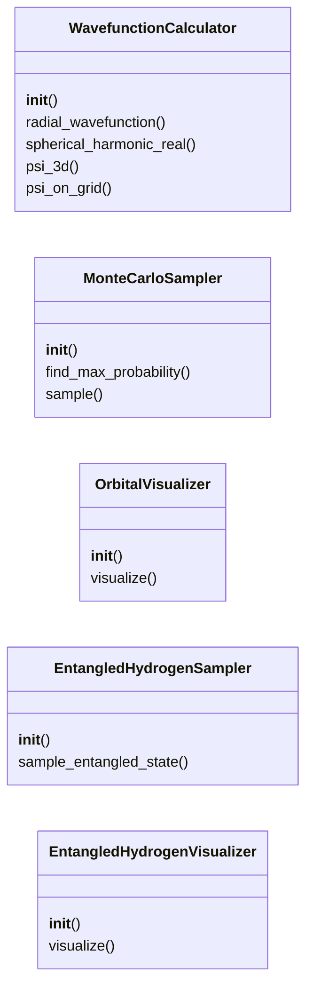
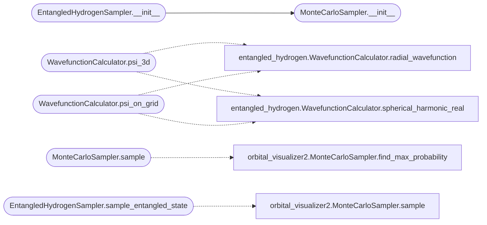

# `quantum_framework_visualization`

> Source: [quantum_framework_visualization.py:1](../../quantum_framework_visualization.py#L1) | language `py` | coverage 30.0% | [API index](../index.md)

Quantum Framework Visualization Module ======================================== Orbital visualization, Monte Carlo sampling, and entangled state visualization.

Author: Gris Iscomeback
License: AGPL v3

## Contents

- **Classes:** [`WavefunctionCalculator`](#wavefunctioncalculator), [`MonteCarloSampler`](#montecarlosampler), [`OrbitalVisualizer`](#orbitalvisualizer), [`EntangledHydrogenSampler`](#entangledhydrogensampler), [`EntangledHydrogenVisualizer`](#entangledhydrogenvisualizer)

## Type Diagram



## Call Graph

Solid arrows stay in this module, dashed arrows leave it.



## Classes

<a id="wavefunctioncalculator"></a>

### `WavefunctionCalculator`

`class` | [quantum_framework_visualization.py:59](../../quantum_framework_visualization.py#L59)

```python
class WavefunctionCalculator
```

Calculates hydrogen atom wavefunctions for visualization.

Uses analytical formulas for radial and angular parts.

**Members**

| Member | Kind | Summary |
|---|---|---|
| [`__init__`](#wavefunctioncalculator-__init__) | constructor |  |
| [`radial_wavefunction`](#wavefunctioncalculator-radial_wavefunction) | staticmethod |  |
| [`spherical_harmonic_real`](#wavefunctioncalculator-spherical_harmonic_real) | staticmethod |  |
| [`psi_3d`](#wavefunctioncalculator-psi_3d) | method |  |
| [`psi_on_grid`](#wavefunctioncalculator-psi_on_grid) | method |  |

<a id="wavefunctioncalculator-__init__"></a>

#### `WavefunctionCalculator.__init__`

`constructor` | [quantum_framework_visualization.py:65](../../quantum_framework_visualization.py#L65)

```python
def __init__(self, config: Any) -> None
```

**Parameters**

| Name | Type | Default | Description |
|---|---|---|---|
| `config` | `Any` |  |  |

<a id="wavefunctioncalculator-radial_wavefunction"></a>

#### `WavefunctionCalculator.radial_wavefunction`

`staticmethod` | [quantum_framework_visualization.py:69](../../quantum_framework_visualization.py#L69)

Decorators: `@staticmethod`

```python
def radial_wavefunction(n: int, l: int, r: np.ndarray) -> np.ndarray
```

**Parameters**

| Name | Type | Default | Description |
|---|---|---|---|
| `n` | `int` |  |  |
| `l` | `int` |  |  |
| `r` | `np.ndarray` |  |  |

**Returns:** `np.ndarray`

<a id="wavefunctioncalculator-spherical_harmonic_real"></a>

#### `WavefunctionCalculator.spherical_harmonic_real`

`staticmethod` | [quantum_framework_visualization.py:81](../../quantum_framework_visualization.py#L81)

Decorators: `@staticmethod`

```python
def spherical_harmonic_real(l: int, m: int, theta: np.ndarray, phi: np.ndarray) -> np.ndarray
```

**Parameters**

| Name | Type | Default | Description |
|---|---|---|---|
| `l` | `int` |  |  |
| `m` | `int` |  |  |
| `theta` | `np.ndarray` |  |  |
| `phi` | `np.ndarray` |  |  |

**Returns:** `np.ndarray`

<a id="wavefunctioncalculator-psi_3d"></a>

#### `WavefunctionCalculator.psi_3d`

`method` | [quantum_framework_visualization.py:92](../../quantum_framework_visualization.py#L92)

```python
def psi_3d(self, n: int, l: int, m: int, r: np.ndarray, theta: np.ndarray, phi: np.ndarray) -> np.ndarray
```

**Parameters**

| Name | Type | Default | Description |
|---|---|---|---|
| `n` | `int` |  |  |
| `l` | `int` |  |  |
| `m` | `int` |  |  |
| `r` | `np.ndarray` |  |  |
| `theta` | `np.ndarray` |  |  |
| `phi` | `np.ndarray` |  |  |

**Returns:** `np.ndarray`

*Calls:* [`WavefunctionCalculator.radial_wavefunction`](entangled_hydrogen.py.md#wavefunctioncalculator-radial_wavefunction), [`WavefunctionCalculator.spherical_harmonic_real`](entangled_hydrogen.py.md#wavefunctioncalculator-spherical_harmonic_real)

<a id="wavefunctioncalculator-psi_on_grid"></a>

#### `WavefunctionCalculator.psi_on_grid`

`method` | [quantum_framework_visualization.py:97](../../quantum_framework_visualization.py#L97)

```python
def psi_on_grid(self, n: int, l: int, m: int) -> torch.Tensor
```

**Parameters**

| Name | Type | Default | Description |
|---|---|---|---|
| `n` | `int` |  |  |
| `l` | `int` |  |  |
| `m` | `int` |  |  |

**Returns:** `torch.Tensor`

*Calls:* [`WavefunctionCalculator.radial_wavefunction`](entangled_hydrogen.py.md#wavefunctioncalculator-radial_wavefunction), [`WavefunctionCalculator.spherical_harmonic_real`](entangled_hydrogen.py.md#wavefunctioncalculator-spherical_harmonic_real)

---

<a id="montecarlosampler"></a>

### `MonteCarloSampler`

`class` | [quantum_framework_visualization.py:115](../../quantum_framework_visualization.py#L115)

```python
class MonteCarloSampler
```

Monte Carlo sampling for orbital visualization.

Uses rejection sampling to generate 3D point clouds.

**Members**

| Member | Kind | Summary |
|---|---|---|
| [`__init__`](#montecarlosampler-__init__) | constructor |  |
| [`find_max_probability`](#montecarlosampler-find_max_probability) | method |  |
| [`sample`](#montecarlosampler-sample) | method |  |

<a id="montecarlosampler-__init__"></a>

#### `MonteCarloSampler.__init__`

`constructor` | [quantum_framework_visualization.py:121](../../quantum_framework_visualization.py#L121)

```python
def __init__(self, config: Any, wavefunction_calc: WavefunctionCalculator) -> None
```

**Parameters**

| Name | Type | Default | Description |
|---|---|---|---|
| `config` | `Any` |  |  |
| `wavefunction_calc` | `WavefunctionCalculator` |  |  |

*Called by:* [`EntangledHydrogenSampler.__init__`](#entangledhydrogensampler-__init__)

<a id="montecarlosampler-find_max_probability"></a>

#### `MonteCarloSampler.find_max_probability`

`method` | [quantum_framework_visualization.py:125](../../quantum_framework_visualization.py#L125)

```python
def find_max_probability(self, n: int, l: int, m: int) -> Tuple[float, float, float, float]
```

**Parameters**

| Name | Type | Default | Description |
|---|---|---|---|
| `n` | `int` |  |  |
| `l` | `int` |  |  |
| `m` | `int` |  |  |

**Returns:** `Tuple[float, float, float, float]`

<a id="montecarlosampler-sample"></a>

#### `MonteCarloSampler.sample`

`method` | [quantum_framework_visualization.py:149](../../quantum_framework_visualization.py#L149)

```python
def sample(self, n: int, l: int, m: int, num_samples: int) -> Dict[str, Any]
```

**Parameters**

| Name | Type | Default | Description |
|---|---|---|---|
| `n` | `int` |  |  |
| `l` | `int` |  |  |
| `m` | `int` |  |  |
| `num_samples` | `int` |  |  |

**Returns:** `Dict[str, Any]`

*Calls:* [`MonteCarloSampler.find_max_probability`](orbital_visualizer2.py.md#montecarlosampler-find_max_probability)

---

<a id="orbitalvisualizer"></a>

### `OrbitalVisualizer`

`class` | [quantum_framework_visualization.py:202](../../quantum_framework_visualization.py#L202)

```python
class OrbitalVisualizer
```

High-resolution visualization of hydrogen orbitals.

Creates 2D projections and 3D scatter plots.

**Members**

| Member | Kind | Summary |
|---|---|---|
| [`__init__`](#orbitalvisualizer-__init__) | constructor |  |
| [`visualize`](#orbitalvisualizer-visualize) | method |  |

<a id="orbitalvisualizer-__init__"></a>

#### `OrbitalVisualizer.__init__`

`constructor` | [quantum_framework_visualization.py:208](../../quantum_framework_visualization.py#L208)

```python
def __init__(self, config: Any) -> None
```

**Parameters**

| Name | Type | Default | Description |
|---|---|---|---|
| `config` | `Any` |  |  |

<a id="orbitalvisualizer-visualize"></a>

#### `OrbitalVisualizer.visualize`

`method` | [quantum_framework_visualization.py:211](../../quantum_framework_visualization.py#L211)

```python
def visualize(self, data: Dict[str, Any], save_path: Optional[str] = None) -> None
```

**Parameters**

| Name | Type | Default | Description |
|---|---|---|---|
| `data` | `Dict[str, Any]` |  |  |
| `save_path` | `Optional[str]` | `None` |  |

---

<a id="entangledhydrogensampler"></a>

### `EntangledHydrogenSampler`

`class` | [quantum_framework_visualization.py:290](../../quantum_framework_visualization.py#L290)

```python
class EntangledHydrogenSampler
```

Monte Carlo sampler for entangled hydrogen states.

Samples from joint probability distribution of entangled orbitals.

**Members**

| Member | Kind | Summary |
|---|---|---|
| [`__init__`](#entangledhydrogensampler-__init__) | constructor |  |
| [`sample_entangled_state`](#entangledhydrogensampler-sample_entangled_state) | method |  |

<a id="entangledhydrogensampler-__init__"></a>

#### `EntangledHydrogenSampler.__init__`

`constructor` | [quantum_framework_visualization.py:296](../../quantum_framework_visualization.py#L296)

```python
def __init__(self, config: Any, wavefunction_calc: WavefunctionCalculator) -> None
```

**Parameters**

| Name | Type | Default | Description |
|---|---|---|---|
| `config` | `Any` |  |  |
| `wavefunction_calc` | `WavefunctionCalculator` |  |  |

*Calls:* [`MonteCarloSampler.__init__`](#montecarlosampler-__init__)

<a id="entangledhydrogensampler-sample_entangled_state"></a>

#### `EntangledHydrogenSampler.sample_entangled_state`

`method` | [quantum_framework_visualization.py:301](../../quantum_framework_visualization.py#L301)

```python
def sample_entangled_state(self, n1: int, l1: int, m1: int, n2: int, l2: int, m2: int, num_samples: int, entanglement_weight: float = 0.5) -> Dict[str, Any]
```

**Parameters**

| Name | Type | Default | Description |
|---|---|---|---|
| `n1` | `int` |  |  |
| `l1` | `int` |  |  |
| `m1` | `int` |  |  |
| `n2` | `int` |  |  |
| `l2` | `int` |  |  |
| `m2` | `int` |  |  |
| `num_samples` | `int` |  |  |
| `entanglement_weight` | `float` | `0.5` |  |

**Returns:** `Dict[str, Any]`

*Calls:* [`MonteCarloSampler.sample`](orbital_visualizer2.py.md#montecarlosampler-sample)

---

<a id="entangledhydrogenvisualizer"></a>

### `EntangledHydrogenVisualizer`

`class` | [quantum_framework_visualization.py:325](../../quantum_framework_visualization.py#L325)

```python
class EntangledHydrogenVisualizer
```

Visualizer for entangled hydrogen states.

Creates high-resolution visualizations with multiple orbitals.

**Members**

| Member | Kind | Summary |
|---|---|---|
| [`__init__`](#entangledhydrogenvisualizer-__init__) | constructor |  |
| [`visualize`](#entangledhydrogenvisualizer-visualize) | method |  |

<a id="entangledhydrogenvisualizer-__init__"></a>

#### `EntangledHydrogenVisualizer.__init__`

`constructor` | [quantum_framework_visualization.py:331](../../quantum_framework_visualization.py#L331)

```python
def __init__(self, config: Any) -> None
```

**Parameters**

| Name | Type | Default | Description |
|---|---|---|---|
| `config` | `Any` |  |  |

<a id="entangledhydrogenvisualizer-visualize"></a>

#### `EntangledHydrogenVisualizer.visualize`

`method` | [quantum_framework_visualization.py:334](../../quantum_framework_visualization.py#L334)

```python
def visualize(self, data: Dict[str, Any], quantum_result: Any, save_path: Optional[str] = None) -> None
```

**Parameters**

| Name | Type | Default | Description |
|---|---|---|---|
| `data` | `Dict[str, Any]` |  |  |
| `quantum_result` | `Any` |  |  |
| `save_path` | `Optional[str]` | `None` |  |

---
