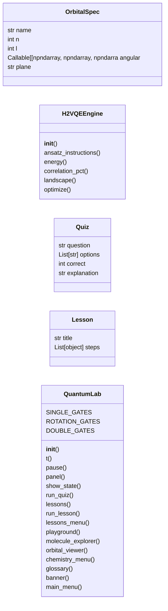
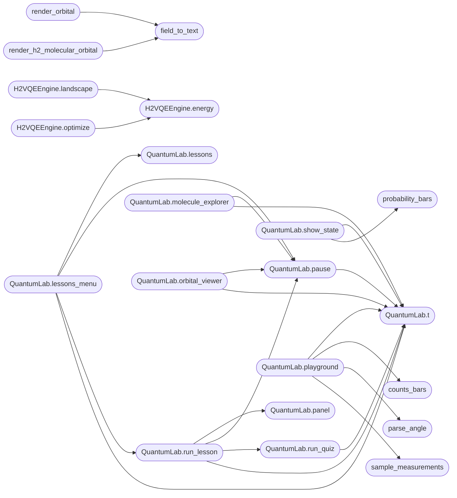

# `quantum_lab`

> Source: [quantum_lab.py:1](../../quantum_lab.py#L1) | language `py` | coverage 38.5% | [API index](../index.md)

Q2C Quantum Lab - Interactive Educational TUI ============================================= A guided, bilingual (English/Spanish) terminal experience for learning quantum computing and quantum chemistry with the Q2C simulator.

It is built on top of the real simulation engine (quantum_framework_core):
every probability bar, entropy value and orbital picture you see is
computed live, not pre-recorded.

Usage:
    python quantum_lab.py                # interactive, asks for language
    python quantum_lab.py --lang es      # start in Spanish
    python quantum_lab.py --lesson 3     # jump straight into lesson 3

Sections:
    1. Lessons     - guided course: qubits, measurement, entanglement,
                     Grover search and quantum chemistry
    2. Playground  - build circuits gate by gate, watch the state evolve
    3. Chemistry   - molecule cards and an ASCII hydrogen-orbital viewer
    4. Glossary    - quick reference of the vocabulary used everywhere

Author: Gris Iscomeback
License: AGPL v3

## Contents

- **Classes:** [`OrbitalSpec`](#orbitalspec), [`H2VQEEngine`](#h2vqeengine), [`Quiz`](#quiz), [`Lesson`](#lesson), [`QuantumLab`](#quantumlab)
- **Functions:** [`probability_bars`](#probability_bars), [`counts_bars`](#counts_bars), [`draw_circuit`](#draw_circuit), [`parse_angle`](#parse_angle), [`sample_measurements`](#sample_measurements), [`field_to_text`](#field_to_text), [`render_orbital`](#render_orbital), [`render_h2_molecular_orbital`](#render_h2_molecular_orbital), [`landscape_plot`](#landscape_plot), [`launch_quantum_lab`](#launch_quantum_lab), [`main`](#main)
- **Constants:** [`BAR_WIDTH`](#bar_width), [`MAX_PLAYGROUND_QUBITS`](#max_playground_qubits), [`STATEVECTOR_DISPLAY_LIMIT`](#statevector_display_limit), [`DENSITY_RAMP`](#density_ramp), [`TEXT`](#text), [`GLOSSARY`](#glossary), [`ORBITAL_SPECS`](#orbital_specs), [`H2_BOND_BOHR`](#h2_bond_bohr)

## Type Diagram



## Call Graph

Solid arrows stay in this module, dashed arrows leave it.



## Classes

<a id="orbitalspec"></a>

### `OrbitalSpec`

`class` `dataclass` | [quantum_lab.py:431](../../quantum_lab.py#L431)

Decorators: `@dataclass`

```python
class OrbitalSpec
```

Definition of a real hydrogen orbital for the ASCII viewer.

**Attributes**

| Name | Type | Default | Description |
|---|---|---|---|
| [`name`](#orbitalspec-name) | `str` |  |  |
| [`n`](#orbitalspec-n) | `int` |  |  |
| [`l`](#orbitalspec-l) | `int` |  |  |
| [`angular`](#orbitalspec-angular) | `Callable[[np.ndarray, np.ndarray, np.ndarray, np.ndarray], np.ndarray]` |  |  |
| [`plane`](#orbitalspec-plane) | `str` | `'xz'` |  |

---

<a id="h2vqeengine"></a>

### `H2VQEEngine`

`class` | [quantum_lab.py:604](../../quantum_lab.py#L604)

```python
class H2VQEEngine
```

Minimal live VQE for H2 in the 2-qubit active space.

The trial state cos(theta/2)|01> + sin(theta/2)|10> is prepared with a
real circuit (Ry, CNOT, X) on the MPS engine, and the energy is read
from the Jordan-Wigner H2 Hamiltonian of quantum_framework_molecular.

**Members**

| Member | Kind | Summary |
|---|---|---|
| [`__init__`](#h2vqeengine-__init__) | constructor |  |
| [`ansatz_instructions`](#h2vqeengine-ansatz_instructions) | method |  |
| [`energy`](#h2vqeengine-energy) | method |  |
| [`correlation_pct`](#h2vqeengine-correlation_pct) | method |  |
| [`landscape`](#h2vqeengine-landscape) | method |  |
| [`optimize`](#h2vqeengine-optimize) | method | Gradient descent; yields (iteration, theta, energy) live. |

<a id="h2vqeengine-__init__"></a>

#### `H2VQEEngine.__init__`

`constructor` | [quantum_lab.py:613](../../quantum_lab.py#L613)

```python
def __init__(self, qc: MPSQuantumComputer) -> None
```

**Parameters**

| Name | Type | Default | Description |
|---|---|---|---|
| `qc` | `MPSQuantumComputer` |  |  |

*Calls:* [`ExactJWEnergy.__init__`](quantum_framework_molecular.py.md#exactjwenergy-__init__), [`MoleculeBuilder.h2_sto3g`](quantum_framework_molecular.py.md#moleculebuilder-h2_sto3g)

*Called by:* [`run_project_vqe`](immersive.backend.py.md#run_project_vqe)

<a id="h2vqeengine-ansatz_instructions"></a>

#### `H2VQEEngine.ansatz_instructions`

`method` | [quantum_lab.py:621](../../quantum_lab.py#L621)

```python
def ansatz_instructions(self, theta: float) -> List[Tuple[str, List[int]]]
```

**Parameters**

| Name | Type | Default | Description |
|---|---|---|---|
| `theta` | `float` |  |  |

**Returns:** `List[Tuple[str, List[int]]]`

<a id="h2vqeengine-energy"></a>

#### `H2VQEEngine.energy`

`method` | [quantum_lab.py:624](../../quantum_lab.py#L624)

```python
def energy(self, theta: float) -> float
```

**Parameters**

| Name | Type | Default | Description |
|---|---|---|---|
| `theta` | `float` |  |  |

**Returns:** `float`

*Calls:* [`ExactJWEnergy.evaluate`](quantum_framework_molecular.py.md#exactjwenergy-evaluate)

*Called by:* [`H2VQEEngine.landscape`](#h2vqeengine-landscape), [`H2VQEEngine.optimize`](#h2vqeengine-optimize)

<a id="h2vqeengine-correlation_pct"></a>

#### `H2VQEEngine.correlation_pct`

`method` | [quantum_lab.py:633](../../quantum_lab.py#L633)

```python
def correlation_pct(self, e: float) -> float
```

**Parameters**

| Name | Type | Default | Description |
|---|---|---|---|
| `e` | `float` |  |  |

**Returns:** `float`

<a id="h2vqeengine-landscape"></a>

#### `H2VQEEngine.landscape`

`method` | [quantum_lab.py:636](../../quantum_lab.py#L636)

```python
def landscape(self, cols: int = 58) -> Tuple[List[float], List[float]]
```

**Parameters**

| Name | Type | Default | Description |
|---|---|---|---|
| `cols` | `int` | `58` |  |

**Returns:** `Tuple[List[float], List[float]]`

*Calls:* [`H2VQEEngine.energy`](#h2vqeengine-energy)

<a id="h2vqeengine-optimize"></a>

#### `H2VQEEngine.optimize`

`method` `generator` | [quantum_lab.py:640](../../quantum_lab.py#L640)

```python
def optimize(self, theta0: float = math.pi, lr: float = 25.0, max_iters: int = 40, tol: float = 1e-07)
```

Gradient descent; yields (iteration, theta, energy) live.

**Parameters**

| Name | Type | Default | Description |
|---|---|---|---|
| `theta0` | `float` | `math.pi` |  |
| `lr` | `float` | `25.0` |  |
| `max_iters` | `int` | `40` |  |
| `tol` | `float` | `1e-07` |  |

*Calls:* [`H2VQEEngine.energy`](#h2vqeengine-energy)

*Called by:* [`run_project_vqe`](immersive.backend.py.md#run_project_vqe)

---

<a id="quiz"></a>

### `Quiz`

`class` `dataclass` | [quantum_lab.py:659](../../quantum_lab.py#L659)

Decorators: `@dataclass`

```python
class Quiz
```

**Attributes**

| Name | Type | Default | Description |
|---|---|---|---|
| [`question`](#quiz-question) | `str` |  |  |
| [`options`](#quiz-options) | `List[str]` |  |  |
| [`correct`](#quiz-correct) | `int` |  |  |
| [`explanation`](#quiz-explanation) | `str` |  |  |

---

<a id="lesson"></a>

### `Lesson`

`class` `dataclass` | [quantum_lab.py:667](../../quantum_lab.py#L667)

Decorators: `@dataclass`

```python
class Lesson
```

**Attributes**

| Name | Type | Default | Description |
|---|---|---|---|
| [`title`](#lesson-title) | `str` |  |  |
| [`steps`](#lesson-steps) | `List[object]` | `field(default_factory=list)` |  |

---

<a id="quantumlab"></a>

### `QuantumLab`

`class` | [quantum_lab.py:672](../../quantum_lab.py#L672)

```python
class QuantumLab
```

Interactive educational TUI driven by the real Q2C engine.

**Attributes**

| Name | Type | Default | Description |
|---|---|---|---|
| [`SINGLE_GATES`](#quantumlab-single_gates) |  | `{'h', 'x', 'y', 'z', 's', 't'}` |  |
| [`ROTATION_GATES`](#quantumlab-rotation_gates) |  | `{'rx', 'ry', 'rz'}` |  |
| [`DOUBLE_GATES`](#quantumlab-double_gates) |  | `{'cnot', 'cz', 'swap'}` |  |

**Members**

| Member | Kind | Summary |
|---|---|---|
| [`__init__`](#quantumlab-__init__) | constructor |  |
| [`t`](#quantumlab-t) | method |  |
| [`pause`](#quantumlab-pause) | method |  |
| [`panel`](#quantumlab-panel) | method |  |
| [`show_state`](#quantumlab-show_state) | method |  |
| [`run_quiz`](#quantumlab-run_quiz) | method |  |
| [`lessons`](#quantumlab-lessons) | method |  |
| [`run_lesson`](#quantumlab-run_lesson) | method |  |
| [`lessons_menu`](#quantumlab-lessons_menu) | method |  |
| [`playground`](#quantumlab-playground) | method |  |
| [`molecule_explorer`](#quantumlab-molecule_explorer) | method |  |
| [`orbital_viewer`](#quantumlab-orbital_viewer) | method |  |
| [`chemistry_menu`](#quantumlab-chemistry_menu) | method |  |
| [`glossary`](#quantumlab-glossary) | method |  |
| [`banner`](#quantumlab-banner) | method |  |
| [`main_menu`](#quantumlab-main_menu) | method |  |

<a id="quantumlab-__init__"></a>

#### `QuantumLab.__init__`

`constructor` | [quantum_lab.py:675](../../quantum_lab.py#L675)

```python
def __init__(self, config: FrameworkConfig, loader: ConfigLoader, lang: str = 'en') -> None
```

**Parameters**

| Name | Type | Default | Description |
|---|---|---|---|
| `config` | `FrameworkConfig` |  |  |
| `loader` | `ConfigLoader` |  |  |
| `lang` | `str` | `'en'` |  |

*Calls:* [`MPSQuantumComputer.__init__`](quantum_framework_core.py.md#mpsquantumcomputer-__init__)

*Called by:* [`launch_quantum_lab`](#launch_quantum_lab)

<a id="quantumlab-t"></a>

#### `QuantumLab.t`

`method` | [quantum_lab.py:683](../../quantum_lab.py#L683)

```python
def t(self, key: str) -> str
```

**Parameters**

| Name | Type | Default | Description |
|---|---|---|---|
| `key` | `str` |  |  |

**Returns:** `str`

*Called by:* [`QuantumLab.banner`](#quantumlab-banner), [`QuantumLab.chemistry_menu`](#quantumlab-chemistry_menu), [`QuantumLab.glossary`](#quantumlab-glossary), [`QuantumLab.lessons_menu`](#quantumlab-lessons_menu), [`QuantumLab.main_menu`](#quantumlab-main_menu), [`QuantumLab.molecule_explorer`](#quantumlab-molecule_explorer), [`QuantumLab.orbital_viewer`](#quantumlab-orbital_viewer), [`QuantumLab.pause`](#quantumlab-pause), [`QuantumLab.playground`](#quantumlab-playground), [`QuantumLab.run_lesson`](#quantumlab-run_lesson), [`QuantumLab.run_quiz`](#quantumlab-run_quiz), [`QuantumLab.show_state`](#quantumlab-show_state)

<a id="quantumlab-pause"></a>

#### `QuantumLab.pause`

`method` | [quantum_lab.py:690](../../quantum_lab.py#L690)

```python
def pause(self) -> None
```

*Calls:* [`QuantumLab.t`](#quantumlab-t)

*Called by:* [`QuantumLab.glossary`](#quantumlab-glossary), [`QuantumLab.lessons_menu`](#quantumlab-lessons_menu), [`QuantumLab.molecule_explorer`](#quantumlab-molecule_explorer), [`QuantumLab.orbital_viewer`](#quantumlab-orbital_viewer), [`QuantumLab.run_lesson`](#quantumlab-run_lesson)

<a id="quantumlab-panel"></a>

#### `QuantumLab.panel`

`method` | [quantum_lab.py:697](../../quantum_lab.py#L697)

```python
def panel(self, body: str, title: str = '', style: str = 'cyan') -> None
```

**Parameters**

| Name | Type | Default | Description |
|---|---|---|---|
| `body` | `str` |  |  |
| `title` | `str` | `''` |  |
| `style` | `str` | `'cyan'` |  |

*Called by:* [`QuantumLab.run_lesson`](#quantumlab-run_lesson)

<a id="quantumlab-show_state"></a>

#### `QuantumLab.show_state`

`method` | [quantum_lab.py:701](../../quantum_lab.py#L701)

```python
def show_state(self, probs: np.ndarray, n_qubits: int, title: Optional[str] = None) -> None
```

**Parameters**

| Name | Type | Default | Description |
|---|---|---|---|
| `probs` | `np.ndarray` |  |  |
| `n_qubits` | `int` |  |  |
| `title` | `Optional[str]` | `None` |  |

*Calls:* [`QuantumLab.t`](#quantumlab-t), [`probability_bars`](#probability_bars)

<a id="quantumlab-run_quiz"></a>

#### `QuantumLab.run_quiz`

`method` | [quantum_lab.py:707](../../quantum_lab.py#L707)

```python
def run_quiz(self, quiz: Quiz) -> None
```

**Parameters**

| Name | Type | Default | Description |
|---|---|---|---|
| `quiz` | `Quiz` |  |  |

*Calls:* [`QuantumLab.t`](#quantumlab-t)

*Called by:* [`QuantumLab.run_lesson`](#quantumlab-run_lesson)

<a id="quantumlab-lessons"></a>

#### `QuantumLab.lessons`

`method` | [quantum_lab.py:728](../../quantum_lab.py#L728)

```python
def lessons(self) -> List[Lesson]
```

**Returns:** `List[Lesson]`

*Called by:* [`QuantumLab.lessons_menu`](#quantumlab-lessons_menu), [`launch_quantum_lab`](#launch_quantum_lab)

<a id="quantumlab-run_lesson"></a>

#### `QuantumLab.run_lesson`

`method` | [quantum_lab.py:1159](../../quantum_lab.py#L1159)

```python
def run_lesson(self, lesson: Lesson) -> None
```

**Parameters**

| Name | Type | Default | Description |
|---|---|---|---|
| `lesson` | `Lesson` |  |  |

*Calls:* [`QuantumLab.panel`](#quantumlab-panel), [`QuantumLab.pause`](#quantumlab-pause), [`QuantumLab.run_quiz`](#quantumlab-run_quiz), [`QuantumLab.t`](#quantumlab-t)

*Called by:* [`QuantumLab.lessons_menu`](#quantumlab-lessons_menu), [`launch_quantum_lab`](#launch_quantum_lab)

<a id="quantumlab-lessons_menu"></a>

#### `QuantumLab.lessons_menu`

`method` | [quantum_lab.py:1175](../../quantum_lab.py#L1175)

```python
def lessons_menu(self) -> None
```

*Calls:* [`QuantumLab.lessons`](#quantumlab-lessons), [`QuantumLab.pause`](#quantumlab-pause), [`QuantumLab.run_lesson`](#quantumlab-run_lesson), [`QuantumLab.t`](#quantumlab-t)

*Called by:* [`QuantumLab.main_menu`](#quantumlab-main_menu)

<a id="quantumlab-playground"></a>

#### `QuantumLab.playground`

`method` | [quantum_lab.py:1249](../../quantum_lab.py#L1249)

```python
def playground(self) -> None
```

*Calls:* [`QuantumLab.t`](#quantumlab-t), [`counts_bars`](#counts_bars), [`parse_angle`](#parse_angle), [`sample_measurements`](#sample_measurements)

*Called by:* [`QuantumLab.main_menu`](#quantumlab-main_menu)

<a id="quantumlab-molecule_explorer"></a>

#### `QuantumLab.molecule_explorer`

`method` | [quantum_lab.py:1365](../../quantum_lab.py#L1365)

```python
def molecule_explorer(self) -> None
```

*Calls:* [`QuantumLab.pause`](#quantumlab-pause), [`QuantumLab.t`](#quantumlab-t)

*Called by:* [`QuantumLab.chemistry_menu`](#quantumlab-chemistry_menu)

<a id="quantumlab-orbital_viewer"></a>

#### `QuantumLab.orbital_viewer`

`method` | [quantum_lab.py:1383](../../quantum_lab.py#L1383)

```python
def orbital_viewer(self) -> None
```

*Calls:* [`QuantumLab.pause`](#quantumlab-pause), [`QuantumLab.t`](#quantumlab-t), [`render_orbital`](#render_orbital)

*Called by:* [`QuantumLab.chemistry_menu`](#quantumlab-chemistry_menu)

<a id="quantumlab-chemistry_menu"></a>

#### `QuantumLab.chemistry_menu`

`method` | [quantum_lab.py:1403](../../quantum_lab.py#L1403)

```python
def chemistry_menu(self) -> None
```

*Calls:* [`QuantumLab.molecule_explorer`](#quantumlab-molecule_explorer), [`QuantumLab.orbital_viewer`](#quantumlab-orbital_viewer), [`QuantumLab.t`](#quantumlab-t)

*Called by:* [`QuantumLab.main_menu`](#quantumlab-main_menu)

<a id="quantumlab-glossary"></a>

#### `QuantumLab.glossary`

`method` | [quantum_lab.py:1422](../../quantum_lab.py#L1422)

```python
def glossary(self) -> None
```

*Calls:* [`QuantumLab.pause`](#quantumlab-pause), [`QuantumLab.t`](#quantumlab-t)

*Called by:* [`QuantumLab.main_menu`](#quantumlab-main_menu)

<a id="quantumlab-banner"></a>

#### `QuantumLab.banner`

`method` | [quantum_lab.py:1437](../../quantum_lab.py#L1437)

```python
def banner(self) -> None
```

*Calls:* [`QuantumLab.t`](#quantumlab-t)

*Called by:* [`QuantumLab.main_menu`](#quantumlab-main_menu)

<a id="quantumlab-main_menu"></a>

#### `QuantumLab.main_menu`

`method` | [quantum_lab.py:1443](../../quantum_lab.py#L1443)

```python
def main_menu(self) -> None
```

*Calls:* [`QuantumLab.banner`](#quantumlab-banner), [`QuantumLab.chemistry_menu`](#quantumlab-chemistry_menu), [`QuantumLab.glossary`](#quantumlab-glossary), [`QuantumLab.lessons_menu`](#quantumlab-lessons_menu), [`QuantumLab.playground`](#quantumlab-playground), [`QuantumLab.t`](#quantumlab-t)

*Called by:* [`launch_quantum_lab`](#launch_quantum_lab)

---

## Functions

<a id="probability_bars"></a>

### `probability_bars`

`function` | [quantum_lab.py:325](../../quantum_lab.py#L325)

```python
def probability_bars(probs: np.ndarray, n_qubits: int, lang: str, max_rows: int = 16) -> Table
```

Build a table of probability bars for a state's distribution.

**Parameters**

| Name | Type | Default | Description |
|---|---|---|---|
| `probs` | `np.ndarray` |  |  |
| `n_qubits` | `int` |  |  |
| `lang` | `str` |  |  |
| `max_rows` | `int` | `16` |  |

**Returns:** `Table`

*Called by:* [`QuantumLab.show_state`](#quantumlab-show_state)

---

<a id="counts_bars"></a>

### `counts_bars`

`function` | [quantum_lab.py:353](../../quantum_lab.py#L353)

```python
def counts_bars(counts: Dict[str, int], total: int, lang: str) -> Table
```

Build a table of measurement-count bars.

**Parameters**

| Name | Type | Default | Description |
|---|---|---|---|
| `counts` | `Dict[str, int]` |  |  |
| `total` | `int` |  |  |
| `lang` | `str` |  |  |

**Returns:** `Table`

*Called by:* [`QuantumLab.playground`](#quantumlab-playground)

---

<a id="draw_circuit"></a>

### `draw_circuit`

`function` | [quantum_lab.py:369](../../quantum_lab.py#L369)

```python
def draw_circuit(n_qubits: int, instructions: List[Tuple[str, List[int]]]) -> Text
```

Render an ASCII timeline of the circuit, one line per qubit.

**Parameters**

| Name | Type | Default | Description |
|---|---|---|---|
| `n_qubits` | `int` |  |  |
| `instructions` | `List[Tuple[str, List[int]]]` |  |  |

**Returns:** `Text`

---

<a id="parse_angle"></a>

### `parse_angle`

`function` | [quantum_lab.py:394](../../quantum_lab.py#L394)

```python
def parse_angle(token: str) -> float
```

Parse an angle like '1.57', 'pi', '-pi/2' or '3*pi/4' into radians.

**Parameters**

| Name | Type | Default | Description |
|---|---|---|---|
| `token` | `str` |  |  |

**Returns:** `float`

**Raises**

- `ValueError`: (raised in the body, not documented)

*Called by:* [`QuantumLab.playground`](#quantumlab-playground)

---

<a id="sample_measurements"></a>

### `sample_measurements`

`function` | [quantum_lab.py:414](../../quantum_lab.py#L414)

```python
def sample_measurements(probs: np.ndarray, n_qubits: int, n_samples: int, rng: np.random.Generator) -> Dict[str, int]
```

Draw measurement outcomes from a probability distribution.

**Parameters**

| Name | Type | Default | Description |
|---|---|---|---|
| `probs` | `np.ndarray` |  |  |
| `n_qubits` | `int` |  |  |
| `n_samples` | `int` |  |  |
| `rng` | `np.random.Generator` |  |  |

**Returns:** `Dict[str, int]`

*Called by:* [`QuantumLab.playground`](#quantumlab-playground)

---

<a id="field_to_text"></a>

### `field_to_text`

`function` | [quantum_lab.py:490](../../quantum_lab.py#L490)

```python
def field_to_text(psi: np.ndarray) -> Text
```

Render a real scalar field as colored ASCII: brightness = |psi|^2, color = sign.

**Parameters**

| Name | Type | Default | Description |
|---|---|---|---|
| `psi` | `np.ndarray` |  |  |

**Returns:** `Text`

*Called by:* [`render_h2_molecular_orbital`](#render_h2_molecular_orbital), [`render_orbital`](#render_orbital)

---

<a id="render_orbital"></a>

### `render_orbital`

`function` | [quantum_lab.py:516](../../quantum_lab.py#L516)

```python
def render_orbital(spec: OrbitalSpec, rows: int = 27, cols: int = 64) -> Tuple[Text, float]
```

Render |psi|^2 of a hydrogen orbital on a plane slice as colored ASCII.

**Parameters**

| Name | Type | Default | Description |
|---|---|---|---|
| `spec` | `OrbitalSpec` |  |  |
| `rows` | `int` | `27` |  |
| `cols` | `int` | `64` |  |

**Returns:** `Tuple[Text, float]`

*Calls:* [`field_to_text`](#field_to_text)

*Called by:* [`QuantumLab.orbital_viewer`](#quantumlab-orbital_viewer)

---

<a id="render_h2_molecular_orbital"></a>

### `render_h2_molecular_orbital`

`function` | [quantum_lab.py:536](../../quantum_lab.py#L536)

```python
def render_h2_molecular_orbital(kind: str, rows: int = 19, cols: int = 38) -> Text
```

Render the bonding or antibonding LCAO molecular orbital of H2.

**Parameters**

| Name | Type | Default | Description |
|---|---|---|---|
| `kind` | `str` |  |  |
| `rows` | `int` | `19` |  |
| `cols` | `int` | `38` |  |

**Returns:** `Text`

*Calls:* [`field_to_text`](#field_to_text)

---

<a id="landscape_plot"></a>

### `landscape_plot`

`function` | [quantum_lab.py:556](../../quantum_lab.py#L556)

```python
def landscape_plot(energies: List[float], e_hf: float, e_fci: float, marker: Optional[int] = None, rows: int = 14) -> Text
```

Draw an ASCII plot of E(theta) over one full period with HF and FCI reference lines and an optional optimizer marker.

**Parameters**

| Name | Type | Default | Description |
|---|---|---|---|
| `energies` | `List[float]` |  |  |
| `e_hf` | `float` |  |  |
| `e_fci` | `float` |  |  |
| `marker` | `Optional[int]` | `None` |  |
| `rows` | `int` | `14` |  |

**Returns:** `Text`

---

<a id="launch_quantum_lab"></a>

### `launch_quantum_lab`

`function` | [quantum_lab.py:1474](../../quantum_lab.py#L1474)

```python
def launch_quantum_lab(config: Optional[FrameworkConfig] = None, loader: Optional[ConfigLoader] = None, lang: Optional[str] = None, lesson: Optional[int] = None) -> None
```

Entry point used both standalone and from quantum_framework_main.

**Parameters**

| Name | Type | Default | Description |
|---|---|---|---|
| `config` | `Optional[FrameworkConfig]` | `None` |  |
| `loader` | `Optional[ConfigLoader]` | `None` |  |
| `lang` | `Optional[str]` | `None` |  |
| `lesson` | `Optional[int]` | `None` |  |

*Calls:* [`ConfigLoader.__init__`](quantum_framework_core.py.md#configloader-__init__), [`FrameworkConfig`](quantum_framework_core.py.md#frameworkconfig), [`FrameworkConfig.from_toml`](quantum_framework_core.py.md#frameworkconfig-from_toml), [`QuantumLab.__init__`](#quantumlab-__init__), [`QuantumLab.lessons`](#quantumlab-lessons), [`QuantumLab.main_menu`](#quantumlab-main_menu), [`QuantumLab.run_lesson`](#quantumlab-run_lesson)

*Called by:* [`main`](quantum_framework_main.py.md#main), [`main`](#main)

---

<a id="main"></a>

### `main`

`function` | [quantum_lab.py:1500](../../quantum_lab.py#L1500)

```python
def main() -> None
```

*Calls:* [`launch_quantum_lab`](#launch_quantum_lab)

---

## Constants

<a id="bar_width"></a>

### `BAR_WIDTH`

`constant` | [quantum_lab.py:69](../../quantum_lab.py#L69)

```python
BAR_WIDTH = 40
```

---

<a id="max_playground_qubits"></a>

### `MAX_PLAYGROUND_QUBITS`

`constant` | [quantum_lab.py:70](../../quantum_lab.py#L70)

```python
MAX_PLAYGROUND_QUBITS = 8
```

---

<a id="statevector_display_limit"></a>

### `STATEVECTOR_DISPLAY_LIMIT`

`constant` | [quantum_lab.py:71](../../quantum_lab.py#L71)

```python
STATEVECTOR_DISPLAY_LIMIT = 5
```

---

<a id="density_ramp"></a>

### `DENSITY_RAMP`

`constant` | [quantum_lab.py:72](../../quantum_lab.py#L72)

```python
DENSITY_RAMP = ' ·:-=+*#%@'
```

---

<a id="text"></a>

### `TEXT`

`constant` | [quantum_lab.py:78](../../quantum_lab.py#L78)

```python
TEXT: Dict[str, Dict[str, str]]
```

---

<a id="glossary"></a>

### `GLOSSARY`

`constant` | [quantum_lab.py:281](../../quantum_lab.py#L281)

```python
GLOSSARY: Dict[str, List[Tuple[str, str]]]
```

---

<a id="orbital_specs"></a>

### `ORBITAL_SPECS`

`constant` | [quantum_lab.py:477](../../quantum_lab.py#L477)

```python
ORBITAL_SPECS: List[OrbitalSpec]
```

---

<a id="h2_bond_bohr"></a>

### `H2_BOND_BOHR`

`constant` | [quantum_lab.py:533](../../quantum_lab.py#L533)

```python
H2_BOND_BOHR = 1.4
```

---
