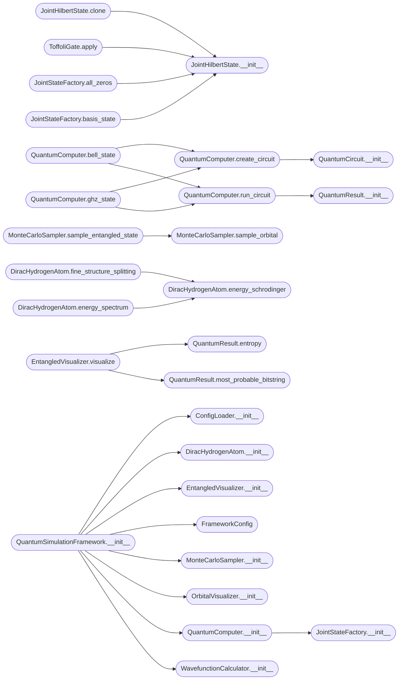

# `quantum_simulator`

> Source: [quantum_simulator.py:1](../../quantum_simulator.py#L1) | language `py` | coverage 0.6% | [API index](../index.md)

Quantum Simulation Framework - Complete Edition ================================================ Self-contained quantum simulation framework with: - Quantum circuit simulation (Hamiltonian, Schrodinger, Dirac backends) - Atomic orbital visualization with Monte Carlo sampling - Molecular VQE/UCCSD simulation - Relativistic hydrogen with fine structure and Zitterbewegung - Entangled state visualization - Multi-atom orbital support

All configuration via TOML file - no hardcoded values.

## Contents

- **Classes:** [`FrameworkConfig`](#frameworkconfig), [`AtomData`](#atomdata), [`MoleculeData`](#moleculedata), [`OrbitalData`](#orbitaldata), [`ConfigLoader`](#configloader), [`JointHilbertState`](#jointhilbertstate), [`IQuantumGate`](#iquantumgate), [`HadamardGate`](#hadamardgate), [`PauliXGate`](#paulixgate), [`PauliYGate`](#pauliygate), [`PauliZGate`](#paulizgate), [`SGate`](#sgate), [`TGate`](#tgate), [`RxGate`](#rxgate), [`RyGate`](#rygate), [`RzGate`](#rzgate), [`CNOTGate`](#cnotgate), [`CZGate`](#czgate), [`SWAPGate`](#swapgate), [`ToffoliGate`](#toffoligate), [`CircuitInstruction`](#circuitinstruction), [`QuantumCircuit`](#quantumcircuit), [`QuantumResult`](#quantumresult), [`PotentialGenerator`](#potentialgenerator), [`JointStateFactory`](#jointstatefactory), [`QuantumComputer`](#quantumcomputer), [`WavefunctionCalculator`](#wavefunctioncalculator), [`MonteCarloSampler`](#montecarlosampler), [`DiracHydrogenAtom`](#dirachydrogenatom), [`ZitterbewegungSimulator`](#zitterbewegungsimulator), [`OrbitalVisualizer`](#orbitalvisualizer), [`EntangledVisualizer`](#entangledvisualizer), [`QuantumSimulationFramework`](#quantumsimulationframework), [`InteractiveMenu`](#interactivemenu)
- **Functions:** [`main`](#main)

## Type Diagram

```mermaid
classDiagram
    direction LR
    class FrameworkConfig
    FrameworkConfig : int grid_size
    FrameworkConfig : int hidden_dim
    FrameworkConfig : int expansion_dim
    FrameworkConfig : int num_spectral_layers
    FrameworkConfig : int spinor_components
    FrameworkConfig : float c_light
    FrameworkConfig : float alpha_fs
    FrameworkConfig : float hbar
    FrameworkConfig : float electron_mass
    FrameworkConfig : float dt
    FrameworkConfig : float normalization_eps
    FrameworkConfig : float potential_depth
    FrameworkConfig : float potential_width
    FrameworkConfig : str device
    FrameworkConfig : int random_seed
    FrameworkConfig : int max_qubits
    FrameworkConfig : int mc_batch_size
    FrameworkConfig : int mc_max_particles
    FrameworkConfig : int mc_min_particles
    FrameworkConfig : float r_max_factor
    FrameworkConfig : float r_max_offset
    FrameworkConfig : float prob_safety_factor
    FrameworkConfig : int grid_search_r
    FrameworkConfig : int grid_search_theta
    class AtomData
    AtomData : str symbol
    AtomData : str name
    AtomData : int atomic_number
    AtomData : float mass
    AtomData : List[str] electron_configuration
    AtomData : float nuclear_charge
    class MoleculeData
    MoleculeData : str name
    MoleculeData : str formula
    MoleculeData : str description
    MoleculeData : List[str] atoms
    MoleculeData : int n_electrons
    MoleculeData : int n_orbitals
    MoleculeData : int n_qubits
    MoleculeData : float bond_length_angstrom
    MoleculeData : float hf_energy_hartree
    MoleculeData : float fci_energy_hartree
    MoleculeData : float nuclear_repulsion_hartree
    MoleculeData : Dict[str, Any] geometry
    MoleculeData : Optional[npndarray] h_core
    MoleculeData : Optional[npndarray] eri
    class OrbitalData
    OrbitalData : str name
    OrbitalData : int n
    OrbitalData : int l
    OrbitalData : int m
    OrbitalData : str description
    class ConfigLoader
    ConfigLoader : __init__()
    ConfigLoader : get_atom()
    ConfigLoader : get_molecule()
    ConfigLoader : get_orbital()
    ConfigLoader : atoms()
    ConfigLoader : molecules()
    ConfigLoader : orbitals()
    class JointHilbertState
    JointHilbertState : __init__()
    JointHilbertState : normalize_()
    JointHilbertState : probabilities()
    JointHilbertState : entropy()
    JointHilbertState : most_probable_bitstring()
    JointHilbertState : clone()
    class IQuantumGate
    IQuantumGate : name()
    IQuantumGate : apply()
    class HadamardGate
    HadamardGate : name()
    HadamardGate : apply()
    class PauliXGate
    PauliXGate : name()
    PauliXGate : apply()
    class PauliYGate
    PauliYGate : name()
    PauliYGate : apply()
    class PauliZGate
    PauliZGate : name()
    PauliZGate : apply()
    class SGate
    SGate : name()
    SGate : apply()
    class TGate
    TGate : name()
    TGate : apply()
    class RxGate
    RxGate : name()
    RxGate : apply()
    class RyGate
    RyGate : name()
    RyGate : apply()
    class RzGate
    RzGate : name()
    RzGate : apply()
    class CNOTGate
    CNOTGate : name()
    CNOTGate : apply()
    class CZGate
    CZGate : name()
    CZGate : apply()
    class SWAPGate
    SWAPGate : name()
    SWAPGate : apply()
    class ToffoliGate
    ToffoliGate : name()
    ToffoliGate : apply()
    class CircuitInstruction
    CircuitInstruction : str gate_name
    CircuitInstruction : List[int] targets
    CircuitInstruction : Dict[str, float] params
    class QuantumCircuit
    QuantumCircuit : __init__()
    QuantumCircuit : h()
    QuantumCircuit : x()
    QuantumCircuit : y()
    QuantumCircuit : z()
    QuantumCircuit : s()
    QuantumCircuit : t()
    QuantumCircuit : rx()
    QuantumCircuit : ry()
    QuantumCircuit : rz()
    QuantumCircuit : cnot()
    QuantumCircuit : cz()
    QuantumCircuit : swap()
    QuantumCircuit : ccx()
    QuantumCircuit : run()
    class QuantumResult
    QuantumResult : __init__()
    QuantumResult : entropy()
    QuantumResult : most_probable_bitstring()
    QuantumResult : probabilities()
    class PotentialGenerator
    PotentialGenerator : __init__()
    PotentialGenerator : harmonic()
    PotentialGenerator : double_well()
    PotentialGenerator : coulomb()
    PotentialGenerator : periodic_lattice()
    PotentialGenerator : mixed()
    IQuantumGate <|-- HadamardGate
    IQuantumGate <|-- PauliXGate
    IQuantumGate <|-- PauliYGate
    IQuantumGate <|-- PauliZGate
    IQuantumGate <|-- SGate
    IQuantumGate <|-- TGate
    IQuantumGate <|-- RxGate
    IQuantumGate <|-- RyGate
    IQuantumGate <|-- RzGate
    IQuantumGate <|-- CNOTGate
    IQuantumGate <|-- CZGate
    IQuantumGate <|-- SWAPGate
    IQuantumGate <|-- ToffoliGate
```



## Call Graph

Solid arrows stay in this module, dashed arrows leave it.



## Classes

<a id="frameworkconfig"></a>

### `FrameworkConfig`

`class` `dataclass` | [quantum_simulator.py:81](../../quantum_simulator.py#L81)

Decorators: `@dataclass`

```python
class FrameworkConfig
```

**Attributes**

| Name | Type | Default | Description |
|---|---|---|---|
| [`grid_size`](#frameworkconfig-grid_size) | `int` | `16` |  |
| [`hidden_dim`](#frameworkconfig-hidden_dim) | `int` | `32` |  |
| [`expansion_dim`](#frameworkconfig-expansion_dim) | `int` | `64` |  |
| [`num_spectral_layers`](#frameworkconfig-num_spectral_layers) | `int` | `2` |  |
| [`spinor_components`](#frameworkconfig-spinor_components) | `int` | `4` |  |
| [`c_light`](#frameworkconfig-c_light) | `float` | `137.035999084` |  |
| [`alpha_fs`](#frameworkconfig-alpha_fs) | `float` | `0.0072973525693` |  |
| [`hbar`](#frameworkconfig-hbar) | `float` | `1.0` |  |
| [`electron_mass`](#frameworkconfig-electron_mass) | `float` | `1.0` |  |
| [`dt`](#frameworkconfig-dt) | `float` | `0.01` |  |
| [`normalization_eps`](#frameworkconfig-normalization_eps) | `float` | `1e-08` |  |
| [`potential_depth`](#frameworkconfig-potential_depth) | `float` | `5.0` |  |
| [`potential_width`](#frameworkconfig-potential_width) | `float` | `0.3` |  |
| [`device`](#frameworkconfig-device) | `str` | `'cpu'` |  |
| [`random_seed`](#frameworkconfig-random_seed) | `int` | `42` |  |
| [`max_qubits`](#frameworkconfig-max_qubits) | `int` | `8` |  |
| [`mc_batch_size`](#frameworkconfig-mc_batch_size) | `int` | `100000` |  |
| [`mc_max_particles`](#frameworkconfig-mc_max_particles) | `int` | `2000000` |  |
| [`mc_min_particles`](#frameworkconfig-mc_min_particles) | `int` | `5000` |  |
| [`r_max_factor`](#frameworkconfig-r_max_factor) | `float` | `4.0` |  |
| [`r_max_offset`](#frameworkconfig-r_max_offset) | `float` | `10.0` |  |
| [`prob_safety_factor`](#frameworkconfig-prob_safety_factor) | `float` | `1.05` |  |
| [`grid_search_r`](#frameworkconfig-grid_search_r) | `int` | `300` |  |
| [`grid_search_theta`](#frameworkconfig-grid_search_theta) | `int` | `150` |  |
| [`grid_search_phi`](#frameworkconfig-grid_search_phi) | `int` | `150` |  |
| [`figure_dpi`](#frameworkconfig-figure_dpi) | `int` | `150` |  |
| [`figure_size_x`](#frameworkconfig-figure_size_x) | `int` | `24` |  |
| [`figure_size_y`](#frameworkconfig-figure_size_y) | `int` | `20` |  |
| [`histogram_bins`](#frameworkconfig-histogram_bins) | `int` | `300` |  |
| [`scatter_size_min`](#frameworkconfig-scatter_size_min) | `float` | `1.0` |  |
| [`scatter_size_max`](#frameworkconfig-scatter_size_max) | `float` | `8.0` |  |
| [`background_color`](#frameworkconfig-background_color) | `str` | `'#000008'` |  |
| [`hamiltonian_checkpoint`](#frameworkconfig-hamiltonian_checkpoint) | `str` | `'hamiltonian.pth'` |  |
| [`schrodinger_checkpoint`](#frameworkconfig-schrodinger_checkpoint) | `str` | `'checkpoint_phase3_training_epoch_18921_20260224_154739.pth'` |  |
| [`dirac_checkpoint`](#frameworkconfig-dirac_checkpoint) | `str` | `'best_dirac.pth'` |  |
| [`output_dir`](#frameworkconfig-output_dir) | `str` | `'download'` |  |
| [`default_num_samples`](#frameworkconfig-default_num_samples) | `int` | `100000` |  |
| [`zbw_time_steps`](#frameworkconfig-zbw_time_steps) | `int` | `1000` |  |
| [`zbw_dt`](#frameworkconfig-zbw_dt) | `float` | `0.001` |  |
| [`zbw_packet_width`](#frameworkconfig-zbw_packet_width) | `float` | `0.1` |  |
| [`fine_structure_orders`](#frameworkconfig-fine_structure_orders) | `int` | `4` |  |

**Members**

| Member | Kind | Summary |
|---|---|---|
| [`from_toml`](#frameworkconfig-from_toml) | classmethod |  |

<a id="frameworkconfig-from_toml"></a>

#### `FrameworkConfig.from_toml`

`classmethod` | [quantum_simulator.py:125](../../quantum_simulator.py#L125)

Decorators: `@classmethod`

```python
def from_toml(cls, toml_path: str) -> 'FrameworkConfig'
```

**Parameters**

| Name | Type | Default | Description |
|---|---|---|---|
| `toml_path` | `str` |  |  |

**Returns:** `'FrameworkConfig'`

---

<a id="atomdata"></a>

### `AtomData`

`class` `dataclass` | [quantum_simulator.py:177](../../quantum_simulator.py#L177)

Decorators: `@dataclass`

```python
class AtomData
```

**Attributes**

| Name | Type | Default | Description |
|---|---|---|---|
| [`symbol`](#atomdata-symbol) | `str` |  |  |
| [`name`](#atomdata-name) | `str` |  |  |
| [`atomic_number`](#atomdata-atomic_number) | `int` |  |  |
| [`mass`](#atomdata-mass) | `float` |  |  |
| [`electron_configuration`](#atomdata-electron_configuration) | `List[str]` |  |  |
| [`nuclear_charge`](#atomdata-nuclear_charge) | `float` |  |  |

---

<a id="moleculedata"></a>

### `MoleculeData`

`class` `dataclass` | [quantum_simulator.py:187](../../quantum_simulator.py#L187)

Decorators: `@dataclass`

```python
class MoleculeData
```

**Attributes**

| Name | Type | Default | Description |
|---|---|---|---|
| [`name`](#moleculedata-name) | `str` |  |  |
| [`formula`](#moleculedata-formula) | `str` |  |  |
| [`description`](#moleculedata-description) | `str` |  |  |
| [`atoms`](#moleculedata-atoms) | `List[str]` |  |  |
| [`n_electrons`](#moleculedata-n_electrons) | `int` |  |  |
| [`n_orbitals`](#moleculedata-n_orbitals) | `int` |  |  |
| [`n_qubits`](#moleculedata-n_qubits) | `int` |  |  |
| [`bond_length_angstrom`](#moleculedata-bond_length_angstrom) | `float` |  |  |
| [`hf_energy_hartree`](#moleculedata-hf_energy_hartree) | `float` |  |  |
| [`fci_energy_hartree`](#moleculedata-fci_energy_hartree) | `float` |  |  |
| [`nuclear_repulsion_hartree`](#moleculedata-nuclear_repulsion_hartree) | `float` |  |  |
| [`geometry`](#moleculedata-geometry) | `Dict[str, Any]` |  |  |
| [`h_core`](#moleculedata-h_core) | `Optional[np.ndarray]` | `None` |  |
| [`eri`](#moleculedata-eri) | `Optional[np.ndarray]` | `None` |  |

---

<a id="orbitaldata"></a>

### `OrbitalData`

`class` `dataclass` | [quantum_simulator.py:205](../../quantum_simulator.py#L205)

Decorators: `@dataclass`

```python
class OrbitalData
```

**Attributes**

| Name | Type | Default | Description |
|---|---|---|---|
| [`name`](#orbitaldata-name) | `str` |  |  |
| [`n`](#orbitaldata-n) | `int` |  |  |
| [`l`](#orbitaldata-l) | `int` |  |  |
| [`m`](#orbitaldata-m) | `int` |  |  |
| [`description`](#orbitaldata-description) | `str` |  |  |

---

<a id="configloader"></a>

### `ConfigLoader`

`class` | [quantum_simulator.py:213](../../quantum_simulator.py#L213)

```python
class ConfigLoader
```

**Members**

| Member | Kind | Summary |
|---|---|---|
| [`__init__`](#configloader-__init__) | constructor |  |
| [`get_atom`](#configloader-get_atom) | method |  |
| [`get_molecule`](#configloader-get_molecule) | method |  |
| [`get_orbital`](#configloader-get_orbital) | method |  |
| [`atoms`](#configloader-atoms) | property |  |
| [`molecules`](#configloader-molecules) | property |  |
| [`orbitals`](#configloader-orbitals) | property |  |

<a id="configloader-__init__"></a>

#### `ConfigLoader.__init__`

`constructor` | [quantum_simulator.py:214](../../quantum_simulator.py#L214)

```python
def __init__(self, config_path: Optional[str] = None)
```

**Parameters**

| Name | Type | Default | Description |
|---|---|---|---|
| `config_path` | `Optional[str]` | `None` |  |

*Called by:* [`QuantumSimulationFramework.__init__`](#quantumsimulationframework-__init__)

<a id="configloader-get_atom"></a>

#### `ConfigLoader.get_atom`

`method` | [quantum_simulator.py:264](../../quantum_simulator.py#L264)

```python
def get_atom(self, symbol: str) -> Optional[AtomData]
```

**Parameters**

| Name | Type | Default | Description |
|---|---|---|---|
| `symbol` | `str` |  |  |

**Returns:** `Optional[AtomData]`

<a id="configloader-get_molecule"></a>

#### `ConfigLoader.get_molecule`

`method` | [quantum_simulator.py:272](../../quantum_simulator.py#L272)

```python
def get_molecule(self, name: str) -> Optional[MoleculeData]
```

**Parameters**

| Name | Type | Default | Description |
|---|---|---|---|
| `name` | `str` |  |  |

**Returns:** `Optional[MoleculeData]`

<a id="configloader-get_orbital"></a>

#### `ConfigLoader.get_orbital`

`method` | [quantum_simulator.py:280](../../quantum_simulator.py#L280)

```python
def get_orbital(self, name: str) -> Optional[OrbitalData]
```

**Parameters**

| Name | Type | Default | Description |
|---|---|---|---|
| `name` | `str` |  |  |

**Returns:** `Optional[OrbitalData]`

<a id="configloader-atoms"></a>

#### `ConfigLoader.atoms`

`property` | [quantum_simulator.py:289](../../quantum_simulator.py#L289)

Decorators: `@property`

```python
def atoms(self) -> Dict[str, AtomData]
```

**Returns:** `Dict[str, AtomData]`

<a id="configloader-molecules"></a>

#### `ConfigLoader.molecules`

`property` | [quantum_simulator.py:293](../../quantum_simulator.py#L293)

Decorators: `@property`

```python
def molecules(self) -> Dict[str, MoleculeData]
```

**Returns:** `Dict[str, MoleculeData]`

<a id="configloader-orbitals"></a>

#### `ConfigLoader.orbitals`

`property` | [quantum_simulator.py:297](../../quantum_simulator.py#L297)

Decorators: `@property`

```python
def orbitals(self) -> Dict[str, OrbitalData]
```

**Returns:** `Dict[str, OrbitalData]`

---

<a id="jointhilbertstate"></a>

### `JointHilbertState`

`class` | [quantum_simulator.py:301](../../quantum_simulator.py#L301)

```python
class JointHilbertState
```

**Members**

| Member | Kind | Summary |
|---|---|---|
| [`__init__`](#jointhilbertstate-__init__) | constructor |  |
| [`normalize_`](#jointhilbertstate-normalize_) | method |  |
| [`probabilities`](#jointhilbertstate-probabilities) | method |  |
| [`entropy`](#jointhilbertstate-entropy) | method |  |
| [`most_probable_bitstring`](#jointhilbertstate-most_probable_bitstring) | method |  |
| [`clone`](#jointhilbertstate-clone) | method |  |

<a id="jointhilbertstate-__init__"></a>

#### `JointHilbertState.__init__`

`constructor` | [quantum_simulator.py:302](../../quantum_simulator.py#L302)

```python
def __init__(self, amplitudes: torch.Tensor, n_qubits: int) -> None
```

**Parameters**

| Name | Type | Default | Description |
|---|---|---|---|
| `amplitudes` | `torch.Tensor` |  |  |
| `n_qubits` | `int` |  |  |

*Called by:* [`JointHilbertState.clone`](#jointhilbertstate-clone), [`JointStateFactory.all_zeros`](#jointstatefactory-all_zeros), [`JointStateFactory.basis_state`](#jointstatefactory-basis_state), [`ToffoliGate.apply`](#toffoligate-apply)

<a id="jointhilbertstate-normalize_"></a>

#### `JointHilbertState.normalize_`

`method` | [quantum_simulator.py:309](../../quantum_simulator.py#L309)

```python
def normalize_(self) -> None
```

<a id="jointhilbertstate-probabilities"></a>

#### `JointHilbertState.probabilities`

`method` | [quantum_simulator.py:314](../../quantum_simulator.py#L314)

```python
def probabilities(self) -> torch.Tensor
```

**Returns:** `torch.Tensor`

<a id="jointhilbertstate-entropy"></a>

#### `JointHilbertState.entropy`

`method` | [quantum_simulator.py:318](../../quantum_simulator.py#L318)

```python
def entropy(self) -> float
```

**Returns:** `float`

*Calls:* [`JointHilbertState.probabilities`](quantum_computer.py.md#jointhilbertstate-probabilities)

<a id="jointhilbertstate-most_probable_bitstring"></a>

#### `JointHilbertState.most_probable_bitstring`

`method` | [quantum_simulator.py:323](../../quantum_simulator.py#L323)

```python
def most_probable_bitstring(self) -> str
```

**Returns:** `str`

*Calls:* [`JointHilbertState.probabilities`](quantum_computer.py.md#jointhilbertstate-probabilities)

<a id="jointhilbertstate-clone"></a>

#### `JointHilbertState.clone`

`method` | [quantum_simulator.py:327](../../quantum_simulator.py#L327)

```python
def clone(self) -> 'JointHilbertState'
```

**Returns:** `'JointHilbertState'`

*Calls:* [`JointHilbertState.__init__`](#jointhilbertstate-__init__)

---

<a id="iquantumgate"></a>

### `IQuantumGate`

`class` `abstract` | [quantum_simulator.py:382](../../quantum_simulator.py#L382)

```python
class IQuantumGate(ABC)
```

Bases: `ABC`

Subclasses: [`CNOTGate`](#cnotgate), [`CZGate`](#czgate), [`HadamardGate`](#hadamardgate), [`PauliXGate`](#paulixgate), [`PauliYGate`](#pauliygate), [`PauliZGate`](#paulizgate), [`RxGate`](#rxgate), [`RyGate`](#rygate), [`RzGate`](#rzgate), [`SGate`](#sgate), [`SWAPGate`](#swapgate), [`TGate`](#tgate), [`ToffoliGate`](#toffoligate)

**Members**

| Member | Kind | Summary |
|---|---|---|
| [`name`](#iquantumgate-name) | property |  |
| [`apply`](#iquantumgate-apply) | method |  |

<a id="iquantumgate-name"></a>

#### `IQuantumGate.name`

`property` `abstract` | [quantum_simulator.py:385](../../quantum_simulator.py#L385)

Decorators: `@property`, `@abstractmethod`

```python
def name(self) -> str
```

**Returns:** `str`

<a id="iquantumgate-apply"></a>

#### `IQuantumGate.apply`

`method` `abstract` | [quantum_simulator.py:389](../../quantum_simulator.py#L389)

Decorators: `@abstractmethod`

```python
def apply(self, state: JointHilbertState, backend: IPhysicsBackend, targets: Sequence[int], params: Optional[Dict[str, float]]) -> JointHilbertState
```

**Parameters**

| Name | Type | Default | Description |
|---|---|---|---|
| `state` | `JointHilbertState` |  |  |
| `backend` | `IPhysicsBackend` |  |  |
| `targets` | `Sequence[int]` |  |  |
| `params` | `Optional[Dict[str, float]]` |  |  |

**Returns:** `JointHilbertState`

---

<a id="hadamardgate"></a>

### `HadamardGate`

`class` | [quantum_simulator.py:393](../../quantum_simulator.py#L393)

```python
class HadamardGate(IQuantumGate)
```

Bases: [`IQuantumGate`](#iquantumgate)

**Members**

| Member | Kind | Summary |
|---|---|---|
| [`name`](#hadamardgate-name) | property |  |
| [`apply`](#hadamardgate-apply) | method |  |

<a id="hadamardgate-name"></a>

#### `HadamardGate.name`

`property` | [quantum_simulator.py:395](../../quantum_simulator.py#L395)

Decorators: `@property`

```python
def name(self) -> str
```

**Returns:** `str`

<a id="hadamardgate-apply"></a>

#### `HadamardGate.apply`

`method` | [quantum_simulator.py:398](../../quantum_simulator.py#L398)

```python
def apply(self, state, backend, targets, params)
```

**Parameters**

| Name | Type | Default | Description |
|---|---|---|---|
| `state` |  |  |  |
| `backend` |  |  |  |
| `targets` |  |  |  |
| `params` |  |  |  |

---

<a id="paulixgate"></a>

### `PauliXGate`

`class` | [quantum_simulator.py:406](../../quantum_simulator.py#L406)

```python
class PauliXGate(IQuantumGate)
```

Bases: [`IQuantumGate`](#iquantumgate)

**Members**

| Member | Kind | Summary |
|---|---|---|
| [`name`](#paulixgate-name) | property |  |
| [`apply`](#paulixgate-apply) | method |  |

<a id="paulixgate-name"></a>

#### `PauliXGate.name`

`property` | [quantum_simulator.py:408](../../quantum_simulator.py#L408)

Decorators: `@property`

```python
def name(self) -> str
```

**Returns:** `str`

<a id="paulixgate-apply"></a>

#### `PauliXGate.apply`

`method` | [quantum_simulator.py:411](../../quantum_simulator.py#L411)

```python
def apply(self, state, backend, targets, params)
```

**Parameters**

| Name | Type | Default | Description |
|---|---|---|---|
| `state` |  |  |  |
| `backend` |  |  |  |
| `targets` |  |  |  |
| `params` |  |  |  |

---

<a id="pauliygate"></a>

### `PauliYGate`

`class` | [quantum_simulator.py:418](../../quantum_simulator.py#L418)

```python
class PauliYGate(IQuantumGate)
```

Bases: [`IQuantumGate`](#iquantumgate)

**Members**

| Member | Kind | Summary |
|---|---|---|
| [`name`](#pauliygate-name) | property |  |
| [`apply`](#pauliygate-apply) | method |  |

<a id="pauliygate-name"></a>

#### `PauliYGate.name`

`property` | [quantum_simulator.py:420](../../quantum_simulator.py#L420)

Decorators: `@property`

```python
def name(self) -> str
```

**Returns:** `str`

<a id="pauliygate-apply"></a>

#### `PauliYGate.apply`

`method` | [quantum_simulator.py:423](../../quantum_simulator.py#L423)

```python
def apply(self, state, backend, targets, params)
```

**Parameters**

| Name | Type | Default | Description |
|---|---|---|---|
| `state` |  |  |  |
| `backend` |  |  |  |
| `targets` |  |  |  |
| `params` |  |  |  |

---

<a id="paulizgate"></a>

### `PauliZGate`

`class` | [quantum_simulator.py:430](../../quantum_simulator.py#L430)

```python
class PauliZGate(IQuantumGate)
```

Bases: [`IQuantumGate`](#iquantumgate)

**Members**

| Member | Kind | Summary |
|---|---|---|
| [`name`](#paulizgate-name) | property |  |
| [`apply`](#paulizgate-apply) | method |  |

<a id="paulizgate-name"></a>

#### `PauliZGate.name`

`property` | [quantum_simulator.py:432](../../quantum_simulator.py#L432)

Decorators: `@property`

```python
def name(self) -> str
```

**Returns:** `str`

<a id="paulizgate-apply"></a>

#### `PauliZGate.apply`

`method` | [quantum_simulator.py:435](../../quantum_simulator.py#L435)

```python
def apply(self, state, backend, targets, params)
```

**Parameters**

| Name | Type | Default | Description |
|---|---|---|---|
| `state` |  |  |  |
| `backend` |  |  |  |
| `targets` |  |  |  |
| `params` |  |  |  |

---

<a id="sgate"></a>

### `SGate`

`class` | [quantum_simulator.py:442](../../quantum_simulator.py#L442)

```python
class SGate(IQuantumGate)
```

Bases: [`IQuantumGate`](#iquantumgate)

**Members**

| Member | Kind | Summary |
|---|---|---|
| [`name`](#sgate-name) | property |  |
| [`apply`](#sgate-apply) | method |  |

<a id="sgate-name"></a>

#### `SGate.name`

`property` | [quantum_simulator.py:444](../../quantum_simulator.py#L444)

Decorators: `@property`

```python
def name(self) -> str
```

**Returns:** `str`

<a id="sgate-apply"></a>

#### `SGate.apply`

`method` | [quantum_simulator.py:447](../../quantum_simulator.py#L447)

```python
def apply(self, state, backend, targets, params)
```

**Parameters**

| Name | Type | Default | Description |
|---|---|---|---|
| `state` |  |  |  |
| `backend` |  |  |  |
| `targets` |  |  |  |
| `params` |  |  |  |

---

<a id="tgate"></a>

### `TGate`

`class` | [quantum_simulator.py:454](../../quantum_simulator.py#L454)

```python
class TGate(IQuantumGate)
```

Bases: [`IQuantumGate`](#iquantumgate)

**Members**

| Member | Kind | Summary |
|---|---|---|
| [`name`](#tgate-name) | property |  |
| [`apply`](#tgate-apply) | method |  |

<a id="tgate-name"></a>

#### `TGate.name`

`property` | [quantum_simulator.py:456](../../quantum_simulator.py#L456)

Decorators: `@property`

```python
def name(self) -> str
```

**Returns:** `str`

<a id="tgate-apply"></a>

#### `TGate.apply`

`method` | [quantum_simulator.py:459](../../quantum_simulator.py#L459)

```python
def apply(self, state, backend, targets, params)
```

**Parameters**

| Name | Type | Default | Description |
|---|---|---|---|
| `state` |  |  |  |
| `backend` |  |  |  |
| `targets` |  |  |  |
| `params` |  |  |  |

---

<a id="rxgate"></a>

### `RxGate`

`class` | [quantum_simulator.py:467](../../quantum_simulator.py#L467)

```python
class RxGate(IQuantumGate)
```

Bases: [`IQuantumGate`](#iquantumgate)

**Members**

| Member | Kind | Summary |
|---|---|---|
| [`name`](#rxgate-name) | property |  |
| [`apply`](#rxgate-apply) | method |  |

<a id="rxgate-name"></a>

#### `RxGate.name`

`property` | [quantum_simulator.py:469](../../quantum_simulator.py#L469)

Decorators: `@property`

```python
def name(self) -> str
```

**Returns:** `str`

<a id="rxgate-apply"></a>

#### `RxGate.apply`

`method` | [quantum_simulator.py:472](../../quantum_simulator.py#L472)

```python
def apply(self, state, backend, targets, params)
```

**Parameters**

| Name | Type | Default | Description |
|---|---|---|---|
| `state` |  |  |  |
| `backend` |  |  |  |
| `targets` |  |  |  |
| `params` |  |  |  |

---

<a id="rygate"></a>

### `RyGate`

`class` | [quantum_simulator.py:481](../../quantum_simulator.py#L481)

```python
class RyGate(IQuantumGate)
```

Bases: [`IQuantumGate`](#iquantumgate)

**Members**

| Member | Kind | Summary |
|---|---|---|
| [`name`](#rygate-name) | property |  |
| [`apply`](#rygate-apply) | method |  |

<a id="rygate-name"></a>

#### `RyGate.name`

`property` | [quantum_simulator.py:483](../../quantum_simulator.py#L483)

Decorators: `@property`

```python
def name(self) -> str
```

**Returns:** `str`

<a id="rygate-apply"></a>

#### `RyGate.apply`

`method` | [quantum_simulator.py:486](../../quantum_simulator.py#L486)

```python
def apply(self, state, backend, targets, params)
```

**Parameters**

| Name | Type | Default | Description |
|---|---|---|---|
| `state` |  |  |  |
| `backend` |  |  |  |
| `targets` |  |  |  |
| `params` |  |  |  |

---

<a id="rzgate"></a>

### `RzGate`

`class` | [quantum_simulator.py:495](../../quantum_simulator.py#L495)

```python
class RzGate(IQuantumGate)
```

Bases: [`IQuantumGate`](#iquantumgate)

**Members**

| Member | Kind | Summary |
|---|---|---|
| [`name`](#rzgate-name) | property |  |
| [`apply`](#rzgate-apply) | method |  |

<a id="rzgate-name"></a>

#### `RzGate.name`

`property` | [quantum_simulator.py:497](../../quantum_simulator.py#L497)

Decorators: `@property`

```python
def name(self) -> str
```

**Returns:** `str`

<a id="rzgate-apply"></a>

#### `RzGate.apply`

`method` | [quantum_simulator.py:500](../../quantum_simulator.py#L500)

```python
def apply(self, state, backend, targets, params)
```

**Parameters**

| Name | Type | Default | Description |
|---|---|---|---|
| `state` |  |  |  |
| `backend` |  |  |  |
| `targets` |  |  |  |
| `params` |  |  |  |

---

<a id="cnotgate"></a>

### `CNOTGate`

`class` | [quantum_simulator.py:510](../../quantum_simulator.py#L510)

```python
class CNOTGate(IQuantumGate)
```

Bases: [`IQuantumGate`](#iquantumgate)

**Members**

| Member | Kind | Summary |
|---|---|---|
| [`name`](#cnotgate-name) | property |  |
| [`apply`](#cnotgate-apply) | method |  |

<a id="cnotgate-name"></a>

#### `CNOTGate.name`

`property` | [quantum_simulator.py:512](../../quantum_simulator.py#L512)

Decorators: `@property`

```python
def name(self) -> str
```

**Returns:** `str`

<a id="cnotgate-apply"></a>

#### `CNOTGate.apply`

`method` | [quantum_simulator.py:515](../../quantum_simulator.py#L515)

```python
def apply(self, state, backend, targets, params)
```

**Parameters**

| Name | Type | Default | Description |
|---|---|---|---|
| `state` |  |  |  |
| `backend` |  |  |  |
| `targets` |  |  |  |
| `params` |  |  |  |

**Raises**

- `ValueError`: (raised in the body, not documented)

---

<a id="czgate"></a>

### `CZGate`

`class` | [quantum_simulator.py:522](../../quantum_simulator.py#L522)

```python
class CZGate(IQuantumGate)
```

Bases: [`IQuantumGate`](#iquantumgate)

**Members**

| Member | Kind | Summary |
|---|---|---|
| [`name`](#czgate-name) | property |  |
| [`apply`](#czgate-apply) | method |  |

<a id="czgate-name"></a>

#### `CZGate.name`

`property` | [quantum_simulator.py:524](../../quantum_simulator.py#L524)

Decorators: `@property`

```python
def name(self) -> str
```

**Returns:** `str`

<a id="czgate-apply"></a>

#### `CZGate.apply`

`method` | [quantum_simulator.py:527](../../quantum_simulator.py#L527)

```python
def apply(self, state, backend, targets, params)
```

**Parameters**

| Name | Type | Default | Description |
|---|---|---|---|
| `state` |  |  |  |
| `backend` |  |  |  |
| `targets` |  |  |  |
| `params` |  |  |  |

**Raises**

- `ValueError`: (raised in the body, not documented)

---

<a id="swapgate"></a>

### `SWAPGate`

`class` | [quantum_simulator.py:534](../../quantum_simulator.py#L534)

```python
class SWAPGate(IQuantumGate)
```

Bases: [`IQuantumGate`](#iquantumgate)

**Members**

| Member | Kind | Summary |
|---|---|---|
| [`name`](#swapgate-name) | property |  |
| [`apply`](#swapgate-apply) | method |  |

<a id="swapgate-name"></a>

#### `SWAPGate.name`

`property` | [quantum_simulator.py:536](../../quantum_simulator.py#L536)

Decorators: `@property`

```python
def name(self) -> str
```

**Returns:** `str`

<a id="swapgate-apply"></a>

#### `SWAPGate.apply`

`method` | [quantum_simulator.py:539](../../quantum_simulator.py#L539)

```python
def apply(self, state, backend, targets, params)
```

**Parameters**

| Name | Type | Default | Description |
|---|---|---|---|
| `state` |  |  |  |
| `backend` |  |  |  |
| `targets` |  |  |  |
| `params` |  |  |  |

**Raises**

- `ValueError`: (raised in the body, not documented)

---

<a id="toffoligate"></a>

### `ToffoliGate`

`class` | [quantum_simulator.py:546](../../quantum_simulator.py#L546)

```python
class ToffoliGate(IQuantumGate)
```

Bases: [`IQuantumGate`](#iquantumgate)

**Members**

| Member | Kind | Summary |
|---|---|---|
| [`name`](#toffoligate-name) | property |  |
| [`apply`](#toffoligate-apply) | method |  |

<a id="toffoligate-name"></a>

#### `ToffoliGate.name`

`property` | [quantum_simulator.py:548](../../quantum_simulator.py#L548)

Decorators: `@property`

```python
def name(self) -> str
```

**Returns:** `str`

<a id="toffoligate-apply"></a>

#### `ToffoliGate.apply`

`method` | [quantum_simulator.py:551](../../quantum_simulator.py#L551)

```python
def apply(self, state, backend, targets, params)
```

**Parameters**

| Name | Type | Default | Description |
|---|---|---|---|
| `state` |  |  |  |
| `backend` |  |  |  |
| `targets` |  |  |  |
| `params` |  |  |  |

**Raises**

- `ValueError`: (raised in the body, not documented)

*Calls:* [`JointHilbertState.normalize_`](quantum_computer.py.md#jointhilbertstate-normalize_), [`JointHilbertState.__init__`](#jointhilbertstate-__init__)

---

<a id="circuitinstruction"></a>

### `CircuitInstruction`

`class` `dataclass` | [quantum_simulator.py:576](../../quantum_simulator.py#L576)

Decorators: `@dataclass`

```python
class CircuitInstruction
```

**Attributes**

| Name | Type | Default | Description |
|---|---|---|---|
| [`gate_name`](#circuitinstruction-gate_name) | `str` |  |  |
| [`targets`](#circuitinstruction-targets) | `List[int]` |  |  |
| [`params`](#circuitinstruction-params) | `Dict[str, float]` | `field(default_factory=dict)` |  |

---

<a id="quantumcircuit"></a>

### `QuantumCircuit`

`class` | [quantum_simulator.py:582](../../quantum_simulator.py#L582)

```python
class QuantumCircuit
```

**Members**

| Member | Kind | Summary |
|---|---|---|
| [`__init__`](#quantumcircuit-__init__) | constructor |  |
| [`h`](#quantumcircuit-h) | method |  |
| [`x`](#quantumcircuit-x) | method |  |
| [`y`](#quantumcircuit-y) | method |  |
| [`z`](#quantumcircuit-z) | method |  |
| [`s`](#quantumcircuit-s) | method |  |
| [`t`](#quantumcircuit-t) | method |  |
| [`rx`](#quantumcircuit-rx) | method |  |
| [`ry`](#quantumcircuit-ry) | method |  |
| [`rz`](#quantumcircuit-rz) | method |  |
| [`cnot`](#quantumcircuit-cnot) | method |  |
| [`cz`](#quantumcircuit-cz) | method |  |
| [`swap`](#quantumcircuit-swap) | method |  |
| [`ccx`](#quantumcircuit-ccx) | method |  |
| [`run`](#quantumcircuit-run) | method |  |

<a id="quantumcircuit-__init__"></a>

#### `QuantumCircuit.__init__`

`constructor` | [quantum_simulator.py:583](../../quantum_simulator.py#L583)

```python
def __init__(self, n_qubits: int) -> None
```

**Parameters**

| Name | Type | Default | Description |
|---|---|---|---|
| `n_qubits` | `int` |  |  |

*Called by:* [`QuantumComputer.create_circuit`](#quantumcomputer-create_circuit)

<a id="quantumcircuit-h"></a>

#### `QuantumCircuit.h`

`method` | [quantum_simulator.py:590](../../quantum_simulator.py#L590)

```python
def h(self, qubit: int) -> None
```

**Parameters**

| Name | Type | Default | Description |
|---|---|---|---|
| `qubit` | `int` |  |  |

<a id="quantumcircuit-x"></a>

#### `QuantumCircuit.x`

`method` | [quantum_simulator.py:593](../../quantum_simulator.py#L593)

```python
def x(self, qubit: int) -> None
```

**Parameters**

| Name | Type | Default | Description |
|---|---|---|---|
| `qubit` | `int` |  |  |

<a id="quantumcircuit-y"></a>

#### `QuantumCircuit.y`

`method` | [quantum_simulator.py:596](../../quantum_simulator.py#L596)

```python
def y(self, qubit: int) -> None
```

**Parameters**

| Name | Type | Default | Description |
|---|---|---|---|
| `qubit` | `int` |  |  |

<a id="quantumcircuit-z"></a>

#### `QuantumCircuit.z`

`method` | [quantum_simulator.py:599](../../quantum_simulator.py#L599)

```python
def z(self, qubit: int) -> None
```

**Parameters**

| Name | Type | Default | Description |
|---|---|---|---|
| `qubit` | `int` |  |  |

<a id="quantumcircuit-s"></a>

#### `QuantumCircuit.s`

`method` | [quantum_simulator.py:602](../../quantum_simulator.py#L602)

```python
def s(self, qubit: int) -> None
```

**Parameters**

| Name | Type | Default | Description |
|---|---|---|---|
| `qubit` | `int` |  |  |

<a id="quantumcircuit-t"></a>

#### `QuantumCircuit.t`

`method` | [quantum_simulator.py:605](../../quantum_simulator.py#L605)

```python
def t(self, qubit: int) -> None
```

**Parameters**

| Name | Type | Default | Description |
|---|---|---|---|
| `qubit` | `int` |  |  |

<a id="quantumcircuit-rx"></a>

#### `QuantumCircuit.rx`

`method` | [quantum_simulator.py:608](../../quantum_simulator.py#L608)

```python
def rx(self, qubit: int, theta: float) -> None
```

**Parameters**

| Name | Type | Default | Description |
|---|---|---|---|
| `qubit` | `int` |  |  |
| `theta` | `float` |  |  |

<a id="quantumcircuit-ry"></a>

#### `QuantumCircuit.ry`

`method` | [quantum_simulator.py:611](../../quantum_simulator.py#L611)

```python
def ry(self, qubit: int, theta: float) -> None
```

**Parameters**

| Name | Type | Default | Description |
|---|---|---|---|
| `qubit` | `int` |  |  |
| `theta` | `float` |  |  |

<a id="quantumcircuit-rz"></a>

#### `QuantumCircuit.rz`

`method` | [quantum_simulator.py:614](../../quantum_simulator.py#L614)

```python
def rz(self, qubit: int, theta: float) -> None
```

**Parameters**

| Name | Type | Default | Description |
|---|---|---|---|
| `qubit` | `int` |  |  |
| `theta` | `float` |  |  |

<a id="quantumcircuit-cnot"></a>

#### `QuantumCircuit.cnot`

`method` | [quantum_simulator.py:617](../../quantum_simulator.py#L617)

```python
def cnot(self, control: int, target: int) -> None
```

**Parameters**

| Name | Type | Default | Description |
|---|---|---|---|
| `control` | `int` |  |  |
| `target` | `int` |  |  |

<a id="quantumcircuit-cz"></a>

#### `QuantumCircuit.cz`

`method` | [quantum_simulator.py:620](../../quantum_simulator.py#L620)

```python
def cz(self, control: int, target: int) -> None
```

**Parameters**

| Name | Type | Default | Description |
|---|---|---|---|
| `control` | `int` |  |  |
| `target` | `int` |  |  |

<a id="quantumcircuit-swap"></a>

#### `QuantumCircuit.swap`

`method` | [quantum_simulator.py:623](../../quantum_simulator.py#L623)

```python
def swap(self, qubit1: int, qubit2: int) -> None
```

**Parameters**

| Name | Type | Default | Description |
|---|---|---|---|
| `qubit1` | `int` |  |  |
| `qubit2` | `int` |  |  |

<a id="quantumcircuit-ccx"></a>

#### `QuantumCircuit.ccx`

`method` | [quantum_simulator.py:626](../../quantum_simulator.py#L626)

```python
def ccx(self, ctrl0: int, ctrl1: int, target: int) -> None
```

**Parameters**

| Name | Type | Default | Description |
|---|---|---|---|
| `ctrl0` | `int` |  |  |
| `ctrl1` | `int` |  |  |
| `target` | `int` |  |  |

<a id="quantumcircuit-run"></a>

#### `QuantumCircuit.run`

`method` | [quantum_simulator.py:629](../../quantum_simulator.py#L629)

```python
def run(self, state: JointHilbertState, backend: IPhysicsBackend) -> JointHilbertState
```

**Parameters**

| Name | Type | Default | Description |
|---|---|---|---|
| `state` | `JointHilbertState` |  |  |
| `backend` | `IPhysicsBackend` |  |  |

**Returns:** `JointHilbertState`

**Raises**

- `KeyError`: (raised in the body, not documented)

---

<a id="quantumresult"></a>

### `QuantumResult`

`class` | [quantum_simulator.py:638](../../quantum_simulator.py#L638)

```python
class QuantumResult
```

**Members**

| Member | Kind | Summary |
|---|---|---|
| [`__init__`](#quantumresult-__init__) | constructor |  |
| [`entropy`](#quantumresult-entropy) | method |  |
| [`most_probable_bitstring`](#quantumresult-most_probable_bitstring) | method |  |
| [`probabilities`](#quantumresult-probabilities) | method |  |

<a id="quantumresult-__init__"></a>

#### `QuantumResult.__init__`

`constructor` | [quantum_simulator.py:639](../../quantum_simulator.py#L639)

```python
def __init__(self, state: JointHilbertState) -> None
```

**Parameters**

| Name | Type | Default | Description |
|---|---|---|---|
| `state` | `JointHilbertState` |  |  |

*Called by:* [`QuantumComputer.run_circuit`](#quantumcomputer-run_circuit)

<a id="quantumresult-entropy"></a>

#### `QuantumResult.entropy`

`method` | [quantum_simulator.py:642](../../quantum_simulator.py#L642)

```python
def entropy(self) -> float
```

**Returns:** `float`

*Called by:* [`EntangledVisualizer.visualize`](#entangledvisualizer-visualize)

<a id="quantumresult-most_probable_bitstring"></a>

#### `QuantumResult.most_probable_bitstring`

`method` | [quantum_simulator.py:645](../../quantum_simulator.py#L645)

```python
def most_probable_bitstring(self) -> str
```

**Returns:** `str`

*Called by:* [`EntangledVisualizer.visualize`](#entangledvisualizer-visualize)

<a id="quantumresult-probabilities"></a>

#### `QuantumResult.probabilities`

`method` | [quantum_simulator.py:648](../../quantum_simulator.py#L648)

```python
def probabilities(self) -> torch.Tensor
```

**Returns:** `torch.Tensor`

---

<a id="potentialgenerator"></a>

### `PotentialGenerator`

`class` | [quantum_simulator.py:652](../../quantum_simulator.py#L652)

```python
class PotentialGenerator
```

**Members**

| Member | Kind | Summary |
|---|---|---|
| [`__init__`](#potentialgenerator-__init__) | constructor |  |
| [`harmonic`](#potentialgenerator-harmonic) | method |  |
| [`double_well`](#potentialgenerator-double_well) | method |  |
| [`coulomb`](#potentialgenerator-coulomb) | method |  |
| [`periodic_lattice`](#potentialgenerator-periodic_lattice) | method |  |
| [`mixed`](#potentialgenerator-mixed) | method |  |

<a id="potentialgenerator-__init__"></a>

#### `PotentialGenerator.__init__`

`constructor` | [quantum_simulator.py:653](../../quantum_simulator.py#L653)

```python
def __init__(self, config: FrameworkConfig) -> None
```

**Parameters**

| Name | Type | Default | Description |
|---|---|---|---|
| `config` | `FrameworkConfig` |  |  |

<a id="potentialgenerator-harmonic"></a>

#### `PotentialGenerator.harmonic`

`method` | [quantum_simulator.py:662](../../quantum_simulator.py#L662)

```python
def harmonic(self) -> torch.Tensor
```

**Returns:** `torch.Tensor`

<a id="potentialgenerator-double_well"></a>

#### `PotentialGenerator.double_well`

`method` | [quantum_simulator.py:667](../../quantum_simulator.py#L667)

```python
def double_well(self) -> torch.Tensor
```

**Returns:** `torch.Tensor`

<a id="potentialgenerator-coulomb"></a>

#### `PotentialGenerator.coulomb`

`method` | [quantum_simulator.py:673](../../quantum_simulator.py#L673)

```python
def coulomb(self) -> torch.Tensor
```

**Returns:** `torch.Tensor`

<a id="potentialgenerator-periodic_lattice"></a>

#### `PotentialGenerator.periodic_lattice`

`method` | [quantum_simulator.py:679](../../quantum_simulator.py#L679)

```python
def periodic_lattice(self) -> torch.Tensor
```

**Returns:** `torch.Tensor`

<a id="potentialgenerator-mixed"></a>

#### `PotentialGenerator.mixed`

`method` | [quantum_simulator.py:683](../../quantum_simulator.py#L683)

```python
def mixed(self, seed: int) -> torch.Tensor
```

**Parameters**

| Name | Type | Default | Description |
|---|---|---|---|
| `seed` | `int` |  |  |

**Returns:** `torch.Tensor`

*Calls:* [`PotentialGenerator.coulomb`](quantum_computer.py.md#potentialgenerator-coulomb), [`PotentialGenerator.double_well`](quantum_computer.py.md#potentialgenerator-double_well), [`PotentialGenerator.harmonic`](quantum_computer.py.md#potentialgenerator-harmonic), [`PotentialGenerator.periodic_lattice`](quantum_computer.py.md#potentialgenerator-periodic_lattice)

---

<a id="jointstatefactory"></a>

### `JointStateFactory`

`class` | [quantum_simulator.py:716](../../quantum_simulator.py#L716)

```python
class JointStateFactory
```

**Members**

| Member | Kind | Summary |
|---|---|---|
| [`__init__`](#jointstatefactory-__init__) | constructor |  |
| [`all_zeros`](#jointstatefactory-all_zeros) | method |  |
| [`basis_state`](#jointstatefactory-basis_state) | method |  |
| [`from_bitstring`](#jointstatefactory-from_bitstring) | method |  |

<a id="jointstatefactory-__init__"></a>

#### `JointStateFactory.__init__`

`constructor` | [quantum_simulator.py:717](../../quantum_simulator.py#L717)

```python
def __init__(self, config: FrameworkConfig) -> None
```

**Parameters**

| Name | Type | Default | Description |
|---|---|---|---|
| `config` | `FrameworkConfig` |  |  |

*Called by:* [`QuantumComputer.__init__`](#quantumcomputer-__init__)

<a id="jointstatefactory-all_zeros"></a>

#### `JointStateFactory.all_zeros`

`method` | [quantum_simulator.py:723](../../quantum_simulator.py#L723)

```python
def all_zeros(self, n_qubits: int) -> JointHilbertState
```

**Parameters**

| Name | Type | Default | Description |
|---|---|---|---|
| `n_qubits` | `int` |  |  |

**Returns:** `JointHilbertState`

*Calls:* [`JointHilbertState.normalize_`](quantum_computer.py.md#jointhilbertstate-normalize_), [`JointHilbertState.__init__`](#jointhilbertstate-__init__)

<a id="jointstatefactory-basis_state"></a>

#### `JointStateFactory.basis_state`

`method` | [quantum_simulator.py:730](../../quantum_simulator.py#L730)

```python
def basis_state(self, n_qubits: int, k: int) -> JointHilbertState
```

**Parameters**

| Name | Type | Default | Description |
|---|---|---|---|
| `n_qubits` | `int` |  |  |
| `k` | `int` |  |  |

**Returns:** `JointHilbertState`

**Raises**

- `ValueError`: (raised in the body, not documented)

*Calls:* [`JointHilbertState.normalize_`](quantum_computer.py.md#jointhilbertstate-normalize_), [`JointHilbertState.__init__`](#jointhilbertstate-__init__)

<a id="jointstatefactory-from_bitstring"></a>

#### `JointStateFactory.from_bitstring`

`method` | [quantum_simulator.py:739](../../quantum_simulator.py#L739)

```python
def from_bitstring(self, bitstring: str) -> JointHilbertState
```

**Parameters**

| Name | Type | Default | Description |
|---|---|---|---|
| `bitstring` | `str` |  |  |

**Returns:** `JointHilbertState`

*Calls:* [`JointStateFactory.basis_state`](quantum_computer.py.md#jointstatefactory-basis_state)

---

<a id="quantumcomputer"></a>

### `QuantumComputer`

`class` | [quantum_simulator.py:743](../../quantum_simulator.py#L743)

```python
class QuantumComputer
```

**Members**

| Member | Kind | Summary |
|---|---|---|
| [`__init__`](#quantumcomputer-__init__) | constructor |  |
| [`create_circuit`](#quantumcomputer-create_circuit) | method |  |
| [`run_circuit`](#quantumcomputer-run_circuit) | method |  |
| [`bell_state`](#quantumcomputer-bell_state) | method |  |
| [`ghz_state`](#quantumcomputer-ghz_state) | method |  |
| [`factory`](#quantumcomputer-factory) | property |  |
| [`backends`](#quantumcomputer-backends) | property |  |

<a id="quantumcomputer-__init__"></a>

#### `QuantumComputer.__init__`

`constructor` | [quantum_simulator.py:744](../../quantum_simulator.py#L744)

```python
def __init__(self, config: FrameworkConfig) -> None
```

**Parameters**

| Name | Type | Default | Description |
|---|---|---|---|
| `config` | `FrameworkConfig` |  |  |

*Calls:* [`DiracBackend.__init__`](quantum_framework_physics.py.md#diracbackend-__init__), [`HamiltonianBackend.__init__`](quantum_framework_physics.py.md#hamiltonianbackend-__init__), [`SchrodingerBackend.__init__`](quantum_framework_physics.py.md#schrodingerbackend-__init__), [`JointStateFactory.__init__`](#jointstatefactory-__init__)

*Called by:* [`QuantumSimulationFramework.__init__`](#quantumsimulationframework-__init__)

<a id="quantumcomputer-create_circuit"></a>

#### `QuantumComputer.create_circuit`

`method` | [quantum_simulator.py:755](../../quantum_simulator.py#L755)

```python
def create_circuit(self, n_qubits: int) -> QuantumCircuit
```

**Parameters**

| Name | Type | Default | Description |
|---|---|---|---|
| `n_qubits` | `int` |  |  |

**Returns:** `QuantumCircuit`

*Calls:* [`QuantumCircuit.__init__`](#quantumcircuit-__init__)

*Called by:* [`QuantumComputer.bell_state`](#quantumcomputer-bell_state), [`QuantumComputer.ghz_state`](#quantumcomputer-ghz_state)

<a id="quantumcomputer-run_circuit"></a>

#### `QuantumComputer.run_circuit`

`method` | [quantum_simulator.py:758](../../quantum_simulator.py#L758)

```python
def run_circuit(self, circuit: QuantumCircuit, initial_state: Optional[JointHilbertState] = None, backend: str = 'schrodinger') -> QuantumResult
```

**Parameters**

| Name | Type | Default | Description |
|---|---|---|---|
| `circuit` | `QuantumCircuit` |  |  |
| `initial_state` | `Optional[JointHilbertState]` | `None` |  |
| `backend` | `str` | `'schrodinger'` |  |

**Returns:** `QuantumResult`

*Calls:* [`JointStateFactory.all_zeros`](quantum_computer.py.md#jointstatefactory-all_zeros), [`QuantumCircuit.run`](quantum_framework_core.py.md#quantumcircuit-run), [`QuantumResult.__init__`](#quantumresult-__init__)

*Called by:* [`QuantumComputer.bell_state`](#quantumcomputer-bell_state), [`QuantumComputer.ghz_state`](#quantumcomputer-ghz_state), [`QuantumSimulationFramework.run_quantum_circuit`](#quantumsimulationframework-run_quantum_circuit)

<a id="quantumcomputer-bell_state"></a>

#### `QuantumComputer.bell_state`

`method` | [quantum_simulator.py:765](../../quantum_simulator.py#L765)

```python
def bell_state(self, backend: str = 'schrodinger') -> QuantumResult
```

**Parameters**

| Name | Type | Default | Description |
|---|---|---|---|
| `backend` | `str` | `'schrodinger'` |  |

**Returns:** `QuantumResult`

*Calls:* [`QuantumComputer.create_circuit`](#quantumcomputer-create_circuit), [`QuantumComputer.run_circuit`](#quantumcomputer-run_circuit)

<a id="quantumcomputer-ghz_state"></a>

#### `QuantumComputer.ghz_state`

`method` | [quantum_simulator.py:771](../../quantum_simulator.py#L771)

```python
def ghz_state(self, n_qubits: int = 3, backend: str = 'schrodinger') -> QuantumResult
```

**Parameters**

| Name | Type | Default | Description |
|---|---|---|---|
| `n_qubits` | `int` | `3` |  |
| `backend` | `str` | `'schrodinger'` |  |

**Returns:** `QuantumResult`

*Calls:* [`QuantumComputer.create_circuit`](#quantumcomputer-create_circuit), [`QuantumComputer.run_circuit`](#quantumcomputer-run_circuit)

<a id="quantumcomputer-factory"></a>

#### `QuantumComputer.factory`

`property` | [quantum_simulator.py:779](../../quantum_simulator.py#L779)

Decorators: `@property`

```python
def factory(self) -> JointStateFactory
```

**Returns:** `JointStateFactory`

<a id="quantumcomputer-backends"></a>

#### `QuantumComputer.backends`

`property` | [quantum_simulator.py:783](../../quantum_simulator.py#L783)

Decorators: `@property`

```python
def backends(self) -> Dict[str, IPhysicsBackend]
```

**Returns:** `Dict[str, IPhysicsBackend]`

---

<a id="wavefunctioncalculator"></a>

### `WavefunctionCalculator`

`class` | [quantum_simulator.py:787](../../quantum_simulator.py#L787)

```python
class WavefunctionCalculator
```

**Members**

| Member | Kind | Summary |
|---|---|---|
| [`__init__`](#wavefunctioncalculator-__init__) | constructor |  |
| [`radial_wavefunction`](#wavefunctioncalculator-radial_wavefunction) | staticmethod |  |
| [`spherical_harmonic_real`](#wavefunctioncalculator-spherical_harmonic_real) | staticmethod |  |
| [`psi_3d`](#wavefunctioncalculator-psi_3d) | method |  |
| [`energy_analytical`](#wavefunctioncalculator-energy_analytical) | method |  |

<a id="wavefunctioncalculator-__init__"></a>

#### `WavefunctionCalculator.__init__`

`constructor` | [quantum_simulator.py:788](../../quantum_simulator.py#L788)

```python
def __init__(self, config: FrameworkConfig) -> None
```

**Parameters**

| Name | Type | Default | Description |
|---|---|---|---|
| `config` | `FrameworkConfig` |  |  |

*Called by:* [`QuantumSimulationFramework.__init__`](#quantumsimulationframework-__init__)

<a id="wavefunctioncalculator-radial_wavefunction"></a>

#### `WavefunctionCalculator.radial_wavefunction`

`staticmethod` | [quantum_simulator.py:792](../../quantum_simulator.py#L792)

Decorators: `@staticmethod`

```python
def radial_wavefunction(n: int, l: int, r: np.ndarray) -> np.ndarray
```

**Parameters**

| Name | Type | Default | Description |
|---|---|---|---|
| `n` | `int` |  |  |
| `l` | `int` |  |  |
| `r` | `np.ndarray` |  |  |

**Returns:** `np.ndarray`

**Raises**

- `RuntimeError`: (raised in the body, not documented)

<a id="wavefunctioncalculator-spherical_harmonic_real"></a>

#### `WavefunctionCalculator.spherical_harmonic_real`

`staticmethod` | [quantum_simulator.py:804](../../quantum_simulator.py#L804)

Decorators: `@staticmethod`

```python
def spherical_harmonic_real(l: int, m: int, theta: np.ndarray, phi: np.ndarray) -> np.ndarray
```

**Parameters**

| Name | Type | Default | Description |
|---|---|---|---|
| `l` | `int` |  |  |
| `m` | `int` |  |  |
| `theta` | `np.ndarray` |  |  |
| `phi` | `np.ndarray` |  |  |

**Returns:** `np.ndarray`

**Raises**

- `RuntimeError`: (raised in the body, not documented)

<a id="wavefunctioncalculator-psi_3d"></a>

#### `WavefunctionCalculator.psi_3d`

`method` | [quantum_simulator.py:815](../../quantum_simulator.py#L815)

```python
def psi_3d(self, n: int, l: int, m: int, r: np.ndarray, theta: np.ndarray, phi: np.ndarray) -> np.ndarray
```

**Parameters**

| Name | Type | Default | Description |
|---|---|---|---|
| `n` | `int` |  |  |
| `l` | `int` |  |  |
| `m` | `int` |  |  |
| `r` | `np.ndarray` |  |  |
| `theta` | `np.ndarray` |  |  |
| `phi` | `np.ndarray` |  |  |

**Returns:** `np.ndarray`

*Calls:* [`WavefunctionCalculator.radial_wavefunction`](entangled_hydrogen.py.md#wavefunctioncalculator-radial_wavefunction), [`WavefunctionCalculator.spherical_harmonic_real`](entangled_hydrogen.py.md#wavefunctioncalculator-spherical_harmonic_real)

<a id="wavefunctioncalculator-energy_analytical"></a>

#### `WavefunctionCalculator.energy_analytical`

`method` | [quantum_simulator.py:820](../../quantum_simulator.py#L820)

```python
def energy_analytical(self, n: int) -> float
```

**Parameters**

| Name | Type | Default | Description |
|---|---|---|---|
| `n` | `int` |  |  |

**Returns:** `float`

---

<a id="montecarlosampler"></a>

### `MonteCarloSampler`

`class` | [quantum_simulator.py:824](../../quantum_simulator.py#L824)

```python
class MonteCarloSampler
```

**Members**

| Member | Kind | Summary |
|---|---|---|
| [`__init__`](#montecarlosampler-__init__) | constructor |  |
| [`find_max_probability`](#montecarlosampler-find_max_probability) | method |  |
| [`sample_orbital`](#montecarlosampler-sample_orbital) | method |  |
| [`sample_entangled_state`](#montecarlosampler-sample_entangled_state) | method |  |

<a id="montecarlosampler-__init__"></a>

#### `MonteCarloSampler.__init__`

`constructor` | [quantum_simulator.py:825](../../quantum_simulator.py#L825)

```python
def __init__(self, config: FrameworkConfig, wavefunction_calc: WavefunctionCalculator) -> None
```

**Parameters**

| Name | Type | Default | Description |
|---|---|---|---|
| `config` | `FrameworkConfig` |  |  |
| `wavefunction_calc` | `WavefunctionCalculator` |  |  |

*Called by:* [`QuantumSimulationFramework.__init__`](#quantumsimulationframework-__init__)

<a id="montecarlosampler-find_max_probability"></a>

#### `MonteCarloSampler.find_max_probability`

`method` | [quantum_simulator.py:829](../../quantum_simulator.py#L829)

```python
def find_max_probability(self, n: int, l: int, m: int) -> Tuple[float, float, float, float]
```

**Parameters**

| Name | Type | Default | Description |
|---|---|---|---|
| `n` | `int` |  |  |
| `l` | `int` |  |  |
| `m` | `int` |  |  |

**Returns:** `Tuple[float, float, float, float]`

<a id="montecarlosampler-sample_orbital"></a>

#### `MonteCarloSampler.sample_orbital`

`method` | [quantum_simulator.py:853](../../quantum_simulator.py#L853)

```python
def sample_orbital(self, n: int, l: int, m: int, num_samples: int, Z: float = 1.0) -> Dict[str, Any]
```

**Parameters**

| Name | Type | Default | Description |
|---|---|---|---|
| `n` | `int` |  |  |
| `l` | `int` |  |  |
| `m` | `int` |  |  |
| `num_samples` | `int` |  |  |
| `Z` | `float` | `1.0` |  |

**Returns:** `Dict[str, Any]`

*Calls:* [`MonteCarloSampler.find_max_probability`](orbital_visualizer2.py.md#montecarlosampler-find_max_probability)

*Called by:* [`MonteCarloSampler.sample_entangled_state`](#montecarlosampler-sample_entangled_state), [`QuantumSimulationFramework.visualize_atom_orbitals`](#quantumsimulationframework-visualize_atom_orbitals), [`QuantumSimulationFramework.visualize_orbital`](#quantumsimulationframework-visualize_orbital)

<a id="montecarlosampler-sample_entangled_state"></a>

#### `MonteCarloSampler.sample_entangled_state`

`method` | [quantum_simulator.py:890](../../quantum_simulator.py#L890)

```python
def sample_entangled_state(self, n1: int, l1: int, m1: int, n2: int, l2: int, m2: int, num_samples: int) -> Dict[str, Any]
```

**Parameters**

| Name | Type | Default | Description |
|---|---|---|---|
| `n1` | `int` |  |  |
| `l1` | `int` |  |  |
| `m1` | `int` |  |  |
| `n2` | `int` |  |  |
| `l2` | `int` |  |  |
| `m2` | `int` |  |  |
| `num_samples` | `int` |  |  |

**Returns:** `Dict[str, Any]`

*Calls:* [`MonteCarloSampler.sample_orbital`](#montecarlosampler-sample_orbital)

*Called by:* [`QuantumSimulationFramework.visualize_entangled_state`](#quantumsimulationframework-visualize_entangled_state)

---

<a id="dirachydrogenatom"></a>

### `DiracHydrogenAtom`

`class` | [quantum_simulator.py:903](../../quantum_simulator.py#L903)

```python
class DiracHydrogenAtom
```

**Members**

| Member | Kind | Summary |
|---|---|---|
| [`__init__`](#dirachydrogenatom-__init__) | constructor |  |
| [`energy_level_dirac`](#dirachydrogenatom-energy_level_dirac) | method |  |
| [`energy_schrodinger`](#dirachydrogenatom-energy_schrodinger) | method |  |
| [`fine_structure_splitting`](#dirachydrogenatom-fine_structure_splitting) | method |  |
| [`energy_spectrum`](#dirachydrogenatom-energy_spectrum) | method |  |

<a id="dirachydrogenatom-__init__"></a>

#### `DiracHydrogenAtom.__init__`

`constructor` | [quantum_simulator.py:904](../../quantum_simulator.py#L904)

```python
def __init__(self, config: FrameworkConfig) -> None
```

**Parameters**

| Name | Type | Default | Description |
|---|---|---|---|
| `config` | `FrameworkConfig` |  |  |

*Called by:* [`LambShiftCalculator.__init__`](advanced_experiments.py.md#lambshiftcalculator-__init__), [`QuantumSimulationFramework.__init__`](#quantumsimulationframework-__init__)

<a id="dirachydrogenatom-energy_level_dirac"></a>

#### `DiracHydrogenAtom.energy_level_dirac`

`method` | [quantum_simulator.py:909](../../quantum_simulator.py#L909)

```python
def energy_level_dirac(self, n: int, kappa: int, Z: float = 1.0) -> float
```

**Parameters**

| Name | Type | Default | Description |
|---|---|---|---|
| `n` | `int` |  |  |
| `kappa` | `int` |  |  |
| `Z` | `float` | `1.0` |  |

**Returns:** `float`

<a id="dirachydrogenatom-energy_schrodinger"></a>

#### `DiracHydrogenAtom.energy_schrodinger`

`method` | [quantum_simulator.py:917](../../quantum_simulator.py#L917)

```python
def energy_schrodinger(self, n: int, Z: float = 1.0) -> float
```

**Parameters**

| Name | Type | Default | Description |
|---|---|---|---|
| `n` | `int` |  |  |
| `Z` | `float` | `1.0` |  |

**Returns:** `float`

*Called by:* [`DiracHydrogenAtom.energy_spectrum`](#dirachydrogenatom-energy_spectrum), [`DiracHydrogenAtom.fine_structure_splitting`](#dirachydrogenatom-fine_structure_splitting)

<a id="dirachydrogenatom-fine_structure_splitting"></a>

#### `DiracHydrogenAtom.fine_structure_splitting`

`method` | [quantum_simulator.py:920](../../quantum_simulator.py#L920)

```python
def fine_structure_splitting(self, n: int, l: int, Z: float = 1.0) -> Dict[str, float]
```

**Parameters**

| Name | Type | Default | Description |
|---|---|---|---|
| `n` | `int` |  |  |
| `l` | `int` |  |  |
| `Z` | `float` | `1.0` |  |

**Returns:** `Dict[str, float]`

*Calls:* [`DiracHydrogenAtom.energy_level_dirac`](quantum_framework_physics.py.md#dirachydrogenatom-energy_level_dirac), [`DiracHydrogenAtom.energy_schrodinger`](#dirachydrogenatom-energy_schrodinger)

<a id="dirachydrogenatom-energy_spectrum"></a>

#### `DiracHydrogenAtom.energy_spectrum`

`method` | [quantum_simulator.py:928](../../quantum_simulator.py#L928)

```python
def energy_spectrum(self, n_max: int = 4, Z: float = 1.0) -> List[Dict]
```

**Parameters**

| Name | Type | Default | Description |
|---|---|---|---|
| `n_max` | `int` | `4` |  |
| `Z` | `float` | `1.0` |  |

**Returns:** `List[Dict]`

*Calls:* [`DiracHydrogenAtom.energy_level_dirac`](quantum_framework_physics.py.md#dirachydrogenatom-energy_level_dirac), [`DiracHydrogenAtom.energy_schrodinger`](#dirachydrogenatom-energy_schrodinger)

---

<a id="zitterbewegungsimulator"></a>

### `ZitterbewegungSimulator`

`class` | [quantum_simulator.py:944](../../quantum_simulator.py#L944)

```python
class ZitterbewegungSimulator
```

**Members**

| Member | Kind | Summary |
|---|---|---|
| [`__init__`](#zitterbewegungsimulator-__init__) | constructor |  |
| [`create_gaussian_wave_packet`](#zitterbewegungsimulator-create_gaussian_wave_packet) | method |  |
| [`compute_position_expectation`](#zitterbewegungsimulator-compute_position_expectation) | method |  |
| [`compute_velocity_expectation`](#zitterbewegungsimulator-compute_velocity_expectation) | method |  |
| [`simulate`](#zitterbewegungsimulator-simulate) | method |  |

<a id="zitterbewegungsimulator-__init__"></a>

#### `ZitterbewegungSimulator.__init__`

`constructor` | [quantum_simulator.py:945](../../quantum_simulator.py#L945)

```python
def __init__(self, config: FrameworkConfig, dirac_backend: DiracBackend) -> None
```

**Parameters**

| Name | Type | Default | Description |
|---|---|---|---|
| `config` | `FrameworkConfig` |  |  |
| `dirac_backend` | `DiracBackend` |  |  |

*Called by:* [`QuantumSimulationFramework.__init__`](#quantumsimulationframework-__init__)

<a id="zitterbewegungsimulator-create_gaussian_wave_packet"></a>

#### `ZitterbewegungSimulator.create_gaussian_wave_packet`

`method` | [quantum_simulator.py:950](../../quantum_simulator.py#L950)

```python
def create_gaussian_wave_packet(self, sigma: float = 0.1, momentum: float = 0.0) -> torch.Tensor
```

**Parameters**

| Name | Type | Default | Description |
|---|---|---|---|
| `sigma` | `float` | `0.1` |  |
| `momentum` | `float` | `0.0` |  |

**Returns:** `torch.Tensor`

<a id="zitterbewegungsimulator-compute_position_expectation"></a>

#### `ZitterbewegungSimulator.compute_position_expectation`

`method` | [quantum_simulator.py:968](../../quantum_simulator.py#L968)

```python
def compute_position_expectation(self, spinor: torch.Tensor) -> Tuple[float, float]
```

**Parameters**

| Name | Type | Default | Description |
|---|---|---|---|
| `spinor` | `torch.Tensor` |  |  |

**Returns:** `Tuple[float, float]`

<a id="zitterbewegungsimulator-compute_velocity_expectation"></a>

#### `ZitterbewegungSimulator.compute_velocity_expectation`

`method` | [quantum_simulator.py:979](../../quantum_simulator.py#L979)

```python
def compute_velocity_expectation(self, spinor: torch.Tensor) -> Tuple[float, float]
```

**Parameters**

| Name | Type | Default | Description |
|---|---|---|---|
| `spinor` | `torch.Tensor` |  |  |

**Returns:** `Tuple[float, float]`

<a id="zitterbewegungsimulator-simulate"></a>

#### `ZitterbewegungSimulator.simulate`

`method` | [quantum_simulator.py:990](../../quantum_simulator.py#L990)

```python
def simulate(self, duration: float = 1.0, dt: float = 0.001, sigma: float = 0.1) -> Dict
```

**Parameters**

| Name | Type | Default | Description |
|---|---|---|---|
| `duration` | `float` | `1.0` |  |
| `dt` | `float` | `0.001` |  |
| `sigma` | `float` | `0.1` |  |

**Returns:** `Dict`

*Calls:* [`ZitterbewegungSimulator.compute_position_expectation`](quantum_framework_physics.py.md#zitterbewegungsimulator-compute_position_expectation), [`ZitterbewegungSimulator.compute_velocity_expectation`](quantum_framework_physics.py.md#zitterbewegungsimulator-compute_velocity_expectation), [`ZitterbewegungSimulator.create_gaussian_wave_packet`](quantum_framework_physics.py.md#zitterbewegungsimulator-create_gaussian_wave_packet)

*Called by:* [`QuantumSimulationFramework.run_zitterbewegung_simulation`](#quantumsimulationframework-run_zitterbewegung_simulation), [`DiracValidationSuite.validate_zitterbewegung`](relativistic_hydrogen.py.md#diracvalidationsuite-validate_zitterbewegung)

---

<a id="orbitalvisualizer"></a>

### `OrbitalVisualizer`

`class` | [quantum_simulator.py:1026](../../quantum_simulator.py#L1026)

```python
class OrbitalVisualizer
```

**Members**

| Member | Kind | Summary |
|---|---|---|
| [`__init__`](#orbitalvisualizer-__init__) | constructor |  |
| [`visualize`](#orbitalvisualizer-visualize) | method |  |

<a id="orbitalvisualizer-__init__"></a>

#### `OrbitalVisualizer.__init__`

`constructor` | [quantum_simulator.py:1027](../../quantum_simulator.py#L1027)

```python
def __init__(self, config: FrameworkConfig) -> None
```

**Parameters**

| Name | Type | Default | Description |
|---|---|---|---|
| `config` | `FrameworkConfig` |  |  |

*Called by:* [`QuantumSimulationFramework.__init__`](#quantumsimulationframework-__init__)

<a id="orbitalvisualizer-visualize"></a>

#### `OrbitalVisualizer.visualize`

`method` | [quantum_simulator.py:1030](../../quantum_simulator.py#L1030)

```python
def visualize(self, data: Dict[str, Any], save_path: Optional[str] = None, title_suffix: str = '') -> None
```

**Parameters**

| Name | Type | Default | Description |
|---|---|---|---|
| `data` | `Dict[str, Any]` |  |  |
| `save_path` | `Optional[str]` | `None` |  |
| `title_suffix` | `str` | `''` |  |

---

<a id="entangledvisualizer"></a>

### `EntangledVisualizer`

`class` | [quantum_simulator.py:1087](../../quantum_simulator.py#L1087)

```python
class EntangledVisualizer
```

**Members**

| Member | Kind | Summary |
|---|---|---|
| [`__init__`](#entangledvisualizer-__init__) | constructor |  |
| [`visualize`](#entangledvisualizer-visualize) | method |  |

<a id="entangledvisualizer-__init__"></a>

#### `EntangledVisualizer.__init__`

`constructor` | [quantum_simulator.py:1088](../../quantum_simulator.py#L1088)

```python
def __init__(self, config: FrameworkConfig) -> None
```

**Parameters**

| Name | Type | Default | Description |
|---|---|---|---|
| `config` | `FrameworkConfig` |  |  |

*Called by:* [`QuantumSimulationFramework.__init__`](#quantumsimulationframework-__init__)

<a id="entangledvisualizer-visualize"></a>

#### `EntangledVisualizer.visualize`

`method` | [quantum_simulator.py:1091](../../quantum_simulator.py#L1091)

```python
def visualize(self, data: Dict[str, Any], quantum_result: QuantumResult, save_path: Optional[str] = None) -> None
```

**Parameters**

| Name | Type | Default | Description |
|---|---|---|---|
| `data` | `Dict[str, Any]` |  |  |
| `quantum_result` | `QuantumResult` |  |  |
| `save_path` | `Optional[str]` | `None` |  |

*Calls:* [`QuantumResult.entropy`](#quantumresult-entropy), [`QuantumResult.most_probable_bitstring`](#quantumresult-most_probable_bitstring)

*Called by:* [`QuantumSimulationFramework.visualize_entangled_state`](#quantumsimulationframework-visualize_entangled_state)

---

<a id="quantumsimulationframework"></a>

### `QuantumSimulationFramework`

`class` | [quantum_simulator.py:1153](../../quantum_simulator.py#L1153)

```python
class QuantumSimulationFramework
```

**Members**

| Member | Kind | Summary |
|---|---|---|
| [`__init__`](#quantumsimulationframework-__init__) | constructor |  |
| [`list_available_atoms`](#quantumsimulationframework-list_available_atoms) | method |  |
| [`list_available_molecules`](#quantumsimulationframework-list_available_molecules) | method |  |
| [`list_available_orbitals`](#quantumsimulationframework-list_available_orbitals) | method |  |
| [`get_atom`](#quantumsimulationframework-get_atom) | method |  |
| [`get_molecule`](#quantumsimulationframework-get_molecule) | method |  |
| [`get_orbital`](#quantumsimulationframework-get_orbital) | method |  |
| [`run_quantum_circuit`](#quantumsimulationframework-run_quantum_circuit) | method |  |
| [`visualize_orbital`](#quantumsimulationframework-visualize_orbital) | method |  |
| [`visualize_atom_orbitals`](#quantumsimulationframework-visualize_atom_orbitals) | method |  |
| [`visualize_entangled_state`](#quantumsimulationframework-visualize_entangled_state) | method |  |
| [`compute_relativistic_energy`](#quantumsimulationframework-compute_relativistic_energy) | method |  |
| [`compute_energy_spectrum`](#quantumsimulationframework-compute_energy_spectrum) | method |  |
| [`run_zitterbewegung_simulation`](#quantumsimulationframework-run_zitterbewegung_simulation) | method |  |
| [`run_all_demonstrations`](#quantumsimulationframework-run_all_demonstrations) | method |  |

<a id="quantumsimulationframework-__init__"></a>

#### `QuantumSimulationFramework.__init__`

`constructor` | [quantum_simulator.py:1154](../../quantum_simulator.py#L1154)

```python
def __init__(self, config_path: Optional[str] = None) -> None
```

**Parameters**

| Name | Type | Default | Description |
|---|---|---|---|
| `config_path` | `Optional[str]` | `None` |  |

*Calls:* [`FrameworkConfig.from_toml`](quantum_framework_core.py.md#frameworkconfig-from_toml), [`ConfigLoader.__init__`](#configloader-__init__), [`DiracHydrogenAtom.__init__`](#dirachydrogenatom-__init__), [`EntangledVisualizer.__init__`](#entangledvisualizer-__init__), [`FrameworkConfig`](#frameworkconfig), [`MonteCarloSampler.__init__`](#montecarlosampler-__init__), [`OrbitalVisualizer.__init__`](#orbitalvisualizer-__init__), [`QuantumComputer.__init__`](#quantumcomputer-__init__), [`WavefunctionCalculator.__init__`](#wavefunctioncalculator-__init__), [`ZitterbewegungSimulator.__init__`](#zitterbewegungsimulator-__init__)

*Called by:* [`main`](#main)

<a id="quantumsimulationframework-list_available_atoms"></a>

#### `QuantumSimulationFramework.list_available_atoms`

`method` | [quantum_simulator.py:1169](../../quantum_simulator.py#L1169)

```python
def list_available_atoms(self) -> List[str]
```

**Returns:** `List[str]`

<a id="quantumsimulationframework-list_available_molecules"></a>

#### `QuantumSimulationFramework.list_available_molecules`

`method` | [quantum_simulator.py:1172](../../quantum_simulator.py#L1172)

```python
def list_available_molecules(self) -> List[str]
```

**Returns:** `List[str]`

<a id="quantumsimulationframework-list_available_orbitals"></a>

#### `QuantumSimulationFramework.list_available_orbitals`

`method` | [quantum_simulator.py:1175](../../quantum_simulator.py#L1175)

```python
def list_available_orbitals(self) -> List[str]
```

**Returns:** `List[str]`

<a id="quantumsimulationframework-get_atom"></a>

#### `QuantumSimulationFramework.get_atom`

`method` | [quantum_simulator.py:1178](../../quantum_simulator.py#L1178)

```python
def get_atom(self, symbol: str) -> Optional[AtomData]
```

**Parameters**

| Name | Type | Default | Description |
|---|---|---|---|
| `symbol` | `str` |  |  |

**Returns:** `Optional[AtomData]`

*Calls:* [`ConfigLoader.get_atom`](quantum_framework_core.py.md#configloader-get_atom)

*Called by:* [`QuantumSimulationFramework.visualize_atom_orbitals`](#quantumsimulationframework-visualize_atom_orbitals)

<a id="quantumsimulationframework-get_molecule"></a>

#### `QuantumSimulationFramework.get_molecule`

`method` | [quantum_simulator.py:1181](../../quantum_simulator.py#L1181)

```python
def get_molecule(self, name: str) -> Optional[MoleculeData]
```

**Parameters**

| Name | Type | Default | Description |
|---|---|---|---|
| `name` | `str` |  |  |

**Returns:** `Optional[MoleculeData]`

*Calls:* [`ConfigLoader.get_molecule`](quantum_framework_core.py.md#configloader-get_molecule)

<a id="quantumsimulationframework-get_orbital"></a>

#### `QuantumSimulationFramework.get_orbital`

`method` | [quantum_simulator.py:1184](../../quantum_simulator.py#L1184)

```python
def get_orbital(self, name: str) -> Optional[OrbitalData]
```

**Parameters**

| Name | Type | Default | Description |
|---|---|---|---|
| `name` | `str` |  |  |

**Returns:** `Optional[OrbitalData]`

*Calls:* [`ConfigLoader.get_orbital`](quantum_framework_core.py.md#configloader-get_orbital)

*Called by:* [`QuantumSimulationFramework.visualize_entangled_state`](#quantumsimulationframework-visualize_entangled_state), [`QuantumSimulationFramework.visualize_orbital`](#quantumsimulationframework-visualize_orbital)

<a id="quantumsimulationframework-run_quantum_circuit"></a>

#### `QuantumSimulationFramework.run_quantum_circuit`

`method` | [quantum_simulator.py:1187](../../quantum_simulator.py#L1187)

```python
def run_quantum_circuit(self, circuit: QuantumCircuit, backend: str = 'schrodinger') -> QuantumResult
```

**Parameters**

| Name | Type | Default | Description |
|---|---|---|---|
| `circuit` | `QuantumCircuit` |  |  |
| `backend` | `str` | `'schrodinger'` |  |

**Returns:** `QuantumResult`

*Calls:* [`QuantumComputer.run_circuit`](#quantumcomputer-run_circuit)

<a id="quantumsimulationframework-visualize_orbital"></a>

#### `QuantumSimulationFramework.visualize_orbital`

`method` | [quantum_simulator.py:1190](../../quantum_simulator.py#L1190)

```python
def visualize_orbital(self, orbital_name: str, num_samples: Optional[int] = None, save: bool = False, Z: float = 1.0, title_suffix: str = '') -> Dict[str, Any]
```

**Parameters**

| Name | Type | Default | Description |
|---|---|---|---|
| `orbital_name` | `str` |  |  |
| `num_samples` | `Optional[int]` | `None` |  |
| `save` | `bool` | `False` |  |
| `Z` | `float` | `1.0` |  |
| `title_suffix` | `str` | `''` |  |

**Returns:** `Dict[str, Any]`

**Raises**

- `ValueError`: (raised in the body, not documented)

*Calls:* [`OrbitalVisualizer.visualize`](orbital_visualizer2.py.md#orbitalvisualizer-visualize), [`MonteCarloSampler.sample_orbital`](#montecarlosampler-sample_orbital), [`QuantumSimulationFramework.get_orbital`](#quantumsimulationframework-get_orbital)

<a id="quantumsimulationframework-visualize_atom_orbitals"></a>

#### `QuantumSimulationFramework.visualize_atom_orbitals`

`method` | [quantum_simulator.py:1202](../../quantum_simulator.py#L1202)

```python
def visualize_atom_orbitals(self, atom_symbol: str, num_samples: Optional[int] = None, save: bool = False) -> List[Dict[str, Any]]
```

**Parameters**

| Name | Type | Default | Description |
|---|---|---|---|
| `atom_symbol` | `str` |  |  |
| `num_samples` | `Optional[int]` | `None` |  |
| `save` | `bool` | `False` |  |

**Returns:** `List[Dict[str, Any]]`

**Raises**

- `ValueError`: (raised in the body, not documented)

*Calls:* [`OrbitalVisualizer.visualize`](orbital_visualizer2.py.md#orbitalvisualizer-visualize), [`MonteCarloSampler.sample_orbital`](#montecarlosampler-sample_orbital), [`QuantumSimulationFramework.get_atom`](#quantumsimulationframework-get_atom)

<a id="quantumsimulationframework-visualize_entangled_state"></a>

#### `QuantumSimulationFramework.visualize_entangled_state`

`method` | [quantum_simulator.py:1226](../../quantum_simulator.py#L1226)

```python
def visualize_entangled_state(self, orbital1: str, orbital2: str, num_samples: Optional[int] = None, save: bool = False) -> Dict[str, Any]
```

**Parameters**

| Name | Type | Default | Description |
|---|---|---|---|
| `orbital1` | `str` |  |  |
| `orbital2` | `str` |  |  |
| `num_samples` | `Optional[int]` | `None` |  |
| `save` | `bool` | `False` |  |

**Returns:** `Dict[str, Any]`

**Raises**

- `ValueError`: (raised in the body, not documented)

*Calls:* [`QuantumComputer.bell_state`](quantum_computer.py.md#quantumcomputer-bell_state), [`EntangledVisualizer.visualize`](#entangledvisualizer-visualize), [`MonteCarloSampler.sample_entangled_state`](#montecarlosampler-sample_entangled_state), [`QuantumSimulationFramework.get_orbital`](#quantumsimulationframework-get_orbital)

<a id="quantumsimulationframework-compute_relativistic_energy"></a>

#### `QuantumSimulationFramework.compute_relativistic_energy`

`method` | [quantum_simulator.py:1240](../../quantum_simulator.py#L1240)

```python
def compute_relativistic_energy(self, n: int, l: int, Z: float = 1.0) -> Dict[str, float]
```

**Parameters**

| Name | Type | Default | Description |
|---|---|---|---|
| `n` | `int` |  |  |
| `l` | `int` |  |  |
| `Z` | `float` | `1.0` |  |

**Returns:** `Dict[str, float]`

*Calls:* [`DiracHydrogenAtom.fine_structure_splitting`](quantum_framework_physics.py.md#dirachydrogenatom-fine_structure_splitting)

<a id="quantumsimulationframework-compute_energy_spectrum"></a>

#### `QuantumSimulationFramework.compute_energy_spectrum`

`method` | [quantum_simulator.py:1243](../../quantum_simulator.py#L1243)

```python
def compute_energy_spectrum(self, n_max: int = 4, Z: float = 1.0) -> List[Dict]
```

**Parameters**

| Name | Type | Default | Description |
|---|---|---|---|
| `n_max` | `int` | `4` |  |
| `Z` | `float` | `1.0` |  |

**Returns:** `List[Dict]`

*Calls:* [`DiracHydrogenAtom.energy_spectrum`](quantum_framework_physics.py.md#dirachydrogenatom-energy_spectrum)

*Called by:* [`QuantumSimulationFramework.run_all_demonstrations`](#quantumsimulationframework-run_all_demonstrations)

<a id="quantumsimulationframework-run_zitterbewegung_simulation"></a>

#### `QuantumSimulationFramework.run_zitterbewegung_simulation`

`method` | [quantum_simulator.py:1246](../../quantum_simulator.py#L1246)

```python
def run_zitterbewegung_simulation(self, duration: float = 1.0, dt: float = 0.001, sigma: float = 0.1) -> Dict
```

**Parameters**

| Name | Type | Default | Description |
|---|---|---|---|
| `duration` | `float` | `1.0` |  |
| `dt` | `float` | `0.001` |  |
| `sigma` | `float` | `0.1` |  |

**Returns:** `Dict`

*Calls:* [`ZitterbewegungSimulator.simulate`](#zitterbewegungsimulator-simulate)

*Called by:* [`QuantumSimulationFramework.run_all_demonstrations`](#quantumsimulationframework-run_all_demonstrations)

<a id="quantumsimulationframework-run_all_demonstrations"></a>

#### `QuantumSimulationFramework.run_all_demonstrations`

`method` | [quantum_simulator.py:1249](../../quantum_simulator.py#L1249)

```python
def run_all_demonstrations(self, num_samples: Optional[int] = None) -> Dict[str, Any]
```

**Parameters**

| Name | Type | Default | Description |
|---|---|---|---|
| `num_samples` | `Optional[int]` | `None` |  |

**Returns:** `Dict[str, Any]`

*Calls:* [`QuantumComputer.bell_state`](quantum_computer.py.md#quantumcomputer-bell_state), [`QuantumComputer.ghz_state`](quantum_computer.py.md#quantumcomputer-ghz_state), [`QuantumSimulationFramework.compute_energy_spectrum`](#quantumsimulationframework-compute_energy_spectrum), [`QuantumSimulationFramework.run_zitterbewegung_simulation`](#quantumsimulationframework-run_zitterbewegung_simulation)

---

<a id="interactivemenu"></a>

### `InteractiveMenu`

`class` | [quantum_simulator.py:1279](../../quantum_simulator.py#L1279)

```python
class InteractiveMenu
```

**Members**

| Member | Kind | Summary |
|---|---|---|
| [`__init__`](#interactivemenu-__init__) | constructor |  |
| [`display_header`](#interactivemenu-display_header) | method |  |
| [`display_main_menu`](#interactivemenu-display_main_menu) | method |  |
| [`get_user_choice`](#interactivemenu-get_user_choice) | method |  |
| [`orbital_menu`](#interactivemenu-orbital_menu) | method |  |
| [`atom_orbital_menu`](#interactivemenu-atom_orbital_menu) | method |  |
| [`entangled_menu`](#interactivemenu-entangled_menu) | method |  |
| [`quantum_circuit_menu`](#interactivemenu-quantum_circuit_menu) | method |  |
| [`relativistic_menu`](#interactivemenu-relativistic_menu) | method |  |
| [`zitterbewegung_menu`](#interactivemenu-zitterbewegung_menu) | method |  |
| [`molecular_menu`](#interactivemenu-molecular_menu) | method |  |
| [`atomic_menu`](#interactivemenu-atomic_menu) | method |  |
| [`run`](#interactivemenu-run) | method |  |

<a id="interactivemenu-__init__"></a>

#### `InteractiveMenu.__init__`

`constructor` | [quantum_simulator.py:1280](../../quantum_simulator.py#L1280)

```python
def __init__(self, framework: QuantumSimulationFramework) -> None
```

**Parameters**

| Name | Type | Default | Description |
|---|---|---|---|
| `framework` | `QuantumSimulationFramework` |  |  |

*Called by:* [`main`](#main)

<a id="interactivemenu-display_header"></a>

#### `InteractiveMenu.display_header`

`method` | [quantum_simulator.py:1284](../../quantum_simulator.py#L1284)

```python
def display_header(self) -> None
```

*Called by:* [`InteractiveMenu.run`](#interactivemenu-run)

<a id="interactivemenu-display_main_menu"></a>

#### `InteractiveMenu.display_main_menu`

`method` | [quantum_simulator.py:1292](../../quantum_simulator.py#L1292)

```python
def display_main_menu(self) -> None
```

*Called by:* [`InteractiveMenu.run`](#interactivemenu-run)

<a id="interactivemenu-get_user_choice"></a>

#### `InteractiveMenu.get_user_choice`

`method` | [quantum_simulator.py:1308](../../quantum_simulator.py#L1308)

```python
def get_user_choice(self, prompt: str = '  Select option: ') -> str
```

**Parameters**

| Name | Type | Default | Description |
|---|---|---|---|
| `prompt` | `str` | `' Select option: '` |  |

**Returns:** `str`

*Called by:* [`InteractiveMenu.atom_orbital_menu`](#interactivemenu-atom_orbital_menu), [`InteractiveMenu.atomic_menu`](#interactivemenu-atomic_menu), [`InteractiveMenu.entangled_menu`](#interactivemenu-entangled_menu), [`InteractiveMenu.molecular_menu`](#interactivemenu-molecular_menu), [`InteractiveMenu.orbital_menu`](#interactivemenu-orbital_menu), [`InteractiveMenu.quantum_circuit_menu`](#interactivemenu-quantum_circuit_menu), [`InteractiveMenu.relativistic_menu`](#interactivemenu-relativistic_menu), [`InteractiveMenu.run`](#interactivemenu-run), [`InteractiveMenu.zitterbewegung_menu`](#interactivemenu-zitterbewegung_menu)

<a id="interactivemenu-orbital_menu"></a>

#### `InteractiveMenu.orbital_menu`

`method` | [quantum_simulator.py:1322](../../quantum_simulator.py#L1322)

```python
def orbital_menu(self) -> None
```

*Calls:* [`InteractiveMenu.get_user_choice`](#interactivemenu-get_user_choice)

*Called by:* [`InteractiveMenu.run`](#interactivemenu-run)

<a id="interactivemenu-atom_orbital_menu"></a>

#### `InteractiveMenu.atom_orbital_menu`

`method` | [quantum_simulator.py:1346](../../quantum_simulator.py#L1346)

```python
def atom_orbital_menu(self) -> None
```

*Calls:* [`InteractiveMenu.get_user_choice`](#interactivemenu-get_user_choice)

*Called by:* [`InteractiveMenu.run`](#interactivemenu-run)

<a id="interactivemenu-entangled_menu"></a>

#### `InteractiveMenu.entangled_menu`

`method` | [quantum_simulator.py:1366](../../quantum_simulator.py#L1366)

```python
def entangled_menu(self) -> None
```

*Calls:* [`InteractiveMenu.get_user_choice`](#interactivemenu-get_user_choice)

*Called by:* [`InteractiveMenu.run`](#interactivemenu-run)

<a id="interactivemenu-quantum_circuit_menu"></a>

#### `InteractiveMenu.quantum_circuit_menu`

`method` | [quantum_simulator.py:1395](../../quantum_simulator.py#L1395)

```python
def quantum_circuit_menu(self) -> None
```

*Calls:* [`InteractiveMenu.get_user_choice`](#interactivemenu-get_user_choice)

*Called by:* [`InteractiveMenu.run`](#interactivemenu-run)

<a id="interactivemenu-relativistic_menu"></a>

#### `InteractiveMenu.relativistic_menu`

`method` | [quantum_simulator.py:1481](../../quantum_simulator.py#L1481)

```python
def relativistic_menu(self) -> None
```

*Calls:* [`InteractiveMenu.get_user_choice`](#interactivemenu-get_user_choice)

*Called by:* [`InteractiveMenu.run`](#interactivemenu-run)

<a id="interactivemenu-zitterbewegung_menu"></a>

#### `InteractiveMenu.zitterbewegung_menu`

`method` | [quantum_simulator.py:1521](../../quantum_simulator.py#L1521)

```python
def zitterbewegung_menu(self) -> None
```

*Calls:* [`InteractiveMenu.get_user_choice`](#interactivemenu-get_user_choice)

*Called by:* [`InteractiveMenu.run`](#interactivemenu-run)

<a id="interactivemenu-molecular_menu"></a>

#### `InteractiveMenu.molecular_menu`

`method` | [quantum_simulator.py:1540](../../quantum_simulator.py#L1540)

```python
def molecular_menu(self) -> None
```

*Calls:* [`InteractiveMenu.get_user_choice`](#interactivemenu-get_user_choice)

*Called by:* [`InteractiveMenu.run`](#interactivemenu-run)

<a id="interactivemenu-atomic_menu"></a>

#### `InteractiveMenu.atomic_menu`

`method` | [quantum_simulator.py:1564](../../quantum_simulator.py#L1564)

```python
def atomic_menu(self) -> None
```

*Calls:* [`InteractiveMenu.get_user_choice`](#interactivemenu-get_user_choice)

*Called by:* [`InteractiveMenu.run`](#interactivemenu-run)

<a id="interactivemenu-run"></a>

#### `InteractiveMenu.run`

`method` | [quantum_simulator.py:1584](../../quantum_simulator.py#L1584)

```python
def run(self) -> None
```

*Calls:* [`InteractiveMenu.atom_orbital_menu`](#interactivemenu-atom_orbital_menu), [`InteractiveMenu.atomic_menu`](#interactivemenu-atomic_menu), [`InteractiveMenu.display_header`](#interactivemenu-display_header), [`InteractiveMenu.display_main_menu`](#interactivemenu-display_main_menu), [`InteractiveMenu.entangled_menu`](#interactivemenu-entangled_menu), [`InteractiveMenu.get_user_choice`](#interactivemenu-get_user_choice), [`InteractiveMenu.molecular_menu`](#interactivemenu-molecular_menu), [`InteractiveMenu.orbital_menu`](#interactivemenu-orbital_menu), [`InteractiveMenu.quantum_circuit_menu`](#interactivemenu-quantum_circuit_menu), [`InteractiveMenu.relativistic_menu`](#interactivemenu-relativistic_menu), [`InteractiveMenu.zitterbewegung_menu`](#interactivemenu-zitterbewegung_menu)

*Called by:* [`main`](#main)

---

## Functions

<a id="main"></a>

### `main`

`function` | [quantum_simulator.py:1612](../../quantum_simulator.py#L1612)

```python
def main() -> None
```

*Calls:* [`InteractiveMenu.__init__`](#interactivemenu-__init__), [`InteractiveMenu.run`](#interactivemenu-run), [`QuantumSimulationFramework.__init__`](#quantumsimulationframework-__init__)

---
