# `quantum_visualizer`

> Source: [quantum_visualizer.py:1](../../quantum_visualizer.py#L1) | language `py` | coverage 2.1% | [API index](../index.md)

quantum_visualizer.py - Production Quantum State Visualizer ============================================================ Brutal real-time visualization of quantum state evolution using trained neural network backends (Hamiltonian, Schrodinger, Dirac).

Imports and uses existing quantum_computer.py, molecular_sim.py,
and advanced_experiments.py infrastructure.

Author: Gris Iscomeback
License: AGPL v3

## Contents

- **Classes:** [`VisualizerConfig`](#visualizerconfig), [`QuantumStateSnapshot`](#quantumstatesnapshot), [`BackendComparisonResult`](#backendcomparisonresult), [`VisualizationResult`](#visualizationresult), [`IVisualizationComponent`](#ivisualizationcomponent), [`ProbabilityBarRenderer`](#probabilitybarrenderer), [`BlochSphereRenderer`](#blochsphererenderer), [`PhasePlotRenderer`](#phaseplotrenderer), [`EntropyPlotRenderer`](#entropyplotrenderer), [`BackendComparisonRenderer`](#backendcomparisonrenderer), [`QuantumStateAnalyzer`](#quantumstateanalyzer), [`CircuitExecutor`](#circuitexecutor), [`StandardCircuits`](#standardcircuits), [`FigureBuilder`](#figurebuilder), [`QuantumVisualizer`](#quantumvisualizer)
- **Functions:** [`main`](#main)
- **Constants:** [`UPLOAD_DIR`](#upload_dir)

## Type Diagram

```mermaid
classDiagram
    direction LR
    class VisualizerConfig
    VisualizerConfig : int grid_size
    VisualizerConfig : int hidden_dim
    VisualizerConfig : int expansion_dim
    VisualizerConfig : int num_spectral_layers
    VisualizerConfig : float dirac_mass
    VisualizerConfig : float dirac_c
    VisualizerConfig : str gamma_representation
    VisualizerConfig : float dt
    VisualizerConfig : float normalization_eps
    VisualizerConfig : float potential_depth
    VisualizerConfig : float potential_width
    VisualizerConfig : str hamiltonian_checkpoint
    VisualizerConfig : str schrodinger_checkpoint
    VisualizerConfig : str dirac_checkpoint
    VisualizerConfig : str device
    VisualizerConfig : int random_seed
    VisualizerConfig : int max_qubits
    VisualizerConfig : int figure_dpi
    VisualizerConfig : int figure_size_x
    VisualizerConfig : int figure_size_y
    VisualizerConfig : str colormap_primary
    VisualizerConfig : str colormap_secondary
    VisualizerConfig : str colormap_phase
    VisualizerConfig : str background_color
    class QuantumStateSnapshot
    QuantumStateSnapshot : int step
    QuantumStateSnapshot : str gate_name
    QuantumStateSnapshot : npndarray probabilities
    QuantumStateSnapshot : npndarray phases
    QuantumStateSnapshot : float entropy
    QuantumStateSnapshot : List[Tuple[float, float, float]] bloch_vectors
    QuantumStateSnapshot : npndarray amplitudes
    QuantumStateSnapshot : int most_probable
    QuantumStateSnapshot : float norm
    class BackendComparisonResult
    BackendComparisonResult : str backend_name
    BackendComparisonResult : npndarray probabilities
    BackendComparisonResult : float entropy
    BackendComparisonResult : int most_probable
    BackendComparisonResult : List[Tuple[int, float]] top_states
    BackendComparisonResult : List[Tuple[float, float, float]] bloch_vectors
    BackendComparisonResult : float fidelity_with_reference
    class VisualizationResult
    VisualizationResult : List[QuantumStateSnapshot] snapshots
    VisualizationResult : List[BackendComparisonResult] backend_results
    VisualizationResult : str circuit_diagram
    VisualizationResult : float execution_time
    VisualizationResult : int total_steps
    VisualizationResult : str output_path
    class IVisualizationComponent
    IVisualizationComponent : render()
    class ProbabilityBarRenderer
    ProbabilityBarRenderer : render()
    class BlochSphereRenderer
    BlochSphereRenderer : render()
    class PhasePlotRenderer
    PhasePlotRenderer : render()
    class EntropyPlotRenderer
    EntropyPlotRenderer : render()
    class BackendComparisonRenderer
    BackendComparisonRenderer : render()
    class QuantumStateAnalyzer
    QuantumStateAnalyzer : __init__()
    QuantumStateAnalyzer : compute_probabilities()
    QuantumStateAnalyzer : compute_phases()
    QuantumStateAnalyzer : compute_entropy()
    QuantumStateAnalyzer : compute_bloch_vectors()
    QuantumStateAnalyzer : create_snapshot()
    class CircuitExecutor
    CircuitExecutor : __init__()
    CircuitExecutor : execute_sequence()
    CircuitExecutor : compare_backends()
    class StandardCircuits
    StandardCircuits : bell_state()
    StandardCircuits : ghz_state()
    StandardCircuits : qft()
    StandardCircuits : grover_oracle()
    StandardCircuits : grover_diffusion()
    StandardCircuits : custom_sequence()
    class FigureBuilder
    FigureBuilder : __init__()
    FigureBuilder : build_evolution_figure()
    FigureBuilder : build_summary_figure()
    class QuantumVisualizer
    QuantumVisualizer : __init__()
    QuantumVisualizer : visualize_bell_state()
    QuantumVisualizer : visualize_ghz_state()
    QuantumVisualizer : visualize_qft()
    QuantumVisualizer : visualize_grover()
    QuantumVisualizer : visualize_custom_circuit()
    QuantumVisualizer : run_all_visualizations()
    IVisualizationComponent <|-- ProbabilityBarRenderer
    IVisualizationComponent <|-- BlochSphereRenderer
    IVisualizationComponent <|-- PhasePlotRenderer
    IVisualizationComponent <|-- EntropyPlotRenderer
    IVisualizationComponent <|-- BackendComparisonRenderer
```



## Call Graph

Solid arrows stay in this module, dashed arrows leave it.

```mermaid
flowchart LR
    n_quantum_visualizer_py__QuantumStateAnalyzer_create_snapshot(["QuantumStateAnalyzer.create_snapshot"])
    n_quantum_visualizer_py__QuantumStateSnapshot(["QuantumStateSnapshot"])
    n_quantum_visualizer_py__CircuitExecutor___init__(["CircuitExecutor.__init__"])
    n_quantum_visualizer_py__QuantumStateAnalyzer___init__(["QuantumStateAnalyzer.__init__"])
    n_quantum_visualizer_py__CircuitExecutor_compare_backends(["CircuitExecutor.compare_backends"])
    n_quantum_visualizer_py__BackendComparisonResult(["BackendComparisonResult"])
    n_quantum_visualizer_py__FigureBuilder___init__(["FigureBuilder.__init__"])
    n_quantum_visualizer_py__BackendComparisonRenderer(["BackendComparisonRenderer"])
    n_quantum_visualizer_py__BlochSphereRenderer(["BlochSphereRenderer"])
    n_quantum_visualizer_py__EntropyPlotRenderer(["EntropyPlotRenderer"])
    n_quantum_visualizer_py__PhasePlotRenderer(["PhasePlotRenderer"])
    n_quantum_visualizer_py__ProbabilityBarRenderer(["ProbabilityBarRenderer"])
    n_quantum_visualizer_py__FigureBuilder_build_evolution_figure(["FigureBuilder.build_evolution_figure"])
    n_quantum_visualizer_py__BlochSphereRenderer_render(["BlochSphereRenderer.render"])
    n_quantum_visualizer_py__PhasePlotRenderer_render(["PhasePlotRenderer.render"])
    n_quantum_visualizer_py__ProbabilityBarRenderer_render(["ProbabilityBarRenderer.render"])
    n_quantum_visualizer_py__FigureBuilder_build_summary_figure(["FigureBuilder.build_summary_figure"])
    n_quantum_visualizer_py__BackendComparisonRenderer_render(["BackendComparisonRenderer.render"])
    n_quantum_visualizer_py__EntropyPlotRenderer_render(["EntropyPlotRenderer.render"])
    n_quantum_visualizer_py__QuantumVisualizer_visualize_bell_state(["QuantumVisualizer.visualize_bell_state"])
    n_quantum_visualizer_py__VisualizationResult(["VisualizationResult"])
    n_quantum_visualizer_py__QuantumVisualizer_visualize_ghz_state(["QuantumVisualizer.visualize_ghz_state"])
    n_quantum_visualizer_py__QuantumVisualizer_visualize_qft(["QuantumVisualizer.visualize_qft"])
    n_quantum_visualizer_py__QuantumVisualizer_visualize_grover(["QuantumVisualizer.visualize_grover"])
    n_quantum_visualizer_py__QuantumVisualizer_visualize_custom_circuit(["QuantumVisualizer.visualize_custom_circuit"])
    n_quantum_visualizer_py__main(["main"])
    n_quantum_visualizer_py__QuantumVisualizer___init__(["QuantumVisualizer.__init__"])
    n_quantum_visualizer_py__QuantumVisualizer_run_all_visualizations(["QuantumVisualizer.run_all_visualizations"])
    n_quantum_visualizer_py__VisualizerConfig(["VisualizerConfig"])
    n_quantum_visualizer_py__QuantumStateAnalyzer_create_snapshot --> n_quantum_visualizer_py__QuantumStateSnapshot
    n_quantum_visualizer_py__CircuitExecutor___init__ --> n_quantum_visualizer_py__QuantumStateAnalyzer___init__
    n_quantum_visualizer_py__CircuitExecutor_compare_backends --> n_quantum_visualizer_py__BackendComparisonResult
    n_quantum_visualizer_py__FigureBuilder___init__ --> n_quantum_visualizer_py__BackendComparisonRenderer
    n_quantum_visualizer_py__FigureBuilder___init__ --> n_quantum_visualizer_py__BlochSphereRenderer
    n_quantum_visualizer_py__FigureBuilder___init__ --> n_quantum_visualizer_py__EntropyPlotRenderer
    n_quantum_visualizer_py__FigureBuilder___init__ --> n_quantum_visualizer_py__PhasePlotRenderer
    n_quantum_visualizer_py__FigureBuilder___init__ --> n_quantum_visualizer_py__ProbabilityBarRenderer
    n_quantum_visualizer_py__FigureBuilder_build_evolution_figure --> n_quantum_visualizer_py__BlochSphereRenderer_render
    n_quantum_visualizer_py__FigureBuilder_build_evolution_figure --> n_quantum_visualizer_py__PhasePlotRenderer_render
    n_quantum_visualizer_py__FigureBuilder_build_evolution_figure --> n_quantum_visualizer_py__ProbabilityBarRenderer_render
    n_quantum_visualizer_py__FigureBuilder_build_summary_figure --> n_quantum_visualizer_py__BackendComparisonRenderer_render
    n_quantum_visualizer_py__FigureBuilder_build_summary_figure --> n_quantum_visualizer_py__BlochSphereRenderer_render
    n_quantum_visualizer_py__FigureBuilder_build_summary_figure --> n_quantum_visualizer_py__EntropyPlotRenderer_render
    n_quantum_visualizer_py__FigureBuilder_build_summary_figure --> n_quantum_visualizer_py__PhasePlotRenderer_render
    n_quantum_visualizer_py__FigureBuilder_build_summary_figure --> n_quantum_visualizer_py__ProbabilityBarRenderer_render
    n_quantum_visualizer_py__QuantumVisualizer_visualize_bell_state --> n_quantum_visualizer_py__VisualizationResult
    n_quantum_visualizer_py__QuantumVisualizer_visualize_ghz_state --> n_quantum_visualizer_py__VisualizationResult
    n_quantum_visualizer_py__QuantumVisualizer_visualize_qft --> n_quantum_visualizer_py__VisualizationResult
    n_quantum_visualizer_py__QuantumVisualizer_visualize_grover --> n_quantum_visualizer_py__VisualizationResult
    n_quantum_visualizer_py__QuantumVisualizer_visualize_custom_circuit --> n_quantum_visualizer_py__VisualizationResult
    n_quantum_visualizer_py__main --> n_quantum_visualizer_py__QuantumVisualizer___init__
    n_quantum_visualizer_py__main --> n_quantum_visualizer_py__QuantumVisualizer_run_all_visualizations
    n_quantum_visualizer_py__main --> n_quantum_visualizer_py__VisualizerConfig
```



## Classes

<a id="visualizerconfig"></a>

### `VisualizerConfig`

`class` `dataclass` | [quantum_visualizer.py:109](../../quantum_visualizer.py#L109)

Decorators: `@dataclass`

```python
class VisualizerConfig
```

**Attributes**

| Name | Type | Default | Description |
|---|---|---|---|
| [`grid_size`](#visualizerconfig-grid_size) | `int` | `16` |  |
| [`hidden_dim`](#visualizerconfig-hidden_dim) | `int` | `32` |  |
| [`expansion_dim`](#visualizerconfig-expansion_dim) | `int` | `64` |  |
| [`num_spectral_layers`](#visualizerconfig-num_spectral_layers) | `int` | `2` |  |
| [`dirac_mass`](#visualizerconfig-dirac_mass) | `float` | `1.0` |  |
| [`dirac_c`](#visualizerconfig-dirac_c) | `float` | `1.0` |  |
| [`gamma_representation`](#visualizerconfig-gamma_representation) | `str` | `'dirac'` |  |
| [`dt`](#visualizerconfig-dt) | `float` | `0.01` |  |
| [`normalization_eps`](#visualizerconfig-normalization_eps) | `float` | `1e-08` |  |
| [`potential_depth`](#visualizerconfig-potential_depth) | `float` | `5.0` |  |
| [`potential_width`](#visualizerconfig-potential_width) | `float` | `0.3` |  |
| [`hamiltonian_checkpoint`](#visualizerconfig-hamiltonian_checkpoint) | `str` | `'hamiltonian.pth'` |  |
| [`schrodinger_checkpoint`](#visualizerconfig-schrodinger_checkpoint) | `str` | `'checkpoint_phase3_training_epoch_18921_20260224_154739.pth'` |  |
| [`dirac_checkpoint`](#visualizerconfig-dirac_checkpoint) | `str` | `'best_dirac.pth'` |  |
| [`device`](#visualizerconfig-device) | `str` | `'cpu'` |  |
| [`random_seed`](#visualizerconfig-random_seed) | `int` | `42` |  |
| [`max_qubits`](#visualizerconfig-max_qubits) | `int` | `8` |  |
| [`figure_dpi`](#visualizerconfig-figure_dpi) | `int` | `150` |  |
| [`figure_size_x`](#visualizerconfig-figure_size_x) | `int` | `24` |  |
| [`figure_size_y`](#visualizerconfig-figure_size_y) | `int` | `20` |  |
| [`colormap_primary`](#visualizerconfig-colormap_primary) | `str` | `'inferno'` |  |
| [`colormap_secondary`](#visualizerconfig-colormap_secondary) | `str` | `'viridis'` |  |
| [`colormap_phase`](#visualizerconfig-colormap_phase) | `str` | `'twilight'` |  |
| [`background_color`](#visualizerconfig-background_color) | `str` | `'#000008'` |  |
| [`text_color`](#visualizerconfig-text_color) | `str` | `'white'` |  |
| [`grid_color`](#visualizerconfig-grid_color) | `str` | `'#333333'` |  |
| [`axis_label_size`](#visualizerconfig-axis_label_size) | `int` | `12` |  |
| [`title_size`](#visualizerconfig-title_size) | `int` | `14` |  |
| [`annotation_size`](#visualizerconfig-annotation_size) | `int` | `11` |  |
| [`animation_frames`](#visualizerconfig-animation_frames) | `int` | `100` |  |
| [`animation_interval`](#visualizerconfig-animation_interval) | `int` | `50` |  |
| [`bloch_sphere_resolution`](#visualizerconfig-bloch_sphere_resolution) | `int` | `50` |  |
| [`histogram_bins`](#visualizerconfig-histogram_bins) | `int` | `100` |  |
| [`entropy_base`](#visualizerconfig-entropy_base) | `float` | `2.0` |  |
| [`probability_threshold`](#visualizerconfig-probability_threshold) | `float` | `1e-06` |  |
| [`phase_normalization`](#visualizerconfig-phase_normalization) | `float` | `math.pi` |  |
| [`output_dir`](#visualizerconfig-output_dir) | `str` | `'download'` |  |
| [`backend_order`](#visualizerconfig-backend_order) | `Tuple[str, str, str]` | `('hamiltonian', 'schrodinger', 'dirac')` |  |
| [`gate_sequence`](#visualizerconfig-gate_sequence) | `Tuple[str, ...]` | `('H', 'CNOT', 'Z', 'H')` |  |
| [`n_qubits_default`](#visualizerconfig-n_qubits_default) | `int` | `3` |  |
| [`grover_iterations`](#visualizerconfig-grover_iterations) | `int` | `2` |  |
| [`grover_marked_state`](#visualizerconfig-grover_marked_state) | `int` | `5` |  |
| [`vqe_max_iterations`](#visualizerconfig-vqe_max_iterations) | `int` | `200` |  |
| [`vqe_tolerance`](#visualizerconfig-vqe_tolerance) | `float` | `1e-08` |  |

---

<a id="quantumstatesnapshot"></a>

### `QuantumStateSnapshot`

`class` `dataclass` | [quantum_visualizer.py:157](../../quantum_visualizer.py#L157)

Decorators: `@dataclass`

```python
class QuantumStateSnapshot
```

**Attributes**

| Name | Type | Default | Description |
|---|---|---|---|
| [`step`](#quantumstatesnapshot-step) | `int` |  |  |
| [`gate_name`](#quantumstatesnapshot-gate_name) | `str` |  |  |
| [`probabilities`](#quantumstatesnapshot-probabilities) | `np.ndarray` |  |  |
| [`phases`](#quantumstatesnapshot-phases) | `np.ndarray` |  |  |
| [`entropy`](#quantumstatesnapshot-entropy) | `float` |  |  |
| [`bloch_vectors`](#quantumstatesnapshot-bloch_vectors) | `List[Tuple[float, float, float]]` |  |  |
| [`amplitudes`](#quantumstatesnapshot-amplitudes) | `np.ndarray` |  |  |
| [`most_probable`](#quantumstatesnapshot-most_probable) | `int` |  |  |
| [`norm`](#quantumstatesnapshot-norm) | `float` |  |  |

---

<a id="backendcomparisonresult"></a>

### `BackendComparisonResult`

`class` `dataclass` | [quantum_visualizer.py:170](../../quantum_visualizer.py#L170)

Decorators: `@dataclass`

```python
class BackendComparisonResult
```

**Attributes**

| Name | Type | Default | Description |
|---|---|---|---|
| [`backend_name`](#backendcomparisonresult-backend_name) | `str` |  |  |
| [`probabilities`](#backendcomparisonresult-probabilities) | `np.ndarray` |  |  |
| [`entropy`](#backendcomparisonresult-entropy) | `float` |  |  |
| [`most_probable`](#backendcomparisonresult-most_probable) | `int` |  |  |
| [`top_states`](#backendcomparisonresult-top_states) | `List[Tuple[int, float]]` |  |  |
| [`bloch_vectors`](#backendcomparisonresult-bloch_vectors) | `List[Tuple[float, float, float]]` |  |  |
| [`fidelity_with_reference`](#backendcomparisonresult-fidelity_with_reference) | `float` |  |  |

---

<a id="visualizationresult"></a>

### `VisualizationResult`

`class` `dataclass` | [quantum_visualizer.py:181](../../quantum_visualizer.py#L181)

Decorators: `@dataclass`

```python
class VisualizationResult
```

**Attributes**

| Name | Type | Default | Description |
|---|---|---|---|
| [`snapshots`](#visualizationresult-snapshots) | `List[QuantumStateSnapshot]` |  |  |
| [`backend_results`](#visualizationresult-backend_results) | `List[BackendComparisonResult]` |  |  |
| [`circuit_diagram`](#visualizationresult-circuit_diagram) | `str` |  |  |
| [`execution_time`](#visualizationresult-execution_time) | `float` |  |  |
| [`total_steps`](#visualizationresult-total_steps) | `int` |  |  |
| [`output_path`](#visualizationresult-output_path) | `str` |  |  |

---

<a id="ivisualizationcomponent"></a>

### `IVisualizationComponent`

`class` `abstract` | [quantum_visualizer.py:190](../../quantum_visualizer.py#L190)

```python
class IVisualizationComponent(ABC)
```

Bases: `ABC`

Subclasses: [`BackendComparisonRenderer`](#backendcomparisonrenderer), [`BlochSphereRenderer`](#blochsphererenderer), [`EntropyPlotRenderer`](#entropyplotrenderer), [`PhasePlotRenderer`](#phaseplotrenderer), [`ProbabilityBarRenderer`](#probabilitybarrenderer)

**Members**

| Member | Kind | Summary |
|---|---|---|
| [`render`](#ivisualizationcomponent-render) | method |  |

<a id="ivisualizationcomponent-render"></a>

#### `IVisualizationComponent.render`

`method` `abstract` | [quantum_visualizer.py:192](../../quantum_visualizer.py#L192)

Decorators: `@abstractmethod`

```python
def render(self, data: Any, axes: Any, config: VisualizerConfig) -> None
```

**Parameters**

| Name | Type | Default | Description |
|---|---|---|---|
| `data` | `Any` |  |  |
| `axes` | `Any` |  |  |
| `config` | `VisualizerConfig` |  |  |

---

<a id="probabilitybarrenderer"></a>

### `ProbabilityBarRenderer`

`class` | [quantum_visualizer.py:196](../../quantum_visualizer.py#L196)

```python
class ProbabilityBarRenderer(IVisualizationComponent)
```

Bases: [`IVisualizationComponent`](#ivisualizationcomponent)

**Members**

| Member | Kind | Summary |
|---|---|---|
| [`render`](#probabilitybarrenderer-render) | method |  |

<a id="probabilitybarrenderer-render"></a>

#### `ProbabilityBarRenderer.render`

`method` | [quantum_visualizer.py:197](../../quantum_visualizer.py#L197)

```python
def render(self, data: QuantumStateSnapshot, axes: Any, config: VisualizerConfig) -> None
```

**Parameters**

| Name | Type | Default | Description |
|---|---|---|---|
| `data` | `QuantumStateSnapshot` |  |  |
| `axes` | `Any` |  |  |
| `config` | `VisualizerConfig` |  |  |

*Called by:* [`FigureBuilder.build_evolution_figure`](#figurebuilder-build_evolution_figure), [`FigureBuilder.build_summary_figure`](#figurebuilder-build_summary_figure)

---

<a id="blochsphererenderer"></a>

### `BlochSphereRenderer`

`class` | [quantum_visualizer.py:227](../../quantum_visualizer.py#L227)

```python
class BlochSphereRenderer(IVisualizationComponent)
```

Bases: [`IVisualizationComponent`](#ivisualizationcomponent)

**Members**

| Member | Kind | Summary |
|---|---|---|
| [`render`](#blochsphererenderer-render) | method |  |

<a id="blochsphererenderer-render"></a>

#### `BlochSphereRenderer.render`

`method` | [quantum_visualizer.py:228](../../quantum_visualizer.py#L228)

```python
def render(self, data: QuantumStateSnapshot, axes: Any, config: VisualizerConfig) -> None
```

**Parameters**

| Name | Type | Default | Description |
|---|---|---|---|
| `data` | `QuantumStateSnapshot` |  |  |
| `axes` | `Any` |  |  |
| `config` | `VisualizerConfig` |  |  |

*Called by:* [`FigureBuilder.build_evolution_figure`](#figurebuilder-build_evolution_figure), [`FigureBuilder.build_summary_figure`](#figurebuilder-build_summary_figure)

---

<a id="phaseplotrenderer"></a>

### `PhasePlotRenderer`

`class` | [quantum_visualizer.py:258](../../quantum_visualizer.py#L258)

```python
class PhasePlotRenderer(IVisualizationComponent)
```

Bases: [`IVisualizationComponent`](#ivisualizationcomponent)

**Members**

| Member | Kind | Summary |
|---|---|---|
| [`render`](#phaseplotrenderer-render) | method |  |

<a id="phaseplotrenderer-render"></a>

#### `PhasePlotRenderer.render`

`method` | [quantum_visualizer.py:259](../../quantum_visualizer.py#L259)

```python
def render(self, data: QuantumStateSnapshot, axes: Any, config: VisualizerConfig) -> None
```

**Parameters**

| Name | Type | Default | Description |
|---|---|---|---|
| `data` | `QuantumStateSnapshot` |  |  |
| `axes` | `Any` |  |  |
| `config` | `VisualizerConfig` |  |  |

*Called by:* [`FigureBuilder.build_evolution_figure`](#figurebuilder-build_evolution_figure), [`FigureBuilder.build_summary_figure`](#figurebuilder-build_summary_figure)

---

<a id="entropyplotrenderer"></a>

### `EntropyPlotRenderer`

`class` | [quantum_visualizer.py:291](../../quantum_visualizer.py#L291)

```python
class EntropyPlotRenderer(IVisualizationComponent)
```

Bases: [`IVisualizationComponent`](#ivisualizationcomponent)

**Members**

| Member | Kind | Summary |
|---|---|---|
| [`render`](#entropyplotrenderer-render) | method |  |

<a id="entropyplotrenderer-render"></a>

#### `EntropyPlotRenderer.render`

`method` | [quantum_visualizer.py:292](../../quantum_visualizer.py#L292)

```python
def render(self, snapshots: List[QuantumStateSnapshot], axes: Any, config: VisualizerConfig) -> None
```

**Parameters**

| Name | Type | Default | Description |
|---|---|---|---|
| `snapshots` | `List[QuantumStateSnapshot]` |  |  |
| `axes` | `Any` |  |  |
| `config` | `VisualizerConfig` |  |  |

*Called by:* [`FigureBuilder.build_summary_figure`](#figurebuilder-build_summary_figure)

---

<a id="backendcomparisonrenderer"></a>

### `BackendComparisonRenderer`

`class` | [quantum_visualizer.py:313](../../quantum_visualizer.py#L313)

```python
class BackendComparisonRenderer(IVisualizationComponent)
```

Bases: [`IVisualizationComponent`](#ivisualizationcomponent)

**Members**

| Member | Kind | Summary |
|---|---|---|
| [`render`](#backendcomparisonrenderer-render) | method |  |

<a id="backendcomparisonrenderer-render"></a>

#### `BackendComparisonRenderer.render`

`method` | [quantum_visualizer.py:314](../../quantum_visualizer.py#L314)

```python
def render(self, results: List[BackendComparisonResult], axes: Any, config: VisualizerConfig) -> None
```

**Parameters**

| Name | Type | Default | Description |
|---|---|---|---|
| `results` | `List[BackendComparisonResult]` |  |  |
| `axes` | `Any` |  |  |
| `config` | `VisualizerConfig` |  |  |

*Called by:* [`FigureBuilder.build_summary_figure`](#figurebuilder-build_summary_figure)

---

<a id="quantumstateanalyzer"></a>

### `QuantumStateAnalyzer`

`class` | [quantum_visualizer.py:341](../../quantum_visualizer.py#L341)

```python
class QuantumStateAnalyzer
```

**Members**

| Member | Kind | Summary |
|---|---|---|
| [`__init__`](#quantumstateanalyzer-__init__) | constructor |  |
| [`compute_probabilities`](#quantumstateanalyzer-compute_probabilities) | method |  |
| [`compute_phases`](#quantumstateanalyzer-compute_phases) | method |  |
| [`compute_entropy`](#quantumstateanalyzer-compute_entropy) | method |  |
| [`compute_bloch_vectors`](#quantumstateanalyzer-compute_bloch_vectors) | method |  |
| [`create_snapshot`](#quantumstateanalyzer-create_snapshot) | method |  |

<a id="quantumstateanalyzer-__init__"></a>

#### `QuantumStateAnalyzer.__init__`

`constructor` | [quantum_visualizer.py:342](../../quantum_visualizer.py#L342)

```python
def __init__(self, config: VisualizerConfig)
```

**Parameters**

| Name | Type | Default | Description |
|---|---|---|---|
| `config` | `VisualizerConfig` |  |  |

*Called by:* [`CircuitExecutor.__init__`](#circuitexecutor-__init__)

<a id="quantumstateanalyzer-compute_probabilities"></a>

#### `QuantumStateAnalyzer.compute_probabilities`

`method` | [quantum_visualizer.py:345](../../quantum_visualizer.py#L345)

```python
def compute_probabilities(self, state: JointHilbertState) -> np.ndarray
```

**Parameters**

| Name | Type | Default | Description |
|---|---|---|---|
| `state` | `JointHilbertState` |  |  |

**Returns:** `np.ndarray`

*Calls:* [`JointHilbertState.probabilities`](quantum_computer.py.md#jointhilbertstate-probabilities)

<a id="quantumstateanalyzer-compute_phases"></a>

#### `QuantumStateAnalyzer.compute_phases`

`method` | [quantum_visualizer.py:349](../../quantum_visualizer.py#L349)

```python
def compute_phases(self, state: JointHilbertState) -> np.ndarray
```

**Parameters**

| Name | Type | Default | Description |
|---|---|---|---|
| `state` | `JointHilbertState` |  |  |

**Returns:** `np.ndarray`

<a id="quantumstateanalyzer-compute_entropy"></a>

#### `QuantumStateAnalyzer.compute_entropy`

`method` | [quantum_visualizer.py:360](../../quantum_visualizer.py#L360)

```python
def compute_entropy(self, probs: np.ndarray) -> float
```

**Parameters**

| Name | Type | Default | Description |
|---|---|---|---|
| `probs` | `np.ndarray` |  |  |

**Returns:** `float`

<a id="quantumstateanalyzer-compute_bloch_vectors"></a>

#### `QuantumStateAnalyzer.compute_bloch_vectors`

`method` | [quantum_visualizer.py:367](../../quantum_visualizer.py#L367)

```python
def compute_bloch_vectors(self, state: JointHilbertState) -> List[Tuple[float, float, float]]
```

**Parameters**

| Name | Type | Default | Description |
|---|---|---|---|
| `state` | `JointHilbertState` |  |  |

**Returns:** `List[Tuple[float, float, float]]`

*Calls:* [`JointHilbertState.bloch_vector`](quantum_computer.py.md#jointhilbertstate-bloch_vector)

<a id="quantumstateanalyzer-create_snapshot"></a>

#### `QuantumStateAnalyzer.create_snapshot`

`method` | [quantum_visualizer.py:374](../../quantum_visualizer.py#L374)

```python
def create_snapshot(self, state: JointHilbertState, step: int, gate_name: str) -> QuantumStateSnapshot
```

**Parameters**

| Name | Type | Default | Description |
|---|---|---|---|
| `state` | `JointHilbertState` |  |  |
| `step` | `int` |  |  |
| `gate_name` | `str` |  |  |

**Returns:** `QuantumStateSnapshot`

*Calls:* [`QuantumStateAnalyzer.compute_bloch_vectors`](quantum_dash.py.md#quantumstateanalyzer-compute_bloch_vectors), [`QuantumStateAnalyzer.compute_entropy`](quantum_dash.py.md#quantumstateanalyzer-compute_entropy), [`QuantumStateAnalyzer.compute_phases`](quantum_dash.py.md#quantumstateanalyzer-compute_phases), [`QuantumStateAnalyzer.compute_probabilities`](quantum_dash.py.md#quantumstateanalyzer-compute_probabilities), [`QuantumStateSnapshot`](#quantumstatesnapshot)

---

<a id="circuitexecutor"></a>

### `CircuitExecutor`

`class` | [quantum_visualizer.py:397](../../quantum_visualizer.py#L397)

```python
class CircuitExecutor
```

**Members**

| Member | Kind | Summary |
|---|---|---|
| [`__init__`](#circuitexecutor-__init__) | constructor |  |
| [`execute_sequence`](#circuitexecutor-execute_sequence) | method |  |
| [`compare_backends`](#circuitexecutor-compare_backends) | method |  |

<a id="circuitexecutor-__init__"></a>

#### `CircuitExecutor.__init__`

`constructor` | [quantum_visualizer.py:398](../../quantum_visualizer.py#L398)

```python
def __init__(self, qc: QuantumComputer, config: VisualizerConfig)
```

**Parameters**

| Name | Type | Default | Description |
|---|---|---|---|
| `qc` | `QuantumComputer` |  |  |
| `config` | `VisualizerConfig` |  |  |

*Calls:* [`QuantumStateAnalyzer.__init__`](#quantumstateanalyzer-__init__)

<a id="circuitexecutor-execute_sequence"></a>

#### `CircuitExecutor.execute_sequence`

`method` | [quantum_visualizer.py:403](../../quantum_visualizer.py#L403)

```python
def execute_sequence(self, gates: Sequence[Tuple[str, List[int], Dict[str, float]]], n_qubits: int, backend_name: str) -> List[QuantumStateSnapshot]
```

**Parameters**

| Name | Type | Default | Description |
|---|---|---|---|
| `gates` | `Sequence[Tuple[str, List[int], Dict[str, float]]]` |  |  |
| `n_qubits` | `int` |  |  |
| `backend_name` | `str` |  |  |

**Returns:** `List[QuantumStateSnapshot]`

*Calls:* [`QuantumStateAnalyzer.create_snapshot`](quantum_dash.py.md#quantumstateanalyzer-create_snapshot)

<a id="circuitexecutor-compare_backends"></a>

#### `CircuitExecutor.compare_backends`

`method` | [quantum_visualizer.py:423](../../quantum_visualizer.py#L423)

```python
def compare_backends(self, gates: Sequence[Tuple[str, List[int], Dict[str, float]]], n_qubits: int, reference_backend: str = 'hamiltonian') -> List[BackendComparisonResult]
```

**Parameters**

| Name | Type | Default | Description |
|---|---|---|---|
| `gates` | `Sequence[Tuple[str, List[int], Dict[str, float]]]` |  |  |
| `n_qubits` | `int` |  |  |
| `reference_backend` | `str` | `'hamiltonian'` |  |

**Returns:** `List[BackendComparisonResult]`

*Calls:* [`CircuitExecutor.execute_sequence`](quantum_dash.py.md#circuitexecutor-execute_sequence), [`BackendComparisonResult`](#backendcomparisonresult)

---

<a id="standardcircuits"></a>

### `StandardCircuits`

`class` | [quantum_visualizer.py:457](../../quantum_visualizer.py#L457)

```python
class StandardCircuits
```

**Members**

| Member | Kind | Summary |
|---|---|---|
| [`bell_state`](#standardcircuits-bell_state) | staticmethod |  |
| [`ghz_state`](#standardcircuits-ghz_state) | staticmethod |  |
| [`qft`](#standardcircuits-qft) | staticmethod |  |
| [`grover_oracle`](#standardcircuits-grover_oracle) | staticmethod |  |
| [`grover_diffusion`](#standardcircuits-grover_diffusion) | staticmethod |  |
| [`custom_sequence`](#standardcircuits-custom_sequence) | staticmethod |  |

<a id="standardcircuits-bell_state"></a>

#### `StandardCircuits.bell_state`

`staticmethod` | [quantum_visualizer.py:459](../../quantum_visualizer.py#L459)

Decorators: `@staticmethod`

```python
def bell_state() -> List[Tuple[str, List[int], Dict[str, float]]]
```

**Returns:** `List[Tuple[str, List[int], Dict[str, float]]]`

<a id="standardcircuits-ghz_state"></a>

#### `StandardCircuits.ghz_state`

`staticmethod` | [quantum_visualizer.py:466](../../quantum_visualizer.py#L466)

Decorators: `@staticmethod`

```python
def ghz_state(n_qubits: int) -> List[Tuple[str, List[int], Dict[str, float]]]
```

**Parameters**

| Name | Type | Default | Description |
|---|---|---|---|
| `n_qubits` | `int` |  |  |

**Returns:** `List[Tuple[str, List[int], Dict[str, float]]]`

<a id="standardcircuits-qft"></a>

#### `StandardCircuits.qft`

`staticmethod` | [quantum_visualizer.py:473](../../quantum_visualizer.py#L473)

Decorators: `@staticmethod`

```python
def qft(n_qubits: int) -> List[Tuple[str, List[int], Dict[str, float]]]
```

**Parameters**

| Name | Type | Default | Description |
|---|---|---|---|
| `n_qubits` | `int` |  |  |

**Returns:** `List[Tuple[str, List[int], Dict[str, float]]]`

<a id="standardcircuits-grover_oracle"></a>

#### `StandardCircuits.grover_oracle`

`staticmethod` | [quantum_visualizer.py:488](../../quantum_visualizer.py#L488)

Decorators: `@staticmethod`

```python
def grover_oracle(n_qubits: int, marked: int) -> List[Tuple[str, List[int], Dict[str, float]]]
```

**Parameters**

| Name | Type | Default | Description |
|---|---|---|---|
| `n_qubits` | `int` |  |  |
| `marked` | `int` |  |  |

**Returns:** `List[Tuple[str, List[int], Dict[str, float]]]`

<a id="standardcircuits-grover_diffusion"></a>

#### `StandardCircuits.grover_diffusion`

`staticmethod` | [quantum_visualizer.py:501](../../quantum_visualizer.py#L501)

Decorators: `@staticmethod`

```python
def grover_diffusion(n_qubits: int) -> List[Tuple[str, List[int], Dict[str, float]]]
```

**Parameters**

| Name | Type | Default | Description |
|---|---|---|---|
| `n_qubits` | `int` |  |  |

**Returns:** `List[Tuple[str, List[int], Dict[str, float]]]`

<a id="standardcircuits-custom_sequence"></a>

#### `StandardCircuits.custom_sequence`

`staticmethod` | [quantum_visualizer.py:514](../../quantum_visualizer.py#L514)

Decorators: `@staticmethod`

```python
def custom_sequence(sequence: Sequence[str]) -> List[Tuple[str, List[int], Dict[str, float]]]
```

**Parameters**

| Name | Type | Default | Description |
|---|---|---|---|
| `sequence` | `Sequence[str]` |  |  |

**Returns:** `List[Tuple[str, List[int], Dict[str, float]]]`

---

<a id="figurebuilder"></a>

### `FigureBuilder`

`class` | [quantum_visualizer.py:528](../../quantum_visualizer.py#L528)

```python
class FigureBuilder
```

**Members**

| Member | Kind | Summary |
|---|---|---|
| [`__init__`](#figurebuilder-__init__) | constructor |  |
| [`build_evolution_figure`](#figurebuilder-build_evolution_figure) | method |  |
| [`build_summary_figure`](#figurebuilder-build_summary_figure) | method |  |

<a id="figurebuilder-__init__"></a>

#### `FigureBuilder.__init__`

`constructor` | [quantum_visualizer.py:529](../../quantum_visualizer.py#L529)

```python
def __init__(self, config: VisualizerConfig)
```

**Parameters**

| Name | Type | Default | Description |
|---|---|---|---|
| `config` | `VisualizerConfig` |  |  |

*Calls:* [`BackendComparisonRenderer`](#backendcomparisonrenderer), [`BlochSphereRenderer`](#blochsphererenderer), [`EntropyPlotRenderer`](#entropyplotrenderer), [`PhasePlotRenderer`](#phaseplotrenderer), [`ProbabilityBarRenderer`](#probabilitybarrenderer)

<a id="figurebuilder-build_evolution_figure"></a>

#### `FigureBuilder.build_evolution_figure`

`method` | [quantum_visualizer.py:537](../../quantum_visualizer.py#L537)

```python
def build_evolution_figure(self, snapshots: List[QuantumStateSnapshot], backend_results: List[BackendComparisonResult]) -> Any
```

**Parameters**

| Name | Type | Default | Description |
|---|---|---|---|
| `snapshots` | `List[QuantumStateSnapshot]` |  |  |
| `backend_results` | `List[BackendComparisonResult]` |  |  |

**Returns:** `Any`

*Calls:* [`BlochSphereRenderer.render`](#blochsphererenderer-render), [`PhasePlotRenderer.render`](#phaseplotrenderer-render), [`ProbabilityBarRenderer.render`](#probabilitybarrenderer-render)

<a id="figurebuilder-build_summary_figure"></a>

#### `FigureBuilder.build_summary_figure`

`method` | [quantum_visualizer.py:563](../../quantum_visualizer.py#L563)

```python
def build_summary_figure(self, snapshots: List[QuantumStateSnapshot], backend_results: List[BackendComparisonResult]) -> Any
```

**Parameters**

| Name | Type | Default | Description |
|---|---|---|---|
| `snapshots` | `List[QuantumStateSnapshot]` |  |  |
| `backend_results` | `List[BackendComparisonResult]` |  |  |

**Returns:** `Any`

*Calls:* [`BackendComparisonRenderer.render`](#backendcomparisonrenderer-render), [`BlochSphereRenderer.render`](#blochsphererenderer-render), [`EntropyPlotRenderer.render`](#entropyplotrenderer-render), [`PhasePlotRenderer.render`](#phaseplotrenderer-render), [`ProbabilityBarRenderer.render`](#probabilitybarrenderer-render)

---

<a id="quantumvisualizer"></a>

### `QuantumVisualizer`

`class` | [quantum_visualizer.py:612](../../quantum_visualizer.py#L612)

```python
class QuantumVisualizer
```

**Members**

| Member | Kind | Summary |
|---|---|---|
| [`__init__`](#quantumvisualizer-__init__) | constructor |  |
| [`visualize_bell_state`](#quantumvisualizer-visualize_bell_state) | method |  |
| [`visualize_ghz_state`](#quantumvisualizer-visualize_ghz_state) | method |  |
| [`visualize_qft`](#quantumvisualizer-visualize_qft) | method |  |
| [`visualize_grover`](#quantumvisualizer-visualize_grover) | method |  |
| [`visualize_custom_circuit`](#quantumvisualizer-visualize_custom_circuit) | method |  |
| [`run_all_visualizations`](#quantumvisualizer-run_all_visualizations) | method |  |

<a id="quantumvisualizer-__init__"></a>

#### `QuantumVisualizer.__init__`

`constructor` | [quantum_visualizer.py:613](../../quantum_visualizer.py#L613)

```python
def __init__(self, config: VisualizerConfig)
```

**Parameters**

| Name | Type | Default | Description |
|---|---|---|---|
| `config` | `VisualizerConfig` |  |  |

*Called by:* [`main`](#main)

<a id="quantumvisualizer-visualize_bell_state"></a>

#### `QuantumVisualizer.visualize_bell_state`

`method` | [quantum_visualizer.py:654](../../quantum_visualizer.py#L654)

```python
def visualize_bell_state(self) -> VisualizationResult
```

**Returns:** `VisualizationResult`

*Calls:* [`CircuitExecutor.compare_backends`](quantum_dash.py.md#circuitexecutor-compare_backends), [`CircuitExecutor.execute_sequence`](quantum_dash.py.md#circuitexecutor-execute_sequence), [`FigureBuilder.build_summary_figure`](quantum_dash.py.md#figurebuilder-build_summary_figure), [`StandardCircuits.bell_state`](quantum_dash.py.md#standardcircuits-bell_state), [`VisualizationResult`](#visualizationresult)

<a id="quantumvisualizer-visualize_ghz_state"></a>

#### `QuantumVisualizer.visualize_ghz_state`

`method` | [quantum_visualizer.py:683](../../quantum_visualizer.py#L683)

```python
def visualize_ghz_state(self, n_qubits: int = None) -> VisualizationResult
```

**Parameters**

| Name | Type | Default | Description |
|---|---|---|---|
| `n_qubits` | `int` | `None` |  |

**Returns:** `VisualizationResult`

*Calls:* [`CircuitExecutor.compare_backends`](quantum_dash.py.md#circuitexecutor-compare_backends), [`CircuitExecutor.execute_sequence`](quantum_dash.py.md#circuitexecutor-execute_sequence), [`FigureBuilder.build_summary_figure`](quantum_dash.py.md#figurebuilder-build_summary_figure), [`StandardCircuits.ghz_state`](quantum_dash.py.md#standardcircuits-ghz_state), [`VisualizationResult`](#visualizationresult)

<a id="quantumvisualizer-visualize_qft"></a>

#### `QuantumVisualizer.visualize_qft`

`method` | [quantum_visualizer.py:711](../../quantum_visualizer.py#L711)

```python
def visualize_qft(self, n_qubits: int = None) -> VisualizationResult
```

**Parameters**

| Name | Type | Default | Description |
|---|---|---|---|
| `n_qubits` | `int` | `None` |  |

**Returns:** `VisualizationResult`

*Calls:* [`CircuitExecutor.compare_backends`](quantum_dash.py.md#circuitexecutor-compare_backends), [`CircuitExecutor.execute_sequence`](quantum_dash.py.md#circuitexecutor-execute_sequence), [`FigureBuilder.build_summary_figure`](quantum_dash.py.md#figurebuilder-build_summary_figure), [`StandardCircuits.qft`](quantum_dash.py.md#standardcircuits-qft), [`VisualizationResult`](#visualizationresult)

<a id="quantumvisualizer-visualize_grover"></a>

#### `QuantumVisualizer.visualize_grover`

`method` | [quantum_visualizer.py:739](../../quantum_visualizer.py#L739)

```python
def visualize_grover(self, n_qubits: int = None, marked_state: int = None) -> VisualizationResult
```

**Parameters**

| Name | Type | Default | Description |
|---|---|---|---|
| `n_qubits` | `int` | `None` |  |
| `marked_state` | `int` | `None` |  |

**Returns:** `VisualizationResult`

*Calls:* [`CircuitExecutor.compare_backends`](quantum_dash.py.md#circuitexecutor-compare_backends), [`CircuitExecutor.execute_sequence`](quantum_dash.py.md#circuitexecutor-execute_sequence), [`FigureBuilder.build_summary_figure`](quantum_dash.py.md#figurebuilder-build_summary_figure), [`StandardCircuits.grover_diffusion`](quantum_dash.py.md#standardcircuits-grover_diffusion), [`StandardCircuits.grover_oracle`](quantum_dash.py.md#standardcircuits-grover_oracle), [`VisualizationResult`](#visualizationresult)

<a id="quantumvisualizer-visualize_custom_circuit"></a>

#### `QuantumVisualizer.visualize_custom_circuit`

`method` | [quantum_visualizer.py:778](../../quantum_visualizer.py#L778)

```python
def visualize_custom_circuit(self, gates: List[Tuple[str, List[int], Dict[str, float]]], n_qubits: int, name: str = 'custom') -> VisualizationResult
```

**Parameters**

| Name | Type | Default | Description |
|---|---|---|---|
| `gates` | `List[Tuple[str, List[int], Dict[str, float]]]` |  |  |
| `n_qubits` | `int` |  |  |
| `name` | `str` | `'custom'` |  |

**Returns:** `VisualizationResult`

*Calls:* [`CircuitExecutor.compare_backends`](quantum_dash.py.md#circuitexecutor-compare_backends), [`CircuitExecutor.execute_sequence`](quantum_dash.py.md#circuitexecutor-execute_sequence), [`FigureBuilder.build_summary_figure`](quantum_dash.py.md#figurebuilder-build_summary_figure), [`VisualizationResult`](#visualizationresult)

<a id="quantumvisualizer-run_all_visualizations"></a>

#### `QuantumVisualizer.run_all_visualizations`

`method` | [quantum_visualizer.py:810](../../quantum_visualizer.py#L810)

```python
def run_all_visualizations(self) -> Dict[str, VisualizationResult]
```

**Returns:** `Dict[str, VisualizationResult]`

*Calls:* [`QuantumVisualizer.visualize_bell_state`](quantum_dash.py.md#quantumvisualizer-visualize_bell_state), [`QuantumVisualizer.visualize_ghz_state`](quantum_dash.py.md#quantumvisualizer-visualize_ghz_state), [`QuantumVisualizer.visualize_grover`](quantum_dash.py.md#quantumvisualizer-visualize_grover), [`QuantumVisualizer.visualize_qft`](quantum_dash.py.md#quantumvisualizer-visualize_qft)

*Called by:* [`main`](#main)

---

## Functions

<a id="main"></a>

### `main`

`function` | [quantum_visualizer.py:856](../../quantum_visualizer.py#L856)

```python
def main()
```

*Calls:* [`QuantumVisualizer.visualize_bell_state`](quantum_dash.py.md#quantumvisualizer-visualize_bell_state), [`QuantumVisualizer.visualize_ghz_state`](quantum_dash.py.md#quantumvisualizer-visualize_ghz_state), [`QuantumVisualizer.visualize_grover`](quantum_dash.py.md#quantumvisualizer-visualize_grover), [`QuantumVisualizer.visualize_qft`](quantum_dash.py.md#quantumvisualizer-visualize_qft), [`QuantumVisualizer.__init__`](#quantumvisualizer-__init__), [`QuantumVisualizer.run_all_visualizations`](#quantumvisualizer-run_all_visualizations), [`VisualizerConfig`](#visualizerconfig)

---

## Constants

<a id="upload_dir"></a>

### `UPLOAD_DIR`

`constant` | [quantum_visualizer.py:37](../../quantum_visualizer.py#L37)

```python
UPLOAD_DIR = os.path.dirname(os.path.abspath(__file__))
```

---
