# `relativistic_hydrogen`

> Source: [relativistic_hydrogen.py:1](../../relativistic_hydrogen.py#L1) | language `py` | coverage 65.5% | [API index](../index.md)

Dirac Relativistic Hydrogen Visualizer ====================================== Validation suite for Dirac equation grokking via Hamiltonian Topological Crystallization.

Extends the Schrodinger visualization architecture to handle relativistic quantum mechanics.

Features:
  - Relativistic Hydrogen Atom energy levels (Fine Structure)
  - Zitterbewegung (Trembling Motion) reconstruction
  - Spin-orbit coupling visualization
  - 4-component spinor evolution

## Contents

- **Classes:** [`Config`](#config), [`LoggerFactory`](#loggerfactory), [`GammaMatrices`](#gammamatrices), [`DiracHamiltonianOperator`](#dirachamiltonianoperator), [`SpectralLayer`](#spectrallayer), [`DiracSpectralNetwork`](#diracspectralnetwork), [`DiracModelWrapper`](#diracmodelwrapper), [`DiracHydrogenAtom`](#dirachydrogenatom), [`ZitterbewegungSimulator`](#zitterbewegungsimulator), [`DiracWavefunctionCalculator`](#diracwavefunctioncalculator), [`DiracMonteCarloSampler`](#diracmontecarlosampler), [`DiracVisualizer`](#diracvisualizer), [`DiracValidationSuite`](#diracvalidationsuite)
- **Functions:** [`main`](#main)

## Type Diagram

```mermaid
classDiagram
    direction LR
    class Config
    Config : int GRID_SIZE
    Config : int HIDDEN_DIM
    Config : int NUM_SPECTRAL_LAYERS
    Config : int EXPANSION_DIM
    Config : int SPINOR_COMPONENTS
    Config : str DEVICE
    Config : str CHECKPOINT_DIR
    Config : str CHECKPOINT_BEST_ALPHA
    Config : float HBAR
    Config : float ELECTRON_MASS
    Config : float C_LIGHT
    Config : float ALPHA_FS
    Config : int FIGURE_DPI
    Config : int FIGURE_SIZE_X
    Config : int FIGURE_SIZE_Y
    Config : int MONTE_CARLO_BATCH_SIZE
    Config : int MONTE_CARLO_MAX_PARTICLES
    Config : int MONTE_CARLO_MIN_PARTICLES
    Config : float ORBITAL_R_MAX_FACTOR
    Config : float ORBITAL_R_MAX_OFFSET
    Config : float ORBITAL_PROBABILITY_SAFETY_FACTOR
    Config : int ORBITAL_GRID_SEARCH_R
    Config : int ORBITAL_GRID_SEARCH_THETA
    Config : int ORBITAL_GRID_SEARCH_PHI
    class LoggerFactory
    LoggerFactory : create_logger()
    class GammaMatrices
    GammaMatrices : __init__()
    class DiracHamiltonianOperator
    DiracHamiltonianOperator : __init__()
    DiracHamiltonianOperator : apply_dirac_hamiltonian()
    DiracHamiltonianOperator : time_evolution()
    class SpectralLayer
    SpectralLayer : __init__()
    SpectralLayer : forward()
    class DiracSpectralNetwork
    DiracSpectralNetwork : __init__()
    DiracSpectralNetwork : forward()
    class DiracModelWrapper
    DiracModelWrapper : __init__()
    DiracModelWrapper : apply_hamiltonian()
    DiracModelWrapper : evolve_spinor()
    class DiracHydrogenAtom
    DiracHydrogenAtom : __init__()
    DiracHydrogenAtom : energy_level_dirac()
    DiracHydrogenAtom : fine_structure_splitting()
    DiracHydrogenAtom : energy_spectrum()
    class ZitterbewegungSimulator
    ZitterbewegungSimulator : __init__()
    ZitterbewegungSimulator : create_gaussian_wave_packet()
    ZitterbewegungSimulator : compute_position_expectation()
    ZitterbewegungSimulator : compute_velocity_expectation()
    ZitterbewegungSimulator : simulate()
    class DiracWavefunctionCalculator
    DiracWavefunctionCalculator : __init__()
    DiracWavefunctionCalculator : radial_wavefunction_schrodinger()
    DiracWavefunctionCalculator : radial_wavefunction_dirac()
    DiracWavefunctionCalculator : spherical_harmonic_real()
    DiracWavefunctionCalculator : spin_angular_function()
    class DiracMonteCarloSampler
    DiracMonteCarloSampler : __init__()
    DiracMonteCarloSampler : sample_orbital()
    class DiracVisualizer
    DiracVisualizer : __init__()
    DiracVisualizer : visualize_orbital()
    DiracVisualizer : visualize_energy_spectrum()
    DiracVisualizer : visualize_zitterbewegung()
    class DiracValidationSuite
    DiracValidationSuite : __init__()
    DiracValidationSuite : print_header()
    DiracValidationSuite : validate_fine_structure()
    DiracValidationSuite : validate_zitterbewegung()
    DiracValidationSuite : validate_energy_spectrum()
    DiracValidationSuite : validate_orbital()
    DiracValidationSuite : run_full_validation()
    DiracValidationSuite : interactive_mode()
```



## Call Graph

Solid arrows stay in this module, dashed arrows leave it.

```mermaid
flowchart LR
    n_relativistic_hydrogen_py__DiracHamiltonianOperator___init__(["DiracHamiltonianOperator.__init__"])
    n_relativistic_hydrogen_py__GammaMatrices___init__(["GammaMatrices.__init__"])
    n_relativistic_hydrogen_py__DiracSpectralNetwork___init__(["DiracSpectralNetwork.__init__"])
    n_relativistic_hydrogen_py__SpectralLayer___init__(["SpectralLayer.__init__"])
    n_relativistic_hydrogen_py__DiracModelWrapper___init__(["DiracModelWrapper.__init__"])
    n_relativistic_hydrogen_py__LoggerFactory_create_logger(["LoggerFactory.create_logger"])
    n_relativistic_hydrogen_py__ZitterbewegungSimulator___init__(["ZitterbewegungSimulator.__init__"])
    n_relativistic_hydrogen_py__DiracWavefunctionCalculator_spin_angular_function(["DiracWavefunctionCalculator.spin_angular_function"])
    n_relativistic_hydrogen_py__DiracWavefunctionCalculator_spherical_harmonic_real(["DiracWavefunctionCalculator.spherical_harmonic_real"])
    n_relativistic_hydrogen_py__DiracMonteCarloSampler___init__(["DiracMonteCarloSampler.__init__"])
    n_relativistic_hydrogen_py__DiracHydrogenAtom___init__(["DiracHydrogenAtom.__init__"])
    n_relativistic_hydrogen_py__DiracWavefunctionCalculator___init__(["DiracWavefunctionCalculator.__init__"])
    n_relativistic_hydrogen_py__DiracMonteCarloSampler_sample_orbital(["DiracMonteCarloSampler.sample_orbital"])
    n_relativistic_hydrogen_py__DiracWavefunctionCalculator_radial_wavefunction_schrodinger(["DiracWavefunctionCalculator.radial_wavefunction_schrodinger"])
    n_relativistic_hydrogen_py__DiracVisualizer_visualize_energy_spectrum(["DiracVisualizer.visualize_energy_spectrum"])
    n_relativistic_hydrogen_py__DiracValidationSuite___init__(["DiracValidationSuite.__init__"])
    n_relativistic_hydrogen_py__DiracVisualizer___init__(["DiracVisualizer.__init__"])
    n_relativistic_hydrogen_py__DiracValidationSuite_validate_zitterbewegung(["DiracValidationSuite.validate_zitterbewegung"])
    n_relativistic_hydrogen_py__DiracVisualizer_visualize_zitterbewegung(["DiracVisualizer.visualize_zitterbewegung"])
    n_relativistic_hydrogen_py__DiracValidationSuite_validate_energy_spectrum(["DiracValidationSuite.validate_energy_spectrum"])
    n_relativistic_hydrogen_py__DiracValidationSuite_validate_orbital(["DiracValidationSuite.validate_orbital"])
    n_relativistic_hydrogen_py__DiracVisualizer_visualize_orbital(["DiracVisualizer.visualize_orbital"])
    n_relativistic_hydrogen_py__DiracValidationSuite_run_full_validation(["DiracValidationSuite.run_full_validation"])
    n_relativistic_hydrogen_py__DiracValidationSuite_validate_fine_structure(["DiracValidationSuite.validate_fine_structure"])
    n_relativistic_hydrogen_py__DiracHamiltonianOperator___init__ --> n_relativistic_hydrogen_py__GammaMatrices___init__
    n_relativistic_hydrogen_py__DiracSpectralNetwork___init__ --> n_relativistic_hydrogen_py__SpectralLayer___init__
    n_relativistic_hydrogen_py__DiracModelWrapper___init__ --> n_relativistic_hydrogen_py__DiracHamiltonianOperator___init__
    n_relativistic_hydrogen_py__DiracModelWrapper___init__ --> n_relativistic_hydrogen_py__LoggerFactory_create_logger
    n_relativistic_hydrogen_py__ZitterbewegungSimulator___init__ --> n_relativistic_hydrogen_py__GammaMatrices___init__
    n_relativistic_hydrogen_py__DiracWavefunctionCalculator_spin_angular_function --> n_relativistic_hydrogen_py__DiracWavefunctionCalculator_spherical_harmonic_real
    n_relativistic_hydrogen_py__DiracMonteCarloSampler___init__ --> n_relativistic_hydrogen_py__DiracHydrogenAtom___init__
    n_relativistic_hydrogen_py__DiracMonteCarloSampler___init__ --> n_relativistic_hydrogen_py__DiracWavefunctionCalculator___init__
    n_relativistic_hydrogen_py__DiracMonteCarloSampler_sample_orbital --> n_relativistic_hydrogen_py__DiracWavefunctionCalculator_radial_wavefunction_schrodinger
    n_relativistic_hydrogen_py__DiracMonteCarloSampler_sample_orbital --> n_relativistic_hydrogen_py__DiracWavefunctionCalculator_spherical_harmonic_real
    n_relativistic_hydrogen_py__DiracVisualizer_visualize_energy_spectrum --> n_relativistic_hydrogen_py__DiracHydrogenAtom___init__
    n_relativistic_hydrogen_py__DiracValidationSuite___init__ --> n_relativistic_hydrogen_py__DiracHydrogenAtom___init__
    n_relativistic_hydrogen_py__DiracValidationSuite___init__ --> n_relativistic_hydrogen_py__DiracModelWrapper___init__
    n_relativistic_hydrogen_py__DiracValidationSuite___init__ --> n_relativistic_hydrogen_py__DiracMonteCarloSampler___init__
    n_relativistic_hydrogen_py__DiracValidationSuite___init__ --> n_relativistic_hydrogen_py__DiracVisualizer___init__
    n_relativistic_hydrogen_py__DiracValidationSuite___init__ --> n_relativistic_hydrogen_py__LoggerFactory_create_logger
    n_relativistic_hydrogen_py__DiracValidationSuite___init__ --> n_relativistic_hydrogen_py__ZitterbewegungSimulator___init__
    n_relativistic_hydrogen_py__DiracValidationSuite_validate_zitterbewegung --> n_relativistic_hydrogen_py__DiracVisualizer_visualize_zitterbewegung
    n_relativistic_hydrogen_py__DiracValidationSuite_validate_energy_spectrum --> n_relativistic_hydrogen_py__DiracVisualizer_visualize_energy_spectrum
    n_relativistic_hydrogen_py__DiracValidationSuite_validate_orbital --> n_relativistic_hydrogen_py__DiracMonteCarloSampler_sample_orbital
    n_relativistic_hydrogen_py__DiracValidationSuite_validate_orbital --> n_relativistic_hydrogen_py__DiracVisualizer_visualize_orbital
    n_relativistic_hydrogen_py__DiracValidationSuite_run_full_validation --> n_relativistic_hydrogen_py__DiracValidationSuite_validate_energy_spectrum
    n_relativistic_hydrogen_py__DiracValidationSuite_run_full_validation --> n_relativistic_hydrogen_py__DiracValidationSuite_validate_fine_structure
    n_relativistic_hydrogen_py__DiracValidationSuite_run_full_validation --> n_relativistic_hydrogen_py__DiracValidationSuite_validate_orbital
```



## Classes

<a id="config"></a>

### `Config`

`class` `dataclass` | [relativistic_hydrogen.py:41](../../relativistic_hydrogen.py#L41)

Decorators: `@dataclass`

```python
class Config
```

**Attributes**

| Name | Type | Default | Description |
|---|---|---|---|
| [`GRID_SIZE`](#config-grid_size) | `int` | `16` |  |
| [`HIDDEN_DIM`](#config-hidden_dim) | `int` | `32` |  |
| [`NUM_SPECTRAL_LAYERS`](#config-num_spectral_layers) | `int` | `2` |  |
| [`EXPANSION_DIM`](#config-expansion_dim) | `int` | `64` |  |
| [`SPINOR_COMPONENTS`](#config-spinor_components) | `int` | `4` |  |
| [`DEVICE`](#config-device) | `str` | `'cuda' if torch.cuda.is_available() else 'cpu'` |  |
| [`CHECKPOINT_DIR`](#config-checkpoint_dir) | `str` | `'checkpoints_dirac_phase4'` |  |
| [`CHECKPOINT_BEST_ALPHA`](#config-checkpoint_best_alpha) | `str` | `'latest.pth'` |  |
| [`HBAR`](#config-hbar) | `float` | `1.0` |  |
| [`ELECTRON_MASS`](#config-electron_mass) | `float` | `1.0` |  |
| [`C_LIGHT`](#config-c_light) | `float` | `137.035999084` |  |
| [`ALPHA_FS`](#config-alpha_fs) | `float` | `1.0 / 137.035999084` |  |
| [`FIGURE_DPI`](#config-figure_dpi) | `int` | `150` |  |
| [`FIGURE_SIZE_X`](#config-figure_size_x) | `int` | `24` |  |
| [`FIGURE_SIZE_Y`](#config-figure_size_y) | `int` | `20` |  |
| [`MONTE_CARLO_BATCH_SIZE`](#config-monte_carlo_batch_size) | `int` | `100000` |  |
| [`MONTE_CARLO_MAX_PARTICLES`](#config-monte_carlo_max_particles) | `int` | `2000000` |  |
| [`MONTE_CARLO_MIN_PARTICLES`](#config-monte_carlo_min_particles) | `int` | `5000` |  |
| [`ORBITAL_R_MAX_FACTOR`](#config-orbital_r_max_factor) | `float` | `4.0` |  |
| [`ORBITAL_R_MAX_OFFSET`](#config-orbital_r_max_offset) | `float` | `10.0` |  |
| [`ORBITAL_PROBABILITY_SAFETY_FACTOR`](#config-orbital_probability_safety_factor) | `float` | `1.05` |  |
| [`ORBITAL_GRID_SEARCH_R`](#config-orbital_grid_search_r) | `int` | `300` |  |
| [`ORBITAL_GRID_SEARCH_THETA`](#config-orbital_grid_search_theta) | `int` | `150` |  |
| [`ORBITAL_GRID_SEARCH_PHI`](#config-orbital_grid_search_phi) | `int` | `150` |  |
| [`ZBW_TIME_STEPS`](#config-zbw_time_steps) | `int` | `1000` |  |
| [`ZBW_DT`](#config-zbw_dt) | `float` | `0.001` |  |
| [`ZBW_PACKET_WIDTH`](#config-zbw_packet_width) | `float` | `0.1` |  |
| [`FINE_STRUCTURE_ORDERS`](#config-fine_structure_orders) | `int` | `4` |  |
| [`NORMALIZATION_EPS`](#config-normalization_eps) | `float` | `1e-10` |  |
| [`LOG_LEVEL`](#config-log_level) | `str` | `'INFO'` |  |

---

<a id="loggerfactory"></a>

### `LoggerFactory`

`class` | [relativistic_hydrogen.py:95](../../relativistic_hydrogen.py#L95)

```python
class LoggerFactory
```

**Members**

| Member | Kind | Summary |
|---|---|---|
| [`create_logger`](#loggerfactory-create_logger) | staticmethod |  |

<a id="loggerfactory-create_logger"></a>

#### `LoggerFactory.create_logger`

`staticmethod` | [relativistic_hydrogen.py:97](../../relativistic_hydrogen.py#L97)

Decorators: `@staticmethod`

```python
def create_logger(name: str, level: str = Config.LOG_LEVEL) -> logging.Logger
```

**Parameters**

| Name | Type | Default | Description |
|---|---|---|---|
| `name` | `str` |  |  |
| `level` | `str` | `Config.LOG_LEVEL` |  |

**Returns:** `logging.Logger`

*Called by:* [`DiracModelWrapper.__init__`](#diracmodelwrapper-__init__), [`DiracValidationSuite.__init__`](#diracvalidationsuite-__init__)

---

<a id="gammamatrices"></a>

### `GammaMatrices`

`class` | [relativistic_hydrogen.py:113](../../relativistic_hydrogen.py#L113)

```python
class GammaMatrices
```

Dirac gamma matrices in Dirac (standard) representation. gamma^0 = beta, gamma^i = beta * alpha_i

**Members**

| Member | Kind | Summary |
|---|---|---|
| [`__init__`](#gammamatrices-__init__) | constructor |  |

<a id="gammamatrices-__init__"></a>

#### `GammaMatrices.__init__`

`constructor` | [relativistic_hydrogen.py:118](../../relativistic_hydrogen.py#L118)

```python
def __init__(self, device: str = 'cpu')
```

**Parameters**

| Name | Type | Default | Description |
|---|---|---|---|
| `device` | `str` | `'cpu'` |  |

*Called by:* [`DiracHamiltonianOperator.__init__`](#dirachamiltonianoperator-__init__), [`ZitterbewegungSimulator.__init__`](#zitterbewegungsimulator-__init__)

---

<a id="dirachamiltonianoperator"></a>

### `DiracHamiltonianOperator`

`class` | [relativistic_hydrogen.py:199](../../relativistic_hydrogen.py#L199)

```python
class DiracHamiltonianOperator
```

Dirac Hamiltonian operator for relativistic quantum mechanics.

H_Dirac = c * alpha . p + beta * m * c^2 + V(r)

In atomic units (c = 1/alpha ~ 137):
H = c * alpha . p + beta * m * c^2 + V

**Members**

| Member | Kind | Summary |
|---|---|---|
| [`__init__`](#dirachamiltonianoperator-__init__) | constructor |  |
| [`apply_dirac_hamiltonian`](#dirachamiltonianoperator-apply_dirac_hamiltonian) | method | Apply Dirac Hamiltonian to 4-component spinor. |
| [`time_evolution`](#dirachamiltonianoperator-time_evolution) | method | Time evolution of Dirac spinor using first-order split-step. psi(t+dt) = exp(-i * H * dt) * psi(t) ~ (1 - i*H*dt) * psi |

<a id="dirachamiltonianoperator-__init__"></a>

#### `DiracHamiltonianOperator.__init__`

`constructor` | [relativistic_hydrogen.py:207](../../relativistic_hydrogen.py#L207)

```python
def __init__(self, config: Config)
```

**Parameters**

| Name | Type | Default | Description |
|---|---|---|---|
| `config` | `Config` |  |  |

*Calls:* [`GammaMatrices.__init__`](#gammamatrices-__init__)

*Called by:* [`DiracModelWrapper.__init__`](#diracmodelwrapper-__init__)

<a id="dirachamiltonianoperator-apply_dirac_hamiltonian"></a>

#### `DiracHamiltonianOperator.apply_dirac_hamiltonian`

`method` | [relativistic_hydrogen.py:223](../../relativistic_hydrogen.py#L223)

```python
def apply_dirac_hamiltonian(self, spinor: torch.Tensor, potential: torch.Tensor = None) -> torch.Tensor
```

Apply Dirac Hamiltonian to 4-component spinor.

**Parameters**

| Name | Type | Default | Description |
|---|---|---|---|
| `spinor` | `torch.Tensor` |  | Shape [4, H, W] or [batch, 4, H, W] - 4-component spinor |
| `potential` | `torch.Tensor` | `None` | Optional scalar potential V(r) |

**Returns:** `torch.Tensor` - H * psi with same shape as input

<a id="dirachamiltonianoperator-time_evolution"></a>

#### `DiracHamiltonianOperator.time_evolution`

`method` | [relativistic_hydrogen.py:282](../../relativistic_hydrogen.py#L282)

```python
def time_evolution(self, spinor: torch.Tensor, dt: float, potential: torch.Tensor = None) -> torch.Tensor
```

Time evolution of Dirac spinor using first-order split-step. psi(t+dt) = exp(-i * H * dt) * psi(t) ~ (1 - i*H*dt) * psi

**Parameters**

| Name | Type | Default | Description |
|---|---|---|---|
| `spinor` | `torch.Tensor` |  |  |
| `dt` | `float` |  |  |
| `potential` | `torch.Tensor` | `None` |  |

**Returns:** `torch.Tensor`

*Calls:* [`DiracHamiltonianOperator.apply_dirac_hamiltonian`](quantum_framework_physics.py.md#dirachamiltonianoperator-apply_dirac_hamiltonian)

---

<a id="spectrallayer"></a>

### `SpectralLayer`

`class` | [relativistic_hydrogen.py:310](../../relativistic_hydrogen.py#L310)

```python
class SpectralLayer(nn.Module)
```

Bases: `nn.Module`

**Members**

| Member | Kind | Summary |
|---|---|---|
| [`__init__`](#spectrallayer-__init__) | constructor |  |
| [`forward`](#spectrallayer-forward) | method |  |

<a id="spectrallayer-__init__"></a>

#### `SpectralLayer.__init__`

`constructor` | [relativistic_hydrogen.py:311](../../relativistic_hydrogen.py#L311)

```python
def __init__(self, channels: int, grid_size: int)
```

**Parameters**

| Name | Type | Default | Description |
|---|---|---|---|
| `channels` | `int` |  |  |
| `grid_size` | `int` |  |  |

*Calls:* [`SpectralLayer.__init__`](quantum_framework_physics.py.md#spectrallayer-__init__)

*Called by:* [`DiracSpectralNetwork.__init__`](#diracspectralnetwork-__init__)

<a id="spectrallayer-forward"></a>

#### `SpectralLayer.forward`

`method` | [relativistic_hydrogen.py:322](../../relativistic_hydrogen.py#L322)

```python
def forward(self, x: torch.Tensor) -> torch.Tensor
```

**Parameters**

| Name | Type | Default | Description |
|---|---|---|---|
| `x` | `torch.Tensor` |  |  |

**Returns:** `torch.Tensor`

---

<a id="diracspectralnetwork"></a>

### `DiracSpectralNetwork`

`class` | [relativistic_hydrogen.py:351](../../relativistic_hydrogen.py#L351)

```python
class DiracSpectralNetwork(nn.Module)
```

Bases: `nn.Module`

Neural network for learning Dirac equation dynamics.

Handles 4-component spinors with real and imaginary parts (8 channels total).

**Members**

| Member | Kind | Summary |
|---|---|---|
| [`__init__`](#diracspectralnetwork-__init__) | constructor |  |
| [`forward`](#diracspectralnetwork-forward) | method |  |

<a id="diracspectralnetwork-__init__"></a>

#### `DiracSpectralNetwork.__init__`

`constructor` | [relativistic_hydrogen.py:356](../../relativistic_hydrogen.py#L356)

```python
def __init__(self, grid_size: int = Config.GRID_SIZE, hidden_dim: int = Config.HIDDEN_DIM, expansion_dim: int = Config.EXPANSION_DIM, num_spectral_layers: int = Config.NUM_SPECTRAL_LAYERS, spinor_components: int = Config.SPINOR_COMPONENTS)
```

**Parameters**

| Name | Type | Default | Description |
|---|---|---|---|
| `grid_size` | `int` | `Config.GRID_SIZE` |  |
| `hidden_dim` | `int` | `Config.HIDDEN_DIM` |  |
| `expansion_dim` | `int` | `Config.EXPANSION_DIM` |  |
| `num_spectral_layers` | `int` | `Config.NUM_SPECTRAL_LAYERS` |  |
| `spinor_components` | `int` | `Config.SPINOR_COMPONENTS` |  |

*Calls:* [`SpectralLayer.__init__`](#spectrallayer-__init__)

<a id="diracspectralnetwork-forward"></a>

#### `DiracSpectralNetwork.forward`

`method` | [relativistic_hydrogen.py:379](../../relativistic_hydrogen.py#L379)

```python
def forward(self, x: torch.Tensor) -> torch.Tensor
```

**Parameters**

| Name | Type | Default | Description |
|---|---|---|---|
| `x` | `torch.Tensor` |  |  |

**Returns:** `torch.Tensor`

---

<a id="diracmodelwrapper"></a>

### `DiracModelWrapper`

`class` | [relativistic_hydrogen.py:393](../../relativistic_hydrogen.py#L393)

```python
class DiracModelWrapper
```

Wrapper to load and use the trained Dirac model.

**Members**

| Member | Kind | Summary |
|---|---|---|
| [`__init__`](#diracmodelwrapper-__init__) | constructor |  |
| [`apply_hamiltonian`](#diracmodelwrapper-apply_hamiltonian) | method | Apply Hamiltonian using analytical operator. |
| [`evolve_spinor`](#diracmodelwrapper-evolve_spinor) | method | Evolve spinor in time using the analytical Dirac operator. |

<a id="diracmodelwrapper-__init__"></a>

#### `DiracModelWrapper.__init__`

`constructor` | [relativistic_hydrogen.py:397](../../relativistic_hydrogen.py#L397)

```python
def __init__(self, config: Config)
```

**Parameters**

| Name | Type | Default | Description |
|---|---|---|---|
| `config` | `Config` |  |  |

*Calls:* [`DiracHamiltonianOperator.__init__`](#dirachamiltonianoperator-__init__), [`LoggerFactory.create_logger`](#loggerfactory-create_logger)

*Called by:* [`DiracValidationSuite.__init__`](#diracvalidationsuite-__init__)

<a id="diracmodelwrapper-apply_hamiltonian"></a>

#### `DiracModelWrapper.apply_hamiltonian`

`method` | [relativistic_hydrogen.py:498](../../relativistic_hydrogen.py#L498)

```python
def apply_hamiltonian(self, spinor: torch.Tensor, potential: torch.Tensor = None) -> torch.Tensor
```

Apply Hamiltonian using analytical operator.

The NN model learns spinor evolution, but the Hamiltonian operator is applied analytically for physical validation.

**Parameters**

| Name | Type | Default | Description |
|---|---|---|---|
| `spinor` | `torch.Tensor` |  |  |
| `potential` | `torch.Tensor` | `None` |  |

**Returns:** `torch.Tensor`

*Calls:* [`DiracHamiltonianOperator.apply_dirac_hamiltonian`](quantum_framework_physics.py.md#dirachamiltonianoperator-apply_dirac_hamiltonian)

<a id="diracmodelwrapper-evolve_spinor"></a>

#### `DiracModelWrapper.evolve_spinor`

`method` | [relativistic_hydrogen.py:506](../../relativistic_hydrogen.py#L506)

```python
def evolve_spinor(self, spinor: torch.Tensor, dt: float, potential: torch.Tensor = None) -> torch.Tensor
```

Evolve spinor in time using the analytical Dirac operator.

**Parameters**

| Name | Type | Default | Description |
|---|---|---|---|
| `spinor` | `torch.Tensor` |  |  |
| `dt` | `float` |  |  |
| `potential` | `torch.Tensor` | `None` |  |

**Returns:** `torch.Tensor`

*Calls:* [`DiracHamiltonianOperator.time_evolution`](quantum_framework_physics.py.md#dirachamiltonianoperator-time_evolution)

---

<a id="dirachydrogenatom"></a>

### `DiracHydrogenAtom`

`class` | [relativistic_hydrogen.py:516](../../relativistic_hydrogen.py#L516)

```python
class DiracHydrogenAtom
```

Relativistic hydrogen atom with Dirac equation.

Computes energy levels including fine structure.

**Members**

| Member | Kind | Summary |
|---|---|---|
| [`__init__`](#dirachydrogenatom-__init__) | constructor |  |
| [`energy_level_dirac`](#dirachydrogenatom-energy_level_dirac) | method | Exact Dirac energy level for hydrogen-like atom. |
| [`fine_structure_splitting`](#dirachydrogenatom-fine_structure_splitting) | method | Calculate fine structure splitting for given n, l. |
| [`energy_spectrum`](#dirachydrogenatom-energy_spectrum) | method | Generate relativistic energy spectrum up to n_max. |

<a id="dirachydrogenatom-__init__"></a>

#### `DiracHydrogenAtom.__init__`

`constructor` | [relativistic_hydrogen.py:521](../../relativistic_hydrogen.py#L521)

```python
def __init__(self, config: Config)
```

**Parameters**

| Name | Type | Default | Description |
|---|---|---|---|
| `config` | `Config` |  |  |

*Called by:* [`EntangledHydrogenExperiment.run_relativistic_entangled_hydrogen`](entangled_hydrogen.py.md#entangledhydrogenexperiment-run_relativistic_entangled_hydrogen), [`DiracMonteCarloSampler.__init__`](#diracmontecarlosampler-__init__), [`DiracValidationSuite.__init__`](#diracvalidationsuite-__init__), [`DiracVisualizer.visualize_energy_spectrum`](#diracvisualizer-visualize_energy_spectrum)

<a id="dirachydrogenatom-energy_level_dirac"></a>

#### `DiracHydrogenAtom.energy_level_dirac`

`method` | [relativistic_hydrogen.py:526](../../relativistic_hydrogen.py#L526)

```python
def energy_level_dirac(self, n: int, kappa: int) -> float
```

Exact Dirac energy level for hydrogen-like atom.

E = m*c^2 / sqrt(1 + (alpha*Z)^2 / (n - |kappa| + sqrt(kappa^2 - (alpha*Z)^2))^2)

For hydrogen (Z=1):
E = mc^2 * [1 + (alpha^2 / (n - |kappa| + sqrt(kappa^2 - alpha^2)))^2]^(-1/2)

**Parameters**

| Name | Type | Default | Description |
|---|---|---|---|
| `n` | `int` |  | Principal quantum number |
| `kappa` | `int` |  | Relativistic quantum number (kappa = -(l+1) for j=l+1/2, kappa = l for j=l-1/2) |

**Returns:** `float` - Energy in atomic units (relative to m*c^2)

<a id="dirachydrogenatom-fine_structure_splitting"></a>

#### `DiracHydrogenAtom.fine_structure_splitting`

`method` | [relativistic_hydrogen.py:556](../../relativistic_hydrogen.py#L556)

```python
def fine_structure_splitting(self, n: int, l: int) -> Dict[str, float]
```

Calculate fine structure splitting for given n, l.

Fine structure includes:
1. Relativistic correction to kinetic energy
2. Spin-orbit coupling
3. Darwin term (for l=0)

Returns energies for j = l+1/2 and j = l-1/2

**Parameters**

| Name | Type | Default | Description |
|---|---|---|---|
| `n` | `int` |  |  |
| `l` | `int` |  |  |

**Returns:** `Dict[str, float]`

*Calls:* [`DiracHydrogenAtom.energy_level_dirac`](quantum_framework_physics.py.md#dirachydrogenatom-energy_level_dirac)

<a id="dirachydrogenatom-energy_spectrum"></a>

#### `DiracHydrogenAtom.energy_spectrum`

`method` | [relativistic_hydrogen.py:597](../../relativistic_hydrogen.py#L597)

```python
def energy_spectrum(self, n_max: int = 4) -> List[Dict]
```

Generate relativistic energy spectrum up to n_max.

**Parameters**

| Name | Type | Default | Description |
|---|---|---|---|
| `n_max` | `int` | `4` |  |

**Returns:** `List[Dict]`

*Calls:* [`DiracHydrogenAtom.energy_level_dirac`](quantum_framework_physics.py.md#dirachydrogenatom-energy_level_dirac)

---

<a id="zitterbewegungsimulator"></a>

### `ZitterbewegungSimulator`

`class` | [relativistic_hydrogen.py:640](../../relativistic_hydrogen.py#L640)

```python
class ZitterbewegungSimulator
```

Simulates the Zitterbewegung (trembling motion) of a relativistic electron.

In Dirac theory, the position operator has a term oscillating with frequency
~ 2mc^2/hbar, which is the interference between positive and negative energy states.

<x(t)> = <x(0)> + (p/m) * t + oscillating term
The oscillating term has amplitude ~ hbar/(2mc) ~ 10^-12 m

**Members**

| Member | Kind | Summary |
|---|---|---|
| [`__init__`](#zitterbewegungsimulator-__init__) | constructor |  |
| [`create_gaussian_wave_packet`](#zitterbewegungsimulator-create_gaussian_wave_packet) | method | Create a Gaussian wave packet for a free particle. |
| [`compute_position_expectation`](#zitterbewegungsimulator-compute_position_expectation) | method | Compute expectation value of position operator. <x> = <psi\| x \|psi> |
| [`compute_velocity_expectation`](#zitterbewegungsimulator-compute_velocity_expectation) | method | Compute expectation value of velocity operator. |
| [`simulate`](#zitterbewegungsimulator-simulate) | method | Run Zitterbewegung simulation. |

<a id="zitterbewegungsimulator-__init__"></a>

#### `ZitterbewegungSimulator.__init__`

`constructor` | [relativistic_hydrogen.py:650](../../relativistic_hydrogen.py#L650)

```python
def __init__(self, config: Config, model_wrapper: DiracModelWrapper)
```

**Parameters**

| Name | Type | Default | Description |
|---|---|---|---|
| `config` | `Config` |  |  |
| `model_wrapper` | `DiracModelWrapper` |  |  |

*Calls:* [`GammaMatrices.__init__`](#gammamatrices-__init__)

*Called by:* [`DiracValidationSuite.__init__`](#diracvalidationsuite-__init__)

<a id="zitterbewegungsimulator-create_gaussian_wave_packet"></a>

#### `ZitterbewegungSimulator.create_gaussian_wave_packet`

`method` | [relativistic_hydrogen.py:657](../../relativistic_hydrogen.py#L657)

```python
def create_gaussian_wave_packet(self, sigma: float = 0.1, momentum: float = 0.0) -> torch.Tensor
```

Create a Gaussian wave packet for a free particle.

For Dirac, we need a 4-component spinor that's a superposition
of positive energy states.

**Parameters**

| Name | Type | Default | Description |
|---|---|---|---|
| `sigma` | `float` | `0.1` |  |
| `momentum` | `float` | `0.0` |  |

**Returns:** `torch.Tensor`

<a id="zitterbewegungsimulator-compute_position_expectation"></a>

#### `ZitterbewegungSimulator.compute_position_expectation`

`method` | [relativistic_hydrogen.py:702](../../relativistic_hydrogen.py#L702)

```python
def compute_position_expectation(self, spinor: torch.Tensor) -> Tuple[float, float]
```

Compute expectation value of position operator. <x> = <psi| x |psi>

**Parameters**

| Name | Type | Default | Description |
|---|---|---|---|
| `spinor` | `torch.Tensor` |  |  |

**Returns:** `Tuple[float, float]`

<a id="zitterbewegungsimulator-compute_velocity_expectation"></a>

#### `ZitterbewegungSimulator.compute_velocity_expectation`

`method` | [relativistic_hydrogen.py:724](../../relativistic_hydrogen.py#L724)

```python
def compute_velocity_expectation(self, spinor: torch.Tensor) -> Tuple[float, float]
```

Compute expectation value of velocity operator.

In Dirac theory, v = c * alpha

<v_x> = c * <psi| alpha_x |psi>

**Parameters**

| Name | Type | Default | Description |
|---|---|---|---|
| `spinor` | `torch.Tensor` |  |  |

**Returns:** `Tuple[float, float]`

<a id="zitterbewegungsimulator-simulate"></a>

#### `ZitterbewegungSimulator.simulate`

`method` | [relativistic_hydrogen.py:750](../../relativistic_hydrogen.py#L750)

```python
def simulate(self, duration: float = 1.0, dt: float = 0.001, sigma: float = 0.1) -> Dict
```

Run Zitterbewegung simulation.

Returns time evolution of position and velocity showing the
oscillatory ZBW term.

**Parameters**

| Name | Type | Default | Description |
|---|---|---|---|
| `duration` | `float` | `1.0` |  |
| `dt` | `float` | `0.001` |  |
| `sigma` | `float` | `0.1` |  |

**Returns:** `Dict`

*Calls:* [`ZitterbewegungSimulator.compute_position_expectation`](quantum_framework_physics.py.md#zitterbewegungsimulator-compute_position_expectation), [`ZitterbewegungSimulator.compute_velocity_expectation`](quantum_framework_physics.py.md#zitterbewegungsimulator-compute_velocity_expectation), [`ZitterbewegungSimulator.create_gaussian_wave_packet`](quantum_framework_physics.py.md#zitterbewegungsimulator-create_gaussian_wave_packet)

---

<a id="diracwavefunctioncalculator"></a>

### `DiracWavefunctionCalculator`

`class` | [relativistic_hydrogen.py:833](../../relativistic_hydrogen.py#L833)

```python
class DiracWavefunctionCalculator
```

Calculate relativistic hydrogen wavefunctions.

**Members**

| Member | Kind | Summary |
|---|---|---|
| [`__init__`](#diracwavefunctioncalculator-__init__) | constructor |  |
| [`radial_wavefunction_schrodinger`](#diracwavefunctioncalculator-radial_wavefunction_schrodinger) | staticmethod | Non-relativistic radial wavefunction for comparison. |
| [`radial_wavefunction_dirac`](#diracwavefunctioncalculator-radial_wavefunction_dirac) | method | Relativistic radial wavefunctions for hydrogen. |
| [`spherical_harmonic_real`](#diracwavefunctioncalculator-spherical_harmonic_real) | method | Real spherical harmonics. |
| [`spin_angular_function`](#diracwavefunctioncalculator-spin_angular_function) | method | Spin-angular functions Omega_{kappa,m_j}(theta, phi). |

<a id="diracwavefunctioncalculator-__init__"></a>

#### `DiracWavefunctionCalculator.__init__`

`constructor` | [relativistic_hydrogen.py:837](../../relativistic_hydrogen.py#L837)

```python
def __init__(self, config: Config)
```

**Parameters**

| Name | Type | Default | Description |
|---|---|---|---|
| `config` | `Config` |  |  |

*Called by:* [`DiracMonteCarloSampler.__init__`](#diracmontecarlosampler-__init__)

<a id="diracwavefunctioncalculator-radial_wavefunction_schrodinger"></a>

#### `DiracWavefunctionCalculator.radial_wavefunction_schrodinger`

`staticmethod` | [relativistic_hydrogen.py:843](../../relativistic_hydrogen.py#L843)

Decorators: `@staticmethod`

```python
def radial_wavefunction_schrodinger(n: int, l: int, r: np.ndarray) -> np.ndarray
```

Non-relativistic radial wavefunction for comparison.

**Parameters**

| Name | Type | Default | Description |
|---|---|---|---|
| `n` | `int` |  |  |
| `l` | `int` |  |  |
| `r` | `np.ndarray` |  |  |

**Returns:** `np.ndarray`

*Called by:* [`DiracMonteCarloSampler.sample_orbital`](#diracmontecarlosampler-sample_orbital)

<a id="diracwavefunctioncalculator-radial_wavefunction_dirac"></a>

#### `DiracWavefunctionCalculator.radial_wavefunction_dirac`

`method` | [relativistic_hydrogen.py:853](../../relativistic_hydrogen.py#L853)

```python
def radial_wavefunction_dirac(self, n: int, kappa: int, r: np.ndarray, Z: int = 1) -> Tuple[np.ndarray, np.ndarray]
```

Relativistic radial wavefunctions for hydrogen.

Returns (f, g) - small and large components.
For bound states, the Dirac radial functions are:
f(r) = sqrt((E+mc^2)/(2E)) * G(r)
g(r) = sqrt((E-mc^2)/(2E)) * F(r)

Simplified version using Sommerfeld fine-structure formula.

**Parameters**

| Name | Type | Default | Description |
|---|---|---|---|
| `n` | `int` |  |  |
| `kappa` | `int` |  |  |
| `r` | `np.ndarray` |  |  |
| `Z` | `int` | `1` |  |

**Returns:** `Tuple[np.ndarray, np.ndarray]`

<a id="diracwavefunctioncalculator-spherical_harmonic_real"></a>

#### `DiracWavefunctionCalculator.spherical_harmonic_real`

`method` | [relativistic_hydrogen.py:900](../../relativistic_hydrogen.py#L900)

```python
def spherical_harmonic_real(self, l: int, m: int, theta: np.ndarray, phi: np.ndarray) -> np.ndarray
```

Real spherical harmonics.

**Parameters**

| Name | Type | Default | Description |
|---|---|---|---|
| `l` | `int` |  |  |
| `m` | `int` |  |  |
| `theta` | `np.ndarray` |  |  |
| `phi` | `np.ndarray` |  |  |

**Returns:** `np.ndarray`

*Called by:* [`DiracMonteCarloSampler.sample_orbital`](#diracmontecarlosampler-sample_orbital), [`DiracWavefunctionCalculator.spin_angular_function`](#diracwavefunctioncalculator-spin_angular_function)

<a id="diracwavefunctioncalculator-spin_angular_function"></a>

#### `DiracWavefunctionCalculator.spin_angular_function`

`method` | [relativistic_hydrogen.py:910](../../relativistic_hydrogen.py#L910)

```python
def spin_angular_function(self, kappa: int, m_j: float, theta: np.ndarray, phi: np.ndarray) -> Tuple[np.ndarray, np.ndarray]
```

Spin-angular functions Omega_{kappa,m_j}(theta, phi).

These couple the orbital and spin degrees of freedom.

**Parameters**

| Name | Type | Default | Description |
|---|---|---|---|
| `kappa` | `int` |  |  |
| `m_j` | `float` |  |  |
| `theta` | `np.ndarray` |  |  |
| `phi` | `np.ndarray` |  |  |

**Returns:** `Tuple[np.ndarray, np.ndarray]`

*Calls:* [`DiracWavefunctionCalculator.spherical_harmonic_real`](#diracwavefunctioncalculator-spherical_harmonic_real)

---

<a id="diracmontecarlosampler"></a>

### `DiracMonteCarloSampler`

`class` | [relativistic_hydrogen.py:956](../../relativistic_hydrogen.py#L956)

```python
class DiracMonteCarloSampler
```

Monte Carlo sampling for relativistic orbital visualization.

**Members**

| Member | Kind | Summary |
|---|---|---|
| [`__init__`](#diracmontecarlosampler-__init__) | constructor |  |
| [`sample_orbital`](#diracmontecarlosampler-sample_orbital) | method | Sample points from a relativistic hydrogen orbital. |

<a id="diracmontecarlosampler-__init__"></a>

#### `DiracMonteCarloSampler.__init__`

`constructor` | [relativistic_hydrogen.py:960](../../relativistic_hydrogen.py#L960)

```python
def __init__(self, config: Config, model_wrapper: DiracModelWrapper)
```

**Parameters**

| Name | Type | Default | Description |
|---|---|---|---|
| `config` | `Config` |  |  |
| `model_wrapper` | `DiracModelWrapper` |  |  |

*Calls:* [`DiracHydrogenAtom.__init__`](#dirachydrogenatom-__init__), [`DiracWavefunctionCalculator.__init__`](#diracwavefunctioncalculator-__init__)

*Called by:* [`DiracValidationSuite.__init__`](#diracvalidationsuite-__init__)

<a id="diracmontecarlosampler-sample_orbital"></a>

#### `DiracMonteCarloSampler.sample_orbital`

`method` | [relativistic_hydrogen.py:966](../../relativistic_hydrogen.py#L966)

```python
def sample_orbital(self, n: int, l: int, j: float, num_samples: int) -> Dict
```

Sample points from a relativistic hydrogen orbital.

**Parameters**

| Name | Type | Default | Description |
|---|---|---|---|
| `n` | `int` |  |  |
| `l` | `int` |  |  |
| `j` | `float` |  |  |
| `num_samples` | `int` |  |  |

**Returns:** `Dict`

*Calls:* [`DiracHydrogenAtom.energy_level_dirac`](quantum_framework_physics.py.md#dirachydrogenatom-energy_level_dirac), [`DiracWavefunctionCalculator.radial_wavefunction_schrodinger`](#diracwavefunctioncalculator-radial_wavefunction_schrodinger), [`DiracWavefunctionCalculator.spherical_harmonic_real`](#diracwavefunctioncalculator-spherical_harmonic_real)

*Called by:* [`DiracValidationSuite.validate_orbital`](#diracvalidationsuite-validate_orbital)

---

<a id="diracvisualizer"></a>

### `DiracVisualizer`

`class` | [relativistic_hydrogen.py:1075](../../relativistic_hydrogen.py#L1075)

```python
class DiracVisualizer
```

Visualization suite for Dirac equation results.

**Members**

| Member | Kind | Summary |
|---|---|---|
| [`__init__`](#diracvisualizer-__init__) | constructor |  |
| [`visualize_orbital`](#diracvisualizer-visualize_orbital) | method | Visualize relativistic orbital. |
| [`visualize_energy_spectrum`](#diracvisualizer-visualize_energy_spectrum) | method | Visualize relativistic energy spectrum with fine structure. |
| [`visualize_zitterbewegung`](#diracvisualizer-visualize_zitterbewegung) | method | Visualize Zitterbewegung oscillation. |

<a id="diracvisualizer-__init__"></a>

#### `DiracVisualizer.__init__`

`constructor` | [relativistic_hydrogen.py:1079](../../relativistic_hydrogen.py#L1079)

```python
def __init__(self, config: Config)
```

**Parameters**

| Name | Type | Default | Description |
|---|---|---|---|
| `config` | `Config` |  |  |

*Called by:* [`DiracValidationSuite.__init__`](#diracvalidationsuite-__init__)

<a id="diracvisualizer-visualize_orbital"></a>

#### `DiracVisualizer.visualize_orbital`

`method` | [relativistic_hydrogen.py:1082](../../relativistic_hydrogen.py#L1082)

```python
def visualize_orbital(self, data: Dict, save_path: str = None)
```

Visualize relativistic orbital.

**Parameters**

| Name | Type | Default | Description |
|---|---|---|---|
| `data` | `Dict` |  |  |
| `save_path` | `str` | `None` |  |

*Called by:* [`DiracValidationSuite.validate_orbital`](#diracvalidationsuite-validate_orbital)

<a id="diracvisualizer-visualize_energy_spectrum"></a>

#### `DiracVisualizer.visualize_energy_spectrum`

`method` | [relativistic_hydrogen.py:1213](../../relativistic_hydrogen.py#L1213)

```python
def visualize_energy_spectrum(self, spectrum: List[Dict], save_path: str = None)
```

Visualize relativistic energy spectrum with fine structure.

**Parameters**

| Name | Type | Default | Description |
|---|---|---|---|
| `spectrum` | `List[Dict]` |  |  |
| `save_path` | `str` | `None` |  |

*Calls:* [`DiracHydrogenAtom.energy_level_dirac`](quantum_framework_physics.py.md#dirachydrogenatom-energy_level_dirac), [`DiracHydrogenAtom.__init__`](#dirachydrogenatom-__init__)

*Called by:* [`DiracValidationSuite.validate_energy_spectrum`](#diracvalidationsuite-validate_energy_spectrum)

<a id="diracvisualizer-visualize_zitterbewegung"></a>

#### `DiracVisualizer.visualize_zitterbewegung`

`method` | [relativistic_hydrogen.py:1296](../../relativistic_hydrogen.py#L1296)

```python
def visualize_zitterbewegung(self, zbw_data: Dict, save_path: str = None)
```

Visualize Zitterbewegung oscillation.

**Parameters**

| Name | Type | Default | Description |
|---|---|---|---|
| `zbw_data` | `Dict` |  |  |
| `save_path` | `str` | `None` |  |

*Called by:* [`DiracValidationSuite.validate_zitterbewegung`](#diracvalidationsuite-validate_zitterbewegung)

---

<a id="diracvalidationsuite"></a>

### `DiracValidationSuite`

`class` | [relativistic_hydrogen.py:1370](../../relativistic_hydrogen.py#L1370)

```python
class DiracValidationSuite
```

Complete validation suite for Dirac equation grokking.

**Members**

| Member | Kind | Summary |
|---|---|---|
| [`__init__`](#diracvalidationsuite-__init__) | constructor |  |
| [`print_header`](#diracvalidationsuite-print_header) | method |  |
| [`validate_fine_structure`](#diracvalidationsuite-validate_fine_structure) | method | Validate fine structure energy corrections. |
| [`validate_zitterbewegung`](#diracvalidationsuite-validate_zitterbewegung) | method | Validate Zitterbewegung simulation. |
| [`validate_energy_spectrum`](#diracvalidationsuite-validate_energy_spectrum) | method | Validate complete energy spectrum. |
| [`validate_orbital`](#diracvalidationsuite-validate_orbital) | method | Validate single orbital visualization. |
| [`run_full_validation`](#diracvalidationsuite-run_full_validation) | method | Run complete validation suite. |
| [`interactive_mode`](#diracvalidationsuite-interactive_mode) | method | Run in interactive mode. |

<a id="diracvalidationsuite-__init__"></a>

#### `DiracValidationSuite.__init__`

`constructor` | [relativistic_hydrogen.py:1374](../../relativistic_hydrogen.py#L1374)

```python
def __init__(self, config: Config)
```

**Parameters**

| Name | Type | Default | Description |
|---|---|---|---|
| `config` | `Config` |  |  |

*Calls:* [`DiracHydrogenAtom.__init__`](#dirachydrogenatom-__init__), [`DiracModelWrapper.__init__`](#diracmodelwrapper-__init__), [`DiracMonteCarloSampler.__init__`](#diracmontecarlosampler-__init__), [`DiracVisualizer.__init__`](#diracvisualizer-__init__), [`LoggerFactory.create_logger`](#loggerfactory-create_logger), [`ZitterbewegungSimulator.__init__`](#zitterbewegungsimulator-__init__)

*Called by:* [`main`](#main)

<a id="diracvalidationsuite-print_header"></a>

#### `DiracValidationSuite.print_header`

`method` | [relativistic_hydrogen.py:1398](../../relativistic_hydrogen.py#L1398)

```python
def print_header(self)
```

*Called by:* [`DiracValidationSuite.interactive_mode`](#diracvalidationsuite-interactive_mode)

<a id="diracvalidationsuite-validate_fine_structure"></a>

#### `DiracValidationSuite.validate_fine_structure`

`method` | [relativistic_hydrogen.py:1419](../../relativistic_hydrogen.py#L1419)

```python
def validate_fine_structure(self)
```

Validate fine structure energy corrections.

*Calls:* [`DiracHydrogenAtom.energy_level_dirac`](quantum_framework_physics.py.md#dirachydrogenatom-energy_level_dirac)

*Called by:* [`DiracValidationSuite.interactive_mode`](#diracvalidationsuite-interactive_mode), [`DiracValidationSuite.run_full_validation`](#diracvalidationsuite-run_full_validation)

<a id="diracvalidationsuite-validate_zitterbewegung"></a>

#### `DiracValidationSuite.validate_zitterbewegung`

`method` | [relativistic_hydrogen.py:1477](../../relativistic_hydrogen.py#L1477)

```python
def validate_zitterbewegung(self)
```

Validate Zitterbewegung simulation.

*Calls:* [`ZitterbewegungSimulator.simulate`](quantum_simulator.py.md#zitterbewegungsimulator-simulate), [`DiracVisualizer.visualize_zitterbewegung`](#diracvisualizer-visualize_zitterbewegung)

*Called by:* [`DiracValidationSuite.interactive_mode`](#diracvalidationsuite-interactive_mode), [`DiracValidationSuite.run_full_validation`](#diracvalidationsuite-run_full_validation)

<a id="diracvalidationsuite-validate_energy_spectrum"></a>

#### `DiracValidationSuite.validate_energy_spectrum`

`method` | [relativistic_hydrogen.py:1509](../../relativistic_hydrogen.py#L1509)

```python
def validate_energy_spectrum(self)
```

Validate complete energy spectrum.

*Calls:* [`DiracHydrogenAtom.energy_spectrum`](quantum_framework_physics.py.md#dirachydrogenatom-energy_spectrum), [`DiracVisualizer.visualize_energy_spectrum`](#diracvisualizer-visualize_energy_spectrum)

*Called by:* [`DiracValidationSuite.interactive_mode`](#diracvalidationsuite-interactive_mode), [`DiracValidationSuite.run_full_validation`](#diracvalidationsuite-run_full_validation)

<a id="diracvalidationsuite-validate_orbital"></a>

#### `DiracValidationSuite.validate_orbital`

`method` | [relativistic_hydrogen.py:1524](../../relativistic_hydrogen.py#L1524)

```python
def validate_orbital(self, orbital_name: str, num_samples: int = 100000)
```

Validate single orbital visualization.

**Parameters**

| Name | Type | Default | Description |
|---|---|---|---|
| `orbital_name` | `str` |  |  |
| `num_samples` | `int` | `100000` |  |

*Calls:* [`DiracMonteCarloSampler.sample_orbital`](#diracmontecarlosampler-sample_orbital), [`DiracVisualizer.visualize_orbital`](#diracvisualizer-visualize_orbital)

*Called by:* [`DiracValidationSuite.interactive_mode`](#diracvalidationsuite-interactive_mode), [`DiracValidationSuite.run_full_validation`](#diracvalidationsuite-run_full_validation)

<a id="diracvalidationsuite-run_full_validation"></a>

#### `DiracValidationSuite.run_full_validation`

`method` | [relativistic_hydrogen.py:1541](../../relativistic_hydrogen.py#L1541)

```python
def run_full_validation(self)
```

Run complete validation suite.

*Calls:* [`DiracValidationSuite.validate_energy_spectrum`](#diracvalidationsuite-validate_energy_spectrum), [`DiracValidationSuite.validate_fine_structure`](#diracvalidationsuite-validate_fine_structure), [`DiracValidationSuite.validate_orbital`](#diracvalidationsuite-validate_orbital), [`DiracValidationSuite.validate_zitterbewegung`](#diracvalidationsuite-validate_zitterbewegung)

*Called by:* [`DiracValidationSuite.interactive_mode`](#diracvalidationsuite-interactive_mode)

<a id="diracvalidationsuite-interactive_mode"></a>

#### `DiracValidationSuite.interactive_mode`

`method` | [relativistic_hydrogen.py:1575](../../relativistic_hydrogen.py#L1575)

```python
def interactive_mode(self)
```

Run in interactive mode.

*Calls:* [`DiracValidationSuite.print_header`](#diracvalidationsuite-print_header), [`DiracValidationSuite.run_full_validation`](#diracvalidationsuite-run_full_validation), [`DiracValidationSuite.validate_energy_spectrum`](#diracvalidationsuite-validate_energy_spectrum), [`DiracValidationSuite.validate_fine_structure`](#diracvalidationsuite-validate_fine_structure), [`DiracValidationSuite.validate_orbital`](#diracvalidationsuite-validate_orbital), [`DiracValidationSuite.validate_zitterbewegung`](#diracvalidationsuite-validate_zitterbewegung)

*Called by:* [`main`](#main)

---

## Functions

<a id="main"></a>

### `main`

`function` | [relativistic_hydrogen.py:1613](../../relativistic_hydrogen.py#L1613)

```python
def main()
```

*Calls:* [`Config`](#config), [`DiracValidationSuite.__init__`](#diracvalidationsuite-__init__), [`DiracValidationSuite.interactive_mode`](#diracvalidationsuite-interactive_mode)

---
