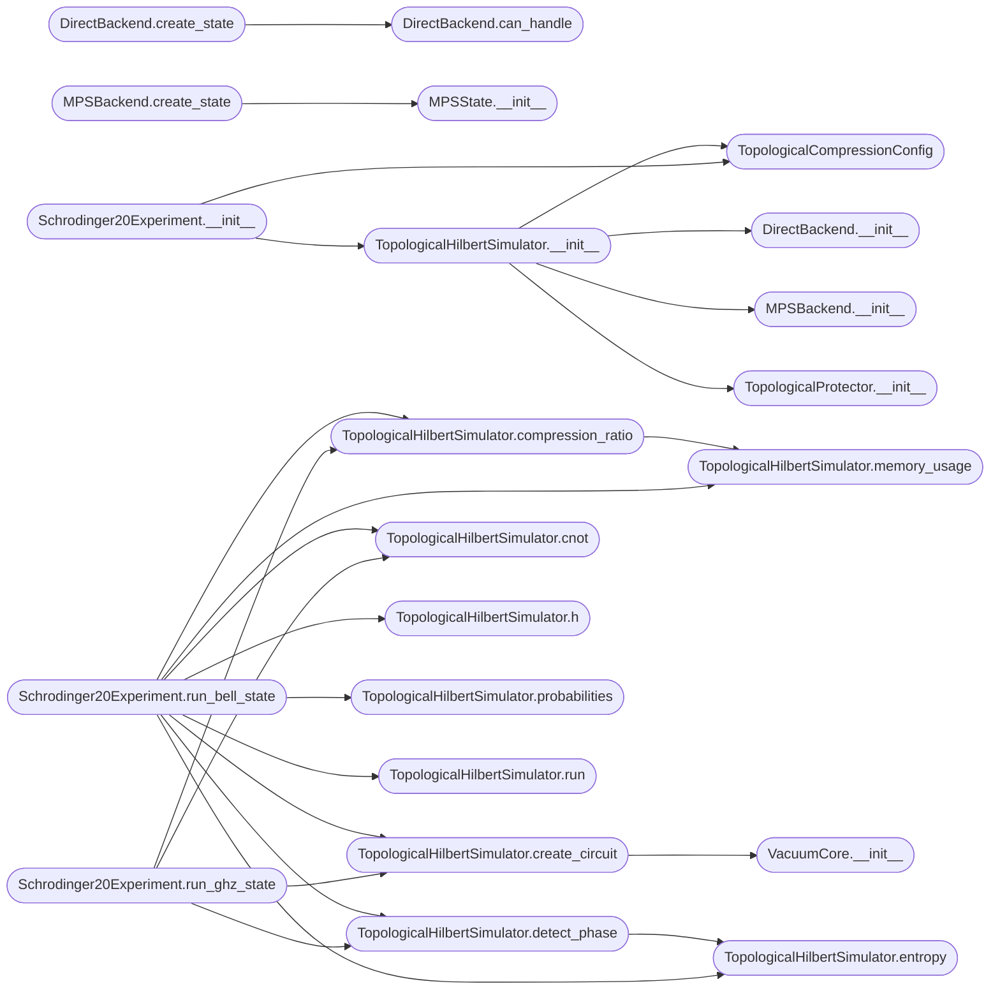

# `topological_hilbert_compression2`

> Source: [topological_hilbert_compression2.py:1](../../topological_hilbert_compression2.py#L1) | language `py` | coverage 12.7% | [API index](../index.md)

Topological Hilbert Space Compression ====================================== Implements Matrix Product State (MPS) factorization with vacuum-core architecture for scaling quantum simulations beyond 20 qubits.

Architecture:
    - MPS/TTN factorization reduces O(2^n) to O(n * chi^2)
    - Vacuum Core projects irrelevant Hilbert subspace to zero
    - Hybrid backend routes subcircuits to optimal processors
    - Topological protection via winding numbers and Berry phases

Author: Gris Iscomeback
License: AGPL v3

## Contents

- **Classes:** [`TopologicalCompressionConfig`](#topologicalcompressionconfig), [`ITensorNetwork`](#itensornetwork), [`MPSCore`](#mpscore), [`MPSState`](#mpsstate), [`VacuumCore`](#vacuumcore), [`TopologicalProtector`](#topologicalprotector), [`HybridBackend`](#hybridbackend), [`DirectBackend`](#directbackend), [`MPSBackend`](#mpsbackend), [`TopologicalHilbertSimulator`](#topologicalhilbertsimulator), [`Schrodinger20Experiment`](#schrodinger20experiment)
- **Enums:** [`HilbertPhase`](#hilbertphase)
- **Functions:** [`main`](#main)

## Type Diagram

```mermaid
classDiagram
    direction LR
    class HilbertPhase
    <<enum>> HilbertPhase
    HilbertPhase : HOT_GLASS
    HilbertPhase : COLD_GLASS
    HilbertPhase : POLYCRYSTAL
    HilbertPhase : TOPOLOGICAL_INSULATOR
    HilbertPhase : PERFECT_CRYSTAL
    class TopologicalCompressionConfig
    TopologicalCompressionConfig : int grid_size
    TopologicalCompressionConfig : int bond_dimension
    TopologicalCompressionConfig : int max_bond_dimension
    TopologicalCompressionConfig : float svd_threshold
    TopologicalCompressionConfig : float truncation_error
    TopologicalCompressionConfig : float regularization_lambda
    TopologicalCompressionConfig : float vacuum_sparsity_target
    TopologicalCompressionConfig : float winding_number_threshold
    TopologicalCompressionConfig : float berry_phase_threshold
    TopologicalCompressionConfig : int max_qubits_direct
    TopologicalCompressionConfig : int max_qubits_mps
    TopologicalCompressionConfig : bool force_mps
    TopologicalCompressionConfig : bool prefer_mps_for_low_entanglement
    TopologicalCompressionConfig : str device
    TopologicalCompressionConfig : torchdtype dtype
    TopologicalCompressionConfig : bool enable_topological_protection
    TopologicalCompressionConfig : bool enable_vacuum_core
    TopologicalCompressionConfig : float entanglement_entropy_threshold
    TopologicalCompressionConfig : str hamiltonian_checkpoint
    TopologicalCompressionConfig : str schrodinger_checkpoint
    TopologicalCompressionConfig : str dirac_checkpoint
    TopologicalCompressionConfig : int random_seed
    class ITensorNetwork
    ITensorNetwork : amplitude()
    ITensorNetwork : apply_single_qubit_gate()
    ITensorNetwork : apply_two_qubit_gate()
    ITensorNetwork : norm()
    ITensorNetwork : probabilities()
    ITensorNetwork : entropy()
    ITensorNetwork : memory_bytes()
    class MPSCore
    MPSCore : __init__()
    MPSCore : tensor()
    MPSCore : tensor()
    MPSCore : left_canonicalize()
    MPSCore : right_canonicalize()
    class MPSState
    MPSState : __init__()
    MPSState : amplitude()
    MPSState : apply_single_qubit_gate()
    MPSState : apply_two_qubit_gate()
    MPSState : norm()
    MPSState : probabilities()
    MPSState : entropy()
    MPSState : memory_bytes()
    MPSState : entanglement_entropy()
    class VacuumCore
    VacuumCore : __init__()
    VacuumCore : add_active_state()
    VacuumCore : is_topologically_protected()
    VacuumCore : sparsity()
    VacuumCore : project_to_active()
    class TopologicalProtector
    TopologicalProtector : __init__()
    TopologicalProtector : compute_winding_number()
    TopologicalProtector : compute_berry_phase()
    TopologicalProtector : is_protected()
    class HybridBackend
    HybridBackend : can_handle()
    HybridBackend : create_state()
    HybridBackend : apply_gate()
    class DirectBackend
    DirectBackend : __init__()
    DirectBackend : can_handle()
    DirectBackend : create_state()
    DirectBackend : apply_gate()
    class MPSBackend
    MPSBackend : __init__()
    MPSBackend : can_handle()
    MPSBackend : create_state()
    MPSBackend : apply_gate()
    class TopologicalHilbertSimulator
    TopologicalHilbertSimulator : __init__()
    TopologicalHilbertSimulator : create_circuit()
    TopologicalHilbertSimulator : h()
    TopologicalHilbertSimulator : x()
    TopologicalHilbertSimulator : y()
    TopologicalHilbertSimulator : z()
    TopologicalHilbertSimulator : rx()
    TopologicalHilbertSimulator : ry()
    TopologicalHilbertSimulator : rz()
    TopologicalHilbertSimulator : cnot()
    TopologicalHilbertSimulator : cz()
    TopologicalHilbertSimulator : swap()
    TopologicalHilbertSimulator : run()
    TopologicalHilbertSimulator : probabilities()
    TopologicalHilbertSimulator : entropy()
    TopologicalHilbertSimulator : memory_usage()
    TopologicalHilbertSimulator : compression_ratio()
    TopologicalHilbertSimulator : detect_phase()
    class Schrodinger20Experiment
    Schrodinger20Experiment : __init__()
    Schrodinger20Experiment : run_bell_state()
    Schrodinger20Experiment : run_ghz_state()
    Schrodinger20Experiment : run_w_state()
    Schrodinger20Experiment : prepare_ghz_state()
    Schrodinger20Experiment : run_scaling_benchmark()
    Schrodinger20Experiment : run_all()
    ITensorNetwork <|-- MPSState
    HybridBackend <|-- DirectBackend
    HybridBackend <|-- MPSBackend
```



## Call Graph

Solid arrows stay in this module, dashed arrows leave it.



## Classes

<a id="topologicalcompressionconfig"></a>

### `TopologicalCompressionConfig`

`class` `dataclass` | [topological_hilbert_compression2.py:56](../../topological_hilbert_compression2.py#L56)

Decorators: `@dataclass`

```python
class TopologicalCompressionConfig
```

**Attributes**

| Name | Type | Default | Description |
|---|---|---|---|
| [`grid_size`](#topologicalcompressionconfig-grid_size) | `int` | `16` |  |
| [`bond_dimension`](#topologicalcompressionconfig-bond_dimension) | `int` | `16` |  |
| [`max_bond_dimension`](#topologicalcompressionconfig-max_bond_dimension) | `int` | `64` |  |
| [`svd_threshold`](#topologicalcompressionconfig-svd_threshold) | `float` | `1e-10` |  |
| [`truncation_error`](#topologicalcompressionconfig-truncation_error) | `float` | `1e-08` |  |
| [`regularization_lambda`](#topologicalcompressionconfig-regularization_lambda) | `float` | `1e+34` |  |
| [`vacuum_sparsity_target`](#topologicalcompressionconfig-vacuum_sparsity_target) | `float` | `0.9999` |  |
| [`winding_number_threshold`](#topologicalcompressionconfig-winding_number_threshold) | `float` | `1.5` |  |
| [`berry_phase_threshold`](#topologicalcompressionconfig-berry_phase_threshold) | `float` | `0.1` |  |
| [`max_qubits_direct`](#topologicalcompressionconfig-max_qubits_direct) | `int` | `20` |  |
| [`max_qubits_mps`](#topologicalcompressionconfig-max_qubits_mps) | `int` | `40` |  |
| [`force_mps`](#topologicalcompressionconfig-force_mps) | `bool` | `False` |  |
| [`prefer_mps_for_low_entanglement`](#topologicalcompressionconfig-prefer_mps_for_low_entanglement) | `bool` | `True` |  |
| [`device`](#topologicalcompressionconfig-device) | `str` | `'cuda' if torch.cuda.is_available() else 'cpu'` |  |
| [`dtype`](#topologicalcompressionconfig-dtype) | `torch.dtype` | `torch.float64` |  |
| [`enable_topological_protection`](#topologicalcompressionconfig-enable_topological_protection) | `bool` | `True` |  |
| [`enable_vacuum_core`](#topologicalcompressionconfig-enable_vacuum_core) | `bool` | `True` |  |
| [`entanglement_entropy_threshold`](#topologicalcompressionconfig-entanglement_entropy_threshold) | `float` | `1.0` |  |
| [`hamiltonian_checkpoint`](#topologicalcompressionconfig-hamiltonian_checkpoint) | `str` | `'weights/latest.pth'` |  |
| [`schrodinger_checkpoint`](#topologicalcompressionconfig-schrodinger_checkpoint) | `str` | `'weights/schrodinger_crystal_final.pth'` |  |
| [`dirac_checkpoint`](#topologicalcompressionconfig-dirac_checkpoint) | `str` | `'weights/dirac_phase5_latest.pth'` |  |
| [`random_seed`](#topologicalcompressionconfig-random_seed) | `int` | `42` |  |

---

<a id="itensornetwork"></a>

### `ITensorNetwork`

`class` `abstract` | [topological_hilbert_compression2.py:85](../../topological_hilbert_compression2.py#L85)

```python
class ITensorNetwork(ABC)
```

Bases: `ABC`

Subclasses: [`MPSState`](#mpsstate)

**Members**

| Member | Kind | Summary |
|---|---|---|
| [`amplitude`](#itensornetwork-amplitude) | method |  |
| [`apply_single_qubit_gate`](#itensornetwork-apply_single_qubit_gate) | method |  |
| [`apply_two_qubit_gate`](#itensornetwork-apply_two_qubit_gate) | method |  |
| [`norm`](#itensornetwork-norm) | method |  |
| [`probabilities`](#itensornetwork-probabilities) | method |  |
| [`entropy`](#itensornetwork-entropy) | method |  |
| [`memory_bytes`](#itensornetwork-memory_bytes) | method |  |

<a id="itensornetwork-amplitude"></a>

#### `ITensorNetwork.amplitude`

`method` `abstract` | [topological_hilbert_compression2.py:87](../../topological_hilbert_compression2.py#L87)

Decorators: `@abstractmethod`

```python
def amplitude(self, basis_index: int) -> torch.Tensor
```

**Parameters**

| Name | Type | Default | Description |
|---|---|---|---|
| `basis_index` | `int` |  |  |

**Returns:** `torch.Tensor`

<a id="itensornetwork-apply_single_qubit_gate"></a>

#### `ITensorNetwork.apply_single_qubit_gate`

`method` `abstract` | [topological_hilbert_compression2.py:91](../../topological_hilbert_compression2.py#L91)

Decorators: `@abstractmethod`

```python
def apply_single_qubit_gate(self, qubit: int, gate: torch.Tensor) -> None
```

**Parameters**

| Name | Type | Default | Description |
|---|---|---|---|
| `qubit` | `int` |  |  |
| `gate` | `torch.Tensor` |  |  |

<a id="itensornetwork-apply_two_qubit_gate"></a>

#### `ITensorNetwork.apply_two_qubit_gate`

`method` `abstract` | [topological_hilbert_compression2.py:95](../../topological_hilbert_compression2.py#L95)

Decorators: `@abstractmethod`

```python
def apply_two_qubit_gate(self, qubit_a: int, qubit_b: int, gate: torch.Tensor) -> None
```

**Parameters**

| Name | Type | Default | Description |
|---|---|---|---|
| `qubit_a` | `int` |  |  |
| `qubit_b` | `int` |  |  |
| `gate` | `torch.Tensor` |  |  |

<a id="itensornetwork-norm"></a>

#### `ITensorNetwork.norm`

`method` `abstract` | [topological_hilbert_compression2.py:99](../../topological_hilbert_compression2.py#L99)

Decorators: `@abstractmethod`

```python
def norm(self) -> float
```

**Returns:** `float`

<a id="itensornetwork-probabilities"></a>

#### `ITensorNetwork.probabilities`

`method` `abstract` | [topological_hilbert_compression2.py:103](../../topological_hilbert_compression2.py#L103)

Decorators: `@abstractmethod`

```python
def probabilities(self) -> torch.Tensor
```

**Returns:** `torch.Tensor`

<a id="itensornetwork-entropy"></a>

#### `ITensorNetwork.entropy`

`method` `abstract` | [topological_hilbert_compression2.py:107](../../topological_hilbert_compression2.py#L107)

Decorators: `@abstractmethod`

```python
def entropy(self) -> float
```

**Returns:** `float`

<a id="itensornetwork-memory_bytes"></a>

#### `ITensorNetwork.memory_bytes`

`method` `abstract` | [topological_hilbert_compression2.py:111](../../topological_hilbert_compression2.py#L111)

Decorators: `@abstractmethod`

```python
def memory_bytes(self) -> int
```

**Returns:** `int`

---

<a id="mpscore"></a>

### `MPSCore`

`class` | [topological_hilbert_compression2.py:115](../../topological_hilbert_compression2.py#L115)

```python
class MPSCore
```

Matrix Product State core tensor A^{[k]}_{i_k} with left and right bond indices.

Shape: (chi_left, d, chi_right) where d=2 for qubits.

**Members**

| Member | Kind | Summary |
|---|---|---|
| [`__init__`](#mpscore-__init__) | constructor |  |
| [`tensor`](#mpscore-tensor) | property |  |
| [`tensor`](#mpscore-tensor) | property |  |
| [`left_canonicalize`](#mpscore-left_canonicalize) | method |  |
| [`right_canonicalize`](#mpscore-right_canonicalize) | method |  |

<a id="mpscore-__init__"></a>

#### `MPSCore.__init__`

`constructor` | [topological_hilbert_compression2.py:121](../../topological_hilbert_compression2.py#L121)

```python
def __init__(self, chi_left: int, chi_right: int, d: int = 2, device: str = 'cpu', dtype: torch.dtype = torch.float64) -> None
```

**Parameters**

| Name | Type | Default | Description |
|---|---|---|---|
| `chi_left` | `int` |  |  |
| `chi_right` | `int` |  |  |
| `d` | `int` | `2` |  |
| `device` | `str` | `'cpu'` |  |
| `dtype` | `torch.dtype` | `torch.float64` |  |

<a id="mpscore-tensor"></a>

#### `MPSCore.tensor`

`property` | [topological_hilbert_compression2.py:142](../../topological_hilbert_compression2.py#L142)

Decorators: `@tensor.setter`

```python
def tensor(self, value: torch.Tensor) -> None
```

**Parameters**

| Name | Type | Default | Description |
|---|---|---|---|
| `value` | `torch.Tensor` |  |  |

<a id="mpscore-tensor"></a>

#### `MPSCore.tensor`

`property` | [topological_hilbert_compression2.py:142](../../topological_hilbert_compression2.py#L142)

Decorators: `@tensor.setter`

```python
def tensor(self, value: torch.Tensor) -> None
```

**Parameters**

| Name | Type | Default | Description |
|---|---|---|---|
| `value` | `torch.Tensor` |  |  |

<a id="mpscore-left_canonicalize"></a>

#### `MPSCore.left_canonicalize`

`method` | [topological_hilbert_compression2.py:147](../../topological_hilbert_compression2.py#L147)

```python
def left_canonicalize(self) -> torch.Tensor
```

**Returns:** `torch.Tensor`

<a id="mpscore-right_canonicalize"></a>

#### `MPSCore.right_canonicalize`

`method` | [topological_hilbert_compression2.py:154](../../topological_hilbert_compression2.py#L154)

```python
def right_canonicalize(self) -> torch.Tensor
```

**Returns:** `torch.Tensor`

---

<a id="mpsstate"></a>

### `MPSState`

`class` | [topological_hilbert_compression2.py:162](../../topological_hilbert_compression2.py#L162)

```python
class MPSState(ITensorNetwork)
```

Bases: [`ITensorNetwork`](#itensornetwork)

Matrix Product State representation of n-qubit quantum state.

|psi> = sum_{i_1...i_n} A^{[1]}_{i_1} A^{[2]}_{i_2} ... A^{[n]}_{i_n} |i_1...i_n>

Memory: O(n * chi^2 * d) vs O(d^n) for full statevector.
For n=30, chi=16: ~30KB vs 8GB for statevector.

**Members**

| Member | Kind | Summary |
|---|---|---|
| [`__init__`](#mpsstate-__init__) | constructor |  |
| [`amplitude`](#mpsstate-amplitude) | method |  |
| [`apply_single_qubit_gate`](#mpsstate-apply_single_qubit_gate) | method |  |
| [`apply_two_qubit_gate`](#mpsstate-apply_two_qubit_gate) | method |  |
| [`norm`](#mpsstate-norm) | method |  |
| [`probabilities`](#mpsstate-probabilities) | method |  |
| [`entropy`](#mpsstate-entropy) | method |  |
| [`memory_bytes`](#mpsstate-memory_bytes) | method |  |
| [`entanglement_entropy`](#mpsstate-entanglement_entropy) | method |  |

<a id="mpsstate-__init__"></a>

#### `MPSState.__init__`

`constructor` | [topological_hilbert_compression2.py:172](../../topological_hilbert_compression2.py#L172)

```python
def __init__(self, n_qubits: int, config: TopologicalCompressionConfig) -> None
```

**Parameters**

| Name | Type | Default | Description |
|---|---|---|---|
| `n_qubits` | `int` |  |  |
| `config` | `TopologicalCompressionConfig` |  |  |

*Called by:* [`MPSBackend.create_state`](#mpsbackend-create_state)

<a id="mpsstate-amplitude"></a>

#### `MPSState.amplitude`

`method` | [topological_hilbert_compression2.py:198](../../topological_hilbert_compression2.py#L198)

```python
def amplitude(self, basis_index: int) -> torch.Tensor
```

**Parameters**

| Name | Type | Default | Description |
|---|---|---|---|
| `basis_index` | `int` |  |  |

**Returns:** `torch.Tensor`

**Raises**

- `ValueError`: (raised in the body, not documented)

<a id="mpsstate-apply_single_qubit_gate"></a>

#### `MPSState.apply_single_qubit_gate`

`method` | [topological_hilbert_compression2.py:209](../../topological_hilbert_compression2.py#L209)

```python
def apply_single_qubit_gate(self, qubit: int, gate: torch.Tensor) -> None
```

**Parameters**

| Name | Type | Default | Description |
|---|---|---|---|
| `qubit` | `int` |  |  |
| `gate` | `torch.Tensor` |  |  |

**Raises**

- `ValueError`: (raised in the body, not documented)

<a id="mpsstate-apply_two_qubit_gate"></a>

#### `MPSState.apply_two_qubit_gate`

`method` | [topological_hilbert_compression2.py:219](../../topological_hilbert_compression2.py#L219)

```python
def apply_two_qubit_gate(self, qubit_a: int, qubit_b: int, gate: torch.Tensor) -> None
```

**Parameters**

| Name | Type | Default | Description |
|---|---|---|---|
| `qubit_a` | `int` |  |  |
| `qubit_b` | `int` |  |  |
| `gate` | `torch.Tensor` |  |  |

**Raises**

- `ValueError`: (raised in the body, not documented)

<a id="mpsstate-norm"></a>

#### `MPSState.norm`

`method` | [topological_hilbert_compression2.py:294](../../topological_hilbert_compression2.py#L294)

```python
def norm(self) -> float
```

**Returns:** `float`

<a id="mpsstate-probabilities"></a>

#### `MPSState.probabilities`

`method` | [topological_hilbert_compression2.py:308](../../topological_hilbert_compression2.py#L308)

```python
def probabilities(self) -> torch.Tensor
```

**Returns:** `torch.Tensor`

*Calls:* [`MPSState.amplitude`](quantum_framework_core.py.md#mpsstate-amplitude)

<a id="mpsstate-entropy"></a>

#### `MPSState.entropy`

`method` | [topological_hilbert_compression2.py:318](../../topological_hilbert_compression2.py#L318)

```python
def entropy(self) -> float
```

**Returns:** `float`

*Calls:* [`MPSState.entanglement_entropy`](quantum_framework_core.py.md#mpsstate-entanglement_entropy)

<a id="mpsstate-memory_bytes"></a>

#### `MPSState.memory_bytes`

`method` | [topological_hilbert_compression2.py:329](../../topological_hilbert_compression2.py#L329)

```python
def memory_bytes(self) -> int
```

**Returns:** `int`

<a id="mpsstate-entanglement_entropy"></a>

#### `MPSState.entanglement_entropy`

`method` | [topological_hilbert_compression2.py:335](../../topological_hilbert_compression2.py#L335)

```python
def entanglement_entropy(self, cut: int) -> float
```

**Parameters**

| Name | Type | Default | Description |
|---|---|---|---|
| `cut` | `int` |  |  |

**Returns:** `float`

---

<a id="vacuumcore"></a>

### `VacuumCore`

`class` | [topological_hilbert_compression2.py:351](../../topological_hilbert_compression2.py#L351)

```python
class VacuumCore
```

Vacuum Core architecture that projects irrelevant Hilbert subspace to zero.

Inspired by the HPU-Core achieving 99.996% sparsity:
- Active core: small subspace carrying quantum information
- Vacuum: 99%+ of Hilbert space forced to zero by regularization
- Protection: topological invariants prevent core destruction

**Members**

| Member | Kind | Summary |
|---|---|---|
| [`__init__`](#vacuumcore-__init__) | constructor |  |
| [`add_active_state`](#vacuumcore-add_active_state) | method |  |
| [`is_topologically_protected`](#vacuumcore-is_topologically_protected) | method |  |
| [`sparsity`](#vacuumcore-sparsity) | method |  |
| [`project_to_active`](#vacuumcore-project_to_active) | method |  |

<a id="vacuumcore-__init__"></a>

#### `VacuumCore.__init__`

`constructor` | [topological_hilbert_compression2.py:361](../../topological_hilbert_compression2.py#L361)

```python
def __init__(self, n_qubits: int, config: TopologicalCompressionConfig) -> None
```

**Parameters**

| Name | Type | Default | Description |
|---|---|---|---|
| `n_qubits` | `int` |  |  |
| `config` | `TopologicalCompressionConfig` |  |  |

*Called by:* [`TopologicalHilbertSimulator.create_circuit`](#topologicalhilbertsimulator-create_circuit)

<a id="vacuumcore-add_active_state"></a>

#### `VacuumCore.add_active_state`

`method` | [topological_hilbert_compression2.py:381](../../topological_hilbert_compression2.py#L381)

```python
def add_active_state(self, basis_index: int, winding_number: float = 0.0) -> None
```

**Parameters**

| Name | Type | Default | Description |
|---|---|---|---|
| `basis_index` | `int` |  |  |
| `winding_number` | `float` | `0.0` |  |

**Raises**

- `ValueError`: (raised in the body, not documented)

<a id="vacuumcore-is_topologically_protected"></a>

#### `VacuumCore.is_topologically_protected`

`method` | [topological_hilbert_compression2.py:394](../../topological_hilbert_compression2.py#L394)

```python
def is_topologically_protected(self, basis_index: int) -> bool
```

**Parameters**

| Name | Type | Default | Description |
|---|---|---|---|
| `basis_index` | `int` |  |  |

**Returns:** `bool`

<a id="vacuumcore-sparsity"></a>

#### `VacuumCore.sparsity`

`method` | [topological_hilbert_compression2.py:398](../../topological_hilbert_compression2.py#L398)

```python
def sparsity(self) -> float
```

**Returns:** `float`

<a id="vacuumcore-project_to_active"></a>

#### `VacuumCore.project_to_active`

`method` | [topological_hilbert_compression2.py:403](../../topological_hilbert_compression2.py#L403)

```python
def project_to_active(self, state: ITensorNetwork) -> ITensorNetwork
```

**Parameters**

| Name | Type | Default | Description |
|---|---|---|---|
| `state` | `ITensorNetwork` |  |  |

**Returns:** `ITensorNetwork`

*Calls:* [`ITensorNetwork.probabilities`](quantum_framework_core.py.md#itensornetwork-probabilities), [`VacuumCore.add_active_state`](quantum_framework_core.py.md#vacuumcore-add_active_state)

---

<a id="topologicalprotector"></a>

### `TopologicalProtector`

`class` | [topological_hilbert_compression2.py:411](../../topological_hilbert_compression2.py#L411)

```python
class TopologicalProtector
```

Provides topological protection for quantum states via: - Winding number monitoring - Berry phase calculation - Edge state preservation

**Members**

| Member | Kind | Summary |
|---|---|---|
| [`__init__`](#topologicalprotector-__init__) | constructor |  |
| [`compute_winding_number`](#topologicalprotector-compute_winding_number) | method |  |
| [`compute_berry_phase`](#topologicalprotector-compute_berry_phase) | method |  |
| [`is_protected`](#topologicalprotector-is_protected) | method |  |

<a id="topologicalprotector-__init__"></a>

#### `TopologicalProtector.__init__`

`constructor` | [topological_hilbert_compression2.py:419](../../topological_hilbert_compression2.py#L419)

```python
def __init__(self, config: TopologicalCompressionConfig) -> None
```

**Parameters**

| Name | Type | Default | Description |
|---|---|---|---|
| `config` | `TopologicalCompressionConfig` |  |  |

*Called by:* [`TopologicalHilbertSimulator.__init__`](#topologicalhilbertsimulator-__init__)

<a id="topologicalprotector-compute_winding_number"></a>

#### `TopologicalProtector.compute_winding_number`

`method` | [topological_hilbert_compression2.py:424](../../topological_hilbert_compression2.py#L424)

```python
def compute_winding_number(self, state: ITensorNetwork, qubit: int) -> float
```

**Parameters**

| Name | Type | Default | Description |
|---|---|---|---|
| `state` | `ITensorNetwork` |  |  |
| `qubit` | `int` |  |  |

**Returns:** `float`

*Calls:* [`ITensorNetwork.probabilities`](quantum_framework_core.py.md#itensornetwork-probabilities)

<a id="topologicalprotector-compute_berry_phase"></a>

#### `TopologicalProtector.compute_berry_phase`

`method` | [topological_hilbert_compression2.py:433](../../topological_hilbert_compression2.py#L433)

```python
def compute_berry_phase(self, state: ITensorNetwork, qubit_a: int, qubit_b: int) -> float
```

**Parameters**

| Name | Type | Default | Description |
|---|---|---|---|
| `state` | `ITensorNetwork` |  |  |
| `qubit_a` | `int` |  |  |
| `qubit_b` | `int` |  |  |

**Returns:** `float`

*Calls:* [`ITensorNetwork.probabilities`](quantum_framework_core.py.md#itensornetwork-probabilities)

<a id="topologicalprotector-is_protected"></a>

#### `TopologicalProtector.is_protected`

`method` | [topological_hilbert_compression2.py:444](../../topological_hilbert_compression2.py#L444)

```python
def is_protected(self, state: ITensorNetwork, vacuum_core: VacuumCore) -> bool
```

**Parameters**

| Name | Type | Default | Description |
|---|---|---|---|
| `state` | `ITensorNetwork` |  |  |
| `vacuum_core` | `VacuumCore` |  |  |

**Returns:** `bool`

---

<a id="hybridbackend"></a>

### `HybridBackend`

`class` `abstract` | [topological_hilbert_compression2.py:452](../../topological_hilbert_compression2.py#L452)

```python
class HybridBackend(ABC)
```

Bases: `ABC`

Subclasses: [`DirectBackend`](#directbackend), [`MPSBackend`](#mpsbackend)

**Members**

| Member | Kind | Summary |
|---|---|---|
| [`can_handle`](#hybridbackend-can_handle) | method |  |
| [`create_state`](#hybridbackend-create_state) | method |  |
| [`apply_gate`](#hybridbackend-apply_gate) | method |  |

<a id="hybridbackend-can_handle"></a>

#### `HybridBackend.can_handle`

`method` `abstract` | [topological_hilbert_compression2.py:454](../../topological_hilbert_compression2.py#L454)

Decorators: `@abstractmethod`

```python
def can_handle(self, n_qubits: int) -> bool
```

**Parameters**

| Name | Type | Default | Description |
|---|---|---|---|
| `n_qubits` | `int` |  |  |

**Returns:** `bool`

<a id="hybridbackend-create_state"></a>

#### `HybridBackend.create_state`

`method` `abstract` | [topological_hilbert_compression2.py:458](../../topological_hilbert_compression2.py#L458)

Decorators: `@abstractmethod`

```python
def create_state(self, n_qubits: int) -> ITensorNetwork
```

**Parameters**

| Name | Type | Default | Description |
|---|---|---|---|
| `n_qubits` | `int` |  |  |

**Returns:** `ITensorNetwork`

<a id="hybridbackend-apply_gate"></a>

#### `HybridBackend.apply_gate`

`method` `abstract` | [topological_hilbert_compression2.py:462](../../topological_hilbert_compression2.py#L462)

Decorators: `@abstractmethod`

```python
def apply_gate(self, state: ITensorNetwork, gate_name: str, targets: Sequence[int], params: Optional[Dict[str, float]] = None) -> ITensorNetwork
```

**Parameters**

| Name | Type | Default | Description |
|---|---|---|---|
| `state` | `ITensorNetwork` |  |  |
| `gate_name` | `str` |  |  |
| `targets` | `Sequence[int]` |  |  |
| `params` | `Optional[Dict[str, float]]` | `None` |  |

**Returns:** `ITensorNetwork`

---

<a id="directbackend"></a>

### `DirectBackend`

`class` | [topological_hilbert_compression2.py:466](../../topological_hilbert_compression2.py#L466)

```python
class DirectBackend(HybridBackend)
```

Bases: [`HybridBackend`](#hybridbackend)

Direct tensor backend using JointHilbertState representation.

Limited to config.max_qubits_direct qubits due to exponential memory.

**Members**

| Member | Kind | Summary |
|---|---|---|
| [`__init__`](#directbackend-__init__) | constructor |  |
| [`can_handle`](#directbackend-can_handle) | method |  |
| [`create_state`](#directbackend-create_state) | method |  |
| [`apply_gate`](#directbackend-apply_gate) | method |  |

<a id="directbackend-__init__"></a>

#### `DirectBackend.__init__`

`constructor` | [topological_hilbert_compression2.py:472](../../topological_hilbert_compression2.py#L472)

```python
def __init__(self, config: TopologicalCompressionConfig) -> None
```

**Parameters**

| Name | Type | Default | Description |
|---|---|---|---|
| `config` | `TopologicalCompressionConfig` |  |  |

*Called by:* [`TopologicalHilbertSimulator.__init__`](#topologicalhilbertsimulator-__init__)

<a id="directbackend-can_handle"></a>

#### `DirectBackend.can_handle`

`method` | [topological_hilbert_compression2.py:497](../../topological_hilbert_compression2.py#L497)

```python
def can_handle(self, n_qubits: int) -> bool
```

**Parameters**

| Name | Type | Default | Description |
|---|---|---|---|
| `n_qubits` | `int` |  |  |

**Returns:** `bool`

*Called by:* [`DirectBackend.create_state`](#directbackend-create_state)

<a id="directbackend-create_state"></a>

#### `DirectBackend.create_state`

`method` | [topological_hilbert_compression2.py:500](../../topological_hilbert_compression2.py#L500)

```python
def create_state(self, n_qubits: int) -> ITensorNetwork
```

**Parameters**

| Name | Type | Default | Description |
|---|---|---|---|
| `n_qubits` | `int` |  |  |

**Returns:** `ITensorNetwork`

**Raises**

- `RuntimeError`: (raised in the body, not documented)
- `ValueError`: (raised in the body, not documented)

*Calls:* [`DirectBackend.can_handle`](#directbackend-can_handle)

<a id="directbackend-apply_gate"></a>

#### `DirectBackend.apply_gate`

`method` | [topological_hilbert_compression2.py:507](../../topological_hilbert_compression2.py#L507)

```python
def apply_gate(self, state: ITensorNetwork, gate_name: str, targets: Sequence[int], params: Optional[Dict[str, float]] = None) -> ITensorNetwork
```

**Parameters**

| Name | Type | Default | Description |
|---|---|---|---|
| `state` | `ITensorNetwork` |  |  |
| `gate_name` | `str` |  |  |
| `targets` | `Sequence[int]` |  |  |
| `params` | `Optional[Dict[str, float]]` | `None` |  |

**Returns:** `ITensorNetwork`

**Raises**

- `KeyError`: (raised in the body, not documented)

---

<a id="mpsbackend"></a>

### `MPSBackend`

`class` | [topological_hilbert_compression2.py:515](../../topological_hilbert_compression2.py#L515)

```python
class MPSBackend(HybridBackend)
```

Bases: [`HybridBackend`](#hybridbackend)

Matrix Product State backend for scalable quantum simulation.

Handles up to config.max_qubits_mps qubits with sub-exponential memory.

**Members**

| Member | Kind | Summary |
|---|---|---|
| [`__init__`](#mpsbackend-__init__) | constructor |  |
| [`can_handle`](#mpsbackend-can_handle) | method |  |
| [`create_state`](#mpsbackend-create_state) | method |  |
| [`apply_gate`](#mpsbackend-apply_gate) | method |  |

<a id="mpsbackend-__init__"></a>

#### `MPSBackend.__init__`

`constructor` | [topological_hilbert_compression2.py:521](../../topological_hilbert_compression2.py#L521)

```python
def __init__(self, config: TopologicalCompressionConfig) -> None
```

**Parameters**

| Name | Type | Default | Description |
|---|---|---|---|
| `config` | `TopologicalCompressionConfig` |  |  |

*Called by:* [`TopologicalHilbertSimulator.__init__`](#topologicalhilbertsimulator-__init__)

<a id="mpsbackend-can_handle"></a>

#### `MPSBackend.can_handle`

`method` | [topological_hilbert_compression2.py:537](../../topological_hilbert_compression2.py#L537)

```python
def can_handle(self, n_qubits: int) -> bool
```

**Parameters**

| Name | Type | Default | Description |
|---|---|---|---|
| `n_qubits` | `int` |  |  |

**Returns:** `bool`

<a id="mpsbackend-create_state"></a>

#### `MPSBackend.create_state`

`method` | [topological_hilbert_compression2.py:540](../../topological_hilbert_compression2.py#L540)

```python
def create_state(self, n_qubits: int) -> ITensorNetwork
```

**Parameters**

| Name | Type | Default | Description |
|---|---|---|---|
| `n_qubits` | `int` |  |  |

**Returns:** `ITensorNetwork`

*Calls:* [`MPSState.__init__`](#mpsstate-__init__)

<a id="mpsbackend-apply_gate"></a>

#### `MPSBackend.apply_gate`

`method` | [topological_hilbert_compression2.py:543](../../topological_hilbert_compression2.py#L543)

```python
def apply_gate(self, state: ITensorNetwork, gate_name: str, targets: Sequence[int], params: Optional[Dict[str, float]] = None) -> ITensorNetwork
```

**Parameters**

| Name | Type | Default | Description |
|---|---|---|---|
| `state` | `ITensorNetwork` |  |  |
| `gate_name` | `str` |  |  |
| `targets` | `Sequence[int]` |  |  |
| `params` | `Optional[Dict[str, float]]` | `None` |  |

**Returns:** `ITensorNetwork`

**Raises**

- `KeyError`: (raised in the body, not documented)
- `TypeError`: (raised in the body, not documented)
- `ValueError`: (raised in the body, not documented)

*Calls:* [`ITensorNetwork.apply_single_qubit_gate`](quantum_framework_core.py.md#itensornetwork-apply_single_qubit_gate), [`ITensorNetwork.apply_two_qubit_gate`](quantum_framework_core.py.md#itensornetwork-apply_two_qubit_gate)

---

<a id="topologicalhilbertsimulator"></a>

### `TopologicalHilbertSimulator`

`class` | [topological_hilbert_compression2.py:572](../../topological_hilbert_compression2.py#L572)

```python
class TopologicalHilbertSimulator
```

Main simulator implementing hybrid architecture for scalable quantum simulation.

Architecture:
    - n <= max_qubits_direct: HPU-Core direct tensor (exact wavefunction evolution)
    - n > max_qubits_direct: MPS with vacuum core compression

**Members**

| Member | Kind | Summary |
|---|---|---|
| [`__init__`](#topologicalhilbertsimulator-__init__) | constructor |  |
| [`create_circuit`](#topologicalhilbertsimulator-create_circuit) | method |  |
| [`h`](#topologicalhilbertsimulator-h) | method |  |
| [`x`](#topologicalhilbertsimulator-x) | method |  |
| [`y`](#topologicalhilbertsimulator-y) | method |  |
| [`z`](#topologicalhilbertsimulator-z) | method |  |
| [`rx`](#topologicalhilbertsimulator-rx) | method |  |
| [`ry`](#topologicalhilbertsimulator-ry) | method |  |
| [`rz`](#topologicalhilbertsimulator-rz) | method |  |
| [`cnot`](#topologicalhilbertsimulator-cnot) | method |  |
| [`cz`](#topologicalhilbertsimulator-cz) | method |  |
| [`swap`](#topologicalhilbertsimulator-swap) | method |  |
| [`run`](#topologicalhilbertsimulator-run) | method |  |
| [`probabilities`](#topologicalhilbertsimulator-probabilities) | method |  |
| [`entropy`](#topologicalhilbertsimulator-entropy) | method |  |
| [`memory_usage`](#topologicalhilbertsimulator-memory_usage) | method |  |
| [`compression_ratio`](#topologicalhilbertsimulator-compression_ratio) | method |  |
| [`detect_phase`](#topologicalhilbertsimulator-detect_phase) | method |  |

<a id="topologicalhilbertsimulator-__init__"></a>

#### `TopologicalHilbertSimulator.__init__`

`constructor` | [topological_hilbert_compression2.py:581](../../topological_hilbert_compression2.py#L581)

```python
def __init__(self, config: Optional[TopologicalCompressionConfig] = None) -> None
```

**Parameters**

| Name | Type | Default | Description |
|---|---|---|---|
| `config` | `Optional[TopologicalCompressionConfig]` | `None` |  |

*Calls:* [`DirectBackend.__init__`](#directbackend-__init__), [`MPSBackend.__init__`](#mpsbackend-__init__), [`TopologicalCompressionConfig`](#topologicalcompressionconfig), [`TopologicalProtector.__init__`](#topologicalprotector-__init__)

*Called by:* [`Schrodinger20Experiment.__init__`](#schrodinger20experiment-__init__), [`main`](#main)

<a id="topologicalhilbertsimulator-create_circuit"></a>

#### `TopologicalHilbertSimulator.create_circuit`

`method` | [topological_hilbert_compression2.py:602](../../topological_hilbert_compression2.py#L602)

```python
def create_circuit(self, n_qubits: int, force_mps: bool = False) -> None
```

**Parameters**

| Name | Type | Default | Description |
|---|---|---|---|
| `n_qubits` | `int` |  |  |
| `force_mps` | `bool` | `False` |  |

*Calls:* [`VacuumCore.__init__`](#vacuumcore-__init__)

*Called by:* [`Schrodinger20Experiment.prepare_ghz_state`](#schrodinger20experiment-prepare_ghz_state), [`Schrodinger20Experiment.run_bell_state`](#schrodinger20experiment-run_bell_state), [`Schrodinger20Experiment.run_ghz_state`](#schrodinger20experiment-run_ghz_state), [`Schrodinger20Experiment.run_scaling_benchmark`](#schrodinger20experiment-run_scaling_benchmark), [`Schrodinger20Experiment.run_w_state`](#schrodinger20experiment-run_w_state), [`main`](#main)

<a id="topologicalhilbertsimulator-h"></a>

#### `TopologicalHilbertSimulator.h`

`method` | [topological_hilbert_compression2.py:610](../../topological_hilbert_compression2.py#L610)

```python
def h(self, qubit: int) -> None
```

**Parameters**

| Name | Type | Default | Description |
|---|---|---|---|
| `qubit` | `int` |  |  |

*Called by:* [`Schrodinger20Experiment.prepare_ghz_state`](#schrodinger20experiment-prepare_ghz_state), [`Schrodinger20Experiment.run_bell_state`](#schrodinger20experiment-run_bell_state), [`Schrodinger20Experiment.run_ghz_state`](#schrodinger20experiment-run_ghz_state), [`Schrodinger20Experiment.run_scaling_benchmark`](#schrodinger20experiment-run_scaling_benchmark), [`main`](#main)

<a id="topologicalhilbertsimulator-x"></a>

#### `TopologicalHilbertSimulator.x`

`method` | [topological_hilbert_compression2.py:613](../../topological_hilbert_compression2.py#L613)

```python
def x(self, qubit: int) -> None
```

**Parameters**

| Name | Type | Default | Description |
|---|---|---|---|
| `qubit` | `int` |  |  |

*Called by:* [`Schrodinger20Experiment.run_w_state`](#schrodinger20experiment-run_w_state)

<a id="topologicalhilbertsimulator-y"></a>

#### `TopologicalHilbertSimulator.y`

`method` | [topological_hilbert_compression2.py:616](../../topological_hilbert_compression2.py#L616)

```python
def y(self, qubit: int) -> None
```

**Parameters**

| Name | Type | Default | Description |
|---|---|---|---|
| `qubit` | `int` |  |  |

<a id="topologicalhilbertsimulator-z"></a>

#### `TopologicalHilbertSimulator.z`

`method` | [topological_hilbert_compression2.py:619](../../topological_hilbert_compression2.py#L619)

```python
def z(self, qubit: int) -> None
```

**Parameters**

| Name | Type | Default | Description |
|---|---|---|---|
| `qubit` | `int` |  |  |

<a id="topologicalhilbertsimulator-rx"></a>

#### `TopologicalHilbertSimulator.rx`

`method` | [topological_hilbert_compression2.py:622](../../topological_hilbert_compression2.py#L622)

```python
def rx(self, qubit: int, theta: float) -> None
```

**Parameters**

| Name | Type | Default | Description |
|---|---|---|---|
| `qubit` | `int` |  |  |
| `theta` | `float` |  |  |

<a id="topologicalhilbertsimulator-ry"></a>

#### `TopologicalHilbertSimulator.ry`

`method` | [topological_hilbert_compression2.py:625](../../topological_hilbert_compression2.py#L625)

```python
def ry(self, qubit: int, theta: float) -> None
```

**Parameters**

| Name | Type | Default | Description |
|---|---|---|---|
| `qubit` | `int` |  |  |
| `theta` | `float` |  |  |

*Called by:* [`Schrodinger20Experiment.run_w_state`](#schrodinger20experiment-run_w_state)

<a id="topologicalhilbertsimulator-rz"></a>

#### `TopologicalHilbertSimulator.rz`

`method` | [topological_hilbert_compression2.py:628](../../topological_hilbert_compression2.py#L628)

```python
def rz(self, qubit: int, theta: float) -> None
```

**Parameters**

| Name | Type | Default | Description |
|---|---|---|---|
| `qubit` | `int` |  |  |
| `theta` | `float` |  |  |

<a id="topologicalhilbertsimulator-cnot"></a>

#### `TopologicalHilbertSimulator.cnot`

`method` | [topological_hilbert_compression2.py:631](../../topological_hilbert_compression2.py#L631)

```python
def cnot(self, control: int, target: int) -> None
```

**Parameters**

| Name | Type | Default | Description |
|---|---|---|---|
| `control` | `int` |  |  |
| `target` | `int` |  |  |

*Called by:* [`Schrodinger20Experiment.prepare_ghz_state`](#schrodinger20experiment-prepare_ghz_state), [`Schrodinger20Experiment.run_bell_state`](#schrodinger20experiment-run_bell_state), [`Schrodinger20Experiment.run_ghz_state`](#schrodinger20experiment-run_ghz_state), [`Schrodinger20Experiment.run_scaling_benchmark`](#schrodinger20experiment-run_scaling_benchmark), [`Schrodinger20Experiment.run_w_state`](#schrodinger20experiment-run_w_state), [`main`](#main)

<a id="topologicalhilbertsimulator-cz"></a>

#### `TopologicalHilbertSimulator.cz`

`method` | [topological_hilbert_compression2.py:634](../../topological_hilbert_compression2.py#L634)

```python
def cz(self, control: int, target: int) -> None
```

**Parameters**

| Name | Type | Default | Description |
|---|---|---|---|
| `control` | `int` |  |  |
| `target` | `int` |  |  |

<a id="topologicalhilbertsimulator-swap"></a>

#### `TopologicalHilbertSimulator.swap`

`method` | [topological_hilbert_compression2.py:637](../../topological_hilbert_compression2.py#L637)

```python
def swap(self, qubit_a: int, qubit_b: int) -> None
```

**Parameters**

| Name | Type | Default | Description |
|---|---|---|---|
| `qubit_a` | `int` |  |  |
| `qubit_b` | `int` |  |  |

<a id="topologicalhilbertsimulator-run"></a>

#### `TopologicalHilbertSimulator.run`

`method` | [topological_hilbert_compression2.py:640](../../topological_hilbert_compression2.py#L640)

```python
def run(self) -> ITensorNetwork
```

**Returns:** `ITensorNetwork`

**Raises**

- `RuntimeError`: (raised in the body, not documented)

*Calls:* [`VacuumCore.project_to_active`](quantum_framework_core.py.md#vacuumcore-project_to_active)

*Called by:* [`Schrodinger20Experiment.prepare_ghz_state`](#schrodinger20experiment-prepare_ghz_state), [`Schrodinger20Experiment.run_bell_state`](#schrodinger20experiment-run_bell_state), [`Schrodinger20Experiment.run_ghz_state`](#schrodinger20experiment-run_ghz_state), [`Schrodinger20Experiment.run_scaling_benchmark`](#schrodinger20experiment-run_scaling_benchmark), [`Schrodinger20Experiment.run_w_state`](#schrodinger20experiment-run_w_state), [`main`](#main)

<a id="topologicalhilbertsimulator-probabilities"></a>

#### `TopologicalHilbertSimulator.probabilities`

`method` | [topological_hilbert_compression2.py:650](../../topological_hilbert_compression2.py#L650)

```python
def probabilities(self) -> torch.Tensor
```

**Returns:** `torch.Tensor`

**Raises**

- `RuntimeError`: (raised in the body, not documented)

*Calls:* [`ITensorNetwork.probabilities`](quantum_framework_core.py.md#itensornetwork-probabilities)

*Called by:* [`Schrodinger20Experiment.run_bell_state`](#schrodinger20experiment-run_bell_state), [`Schrodinger20Experiment.run_ghz_state`](#schrodinger20experiment-run_ghz_state), [`Schrodinger20Experiment.run_w_state`](#schrodinger20experiment-run_w_state)

<a id="topologicalhilbertsimulator-entropy"></a>

#### `TopologicalHilbertSimulator.entropy`

`method` | [topological_hilbert_compression2.py:655](../../topological_hilbert_compression2.py#L655)

```python
def entropy(self) -> float
```

**Returns:** `float`

**Raises**

- `RuntimeError`: (raised in the body, not documented)

*Calls:* [`ITensorNetwork.entropy`](quantum_framework_core.py.md#itensornetwork-entropy), [`ITensorNetwork.probabilities`](quantum_framework_core.py.md#itensornetwork-probabilities)

*Called by:* [`Schrodinger20Experiment.run_bell_state`](#schrodinger20experiment-run_bell_state), [`Schrodinger20Experiment.run_ghz_state`](#schrodinger20experiment-run_ghz_state), [`Schrodinger20Experiment.run_w_state`](#schrodinger20experiment-run_w_state), [`TopologicalHilbertSimulator.detect_phase`](#topologicalhilbertsimulator-detect_phase)

<a id="topologicalhilbertsimulator-memory_usage"></a>

#### `TopologicalHilbertSimulator.memory_usage`

`method` | [topological_hilbert_compression2.py:666](../../topological_hilbert_compression2.py#L666)

```python
def memory_usage(self) -> Dict[str, int]
```

**Returns:** `Dict[str, int]`

*Calls:* [`ITensorNetwork.memory_bytes`](quantum_framework_core.py.md#itensornetwork-memory_bytes)

*Called by:* [`Schrodinger20Experiment.run_bell_state`](#schrodinger20experiment-run_bell_state), [`Schrodinger20Experiment.run_ghz_state`](#schrodinger20experiment-run_ghz_state), [`Schrodinger20Experiment.run_scaling_benchmark`](#schrodinger20experiment-run_scaling_benchmark), [`Schrodinger20Experiment.run_w_state`](#schrodinger20experiment-run_w_state), [`TopologicalHilbertSimulator.compression_ratio`](#topologicalhilbertsimulator-compression_ratio), [`main`](#main)

<a id="topologicalhilbertsimulator-compression_ratio"></a>

#### `TopologicalHilbertSimulator.compression_ratio`

`method` | [topological_hilbert_compression2.py:682](../../topological_hilbert_compression2.py#L682)

```python
def compression_ratio(self) -> float
```

**Returns:** `float`

*Calls:* [`TopologicalHilbertSimulator.memory_usage`](#topologicalhilbertsimulator-memory_usage)

*Called by:* [`Schrodinger20Experiment.run_bell_state`](#schrodinger20experiment-run_bell_state), [`Schrodinger20Experiment.run_ghz_state`](#schrodinger20experiment-run_ghz_state), [`Schrodinger20Experiment.run_scaling_benchmark`](#schrodinger20experiment-run_scaling_benchmark), [`Schrodinger20Experiment.run_w_state`](#schrodinger20experiment-run_w_state)

<a id="topologicalhilbertsimulator-detect_phase"></a>

#### `TopologicalHilbertSimulator.detect_phase`

`method` | [topological_hilbert_compression2.py:691](../../topological_hilbert_compression2.py#L691)

```python
def detect_phase(self) -> HilbertPhase
```

**Returns:** `HilbertPhase`

*Calls:* [`VacuumCore.sparsity`](quantum_framework_core.py.md#vacuumcore-sparsity), [`TopologicalHilbertSimulator.entropy`](#topologicalhilbertsimulator-entropy)

*Called by:* [`Schrodinger20Experiment.run_bell_state`](#schrodinger20experiment-run_bell_state), [`Schrodinger20Experiment.run_ghz_state`](#schrodinger20experiment-run_ghz_state), [`Schrodinger20Experiment.run_scaling_benchmark`](#schrodinger20experiment-run_scaling_benchmark), [`Schrodinger20Experiment.run_w_state`](#schrodinger20experiment-run_w_state), [`main`](#main)

---

<a id="schrodinger20experiment"></a>

### `Schrodinger20Experiment`

`class` | [topological_hilbert_compression2.py:723](../../topological_hilbert_compression2.py#L723)

```python
class Schrodinger20Experiment
```

Validates topological compression on 20-qubit molecular ground state.

Target: H2O (10 electrons, ~20 qubits)
Metrics:
    - Energy error < 1 mHa vs Qiskit VQE
    - Inference time < 100ms
    - Memory < 50MB (vs 500MB for direct tensor)

**Members**

| Member | Kind | Summary |
|---|---|---|
| [`__init__`](#schrodinger20experiment-__init__) | constructor |  |
| [`run_bell_state`](#schrodinger20experiment-run_bell_state) | method |  |
| [`run_ghz_state`](#schrodinger20experiment-run_ghz_state) | method |  |
| [`run_w_state`](#schrodinger20experiment-run_w_state) | method |  |
| [`prepare_ghz_state`](#schrodinger20experiment-prepare_ghz_state) | method | Prepare GHZ state directly without SWAP overhead. |
| [`run_scaling_benchmark`](#schrodinger20experiment-run_scaling_benchmark) | method |  |
| [`run_all`](#schrodinger20experiment-run_all) | method |  |

<a id="schrodinger20experiment-__init__"></a>

#### `Schrodinger20Experiment.__init__`

`constructor` | [topological_hilbert_compression2.py:734](../../topological_hilbert_compression2.py#L734)

```python
def __init__(self, config: Optional[TopologicalCompressionConfig] = None) -> None
```

**Parameters**

| Name | Type | Default | Description |
|---|---|---|---|
| `config` | `Optional[TopologicalCompressionConfig]` | `None` |  |

*Calls:* [`TopologicalCompressionConfig`](#topologicalcompressionconfig), [`TopologicalHilbertSimulator.__init__`](#topologicalhilbertsimulator-__init__)

*Called by:* [`main`](#main)

<a id="schrodinger20experiment-run_bell_state"></a>

#### `Schrodinger20Experiment.run_bell_state`

`method` | [topological_hilbert_compression2.py:739](../../topological_hilbert_compression2.py#L739)

```python
def run_bell_state(self, n_qubits: int = 2, use_mps: bool = True) -> Dict[str, Any]
```

**Parameters**

| Name | Type | Default | Description |
|---|---|---|---|
| `n_qubits` | `int` | `2` |  |
| `use_mps` | `bool` | `True` |  |

**Returns:** `Dict[str, Any]`

*Calls:* [`TopologicalHilbertSimulator.cnot`](#topologicalhilbertsimulator-cnot), [`TopologicalHilbertSimulator.compression_ratio`](#topologicalhilbertsimulator-compression_ratio), [`TopologicalHilbertSimulator.create_circuit`](#topologicalhilbertsimulator-create_circuit), [`TopologicalHilbertSimulator.detect_phase`](#topologicalhilbertsimulator-detect_phase), [`TopologicalHilbertSimulator.entropy`](#topologicalhilbertsimulator-entropy), [`TopologicalHilbertSimulator.h`](#topologicalhilbertsimulator-h), [`TopologicalHilbertSimulator.memory_usage`](#topologicalhilbertsimulator-memory_usage), [`TopologicalHilbertSimulator.probabilities`](#topologicalhilbertsimulator-probabilities), [`TopologicalHilbertSimulator.run`](#topologicalhilbertsimulator-run)

*Called by:* [`Schrodinger20Experiment.run_all`](#schrodinger20experiment-run_all)

<a id="schrodinger20experiment-run_ghz_state"></a>

#### `Schrodinger20Experiment.run_ghz_state`

`method` | [topological_hilbert_compression2.py:758](../../topological_hilbert_compression2.py#L758)

```python
def run_ghz_state(self, n_qubits: int = 3, use_mps: bool = True) -> Dict[str, Any]
```

**Parameters**

| Name | Type | Default | Description |
|---|---|---|---|
| `n_qubits` | `int` | `3` |  |
| `use_mps` | `bool` | `True` |  |

**Returns:** `Dict[str, Any]`

*Calls:* [`TopologicalHilbertSimulator.cnot`](#topologicalhilbertsimulator-cnot), [`TopologicalHilbertSimulator.compression_ratio`](#topologicalhilbertsimulator-compression_ratio), [`TopologicalHilbertSimulator.create_circuit`](#topologicalhilbertsimulator-create_circuit), [`TopologicalHilbertSimulator.detect_phase`](#topologicalhilbertsimulator-detect_phase), [`TopologicalHilbertSimulator.entropy`](#topologicalhilbertsimulator-entropy), [`TopologicalHilbertSimulator.h`](#topologicalhilbertsimulator-h), [`TopologicalHilbertSimulator.memory_usage`](#topologicalhilbertsimulator-memory_usage), [`TopologicalHilbertSimulator.probabilities`](#topologicalhilbertsimulator-probabilities), [`TopologicalHilbertSimulator.run`](#topologicalhilbertsimulator-run)

*Called by:* [`Schrodinger20Experiment.run_all`](#schrodinger20experiment-run_all)

<a id="schrodinger20experiment-run_w_state"></a>

#### `Schrodinger20Experiment.run_w_state`

`method` | [topological_hilbert_compression2.py:777](../../topological_hilbert_compression2.py#L777)

```python
def run_w_state(self, n_qubits: int = 3, use_mps: bool = True) -> Dict[str, Any]
```

**Parameters**

| Name | Type | Default | Description |
|---|---|---|---|
| `n_qubits` | `int` | `3` |  |
| `use_mps` | `bool` | `True` |  |

**Returns:** `Dict[str, Any]`

*Calls:* [`TopologicalHilbertSimulator.cnot`](#topologicalhilbertsimulator-cnot), [`TopologicalHilbertSimulator.compression_ratio`](#topologicalhilbertsimulator-compression_ratio), [`TopologicalHilbertSimulator.create_circuit`](#topologicalhilbertsimulator-create_circuit), [`TopologicalHilbertSimulator.detect_phase`](#topologicalhilbertsimulator-detect_phase), [`TopologicalHilbertSimulator.entropy`](#topologicalhilbertsimulator-entropy), [`TopologicalHilbertSimulator.memory_usage`](#topologicalhilbertsimulator-memory_usage), [`TopologicalHilbertSimulator.probabilities`](#topologicalhilbertsimulator-probabilities), [`TopologicalHilbertSimulator.run`](#topologicalhilbertsimulator-run), [`TopologicalHilbertSimulator.ry`](#topologicalhilbertsimulator-ry), [`TopologicalHilbertSimulator.x`](#topologicalhilbertsimulator-x)

*Called by:* [`Schrodinger20Experiment.run_all`](#schrodinger20experiment-run_all)

<a id="schrodinger20experiment-prepare_ghz_state"></a>

#### `Schrodinger20Experiment.prepare_ghz_state`

`method` | [topological_hilbert_compression2.py:798](../../topological_hilbert_compression2.py#L798)

```python
def prepare_ghz_state(self, n_qubits: int, force_mps: bool = True) -> None
```

Prepare GHZ state directly without SWAP overhead.

GHZ: |00...0> + |11...1> normalized.
MPS representation:
- A^{[0]}_{i_0,α_1}: A[0,0,0]=1/√2, A[0,1,1]=1/√2, shape (1,2,2)
- A^{[k]}_{α_k,i_k,α_{k+1}}: A[0,0,0]=A[1,1,1]=1, shape (2,2,2)
- A^{[n-1]}_{α_{n-1},i_{n-1},0}: A[0,0,0]=A[1,1,0]=1, shape (2,2,1)

**Parameters**

| Name | Type | Default | Description |
|---|---|---|---|
| `n_qubits` | `int` |  |  |
| `force_mps` | `bool` | `True` |  |

*Calls:* [`TopologicalHilbertSimulator.cnot`](#topologicalhilbertsimulator-cnot), [`TopologicalHilbertSimulator.create_circuit`](#topologicalhilbertsimulator-create_circuit), [`TopologicalHilbertSimulator.h`](#topologicalhilbertsimulator-h), [`TopologicalHilbertSimulator.run`](#topologicalhilbertsimulator-run)

*Called by:* [`Schrodinger20Experiment.run_scaling_benchmark`](#schrodinger20experiment-run_scaling_benchmark)

<a id="schrodinger20experiment-run_scaling_benchmark"></a>

#### `Schrodinger20Experiment.run_scaling_benchmark`

`method` | [topological_hilbert_compression2.py:844](../../topological_hilbert_compression2.py#L844)

```python
def run_scaling_benchmark(self, max_qubits: int = 20, use_mps: bool = True) -> Dict[str, Any]
```

**Parameters**

| Name | Type | Default | Description |
|---|---|---|---|
| `max_qubits` | `int` | `20` |  |
| `use_mps` | `bool` | `True` |  |

**Returns:** `Dict[str, Any]`

*Calls:* [`Schrodinger20Experiment.prepare_ghz_state`](#schrodinger20experiment-prepare_ghz_state), [`TopologicalHilbertSimulator.cnot`](#topologicalhilbertsimulator-cnot), [`TopologicalHilbertSimulator.compression_ratio`](#topologicalhilbertsimulator-compression_ratio), [`TopologicalHilbertSimulator.create_circuit`](#topologicalhilbertsimulator-create_circuit), [`TopologicalHilbertSimulator.detect_phase`](#topologicalhilbertsimulator-detect_phase), [`TopologicalHilbertSimulator.h`](#topologicalhilbertsimulator-h), [`TopologicalHilbertSimulator.memory_usage`](#topologicalhilbertsimulator-memory_usage), [`TopologicalHilbertSimulator.run`](#topologicalhilbertsimulator-run)

*Called by:* [`Schrodinger20Experiment.run_all`](#schrodinger20experiment-run_all)

<a id="schrodinger20experiment-run_all"></a>

#### `Schrodinger20Experiment.run_all`

`method` | [topological_hilbert_compression2.py:897](../../topological_hilbert_compression2.py#L897)

```python
def run_all(self) -> Dict[str, Any]
```

**Returns:** `Dict[str, Any]`

*Calls:* [`Schrodinger20Experiment.run_bell_state`](#schrodinger20experiment-run_bell_state), [`Schrodinger20Experiment.run_ghz_state`](#schrodinger20experiment-run_ghz_state), [`Schrodinger20Experiment.run_scaling_benchmark`](#schrodinger20experiment-run_scaling_benchmark), [`Schrodinger20Experiment.run_w_state`](#schrodinger20experiment-run_w_state)

*Called by:* [`main`](#main)

---

## Enums

<a id="hilbertphase"></a>

### `HilbertPhase`

`enum` | [topological_hilbert_compression2.py:47](../../topological_hilbert_compression2.py#L47)

```python
class HilbertPhase(Enum)
```

Bases: `Enum`

**Attributes**

| Name | Type | Default | Description |
|---|---|---|---|
| [`HOT_GLASS`](#hilbertphase-hot_glass) |  | `auto()` |  |
| [`COLD_GLASS`](#hilbertphase-cold_glass) |  | `auto()` |  |
| [`POLYCRYSTAL`](#hilbertphase-polycrystal) |  | `auto()` |  |
| [`TOPOLOGICAL_INSULATOR`](#hilbertphase-topological_insulator) |  | `auto()` |  |
| [`PERFECT_CRYSTAL`](#hilbertphase-perfect_crystal) |  | `auto()` |  |

---

## Functions

<a id="main"></a>

### `main`

`function` | [topological_hilbert_compression2.py:956](../../topological_hilbert_compression2.py#L956)

```python
def main() -> None
```

*Calls:* [`Schrodinger20Experiment.__init__`](#schrodinger20experiment-__init__), [`Schrodinger20Experiment.run_all`](#schrodinger20experiment-run_all), [`TopologicalCompressionConfig`](#topologicalcompressionconfig), [`TopologicalHilbertSimulator.__init__`](#topologicalhilbertsimulator-__init__), [`TopologicalHilbertSimulator.cnot`](#topologicalhilbertsimulator-cnot), [`TopologicalHilbertSimulator.create_circuit`](#topologicalhilbertsimulator-create_circuit), [`TopologicalHilbertSimulator.detect_phase`](#topologicalhilbertsimulator-detect_phase), [`TopologicalHilbertSimulator.h`](#topologicalhilbertsimulator-h), [`TopologicalHilbertSimulator.memory_usage`](#topologicalhilbertsimulator-memory_usage), [`TopologicalHilbertSimulator.run`](#topologicalhilbertsimulator-run)

---
