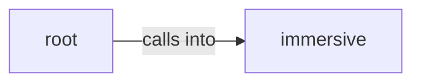

# immersive

immersive groups 12 files (py) around unit_vector_poly_args, angular_constants, ylm_from_table, radial_norm, radial_function. Immersive viewer entry: window, event loop, cinematic tour director.

## immersive (2.1)

immersive groups 10 files (py) around unit_vector_poly_args, angular_constants, ylm_from_table, radial_norm, radial_function. Immersive viewer entry: window, event loop, cinematic tour director.

## root (2.2)

root groups 2 files (py) around test_angular_table_matches_scipy, test_radial_functions_are_normalised, test_energy_levels, test_presets_are_normalised_and_fit_shader, test_overlap_limits. Q2C immersive viewer: GPU volumetric orbitals, H2 bonds, Bloch sphere and entanglement.

**Files**:

- immersive/__init__.py
- immersive/app.py
- immersive/backend.py
- immersive/glkit.py
- immersive/hud.py
- immersive/physics.py
- immersive/postfx.py
- immersive/scenes.py
- immersive/shaders.py
- immersive/spin.py
- qc_immersive.py
- test_immersive.py
