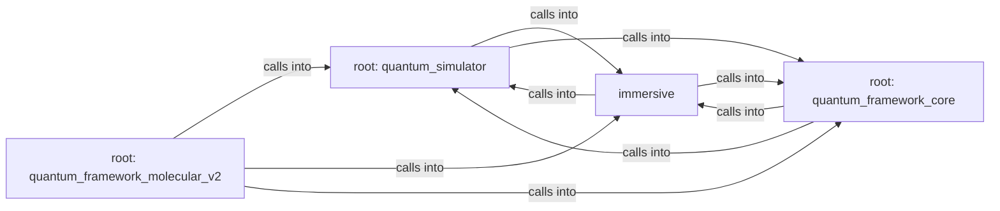

## Details

Static architecture map of 43 files (py, sh) in 4 components: root: quantum_simulator, immersive, root: quantum_framework_core, root: quantum_framework_molecular_v2. Structure is extracted statically without LLM calls; component prose may be enriched locally.

### root: quantum_simulator (1)

root: quantum_simulator groups 16 files (py) around _make_logger, SpectralLayer, __init__, forward, HamiltonianBackboneNet. Advanced Quantum Experiments - Extension Pack

**Related Classes/Methods**:

- <a href="../quantum_framework_physics.py#L46-L65">quantum_framework_physics.py::_make_logger</a>
- <a href="../quantum_framework_physics.py#L66-L85">quantum_framework_physics.py::SpectralLayer</a>
- <a href="../quantum_framework_physics.py#L86-L97">quantum_framework_physics.py::__init__</a>
- <a href="../quantum_framework_physics.py#L98-L132">quantum_framework_physics.py::forward</a>
- <a href="../quantum_framework_physics.py#L133-L135">quantum_framework_physics.py::HamiltonianBackboneNet</a>
- <a href="../quantum_framework_physics.py#L136-L144">quantum_framework_physics.py::__init__</a>
- <a href="../quantum_framework_physics.py#L145-L156">quantum_framework_physics.py::forward</a>
- <a href="../quantum_framework_physics.py#L157-L159">quantum_framework_physics.py::SchrodingerSpectralNet</a>

### immersive (2)

immersive groups 12 files (py) around unit_vector_poly_args, angular_constants, ylm_from_table, radial_norm, radial_function. Immersive viewer entry: window, event loop, cinematic tour director.

**Related Classes/Methods**:

- <a href="../immersive/physics.py#L32-L36">immersive/physics.py::unit_vector_poly_args</a>
- <a href="../immersive/physics.py#L37-L47">immersive/physics.py::angular_constants</a>
- <a href="../immersive/physics.py#L48-L58">immersive/physics.py::ylm_from_table</a>
- <a href="../immersive/physics.py#L59-L62">immersive/physics.py::radial_norm</a>
- <a href="../immersive/physics.py#L63-L68">immersive/physics.py::radial_function</a>
- <a href="../immersive/physics.py#L69-L74">immersive/physics.py::radial_table</a>
- <a href="../immersive/physics.py#L75-L79">immersive/physics.py::view_radius</a>
- <a href="../immersive/physics.py#L80-L83">immersive/physics.py::energy_ev</a>

### root: quantum_framework_core (3)

root: quantum_framework_core groups 10 files (py) around _make_logger, HilbertPhase, FrameworkConfig, __post_init__, from_toml. Hydrogen Orbital Visualizer

**Related Classes/Methods**:

- <a href="../quantum_framework_core.py#L59-L74">quantum_framework_core.py::_make_logger</a>
- <a href="../quantum_framework_core.py#L75-L84">quantum_framework_core.py::HilbertPhase</a>
- <a href="../quantum_framework_core.py#L85-L152">quantum_framework_core.py::FrameworkConfig</a>
- <a href="../quantum_framework_core.py#L153-L160">quantum_framework_core.py::__post_init__</a>
- <a href="../quantum_framework_core.py#L161-L232">quantum_framework_core.py::from_toml</a>
- <a href="../quantum_framework_core.py#L233-L244">quantum_framework_core.py::AtomData</a>
- <a href="../quantum_framework_core.py#L245-L264">quantum_framework_core.py::MoleculeData</a>
- <a href="../quantum_framework_core.py#L265-L273">quantum_framework_core.py::OrbitalData</a>

### root: quantum_framework_molecular_v2 (4)

root: quantum_framework_molecular_v2 groups 2 files (py) around _make_logger, MolecularConfig, from_toml, MoleculeData, MoleculeBuilder. Quantum Framework Demo - Production Version

**Related Classes/Methods**:

- <a href="../quantum_framework_molecular_v2.py#L76-L95">quantum_framework_molecular_v2.py::_make_logger</a>
- <a href="../quantum_framework_molecular_v2.py#L96-L131">quantum_framework_molecular_v2.py::MolecularConfig</a>
- <a href="../quantum_framework_molecular_v2.py#L132-L172">quantum_framework_molecular_v2.py::from_toml</a>
- <a href="../quantum_framework_molecular_v2.py#L173-L200">quantum_framework_molecular_v2.py::MoleculeData</a>
- <a href="../quantum_framework_molecular_v2.py#L201-L208">quantum_framework_molecular_v2.py::MoleculeBuilder</a>
- <a href="../quantum_framework_molecular_v2.py#L209-L289">quantum_framework_molecular_v2.py::build</a>
- <a href="../quantum_framework_molecular_v2.py#L290-L301">quantum_framework_molecular_v2.py::_run_pyscf_direct</a>
- <a href="../quantum_framework_molecular_v2.py#L302-L324">quantum_framework_molecular_v2.py::PseudoMolData</a>
